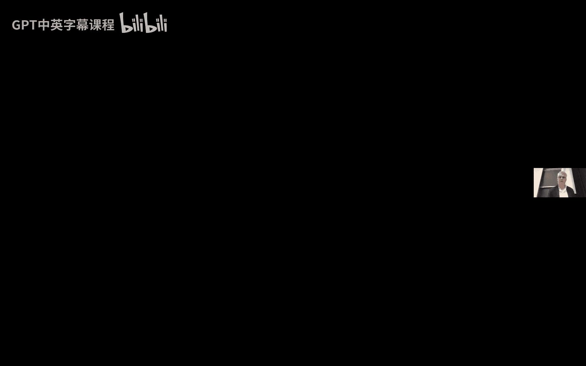
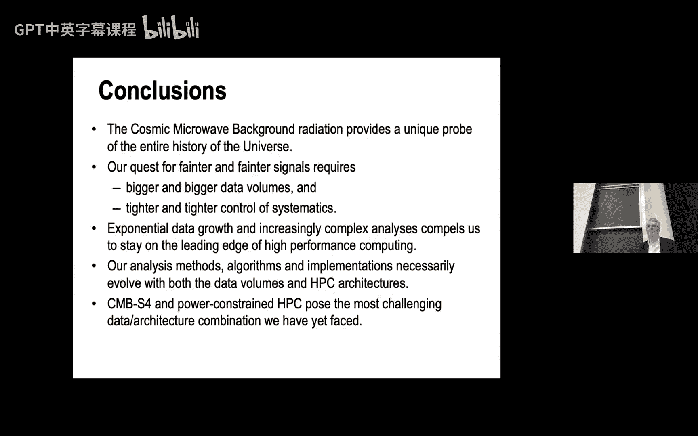

# 【并行计算 CS267 2022】伯克利—中英字幕 p30 CS267 Spr22 Lecture 21 Borrill -BV1PS421978D_p30-

嗯。嗯。

嗯。Welcome， everybody。う。Not turned on。 Can you turn it on。不。唱。不。Welcome everybody。

 it's a pleasure to welcome you here to our guest lecture by Julian Burrell who's a senior scientist at Lawrence Berkeley Lab in the physicsy division and he's won many awards for his work in cosmology and looking at cosmic microwave background radiation we'll hear more about that today and I should mention there's already been two Nobel Prizes given out for work in cosmic microwave background radiation。

 most recently our own George Smoot in 2006 so we'll see if there are any more forthcoming。Yeah。

Thank you very much。10th 50th the year I've been giving this lecture and it's always a great great fun to give really enjoy this one so thank you again for the invitation I'm going to talk about the big bang about big data and about big iron and it's an area of convergence that I've been working on at Berkeley since 1997 now through many generations of experiment it's been a great journey that I want to tell you some about I also wanted to really point out that this is a convergence of work。

😊，In computer science， computational science and and domain science in multiple domains in physics。

 astrophysics， cosmology and astronomy， so a lot of people have contributed to this work and I。

Really need to credit them。Okay， now its stopped working。Yeah。嗯。我でね。诶。那说。Okay。

 some reason this is no longer working。So I should start any lect in cosmology by this wonderful quote from Lelandow and we'll come back to a beautiful example of this later。

 but cosmologists are often in error， but never in doubt。😊。

So I wanted to start with a brief history of cosmology to give you a background for what we're doing and why we're doing it。

And cosmology is an extraordinarily young science， it really starts in 1916 with general relativity。

With Einstein's extraordinary understanding and realization that space and matter are intimately connected and that space tells matter how to move and that matter tells space how to bend and this is all captured in this beautiful equation gene unu because8 pi GT un where the left hand side describes space and the righthand side describes matter and of course the devil is in the details of this these are very complex tenses in any real world but it's an exquisitely elegant equation to describe the entire universe and the fact that it describes the entire universe is what triggers。

😊，Cosmology as a science。The challenge with this equation is that。If you study interview。

 if you try and solve it， implicitly space must be dynamic， the universe must be dynamic。

 and in 1916 everyone knew that the universe was static。So that。

To be something wrong with this equation in Einstein's mind。

 and so he added an additional term Ladagene muu precisely to stabilize and introduce stasis into the universe。

Even though the result is a completely unstable equilibrium。Any tiny。

 tiny variation away from this would cause dynamics to reemerge。So he adds this term。

 and this is now our equation of the universe。We'll come back to Lambda。1929。

 Edwin Hubble using the biggest telescope available at the time。

 the Mount Wilson 100 inch telescope measured nearby galaxies and he measured。

How fast they were moving？From the redshift of the the absorption lines in their spectra。

 and he measured their distance by using something called sd variables。

 which were stars of known absolute brightness。And if you know the absolute brightness of something and you know the apparent brightness of it。

 you can work out the distance。So he looked at these velocities and distances and discovered that for all these nearby galaxies。

 the velocity was proportional to the distance， so the further away something was the faster it was moving。

And these weren't the local motions of the galaxies with respect to each other。

 this was a global motion in space and as it turned out of space。😊。

And so the conclusion was that space itself is expanding and therefore the further away you are。

 as the space is expanding between you and that point。

 the bigger the apparent velocity through that space。So it turns out the universe is dynamic。

 Einstein could have predicted this from Pe as a thought experiment from general relativity and he curses himself and calls it his biggest blunder。

So now we have an expanding universe and so we now want to ask questions about where did the universe come from。

 where is it going to in this dynamic environment？So the two two main theories emerge， one。

 the steady state theory， which said that the universe is expanding。

 but new matter is being spontaneously created to fill the expanding space。

So that overall the density of the universe stayed constant。

 so essentially the universe is as it is always has been always will be， it's the same。

 it's expanding that it's filling in the space so we can treat it as is completely unchanging。😊。

phenomenonmon。The counterpoint to that was have the big bang theory。Which said that the。

So we now have an expanding dynamic universe and because of this because now we're not creating a matter。

 the expansion is also cooling and rareifying the universe。

 so the universe is getting less and less and less dense， it's getting colder， it's expanding。

In fact， the name the Big Bang's theory was coined by one of the proponents as a steady state theory as a kind of pejorative。

 oh， so you think the universe begins in some big bang and it's just stuck as the name。And of course。

 a big bang kind of universe with a beginning with a single explosive event at the outset is much more inconsistent with the teachings of many theologies。

 so in fact in 1951 the pope blessed the big bang theory and said this was the correct theory。

As scientists， we would like a little more evidence than that。And in fact。

 there's a key piece of evidence for a big bang theory。

 something called the Cosmicma quote background， and it was realized in 1948 that if you start with a big bang and you have an expanding cooling universe。

At the beginning of the universe， you're above the ionization temperature of hydrogen。

 and you will at some point in the history of the universe pass through that critical temperature。

 about 3000 Kelvin。And at that point， the protons and the three electrons can combine and form hydrogen atoms。

And there's nothing left for the photons to bounce off of。 So earlier than that time。

 the photons are bouncing off all of the free electrons， interacting very strongly。

 And then suddenly， all the electrons get swept up by the protons into hydrogen atoms。

 And there's nothing left to bounce off in the photons， just free stream。

And Alfred and Herman then predicted in 1948， that this should believe a uniform。

Glow in the universe， whichever direction you looked in。

 you would see the same glow and it should be at about five Kelvin based on the expansion of the universe from the time when it 3000 Kelvin to today。

And this is called the cosmic microwave background， and it's cosmic because it fills all of space。😡。

It's microwave because the stretching， the expansion of the universe has stretched the wavelengths of the photons into microwave frequencies today。

And it's background because these are the primordial photons behind all of the other things in the universe。

 the stars and the galaxies and the clusters and the super clusters。

 so in some sense this is the wallpaper of the universe and the rest of astronomers and astrophysicists are looking for the furniture。

And in this schematic here， you have to think about cosmology is an interesting science for stretching your brain to think in new ways。

😊，We are looking out in space， which means we're looking back in time so you can imagine at any particular distance which is equivalent to some particular epoch there's a shell around you that corresponds to the universe at that particular time if you look back far enough you see the big bang and so we can think of the big bang as a shell around us。

Of。Points of the distance of the age of the universe away in light travel time。

So you can see at this outset， this big bang beginning of time and space and everything。

 the photons are going through this red region， very， very hot ironized。

 and so the photons are bouncing off the electrons going through that outermost shell。Then。

As the universe has cool down we hit what we call the last scattering surface。

 the point where the temperature dropped below the ionization temperature of hydrogen and the photons stopped bouncing off things and so they free stream in whatever direction they were last moving in。

And we observe those that happen to be scattered towards us today。

 so we're in the here and now this doesn't imply that we have any special place in the universe。

 any observer anywhere in the universe can construct a diagram like this and they will see their realization of the universe。

1964， Penzius and Wilson are using this big radio telescope at Bell Labs。

 radio astronomy has emerged as an exciting new science。

 and so they are trying to look at the radio sky， and they find this puzzling signal that's uniform in all directions。

 they can't get rid of it， whatever they do， they do all the tests to see whether it's a systematic effect。

 they compare whether it's different in night or day， summer or winter， Tuesdays or Fridays。

 they decide all of the different instrumental things it could be， nothing。Whatever they do。

 they can't get rid of this signal， they even go to the extent of there were pigeons roosing in this telescope。

They even go to the extent of scrubbing out the inside to remove what they delicately call a white dieelectric substance。

None of that works， they can't get rid of this signal down the road of Princeton。

 Dicky Peeble's role and Wilkinson are trying to build exactly this experiment in order to detect the cosmic microwave background。

And Pen and Wilson hear about this， they've phone up Dicky， they're in the office。

Dicky gets off the phone and turns to his collaboration and says， boysy， we've been scooped。So。

The experiment that the theorists were planning to build to discover this。

 someone else had done accidentally and Penzier and Wilson will win the Nobel Prize for their accident and Dicki Peeble's role in Wilkinson get the runners up prize。

Now in this measurement， the uniformity， the universality of this radiation field really stalls the deathne for the steady state theory。

 there's convincing， no reasonable explanation in a steady state theory for this microwave background radiation。

😊，Now we've discovered the CMB， now we want to measure it in greater and greater and greater precision the great thing about the CMB cos background is that these are the photons that were created in the big bang。

😊，And traveled to us today they have seen the entire history of the universe and everything that has happened in the universe has left its imprint on them so in theory we can we can answer any question we can track the entire history of the universe through these photons so people are making more and more detailed measurements。

😊，And as they keep pushing to greater and greater and greater sensitivity。😊。

The CMB continues to be completely uniform if whatever direction you look in it's the same temperature and this is very confusing because。

😡，For any points on the sky more than about a degree apart。

They would have been out of causal contact with each other。At the time of last scattering。

There hadn't been time in the history of the universe about 300。

000 years till that last scattering point， that means anything more any points more than 300。

000 light years apart can have had no exchange of information。

So how come they're all at the same temperature this violates causality？

Until Alan Goth came along and proposed this period of exponential expansion where you take a tiny。

 tiny tiny region and expand it by 50 or 60 orders of magnitude so that this tiny causal region in the very early universe and this is you know this is the scale here。

 the point of inflation is somewhere around 10 to the minus 35 seconds after the big bang。

So you take a tiny region， a tiny， tiny， tiny fraction of time after the big Bang。

Exponentciialally expand it so that it is big enough that the entire visible universe today resides in one of these causally connected regions and now you do have causality all of those regions were firmly in thermal equilibrium at the time and so you expand the whole region and you've got a causally connected universe and it also solves a number of other problems including why the universe is so flat and why we don't see magnetic monopoles。

The next problem is that the uniformity has to stop somewhere。

 we see structure in the universe if the universe had started out perfectly smooth。

Then it would continue to be perfectly smooth throughout all of its history。But it isn't。

 we see planets and solar systems and galaxies and clusters of galaxies and super clusters and the cosmic web and all this structure。

 it has to have come from somewhere it has to have been seeded somehow。😊，And。

The CMB should carry an imprint。Of these perturbations of these fluctuations。

 of these differences in density， that were the seeds around which matter would coalesce and form all the structure。

But no one can find it。Kept looking， kept looking， kept looking and every result came back。

 it's uniform。Until after about 20 years of searching， the Kobe satellite finally detected。

Some fluctuations in the micro background。This was this was a satellite mission that had three experiments on board。

 one of them was to measure the fluctuations of the microwave background another one was to measure。

The spectrum。 and it turned out that the CMB had a perfect black body spectrum。

 exactly as you would expect for。For prime audio photons。And so George Smot。

 who ran the experiment that measured fluctuations and John Mather。

 who ran the experiment that measured the spectrum。

 shared the second Nobel Prize in CMB Phyic in 2026。

And George actually has the rare distinction of being the only person in history to have both a Nobel Prize and be the million dollar winner on IU Mar and a fifth grade。

Now it was a little bit of a fix because one of the questions they asked him is what is the capital of Sweden？

So now we have this great cosmology， we've seen some fluctuations in the microwave background。

 things were all hanging together and so the model of cosmology in the late 90s，😊。

Said that if you knew the overall density of the universe。

 you could predict it past present in future。And the idea was that if you had exactly the right density。

 then you have this expansion going on， but you have all the mass in the universe。

 so if you have enough density， the expansion would eventually asymptotically come to zero。

And so the universe would come to a halt， but only at time infinity。

And in that model in that with that parameter， you would have a geometrically flat universe。

 you put in geometry angles of a triangle add up to 180 degrees if you had less than that density。

Then there wasn't enough matter to slow the expansion down and the expansion just goes on forever。

And in that model， you have an open universe。With negative curvature。

If you have more than that amount of matter， if you have higher density than that。

Then the expansion eventually comes to zero in a finite amount of time and starts collapsing again。

And in that case， you have a closed universe with positive curvature so this is just。

How light travels， whether it goes in， whether the light is a。

I guess the angles of the triangle of these you want to think about if you think about the angles of a triangle on the surface of a globe。

 from the North pole down to the equator， across the equator back up to the North Po。

 you can have three right angles there。So because it's a curved surface。

 so the curvature of the universe。Works similarly。So the question is which of these three cases do we live in so people are making more and more precise measurements of this and。

🎼Another local luminary saw Pemeter and others were using supernovae as standard candles as things whose intrinsic brightness is known so if you know their intrinsic brightness。

 you measure their。A apparent of brightness， you can tell how far away they are。

 you can use their redshifts， know how fast they're moving。

 and you can kind of use these as beacons scattered throughout the universe to understand the expansion history。

And they make these measurements， huge numbers of them， much more detailed。

 they came up with very clever ways of finding supernovae and tracking them。

And it turned out that much to everyone's sugaring。The universe wasn't even。

The expansion wasn't even slowing down。So we had these three cases of whether it was going to。

Carry on expanding at a slower rate and never come to zero。

 carry on expanding at a slower rate can come to zero at time infinity or carry on expanding。

 but slowing down and come to stop and then start contracting again。None of the above。

The the expansion of the universe is accelerating。And this is where we go back to Lelandow and his wonderful cosmologists are often in error。

 but never in doubt。😊，And throwing that into a slightly different light。

 it was a fantastic example of science as belief in a method rather than a result。

 because almost overnight， the entire cosmology community went from saying cosmologies like this to cosmologys like this。

😊，And it was fine to do that because we had new data that told us that our previous idea was wrong。

And much better to embrace that new data and acknowledge that you were previously incorrect。

than to hang on to the old disproven notion now of course that does mean that you have to remember that when you say cosmology is like this。

 then tomorrow it could be like this depending on the data so don't hang your hat too heavily on a single result。

 but the trust is in the method。And so this acceleration。

 not only can we find the universe accelerating， but the acceleration can be explained by a particular value of that cosmological constant that Einstein put called his greatest blunder having put it into general relativity if you flip the sign of it and instead of using it to make the universe static。

 you can flip the sign and you can make，😊，The accelerate the expansion of the universe accelerate。

And so Saul Paulmoto and Re Schmidt who ran a similar experiment。

 shared the 2011 Nobel Prize in physics for the accelerating universe。So I'm 2000。

We come to what's become known as the concordance cosmology。

 so the booming and maximum balloon experiments to measure the micro backgrounds。

 which are the experiments that brought me to Berkeley to start working on this。

They each measured patches of the sky， measured the geometry of the universe and showed that the universe was indeed flat。

And now previously we said that if we knew the density， we knew everything。

 but now we've broken that model and we needed to know the relative amounts of that density。

in the cosmological constant and in matter， because they have different effect on the geometry and the dynamics we've decoupled geometry and dynamics。

就。The CMB fluctuations tell you the geometry of the universe。

 which is driven by the sum of these two terms。And the supernova measurements tell you the dynamics of the universe。

 which is driven by their difference。The cosmological constant pushes and gravity pulls。

 but both of them have mass energy and therefore they both affect the geometry of the universe in the same way。

So by measuring these two things as is very often the case in cosmology we do much better than measuring any one of them alone because we break the degeneracy so you can see this yellow line。

 the yellow ellipse there is the s and over result that tells you that the difference in these two terms is a particular value and the blue line is the boomerang CMmb result that tells you the sum of these two is the same is a particular value you combine those two and you get this crossing point and it tells us that Einstein's biggest blunder makes up 70% of the universe。

About 25% in dark matter， no idea what that is and 5% in bars。

So the fantastic news is that we have quantified our ignorance。

 we know that we know nothing about 95% of the universe， but we know it's 95%。

So the big question then becomes and the focus of all of cosmology going forward is what and why is the dark universe？

Surely this must be giving us hints about。Fundamental physics at very。

 very high energies beyond the current standard model of physics。

 potentially about ways of unifying quantum field theory and gravity。

 the two great theories that each are exquisitely accurate but are both fundamentally incompatible with each other。

 surely cosmology is telling us something in this dark sector about what's going on there。

So now focusing on sort of the potted history of cosmology to date。CNB is， as I say， is this great。😊。

Sorts of information about the universe and we have three sort of things we can look at when we make comic micro background CMmb measurements。

There are the primordial ionisotropies， these are the fluctuations laid in very。

 very early in the universe depend on fundamental physics and cosmology。😊，And in a sense。

 treat the universe as the ultimate particle accelerator。

There are secondary anisotropies that come from that period where I said the photons are free streaming to the zero thoughter they are。

 but every so often one of them passes close by a cluster of galaxies and a cluster of galaxies is really。

 really massive and really， really hot。So the gravitational field of the cluster can bend the part of the photon and the hot plasma in the interlastta medium can up scattertter the photons give them more energy so we get these little perturbations that trace the distribution of matter in the universe so it's fantastic we now have a way of mapping the entire matter density field of the universe。

And finally， in order to make these observations， we typically go out and we observe a big chunk of the sky and exquisite sensitivity in multiple frequencies in millanmeter wave radiations。

😊，Radiation and so that gives us a millimeter wave legacy survey and so anything that emits in the microwaves and millimeter wave radiation。

 it's a contaminant for cosmologists。But it's the whole field of study for asteroid searches or people looking for planetet9 or people looking at the behavior of dust in the galaxy and the interaction of the magnetic fields。

 so there's a whole slew of extraordinary astronomy and astrophysics that's based on using CMD measurements just as a millimeter wave legacy survey。

So this is what the CM would look like for a single observer。

This is the CM temperature for a single observer， if there were nothing in the way。

 if he had no galaxies or any other any of the furniture， if you just could see the wallpaper。

 you would see a realization， something like this， lots of hot and cold spots of different sizes and the characteristic statistics of those are what tell you about the fundamentals of fundamental physical and cosmology。

Because。As I said， any single observer will see the micro background。

 but the realization that they happen to see will depend on the photons that happened to be scattered towards them。

 what the fluctuations were on their last scattering surface。

 so this is a single realization of a Gaussian random process as seen by a single observer。

So if we want to put。Come up with a theory of cosmology and make predictions。

 we are never going to predict that particular realization。

What we need is a statistical characterization of this map that would be common to all observers。😊。

And it turns out that the spheric harmonics are a perfect decomposition of this。

 if it's arous random Gaussian field that they the spherical harmonics contain all of the information。

 so basically what we're going to look for is how much power is there on different angular scales。

 how correlated are points on the sky separated by a particular angular scale？

And that gives us these angular power spectrum。The top one is the temperature and the second。

 the blue one is the E mode polarization and the green one is the B mode polarization and we've decomposed the polarization field into an electric and a magnetic equivalent。

By analogy with electromagnetism。So you can see we've got this this enormous structure in these curves。

 none of it's accidental， everything is telling us something about the history of the universe。

So for instance， the location of this first bump tells us whether space is flat or curved。

This sequence of bump and the relative heights of them tell us about the fact that there is a harmonic sequence tells us about what generated the first density perturbations。

The relative heights of these two peaks tell us how much of the universe is in bars。

 this is where we get the 5% from。😊，The location of this first pump in the em mode spectrum tells us when the first stars formed。

😊，是的。This the nature of this particular sequence of bumps and wiggles tells us how many light relic particles there were。

These are particles that could go beyond the standard model and any additional degree of freedom in the early evolution of the hot dense universe will impact。

The nature of the positions and the heights of the bumps and wiggles。对。

This bump measures the mass of neutrinos in the universe now neutrinos were long thought to be massless and then when we couldn't find all the neutrinos that should have been coming from the sun。

 it eventually turned out that they must have a tiny， tiny tiny max。

And we're using the entire universe as a way of measuring that mass because individually neutrinos are extraordinarily light。

But on mass。There's a lot of them， they form a huge fraction and enough of a fraction of the universe to impact how high this particular bump is。

And finally， for our purposes， when did inflation happen？

And we can measure the energy scale and therefore the time of inflation by the height of one of these two bumps in the Bmod spectrum。

So the first Nobel Prize for CMB studies came from just measuring expanding the CMB in the first place。

 measuring the monopole。The second one came from measuring the existence of fluctuations on these very large angular scales。

As it turned out。And the third one will come from measuring when inflation happened。

 in fact there's already been one group that tried to claim that they found it and can we have the Nobel Prize please。

 unfortunately it turned out they were mistaken， but it's widely seen as that's on the cards。

So the challenge， well， to measure the monopole that's got an amplitudept of about one Kelvin。

 it's actually 3。 sum， but that was measured in '68 by Penzias and Wilson。

 great to tick that one off。The anisotropy， that's about one part intent of the five measured in 1990 by Kobe。

 great。A series of harmonic peaks that tells you that inflation is the source of density perturbations that was measured by experiments like boomerang and Maxima in the 2000s。

Measuring that reization bump， the e mode spectrum by Daisy in 2005。

 this point we down to one part in of seven。Measuring that lensing signal。

 one part intent1 of the nine that was measured in about 2015 by the South Pole Telescope and polar bear experiments。

But this gravitational wave signal is less than one part in 10 to the nine and we've been pushing down。

Probably less than 10 to the 10， 10 to the 11， these are tiny， tiny， tiny， tiny signals。

And so they're the kind of the holy grail of what we're searching for now， but we don't expect well。

 at this point， obviously post 2020， but I could probably change that to a 30 without too much argument。

So how do we make these observations？So we're looking for these one part in 10 to the。5， six seven。

 eight nine， 1011， 12 fluctuations on a background that's only three Kelvin to begin with so incredibly cold feel and now tiny。

 tiny tiny fluctuations on it。So we have to field very， very large numbers of very， very sensitive。

 very， very cold detectors。And we can do that either by scanning part of the sky from a high dry place on earth。

or we can send a balloon up or we can send a satellite up and this last image is the plank satellite and what you'll have seen as it goes through was it scanned the sky and then that sky turned into an optical image and one of the things you may have noticed is that in the optical there was a dark band across the middle of the sky that was the Mily white that was the dust in the Mily Way that obscures visible light。

But it's very， very bright in the microwaves and so this is a real problem for us there's a band across the middle of the sky where the galaxy is getting in the way of seeing the big bang。

嗯。So now I want to talk about the data analysis。And how we actually take these data sets and turn them into science。

So we've basically got two big challenges， we have the statistical uncertainty in the data and we have systematic effects。

And basically， at each step， we take the data set， we address the systematic effects。

that are most that are most easily addressed in that domain and we compress and then we address a systematic effect in the next domain that compress and the next domain and compress。

And so we go from stream of time samples。to maps， pixels life maps on the sky to these angular power spectral modes。

 and at each stage we have to clean the data in the frame we're in and then compress。So for example。

 here is the the。Time stream data， the green at the top is the dirty data。

 lots of big bumps and wiggles due to phenomena we understand features about the spacecraft。

 we clean all those out， we degitch it， cosmic rays， hit the detectors， they have effects。

And we end up with this。Data this blue data， which is on a much much more compressed axis。

 this is our clean data， we can now turn that into a map。And in fact， we turn it into many maps。😊。

These are the six maps from the plank's satellite， six of the nine frequencies we observed that。

 and you can use those then to use the fact that the foregrounds。

Vary with frequency differently than the cmb and use that to separate help the cmb from the foregrounds that's why we observe at many frequencies until we get that nice clean we now removed the foregrounds as a systematic we get this nice clean map of the cmb。

And now we can take its angular power spectrum。And you'll see the big thing here is on the bottom。😡。

The cleaning here is that we can remove this secondary bump big。

The small angular scale to the right hand the neutrino mass bump this is due to lensing of the em modes into B modes that's obscuring the primordial beam mode signal that we want to see if we can measure that exact precisely enough we can remove it and that's the final systematic to remove and uncover these。

Priordial B mode signals。The challenge with this is that as we go through this sequence of cleaning and compression and cleaning and compression and cleaning and compression。

 we not only need to track the data， but we need to track the covariance of the data so that we understand the correlations and the uncertainties and how they are propagating down this data analysis chain。

The other thing we need to do just to mention is data synthesis。

 we need to generate synthetic data sets， mock data sets， and we do that for three reasons。

 firstly we use those to design our experiments。Secondly。

 we use them to validate our analysis pipelines。And finally， as we'll come to further on。

 we increasingly rely on Monte Carlo methods for uncertainty quantification precisely because the covariant matrices have become too big to calculate and manipulate。

 so we're reduced to Monte Carlo methods。So here's the first case I want to talk about the boomerang experiment。

 balloonborn experiment float flew from McMurdo station on the edge of Antarctica。

 we launched it there's a circumpolar wind， two weeks later the balloon has gone all the way around Antarctica drops back。

 we landed 30 kilometers from the launch site it was a beautiful， beautiful mission。

10 days at 35 kilometers above all of the atmosphere that's going to get in the way and we measure temperature only in four frequencies。

I would note that this was an exceptionally good flight， the following year we flew again。

 we got a third of the way around Antarctica and the wind stopped。And the balloon just hung there。

For weeks。Eventually， they had to drop it。It landed in the Russian sector。

 the only thing within a thousand miles was a statue of Lenin。

And we had to fly in and recover the payload so that was a less successful flight。

 but this one worked beautifully。😊，So a quick review the math is actually very straightforward if we're in Gaussianology。

We model the data as a stationary Gaussian noise plus the sky signal。

So the data as a function of time the of t is just noise plus the signal at a particular pixel on the sky that you happen to be looking at at that time。

 so this P is the pointing matrix that tells you at time T I was looking at pixel P。

And we can estimate the noise correlations， where are so noise dominated。

 we can use the raw time stream as a way of estimating the noise properties。

And then we can analytically maximize the likelihood of the map given the data。😊。

And its noise covariance matrix， we can construct the pixel pixel noise covariance matrix。

And then we can iteratively maximize for the most likely angular power spectrum given the map and its noise properties so we've managed to trace。

😊，The data and the covariance matrix through our calculation and do analytic well or at least iterative solutions to these very straightforward linear algebra equations。

So we're dominated by dense pixel the main matrix operations， this is great。

 we know how to do dense linear your algebra really， really， really fast onsuit computers。😊。

So I wrote the MACap software which was built on Scalaract toolss， lots of level three Blas。

 everything scales as the cube the number of pixels。

 and at this point we were running on a 900 core C T3E and we got 90% of the theoretical peak performance because it was entirely dominated by these level  three bs。

Jim and friends have spent years optimizing beautifully for us。And this in turn。

 so you can see the map in the top， the little black dot in the bottom of corner there is about the size of the full moon。

 so you can see the characteristic spot size is around the degree and that was the flatness measure。

It was the angular spectrum， power spectrum came out of it。

 and again you can see this peak around the degree scale。And in fact。

 this this proved so successful that it ended up being turned into a benchmarking tool for supercomputers and nurse started using it in their procurement suites to show to demonstrate whether or。

A computer could really achieve their desired speed on real world problems。

And this was a big enough deal， we measured the geometry of the universe that we very nicely got the front cover of nature。

 happened to be a week before my performance review to say whether I would carry on from being postdoc to being permanent staff so the answer to what have you done for me lately was the front cover of nature。

And hence I'm here today。So then we moved on to the Planks satelliteate mission this was a European Space Agency mission that NASA was also involved in that was the video I showed earlier and the idea was to fly out to the second Lagrange point。

 nice thing about that is you sit the satellite with its heat shields and you can keep both the earth and constantly behind you and then as the Earth goes around the sun the L2 point gets dragged around and the satellite just gets dragged with it。

You have to do that because if any sunlight or reflected sunlight hit these detectors。

 it would flyry them， they are so sensitive。So in this case we spent four years at the second Larrange point and we measured both temperature and polarization now at nine frequencies。

 so we've gone from temperature only to temperature plus polarization from fourth frequencies to nine frequencies and from a small patch of the sky to the whole sky。

And that's a problem。Our data volume starts creeping up on us。😡，And so he put all these factors in。

 we also were observing a much higher angular resolution， five art minutes instead of 20 a minutes。

This means that we go from having about 100，000 pixels on the sky to about a billion pixels on the sky。

And remember， our algorithms are scaling as the cube of the number of pixels。And so the operations。

Go from audit 10 to the 15， great we can run that on it create T3E and a day to audit 10 to the 27。

 oops it's going to take us the age of the universe to analyze the data。

So all of the science goals are driving us to more challenging computing。

And so we have to give up on exact methods。The algebra's simple， it's beautiful。

 it's well demonstrated， it's just too expensive。So for the mapmaking。

 we can no longer calculate the covariance matrix explicitly， that's okay。

 we can use PCG methods instead and we just solve a straightforward iterative solution through conjugate gradient。

For the power spectrum estimation， well now we've compressed our data。

 but we haven't carried the covariance matrix forward with it。

So now we've got to do something different， we can't do that next step in the way that we had previously。

So what we'll do is we'll use pseudopectral methods。

We'll take apheric so the challenge is that we're looking at a noisy inhomogeneously covered sky that often is covering only a fraction of the sky particularly start cutting the galaxy out so the sphericharonics are no longer a complete orthon normalmal basis in the way that we would like them to be let's ignore that let's just take a spherical harmonic transform anyway。

And then we'll use Monte Carlo methods to tell us what the transfer function is between the pseudo spectrumrum we get from our inhogeneous。

Partial sky。Map and a real map and a full map whether fonics are the ortho basisis。

And if we can calculate that transfer function on simulated data。

 then we can apply the inverse of the transfer function to our real data and get our real spectrum。

And now the dominant cost is no longer in these N cubed matrix operations。

 the number of pixels cubed， it's just in the number of Monte Carlos times the number of time samples。

Because we have to go back and generate synthetic time streams with all of the glitches。

 all of the features， all of the systematic effects。

 everything we know about the instrument in the sky in the time streams so that we get the same transfer function in the simulated data as the real data。

So now we're scaling no longer as a cuber than our pixels， but just linearly in time。

So now we have our algorithms have changed to a data synthesisesis piece。

That depends on pseudo random number generation and lots and lots and lots of pseudoran number generation。

So we really have to be careful not to inadvertently generate the same。

Sequence or sub sequenceequences of pseudoran numbers。

So some interesting tricks to manage there and then FFTs。And it's all down to the FFT。

For the mapping， again， we have the FFTs， we have sparse nature executive multiplies。

And we have the PCG again over the FFT and sparse matrix sector multiply and the idea here is that in order to go between the map and the pixel domain。

 we have this pointing matrix， the covariance matrix is well structured in the time domain so every time we want to do the equivalent of a noise weighting。

 we take the map， we map it back to the time stream。

 we apply the covariance in the time domain where it's straightforward and then we map back。对。Yeah。

So we now have this synthesis and reduction framework。

Where we're going to do some sky modeling and some mission modeling and use those to generate the synthetic sky。

 the synthetic instrument and the synthetic observation。

 apply all of those things through to generate the different components of the time stream signal。

 combine them all with the appropriate weights and store the time stream and then we'll take that time stream and we'll put it through all the cleaning steps that we did and then the map making steps and produce suites of maps and we'll do this。

Tens， hundreds， thousands， tens of thousands of times。So for the implementation。

The good news about linear algorithms is that they reduce the overall cost。

 the number of floating point operations that we need to do。

 the bad news is that we've now got nowhere to hide from the non calculationculation costs。

 so IO and communication costs start to really hit as hard。

So the first thing we did was was obviously to deal with the IO that's always a pain and so the big thing here was。

Historically what people have done was to generate simulation。

 write it out to disk and then read it back in and make a map out of it。

 so we glued the pieces together and to run the whole thing internally。

OnlyOnly writing the map at the end。And then when we're doing these Monte Carlos。

 there are common data between each of the Monte Carlo realization we can cache those and not have to read them in each time。

And the communication we optimize by firstly hybridizing to reduce the number of MPI tasks。

 which is normally a very big overhead and then optimizing what data gets communicated between every pair of calls really they only need to know about。

The pixels on the sky that they have in common。So here was our over several generations。

 so the data point here， this was in 2006， the N Seaborg machine。

 they doubled the size of the machine from about 3，000 nodes to about 6000 nodes。

The IBM version of MPI that had been written had a maximum number of MPI tasks of 1496。We had 6，000。

Nos now will cause at this point。So they wanted the IBM rewrote the MP to make the maximum number of tasks for 8192 I mean I guess they did have said somewhere and just globally replaced 496 to 8192 they wanted to code to test that this actually worked。

 they asked us to come in they gave us the whole machine and we were able to synthesize and map one frequency of the plan satellite mission using the old methods or using this method on this code on the whole system。

 so we didn't really have a scaling plot for this one because this was end that was as big as it got。

Then we moved on to the Franklin system and this is where we started really addressing a lot of the communication issues。

 so at this point this this calculation would have been。

Way too expensive to do if we'd had to write out all the day and read it back in。

 so we got rid of that piece of it。本那我。We're connected again。Great。Okay， sorry。

 so this one was just the simulation and then we would have had to turn around and read it back in and map it。

NoIt was the sum of the two， but yeah， this was before combining so this first step was to。

Get rid of the IO piece。And that obviously think。Brought us a significant reduction。

 this is a logarithmic scale in the time， so we've saved an order of magnitude in time by dropping the IO。

Unfortunately， when we look at scaling on this system now。Instead of。

We start getting a little bit faster but not nearly as much as you would expect as you double the number of calls and then we turn around and we throw more core at the problem and it goes slower and this is purely the MPI issue。

So then the next step was to change the communication protocol。

 only use message passing between nodes and use other communication forms on the node。

 really trim down the number of MP tasks。And you'll see that there are three lines here in this final version。

 I'll come back to why that is and what it implies in a moment。But it。You know， between the first。人你。

The last of these we've you know improved the performance by over two orders magnitudeitude。

 so major major。Improvement and exactly what was required。So。first plank results came out in 2013。

 we did these what we call full focal plane simulations of the entire mission。

 all the detectors across the entire satellite。Generators synthetic data including the foregrounds。

 the detector noise， the instrument model， everything we knew about it。

 and then we generated as many realizations as we could， we called one of them。

 the real data and the rest of them the Monte Carlo set and did all the analyses in that mode and validated that the pipelines worked。

And then could use that same Monte Carlo set to validate the real data。

We only got a thousand realizations in this case， we were aiming for 10。

000 to get 1% statistical uncertainties on the Monte Carlo set。

But it turned out that there were many more maps that the analysts were interested in we were thinking there' would be one map per frequency but in fact they wanted  a00 different data cuts for every frequency for every map we did to be able to do tests on systematics to be able to process the data in different ways。

 so we got this unexpected thousand fold increase in the number of maps required which reduced the multiplicity that we were able to obtain by an order of magnitude。

 so this was brought in a new challenge on the flight simulations。

Nice thing to get the front cover of the New York Times above the fold that's always the key and again this one came out the day of a DOE review。

So the what have you done for me lately was even more timely in that case。

So here was an example of the full focal plane 8 in 2015。

 and this shows one realization of the simulation set and the real data。

 and if you can tell which is which you're doing better than me。

So these are all the different frequencies。呃。So。Each block of six or two in the last case is a different frequency and we're looking at temperature and polarization。

And then in this case， we had optimized the code enough and found ways of doing multiple map makings on a single simulation and really sped things up and were' able to generate and also trim down the requirement from 1000 maps per realization to 100。

 and so we're able to generate the full 10，000 realization Monte Carlo。And this is 10。

000 realizations of the plank noise at each frequency。

This is exactly the kind of data set you need to be able to understand the statistics of your results and you can see the lack of uniformity in fact you can in particular and sort of top left and bottom right of each of these maps you can see places that are much quieter。

 much less noise than elsewhere in the map those are the poles of the scan so as the scan as we scan over the sky and rotate poles get covered every single scan whereas the equator only gets covered by those scan that happen to across it so we get much much lower noise of poles they become very interesting points to test system defect but that's the kind of thing that has to be captured in the covariants in understanding the data。

So we're now continuing the journey。You know， we know that。Inevitably。

 as we look for fainter and fainter signals and in particular as we go after this sort of holy grail energy scale of inflation。

Nine plus orders of magnitude down from the temperature signal that we started with。

We necessarily have to get large and large base sets our detectors at the limit of their sensitivity。

So the only way to get。Eyers of all the data sets in the CMB field over time。

 so we can go back to know Kobe in 1990 and trace it forwards。I plotted them up。😡，And。

Complete unexpectedly， but in some ways。It made sense after the effect， after the fact。

The scaling with time was exactly the same as Moore's law。In some ways。

 it's all about you know miniaturization and energy and energy efficiency and how densely you can pack transistors。

A lot of the same drivers。Lo drivers supported the CMmb data sets as Moore's law and so in this case we have the ground based experiments in red you have the balloon experiments in green。

 you have the satellite experiments in Can they're the one exception to that mo's or scaling and then taking the。

Flagship nurse supercomputer is a proxy for Moore's law， that's the dark blue。

And so you can see that。We are intending that we are following this Moore's law curve in our data volumes。

 given that our computational cost scales with the data volume。

 we are required to sit on the hairy edge of hyper computing just to keep up with our data。

So that brings us to CMBS4， this is the project that I've been working on since 2013 now。

And this is going to be sort of the ultimate ground based experiment。啊。

So the idea is to observe on both large and small scales from multiple high。

 dry sitess on the planet。And the current plan is that we will put 550。

000 detectors on the sky for seven years。The plank had 72 detectors。So we're going from 72 to 550。

000。That's a big data increase。We will do two surveys。

 one survey of 60% of the sky and another survey of 3% of the sky andll the 3% will be within the 60% or give us this nested survey。

Those address different science goals。But they require different places to observe from。

And we will observe at seven frequencies to be able to separate the micro background from foregrounds。

 but we can only observe in the narrow atmospheric windows that you can see in the microwave spectrum。

 so this is the atmospheric absorption。Across the spectrum and these are the windows we can observe in the microwave see radio astronomy does has a great time because there is essentially no absorption。

So the match below is the mean precipital water vapor across the globe。

And you can see there are basically four places you could look at going。One of them is Antarctica。

The South Pole is spectacularly， it's high， it's dry， it's dry because it's so cold。😡。

All the water aor just freezes out the atmosphere so that's a great place to observe from it's also not surprisingly the South pole is on the pole means the same sky is always visible。

😊，So if you want to take a small patch of the sky and just drill deep on it as deep as you can possibly go。

 the south Pole is the place to go， that patch of sky will always be visible。

 no rising and setting just goes round and around you。On the other hand。

 you can't observe that much of the sky from the south Pole because there's no rising and setting you're limited to that fraction of sky that's visible。

 so if you want to cover 60% of the sky you need to go somewhere closer to the equator。😊。

And there there are a couple of options。There is。Just a little bit of blue here。

That's the Aaca Desert in Chile。那们。This bit of blue here， that's the Tibetan plateau。啊。

The Tibetan Plateau turns out to be problematic for a number of reasons。

One of which is that the monsoon comes through。And even though it doesn't have a significant if you know。

 there's not a lot of rain there， it does significantly affect the water vapor and so you lose significant chunk of time to the monsoon。

 turns out that in the Atarma， there's also the alti Plano winter。

 which is actually in the southern hemisphere summer。

 but the moisture coming from the Amazon coming over the Andes gives you a period of the heaviest snow and water vapor is actually in the summer。

But these are two the Atacma and South Polo are two very well developed sites。

 lots of experiments already there， fantastic places to go to， challenging but spectacular。

 and so we're going to take advantage of this legacy and put telescopes at both of these sites。

We'll put。呃。Current plan is one large and 18 small telescopes at the South Pole and two large telescopes in Chile。

So。550，000 detectors play that spread over 21 telescopes at two sites and really take advantage of the best of all worlds。

So the data challenge is as we go from something like plank， something like CMS4。

 four different areas。In terms of the precision。We're going to have to deal with systematics that are much bigger space is great to observe from no atmosphere。

 no radio frequency interference。😊，Nothing it's just。400。

Um but wherere they have to deal with all the things you get on the ground。

 so atmosphere ground pickup and then the things you get in any case。

 you've got to deal with cross correlated noise， polarization modulation， the foregrounds。And we now。

 so it's not only that the systematics are going to be bigger on the ground。

 but we have to control until a much lower level to get these faint， think。

 faint faint signals So that's about1 thousand。🎼A factor of about1 thousand0 in the level of systematic control we're going to have to be able to implement。

We're going to have to push this threshold down by about a factor of 100 to get to these faint。

 faint faint signals。We've got about a factor of 1000 in the data volume。

And we've got about hundredth of the amount of power per fop。But we've been used to。

So you put all those factors together in a very。Crude and naive way。

 and we need about a factor of 10 to the 10 improvement in our computational efficiency。

So this is a non trivial task。So I just wanted to walk through a few quick examples of these。

So we're observing from the ground， we have to deal with the atmosphere， this is a real problem。

It's large correlated， time sensitive， time dependent， unpredictable， you know。

 the foreground when we wanted to move galactic foregrounds， well at least we know where they are。

 they're in the same place。all the time the atmosphere coming over us it's going to depend on the water vapor。

 it's going to depend on the rate at which the water vapor is changing。

 it's going to depend on the wind speed， there are all these factors， it's weather。And so bizarrely。

 we have had to include essentially doing weather simulations into our cosmology analysis。

And so in particular， we have to validate and verify that our design will work and that we've optimized it to deal with the weather。

 which means being able to simulate the weather。So in this case we've developed a three step algorithm。

 so first of all， we calculate for if we。Observe for intervals of maybe a couple of hours and then go off and recalibrate the detectors because everything drifts。

🎼So for that couple of hours， we developed the volume of atmosphere that is going to sweep over the telescope as it scans backwards and forwards and the wind blows。

😊，SoThat gives you a bounding box。Simulate the atmosphere in that box with the full correlation structure。

 the cmovoro spectra of atmospheric fluctuations。Includinging turbulence。

And then as we stimulate this data， we're observing backwards and forwards and so for every single observation to align integral through the atmosphere at。

😊，Where we are in that box at that time for that one particular sector。

So do that for every single time sample that we generate。

So that's a pretty intensive computation and here's a nice example of the bounding box and you can see the atmosphere drifting overhead。

 this is what they're looking through。In terms of residual systematics。

 I'll come back to this example。Aarch 2014， the basicceepp team。

Held the press conference and announced that they had measured the energy scale of inflation。

 they detected all kinds of systematicic effects have been accounted for。Butt。😡。

They were only observing at one frequency。So they had no way of discriminating between E foregrounds and the CMB。

So they picked the quietest patch of the sky that anyone knew about with the lowest foregrounds and observed there。

And unfortunately it turned out that that wasn't low enough and that the Plank satellite mission。

 which covered the whole sky， showed that there is nowhere in the sky where you are free of galactic foreground emission。

To the degree needed to measure the spin signal。So unfortunately， the claim that they made。

 which was this bump here。This was their measurement。Was dust。And we have the data volume issue。Um。

 it's an interesting trade off between whether you work with satellites or ground based and a balloon experiments。

嗯。The great thing about satellites is the environment is much more stable， much more controlled。

 no atmosphere， no ground pickup， your outing space， it's cold。

 you can you have extra degrees of freedom to how you scan the sky。

 you're not constrained to the motion of the earth。And。

Necessarily satellite missions have much higher hardware quality。

 that's why the san line doesn't have the same scaling。

Because it takes twice a long to run to get a satellite mission into the air because everything has to be checked and double checked and triple checked。

The cons for satellite missions is that they're very expensive。

You have limit to the weight you can put into space and in particular the size。

 we would like a big mirror， but satellite fairings typically only hold medium size mirrors。

Unless you're going to have something as spectacular as JWST where the whole thing unfolds and it's put together。

呃。And if something goes wrong。And your satellite is at the Ltune Le Grandze point。You're in trouble。

There are limits to what you can have graduate students do。

 cleaning pigeon poop powder or radio telescope， sure， going  to 22 to fix the detectors。

 not happening。So。This has always been the trade off。😡。

And one of the interesting things is we're now introducing another feature in this trade off。

 which is the data volume。And the computational tractability of doing the analysis。

Because the satellite missions don't need as many detectors because they don't have to integrate down the atmosphere。

You can see that at the same epoch。Satellite missions are orders of magnitude。Smaller data states。

And the great thing about that is that it means that you can do more precise simulations。

And you can do more of them。So you have better control systematics。

 you have better control statistics。And this was very clear in doing the plane analysis。

Compared to the kinds of ground based and balloon experiments that were going on simultaneously。

we were able to do a 10，000 realization Monte Carlo set。

Ground based experiments were boasting when they got 100 realization。

So it really makes a huge difference and that control of systematics and statistics is what it's all about particularly when we get to these very。

 very， very faint signals。嗯。And then the final piece。And in some ways， the most challenging piece。

Is the evolution of high performance computing architectures and I'm sure you've discussed a lot about this in the course so far。

 we're at the pain point of this。呃。🤢，Obviously， we're now in an epocra power contrain suit computing。

We can't just increase the clock speed and keep up with Moores law。

 there just isn't the power in the world to do that。

So we need to go to low energy processing capacity and capability。About10 years ago。

 there were a couple of approaches that were emerging， the MEco and the GPU。

And the interesting thing as a domain scientist is that we have no choice in this。

We work at supercomputer centers。We have to use whatever architecture they put on the floor。

The supercomputer self centers themselves don't have much choice in it high performance computing is a tiny。

 tiny， tiny tiny infinite test a small part。😊，Of the computing economy。So again。

 the HC centers have to do what the vendor does。Have to use whatever the vendors are going to make available。

So。We're two steps down from this out of control。And so in 2009， NurRS made the decision。

 GPU many called。A put a mini core C XV6 system on the floor using the ADopron calls。

And then when it's time to refresh， they replaced that in 2015 via a Cxc40 using the Intel Zion Phi cords。

So here's an example for nurse hopper system， 24 calls per node。嗯。63， 84 nodes so we get into very。

 very， very large degrees of parallelism。And the question is when you have this number of nodes。

 in this case there are two sockets per node， two pneummen nodes per socket and six cores perneummen node。

 so now we've got 24 cores and four memory banks。And all kinds of internal interconnects and then global interconnects。

And the question is， what is the optimal way to run a hybrid open MP MPI code on a system like this？

And it turns out to be conly dependent。So。In this scenario。

If a core on one of these pneumonodes wants to access its local memory， that's great。

 that's super fast。If it needs to access a piece of data in the memory of a nearest neighbor。

 it's okay， but it's much slower and if it has to go diagonally， that's a mess。

 now it's got multiple jumps and so it really slows things down。So at low concurrency。

 and in this case we've got 24 core。And the options are in the blue case。We have。Four tasks per node。

And six threads per task。So now we've we've。告。😡，All the data are localized。

So we have one task on each of those pneummen nodes and they only access local memory。

So in that case， that's the fastest way of running things has the lowest speed here and again。

 remember this is a logarithmic scale， so these differences are significant。

If we put two tasks on a node and it gave you 12 threads。

 now we're going to be split across those nearest its neighbors so there are going to be some non some memory accesses that are on your neighbors。

And if we put。One task per node and 24 threads now three course of a time you're doing non uniform memory you're doing remote not your own memory accessing data that's not on the nearest memory to that call。

So you can see it gets slower and slower and slower as we put more and more non uniform memory access on each node。

On the other hand， at very high concurrencies， the nice thing about only having one task per node。

Because we've now got only。It's one MPI task。And so we have four times fewer MPI tasks。

 as we do in the four tasks for node and six threads。The blue。So in a very high concurrency。

 we're dominated by the MPI overhead。And the non uniform memory access is subdomant and we take that head。

Just to reduce the MPI overhead， whereas low concurrency， it's all about the memory access。

 the MPI overhead is subdominant， so there's this trade off depending on the concurrency depending on the job。

 depending on how you configure figure things about how to run on these hybrid systems。

So we put all this together and we were able now to run on the Corrry Super computer running 50。

000 detectors， so1/10th of the CMBS4 target。Again， full seven frequencies。

 this was a slightly different stand on a 20% patch of the sky for one year。

So this is the tenth0 of the CMBS4 mission。But it's 35 times the plank mission。

30 trillion samples in this case。And in this case， we included the atmosphere。

 the instrument noise and the sky signal， and what I'm showing here are the cumulative maps。

 so taking the data from each day and accumulating it and building up the map。😊。

And showing how in the temperature on the left and the polarization on the right。

 as we integrate down， we get past all of the systematics and noise and start seeing this CMB signal that we're looking for。

So then we hit a bit of a speed bump。In 2019， Intel announced that they were terminating the Zon Fline。

WhatThe Cor system was based on。And essentially， it was deemed to be uncompetitive。

 particularly for machine learning and AI applications。So we've just been。

1en years and two generations of nurse system。Optimizing code for an architecture。我 was听。

And that's the name of the game we are， we go where the vendors drive us。So now the new N system。

 2022 Pel Mutter will come on the floor named after Saul Pe Mu， Nobel laureate。

And it'll field its first GPU based system。So it's a quick about turn。

🎼We have to take the whole code base that we've been working like crazy to optimize for many core systems which are very challenging systems to program each individual core is so feeble that anything that depends on the power of an individual core becomes problematic。

And just。Refactor the whole thing， rewrite it for GPUs。

So the fastest entry point is just to take there's obviously a lot of GPU aware libraries now we can do sparse linear algebra。

 we can do FFTs， we can do fl， we can do linear solvers， all sorts sort of things。

 GPU enabled the trouble with those because if you just drop in a pre-written library。

 you've got to feed at the data as an input。And if that's running on the GPU and the data are off on the CPUU or on the bottom of no。

 you're sending data to the GPU the whole time and we know that data movement on GPU8 systems is the bottleneck。

 it is always going to be the thing that slows down。So we can put these things in and we can。

Essentially， you know the paradigm with GPs， the flops are essentially free。

 it's the data movement that's going to take the effort。

So that was the first thing just to see that we could run these things and they would run on the GPUs and everything worked out fine。

 it was just probably slow。So the next approach is that we have to develop our own GPU kernels with a particular vision to keeping as much data as possible on the GPU for as long as possible。

 doing as much with it， minimizing the data movement。So this is what？We're busy working on now。

 NRSE is very invested in this and it given us a postdoc working on this and so we're taking a couple of different approaches。

 one using JX， one using open MP target offload。And here's some early results from this。

So we're network on palmmeter now each node has 128 cores， so there's still a lot of core。

But now there's also four GPUs。And so this is just showing how running the original compiled code on a single core is our baseline。

🎼We can run that compile code on 32 calls and get a 29 x speed up， so not bad scaling。

Or we can run it under jackX， we get a three x speed up on jacks just again。

 just running on single CPU。But a 37 x speed up when we go to the GPU。

So a single GPU is giving us better performance than the 32 core。

 and that's the ratio of GPUs to calls on the system。

So we really have to push things off to the GPU and so all of the work is going to be on how do we manage the memory。

 how do we again put as much as possible on the GPU。Let it sit there。

 not have to be moving the data back and forth。And so this really requires kind of a radical revision of the way we think about the problem。

 the way we distribute our memory， data structures we build， how we manage that。So just to wrap up。

Caold me my correct background is this extraordinary scientific phenomenon。

It provides us this unique pro of the entire history of the universe。

And so it was called out in the every 10 years there' a review of astronomy and astrophysics to recommend what projects to do for the next 10 years and the CMB was front and center and the CMBS4 project was front and center as this is the only way to do this science。

 this is vital science to do， you must do this。哦。But we've picked all the low hanging fruit。

And we're now looking for data for features in the CMB that are extraordinarily thingsd。

Nannokelvin fluctuations on a three Kelvin background。

And that necessarily means that we need to get bigger and bigger and bigger data volumes and control our systematics ever more stringently。

That itself。Has led us to this exponential data growth and increasingly complex analyses which mean that we have to sit on the leading edge or bleeding edge of high performance computing。

Then。We are dependent on what the vendors provide to the centers to provide to us。

And every time that changes， we have to refactor our code and adjust accordingly。And this。

So for the Planck satelliteate mission， that was six generations of system。

Now the good news was that we're still you know in the Moores or epoch。

 so it was six generations of system， but they were broadly similar。For CMBS4。

 we're already seeing this complete switch from many quarter GPU。

And CMBS4 will run through about 2040， we're probably looking at again。

 half a dozen or more different architectures。Who knows what they're going to look like。

 who knows what we're going to see our GPUs？So we are constantly having to keep up with whatever it's thrown it is。

And this particular combination of the CMB4 data volume going from 72 to half a million detectors and。

Power constrained high performance computing is going to give us the what I think I know is the most challenging combination of data and architecture that we've had to face today。

Thank you very much。Yeah。Okay。下。没什。被申文件。嗯。So。I think the question was。

 what's the biggest challenge in addressing the systematic effects？Right。

The biggest challenge among the systematics we know about。So the CMB4 is the atmosphere。

It's increasingly looking as though the atmosphere is actually slightly polarized ice crystals in the upper atmosphere can affect the polarization。

 that's not something that anyone had seen until we got to these sensitivities so how we capture that and what the global structure of those are how they change in time。

😊，不能。So understanding what they are， how they work， how to introduce them， how to simulate them。

 and then mitigate the effect。But at least we know that's a challenge with every single theme experiment that anyone has ever put on the sky。

There's something you didn't think about。When you get the real data。

And so you don't even know what it is， you just know this I'm glitch in your data。

 so that's going to be the biggest challenge in operations is looking at these enormous data volumes。

Understanding what's in them， tracking where it came from， understanding that。

 being able to simulate it， being able to mitigate。So yeah， for now。The known。

The known problems and in operations。The unknown problems。我这里。

。