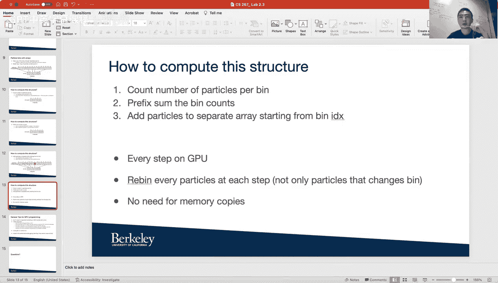

# 【并行计算 CS267 2022】伯克利—中英字幕 p31 CS267-Recitation-2-3-CUDA(Sp22) -BV1PS421978D_p31-

Yeah。Okay hell everyone， welcome to the size2 seventy seventy67 live  two。

3 and today we will cover the topic of the quoa or GPU part simulation and Im your T for this section。

Before we dive into this homework， I want you to recap something we learned from the GPPU Liker segment。

So what is the GPU， Basically it's a separate device compared with CPU because we call CPU the host。

And we usually call the GPU device or accelerator like FPG or As chips。It's a multi on stereo。

 which means it has so many cores within a just one chip。On the K N L processor， it has 67，68 cores。

 which means we can launch 272 thread simultaneouslyim。

And for the like the latest version of media V 100 GP。It has 5120 qua per each GPU。

嗯Some drawbacks on the GPPU side is that each core within the GPPU is really very weak。For example。

 you cannot do something very fancy like a branch prediction on the core of the TQ。

YouIt is never allowed to do so。And KUudDa is like the language for the GPU programming。

 which is similar like C， the language for the CPU programming。

And you can recapve more details in the lecture 7。Here， as you can see on the Rahan side figure。

 it shows like the media below100 GPU， and there is a very small orange circle here。

 it is one stream multiproces which contains 64 core within this small orange circle。

So one question you may ask is， can we just implement our open MP solution in。

So it all often depends on your MP solution。 If you are using the standard library like the vector。

 it won't work really well because。On the GPU side。

 we usually do not have such a vector data structure， and so we can now do some function like add。

 remove or salt on the GPU side。So even though the gP also provides something called the trust library it can provide something similar like the IE vector。

 But usually when you do the add remove or thought， it usually happens still on the CPU side。

 And once it finish add or remove。We will use this updated vector and transmit this vector to the GPU side and usually the CPUU and GPU are connected with the PCIE bus。

 which is just 25 gig per second bandwidth。 this is is equivalent to like three gigab per second。

 So usually the communication between CPUU and GPU is very slow。Thus。

 we suggest not using this trust。Do you pass back to our library？

Because we need to do a lot of memory copy between CPUU and JPU。So every time， for example。

 every time you want to。On多 add or remove operation on the GPPU side device。

 we need to first transmit it back to the CPUU。And once see you finish this add or remove operation。

 we will use this updated vector and transmit this updated vector back to the teacher side。

So it takes a lot of time for the data transmission between the CPUU memory and the CPUU memory。

Thus we don't want you to use this class library。Yeah。

 so we need to find a better way to store particles per beam without using the ST TD vectors。

 Instead， we can use array， not the vector。So the particle bin using array。

 basically one naive way to do this is to have a one array of length equivalent to particle number per each bin。

 So in total， we need to allocate the number of particles multiplied by the number of beings keepingping memory。

 and usually this size is too big。And GPU usually cannot support such a huge memory allocation because usually the GPPU we use only have 16 or 32 gigabytes。

And often it says out of magnitude to less than a signal memory because right now the signal memory can be at least 100 gigabytes for even thousand of gigabytes。

So this naive is not possible。So we may have to find a better way。Which is to just have two arrays。

 one is a global array for the particles。The other is a global array for the BIs。嗯。

 so I you can see on。Uper figure here on this。Particular right here。

So assume we have 15 particles in total。 And on the top， this number are the particle array index。

From zero to4。And within the index， the value are like on the particle index0。

 we have the particle ID file stored inside this particle ID particle index。

And after we have these two global array， we can sort the particle。Based on the B I。For example。

 here the first being the big 0 point to point to the starting address of the particle index 0。

Which means。The first particle stored in the pin zero is stored at the。嗯， particle index0。And also。

 the second particle is also stored in the particle be the。

 third and force are also stored in the particle be river。

And once we move to the next being the index1， it start at the particle index 4。

So as you can see here on8 point to the particle index4。

 which means the particle 14 and particle8 are stored in the first bin。对。And so on and so forth。

 for example， here the particle。嗯3 is stored in the BID图。그。

After we generate these to global array and make the correct pointer to for the different bins。

We can do some very simple computation。I like， we can count the number of particles per each bill。

And it can be paralyzed across particles of GPPU。啊有感觉。Some atomic agion， like the atomic a。

Atomic increase this two atomic operation is similar as the fashion and and in the sea language。

And we do not suggest you to use logs because logs you usually the blocking car。

 and you need to waste a lot of time for the civilizationization or the blocking。

So in order to count the number of particle bit for each bin。

Let me give you an example still using the previous one。For example。

 here we want to count from being 0 to4。How many particles stored in each of these bins so we can paralyze it in this way。

For example， we have the processor one。Wish is to do the。Particle count for particle ID D0，1，2。

Because these three particles are all stored in the B I D 0。

 So every time we want to update the B I D zeros account， we just using that。

Atomic add or atomic increase。就多plus one放个辫子中。For example， in this case， we can do a。放到。是。嗯。

So assume the first processor process on in I D from0 to2。 and we can do the count for the。

Yeah I0 three。And for the second processor， it process the particle I from three to five。

And we can do the count on the。Been0 by adding another one。

 because the third particle is still on the being 0。そうだ。Com for the B as four particles。

And because of false particle ID is stored on with B1。Thus， we can do add one on the big one as well。

And then because on second percent， we also have the safes in I D。 This one is also on the in I D1。

 So we do a plus one for the I1 again。对。So on so forth。

 you can also do the similar thing for example， you can put the particle ID 678 on the third processor night 11 on the fourth processor and 12。

1314 on the fifth processor and doing this particle count in parallel。

And after after this count particles imperative we can get to the final answer like this。

 you have four particles within the being zero， two particles within being one， so on， so first。

On the second operation we can easily do is to do the pre sum for the bin count。

We can run the prefix efficiently in parallel which is covered， I believe， in the lecture 8。

The perfect sum here。And you can either implement yourself or use the trust library。

 but we do not suggest you to use this because it's slower compared with your own implementation。

So how can we do the prefi some。On the big count。Assume we still have  five bins from 0，1， to3，4。

 And the last one is just to find the end。Partricle index for the previous findings。

 So this is not a moving。 This is just to find the tail or the end of the。Particle index。So。

 what we can do is。嗯。I's still using this simple example here。嗯。

We can assign weights for each of these particles on the first。Particle here。Okay。

On the first article here， we kind send width of0。And on the second to the last particle。

 we always assign as a weight of one。Yeah。Yeah。不。Yes。Yes。嗯。Yeah。嗯。So with this new wait。

 you can do the。Prefix sum in parallel by using what you learn from lecture trade。

 once you calculate the prefix sum on this particle array。

 you can get some numbers or some index similar as this particle I D index， which means the first。

The the prefix for the first particle is on0。 for the second particle is one， and then 2，3， and then。

The last particle in has value of 14。And by having this prefix some， we can allocate。

The starting address of each bin based on this prefix sum value。 For example。

 the second bin here is bin one is pointing to the particle I D4。So on and so forth。

 This is how we calculate the starting address。放H边。Building the prefix。any questions？Yeah。

 so after generate this simple read0，1，1，1， and to the last is21。And after doing that prefix sum。

 we can get already similar as this particle index。

And using this particle index to find the correct starting position for each bin。

This is the second step we could it pre sum the bin counts and after you calculate that prefix sum can get this value。

 the bin0 starting address， starting particle index is0 and the being one starting address is4 and then 6。

7 which is。The third one is add the particle or move particle。To another方便。

This can still be paradzed across a particle on the GPP。

And we still need the atomic instruction like the atomic a or atomic increased。To like。

 remove some kind of blocking call or。O。It will remove some of the blocking for the locks。啊。

So how can I move a particle from one bit to another。Let's assume that we have the particle1 here。

After we calculate those force among those particles。

 we find that the particle term will be moved to being one instead of staying the being zero。

So what we can do is like this。 First， we still thought the particle based on its BI。

So after the sort， we still get this summary listed here。

 But now we know that the starting point for the being one is not at the。14 particle。

But it still it should start at this time。Partle here。So after we get this knowledge。

 we just move the pointer or move the starting address of the PNY。To point to the。Tancepir of here。

And change the index from four to3。And by using this atomic at or increase operation。

 we can guarantee that at each time。There is only one process or only one thread can modify one being。

Thus， there is no racing condition in such case。And similarly， we can feed them。

 we can move another particle C， the particle eight。We after calculate the fourth amount particles。

 we may move it to。Like the bin to， we can similar do a similar thing by using atomic increase or atomic a or subjecttract。

And move this pointer。To here。By changing the beanss value from 6 to 5。嗯。

This is how we move particle or add particles from one thing to another。华硕ID图。Oh。

 so as I mentioned before， if the particle to want to move to like the bin3。

 we need to first thought。The particle again， based on the being index。

If you want to move the particle 2 to bin3。Oops。So this particle to will be moved to somewhere。

In here。8s。I can highlight this。Okay。And。嗯。嗯。Yeah。嗯。啊。Yes， so after the startinging。

 you can get a new particle really like this。And then point。The bin3 is2 。

211 if 11 and particle is still within the bin 3。If 1 is moved to somewhere else， you can point。

好 the变识 to to this one。Without天 the particle index。S for and the start。Yes， yes， correct。O。Yeah。

 so previously， we just give you like three basic example of how to do in parallel computation over the particles and bins。

 We first illustrate how to count the number of particles per each bin by using atomic add or increase。

And we also， we also show you some very simple demo to do the prefix sum for the bin to find its starting particle index。

And for the last one， we also show you， how can we remove or add a particle to a separate bin。

So every step of this three operation are happened on GPU， not on the CPUU side。

And we suggest you to re every particles at each step， not only re those particles that change means。

Because in the previous year， we find that there are some groups try to only move the particle that change winds。

 but they failed。The last one is。Because we don't， we do not want you to use the trust library。

 So we want you to have the least amount of memory copies between host and device。

 host means the shipping memory and device means the jping memory。Yeah。嗯。是。

And there are some other genes for the GP programming。First。

 if you are not familiar with Kuda or something like this。

 do not try to implement everything using the debut kernels all at once。

You can just set a lot of baby step and gradually move your CPU code or C code to quoar code。

Basically， you can start off implement everything on the CPU by using C or C at bus。

And they move just a small amount of part。S a GPPU kernel or a quoa kernel。

And then copy the like the data over the array from the CPUU to the GPPU for some operation you can do on the CPUU side。

DonAnd eventually， after you set a lot of baby steps by moving some function from CPUU to GPU after you do all those baby steps。

 everything should be within a product kernel。Without any CPU to give you memory code or without any host to device memory code。

And for atomic cooperation， if you think that atomic of the ka or the DPU provide some atomic operation like the atomic ad subtract increase。

 decrease minimum maximum。 If you think all of these are not sufficient for your implementation。

 You can also try to implement your own or any atomic operation by using this atomic C S CS is short for the comparison one。

哦You can also search online。我大有点买。嗯For the performance debugging。

 quoda GDB is really useful to with just like the GDB in C。 Basically。

 you can step into each function。And see whether each line of code。

Can generate some local value that meet your expectation。啊。

this is just if we went to theGDBC so think you should use it for them来。

And in order to improve your performance， you can also use the O profile。

To generate some profiling files。 and once you generate those profiling files。

 you can open it in some a media provided graphic AI graphic UI。

 which can show you the memory copy time or the kernel competition time in December。

And a simple way to use this， me sorry， maybe some command look like this。For example， you can do。

Dao means your output file name， says out。嗯。2VVPVVP is file for theV。And then run your binary。

This is a very simple command for using a portfolio。你的多多的 performance第八个。嗯。Yeah， any other questions？

Yeah。嗯。楚。Oh， you can split。Like the workload based on particles， not bins。

That's how you can like more efficiently use maybe thousand of course。

 because we may have a million particles。嗯。Yeah。嗯。So according to AID part we done GP。Yes。

 if you are not familiar with a GPU set on sort， you can first use that on trust vector on a CPU set to guarantee that you can。

 you can。generate the correct answer。 And once it's been done。

 you can just change it to the array on the GP S gradually。

So the politics to data also want reading calls like data。Yes。For ribing on。

 I think the maximum memory usage on the G side for ribbing is just to have two copy of the global part global particle array。

 One is the previous steps of particle array。 The second one is the updated were sorted particle array。

 So I don't think。We， we need a lot of data call。Yeah。そ端。Or I can say it in this way。 Basically。

 after you try to like move all the CPU function to the GPU side。

We should assume that you do not have any data copy between host and device and the maximum memory usage on the GPU side is just。

To maintain two particles。And one病为 that is a maximum mechanism you装 gP。Yes， by this part。

 you need to like implement yourself。嗯。Any other questions。Yeah。

 I think less than four second should be fine， yeah。什么。慢慢卡。

for the last bullet point here is because after we move every function from the CPU side to GPU side。

We do not need to do a lot of memory between the host and the device。That's what we mean by the many。

 no need for many public。Well we are calculating。有 the first pro。没有我直接把你发过这个。印兔子。脑空咩女方。😔，Yes。

And the好 the memory要 feel佢。Or for the global array you should maintain in like the。

PPO said glow memory， or we call it level with device memory。

And once you calculate the fourth amount of particles。

 they will be loaded inside HSMs local memory yes。Yes。Any other questions？Yeah。Yes。我用用QQ code的老他的或那个。

😔，Oh you you need to to do it on your own。No， the answer to啊现 the answer to your last question is no。

嗯。Okay。Yes， on the G， you can just like send the starting address of the neighbor particles to。图呃扩大克。

That's how we do it。 We do not need to do family code。

A memory copy for the GPPU memory to the S M memory can be happened automatically。

But you need to assign the correct starting address and the offset。放低身边。嗯。Okay。

 if no more questions we may stop here， thanks for your listening bye。

