# 【康奈尔大学】深度生成模型 ｜ Deep Generative Models, Cornell Tech Cs 6785 p02 P02_Lecture_2-概率建模简介 -BV1p2awzrEJr_p2-

All right， thanks everybody so in the last lecture we defined what。

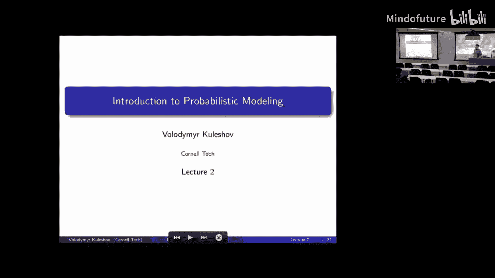

The class is about and we define this task of generative modeling。

 and you remember we accepted the different terms in the title of the course。

Probabilistic and deep generative modeling and we try to explain why's realisticistic why it's deep way it's generative。

 So in this lecture we're going go deeper into each of these terms part of the lecture is going to be a review of certain things in probability and geneative modeling and then I'm also going to set the stage for why we're going to be doing all of these advanced machine learning techniques。

 why are we going be covering these these math methods。

 I'm going to give you a few simple examples of geneative modeling and show why some of them are easier and when why some of them are hard and why they require sophisticated methods and then in the next lecture we're going to see our first family of geneative modeling algorithms。

 some deep gene modeling algorithms， which are going to be utter geneative models。 but for now。

 first a review of probability and some concepts in。

Learning and then defining the sort of modeling problem and defining a few classical approaches and showing why they might not work and why we're going to need all of the things。

Doing the next extra and all the following issues。 So that's the plan for， for。

And before I start diving into into the details， I have this slide。

 which is kind of an overview of how we define the task of general modeling in the last lecture here if you remember。

We're going to be so our goal is to build machine learning models。

 machine learning algorithms that can generate things and can do other manipulations over high dimensionsional objects such as images and the way that we're going do this is going to be different from how other fields of computer science to it。

 for example， in computer graphics someone might implement by hand a complicated graphics engine that can render various types of scenes that's one approach which involves a lot of engineering。

 our approach will be based on machine learning that we're going to be taking a large data set of the objects that we want to model in this case。

AreHere are our data kind of images we're going to learn that generator we're going to learn that system purely from data。

 and in particular， what does it mean to learn current here means that we're going to define a probability distribution over these images。

So this is called， well， either a statistical model serves that you learn from data。那给我。

Thefin of what it means to learn from data is to define a probability distribution over each images over each image or all the images going to have a probability distribution that assigns higher weight better images over way to other images and then once we have this probability distribution。

 we're going to be able to solve a lot of interesting tasks。

 we're going to go into much more depth about each of these tasks for now generation is is the first example the first tasks that we can think of here we can sample from the distribution so if we have P of X we can draw x from P of X we can draw new images。

That's obviously an interesting task we see interesting applications of it in the last lecture and there's other tasks that we're going to be going through in more detail throughout the course。

 another one to which I alluded to in the previous lecture is presentation learning。

 which means that。I am not just interested in generating these exites。

 but I'm interested in learning in discovering in an unsupervised way something interesting about the images。

 if there are some patterns or some plastic images that are present I to discover this from data。

 that is some of the things we might do using a form of representation learning。So this is our goal。

 this is an overview of what deep gene modeling is， but in order to do all of these things。

 we have to start at step one。And step one is going to be deciding what does it mean to defining what it means to represent a model as a probability。

If you remember in the last lecture I had this outline of what a general modeling algorithm looks like and it involves three components and I would also say every machine learning algorithm has these three components and these components are the modeling。

 I guess define the model the model family， in this case our model families are always going to be probability distributions。

 so we have to the class probability distributions that we're going to work with。

Then we're going to have to define a learning objective and then optimize when we have these key things。

 we have a complete machine learning。Algoriths。But for an now we're going to start at step one。

 we're going to try to define model， define a probability distribution over images。

 and then later we're going to look at how we can learn this。

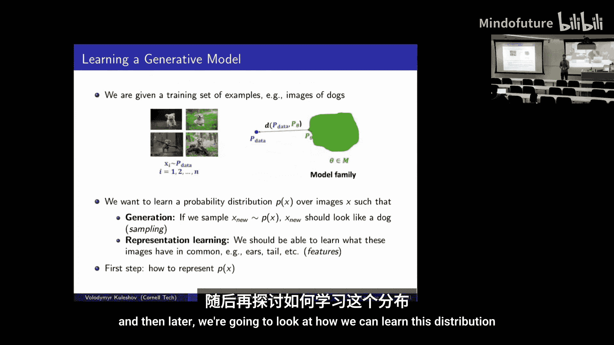

给。😊，And so the plan for the lectures， again， we're going to start by looking at what it means to define the probability distribution。

 what are some。Different types of probability distributions that exist。

 So that's going to be the first， maybe half of the lecture。

 And then in the other half of the lecture， I'm going do a bit of review on discriminative geneative models。

 Let's just remind ourselves， what's a classical geneative model and then we'll end with a first example of a degen model So thats that it extends these classical geneative models to the。

Deep setting， we're going to be parameterizing number of neural networks。

 and well see we'll see a first example of what that。That's the way。Okay， so as a warm up， let's。

First， just。Look at a few really simple examples of what we could use as a probability distribution in some really related choice settings in fact。

 here I'm starting this slide with maybe the simplest distribution you can imagine。

 which is the Bernoulli distribution。We should remember this because this is going to be a building block for a lot of things that are going to come next。

 but a Brnoulli distribution is basically a distribution over a point flip or over two possible outcomes let's say that our data can take only two possible values we can give them arbitrary names is0 over one or hazard or tails but there's only two things that can happen in the world and so a Brnoulli distribution is a distribution over these two possible outcomes and all that it does is to define the probability of one outcome let's say we're modeling head or fails or whether a point has or fails so we're going to choose we're going to say that the probability of heads is going to be some。

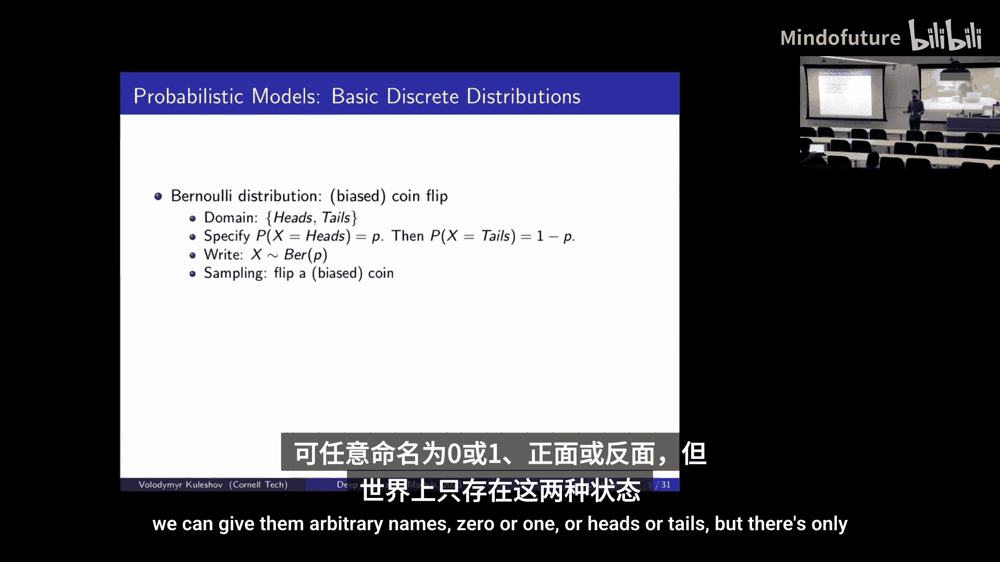

Scaar p between zero and1， and then the ver bo fails it will be automatically defined to be1 minus。

And so we write this as x buildda vernolia be x is a random variable that's sampled according to vernolia distribution and again。

 our example here is a coin。So this distribution only has a single parameter， and that is P， Okay。

 that's something that you should have seen before， very， very simple， very。Yeah。

 very simple example， our first example that will be used as a building block for what comes later。

Now， one way to make this just a little bit less simple is to go from a beruli distribution to a categorical distribution。

categorical distribution is like a Bnoli distribution， but instead of having two outcomes。

 you have some number here M lower M of possible things that can happen in the world。

So one example of a situation you could model with a categorical distribution is drawing an M sided die。

 so let's say a regular die will have six sides， then you have six possible outcomes。

 you throw the die， you observe one of the outcomes and maybe the die is not fully balanced。

 so you would want to model all the possible outcomes with a different probability。诶。

And this distribution has。M minus1 parameters， the way can。The way this distribution defines。

 the way this distribution is defined is by specifying a probability to each possible culture。

And because we have M outcomes， well， because we have M outcomes n the probability have to sum to one。

 there's one redund degree of freedom， so it's enough to define M minus1 numbers between0 and1 and then the other one will be1 minus that。

 so there's this distribution has M minus1 p M minus1。Yeah。Okay， so two simple exam。Now let's。

 let's make this。Once had it more interesting。Here， so in the previous examples， we have these。

 we just had some kind of categorical variable in the excited dye。

Let's say that now we wanted to model something a little bit closer to our motivating your initial motivating example。

 let's say that we wanted to model pixel those in an image。

And let's say that we just wanted to model a single base。

 let's say that we're modeling images and those images in a single base。

Pasal we're modeling one by one， we're modeling we're really the general model over one baal inches。

So what does it mean to model the pixel first of all。

 what's the set of possible values the pixel can take so a pixel is defined by three values the intensity of the roof of the red channel。

 intensity of the green channel and the intensity of the blue channel。And in most examples。

 we would have256 possible， so these are often encoded from0 from one to 256 or from0 to 2155 on a computer。

 so there's 256 possible values that each of these values can be and so each face can be defined asq of the R value that G valued the each value。

 so it's defined by three numbers and each number is an integer between means zero and 155。

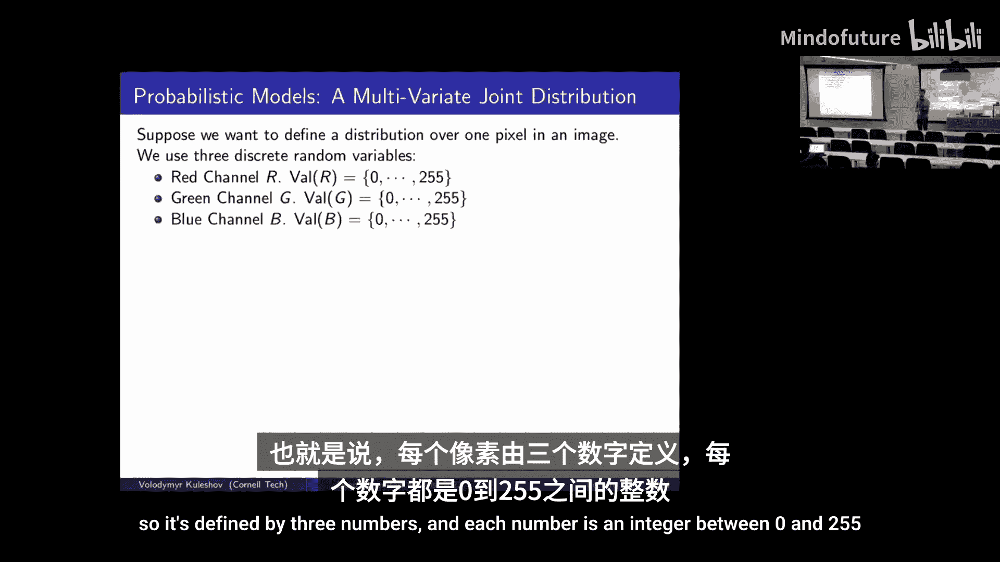

So that's how we represent a pixel and now we want to define the probability of this distribution over all the values that pixelil can take。

So how would we do this？Well。We can model this using a categorical distribution， right。

 We have a finite number of outcomes。In fact， we have 256 outcomes。

 256 possibilities for R for each of these， we have 256 options per G。

 which at least we have 256 options for B。 So we have 256 to the power of three possible value So the pixel can be in 256 to the power of three possible states。

So here we have a categorical distribution where M equals 256 is the power three。

And one way to view this is via this kind of three dimensional cube or three dimensional table here for each so the value blue can take the blue channel can take some number of values。

 the thread channel， the green channel， and for each combination。

 there is a color for the pixel so that's illustrated in the sum。

And so if we wanted to specify a probability distribution。

 we have to assign a number to each entry of this queue。Or in other words。

 you can think of this distribution as being defined by the three dimensional table of numbers。

Right so defining a categorical distribution over a single pixel means defining a 256。By 200。

 it means filling in a three dimensional table。 that's 256 by 256 by 25。

And that's this cube right so now we can we can view the problem we can view the task of modeling a one pixel image as filling in this as defining this three dimensional table of the probabilities that pixel。

嗯。If we sample if we want to do then sample a new pixel well we can sample from a categorical distribution。

 so if we have a good distribution， we can then perform a generation task by sampling a pixel from this categororical distribution and now we have assuming we can learn this we have a simple general model or。

One dimensional image is orbit basically。え？And so again。

 how many parameters do we need to specify this distribution it's 256 is the power3 minus1。

 because this is the categor of distribution， we have M， we have this。

 we have 156 power three outcomes and we need that minus one parameters define this distribution。

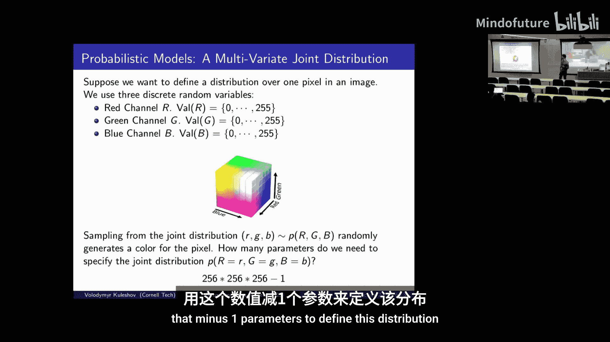

So now we have institutional orders。And let's now take this one step further and let's try to define now a distribution。

Not over。Pixels， but for images， which are arrays of piecess。

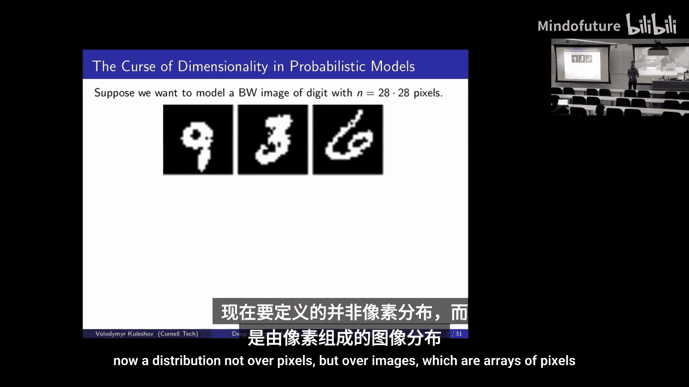

So now we're going to try to define a distribution over。Not one by one images， but 28 by 28 images。

And to make things simpler， let's instead of thinking of images that are in color。

 let's look at these black and white images。And let's say that we're trying to model these kinds of digits。

 so this is a handwritten digit， it's a 28 by 28 pixel image and the values are just black and white。

Okay， these are samples from a famous data set in machine learning called Anes and each each。

Theta point here is an image， it's 28 by 28， and it's black and white。

 so it's a 28 by 28 array of zeros and ones。Okay， and let's say now we wanted to take the same approach to define a distribution over images。

Right， so now we're going to define the distribution over these over not over n pixels and here is 28 by 28。

 so defining a distribution over images means defining a distribution over a vector of n binary pixels。

Okay。So how many possible states get a single image have give we take one image， How many possible。

How many possible values can this take， image of 28 by 28。Aray of view and ones。

 how many possible values given that， how many possible images are there in the universe。

So for each pixel we have two possible values， so for the first pixel we have two values that for for each assignment of course pixels we have two assignments。

 the second pixels then for each joint assignment we have three assignment。

 two assignments the third pixels etc cetera， so we have two times two times two。

 we have two to the power and possible images that exist。Okay， so if we wanted to do this。

 if we wanted to now build same type of model like we did for a single pixel so。

 we have to hear our naive approach for we could define a categorical distribution over a one dimension of over over。

These two to the end possible states。Right so if we were to do exactly the same thing as we did one day so and we consider the states of the the states that are modeled using a categorical distribution。

 if we consider that to be all the possible images。

 then we have two to the n states that we model so M is the n so a categorical distribution that models these images requires how many parameters。

 well M minus one right so it's two to the n minus1。Okay。

And this is a problem and in fact I want to emphasize this is the main problem of gene modeling and this is the whole reason why we have several weeks well several months of lectures on this this is bad so if you have something that's exponential there's no way that you can you can model this in practice even with 28 by 28 that's two to 107。

Due to the power 768， that's more than the number of atoms in universe。

 so it's not possible to define， it's not possible to list。

 but it will take you more than the time of in the universe justumate all the possible parameters that this categorical distribution would date so it's not possible to specify such a large number of parameters。

 even for n of this size and。And yeah， and it's more complicated for even more realistic images this is why it's called the curse of the national there's a question。

I guess it doesn't make sense for images but I'm assuming that sometimes these variables can be independent and so that would reduce the number of parameters by a law Yeah that's a really great observation and a really good point and let me just well actually most of my slides will be an answer to this question so lets let's look at that and then you can you can ask follow up question and get that solve。

That doesn't address。开是。Okay， so again， I just want to emphasize here。

 this is called the curse of dimensionality as you if you this negative approach requires a number of parameters that grows exponentially in input that doesn't scale and that's why we need all of this material。

 all of these lectures to solve this problem。嗯。So obviously this naive approach doesn't work off the double yeah this naive approach doesn't work。

 just modeling this as a simple categorical with to the United States。

 that doesn't work What else could we do Well， we get to choose the model that we learn here right we get to choose the probability distribution that we can that we use to fit to this data so we can make any assumptions we want to this distribution and one assumption that we can make is as you mentioned。

 we could assume that it's independent。 I think in your comment you were saying that the data might be independent which is also true。

 but for now， this is just a modeling decision that we get to make we can fit whatever distribution we want right so let's just fit one where all the pixels are assumed to be independent of each other So now I have。

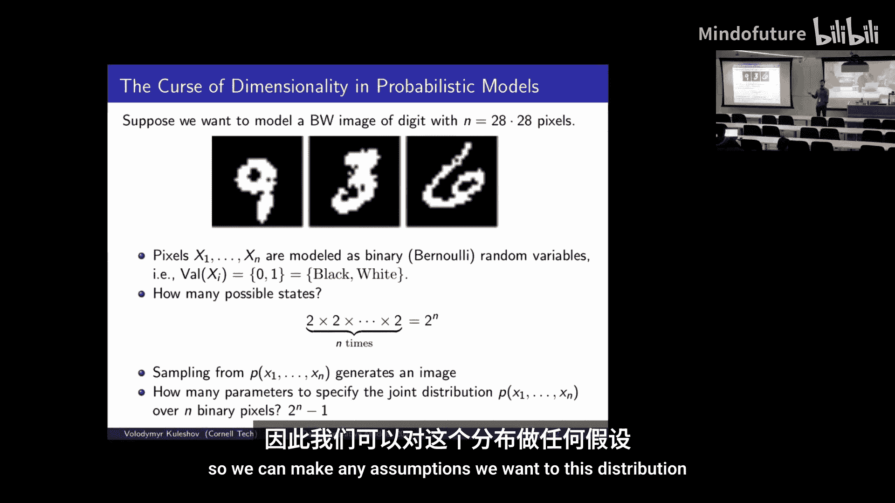

Each of these pixels expand to extent is a binary variable。

And I will assume that the joint distribution is defined as a product of distributions over each pixel。

 since each pixel is is binary， p of x1 p of x2， these are all bely。

 so let's assume that this is the model that I will try to fit to my data。How many。

 how many parameters does this have？And。And right， because I have n probabilities。

 each of them is a Brnooli。 a Brnooli has one parameter， so that's n parameters total， but sorry。

 I guess I should have asked the other question first how many。States how many possible assignments。

 How many possible joint assignments are there， How many possible images exist in the world。

 Still the same number， nothing changed， that the real world hasn't changed。

 We still have look the possible images that exist out there。

But how many parameters do I need to specify this joint distribution。

 while I need one parameter for kX1。And therefore， I need and to specify the whole thing so we can。

We have a distribution over to the power end images， with only n parameters。

Now of course this is a strong assumption if we fit this distribution to data。

 we're not going to get the best possible images， if we literally fit data and the sample from it。

 we're going to get things like this。And you know， it still has。

The outline of what might be an image so there's more white in the middle and more black on the sides and it looks like what we want。

 but it's clearly not anything that's's good enough Okay so clearly this is too strong What else can we do again there is there are entire fields of computer science that's study this problem there's many approaches to this here let's look at one possible approach which which is going be based on this idea that's called the conditional independence。

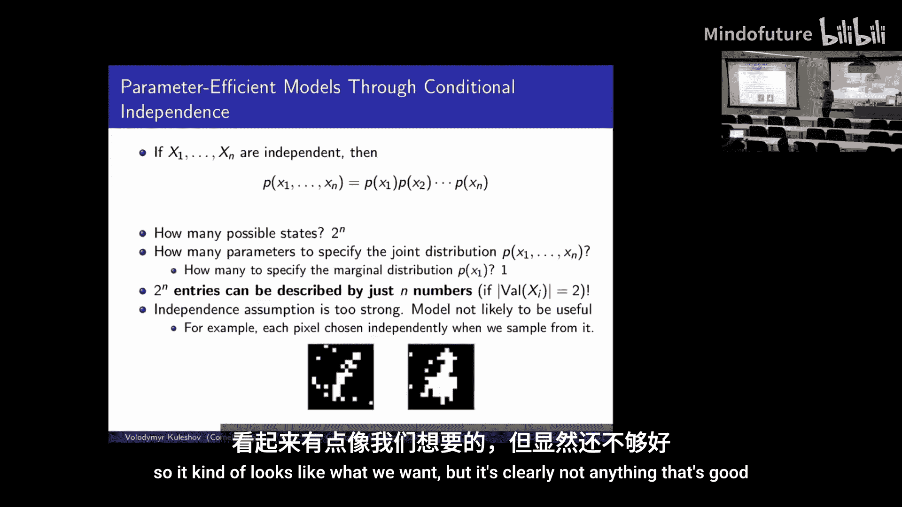

First of all， what is conditional independence， you should run remember this。

 but let's do a review in two slides。We say that two events A are conditionly independent if the following identity holds。

 so the probability of A and B even C is factorizes out as two independent probabilities。

This is the journal definition for events。Here we're working with random variables。

 So for a random variable， we say that two random variables are independent。

 if these events for each possible value of x， each possible value of y， each possible value of Z。

 the events of these specific assignments are independent。

That is the definition of initial independence for random variables。

And we can write this in a more compact form as follows。

 so P of x and y given z equals P of x given z times P of y given。

And we can write this even more compactly， oh， because this is an equivalent definition。

 and we can write this more compactly as expert Y givenency， so that's one standard piece。Again。

 I'm going through this quickly because this is standard probabilityability， but if not please。

 if you don't remember this， please review the slides on your own and just try to do a little refresher on this。

嗯。Okay， and now once we know that certain events are independent on each other。

 there's two important rules and probability that we should remember again。

 this is fairly this is this is the first class in probability， so nothing particular view。

 but let's just look at it again， the first rule is called chain rule。

 which says that if we have a sequence if we have a number of events if we have1 events。

 then the joint probability P1 and P2 etc cetera。And this can be written as probability of this one times probability of is2 given as one times probability of this to written as one and this。

Do。All the way to S N given all the previous things。

 this is called the chain rule of probabilityability。嗯。AndAnother important rule is base rule。

 of course， which says that if we have familiar of S1 given S2。

 then we can rewrite it in a way that only involves either S1 by itself。

2 by itself or S2 given S so we can flip if we have S1 given S2。

 we can flip it to get something to say something about S2 given S1 plus these other terms so you can take a basease rule as a way of flipping the conditioning。

Two rules from probability that you should remember rep of course， we're going to use them a lot。And。

😊，Now， the idea is that。Okay， in our simplifying assumption。make everything completely independent。

we can do， I guess one modeling assumption that we can make on。

Is assume that things are conditionally independent。So what might that mean？Let's。

 let's start with this example。 So here we have a joint distribution key of x1 and et cetera。

 and we could try modeling this。We could try， instead of directly modeling the joint。

 we could rewrite it as the chain rule and we could try to then have a model for each term in this chain rule product。

 so that could be another approach for defining a probability。How many driversgers would thisbe？

Exactly due to the power N-1。 There nothing has changed。 I didn't change anything。

 This is something that's always true。 This is not a， this doesn't reduce。

 this doesn't introduce any additional assumption。 It doesn't restrict the plasticster probability。

 I can just take any probability That's a joint。 I can rewrite it as the chain rule。

 and that doesn't change anything， right， It's I haven't restricted at all。

 the plastic probabilities。I haven't restricted at all the set of probabilities by rewriting it in an equivalent way。

 So that's the same。 again， we need to the2 to the n1 parameters and you can also just check that this is true because well you can we know。

 first of all， nothing changed。 That's one reason or you can literally count how many parameters you need on the right。

 So here of x1。 That's just a vernoulli that requires one parameter P of x2 given an x1 is a verrnoulli over x2。

 but it's condition on x1。 So for each value of x1 I have a different verrnoly。

 So x1 can take two possible values。 Therefore I need two values for x1。 Similarlyly。

 the third term x1 x2。 that's an assignment that is。'Those are two Bnos， it takes。

 there's four possible。Things on which you could condition in the third term for each of them。

 We have a verul over3。 So that's four parameters you need for the third term。

 then 8 for the next one， et cetera。 So you get this series and and we know that this sums to n-1。

 So nothing has。

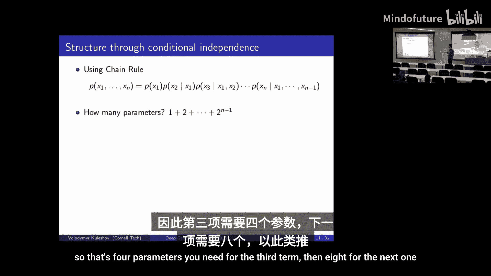

So the chain rule by itself is not enough。喂以。Yes。just。So Cha La up does not give us。But instead。

 let's say that we now introduce some simplifying assumptions。 So we take a chain rule。

 instead of assuming that each variable depends on all the other variables。

 all the previous variables， let's say it depends only on a small number of these previous variables。

 Let's say that X5 plus one condition， it's independent on。

X I plus one given X I is independent of everything that comes before so in other words。

 I take each of these terms and I only so x3 will be only dependent on x2 but not x1 X5 will be only dependent on X4 but not anything that comes before x4 let's say I make this improv assumptions so now now Im assuming something and I'm restricting instead of。

Possible distributions by doing this。So this is what I need here I deletete here I delete everything before I extend my。

 how many parameters does this be？2 n minus1， correct2 n minus1 parameters space。

So now we have a little bit more parameters instead of having just and， we have a little bit more。

 but we have a more expressive。So。Playing with conditional independence is a way of allowing us to trade off model complexity with model exclusivity and the number of parameters that we desert to things will be by making fewer assumptions the model is more flexible or expressive。

 whether it requires more parameters， we can trade off between the two。

 by conditioning on either more or less serious。Okay。

 and this idea is a special case of a more general framework called Asian networks。U。

II'm going to assume that some of you have seen Bay networks。

 but maybe not all of you and if you haven't seen Bay networks。

 worries that important is to just get the general idea， but the idea of Bay networks is that。

We can use this。can use this idea of conditioning not on all the variables in the chain rule but on a subset to define more restrictive。

To define restricted andtractable probabilistic models。In particular。

 what you do in network in an invasion network is that for each variable。

 you define a set of ancestors。So you don't condition。

You start with a chain rule and then you simplify each the in the chainable by conditioning not all of the variables。

 but on a subset of that and that subset is called the ancestors of I In my previous example。

 we only had one ancestor so with the very first example we had zero ancestors it was all independent the next example we only had one ancestor but you can generalize this you can condition on an arbitrary subset of the previous variables and that's what that's what happens so you use this chain rule except this conditioning the is some subsets that you define。

this is called a Bays network or this type of proability is called it's a probabilistic model that can be expressed as a Bay network that's the high level idea that's all that is enough to understand here。

 this is one approach to having tractable generalative models that address the curse of the nationality。

 it's different from everything that we're going to be looking at in this score。

 well it's reasonably different from what we're going to be looking at in this course but I just want to point out that this is a classical approach and what we're going be doing a deep approach is going to be in some sense and alternative well it's going to be not fully orthogonal but somewhat different from from this technique but。

Let's just remember patient networks as another way of doing what we want to do there's a question so it can be there。

I'm trying to think of like it can be variables from。

I don't think that makes sense the time component， but I'm trying to compare that to other frameworks。

 but it can be component， it can be variables there are like。After or before。

 I'm trying to compare that to when there's a sequence model and we say。

 are we going to condition on like the previous two or the previous three or the previous four for patient networks it can be on an amount of variables。

 even if it's after or before is that it can be any sort of asset。Yeah， it can be any sort of set。

 I will give you an example in two slides， but yeah。

 maybe the question is how do you choose which variables to condition on。

 And I think you said maybe if there's like a time component。

 maybe condition on the previous variables at time or if you have prior knowledge about the problem。

 you could use that to select which set of variables to condition on， that is the most。

Standard approach， and you can also you and try to learn this subset that's a more complicated thing。

Anyway， let'll give at an example。So one thing， though， is when we choose these ancestors。

 we have to be a little bit careful about how we choose them。For example。

 if we have two variables and x1 is the ancestor of x2 and x2 is the ancestor of x1。

 that doesn't work， right， you get have。Probability of x1 called by x2 equals give of x1 given x times of x2 given x1。

 So doesn't make any sense。 So there has to be， it still has to factorize in a way that's。

Condition in a way that gives you a valid probabilityability distribution right so if you start with the chain rule and choose a subset of the elements of the chain if you choose a subset of what you would have condition in the chain rule。

 that is a valid distribution but in general， like there has to be some like you can't take a variable and then condition like you can have an ancestor。

You can't condition on an ancestor and then have the same variable again to be the ancestor of its own ancestors。

 like yout have loop and you cannot't have loops in this process and so that's why when we talk about invasion networks。

 we also talk about directedcycl graphs， invasion networks to be represented as a graph。

So you can represent these S2 relationships with these variables as a graph where each node is a random variable。

And there's an edge between。There's a directed dash between a variable between。

There's directed edge from the ancestors to its。To their child and if this crap。

Basically if you have this this distribution with ancestors， you form the graph。

 you draw edges from the ancestor to the children and this graph has to be a directed acyclical graph if it's a directed ascyclical graph good you have a valid distribution。

 it's not directed acyclical graph， then this is invalid， it will not give you a valid distribution。

Right so this is the formalism for a Baysian network yeah。

 so you can I guesss one way of defining a Baysian network。

iss to you can start from a set of ancestors or you can also equivalently equivalently define the Bay network by drawing a graph and once you have the graph。

 you define this distribution where the parents of I or the ancestors of I are the parents notes。

The parent knows in the graph。Let me give you an example。Okay。

 so first of all what is a da on the left that's not a dag if the ancestry relationships have a cycle that's wrong。

 it's not a valid really distribution if。If there's no cycles， then。You have the valid。

Here's an example of what a Bayian network can look like。

 This is a classical example from a text from the Ko。textextbook on。On forlographical morals。

Here we're trying to model a student that has taken a class。

They got a grade in that class and they're asking the professor for a recommendation letter。

 so theres there's five possible variables that we have。In the middle。

 we have the grade the student got in the class， that grade is determined by the difficulty of the class and by the intelligence of the student。

And the indulgence of the student also determines their SAT score。

 but that's not directly correlated to the grade， and then the grade determines the letter。

Right so these are the five variables that we want to model and let's assume there's a finite number of values so the grade can take one of three possible values。

 G1 g2 G3 difficulty， we have two difficulties easy or hard intelligence also higher low and SAT also good or bad two possible outcomes and then the letter can also good or bad So this is an example where we could apply the patient we could make it ava network in fact this is the graph that there is a reasonable Bay network in particular the letter is directly determined by the grade but the letter is probably not determined by the difficulty of the class like if the class was easy or hard。

Here we're assuming that the latter is going to be more likely good the greatest good and more likely bad than the greatest bad。

 but or against maybe， you know the the。The writer。

 the letter doesn't directly observe the intelligence student。 They only observe the grade。

 So this is why it makes sense to condition to conditional。

To define a really distribution where the letter is only dependent on the grade。

 but not directly dependent on the intelligence。Or the SAT score is not dependent。

 it's not correlatedated at all with the letter， so it doesn't make any sense to have any edges between letters and it doesn't make any sense to have any kind of ancestry relationship between SAT and letter because they're fairly in independent。

So this is an answer to the question that you had， maybe maybe this is at least a partial answer。

 when would you apply this Asian network idea， how would you decide what the graph is or we can often look at the problem and you know that two things are obviously not have any dependency from each other like the intelligence of the student and difficulty of the class that's completely unrelated so it doesn't make any sense to have a term so it has intelligence the function of difficulty or difficulty do a function of intelligence they're completely unrelated。

So that's what you get。That's what these are the kinds of assumptions you can taken into a Bay network by deleting certain dependencies or equivalently leading certain edges in the whole graph。

And and this requires less variables than we would normally need if we had。

 so we have five variables， each of them is at least two and some of them are one of them is three。

 So that's at least the two to the power five parameters that we need to specifyable。

But because we have these edges， we only need to specify these tables。

 so here we need two parameters here two here four， four and 12， 2。

 so that's much less than the 32 parameters for more than drinking that we would need to specify the photograph graph。

But the point is， by deleting。By deleting certain edges or deleting certain dependencies in the chain rule decomposition。

 you can define the probabilityion distribution。You can define probabilistic model with fewer parameters that you would have to use if you did the na thing of just modeling a full joint distribution like a full category。

Yeah。

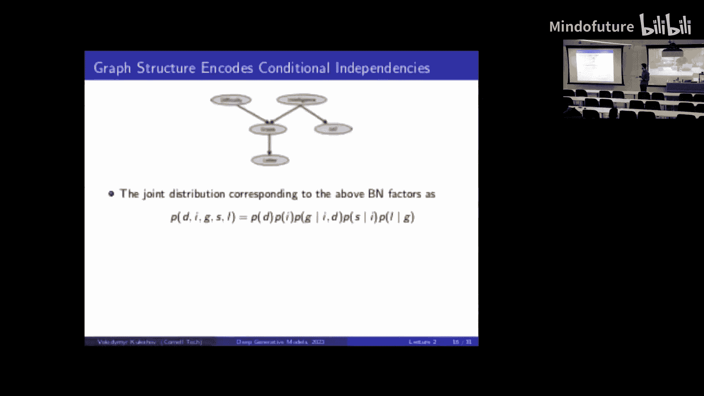

so this is a distribution， if you think of it in terms of the chain rule。

 this is a distribution that we're defining， we're defining an distribution over five variables and when we have this graph。

 we're assuming that it decomposes in this way you can always go back and forth between directed graphs and decompositions you can go back and forth between do these are equivalent this graph is just the visual way of describing this decomposition and each valid decomposition you can draw the graph and for each valid that you can get a valid decomposition there's just an equivalent way of describing the same thing so here we're making the following assumptions in in the graph。

Okay， so summary so far， we have this problem called the curive dimensionality。

 one way to get around it is to assume certain conditional dependencies is one way to define a model where not everything depends on everything else certain variables are certain pixels are independent on certain other pixels condition on other pixels you make these assumptions and you can get away with much fewer parameters your model is less expressive。

 but that dag in in that example that I just showed it doesn't capture all the possible distributions or the by variables it captures the subset of them。

 but it captures a good subset because the other ones， ones where。

Intelligence difficulty are have dependencies， those are probably wrong were to learn it。

 we wouldn't want the model to not have any dependencies there so we can bake in good assumptions into the model by thinking of it as a graph and that's one approach to solving the person initial。

And then in the rest of the lecture， I'm going。Proposed another one。

 which will be a first example of the each general fall。是。Okay。😊，So， but before I do this。

 I want to I want to do a little Eor and talk about discriminative generatorative models。

 I guess to first start by talking about generatorative models。

I'm going to assume that everybody has taken a machine learning course before and have taken you have taken a。

The machinery of course there you've seen the lead based algorithm。

 the lead based algorithm is a simple example of a general model。So what does the na based model do？

It assumes assumes that poly so here we have an application of the database to spam classification。

 our goal is to classify emails that spam y equals one y is the label。

 so spam equals y y equals1 spam is y equals1， not spam is y equals0。

 and then our data X is a bag of words representation of the email that we want to class poly。

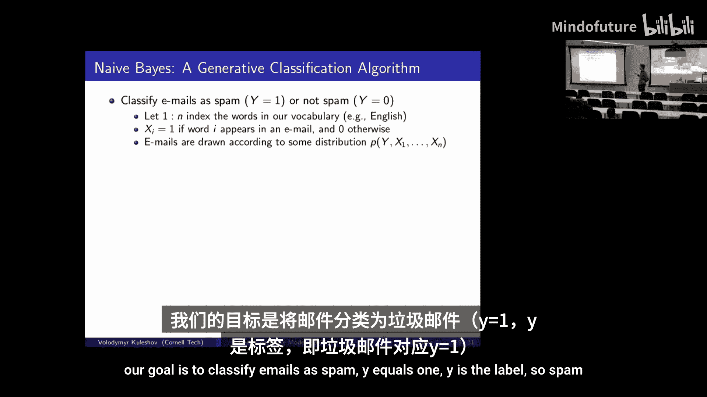

So what it means is that X。So we have to access a vector。

 each component maps to a word in a vocabulary， and that component X equals one if the word I appears in an email。

zero， if it doesn't appear so that's the x is a is a binary vector that is a P of words representation of。

That's the that's the data now we want to define a model。

 a probabilistic model of this data the way we do this in the E days is so we actually form a basic network with the following directed graph。

So an E based model is a special case in the Bay network where the graph has this form。

So what does it mean means that y doesn't have any ancestors and at each other variable。

 it's only es y。In other words， if I were to write this out as a conditional。I that a yeah。

 as a product of factors。I get the following So this joint distribution normally this will be extremely high dimensional because again。

 we have n n is the size of the vocabulary and is's like 10，000 each X takes is a pixelel。

 so we have two to the power to n minus-1 and then this y also appears be have more than two to the n minus-1 parameters。

 but if we make this simplifying assumption that the distribution has conditional dependencies described by this Bay network then we can then this is equivalent to assuming that it factorizes this four。

 we're assuming extra conditional dependencies， and now we can now the thing on the left becomes our model。

 the thing on the right becomes our model and and that's our。And that's our。Yeah。

 that's the model that we're going to show。

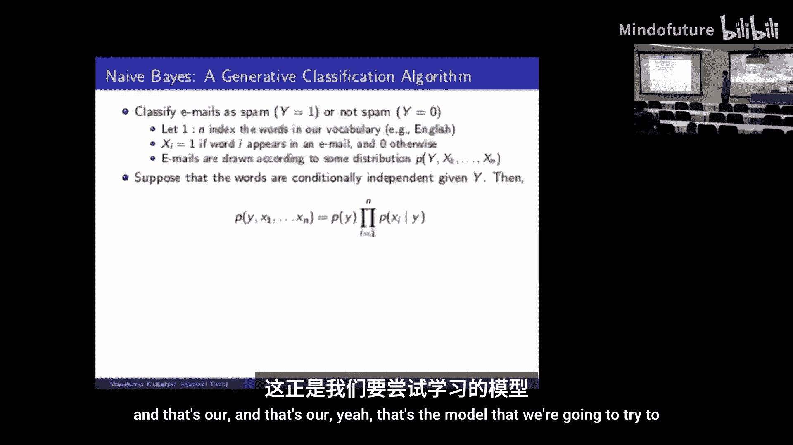

Specifically， negative B assumes the following。Well okay， first of all。

 these X given y they're all so y is binary， So P of y is a Brnoulli that has one parameter P ofxi given y is also so it's a Brnoulli for each y So if you fix y P of X given y is Brnoulli。

 So P of X equals P of X given y equals0 is a verrulli one parameter P of X given y equals one is another verrulli that requires another parameter。

 So here we have one parameter for。But why can we have。2 n parameters for the other components。

 So this thing has。2 plus one parameters and total。And so we assume this particular form。

 we can learn these parameters from data using maximum likelihood， like we did， for example。

 in applied machine learning in fall and now we have a from。And if we want to make predictions。

We can apply the following。Formula， this is just ba。

Remember base rules from mentioned you class size ago and earlier hopefully and and also remember I said that a generalative model can do everything that the discriminative model can do。

 including crdation so here even though I'm。Even though I have a distribution for x's。

 I can flip the distribution， so yeah， I can flip the distribution get P of y given x or equivalently if I want P of y given x。

 I can flip it to get something a formula that only involves P of y and P of x given Y。

So as the formula， I'm not going to go into details。

 but this is just a straightforward applications of phase that we seen in applied machine learning last semester and in any machine learning course。

 you should see this。嗯。Yeah， so this is the model。 Now， of course。

 some of these assumptions are sometimes wrong。 So in particular。

 these based as this problem of of double counting the evidence， if two x's are closely correlated。

 then we might count comp towards the evidence so it gives us。

Probilities that are a little bit more confident and underconfident。

 but in practice this works quite well and it also very better brain if you remember doing if you wanted to learn the。

Cl for formula for each parameter， so it must be very convenient for ease and this is actually a very。

 very strong baseline for that specification。Okay。Okay， so that's an example of a general model。Now。

 another way of approaching this pplification problem is to use the discriminator model。

Supposedly all we aim for predictions is P of Y given X。

Our current approach was to learn P of x given y and P of y and then flip them to get P of y given x so in some sense we're doing more work。

 if we only need P of y given x， why are we doing all of these things。

 let's just model P of y given x threads。呃。Let's just learn this distribution P Y given x。

Effectively， our。Previously our dad。Previously， our major network had this form and now it will have this form in a discri role。

 so why will we dependent on X？Yeah。This is what we called the discriminative model because it is only useful for discriminating Y given x。

 it doesn't do any of the things that general models do， it doesn't do generation。

 it cannot deal with missing input。If only one is predict P of y given x。

 then let's try to form directly a model of P of Y given x。

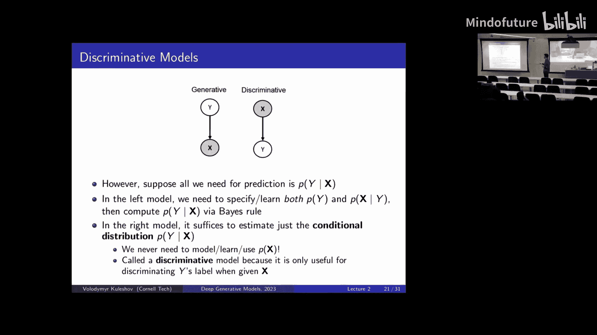

So what does it mean to form a model of P of Y given x Well an example of this is the logistic regression algorithm。

In the logistic regression algorithm， or I guess in various types of deriminable models。

 we assume that P of Y。Equals one given x。Is given to us by some formula。

F of x and sub parameter alpha so this formula has takes input with the x in which we're conditioning and some set of parameters and this formula F spits out probability of y equals one so it's f of x and alpha spits out。

Spits out a prediction for spits out a purion between your。

It's interesting that this is not a table anymore， previously in all of our examples。

 all of these general models， we were effectively representing them as tables， even in the D example。

 we had a table for each node in the D， similarly for the Bay network we for the leaf base example。

 we have essentially in the table， everything was dis。Here this is a slightly different approach。

 we just assume that we have some formula， the formula has some bramarous alpha。And。Can we just。

Learn the parameters， alpha that produce good results when we plug them into the formula。

And so what's interesting with this approach is that it doesn't depend on the complexity of on the size of x anymore。

It only has these fixeds that are parameters so the dimensionality is fixed to numbers to the number of parameters that we choose right if we have B parameters。

 then we have B dimensions。U and our main constraint is that the output of F has to between0 and1 and it has to depend in some reasonable way on x1 and x very reasonable。

 I mean， it has to you know make good predictions and it still has to be track。嗯。

So one way in which we can do this is。And this is what linear regression does is that we could have a linear function of the parameters of d input x。

 so we have alpha， we have x， we can take the dot product with alpha and x。

 we can make alpha be a vector of the same size as x and we take the dot product we call the thing C of alpha and X and that's the formula that's maybe the simplest way in which we could define something which looks like this formula f of x and alpha which is the dot product。

The problem with this is that z is not between0 and1 and we want f to output a probability so it has to do with t0 and1 So what we do in logistic regression is that we pass Z through this sigmoid function and the sigmoid function takes the real number and squishes it between0 and 1。

And now this sigma of z of alpha and x， that's what we define RF。

That's what logistic regression defines that。And this is now an example of a gender quality here this is a。

This is an example of the sigmoid function， you know it takes a real number。

 it squishes it between one and zero and on the left is an example of the Bayian network that could be associated with the distribution felt that there could be a bunch of edges between the axis we haven't made any simplifying assumptions at all on dependencies between the axis but we don't care because。

The x's are always observed， so we never have to worry about these interactions。

 the x's are always fixed and we don't really care about forming a distribution over x so it doesn't matter if they're all correlated。

 we only care that y given x' is。

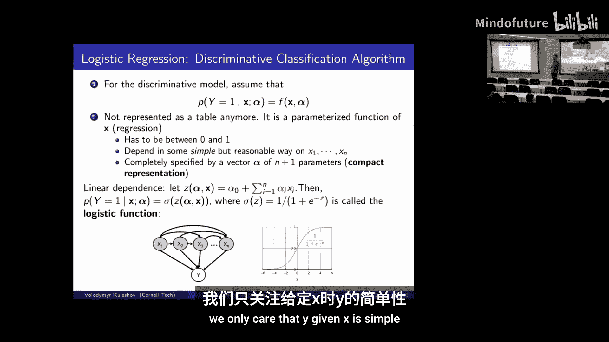

是。Okay， so if we were to visualize it， if we were to visualize this model to get something like this。

 so here we have a two dimensional x and this heat map shows the probability in different regions of the space of x。

So this is a heat heat map or controlour map on the left。

And on the right is the three dimension version， so it assigns higher probability of spam in the yellow region and the low probability in the blue region and as we go from blue to yellow。

 it changes its。And then the decision， if you wanted to make this for if you wanted to make this as a predictive model。

 if you wanted to use this for classified span， we would take the line where the probability equals 0。

5 and that would be the boundary where we would decide whether it's spa or not。

 depending on which side of the boundary the data points are or。Intel languageual mobility。

 your way equal one。X and given x and alpha is greater than 0。

5 then it's lying on the spa side of the map then x is lying on the spa side of the boundary。

 so we make it so we predicted this。Okay， but note that by making this linear assumption， we also。

For we also have， we're also making a particular assumption on the probability。 in particular。

 we're assuming that the probability is this thing which changes。As we grow。

 as we move very particularly to the decision boundary， it changes with a certain probability change。

There's one at a certain rate that's defined by this sigmoid。

So that's an extra assumption that we have made that we have baked in when we chose this linear model in the signal。

 so choosing the parametric form also restricts the probability function in practice you don't have this double counting problem to which you're briefly alluded to and in practice if you have a lot of data。

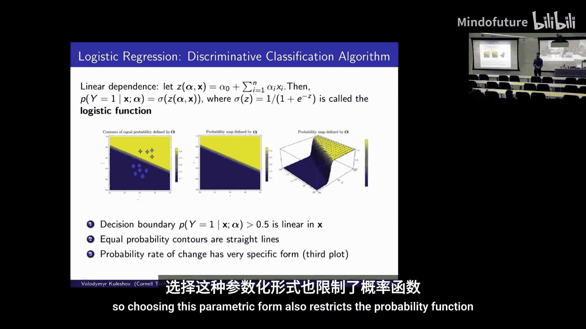

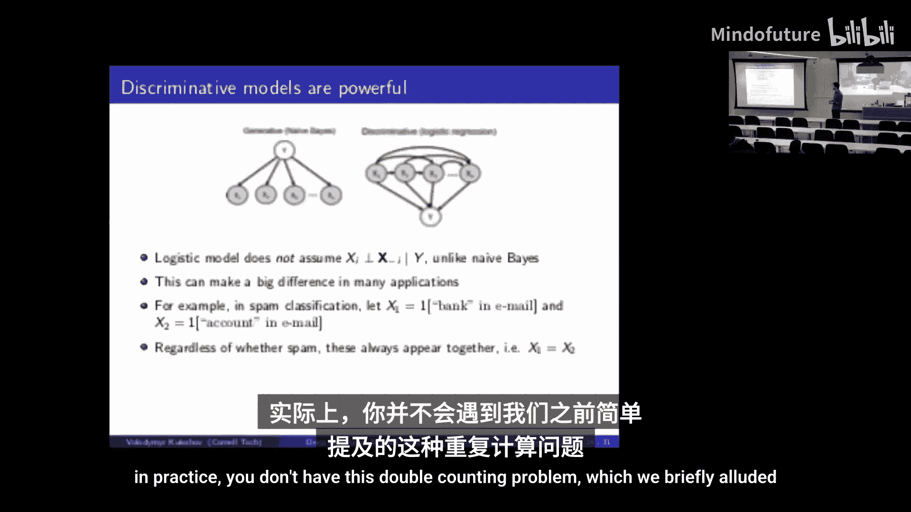

Drimin model will often work work better for particular model， in fact， most of。

Most of the popular algorithms that we use for prediction for classificationation are instances of discriminant models。

 even these deep neural networks， so a deep convolutional neural net is there's another case of this where we're using where this app is now a different form。

 if you make at the continent， then that's a different type of model for neural instance。

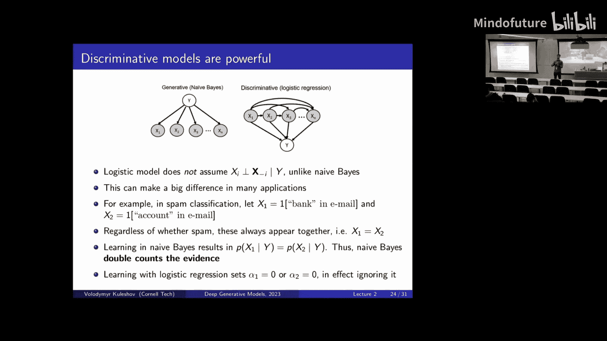

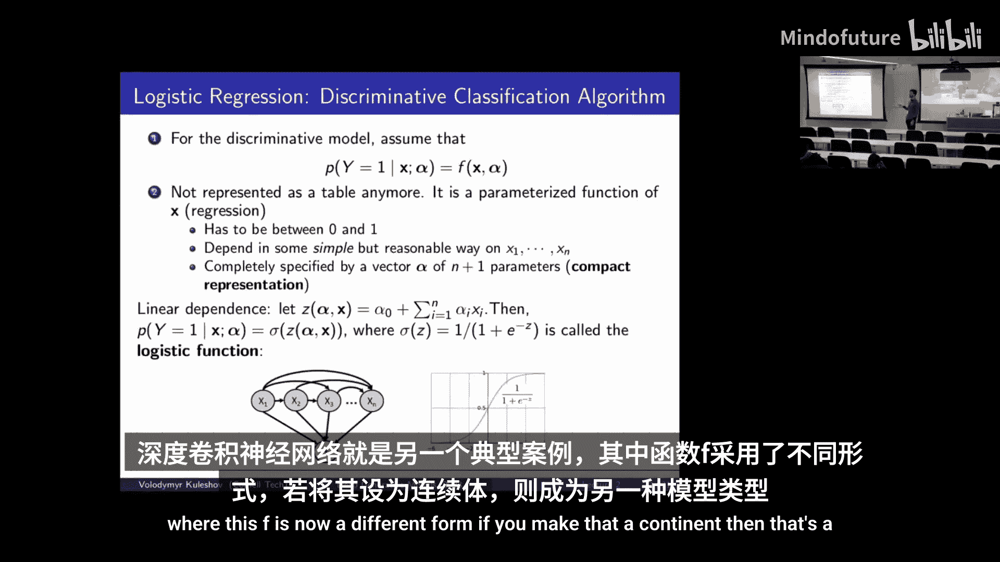

The criminal models are very powerful。The general models are also very useful because we can model X。

We can do things like handling missing data or if we see， yeah， So if we pay a partial。

 if we have a partially observed next， we can still make predictions from the model。

 and we can also do things like generation and other tasks that we can do。

The genderative models are also used。

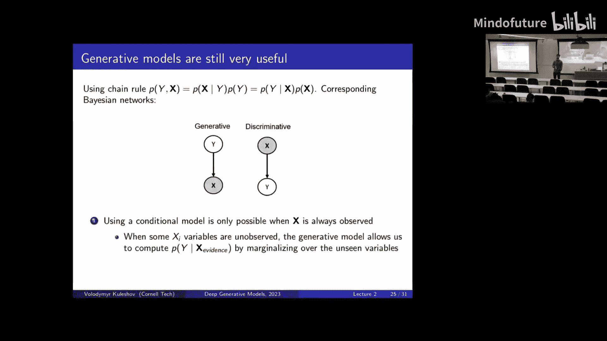

And in particular， general models can become specially useful if we combine them with certain ideas from scrimative models in deep learning。

And this is where and this is what I want to end the lecture with。So， so far， we've see。

Asian networks as the one way of defining。Arobability over data。

 we've seen these parametric discriminator models as another way of defining a predictive distribution of Y given X and in the last few slides I want to hint at how you can combine these ideas and get the best world。

 guess get the best of both worlds and this will also hint at our first example of a deep generator model which is going to be in a better address。

H。OkaySo remember that in theriminative models， we assume this particular for the Y given。And。😊。

The example that I just gave you， linear regression。

 this example assumes that F here is linear function with a sigmoid on top。

 so it assumes a simple form。You can also make this more sophisticated by assuming a more complex form on that。

Let's say that F has the following structure， so we take x， we multiply it by a matrix A。

 we added a5 B， and we added this non nonlinearity G， we call that whole thing H of a B and x。

And then our。And then we apply alpha， not an x but on Asia A and E x。As you can see。

 this is just a fully connected neural net。Its hit a layer this page。

So instead of making F a linear function plus a sigmoid， we can make it a two layer。

 we can make it a fully connected。Neurural net with a single hidden layer， which is H。

 and that's what is exactly described by this formula。This is now a more expressive model。

 it has the more parameters， and the hope is that it can model more expressive。

 more flexible distributions， so we have increased the set of all the possible distributions that we can approximate using this model。

Okay so now we have a non me independence， again， the advantage is more flexible。

 the disadvantage is that it has more parameters。

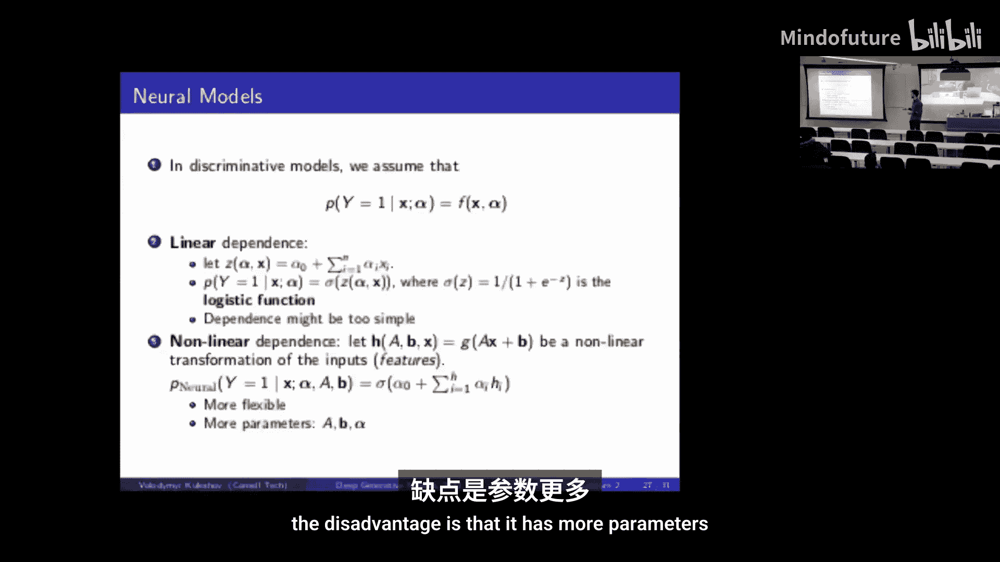

嗯。We can keep repeating this process many times， so we have one H， but we can have multiple hs。

 and this gives us a neural network which has this flow。

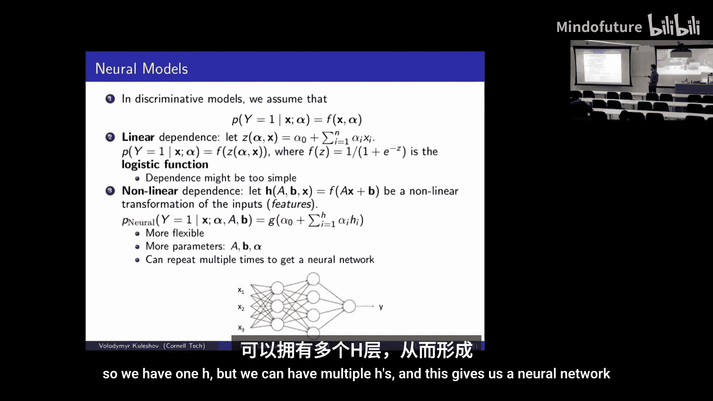

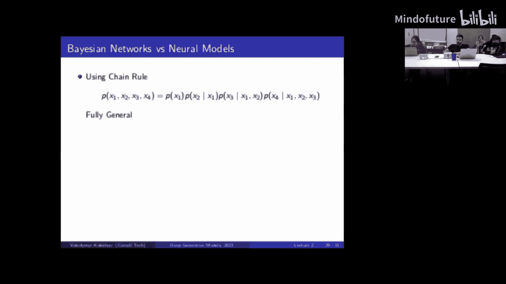

Let's now compare all so okay， I guess now we have three possible approaches we have。

Daature networks， we derived from the conditional the drive from the chain world and conditional independence。

We have these simple linear models， and we have these neuralral models。 Let's compare them。 In fact。

 let's see if we can combine them。So the original way。

 the kind of the initial model families that we we or one of the first model families looked at was something that's based on the chain。

So if we have a distribution already needs four pixels。

 we form all the conditionals in the chain rule and we try to define more for each condition this is still exponential with the number of pixels。

 it doesn't mean in a any。So one way that we use to simplify this model is we remove certain dependencies and this is the basenet approach Now imagine what would happen if we instead。

Added the neural approach to the setting。 So each face look here X speed。

 that's just the binary in the second binary variable，0 over one。

So each of these terms X be given x1 x to explore given x Y x63。

 these are all each term here explore given x1 x23。

 these are in exactly these are exactly the same type of model that we try to solve using logistic regression or using discriminative neural networks explore given x1 x to x3 iss just。

A predictor for the fourth pixel given the previous places， this is a by classifier in some sense。

 this is a probability that tries to model the probability of x4 B black or white。

 given the previous pixel。

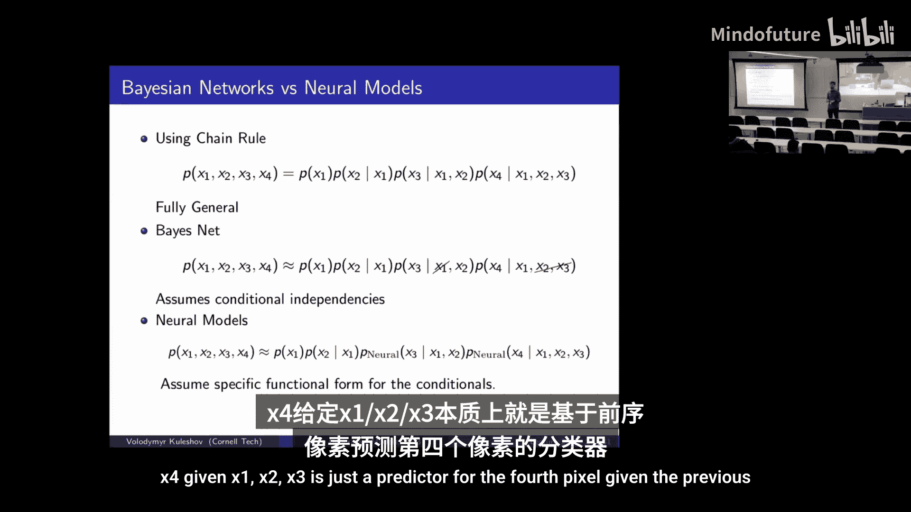

So because this is literally the same problem， we just try to solve using the logistic regression model and using that neuralnet model。

You can also。But different是。And instead we could try to parameter we could try to。

 so instead of simplifying these conditionals， we could try to leave them unsimplified。

 but instead we could across toimate them using a neural model。

So in the naiveve approach using the chain rule， we kept all the conditional and all the dependencies。

 but we tried to， but then we left each conditional unsimplified。

 we left it as a full table that describes all the possible assignment that has a probability for each possible assignment of4 x 1 x3 and that's just exponential。

So one way to reduce this。One way to deal with discural dimensionality is to reduce the number of terms in the table。

 which is what the baseline is doing， Another approach is to not model a table。

 but instead replace the table with a parametric model like a neural net or a logistic regression。

And that's what the hero is doing doing。So one way in which discriminative models and neural networks can be combined with generative models is that this idea of modeling conditionals as neural nets。

And once you do this， you can also have fewer parameters because now each of these zero terms doesn't need。

Right if we， if we make this logistic regression， if efficient。

If each factor here is approximated with a regression， well that has a linear number of parameters。

 so it has its most n parameters and there's at most n terms。

 and there's going to be less than n squared parameters in this model。

NowSo this is so this is an important point， another way which you can get a compact model for the high dimensional distribution is to take the chain rule and instead of simplifying instead of deleting terms in each。

In each factor， we keep all the terms， but we approximate the entire factor using a parametermetric pole。

And that's the first approach that we're going to take in this past building a lead general model in particular and other aggressive model。

And this can be a powerful approach because if these neural nets are expressive。

 we might be able to approximate this distribution very。

 very well from data without having to start writing。And also。

 I want to mentioned this expense to continuous variables as well。So far， I've been talking about。

Sweet variables in the entire lecture。 But if we have a continuous variable。Well。

 we can't represent as a table anymore， but we can assume a certain fairmetric form。

 which you see here and which you should remember for the other lectures that are coming。

For a uniform distribution。Or， you know， your song or。Yeah， or any sort of distribution。嗯。And。

If we have a continued momentum。Gand vector can also represent it using a density function。

 a joint density function， so we could assume some kind of parametric form like con calcium。

Or it also form a chain rule forward the over a jointin if。We continuous variables X， Y， and Z。

 we can still apply the chain。In this form， and now this is a product of best cities。

And similarly to how we approximated each traditional actor within how we proposed。

InIn how you propose modeling each factor using a neural net in on the previous slide。

 you could also model each factor here using。A neuralral net and the same slide。对。没有东西。

And then using this approach we could define some interesting vascular models， so for example。

 one type of models which we're going to see， which is called variational auto code。

 and we see a special case of this where we have two variables， Z and X。

 we can characterizeize them in this form。And。Well， okay。

 one easier setting than what I'm proposing is just a mixture of two Gaussians。

 let's say than z is a rernoulli01 and in a regular mixture of Gaussian。

 Gaussians so we have a net which factorizes in this form and z is a rernoully then x given z is one normal think x given z equals one is another normal。

 it's just a mixture of Gaussians。You could also instead assume that he is coming from something institution and X given。

He could be。The normal distribution was mean this can be seen as an infinite mixture couch。

And then something that we're going to do in this course is that we're going to instead of just having this。

This mean the a linear function of the， you could make this function be some kind of complicated neural net。

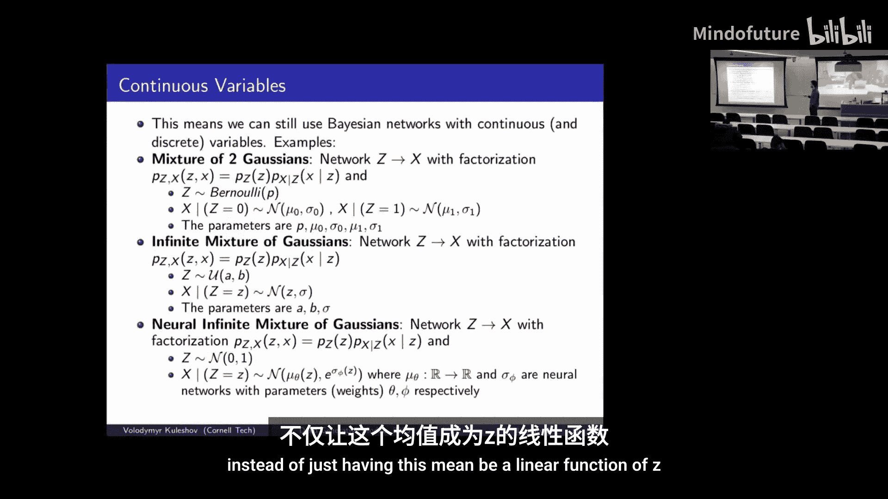

Approxximator that makes Z as input makes itself new。

 And this will give us another type of models that we're going to see called creation。嗯。

Okay so these are some examples of general models that are coming in the next few weeks。

 and next week we're going to look at other aggressivegressive models。

 which is going to be an instance of the first approach of modeling factors using neural net that I just proposed。

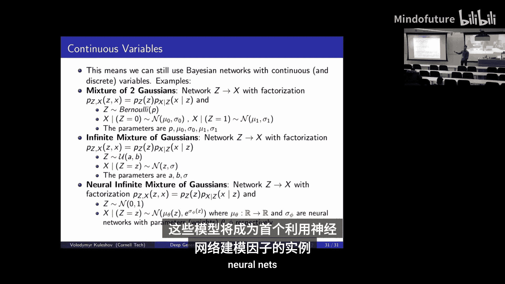