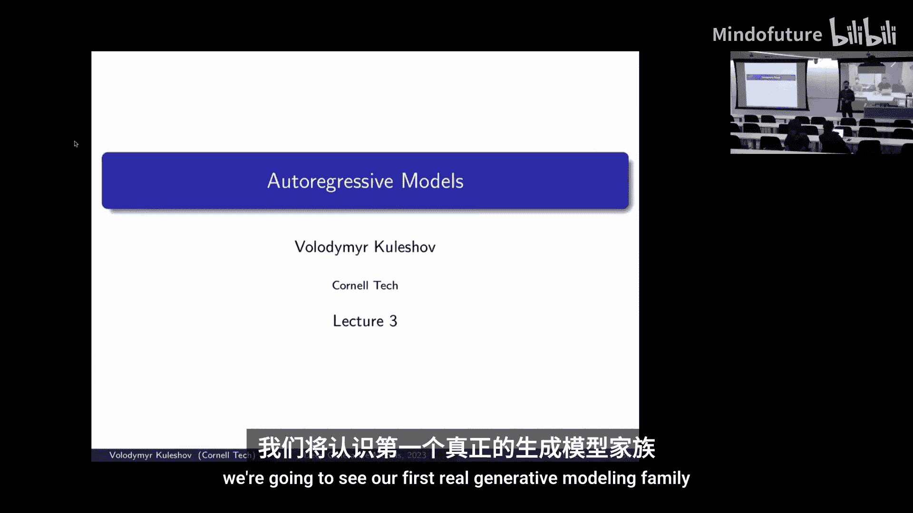
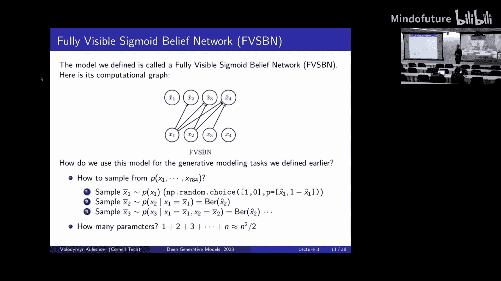
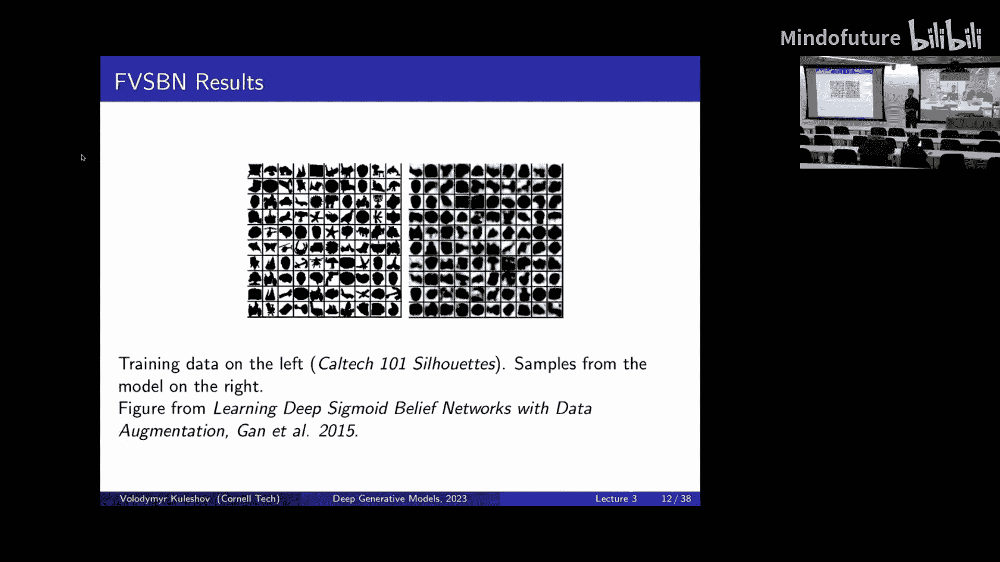
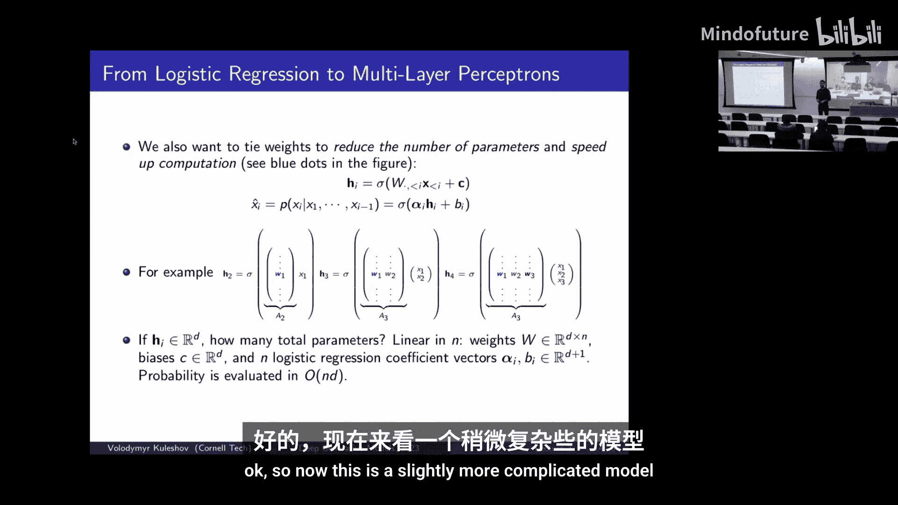
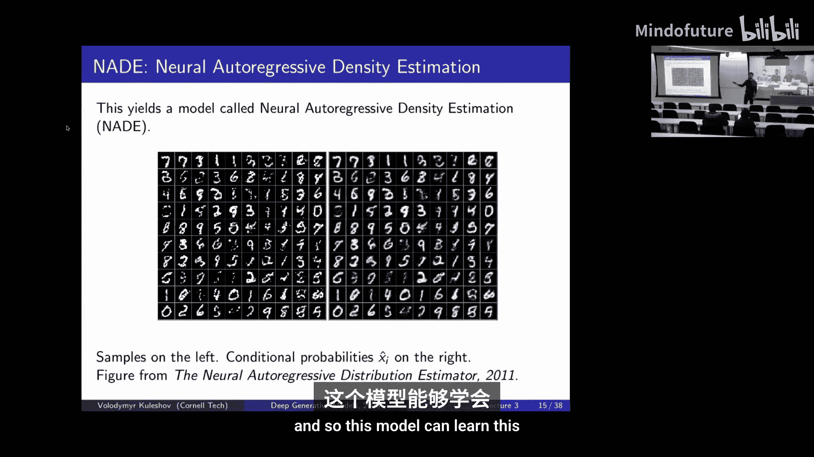
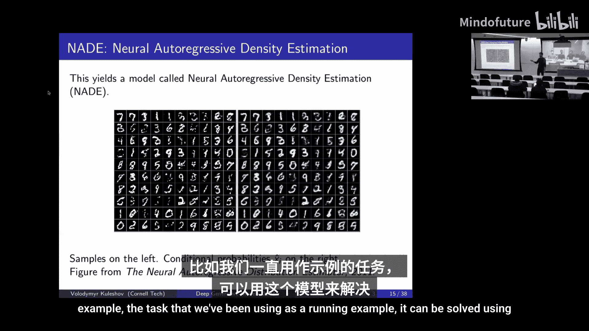
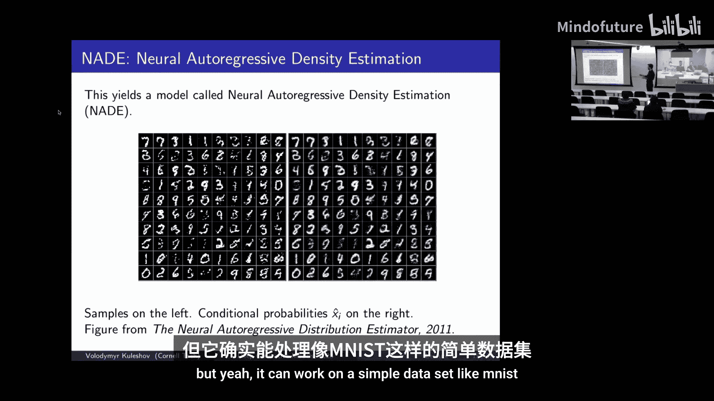
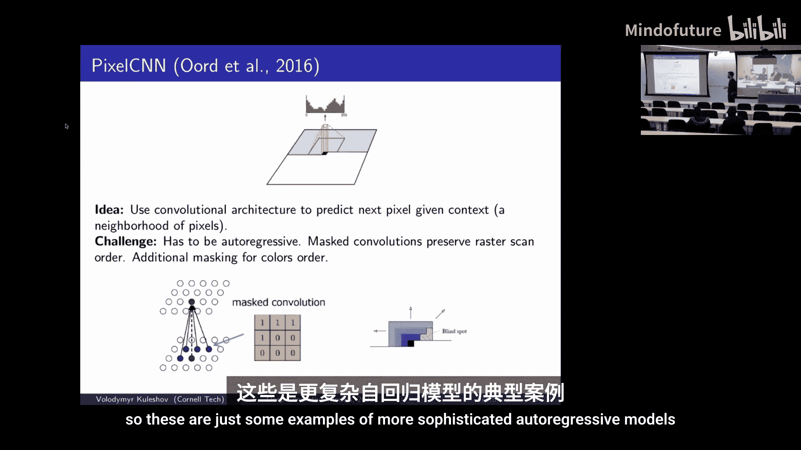
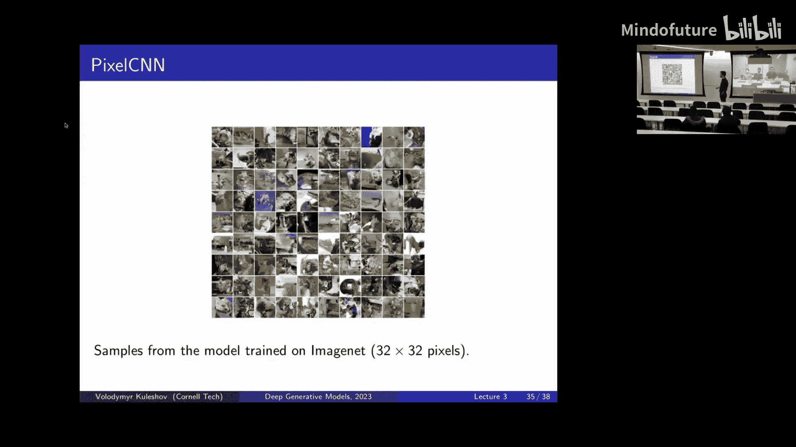
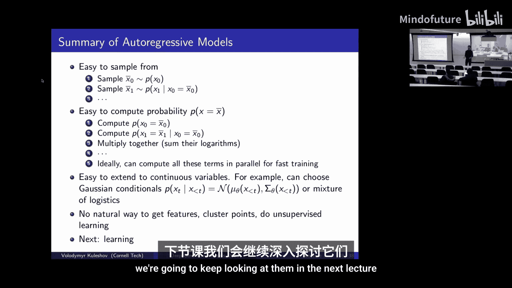

# 【康奈尔大学】深度生成模型 ｜ Deep Generative Models, Cornell Tech Cs 6785 p03 P03_Lecture_3-自回归模型 -BV1p2awzrEJr_p3-

So today we're going to start our first type of we're going to see our first type of general family called Ar Ses。

 if you recall in the last few in the last two lectures， we first started。introductiontro。

 what is gender modeling and then we had a lecture on various types of background and context needed to understand the few lectures that are coming and now we're going to start in earnest we're going to see our first real gene modeling family。

Let's set again a bit of context recall that。Our goal for this lecture and for this class is to is to perform this general task called generative modeling。

 And in our first two lectures， we define what generative modeling is。

 This picture gives an overview of of。Of the idea of general modeling。

 recall that we're interested in modeling high dimensional data points。

 such as images or audio or text or chemical molecules and。In this example。

 we're interested in modeling images and there's different ways of solving this task。

 one example could be building a graphics engine where we write a lot of code that describes that uses our understanding of the world to render complicated scenes that is one approach but what we're doing in this lecture is in this class is very different're going to we're going to be trying to learn these models from data so our models are going to be statistical。

 they will be described by a probability distribution and we're going to learn them from data。

 so in this example we have a data set of images and we want to define and learn a probability distribution with a data science high probability to these images that can generate new images that can discover structure within the images in an unsupervised way and so we're going to define a distribution。

We're going to define a class of distributions， a class of models again this all our gener modeling algorithms have a similar structure。

 we define a model family， we define a parameterization for a probability distribution that's the first step then we define and some kind of objective some kind of metric some kind of loss function between our distribution and the ideal data distribution and then we define an optimizer a way of discoverying or learning the best distribution in our model that is closest to the data distribution that's the high level approach that we're going to follow and then once we once we run this threestep geneative modeling or once we run this generative modeling algorithm that has these three components we get back a probability distribution once we have that we can solve a lot of interesting tasks for example we can perform generation by sampling。

from this distribution so now we get images which look like a dog if we train this on dogs。

 we can also perform representation learning so discover interesting structure in this in these images we might discover that all of these images have certain of components in common like ears tails now and we can also perform this other task called density estimation which means that given an image of a dog I would like or given an image I would like to know is this an image。

That comes from my data distribution， does it look like a dog or is it an outlier。

 so these are going to be some of the tasks that we're interested in。And so the first step is。

 I guess the first step to realize this。I to start at the modeling stage and define what it means to have a probability distribution。

 what it means to define a model family。In other words。

 how do we represent a probability distribution P ofX with some set of parameters that's the focus of today's lecture。

 and then in the next lecture we're going to see methods for learning the parameters of this distribution or in other words。

 choosing a good probability distribution within our model family。

And recall that in the previous lecture， we saw a few ways in which we can represent probability distributions。

 I would say these are more classical these were more classical approaches to representing a probability distribution。

So first of all， wanted， if we had a distribution over variables。

 we can always apply the chain rule of probability to decompose it as a product of factors。

So P of x1 x2 x x4 factorizes using this formula。But。

And then if we wanted to have a model of p1 x2 x p4。

 we can specify a model of px1 a model of px2 given x1， et cetera， et cetera。

 and if we can have a model of each factor， then we can have a model of the full distribution so this is。

The advantage of this decomposition is that we're not making any assumption on what P is we can still represent any distribution if we have these this decomposition so the left and the right hand side are equivalent there's no restrictive assumptions。

 but the problem is that。You know， if each X I variable only has two outcomes， that's already a。

This will require a number of parameters that is exponential in the number of variables。

 so this doesn't work， this doesn't scale， this is the curse of dimensionality and the main reason why we're doing all of this work is to deal with this curse of dimensionality。

So another way that we can， or I guess one thing that we can do to deal with the curse of dimensionality is to simplify our model so instead of considering all the possible factors in this instead of having all the possible factors within decomposition and having each factor be condition on all the variables。

 it can make a simplifying assumption and delete certain variables in the conditioning of each factor。

 so now instead of x4 being dependent on x1， x2 and x3， x4 can be dependent only on。

 I guess in this example will be only x1 or it could be only x3。

 it could be only a subset of the ancestors。And so in other words。

 we're making conditional independence assumptions we're assuming that certain variables are independent of certain other variables this。

This， in other words， restricts the kinds of probabilities that we can represent within our model。

 but it it can greatly reduce the number of parameters we need。

 so this can easily use a linear number of parameters if we make enough simplifying assumptions。

And here when I say we have a model for each probability for each factor in this probability distribution。

 I mean that each term here is a mini table， so x for the sake of this example。

 let's say x1 x to x3 x4 are all binary， so x4 given x1 that's just the table that lists all the probabilities for x4 given x1 it's just a mini table but these tables are because we have deleted certain factor。

 certain terms here in。Position the。These tables are small， they're not exponential。

So this is one way in which we can simplify our。In which we can use a simpler， smaller model。

But that's not the only way。Imagine that instead of trying to represent each of these factors as a mini table。

 imagine that instead we。We parameterize these as a barmetric model。In other words。哎。these x4， x3。

 that's a binary variable， and so this is a probabilityability distribution over X4 given its ancestors is a distribution over a binary variable given a number of inputs。

And that's something that we can model using a regular parametric， discriminative model。

 such as logistic regression or a neural network。So instead of having PCPT。

 instead of having P of X4， given the ancestors me a table。

 we're going to make it a parametric model。And in fact。

 we're going to parameterize it by an expressive model， like a neural net。

And this is what I mean here by P neural and so once we make this assumption。

 we could still use a number of parameters in P neural that is。Exent。

Neural net is sufficiently expressive， we can still approximate this factor which involves a lot of features。

Going inside of it and so we can still have an expressive model that approximates this joint distributions joint distribution using less using a sub exponential number of parameters so that's the strategy that we're going to follow in in this lecture to define an utter aggressive generative model This third line is essentially what an utter aggressive generative model is。

So the plan for the lecture is going to be to dive a little bit deeper into this third strategy and first start with a few examples of the different neural models that could be used to parameterize each of these conditionals these will give you a first set of examples of what other aggressivegressive general model is。

 then we're going to look at another type of other aggressivegressive general models based on recurrent neural networks and then I'll conclude with a few examples of more modern other aggressivegressive models that are not just toy examples。

So for the purpose of this lecture， most of our examples are going to be defined in the context of this task。

 which we also defined in the last lecture， which is modeling handwritten digits。And in this example。

 we're going to be using a data set called MNIS or here it's a binaryized MNIS so we're interested in building a generative model over these 1written digits and each digit is a 28 by 28 pixel image where each pixel has a binary value it's either zero or one so these are the sets of i dimensionional objects。

 images that we're trying to model in most of the following examples。

So each pixel is black and white， and our goal is to define a probability distribution over 784 binary variables where each variable is associated with a pixel。

嗯。So in order to define this model， again， there are two steps or in order to define a general modeling algorithm。

 we have two steps first we have to define a model which is what we're going to do next。

 and then we will want to learn this model somehow。

 which is what we're going to do in the next lecture。Okay。

 so how do we how do we form thisgenerative model so recall that we're going to start with the chain rule decomposition and then each term in the chain rule is going to be parameterized by a neural net by a predictive model of a binary pixel given all the previous pixels。

So what kind of models could we use here？Let's remember a few standard models from machine learning that could be applied here again。

 our task here if we wanted to binary have a predictor for a binary variable y given it features x。

We could use a discriminative model， which is simply a parametertization or a distribution of y of a binary variable y given input X。

And parameters alpha。In the discriminative approach。

 we assume that P of y of1 given x and alpha is given to us by some parameterized function f of x alpha。

And one example of F of x alpha is logistic regression。

Logistic regression simply does a duck product between x and alpha， that's what we call Z of alpha x。

So this is just a dot product， a linear function， and then the probability or the this function f of x alpha is going to be a sigmoid of z。

 so z is just a linear function， but that's not valid between0 and 1 and we want a probability in0 and1 so we use the sigmoid function to squish it to be between0 and1 and that's a linear regression model it outputs a number between0 and 1。

 which is simply the probability of y equals one。And then we can take this one step further。

 And instead of having just one linear layer followed by a sigmoid， we could have multiple layers。

 And this is called a multi layer perceptron。 So instead of first。

Instead of doing a simple linear product and then passing it into a stigmoid。

 we could first do this nonlinear we could do this linear transformation followed by a but followed by a nonlinearity。

 we're going to call this H of ABx or H we're calling it H because this is the hidden layer of a multilayer perceptron。

 so。呃。H is going to be a matrix multiplication followed by a nonlinearity like a re or a sigmoid or a bench and then we have a standard sigmoid layer on top of H right so by adding extra layers we have a more expressive model than a logistic regression model right this logistic regression model it can it can model only only linear decision boundary between y equals1 and y equals0 here when we add this extra hidden layer we have a more expressive model we can we have now a small neural network this is the computational graph of a neural network and by making this model more expressive we can have。

We can we can learn more interesting functions of x to y Okay。

 so this is just a quick recap of logistic regression and multilayer neuralettes you should be familiar with all of this from an earlier course on machine learning。

 but here I just repeated some of these terms so that we're on the same page。Okay。

 so these are the tools that we have for parameterizing at our aggressive model。

 how do we use these tools？Well， first of all， let's start with the simplest rule we have。

 let's start with logistic regression。We're going to follow the recipe in that initial slide。

 we're going to start with the full joint distribution and then we're going to apply the chain rule。

 which gives me the following decomposition。And now some of these conditionals， I want to so here。

 for example， the less conditional XN given all the previous Xn minus1， if this was a table。

 this would require something like 2 to 1784 roughly that number of parameters。

 this is way too large， so instead we want to parameterize each of these conditionals using a logistic regression model。

So here I'm using deep logicit。To， to denote this。 So now probability of X n。

 given the previous values is going to be a logistic regression model with parameters， alpha n。Okay。

 and then for the very first。For the very first variable it's just P of x1 there's there's no conditioning so that one can just be a table it can just x1 only has two values。

 so for the first variable we just store a probability of it being1 and then one minus that is the probability of it being0。

 but then for the second variable for the probability of x2 equals1 give an x1 we have a simple logistic regression model with one input and that input is x1 then for the probability of x3 we have another logistic regression model with。

Now， two input teachers。这ですご。And so on， and then Xn is going to the probability of x n equals one is going to be a logistic regression model with n minus1 input features。

 xn minus1 up to x1。Here we literally just parameterize each term with a logistic regression model。

Now， of course， here we have made a modeling assumption。

 it's not true that every probability XN given all the previous n minus1 variables can be model it's probably false that the true probability of XN given its ancestors is a logistic regression model。

 but we're going to hope that this logistic regression approximation is a good one。

 so here we have made our first modeling assumption。U。

And another observation to make here is that each of these XN。

 given the previous each of these conditionals is a conditional Brnoulli。

 so a Brnoulli has one parameter， and so each of these curves is a Brnoulli with a parameter。

Is a function of the previous inputs x1 to xn minus1。And we're going to use this notation x hat。

To denote the parameter of the period。Okay， so X I hat， you can think of it in two ways。

One way to think of it is literally the parameter of this conditional Bernoulli distribution， okay。

 and because it's a parameter between0 and1。You can also think of it as a prediction for what Xi is given the previous pixels。

 so Xi had。Or I guess x hat， you can think of it as a vector of predictions for each pixel given the previous pixels。

Okay。And this is again， the mathematical form for that prediction。

 it's a logistic function estimator。So X I hat is going to be the probability that the pixel is on。

Is going to be a， you can think of it also as a prediction for the next pixel。

Given the previous pixels， or you can also think of it as a reconstruction of Xi given the previous pixels。

 so this is the kind of the gist of what an utter aggressivegressive gene modeling generative model is。

We're going to be training neural networks to predict each variable or each pixel given the other pixels。

 and if we can accurately predict the next pixel， given all the previous pixels。

 then we can do a lot of the tasks that we're interested in， for example。

 we can generate new images by just sampling the next pixel adding it to the image。

 then predicting the next pixel， taking a sample of that， adding it back to my。

Kind of current sample of the image and so on。 So we can do a lot of the tasks we're interested in if we can simply predict the next pixel from the previous pixel。

And all that utter aggressiveive generative modeling is is it produces to the idea of can I predict the next pixel or the next variable from the previous pixels or variables？

And then Xi hat is what we use to denote her。Prediction。嗯。So we can also represent this visually。

 first of all this model that I just described has a name it's called a fully visible sigmoid belief network and this is how we can represent its computational graph so this is going to be a model that receives as input or at least a training time when we train this we get as we see an image we see all of the pixels and then our goal and then this computational graph runs a bunch of logistic regressions to generate predictions X hat for x and our goal is to ensure that X hat matches the original input X。

So this is how we're going to be how we're going to represent and then later train these models。Now。

 once I have this model again， as I said earlier， I can solve a lot of the tasks that we defined at the very beginning。

 for example， I can perform density estimation。Once I have a model that predicts the next pixel given the previous pixels。

 I can evaluate this density， you like swan given。I can evaluate this joint distribution。

 How do I do this， I just multiply all the conditionals that I have。 So in other words， given。

Given this swax2， I can simply generate these parameters， so I'm given a fully observed image。

I'm given X from X， I can run this computational graph。

 I can run all my logistic regressions to compute X hat and now x hat is the parameter of each pixel。

 So now I can evaluate the probability of that pixel under its parameter X hat。 In other words。

 I have this joint distribution。I can apply the chain rule， I know that this factorizes us。

P of x1 given P of x2， given x1， given P of x3 given x1 x2， et cetera， and then each term。

And then from my logistic regression models， I have the probability for each of these terms。

 so I know that P of x1 given0 is going to be1 minus x1 hat x1 hat is the probability that x1 equals1 and here it equals0 so probability of x1 equals0 is1 minus x1 hat x2 hat is the probability that x2 equals1 given x1 equals0 so that's so here my x2 equals 1 I just multiplied it by x2。

So this is a formula that can be applied to any。To any model to obtain a density from these logistic regression models。

 from their predictions。Okay。So this is literally applying the chain rule and using these predictions。

Yes。And then as I said earlier we can also sample from this distribution so let's say I don't have an image I want to generate one so how do I do this well again according to the chain rule。

 this distribution factorizes as the product as x1 probability of X1 the of x2 given x1 etc ce。

 so I can perform what's called ancestral sampling where I first sample the first pixel you have x1。

Right here I just use my prediction for X1 hat that's my probability of the pixel being positive I can just sample from this。

From this distribution， then given my first sample。

 I can sample the next pixel condition on the first thing that I sampled right so I predict the second pixel。

Its prediction is x2 hat， so the second pixel is sampled from a Bernoulli with a parameter x2 hat。

And then I draw that sample， and I get my second pixel X2。Similarly for x3。

 now that I have a pixel for x1， a pixel for x2 I put these into my logistic regression model for x3。

 I predict x3 I get this value x3 hat sorry this is the type of on the third line I should say x3 hat that's my prediction for the next pixel it's also the parameter of the Bernoulli distribution over the third pixel and now I just draw again another binary sample for the third pixel and so on and I keep doing this until I get the full until I get the full image。

Okay， so now here's a question， roughly speaking in terms of big onnotation。

 how many parameters does this model have？So how many parameters does the fully visible Sigmoid belief network model have？

So recall that I'm training a logistic regression model to predict each I have a separate logistic regression model for each pixel that predicts that pixel given the previous pixels。

Yes。Is it the same， is it one plus two plus three plus four so two to the four minus one？

15 not so one plus 2 plus3， et cetera， up to n。 that is correct。

 and that is roughly the goal of n squared。So it's n times n minus1 divided by two。

 so this is big O squared。So here we have roughly n squared parameters for this model， right？嗯。Yeah。

 so it means that we can do all of the tasks we're interested in and we can also have a polynomial number of parameters for the model it's no longer exponential and so now does this model work well it can do simple things here this is a sigmoid belief network trained on a simple data set of objects settes on the left you see the actual images from the data set on the right you see samples that have been trained using they have been obtained from a model that has been trained on this data and we have samples which look roughly like Settes so this can do this model indeed can do simple tasks this shows that by predicting the next pixel you can solve at least simple instances of this utteraggressive task。

O， yes。So I guess it's a bit odd that those images are exactly corresponding because I you should have no control on what it generate so by giving half image and then asking to I don think that there that there's a one to one mapping like I mean look here we have a dolphin in the top right corner or sample is just a big blob I would say the first one top left is the chair this looks more like dolphin if anything on the top left I don't think there's the one to one corresponding can you control it by giving first half yes yes of course yes so the question is can you can you can you do more interesting things like give it the first half of the image and ask it to generate the other half Yes absolutely you can do a lot of interesting things like this yeah。

Yes。

Okay， so this was a。Our first example of an utterregressive generative model。As you can imagine。

 we can take this one step further instead of using a sigmoid instead of using a logistic regression to parameterize each conditional。

 we can use something more interesting。We can， for example。

 use that multilayer per Setron that I had in my earlier slide。

 and that will give us a slightly more sophisticated model。And yeah。

 so let's consider what happens if instead of using a logistic regression model。

 we use a multi layerer pertra。So now when we can okay our task is still to compute a prediction for each pixel given the previous pixels。

 and I'm going to use Xi hat as as that prediction。

 we call that Xi hat is also the parameter of the Berulli distribution over that pixel。

We have a conditional distribution over the pixel。I， and that conditional distribution is a Bnoulli。

 and its parameter is Xi hat。And because X I hat is between0 and 1。

 you can also think of it as a prediction for the pixel X。 So our goal is to predict this number。

 which is between 0 and1。 We can apply this this multi layer perceptron。

 The way we do this is we take as input。All the previous pixels。

 and I'm going to denote them by this vector x。Sub less than I。

 So x sub less than I is a vector of dimension I -1。

 that is simply the concatenation of all the previous pixels。This is a vector。

 I multiplied by some weight matrix AI， I apply this bias term C。

 and then I pass it into an nonlinearity， this gives me H。

 the hidden layer for the I multilayer perceptron。And then I just put this。

And then I just apply just the regression layer on H to get X I hat。And there you go here。

 I just explained how I would use a multi layerer perceptron to predict Xi So now my now this probability of Xi given。

The previous pixels， it now has some extra parameters before I only had alpha I as my parameter。

 Now I also have these extra parameter I only had alpha and B。 Now I have these two other parameters。

 I have this matrix alpha I and I have the bias them C。

 So I've added I've added a few extra parameters into my model and these parameters are needed。

To parameterize the full multi layerer perceptron。Okay so here is visually how this would look like for the first for the first pixel we don't have any input so that's just tabular for the second pixel。

 we use x1 is our input that's just a scalar so it multiplies a colon vector and then there's the bias term and that's my hidden layer for the second pixel for the third pixel I now concatennate x1 and x2 I make it a column vector of dimension 2 and this now multiplies a2 by d vector where d is the size of my hidden layer is the number of neurons in the hidden layer and then in for H4 this input vector is going to have three is going to have a length3 and I'm going to multiply it by E by matrix and so on This is just a visual representation of the calculations that are going on。

嗯。So as you can see this has way more parameters than we had before now I have instead of just having a vector per conditional。

 I now have an entire matrix for each conditional。This is starting to look like a little bit more parameters than we would like to use。

 so one thing that we can do， and this is something that's very common in our regressive models。

Is to apply weight sharing so we're going to tie the parameters across these different conditionals。

 we're going to reuse the same set of parameters in the model for the first pixel for the second pixel。

 the third pixel， the fourth pixel and so on。Okay， so instead of having a separate matrix a for each conditional。

 we're going to assume that we have one big matrix W and the matrix A is just a different slice of that bigger matrix W。

Okay， let me just show this you here picture， so W is my big matrix。

And order to get this hidden layer， I in order to get the hidden representation for the I pixel。

 I take the first eye columns of the matrix W， and that is my matrix AI。Okay。

 so and this is what I denote by W。Less than I。Or in other words。Visually， this is the same kind of。

Picture illustration， as I had on the previous slide， except that this matrix a2。

 a these matrices a2， a3， a4， they are no longer。They're not independent anymore。

 they're all just slices of the bigger matrix that we so。

This is a D by one matrix that's just the first column of w the second matrix is a D by two matrix that's then I set it to the first two columns of w for the third matrix I to the first three columns of W etc so I'm just going reuse the weights and again this is called weight sharing it's used all the time in our aggressive models to make things more tractable because if you have a lot of pixels and each predictor for each pixel is large then that can lead to a a lot of parameters so in practice we die them question So I got lost a little the dimensions alpha I and B these are scalar scalarrs。

BI is a scalar。 Al I is a vector。 So okay， this Al I and the B are the parameters of the logistic regression model。

 and that logistic regression model has has。It takes this input H。

 let's say the dimension of H sub I is D， so alpha I is a D dimensional vector and B is a scalar term is a scalar bias term。

And then to get the hidden layer， we have one big matrix that's。D by N。And to get the a matrices。

 we take subsets of that big D by n matrix W。So how many parameters does this model have Yeah and there's a question your question is about XI hat right what is Xi hat Yeah it's exactly the same thing as in the previous example it's a scalar between0 and1 and you can think of it as either the prediction for the next pixel or you can think of it as the parameter of the conditional distribution over pixel I given the previous pixels and because that conditional distribution is a Bnoulli its parameter is scalar between0 and1 which is what XI hat is so I guess back to my question how many parameters roughly speaking are there in this model。

You can even ignore the bias termsm if it's easier。so发 I。Alpha is shared also。No。

 no alpha would not be shared， so alpha I is going to be if it has this sub I and it's not shared。

So d squared plus dn。D squared， so it wouldn't be d squared because this matrix W it's D by n right so we have n inputs。

 we have up to n inputs and then the size of the hidden layer is D。so this matrix is D by n。And。

 and then these coefficient vectors are D。 So it's going to be。What's the biggo？Yeah。The。

're going to have roughly big of andD different parameters。Yes。Right， so we have something that's。

 well， I guess D， you want to problem yeah， yeah， we have big O of n times D。

Where D is the size of the hidden layer and most of and this is mostly coming from the weight matrix W。

 which is D by n， and then we also have n of these d dimensional vectors。

 so all of this adds up to a big of N D。Okay， so now this is a slightly more complicated model What kind of samples do we get from it so these are samples on the left we have samples from the model that has been trained on these digits on the right we have the actual digits and so this model can learn this。

Example， the task that we've been using as a running example。

 it can solve these model these are the kinds of samples that we can draw from it okay so this is a model that is called NA neuro auto aggressivegressive density estimation。

 it's an old model from 2011 but yeah it can you work on a simple data set like M。

Okay， there's one more point I want to make here， maybe you've noticed that both of these models。

 the fully visible Sigma belief network and NAD， they look a little bit like an hood on code or neural network。

If you remember， an other encoder is a neural net that takes its input x。

 and then it tries to predict x again， so it takes its input a vector and it tries to output the same vector。

 but it usually has a certain architecture that forces it to compress x into a code and then decompress it。

So just as a refresher an autoender neural network is a neural network that has two components one it's called an encoder for example here we take x。

 we map it through two neural network layers， we get some kind of vector that represents code for that image and then we have a decoder which takes that code and tries to reconstruct the original x so in some sense an autoencoder tries to compress X into some kind of code and then decompress it and if you force it to compress and decompress it who will hopefully learn some interesting some interesting code。

So in this example， yeah， our decoder is pretty simple， and the encodeder has these two layers。

And we typically optimize this neural net using the reconstruction error， we have the input。

 the output should be equal to the input， so we just minimize the loss in this example it's the L2 loss between the input and the output。

Just a quick reminder of what an outenr is， and typically E& D have to be constrained so we don't just learn the identity mapping。

Okay， so you might have noticed some similarities between an outr as defined here and the models that we've been using and an utterr could almost look like a generative model except that。

It doesn't quite give us an actual probability distribution because every in the output。

 every variable depends on every variable in the input， whereas we want some additional structure。

 we want each variable in the output to only depend on a subset of the input。

But these are aggressive models， they really look like an auto coder if you think of them as predicting a shifted input。

Yeah， they predict the shifted input using a smaller computational graph where some edges have been deleted。

So if we have a fully sigmoid belief network， it's generating predictions for the input。

Based on on the real input and then x4 had the prediction of x4 depends on everything that comes before。

Variable4 in the input， but there are no edges that are going to it from the future。

So you can think of an utter aggressiveive model as an autoencor where we have deleted certain edges and computation from the future cannot go and influence the past Okay so here in this computational graph there are no edges well each variable only receives edges from the past but not from the future。

And we when we have this structure， then we can say that we have a valid probability distribution。

 right because。This X4 hat can be seen as a parameter as a prediction for Xi。

 given the previous variable， the previous variables， if it had anything from the future。

 then this would no longer be a valid term in the chain rule decomposition。So。

So we remove the future and once we have removed this future。

 any computational graph gives us a valid。It can give us valid predictions for conditionals。

 such that when we multiply them， we get a valid probability distribution。And in practice。

 we can construct this graph from any out enr by first taking the full outcor and then removing the edges that come from the future。

And what I mean by removing edges that come from the future。

 it just means that we clamp those weights to zero。Okay， so each edge here。It corresponds to。To， to。

 to await。It corresponds to a term in a matrix of parameters that influences。

That influences the prediction， so if we clamp some weights to zero。

 we're effectively the leading edges from the computational graph。

And when we delete edges from the computational graph， we have。

Something which looks like this masked and shifted at aggressivegressive model that you see in this picture。

 so this is an analogy that's really helpful to remember as you're working with other regressive models。

Pretty much every other aggressive model， including the fancier ones that we're going to see in a few slides。

 they are instances of masked outencors， you can obtain them from a certain type of outencoder and then setting certain weights to zero。

Okay and then there's an algorithm for this called made which I won't go into detail yeah I'm going to explain this in detail but if you're interested you look this slide and you can look up the paper there's a general algorithm for the leading edges in an outencor so here on the right we have an outencor and let's say that the second variable is the first is the first variable in our decomposition so Ps p of x2 then p of x3 given x2 then p of x1 given x x2 so the second variable x2 is the first term and so its output node does not receive any edges and everywhere else in the graph we have marked。

The node with a number and。So number three can receive number one and number two。

 but number two can only receive one and then one cannot receive anything。

 and there's a way of assigning these numbers and deleting edges that ensures that with a very deep out oncor。

 you have predictions that don't use anything from the future。Okay。

 so this was an overview of a few initial examples of utterregressive geneative models。

We're going to see a few more advanced approaches in the next few slides。

 but are there any questions on this so far？So an utter encoder is not a generative model for the reason that I said earlier because in the output every。

So an utter encoder takes his input。Let's say an image X， and it to reconstruct。

 it tries to predict that image。FromFrom the input and when it does that。

 the neural net that parameterizes an utterencoder has a particular structure where it first it typically first becomes smaller。

 so you reduce the number of neurons and then you increase the number of neurons again so it can't learn the identity function has to compress the input and then decompress it so this is where a typical utterencor is。

 but when you do this computational graph every pixel in the output image depends on every pixel every pixel in the output depends on every pixel in the input so you can't use those。

You can't use the computational graph to define an utter aggressiveive generative model because each pixel has to output the parameters of a conditional distribution over that pixel given the previous pixels。

 and therefore it can't be influenced by the pixels that come later in the ordering。Which is why。

Aative an encoder can look like a generative model if you delete certain edges or if you or equivalently。

 you clam certain weights0。And， and then you use the output of the outenr as the parameters of a utter aggressiveive model。

 Why do we want to reproduce the image if we already have the age。

 So there's two versions to this question。 One is there's two。

 there's two answers to this in one case， if we。If we just have a regular outcor。

 we might want to use this outcor to learn to compress images into a smaller vector and when you compress images to a smaller vector。

 it will learn to represent the images in an interesting way。

 So similar images will be mapped to similar codes and then you can visualize this So this is when you don't do any this is unrelated to。

Out aggressiveive journal of modeling。 And then。If you are doing otherreive general modeling， well。

You still， you still want to train this model which reconstructs the image given an existing image because at training time。

 you have the real image and you want to reconstruct it。

 but then at test time you don't have the real image， but you can sample pixels one by one and。

You can can use this model to sample pixels one by one。

 or you can also evaluate densities if you have。A full image。

 you can run it through this mask outcor to generate parameters for the joint probability distribution。

 and you can use those parameters to evaluate deduct ability of the image。

 kind of like what I had in one of my earlier slides。

I just want to also spend a little bit of time talking about some slightly more advanced models one of them。

Is going to be based on recurrent neural networks。 I wouldn't say this is terribly advanced or state of the art。

 but this is just another approach to utter aggressive genre modeling， which is really interesting。

Okay， what is。So yeah， what is a general model based on recurrent neuralnet Imagine that these so so far we've work with these pixel with these images of 784 pixels but imagine that we have a very large number of pixels imagine that instead of modeling images。

 we're modeling very long time series or we're modeling text where we can have or the number of variables and can be very。

 very large or it can even be variable， let's say one let's say we're modeling text and we have one sentence or we have a paragraph of 300 words and then another paragraph 500 words and all of the X's are they have a different length then it becomes less obvious to apply that the techniques that we had in the in the first set of slides。

Okay， and in particular， the problem with having a large number of variables is that as T gets longer。

 this history also becomes larger and larger， and so we need at least if we directly apply the methods from the。

Previous few slides， this alpha will also have to become very， very large。

 alpha has to be at least it has to be at least linear in the number of variables。

 but if that number of variables is very large， for example。

 you can imagine generating audio which has it can have up to 44，000 samples or 44。

000 variables per second， that's a very large number of variables to model and so we need to have something a little bit more clever。

 in order to handle very large history。And that's what a recurrent neural network does The idea of a recurrent neural network is that instead of directly parameterizing a function from the previous variables to the next variable。

 it uses a summary of the history。There is。That is the output of that recurring neural net and the prediction for the next pixel is not a function of the previous pixels directly。

 it's a function of the history。So this is a computational graph of a neural net。

 and this is the update rule。And so we see that here we maintain this additional vector H sub T。

 and that's the history of vector。And at each time step。

 the first operation that we do is to update HceptT。

Using an operation which could look like what you see here。

 so we form H subT plus one using some kind of neural net or some kind of matrix multiplication plus non linearity that's a function of the concatenation of the previous H subT and the current token Xt plus one。

Right so we have we observe a new token Xt plus one， we want to update our history。

 so we generate ht plus one from the previous history and the current new token Xt plus one。

 we concatenate these， we put them into it。Into some function here。

 linear transformation plus the linearity， you get the new。We get the new。History。

 and then we generate a prediction， not from the X's directly， but we generate a prediction from the。

From the history， so we multiply the history by some matrix， and that's our prediction。

And we can represent this visually using the coal graph that's at the top。Yes。

 yeah that's a good question can you use an an utterenr to compress maybe but the utter encoder still has you still have to have a first layer which takes all the variables right like you still have to have at least one layer which increases with the number of variables。

So it wouldn't quite work， but maybe there's some variations of this with weight sharing。

 you could do something like this and we're going to come back to it a little bit later。Okay。

 but that's a really good question。Okay so this is a summary of what an RNN is。

 so it's parameterized by a number of matrices that does not increase with the number of variables。

 so constant number of parameters with respect to the number of variables。Okay。

 I'm going to skip the slide， but this is going to be an example of how we can apply R NNs to。

Pixel insert to generate text character by character。

 So now we're modeling sequences of characters and。We're going to be applying the same technique。

 The only thing is。At the output layer， we have our predictions are characters。

 so our output is going to be the parameters of a softmax distribution over these characters。

 which means that given the history， we're going to output a number for each possible character。

 we're going to expentiate them and normalize them so we get a probability distribution over each character。

And now at each step I have a distribution over the next character。

 so to generate I just draw a new character， I put in back into the R and end I have a distribution over the next character and so forth and if we apply this method to。

 for example。Shakespeare， it can generate text to which at a high level。

 this is a very small character by character RNN， and it can generate things which at a high level looks like Shakespeare。

So it can generate the character names here。It's interesting that it gets the punctuation right。

 the grammar is mostly right， the meaning is maybe not quite there。

 but even the simple model gets a lot of interesting things right here it when trained in Wikipedia it gets the markup correctly。

It getsIt learns to open and close the curly brackets。You can even generate。

LateEC which oh sorry this is Mark it can generate， yeah。

 this is stillkipedia Markup and it's roughly correct and it can generate things like baby names。

That's a fun example here we see。Jane or Lee isn so short baby name characters et cetera。

 and I would say going back to the pros and bonds of RNs。

 the main pros is that they can be applied to sequence of arbitrary lengths。And also very general。

 they can express， at least theoretically， they have the computational complex they have the expressivity to represent any computable function that's an interesting theoretical result about RNs。

However， in practice。In practice。They're not always the easiest model to train。

When you apply these multiplications many， many times your gradients can vanish or explode。

 therefore there are specialized architectures such as LSTMs。

 long short termm memory which addresses partially some of these vanishing and exploitd gradient problems but not completely it' still a problem in practice。

 so even though theoretically it can condition on the whole history in practice， it doesn't。

 but it's still be long， it has this problem of slow generation。

Which means that you have to generate word by word。

 so this can take a while if you have to run an neural net each time you generate the next character that can be slow and maybe the bigger problem is that you need to run it character by character。

 not just at inference time， not just for sampling but also for training if you wanted to compute the likelihood of this at training time and then back propagate to obtain the gradients。

 you still have to run that R andN。Essentially in a loop to compute the history。

 so you can't compute the history vector for variable I before you compute it for variable I minus1。

 therefore it takes longer to do the forward pass and then it can take longer to obtain the gradients and therefore these RN or aggressivegressive models can be slower than some of the nonrecurrent models。

Yeah。Okay， so these are some examples and pros and cons of RN based other aggressive models。

And now I also want to introduce a few slightly more sophisticated auto aggressiveive models。

 these are actually。呃。These models or their improved versions or variations of these models are actually used in real world systems。

 this is a famous model called WaveNe which is an unaggressive geneative model for raw audio。

It's a model that was developed in 2016 and versions of this model have been deployed for speech generation on various devices like personal assistant on phones。

 and this is the model from which I played samples in the first lecture so this was a big improvement in audio yourgen quality when it came out and it found its way into many real worldorl products or variations of this have found their way into real worldorld systems。

嗯。Again， waveveNe has this structure which again， looks like a masked out oncor。It takes as input。

 so it guess a wave nett layer takes as input。Observed input。

 and then it passes it through a computational graph that computes the orange layer at the top。

 which are predictions for the next sample given the previous samples right so here at the top right corner I have a prediction for sample Xi plus one given sample Xi and Xi minus one and all the other samples that's what is in blue。

Okay， but this computational graph has some interesting structure that NAD and the other models don't have。

 as you can see it is more sparse， so the black arrows show which。

Which neurons affect the prediction for XI+1 and not all of them influence the prediction for XI+1。

And also， there's a lot of weight sharing within this computational graph that I will describe。

And these， this sparsity and this weight sharing is implemented using。A number of techniques。

 the main ones are the use of causal convolutions and dilated convolutions。

So what do I mean by this and what exactly is this architecture， so first of all。

 it is based on convolutions。You should remember that a convolution is an operation that's used in various types of signal processing。

 it's used a lot in images， it's used within convolutional neural nets。

 but you can also use it within convolutional you can use 1D convolutions within convolutional neural nets for 1D signals like audio and essentially it applies the same filter。

Within a signal。Okay。So waveveNe relies on convolutions to parameterize this computational graph and because the convolution applies the same filter everywhere in the sequence。

 this will naturally lead to some form of weight sharing and so in particular。

 this P of Xi given all the previous，Xise will be parameterized by convolutions and because the convolutions are。

 they're just applying the same filter everywhere in the image， the parameters for P of Xi。

 given the previous exercise will be the same for every eye。Okay。Yeah。

But there is a problem with applying convolutions negative。

A normal one dimensional convolution has a certain receptive field size。

 which is symmetric around the I output so here at the top I have。The output layer and each element。

 I， each neuron I has a receptive field size has a receptive field， which is shown in blue。

 And in this case， I have a receptive field of size3 and this receptive field takes as input the current pixel and then the previous pixel and the next pixel。

 So this is a bit of a problem because if I have if I want to create a convolution neural neural net that parameterizes an ourr that does not see the future。

 I don't want。Eleement Xi plus one， influencing element Xi。Which is what this does。

So what we need to do is similarly to the previous example。

 we want to apply masking and clamp certain weights to zero in particular we're going to take a convolutional filter and we're going to clamp the parts of the convolutional filter that touch the future to be always to zero and this is called a causal convolution。

And it gives us these filters which have the shape that you see at the bottom。

So now the last pixel only is only the or the last。

The neuron is only influenced by the neurons that are directly at the bottom and to the left。

 it doesn't get influenced by the neurons that come to the right。So if I were to use this。As an。

 as the basis of an utter regressive model。If what I have at the top is the prediction for the next pixel or the next sample from the audio signal。

 it doesn't get influenced by anything that comes from the future。

 this is called causal convolution or a mask causal convolution or a masked convolution。

So waveNeck relies on these a lot。And the other thing that WNe uses are dilated convolutions。

 so on the left here you have a standard 2D convolutional filter that's of size three by3。

And it forms a square， but this its receptive field is only three by3 we would like to make it larger and we would like to make it larger without increasing the number of parameters that it requires so has this is a three by three filter it has nine parameters we want to have a larger receptive field size but still keep nine parameters one way to do this is via dilation what dilation does is it just spreads out these nine variables in space or time or whatever dimensions you're using so here in the middle I have a dilation factor of one and I have a dilation factor of two on on the right hand side。

Okay， and when we make it。So in practice， these related convolutions tend to capture long range signal better than other techniques。

 and it's also much more parameter efficient than just increasing the filter size。

So wavenet uses these did convolutions a lot Now let's see we how we can construct waveNe from 1D causal convolutions and from dilated convolutions。

If we had waveNe using only regular non dilated but still causal convolutions。

 we would have a computational graph that looks like this here at the bottom I have my input pixels or my input audio samples and i'm trying to predict the next sample so I apply a causal convolution in the first layer now I have。

A set of hidden neurons and each neuron only depends on what comes previously in the past。

 not in the future， and then apply a convolution layer again here at each time step I have a causal。

Convolution with a。Receptive field size of two， so each neuron here is。

Influenced by directly what comes below and what comes right before right so filter size of two but causal I have this in each layer and then at the end my prediction for the next pixel is only a function of what comes earlier and this is a again these are convolutions so the same filters are applied everywhere in this graph so if I were to take if I were to use if I were to take the prediction not for not the one in the top right corner but somewhere in the middle it would still be the same set of weights that's parameterizing the function that's predicting each of these orange orange nodes。

They're all convolutions with the same filters。Okay， but so this would give us a valid model。

 this will give us a valid generative model， it gives us a valid prediction for the next pixel that cheat that doesn't see the future。

 but the problem is that the receptive field size is really small here if I have one， two， three。

 four， five layers I have one two， three， four， five。

Previous samples that are influencing my prediction。

 And if I have an audio sample with tens of thousands of these inputs。

 is this perceptive field size is too small。So I need to increase the receptive field size。

Which is what we do here by adding diations， so this is the full waveleth model that you had in the person。

And now instead of the blue pixel so in the blue pixel I have a dilation level of one。

 but then as I move upwards， I increase the dilation factor， so it's still a causal convolution。

 it still has shared parameters， so these black arrows they involve the same weights regardless of where you are in the sequence。

 so we have weight weight sharing as in the con， but。

This dilation allows the prediction for the next pixel to be conditioned on a much bigger history of previous pixels。

可。And so this is a summary of the wavenet architecture。

The interesting thing about this architecture is that it can be applied beyond audio signals。

 there is also a way of applying these to images。And the idea is the same。

 you apply masked convolutions。To an image， to obtain predictions for the next pixel at each。

In each pixel right so again， these convolutions have to be masked。

 We have to take a standard convolutional neural net， and each builder has to be。

Certain entries have to be set to zero， so we never cheat and we never look into the future when we compute the the activation and the way we might do this is。

So here， if this is our filter， we would set the values of the the missing values here。

 they have been clamped to be zero in the filter。And so this is a mask con for images if we apply this。

If we apply this to a full image， we get a set of predictions for the next pixel it will be utter aggressive right so here we have a mask convolution。

 this is the filter。They get supplied to a convolution in order to prevent it from seeing the future。

We apply this in the same way as we do to 1D signals and now we have an our aggressivegressive models over images over 2D signals so these are just some examples of more sophisticated other aggressivegressive models and this pixelN model can generate more realistic samples these are samples that were generated in 2016 on this data set called miniimNe we can now of course generate much better samples and we're going to see later much much better quality samples but you know this is already doing something that's much more sophisticated than M。

All right。I'm going to end with。Just a brief overview of regressive models。

 so other regressive models they define this class of probability distributions based on the chain rule based on the chain rule of probability where we use a neural net to parameterize each term in the chain rule and so each of these neural nets simply predicts the next pixel or the next variable given all the previous variables in some kind of ordering。

And they're easy to sample from well they're easy in a sense that sampling is tractable in some cases sampling will be much more complex。

 but here they're easy to sample， we start with the first pixel and then we predict the next pixel given the first pixel and so on。

 we generate things out aggressively， it's also easy to compute the probability of an image so we can do outlier detection and density estimation we again simply compute all the parameters and then we multiply them together。

This so density estimation is tractable again， density estimation will be intractable in。

At least half of the models that were going to be more than half of the gene modeling families we're going to be considering。

 so this is actually a very nice property。And they also extend to continuous variables。However。

 they have limitations， they don't have a way to do representational learning。

 which is a task that we define early on。And and I guess I haven't told you yet how we learn these models。

 which is going to be the topic of the next lecture when we're going to talk about maximum likelihood learning for。

Or genderative models。Okay， so this is an overview of。

Our first this was our first geneative Moing family。

 we're going to keep looking at them in the next lecture and then look at variational art encoders next week。

