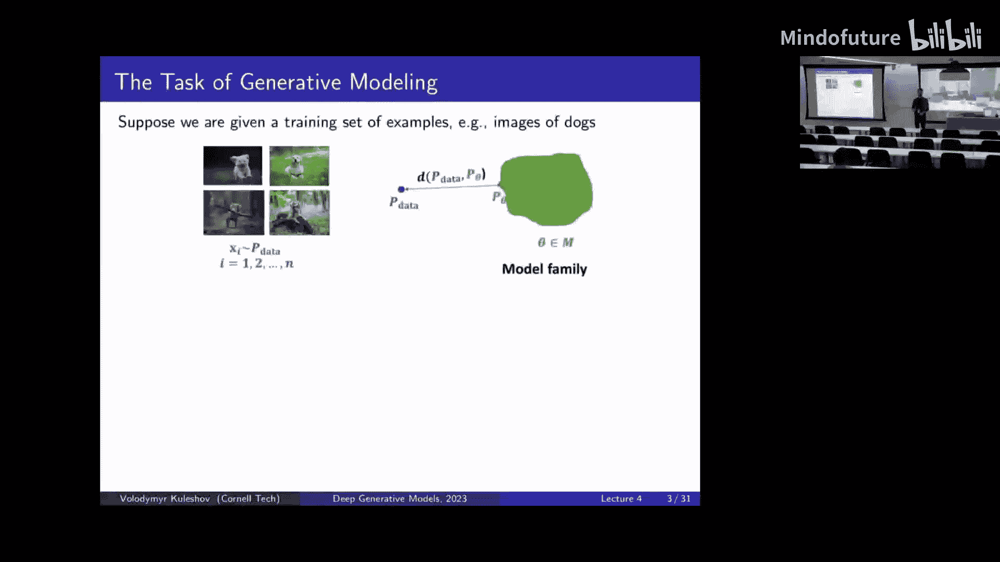
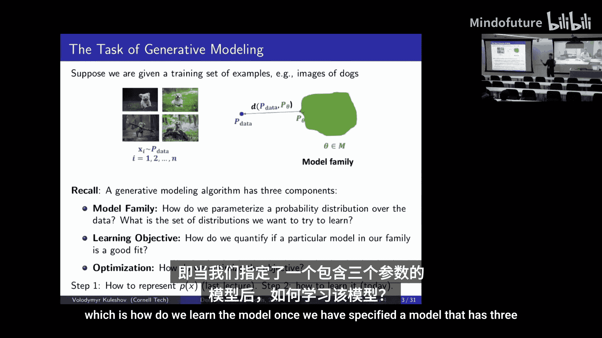
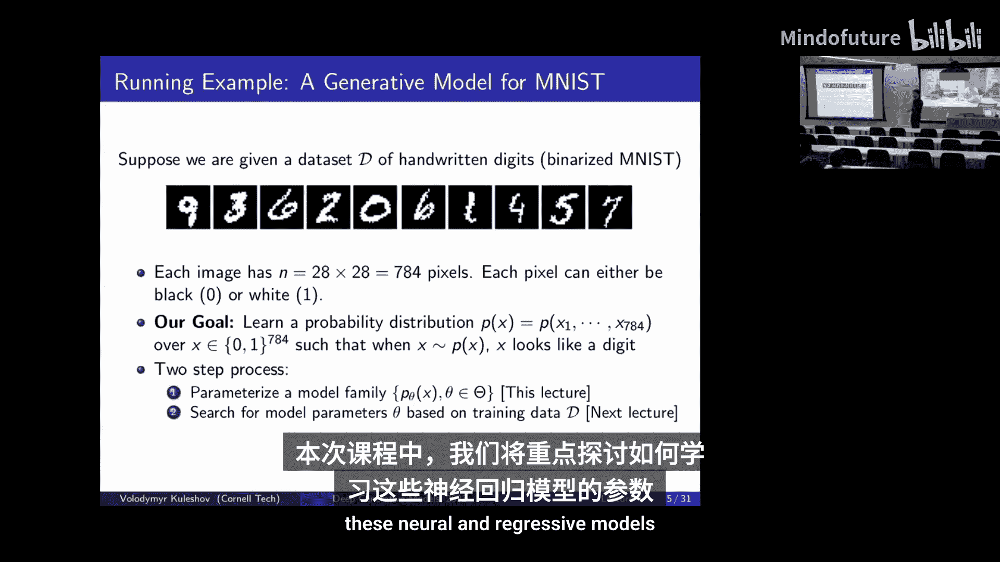
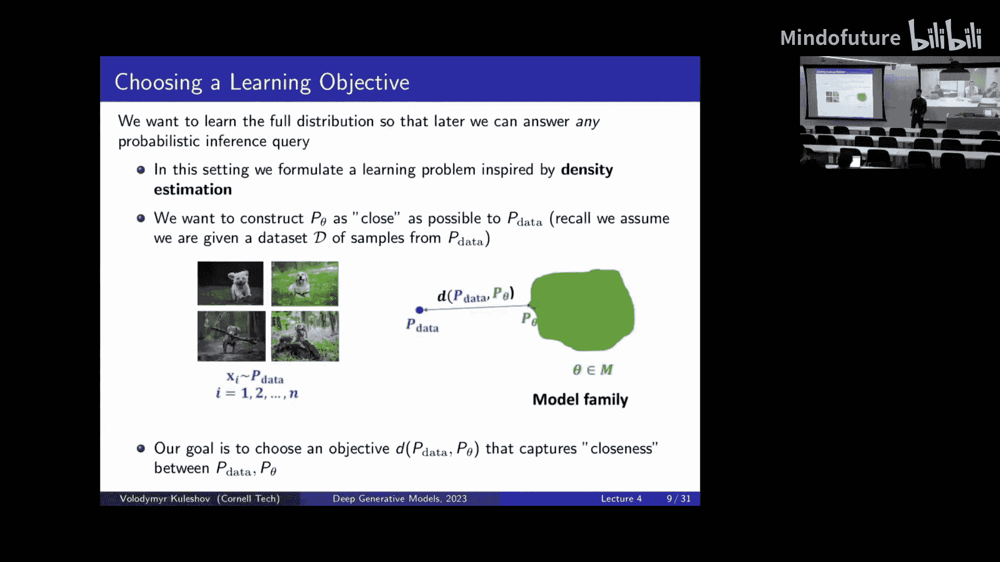
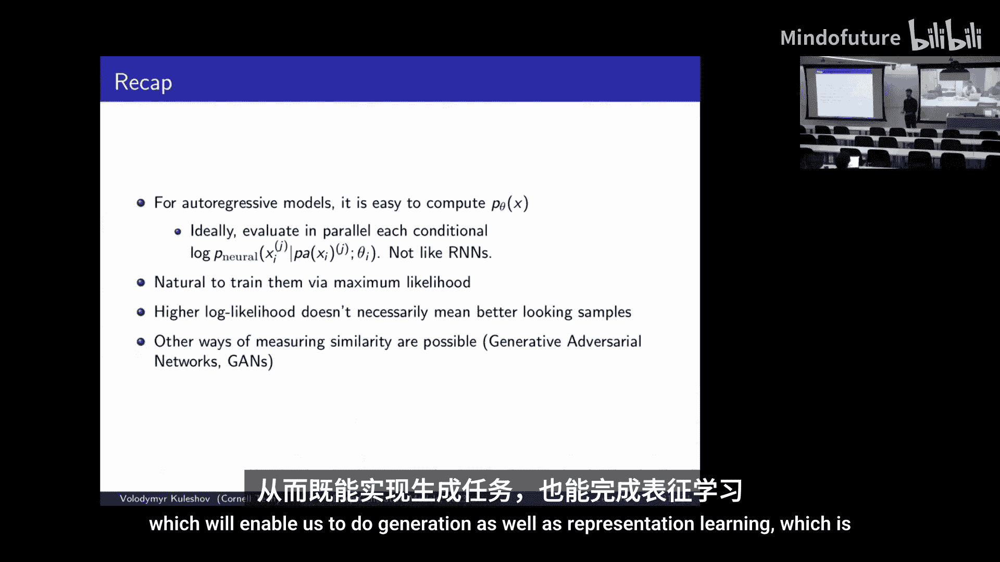

# 【康奈尔大学】深度生成模型 ｜ Deep Generative Models, Cornell Tech Cs 6785 p04 P04_Lecture_4-最大似然学习 -BV1p2awzrEJr_p4-

So， let's start。

So remember， this is the this is our overview slide we've been doing in these past several lectures。

 so this is the image that explains what we've been doing in the last few lectures。

 we have a data set and we want to fit a generalative model to this data set。

 which is going to be in this class always a probability distribution。Let's remind ourselves， again。

 the structure of a generative modeling algorithm。As in most algorithms say machine learning。

 you can define three components of a general model algorithm the first one is the model or maybe more being more precise than it would say it's the model family。

 which is the form or the type of distribution that we're going to fit to the data。

Or a little bit more precisely， what is the set of all the possible distributions from which we could choose our model that will be the output of the algorithm。

 Right， So the once we run the geneative model algorithm。

 our output will be a model of the data will be a probability distribution and。

And the model family is the set of all the possible models that we might consider being the out of the out。

And then once we have a set of possible models that we want to consider。

We choose the learning objective， which tells us which is a way of quantifying whether a certain model is a good fit to the data。

And then we need an optimization procedure for choosing the best model according to our learning these are three standard components of a learning。

And so far。In the first several lectures， we're looking at the first part of the algorithm。

 the model family， how do we represent this probabilistic model。

 what kind of formula do we use for defining a probability and distribution。

 and now this lecture I want to talk to you about the learning objective and the optimizer。

 which is how do we learn the model once we have specified a model that has three parameters。

 how do we choose these parameters。

And so the outline of the lecture is going to be that the format of the lecture will be that first we will look at this general objective for learning probilistic models and in particular for realisticistic generative models called maximum likelihood。

We will define what it is and where it comes from and then in the middle part we will at how we can optimize the likelihood based on a training set。

 and then I'll have a few comments on my experience and miscellaneous topics towards the end。Okay。

 so as our running example， we're again going to use this this task of modeling handwritten digits and here we have this data set these are samples from an actual data set from ANIS and each data point here is an image it's 28 by 28 pixels and each pixel is binary 001 so each。

Images of 28。By 28 matrix of one zeros or equivalently， it's a 784 dimensional binary vector。

And that's what we want to model， and we want to define a probability distribution over this data。

And。The space of all the possible digits all the possible images is very larges due to the power 784 because that's how many because we have 784 binary pixels so we have to make some assumptions on the model we can't just fit all the possible distributions that assign a different value to to the 1784 possible values we have to choose a certain restricted parametric form for what the distribution or digits will be and ideally we want to find a modeling family that is still well it definitely has to be tractable and we also want this model to be。

Able to capture the structure of the data。 So we don't need to be accurate or yeah。

 we we still want the model to be tractable， but also sufficiently expressive to model these digits and to to assign hyperroability。

It is a little probability for one that build。And we saw a few examples of models we use for this one example could involve or I guess there's there's at least two approaches that we've seen for defining compact and expressive models the first one was the Asian networks and the second one was neural auto aggressivegressive models and the idea of neural autoaggressive models was to apply the chain rule of proability to be factorize it into a product of factors and then each of these factors instead of being represented as an exponentially sized table we represented as a compact neuralnet we represented as a parametermetric neuralNe with a tractable number of parameters this was the strategy that we followed in last lecture defined a family of autoaggressive neural models。

Now in this lecture， we want to find a procedure for learning the parameters of these neural or regressive models。

 and this these methods will be useful for learning any distribution。

So。In order to be able to do learning or in order to be able to do learning with。You，Mi。

Here it is that it will somehow work， we have to make some assumptions on the data。

 so machine learning algorithms don't work on any data。

 work on data which satisfies certain assumptions。And the main assumption that you make in machine learning is that the data is coming from some kind of。

Data distribution， So these images that I have， they're not arbitrary they're not arbitrary sets of pixels。

 they're images coming from a data distribution of handwritten digits。Right。

 so there is some signal to to this data。Certain data points are more likely than。

Other data points and we think of this signal as。B as coming from a data distribution。

 so the we assume the data points are coming from this the distribution。

 and we also assume that these so so there is some distribution or all the images that we might want to model。

But when we apply our machine learning algorithm， we have access to a data set。

 so a data set is a set of end samples from a data distribution。

And so now our goal is to so we have these samples here we have another example we have images of dogs and what we're going to try to do is given this data set of dogs。

 given this model family， which is this，Region of the space of all the probability distributions。

 we will want to find the set we will want to find probability within the set that is closest to the data distribution according to some distance or metric or learning objective D。

Hey， that's the。Just the hell effect， we define a learning objective and we find the distribution in our model family that's closest to the data distribution。

对。嗯。So just to make it a little bit more precise here， we have chosen a family of models script N。

 and our goal is to learn a good model。P theta within an。So for example。

 just to make sure this is really contained， lets let's look at what a parametric model what a parametric model family might be。

 one example of a parametric model family could be one example of a model family or distribution could be the set of all the Bay networks。

 the particular structure so we fix。The structure of a Baysian net and for each conditional we have a table。

 these tables are what defined the parameters of the distribution。

 so we could consider learning these tables in a Baysian network。

So so these are the set of all the possible tables defined。

 the set of all the possible basic distributions that we might have。Or if we have a neural model。

 then the set of possible models is defined by the set of all possible parameters that could go into each neural net that's parameterizing a that's parameterizing one factors in the chainposition so the parameters within the FSD and。

Yes， the end model will define all the possible。Dine the so precisely the n is the set of all the probability distributions where their parameters live in the shadow。

All the possible parameters that the logistic Russian coefficient。

So the goal is to then learn these parameters such that we approximate the data distribution well。

So the key component of this figure is this D， it's this learning objective that we have to first define in order to be able to。

Perform any sort of learning， we have to define what learning means。

And there's different ways of defining this。This is especially true in generative modeling inative models。

 So in the next models we may seen in machine learning before， things are a little bit easier。

 we usually want to optimize some。Some notion of accuracy， typically we have， or case in many cases。

 we have a well defined notion of accuracy， we have positive say we have positive and negative labels。

 negative labels， we want to optimize our accuracy over these labels。This is relatively easy。

 so negative factor you might not be exactly differentable。

 so we might want to use another objective that's supposed to related like to error or the procentroppy。

There's different ways of doing it， but usually the effect is more precise here with a generatorative model。

 things are a little bit different because a geneative model can do a lot of things。

 it can do generation that' the estimation it can do missing value patient learning。

It becomes much less obvious how to define the good learning of。

So here are some possible taskss that we might be interested in doing with the general model One task may be density estimation we're interested in。

Directly evaluating the probability PmX we have an image X and we want to compute Pmx that's called density estimation this could be useful for anomaly infection。

 for example， we want to know if a certain image is a digit or not。

We might be interested in prediction， even with a generative model。

 so a generative model can be defined over features X and labels Y。

And we might want to be maximizing predictive actors as's a completely legitimate task for a generative model。

 or we might be interested in representation learning or structure discovery where we want to inspect the model itself。

 we want to inspect the parameters and try to understand something about the data by looking at these parameters。

 for example， maybe we have some model of how genes interact with each other or how gene expression levels are associated with some other factors we。

Maybe with the genetics， maybe with the genetic sequences or or with some other factors some。

So molecules inside the cell， we want to know what influences what so here we're interested in the values of the parameters to learn something about the underlying system。

嗯。Or that's be， of course we might be literally interested in generation quality so we might want to just have good looking images coming out of our model and that's another valid objective for generative models。

So these tasks are， well， if we had a perfect model。

 if we can if we could perfectly obtain a data distribution。

 if our model family load all the possible distributions。

 then the best answer the best solution would be the data distribution and it would solve all of these problems but here it doesn't。

 so we have to define the learning objective which balances across these different tasks。And。

And so our strategy will need to define one particular objective。

 which is going to be so this will eventually lead us to an objective called the likelihood and this objective will essentially optimize for density estimation。

 but the hope is that if our model accurately evaluates the probability of all the different data points。

 then we will be able to we will be able to also solve these other tasks we'll be able to generate and to prediction to structure discovery。

 so we're going to for now focus on density estimation。

 and this will be with the hope that this will give us a model that will solve all。Okay， so。嗯。

Specifically， we want to find a theta that's close to P of data。

 so we're going to try to direct now to find an objective D that's inspired by the vascular density estimation。

We will want to define some kind of。Notion of closeness between the two distributions。

And the particular notion that we're going so first of all。

 there's many ways of defining where it is and we're going to see many examples throughout the class。

 but maybe the most common way of defining closeness between distributions is using this。

呃。Forula detail derivatives。嗯。You have seen this formula if you took my plate。

 she learned class it was in the。Maybe was part of the bonus material and not part of the main material but yeah。

 you should have you're likely to have seen this in other classes in machine learning。

So this is this is called the kl divergence。A diversion。

 which is a little bit different from a distance， it's a particular。大 both。

It's a particular method for evaluating the closeness of P&Q and it's defined according to this formula so it's a diversion because it satisfies the following two properties it's always positive and it's equals zero only if P&q are equal。

So you have to minimize this if he and P are the same。 So this will be。

if and only if P&Q are identical so you can do。get it to  zero， then B should be approaching Q。

And this is a little proof okay。This is using， this is a little proof that you can。

Look at on your own and we're using something called Genen's inequality in the first。

Yeah from the first the second block， we'll come back to Jensens Q in a lot more detail next week。

Its。Mi proof。So because of this property， it is a natural objective to optimize。

And then there's also a few a little nuance that I want to find out with this objective and D of P andq and Dfq and P are not the same if you look at the formula if you have the swap Pq you get a different formula so they're not the same and this is actually going to be a really important nuance so this is theL versions。

PNQ and Q&P， that gives you actually a really different formula a really different objective。

 even though on the surface similar PQ versus Q PQ versus QP give you very different properties that we're going to look at in a lot more detail in two weeks from now and I think it's more of three weeks from now when we look at handss but that's just something to don't hear for。

Okay， so again， our strategy now， we have this scale divergence objective has this property did we want。

 Let's try to use it as our objective D， right， so we will try to。

We will set D to be the k divergence and our goal is to minimize this objective DFP data to P theta and here Ive just written out the math for what is key。

So're quickly trying to optimize this specific learning objective。哎。And if we can get it to zero。

 then we will have learned exactly the institution。Okay。

 do you see any potential issues with this strategy？So this is now my formula， I want to optimize it。

 let's say using gradient descent， is there anything that could go wrong here？Okay。

 so one point is that the theta of x could be zero， that doesn't sound great。Right。

So that's actually a really good point。 It's much more nuanced than the had something really obvious in mind。

 but this is a more subtle point which will we will talk about in two to three weeks when we talk about different Yeah we will look at detail well look at properties of this in more detail that's really good point so you never want the data next p0。

 which means that this probability distribution we'll try to assign some positive probability to every possible input which might not be what want I will come back to this later。

 but that's a very good point but have something much more simpler in mind what might be wrong with this Yes the key data multiplier before the law like what is P data you don't have P data it's a distribution that exists somewhere it's like a plaonic idea of a distribution you don't actually have P datata know we assume that it exists like we only have samples from key data we don't have key data。

If you wanted to put this into your computer， would have to if you wanted to evaluate it。

 you have to evaluate data but how do you evaluate data you just have a data the training set that's what I had in mind it is possible to do this in practice by applying something called Monte Carlo which is what I'm going to show in the next four or five slides so yes you're totally right。

But even before we do this， we're going to make a few simplifications。 Again。

 the problem is that P data， wet， we don't have that。

 So we have to somehow massage our objective into something the optimize。

So the first thing that we do is we the observed that here we have log okay， first of all。

 as you said correctly， this is an an expected value。

 we sum over all the x's and so here in this example x is speed but the same thing holds when x is continuous here we have a sum of a certain term that's multiplied by probability So this is an expected value。

 this is an expected value of this term relative to where the expectation is taken over x sample from the data distribution set have an expectation Now the term inside the expectation is the log of a ratio of the distributions So I can write that as the difference between two logs。

Now we have log of P data log of P。And。😊，What's interesting here is that。

The first term does not involve the model parameters at all。

Which means that if our goal is to simply optimize over theta right our goal is to minimize the subjective find a good set of data。

 we don't care about the first term， we can just drop it right so if our goal is to minimize the yield diversions。

 this is going to be equivalent to maximizing the second term here。

 log P theta expected log of P theta of x。And because it has a medicine front。

 minimizing VL diversionence is equivalent to maximizing this other term。

 and this other term is what we call the expected log of likelihood。

Right let's just stare at this look likelihood term for a moment to get some intuition for what it's doing。

 so this is a lock probability of the data of the data coming from our data distribution。

It's the lock probability of the data under our model。So the x that goes inside the log g of theta。

 it comes from the data distribution。 And if we maximize log g of theta of x。

 we're asking the model to assign hyper probability to。

To to access the come from the data distribution。Does that make sense？

So if we sample instances from a data distribution， we want these， we want the data points。

That come from the data distribution， such as images of digits or images of dogs or sentences that are written by the person that we're modeling。

 we want that data to have high probability under the model。

This is literally what the maximum with the expected likelihood term is asking。Okay。

And we don't again， we don't care about the first term， we only care about the second termer。

DoesDoes this sound intuitive for you？Maximizing the log likelihood means maximizing the log probability of the data。

 that's what we want。Okay， but we still have a problem。 I guess， technically， this objective。

Technically， the low likelihood objective no longer has。

Well well it still has it still has P data in it， it even though it doesn't appear as obviously as it had been before。

 we still need P data to compute the expected value， but we don't have PP data， so what do we do？第一。

We're going to use something called Monte Carlo estimation。

So now I'm going to switch to the second block of the lecture。

 which is going to be about how do we optimize this object？

So we've used here scale diversions to derive a learning objective。

 which is going to be the maximum likelihood。Next。Let's look at how we can maximize it。And again。

 the first issue that we have here is that we can't really optimize it yet because we don't know the data distribution。

But what we do have is that are samples from a data distribution。 So as you pointed out。

 we can still use these samples to derive the technique for optimizing。

For optimizing the actual expected look likelihood if we're interested。

And this technique will be based on an idea called Monte Carlo estimation。First of all。

 what is Monte Carlo estimation？Let's say that we're interested in optimizing the expected value of some function G of x。

 where x is a random variable that's drawn from a probability distribution。对。

We might not know P or or we might know P， but there's just too many set。

 but the dimensionality of x might be so large that we can that we cannot enumerate all the xs so we can't actually compute the sum over all the possible xs because there's too many of them。

Or we might not know P at all， so that's more complicated。

 what we can do instead is let's say that we can draw samples from P。

 you might not be able to evaluate P， but let's say we can draw samples from P。

And let's say that we have generated capital T of such samples that we're going to denode by x1 up to X。

So the Monte Carlo estimator for this expected value of G of x is we're going to call this G hat of x。

 and it's literally the average of G over the samples that we drew over our distribution。

So this should already seem a bit intuitive if we have an expected value。

Where the random variable is taken from some distribution B， well， we can sample。

Xces from the distribution， take the average of G at samples。

 and that should be a guess or an estimate for what the original distribution。

 for what the true quantity， for what the true expectation G x is。Okay。

 then we're going to denote this estimate by GhaAP。

Do you agree this is an intuitive thing to do if I want to get the expectation I samples from distribution。

 I average them this gives me an estimator hope this gives me an estimator she hat。Yeah。Okay。

 and then the other thing I want to note is Ghad， it' still technically a random variable。

Because these x's， well， you can view them as fixed or you can view them as random variables。

I guess once we have made the samples， things now she had evaluated some quantity。

But if you view them as random quantities that could depend on the randomness of each draw of T samples。

 then Ghad is also a random variable。Okay so each time I draw a bunch of samples。

 I get a different value of she had， so in that sense sheha is also a random variable。

And if we think of it as a random variable， we can analyze a few of its properties。

 a few of its important properties。Such as。It's expectation。

So what is the expected value asjihad whenjihad is viewed as a random variable that's a function of the samples drawn from teeth。

嗯。Well。This estimator she had is unbiased， which means that its expected value is exactly this quantity expectation of G of x。

That we wanted to estimate。So on average， the expected value ofjihad as you draw a bunch of samples。

 on average you will get the true estimator that you're interested in so againjihad we call this a Monte Carlo estimator for G for the expected value of G。

And it's an unbiased destiny， On average， it gives you what you want。

The other thing is as you keep drawing more and more samples， right， so you can also do。

You can define GHAT as the limit of of each。So as you draw more and more variables。

 you can look at what is the limit to which she will go as you give a more more sample。

And as you give it more samples， it converges to the true to the true。

P0 that you want right so with a finite number of samples as you reshuffle as you get more and more samples on average you get what you want or if you。

A。😊，A number of samples and you keep making them bigger and bigger and bigger。

AndIt makes key larger then。This estimator G hat will go to G hass of XD will go to。Again。

 the true Exp value。So the way that people think about this is that the images live in some kind of low dimensional continuous subspace。

 so called a metaphor of the full vectors so let'd say your image is a 100 by half this0 by100 that's a 100 dimensional vector so the images live in some。

Mapfoldfold。Of the full space， the metaphorfold there' a really technical definition in differential geometry。

 I think when people talk about it machine learning in this context it soft meant very loosely。

 it's just meant that there is some kind of subspace that that is connected and in some sense somehow smooth but it's some kind of weird hyper curveb in this higher dimensional space and it is challenging to learn this hyper curve because it is much lower dimensional than the full space of x's this this this poses certain computationalal and statistical learning challenges that we're going to talk about when we will see GNs。

 but yes， this makes it。E more difficult to define ingredientss， some of these so for example。

 here when we okay， when we had the expected value。When we had to kill thergence theor。

 and you ask what happens because you have this division by by zero， this is when。嗯。

If your images are actually on a small subset of all the classical x's。

 then your objective function forces you to assign nonze probability to every X that could ever que。

Yeah， you're encouraged to assign high probability to every data point。

 but only a small number of them， but only like a manifold should have a nonze probability。

 this causes a strange mismatch of incentives， which might cause the scale divergence to perform less well。

 and we will see a little bit more precisely with the speed。嗯。All right。

 so just finishing this slide。When you do a Monte Carlo estimate。

 on averages gives you what you want as you take more samples， it converges to what you want。

And you can also quantify the variance of a Monte Carlo estimator。

 Sojihad is a random variable can we can form its variance and its variance is。

Something that goes to zero as you get more samples。 This again。

 shows that when you collect more samples， you get a narrower confidence interval on the。

On the true value that you'reestimating and as T goes to infinity， you get a perfect。嗯。Okay。

 so here I have defined what is the Monte Carlo estimator and I showed you three properties。

The reason why I show this estimator is that we can use it to。

Obtain an approximation to the expected look likelihood。Previously， we arrived。

At the following objective， the formula that's at the top。

And now we can apply Monte Carlo and transform this expectation into an average。Again。

 the reason we can do this is because we have a data set， which we assume to be samples。

 in particular INE samples， independent and identically distributed samples from the data distribution。

Therefore， we apply Monte Carlo and we rewrite the expected value as an average over the data points and this again gives us。

What I think is an intuitive alternative when you maximize the log probability。

Of the trainings that X under the model， you're asking the model to assign high probability to the data that is in your needs。

That's what you would intuitively want to do。And so then maximum length of learning is optimizing this objective。

so now we have derived right， we have started from theel Dirgence and we arrived at this formula。

 which is。Attractable learning effective that when maximized approximately minimizes the scale divergence and our data distribution it makes our model distribution close to the data distribution。

首先。so here I have a few examples to maybe better drive across the point of what is empirical look like in the maximization。

Here I have a formula， but let's see what it means to optimize this formula and practice on a few simple examples。

The simplest example we could have is， let's say we have a data set of pointslets。

 So we're throwing first now our our X is a。It's just zero one。 So each datata point X is。

An integer either0 or one。And the zero or1 corresponds to the outcome of a coin4。

 which is either heads or tails， and the coin is biased。

 we want to know what is the probability of a coin following has versus tails from this data set。

So our data set is going to consist of five point flips。There's three heads and two tails。

And we want to fit a model to this data set， so we're going to define as our model family。

 the set of Brnoli distributions。And a Brnoli distribution has only a single driver。

 which is the probability of the point falling。Yes。

And we want to apply maximum likelihood learning to learn that one parameter of that Bernoulli model。

So the class level models are Bnoli distributions and we want to learn this data。

 which is just the probability of it falling heads。So this is the formal。

Mathematical definition of our model， we have one parameter of theta。

 and that's the probability of the point falling head。And this is our data set。

Three head and two tails。Let's supply maximum likelihood learning。

 let's form the log likelihood of the data well this is the likelihood if you take the log the log likelihood。

 so our data set is add had scales had scales， therefore the probability of this data harder the model is data times theta times1 minus theta times theta times1 minus the。

Okay， so now I have written the likelihood of the data， and this is a function of this is。

A function where we have a three parameter theta， and we want to choose the data that maximizes this probability because this is the theta that will assign the highest distribution to our data set。

 which is the sequence of heads and datas。So what do we do well。

We can take derivative instead set it to zero or we can just visualize and we dot the value of the likelihood as a function of the parameter of theta。

 which is between0 and1 and you can see that it attains a maximum somewhere in the middle here and it's actually precisely at 0。

6 so because we have。Three heads and two tails，60% of our throws at the heads， therefore。

Our maximum likelihood learning procedure says that we should set data to 60%。Okay。

 so this works in practice on a small toy case。And we can even prove that this is true by using a little bit of calculus if we have an arbitrary number of heads and an arbitrary number of tails。

 our likelihood will look like this， it will be always theta times how many heads I have observed in my data。

 times one minus theta to the power of how many tails I have observed my ideas。

So we can take the log of this， which we can just write like this that we have log of theta things number of heads。

And log of1 minus theta times number of tails。And we want to maximize this over。

All the possible sets took go over all the possible data。Well。

 we can just take the derivative of this。 So this is a。

A one dimensional function of this is a function of a one dimensional variable it's a function of a scalar theta。

 it can take its derivative， set it to zero， solve equal theta。

 and if you do the exercise you will find that theta star。

 the maximizer of this will always be number of heads divided by number of heads plus thetas。

So maximum likelihood alert gives you sensible solutions。In situations like this。

And this same principle can extend to more complicated。Probability distributions as well。

 Let's take this one step further。 Instead of fitting a simple bernouli。

 Let's say that we're trying to fit a patient network for， for this data。

 And you can even assume that。Each X， so each X is a component of。Of this vector x。

 each data point is a vector， the Xi denote the components of an x。

 and you could assume here that each X is binary flow。

And the full distribution over the vector x factorizes as a Asian network here， B of Xi。

 our parents of Xi in the Beijing。In the graph that defines the Bay network。

 and let's try to apply a maximum likelihood of learning。Won't be a maximum molecular。Well， again。

 just as in the previous example， we have a， well first， let's fix x to be some theta point。

Let's say we're looking at data point。 Go， no， sorry。 This is a sum。 Okay， we're summing。

 so the love likelihood of the data is going to be the sum of the likelihood of all the data points。

 So we have M of them and their index by chain。This is just a definition of the look likelihood。

 Let's now plug in my formula for the Bayesian network right you have assumed that piece of data is a Bayesian network as defined in the first formula。

 let's plug that formula into the look likelihood Then we get something like this。

 So we have a sum over and data points and now I have a sum of。I there is here。And our goal is to。

 again， find the theta that maximizes the subject。What's interesting here is that。I have。

One set of parameters for each XI in a Bay network so in a Bay network。

 each of these conditionals has its own set of parameters theta I theta I is a table that describes what Xi is given its tests。

In this theta I， it's completely independent， there's no parameter sharing between the different eyes。

Therefore。All of these terms are。theseAll the terms for each eye are effectively independent of each other。

 there is no weight sharing across the eye， therefore we can optimize each term independently for each eye。

That's something that yeah， I see your question， that's something that。AML with me。

 I think we try to emphasize this a few times， but yeah this will factorize independently for each yeah this gives us1 different disjoint independent optimization problem。

There's a question I'm assuming you're going to give an example after。

 but just I'm trying to understand so the X subscript J。

TheseThese training points are drawn independently from the distribution。The X， yeah。

 those are data points that are drawn from the data distribution。 But at this point。

 just think of it as optimal you believe that expected look likelihood is a valid objective。

Then that's just what we're optimizing here， L， theta and。Is the data set， this is just the。

This is just the definition of the lung likelihood I had in my of the empirical lung likelihood that I had in my earlier。

But if we want to the likelihood， the log likelihood requires。

The independence of the training points right， yes。

 it requires the independence of the training points so we normally make the assumption in machine learning that our data points are IED samples from the data distribution。

I can just start with yeah， if it's not true， you're going to have。

Weird things in your your algorithm might still work， but it will become more and more。

It will give you solutions that are worse if it's not really true and if your data points are fully correlated。

 then you might get your behavior。で。So so yeah， there's there's a clear。

Difference between the X I and the X IJ and the independence of the data points x subscript J and the dependence between the the dependence in the Bayesian network like I'm not fully seen yet the。

The example of these data points， the dependence in the Bayesian network and how these are like going to be independent dependence。

That。That makes sense just a， yeah， I'm curious， are you going to present an example of a maximum likelihood estimation of four Bayesian network？

Okay， maybe I should have， but I think I will move this slide as I want to switch to neural models I just wanted to mention know this is this is doable well you can think of in the。

I guess in the extreme case， if each X is completely independent of the。Yeah。Hello。

You know how like in a na base， you just count how many times each variable。

 how many times each word occurs in the positive class。

And how many timess it occurs in a negative class， well that's kind of what's happening and you can do these two classes。

Independently you can compute the parameters for each class independently that's kind of what's going on here you can think of the parent of exci as being just why let's say this is the Eve base you have the words here and you have the the class so you can just independently count how many times a word occurs in each class and these things are never you don't you don't care about。

The count of one word， like the count of word。I does my influence。The counted J。

That's essentially what I meant here when I said that these terms are independent。

I see each other you can swap the order of summation。I first then J and for each eye。

The optimization， the maximum likelihood parameter will typically not depend on what on the parameters for the other eye。

 literally because these state I just don't have any weight sharing。

Please switch maybe to the more interesting。Example。

 which is what happens if you have a neural model。Oh。

 certainly the other point I wanted to make here is that。

Oftentimes in a lot of classical vision networks， for example， in don mixture zone。Yeah okay， and。

In gasssian instrumentminant analysis or in naEive B or in many of the generative models that you see in the first machine learning class。

 these conditional distributions are very simple， therefore。

 there is typically a formula for what data is similarly to how I had a formula for the probability of flipping a coin。

So each of these data Is have their own separate optimization problem and in addition to that there's also a simple formula for each data I that's in classical abasian networks。

This becomes more difficult when we have a neural model now these datas are the parameters of a neural network that parameterizes the probability of Xi given its parents。

Typically， we also have weight sharing。 Can remember， we talked about weight sharing and。

In the NA model neural or densityity estimator here we have we had a big matrix W and that matrix W its column we used to parameterize all the all these。

All these conditionals or in wave andnet or pixelless CNN。

 these conditionals are parameterized by convolutions which are。

If use the same set of filters for each position to excite， therefore。Therefore。

 we don't have this independence of the different sub problems and we also typically don't have a closed form expression we don't have a formula for the optimal a so the simple solution that works for。

Ba doesn't work here anymore。RightAnd so we can't apply a formula anymore。

 we have to do something a little bit more complicated。Which is going to be gradient decent。

So the way that we typically optimize this in practice with a neural model is by applying ingredients。

And I'm going to assume you know what ingredients。Here we want to do this a max。

This is our objective。Therefore we start with the random so I don exactly a high level definition of gradient in thecent is we start with an initial guess for what the parameters might be。

 then we compute this log likelihood function。And so that's going to be a forward pass。

 And then in the backward pass of our。我会 over个。You know。We play an algorithm for a radiant。

 which could be。manuallynually let the vector a propagation algorithm where it could be using an automatic differentiation engine like bytor and then we obtain from you obtain using any of those techniques gradient and then we take a step along that gradient and we get a new estimate for the weight's theta and keep completing this and as we perform reading the site。

 we get the theta that，Maximizes， con gradually， maximizes this public。Now。

 there's one problem that this might have， which is the number of data points in our data set。

 is sometimes very large。In order to compute this load likelihood or to compute gradient。

 I have to sum over all the components I and over all the data points chain。And the points。

 the number of data points， which is the variable M。

 it could be on the order of millions in some examples。And。That's typically very slow。In practice。

 when we apply gradient descent， we use a technique which is also going to be based on Monte cargo we're going to be doing a slight variation of gradient gradient descent called sastic gradient descent。

Whats the gas degree in the Senate does is that instead of taking a step。

Instead of taking gradient over all of these things we subsample a batchge and we compute the gradient on that batchge。

And then the next step of reading disscent。Be several different batch and so on。

And why do we take this patch what's actually going on underneath the hood well it's actually Monte Carlo which we have seen before when do I mean by that well first observe that when we have a very large M。

 we can do a little bit of math we can divide and multiply by pen。Which means that we now have。

So okay， so this expression now kind of looks like an expected value where I have a sum over m terms and each of these m termsm gets a probability of one minus m。

So therefore， I can rewrite this gradient as an expected value over the data points where each data point has a probability of one over app associated with it。

This behaves like an expected value where I have a random variable， which is my choice of data point。

 and this choice of data point is sampled uniformly at random from the training center。

Do you believe that？So here I just multiplied ended by1 over n。And I have a sum of fers。

 So this this inner sum。This becomes minus G of x that I had in the previous example in and I'm just saying that you can rewrite this as an expected value。

Right so this basically what's inside the expected value that was my G of x and here at the top I see that my formula for the gradient looks like an expectation over G of X where x is my choice of data point and each data point is sampled uniformly at random from training。

Now， given I have this expected value， I know that I can easily approximate expected values by drawing samples。

 and this is where the batches come， the batch is just the number of samples I draw from the training set to approximate this average。

 this expected value。对。So again， here we quite here in this here on the slide。

 I literally need just one example， mean literally just using one data point， but as in the other。

Example if like Carl， I can draw a batch of data points and I can approximate。

My gradient with the average gradient on that patch。And this is where stochastic gradient comes from。

 this is why we're using mini batches， it's a Monte Carlo estimate of the gradient for the full data industry。

So。I mean， take these slides。嗯。Yeah是谁。Okay， so now we have defined a full learning procedure for utter aggressivegressive models we start from the kL divergence which is a measure of closeness between distributions。

 we rewrite this into a first into an expected maximum likelihood objective。

 but that is again not fairly tractable so we approximated multiparlo get an empirical maximum likelihood objective and then in a neuro model we saw it using stochastic gradient set which is again another instantiation of Monte parallello。

I just want to blow with a few thoughts。嗯。I guess there's some statistical issues that arise this process and these statistical issues are analogous what you might encounter in。

Classical machine learning well。Okay， so with really big data sets。

 you might not have to worry about it as much if you're working with your data set has。

 if youre all of the Internet， like all over it or something。

 if you might not share that much about overfitting or undertting， actually， you might hear up。

But and that's actually practically important to share， but in practice when we train models to data。

Or at least in theory， when we train models that don't have an unlimited amount of data with the internet。

 we might run into issues of what's all who are fitting or under for bias areas。

 so I just wanted to define these termss so that we know them it's just important to at least have a vocabulary。

Bias is a synonym for underpinning。That say that we have a very large amount of data。

 so bias is actually something that you might。Be running into with general models let's say that we have some very large images or the images are very。

 very instead of just having digs， you have you know the data set as images of dogs and horse camels and birds and all of all kinds of animals this is a much more complicated data just simple Henrywritten images so your model might not be sufficiently expressive to fit the data to approximate the data distribution or in other words。

 in that first figure that we saw the green model might be really small and the distance to the data distribution might be really large。

In that case， we're not going to be drawing good samples because we can't learn them there。

 dont have enough expresssivity nor law and when we don't have enough expresssivity。

 we're underftting what we call this problem bias。One way to remedy bias is to have a more expressive lesson。

嗯。Or if we have， I guess the opposite of bias is something called variance。

vari a synonym for overpay， if we have a tiny amount of data。

 but we have a very expressive hypothesis class。Then we might overfid our data。

Which means that we might be memorizing the data and。

One reason why it's called variance is that when we memorize the data。

 small changes in the train set might produce very different output。

 which is why we say that the predictions would have higher variances for respect data set。

this is another problem called forwardfiing forvari。

So bias can definitely be a problem with Ka our here that there's an interesting paper that came out this week which shows that some of these state of the arts。

Genral models， city VR image models the general models like diffusion models。

 they can sometimes memorize the training data you can find images that it generates for certain prompts they are almost identical to the images that are in the training set so in some sense this could be viewed as as an overfitting problem so it still generates it still generalizes to other images quite well ones that aren't in the training set but even with big data sets。

 it might still be useful to be aware I think of overfitting because it could have the problem of literally memorizing your training set it can still be good outside the training set you might not want to memorize your training set because the images on which you're training might be proprietary。

 they might have copyright you want to create images but memorizing the same images。This is the bias。

 Oh， And guess there's a trade up between the two， if you have a。

If you have a linear model strength to fit complicated data set。This fat gives you bad fit。

 This is an example of underfitting。And then if you use the more complicated data you might。

Something which doesn't look like this rule signal which is much simpler and so there is always a trade off for you to make it too complex。

 you overfit if you make it too simple， you underfit and a big balance this。嗯。

You can reduce these problems by either making the model class more expressive or less expressive or for whofaing there techniquess like regularization。

 which are still used in large general models， even like the police all few papers came out that emphasize the importance of applying regularization techniques like drop out large diffusion models。

 so they these techniques are still not completely irrelevant even with very large data sets。

Applying wage sharing is a form of reducing space of the parameters and again。

 the idea of regularization is to penalize。The complexity of the。Of the the classic models that。那我。

That we're dealing with by specifically having your rate。

I have one more thing here before I conclude。In everything that we talked about。

 we always assume that we just have x and we don't have any y。

But there are some tasks where we have both y and x， and this y could be also very high dimension。

 for example， in a text of speech problem， y is y could be the out wavele net that's conditioned on x。

啊。Or if this affect fixs the image problem then why the image makes us the effects？

In all of these cases， all of this theory still works。We can define like I guess here。

 the log lighting that becomes， this is an example of。Of image text， again。

 this is a high dimensional input， but we also output a high dimensional。

Objects such as a sentence or an image。And therefore， it's still in instance of geneative models。

And we can optimize these models by maximizing the， the conditional log likelihood。P of y given x。

 So given a data set of Y and X， we choose data that assign high probability to the correct Y given x。

This is called the conditional of likelihood， it's a valid objective for wearing conditional models and on the assignment one of the problems is to prove that conditional blood likelihood is also tied to k divergence and the framework that we've been working with in the lecture。

 additional models are also of that。Okay， I'll just end by recapping that in this lecture and the previous lecture。

 we saw neural a aggressivegressive models， which work by parameterizing each condition in a chain deposition via a neural net。

Ideally， we want these to be fast to compute， ideally in parallel， such as a waveant model。

 another way to do them another type of parameterization called current stored。

 and we can train them using maximum light。Vaximma likelihood is a good objective it is the most widely used objective it still has some limitations that we're going to be looking at in a few lectures。

 one exam one reason is that it' one problem with a lot of likelihood is that it's not directly tied to image generation I told you that there are these different goals that achieved and here look likely to directly optimized for density estimation and that happens to be correlated with a lot of other tasks like image generation but it is not perfectly correlated with generation and so in certain cases we might in the future be able to get better models。

By coming up with different objectives， precisely what like it。

And this is where other models agains come in。嗯。And then another issue with look likely to optimize but well probably an issue with regressive models is that。

They're not ideally suited for some other tasks like representational learning。

 let's say we wanted to discover something about the data。

 let's say we wanted to learn some hidden factors of variation in the data or hidden clusters in the data。

They don't have that functionality。Baked in from day zero insight and our。

But it's still a key task in general modeling we will want to solve it so in the next lecture we're going to look at a new family of geneative models called recal out borders which extend the model family with latent variables which can be used for representation learning you're still going to use the same likelihood objective but they're going to gratize the model in different ways which will enable us to do generation as well as representational learning which is another key task。

that's what's coming up next week。