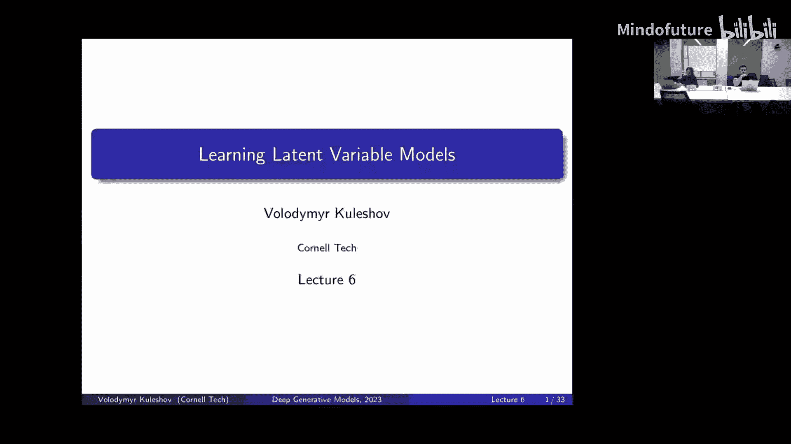
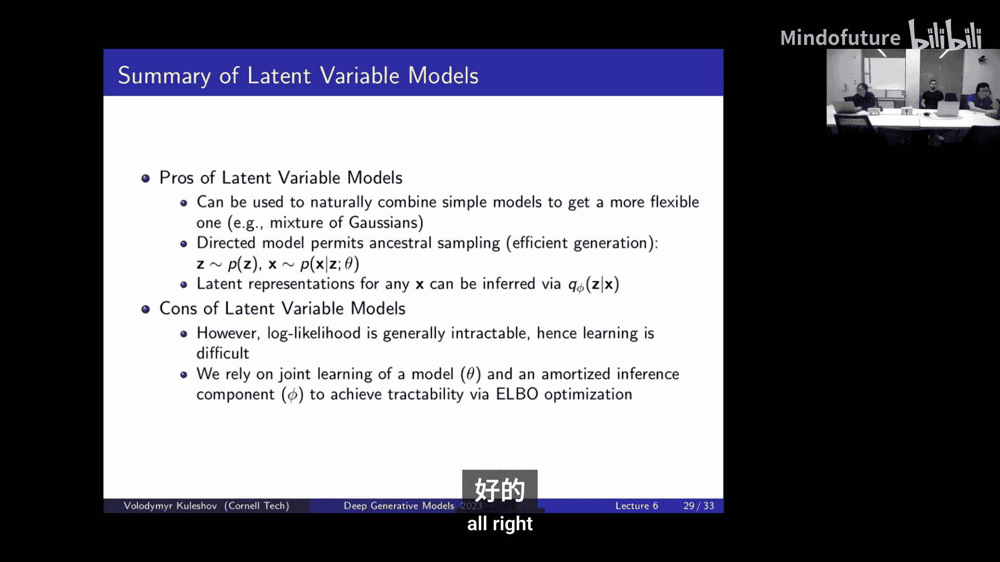

# 【康奈尔大学】深度生成模型 ｜ Deep Generative Models, Cornell Tech Cs 6785 p06 P06_Lecture_6-学习潜变量模型 -BV1p2awzrEJr_p6-

Okay， let's begin lecture six。Let's dive back to latent variable models。

So this is a bit of a recap of what we did last time。

Remember that the motivating staff for this lecture and the previous lecture was that let's say that we have a data set。

 it could be faces， but it could also be， in this case it's a data set of human faces。

 but it could also be molecules or DNA sequences， we might be able。

 we might want to find some interesting patterns in this data。

That's also a key task in generative modeling， representational learning。

So generative models are not just about creating new faces。

 but an important task is to understand the structure of a data set like this one and discover interesting patterns of variation in an unsupervised way。

For example， here there's a lot of interesting structure in this data。

 we have individuals that have different gender， different skin color， different hair color。

 eye color。It would be interesting， it would be useful both from a scientific perspective and from a practical perspective。

 for the model to automatically discover this structure for us。

But it's also challenging because these factors of variation are not labeled in the data。

Which is why we have to use latent variable models for discovering them in an unsupervised way。

And when I say late variable models。This is what I mean this is the type of model we defined in the previous lecture it is a probability distribution over our data。

 which is the variable X and an additional set of variables Z。

 which will represent these unknown factors of variation so in the previous example Z could be a variable that indicates the skin color。

 the age， the gender of a person， but because it's not observed。

 we have it in our model but at training time it is marginalized out so it's a latent variable it's a variable that's not present it's not observed in our data set。

Okay， and then so x here is our usual data and z is the sort of variables that's not in the data set。

Here is one important example of a latent variable model that we introduced in the previous lecture。

 this is the deep Gaussian latent variable model and you can think of it as an extension of a mixture of Gaussian to an infinite number of components。

Remember， we start with a mixture of Gaussians as our first example of a latent variable model and it's something that you should have seen in an earlier machine learning class。

But a gastro mixture model is still relatively simple。

 This is trying to do something more complicated。 so this is the。

Baesian network that corresponds to a deep Ausian lake variable model。

At the bottom we have the data that we're trying to model， in this case it's our image X。

 and at the top， the white circles， these represent the late variables。

The first thing gastian late variable model is that we assume that these latent variables form a continuous vector。

 and this is what we called a continuous or distributed representation of the data。

It is different from。The example that I just gave earlier in which I said that Z can be an indicator variable for skin color or hair color。

 here Z is just a vector of numbers。But I'm going to show you in the next slide and we saw examples of this in the previous lecture that even though Z is just a vector of numbers。

 it can still discover useful structure by placing similar images or placing seally related images to similar parts of the training set of the sorry。

 of the latent space of the latent space。Right so at the top we have a distributed continuous latent representation of the image at the bottom we have the actual image which depends on these variables。

And what connects them is a。Is a conditional of x given Z that is parameterized by a neural net。

So x is just a vector of it's a matrix of pixel values and it has to somehow relate to this continuous set of variables。

 it's really hard to specify by hand what this mapping should be。

 therefore our approach as in all the other models in the course is to parameterize the additional using a neuralNe。

And in particular， the parametermetricization that we choose is that x is going to be also Gaussian。

 but its mean and its variance， the mean and the covariance matrix of P of x given z are going to be a function of the late variable Z。

 and this function will be parameterized by a neural length。

And so now this forms a valid probability distribution， we have a Z， which is Gaussian。

 it has a unit Gaussian prior， we have a P of x given z。

 which is well defined for each Z using these neural nets and now for any mu en sigma we have a valid model we have a valid probability distribution over X and Z and now it's just a matter of learning this distribution。

 it's a matter of fitting this distribution to the data which is what we're going to be doing next。

 but I also want to reemphasize that this can be thought as as an infinite dimensional mixture of Gaussians。

In a regular mixture of Gaussians， Z is a categorical variable。

 So mu of Z takes one of a finite possible set of values。 But if we make Z infinite。

 we can't just enumerate all the possible means and variances for each。Assignment of Z， therefore。

 we have to have a function that maps a continuous Z to a continuous spectrum mu。Okay。

 and then once we learn this model， which I'm going to show you in this lecture how we're going to do this。

 once we learn this model， we can。We can sample new X。 We can sample a Z， then we can compute。

 You have x given Z and we can sample that X。 We can also。

 we're going to see how we can get the Z from the X， and we can also。

Perform various kinds of semantic manipulations so we can take one z and another Z we can interpolate between them。

 we can perform arithmetic in the space of Z like I showed you in with that face example in the earlier lectures so we can do a lot of interesting things with this model and it's also going to be the basis of the variational autoencor so the variational autoenr will be this model plus the algorithm for how to learn this model and as an example of what these kinds of models can learn we have this figure。

This is an example of how a distributed continuous vector representation can still be useful here we've trained a model similar to the one I had in the previous example a little bit different but still。

Generally， the same idea on a data set of。OfThe handwritten digits。

And now we can take each handwritten digit and compute its latent representation and that latent representation。

 we've fixed it to be two dimensional and now we can plot these two dimensional latents on a plane and we see that the model has learned something interesting about the data。

 so it learns to place all the two together and all the one together and so on。

And so even though we don't have a specific indicator variable that a1 is a1 or a two is a two。

 we still have some meaningful continuous vector that represents them。And by inspecting it。

 we can discover something interesting about the data。Okay。

 so that's what we can do with these models。The challenge is how do we learn these models？

And learning can be difficult， this is what we discussed in the previous lecture。

Let's say that we have a data set for learning these models。

 so the data set is just a set of X's There are no Z's in this data set。嗯。But in theory。

 this is not a problem， there is still a valid definition for the log likelihood。

 which is the probability of x under the model。This is the formula。Remember that with a。

At our aggressive neural model， we would maximize the log likelihood of the data。

 which means we find the parameters of the model that assign the highest probability to the observed data。

 which makes sense， that's the objective on the left hand side。U。So the sum of the log probabilities。

And with a regular auto aggressivegressive model， we have a formula for P of x given theta that we can just get from our neural we can get this by just running the feed ho。

Process， we can just run our neural net， do the forward pass。 And this gives us P of x given theta。

 But with a latent variable model， things are much more complicated because。

We don't have a simple formula for P of X。 we have a formula for P of x and Z。

 therefore to compute P of X， we have to sum over all the possible Z's。

And that in general can be challenging。First of all， Z could be continuous。As in my earlier example。

 therefore， this sum becomes an integral。 and how do you compute an integral。It's not。

 it's not completely straightforward， but even more importantly， even if Z was。Discrete。

 and even if z was a vector of binary indicator variables， so let's say it's 30 dimensions。

let's say z is 30 dimensional and each component of z is just zero or1 that's still two to the 30 possible z's that we have to sum here in order for this formula to be applied correctly。

 and that's a number that's not tractable for us。So， oh。

 and since it's intractable to compute the log likelihood， well， that means the forward pass。

For getting to the loss is intractable， and therefore the backwards pass will be equally intractable。

So we need to do some tricks， we need to do approximations。

And this is what we did in the last lecture， we introduced this idea of variational inference。

 which is a way of approximating this intractable marginal likelihood objective。

And specifically what we saw is that the marginal log likelihood equals precisely two terms。

 one of these terms is the elbow which stands for evidence lower bound。

 and the other term is the k divergence between a distribution called Q and the approximateerior of our sorry the true posterior distribution of our model。

And cute here can be anything。😡，And recall that elbow is a。The elbow is。

 I guess they don't have the formula， but the elbow is a function of the parameters theta。

 so this holds true for any assignment to the parameters theta over our model。

 and it's also a function of some distribution P。And for certain this this shows that for certain choices of Q this lower bound and by the way。

 this lower bound is tractable oh sorry one more note of these two terms so the elbow that's something that's tractable。

 we can compute this easily on our computer but the Kl divergence it involves this P of z given x and P of z given x is also intractable for the same for all the same reasons that the marginal likelihood was intractable in fact。

 if you wanted to compute the formula for P of z given x it would contain the marginal likelihood in the denominator so the second term is intractable the first term is tractable and this holds for any Q。

Well， what we can do then since this term on the right is always positive。

 we can throw it away and the elbow is a lower bound on the log likelihood so we can then think of。

Trying to maximize the log likelihood over theta by optimizing the elbow。

 by maximizing the elbow we're pushing up the lower bound and therefore we're pushing up the marginal log likelihood。

 but this will be a good strategy only if this approximation is good。

 only if the lower bound is relatively tight and when is the bound relatively tight。

 well it is tight when this Q is close to P of z given x in fact when Q is exactly P of z given x then this bound is perfect we have an equality。

But in general it holds it holds for any Q and we won't be able to use the actual P of Z given x because again。

 that's computationally intractable， therefore the idea of variational inference is to search the space of cus to find something that's close enough to P of Z given x。

 but still。Ttractable， and so this bound will be sufficiently tight to be useful。

Okay and specifically what finding a Q means is that we typically choose Q of z given phi to be some kind of parametric family。

 maybe the set of Gaussians or maybe the set of products of verrulli distributions we saw these two examples at the end of the last lecture but the idea is that  Q of z given phi is some parametermetric distributions with parameter phi。

 and then we solve an optimization problem， so for each choice of theta if we want to get a tight bound for that specific theta we。

Solve this optimization problem over the space of P to get a bound that's as tight as possible。

And so again， if  Q is a tractable probability， tractable set of probability distributions for different phis。

 then the elbow will be tractable and if we maximize it and Q is sufficiently expressive。

 then this bound will be close enough and it will be useful。So that's what variational inference is。

 variational inference is about finding a tight bound on this intractable objective by optimizing the elbow over a set of approximate mysterioussq。

嗯。And the reason it's called variational is that there is a thing called the calculus of variations。

 which is an extension of calculus to functions， functional。

 so you can take the derivative of a function when we are optimizing over functions。

 we tend to call these things variational。Comes from the calculus and this is why we're calling this variational inference it produces inference to and by inference so we call this inference because P of z given x is called posterior inference so Q of z also approximates the posterior so this is a task that's also called inference it's variational inference because we're using optimization and specifically。

Things which might be inspired by the calculus variations to optimize thisq and perform inference essentially。

 so that's not the only way to do inference， by the way。

 we're going to see in a few weeks another approach that's based on sampling。

I guess at a high level in machine learning and in genderative models， if you can't。

Perform I guess in most models in quite a few models you can't perform P of Z of X exactly but you want to do it because what that's what inferring representation is so you typically have to solve these intractable problems and there's at a high level the machine learning there's two ways of solving them one of them is variation inference which means you reduce this problem to an approximation that involves synization problem and in another way is Markov chain Monte Carlo。

 which means you reduce it to drawing samples from a complicated process for a very long time those are the two main strategies and here we've seen the first one called variational inference。

Okay， all right， so going back to this， this is our strategy， we find a good elbow。

 we optimize over phi once we have found a good phi。

Now we have something that's a good approximation to P of x given theta so now we can consider learning theta right once we have solved the optimization problem。

 what we got is not a good model we still don't have a good model but we have a good objective for learning a good model and so now we're going to use this objective that's provided to us by a variational inference to learn theta so all that we did in the previous lecture was how do we optimize the elbow to get a good objective theta and now is when we get to use it。

Pew is。Any distribution， the idea of variational inference is that you want to find an approximation for this marginal looklight。

And this is a general bound that holds for any distribution queue and the ideal Q is the one that equals P of zs this was a recap and this is a plan for this lecture。

Our main goal here is to explain how to learn the model B， how to find a good theta。 And at the end。

 when we're going to cover this， we will derive the variational。The variational outerenr algorithm。

 which is an important algorithm in generative models。Okay。

 so let's apply now the elbow to learning theta。Again， recall that our objective for。

For each x is the marginal of likelihood， we have an elbow， we have this lower bound。

On it which is just this formula that's what we derived in the previous lecture。

 and I'm going to denote this lower bound with scriptL and scriptL is a function of phi because that's what we choose for Q and a function of theta theta are the parameters of the model。

And now let's say we want to optimize the marginal of likelihood P of x over a training set of x's。

What we would normally do is to try to maximize the following objective。

 which is the marginal log likelihood over all the data set。

 we would want to optimize this thing over theta。But we can't。

 therefore what we could do is simply apply our lower bound for each data point here。ok。Now。

 here's the question。I have the elbow。 Let's say， I have。1 x for which I have one phi。

 if I change the x here， would the optimal phi be the same or different？If we change the x。

 that changes the optimal phi。Which is why in this formula， phi has a subscript I for each X。

 there is a value of phi that makes this boundte for the theta and that particular choice of Xi。

 okay？right， so we have a different set of variational parameters for each X if we want to make this sum type。

 we should be choosing a different phi for each X。And so the optimal bound on the log likelihood of the data is given to us by the formula at the bottom。

 which involves a max over M variational parameters where M is the number of data points Okay。

 so previously I just had a bound on one data point now at the bottom of the slide I have a bound on。

The log likelihood of the entire data set。 So if I want to maximize my model。

 it's the thing at the bottom that I need to use。Okay。So now we have an objective。Okay。

 now I have a bound for zero that makes sense to use as a learning objective for theta。

 it's an objective for all the data set。So what？Learning using variational inference in particular。

 this is called stochastic variational inference， what that means is that we simply optimize this bound over both phi and theta。

 We want to find the theta maximum theta such that this bound， which is a max over phi。

 such that this bound is large。This is our first。Our first way， and we're going to see others。

 but this is the first way that we can use graal inference to learn these models。Specifically。

 we can optimize this。Using gradient using stochastic gradient descent and this is why it's called stochastic variation infant。

 What do I mean by that， we start with an initial guess for these parameters theta and phi。

We can sample a data point from x sorry from D。And now we want to make a step on theta using this data point。

So now we want to find a theta which maximizes our objective for So here I have a sum of x's right so I can whenever I'm optimizing a big sum over the data points。

 I can do mini batch learning So here this is what I'm doing with a mini batch of one now that I've chosen my mini batch of size one。

 I have to optimize this objective this objective will be。Ideal for the best Phi。

 It will be titus for when phi is the maximum of that objective。 So before I can make a step on stta。

 I want to optimize this over phi to make it as tight as possible。

 So then I have an inner loop of gradient descent where I search for the optimal phi using。

Standard gradient descent， I repeat this loop for a while until we have some conversions and now that we have converged。

 I have found a p star， which is the arcax of the elbow for that particular Xi and the current theta。

Okay， so now I have computed an objective that I can optimize over theta。

Therefore I compute the gradient over theta， I take a step on theta in the gradient direction and then I go back to step two。

 but when I go back to step two I will sample a different point a different data point by that point my theta will have changed and also I have a different Xi therefore I have to recompute the variational parameter here so we're recomputing the inner maximization problem。

At every step of the outer optimization loop over theta。

This will not be the final algorithm we will use， but this is。

This is the first and most obvious way of applying variational inference for learning the。嗯。Okay。

 so this is our first version of learning with variational inference now the key task here is that we have to have good gradients for phi。

How do we get that is it obvious how to get a good grain for phi。

 well let's check this is our objective and we want to take the gradient over Phi here。Well， sorry。

 we have to have gradients over phi and theta， so let's look at theta first。

We want to take a gradient of this expression using theta。

 so here I have NaBA theta of this expression， the expectation and the gradient operator can be flipped。

 I can put the gradient inside the sum and now I have a formula for the gradient this log probability of x and z in theta。

It is a formula or it it's something for which I have a formula I can do the forward pass here easily I can't do the forward pass easily on the marginal but I can always do the forward paths easily on the joint I just compute the prior and then I compute x given Z but I have a simple formula for for P of x given z and P of Z therefore computing the joint is easy and the forward pass is easy the backwards pass is also easy。

 the gradient inside the expectation is easy to compute and because I have this expectation of Q given I have this expectation with respect to Q I can approximate that using Monte Carlo。

And this is a formula for the gradient that's easy to use。So getting the gradient over theta is easy。

However， getting the grain with respect to P will not be as easy。Why is that the case， Well。

 because I have this， Okay， I have a。Formula here Okay。

 the the reason why it's not easy is because I'm taking the expectation over Q and I'm also taking the gradient over Q so I can't just flip the expectation and the green operator like I did here。

Right the expectation itself depends on Q。 So if I'm taking a gradient with respect to it。

 I can't flip its's an I can't。诶诶诶。I can't take this operation that depends on phi out of the gradient for phi。

 that's just wrong。So instead， we need to do something collaborative。

 And that's what I'll talk about next。 There are two types of there are two techniques for getting this gradient that I'm going to show you next。

One of them is a technique that you can use in general for pretty much any latent variable model。

 but it has certain flaws that I will explain later。

 but it also has advantages in that you can use it in any case。Let's say that I have some function F。

 I'm taking its expectation over Q， so this is what I'm computing here。

 and I want to take the gradient of this expectation with respect to Phi。How do I do this？Well。

 there is a little trick。Let's say that we want to take the partial derivative with respect to some parameter of phi I。

 some component of phi。Because this expectation is a sum。

 and let's assume for the sake of this explanation that Z is discrete street， if it's continuous。

 it becomes an integral， but the same logic applies。For now， let's assume Z is discrete。 Therefore。

 this is just a sum， and I can。I can now flip a sum and the gradient operator that's fine there's nothing wrong with flipping a sum and now if I do this I have this partial derivative of Q with respect to Phi I that multiplies every app that's just applying the gradient。

Now。I can do another trick。 I can multiply and divide by Q of P。 This doesn't change anything so far。

 That's just a little trick that I'm going that I'm going to do here。

 And the reason this trick is useful is。Is that1 divided by Q times the gradient of Q。

 that's just the gradient of log of Q or， the partial derivative of log of Q given with respect to Phii。

That's just the definition of the derivative of the log that I applied here。So so far。

 nothing has changed。But now the advantage of this is that I have in this last equation something which looks like an expectation。

 therefore I can again reintroduce the expectation term。

And now I have a formula for the derivative of this expectation。That。Itself involves an expectation。

 and it has something that's。Ttractable inside of it。ok。This is just defined for one component phi I。

 but if I apply the same logic to each component if I apply this for each I。

 the gradient is just the vector of these partial derivatives。

 therefore the full formula for the gradient of an expectation is given by this formula。Okay。

 so notice that this is not the same as just flipping the expectation and the gradient。

Flipping the gradient operator and the expectation will be wrong。

 the correct way to do it is what I have on the slides here。This is the actual formula it。

Gives the right estimator for the gradient。ok。嗯。And now that I have a formula for the gradient that looks like an expectation。

 I can do that same trick that we've been using all the time。

 I can approximate the expectation with a sum with a Monte Carlo estimate。

And I can use this to get the gradient of any expectation of any function F。Okay。

And this formula is called the reinforced gradient estimator。

And it works any it works for any queue as long as we can sample from it to do Monte Carlo。

 and as long as we can。As long as we can compute this。

L probability in the forward pass then we can get this gradient in the backwards pass okay so this is one formula and it's really important it's used in a lot of places in machine learning。

 it's used a lot of reinforcement learning， it was originally derived for reinforcement learning which is why it's called reinforce but it also solves the same problem in geneative models。

几。😊，And most importantly， it works for both discrete and continuous distributions。对。

We can apply this formula to our elbow。 This is the elbow。

 We want to compute the grain of this with respect to phi so we can apply the reinforced estimator where F is the。

F is what is inside the expectation。Okay， now this is a little bit different from what I had on the previous slide because F depends on phi as well in the previous example。

 F did not depend phi here F depends on phi， but the logic for the the estimator is essentially the same。

 we just apply the we apply a few additional rules of calculus。

And what we get is that the formula for the gradient of the elbow with respect to phi is an expectation of。

The sum of two terms， one of them is this f times this。

Log the derivative of the log plus the gradient of the elbow without any adjustment factor。

This is a valid formula for the gradient that you can easily derive using the same trick as I had in the earlier slide。

ok。And as before we approximate this， using a Monte Carlo estimator and we draw samples from Q。Okay。

 so this is the reinforced rule。There is a problem with the reinforced rule。 However。

 the problem is that it doesn't scale well when Z is。

A vector that has a high dimension and by high dimension， I mean， something that's greater than say。

 64 will start to cause problems。The specific problem is that it has high variances。Remember。

 we talked about。Montic Carlo estimates having an expectation and a variance。

 Monte Carlo estimate can be thought of itself as a random variable。

 That is a function of the random samples drawn from Q。And that random variable is expectation。

 its expectation is always going to be this true quantity that we want to compute， however。

 as a random variable it also has a variance， so for certain choices of z。

 we might get different we might get very different values of the estimator。

 even though on average we will eventually give us what we want and the problem with the reinforce estimator is that we have very high variance around our mean。

 which is correct， but the variance is large。Roughly speaking。

 the reason is that we have this log of Q term。Q is a probability that can often be very small and when  Q approaches to0。

 the log the function log approaches minus infinity and its derivative becomes arbitrarily large and so if you're close to zero and you wiggle a bit this log probability you get you get very very different samples so this log of q can vary in magnitude significantly for minute changes of z when the log probability is small and so as a result because this。

Because what's inside the expectation has high variance。

 the Monte Carlo estimator will have high variance as well in practice。

 what this means is that if you apply this to anything that has a。

That has a Z of something like 100 or if Z has 100 dimensions or more， this will give you。

Results which are not which won't be great。 It will barely learn anything for Z equals 100 or more。

For smaller values of Z maybe 32， it can still work， but for larger values， it will not work。

And there are ways of fixing these issues， there are ways of fixing this variance problem。

 we will talk about this in another lecture。But for now。

 there is a better way of computing this gradient that can be applied if Z is continuous。

If these continues， there is another estimator that's different from the reinforced estimator to use。

 and the name of this estimator is the reparmettrization trick。

So what is the reparmetricturization trait？Let's start by making the assumption that Z is continuous。

Okay Z is continuous and there is some function R of z。

Whose expectation we're trying to compute and in particular we're trying to compute the gradient of this with respect to Q of5 of z。

嗯。For example， let's say that z is a Gaussian variable and  Q of z given phi is a Gaussian with parameters phi that are the mean in the variance of this Gaussian。

And we want to learn Phi by optimizing this objective and taking ingredients with respect to Phi。

Observe that there are two ways of computing our objective。😡。

One way would be to sample directly from the Gaussian， whatever that means， know we have a Gaussian。

 we have some way of taking samples， yeah， let's just say you have a black box that gives you these samples from this Gaussian。

Another way is to。Perform a little repair meturization。We know that。

The variable that's at the bottom， so a Z which is obtained by first sampling Gaussian noise。By that。

 I mean an epsilon that comes from a Gausian with mean zero in variance to one。If。

 if you sample that and you put it in this formula。

 so you take the mean and you add the Gaussian noise scaled by the variance parameter sigma。

 then you'll also get a Gaussian sample Z with a mean mu and a sample sorry， and a variance of sigma。

Do you believe me？If not， you should look at Gaussians again。

 this is just a standard property of a Gaussian， you can sample this Gaussian noise epsilon do mu plus sigma times Gaussian noise and you get a Gaussian variable with mean mu and variance sigma square。

Okay， but the second way of sampling Z is actually very useful to us。

It will be much easier to take the gradient if we view Z as being sampled using the second formula。

Why is that the case？So let's start with our original expectation and instead of writing it this way。

 we can write it in this other way where I am not sampling Z， but I'm just sampling random noise。

 random Gaussian noise， epsilon。And this random Gaussian noise doesn't have any parameter in particular。

 it doesn't have phi as part of its sampling procedure， right this is just random Gaussian noise。

And then I pass that noise into this function G of epsilon， which just gives me Z。

 so G of epsilon is just mu plus sigma times epsilon。Okay， so I pass it inside G。

 and then G spits out Z。And then Z goes into R as on the left hand side。嗯。

And mathematically speaking， this is what the David role is doing。Okay。

 so here I have two ways of writing the same thing。

The advantage of doing it the second way is that now I can actually flip the gradient and the expectation。

In the formula that's on the left hand side， I can't flip。The gradient operator and the expectation。

 because the expectation itself involves the parameter with respect to which I'm taking the gradient。

I can't flip things on the left， but on the right， the expectation is just over a。

Random Gaussian variable epsilon， which doesn't involve my parameter phi。In that case。

 I can flip the expectation and the file。When the expectation is not using the parameter with respect to which I'm differentiating。

 then there's no problem with swapping them。So if I rewrite it the second way。

 then I can perform this flip of the expectation and the grain operator。

And now I have exactly what I want， I have a。So here， G is easy to。

I have I have the gradient of R composed with G， but G is just a linear function。

 it's really easy to take the gradient of that and R is a function of z well assume that r is differentiable with respect to Z。

 so now I have the expectation of something that is。

Easily differentiable with respect to G for each value of epsilon Okay， so the thing on the right。

I can approximate that using Monte Carlo and get valid gradient estimators。

Get a valid grade estimator by averaging。By drawing some samples from a uniform Gaussian distribution and then taking the Monte Carlo approximation of the quantity that's on the left。

And this is called the reparametrictization trick， it gives you an estimate of the same gradient。

 but this estimator is much better because it doesn't have this log of Q term which has very high variance。

Therefore。It behaves much better， and this scales very well to。To high dimensional latent vector Z。

So this actually works very well in practice。So epsilon here is just。noise。

And I can always flip the expectation with respect to noise with the green operator。

And specifically you can do it for many other types of distributions there's a lot of distributions for which you can do this。

 in fact， for most distributions there is a way of performing a similar repermeturization the main constraint here is that Z has to be。

Continuous。Wndy is the street。This exact procedure doesn't apply anymore。

 although there are ways of still massaging it to work， which will， which we will also talk about。

 But as I explain here， it doesn't work。 the main condition is that Z has to be continuous before I had expectation with respect to Z and Z depends on mu in sigma。

 But now I have expectation with respect to just。White Gaussian noise。

And that is not dependent on U and sigma， which is why I can。

Flip the gradient operator and the expectation。So how do we apply now the reparametricurization trick to the elbow。

 this is my elbow and what's inside the elbow is what I'm going to call R of z and phi。Again。

 there is this little issue that in the previous example， R was only a function of z。

 now R is also a function of phi， so I have to。I have to slightly change the way。

I define the reparitturization trick it's the formula changes slightly it's the same idea it's just that I also have to account that r itself is a function of phi so we make the same assumption and this is the formula it gets approximated。

Sorry， actually I think back what I said， there's actually no change here we just literally。

Set R to be this。To be what's inside the elbow and then we apply the formula on the previous slide and what we have is what's at the bottom。

And when we take the gradients with respect to this。

 observe that phi is found in two places within R and within G so there's。

If you were to derive the formula by hand using calculus， you would have to pay attention to this。

 but in practice you would just use automatic differentiation， so it's not even a major issue。Okay。

 so now we have seen two ways in which we can compute the gradients。

Within our high level algorithm for learning with variational inference。

 there's still one thing we need to do in order to make this algorithm practical。Remember。

 I told you that。We are computing we are recomputing the variational parameters Phi I for each point X at each instance of the outer training loop。

 so that's really slow you if possible you want to avoid that there are some algorithms there are some applications of variational inference where you can't avoid that but here we're going to try to change slightly how we're doing this to get rid of this Phi I to get rid of this。

Inner optimization loop。And that technique is going to be called amortized inference so amortized inference means that we're going to amortize the inner optimization process by a neural net。

 we're going to learn so instead of in the inner loop。Optimizing over the parameters of sp。

 we're going to learn a neural net that will spit out the parameters p directly for us。

And that's what's called inference anorization， where it could have even been called amortized optimization。

 we will。Not perform the optimization ourselves， we will train a neural net to spit out the result of the optimization。

So what do I mean by that right here？Specifically， if I were to put some math on what I just said。

We're going to learn a function， f of lambda。That has some parameters lambda that given x。

In particular， given X， it spits out for us the variational parameters F star。

 which previously we have been。Discovering using a inner optimization loop。ok。😊。

That's what we're going to do。I'll show you in a moment how we're going to do this。Here。

 this is just an example if we have Q of z given Xi， that's Gaussian， if if we're using a Gaussian Q。

 therefore phi I are the parameters of the Gaussian。

And each phi corresponds to amine in the variance。What this inference network will do is that it will take an Xi and it will spit out a mean and a variance for us。

And these are， again， what we think are the optimal parameters for the neural。

For for the variation of PhiI， so the optimal Phii star when Q is Gaussian are a mu star and a sigma star。

 that's what our neural net Flam that will spit out。ok。

And this posterior will be approximated by the distribution。Q of lambda of Z given x。 So P of lambda。

Of Z given x is。The Gaussian， whose parameters are spit out by our function F sub lambda。几。诶。

And in fact， yeah， so this is even， I would say， a slight abusive notation now instead of。

I guess if you've seen a little bit VEs， this is the encoder that you normally have right so we're going to have a neural net that takes X and then it produces M and a sigma。

For the Z that correspond to that x。Here's an example。 Let's say that we're doing fe learning and。

We have some Phi， normally we would find this Phi I star using optimization。

 instead we have this amortized inference network。And instead of using Q of Phi I star。

 we're using Q of Z。And now we've replaced Phi I with the output of the neural net F sub lambda。Okay。

And this is。There is some notational tricks that people do in practice。

 so when we normally define a variational utterender and if you go online and look at a tutorial that defines a variational outencoder。

 they will literally write Q of phi z of x， and they're going to do a bit of a of notation。

 they're going to use phi to denote the parameters of the amorization network F sub lambda。

So the correct thing that's going on is that the neural net。F sub lambda with parameters。

 lambda takes in an Xi and spits out phi， which are the optimal parameters for the variational approximation P of z phi。

But in practice we're just going to view this function。

 we're just going to assume we have a single neural net and by an abusive notation。

 we're going to use five toote the parameters of the neural net。And。For each assignment of phi。

 we have a distribution of z or for each assignment of phi and x， we have a distribution over z。

And that's what the elbow receives。So in practice， when we define a variational autoencoder。

 we use the latter notationq sub p of z given x， but I just want to be clear that what actually happens is that there is a neural net with some set of parameters that takes in an x and it spits out the variational parameters of this distribution Q。

 and that's what goes into the elbow。But to make things simpler instead of having a lambda and instead of having a phi。

 we can we in practice， even in the original paper， what they do is they just。Use。

One variable called phi for the parameters of the big neural net。

 which parameterizes this distributionq of z given x for each。For each for each fight。

Any questions about this last part on imortization？Are there any downsides of doing？

The amortization any downsides well theoretically you wouldn't get the optimal optimal phi star。

 but I think in practice it doesn't buy you anything having a slightly better phi doesn't buy you that much when you're actually trying to learn theta。

This is the objective right where we have now a parameter theta for our model。

 we have another sort of a vector parameters phi for this amortized posteriorq of z given x。

 and now we're optimizing the elbow over theta and phi。And in practice。

 once we do aorization we can get rid of the inner loop previously we had an inner loop at step three。

 but now what we can do is just take a step on both theta and phi jointly and this saves us。

A lot of time， basically， when we when we perform the computation。

 this is going to be much more efficient， so we optimize both over the model theta and over the model5。

And we compute the gradients using the reparmetturization trick that we had earlier。Okay。

 so now we have defined all the components that we need to define this model to which I was alluding to。

This lecture and in the previous lecture， this model is called the variational auto Ender。

And the variational R encodeder is essentially taking all of the components that I defined so far and putting them together。

So remember， to define a generative modeling algorithm， we need to define a model family。

 a learning objective， and an optimizer， and that's what we're doing here。

Our model class is going to be， again， the same deep latent Gaussian model that I started a lecture with。

Again， the prior is a Gaussian， the conditional the distribution of x given z is given to us is also a Gaussian whose mean variants are parameterized by neural nets with parameters phi。

This is an example of how this neural net could look like。So in this simple example。

 the parameters theta are two matrices， A and B， and two bias termss， C and D。

And because we're marginalizing over Z， even though each P of x given z is fairly simple。

 the marginal over x， when we do the weighted average of all of these networks that can be very expressive and it can model really complex images X while also having latent factors baked in inside the model。

So this is our modelal family。And we combine this model family with。

So we start with this deepian model， we combine it with an objective that's based on variational inference。

In particular， amortized variational inferences。In which we have this auxiliary approximate interest network。

 Q of Z given x。Which itself is essentially a conditional Gaussian。So。

This model and the first model are parameterized by neural nets。

 these neural nets have some set of parameters， and we optimize these parameters using the objective that I just had in the earlier slide and using the optimization procedure that I had in that slide。

So we're jointly optimizing the elbow， which is given to us by this formula over both theta and phi。

 the gradients with respect to phi are obtained using standard Monte Carlo。

 the gradient with respect to phi are obtained using the repermeturization trait。

 and here we can apply the repermaturization trait because we chose our model P to be a D late and Gaussian model。

 therefore z is continuous by definition of the model。Okay， so this is。

Defining what the variation artr is in terms of the three components of model objective and optimizer。

Yeah these gradients are estimated using theupriization trick。

 the last thing I want to talk about is why is this model called a variational out on codeder why does it have the word out on quarterr in its name。

The reason is that we can look at our elbow and we can apply a little bit of apple rub to rewrite it in a way that really looks like an outenr objective。

So this is our elbow， I'm going to subtract and add the log this log P of Z term。

And then just applying the definition of the kl divergence and。And doing a little bit of probability。

 I can show that the elbow is the sum of the following two terms。So what is this objective of doing。

 what are these two terms？Imagine that we do a forward pass。In our neural net。

 in our two neural nets， we have a neural net from Q and neural net for Q。

 we do a forward pass in both of these networks to compute the version of the elbow that's on the third line。

 What happens So we take an Xi。Then our first neural net maps it into。A distribution over z。

 so it has a mean and a variance and so the mean of that distribution can be thought of as a guess for what the true latent code z had well it's a guess z had for what the true latent code is for that X so it takes an x and it encodes it into a latent code Z。

And then。So that's what we do to compute the term on the right and then to compute the term on the left。

 we take the Z and we put it inside our。Neural net that parameterizes x given Z that gives us a distribution over x。

 and we measure the likelihood of the real data point x。With this distribution， in particular。

 this P of x given z spits out a mean for what the real x is and that mean can be thought of as a guess for what the x should look like given that code。

 it can be thought of as a reconstruction of the original data point Xi。

So when we look at the mean of P of x given z， that is a vector。A vector X hat。

 which should be close to the real data Xi。And so this training objective does two things。

The first term， you can think of it as a reconstruction penalty。 it takes in a。

An encoded version of Z。 And it tries to reconstruct the original X from Z， right this is。

P of x given Z is the look likelihood of。A data point x， given its code Z。

 so we're trying to get the neural net to reconstruct our Xi。Right。

 so XI has to be likely it has to have high probability under the model。In fact。

 if you write out the formula for the log likelihood of a Gaussian。

 it literally looks like the L2 loss between the predicted mean and the original Xi。

 so it's literally spitting out something which is the reconstruction of Xi and it's straight to minimize the L2 loss between its reconstruction and Xi。

And then the second term。Encourages the learn Z to be close to the。To this prior distribution PFD。

This is。A regularizer， so if you only had the first term。

 this would literally look like an outer word。You take a point Xi。

 you pass it through the encoder to get a smaller code。

 and then the second neuralNe decocodedes it and tries to get back the original image。

So if we only had the term on the left， that would be almost regular our encoder and neuralNe。

 but what the second term does is that it also regularizes the bottleneck layer。

 it regularizes this latent code to look like a Gaussian。

So it tries to ask z to output codes that aren't too large， they're close to zero on average。

And so this is where the word hydro encoder comes from。Any questions on。The outerenr part。Okay。

 in this case， I'll just mention briefly why do we want this regularization term。

 why not just have it be a regular outenr？The reason is that we also want to do things from this model like sampling if we wanted to sample。

I guess how would we sample from this model， we would draw a random Z from the prior。

 and then we would generate an image。If this Z。Looks like our prior then things will work if we didn't have this regularization term。

 then the model could learn to use the latent space。

 the encoder could learn to use the latent space in an arbitrary way。

 and then you wouldn't know how to sample from it so by asking the model to encode。

X into a code which is close to the unit Gaussian， we can now sample new images by drawing samples from the chart。

Okay， so here we have a process where we take an image， we compress a code。

 then we ask the decoder to reconstruct the image from the code。

 and then the scale term forces the distribution of codes to look like our prior such that later if somebody knows the prior。

 then they can sample X from this distribution。All right， so I'll just end with a quick so now this。

Fulfully defines the variational outenr algorithm and this is also going to be the end of the block on late variable models I'll summarize quickly the pros and cons。

 what latent variables can do。Very well， much better than other aggressive models is representation learning。

And at the same time， they're also very flexible distributions。

 they can model complicated inputs like images or maybe audio signals if the length is fixed。

They can do a lot of。Powerful modeling while also being able to do representational learning and sampling from them is very efficient representational learning is possible by using Q of z given x so Q of z given x approximates P of z given x so given an x we can find this representation by running it through the encode quarter neural net。

Sampling and。And representation learning are easy， however。

 the log likelihood is intractable and therefore the objective for them is at least mathematical or complicated when you implement it in Py which it ends up being very simple。

 but in practice it's quite a pain to derive this algorithm and also。

We will never be able to it's hard to get an accurate estimate on the log likelihood of a good data point。

 so if your goal is to do density estimation， this might not be the best model to use。Yeah。

And in the next lecture we will see a new type of family called normalizing flows and normalizing flows will in a sense。

 at least theoretically they will give us the best of both worlds。

 we're going to be able to perform latent variable inference sampling。

 and we're also going to have tractable livelihoods all within the same model pattern。

So that's what's coming next。All right， let me know if you have any questions here。

 this is the last slide I may have。

