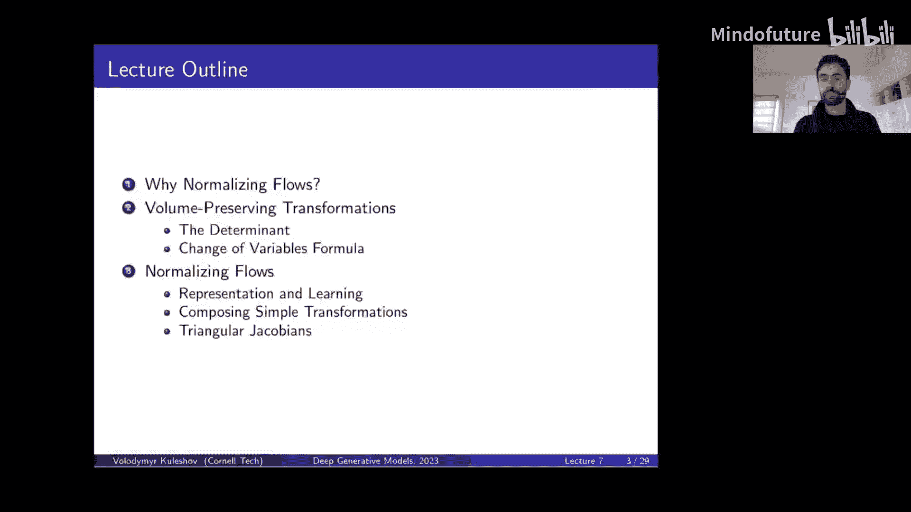
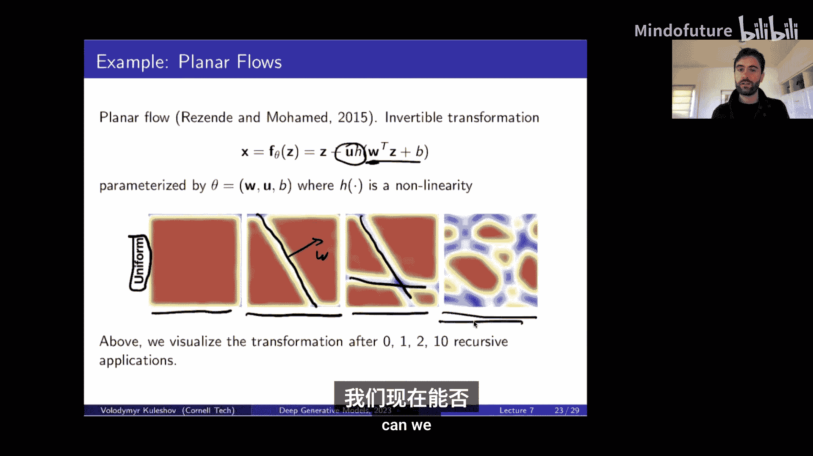
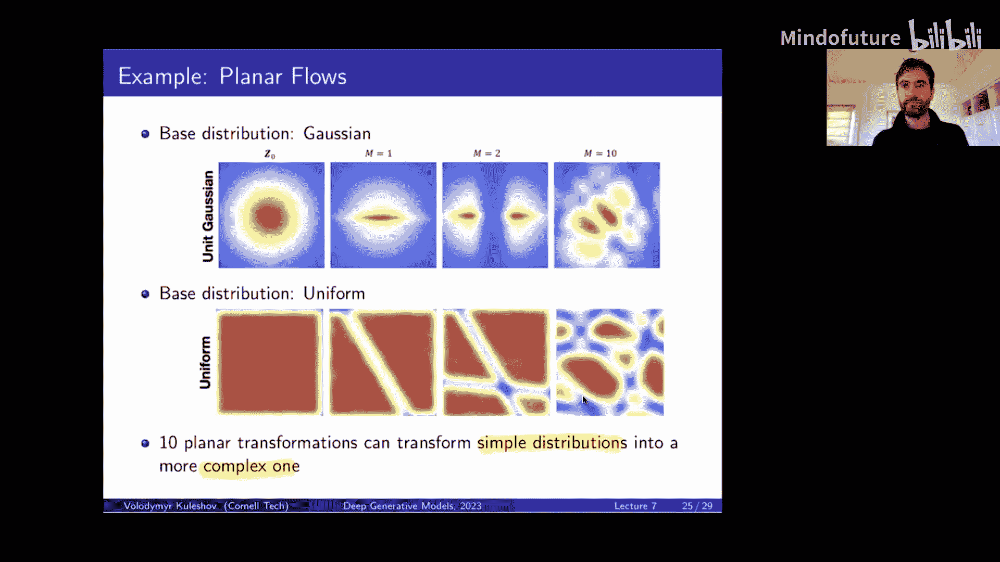
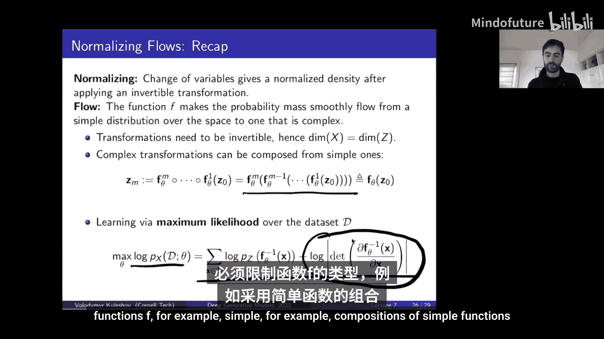
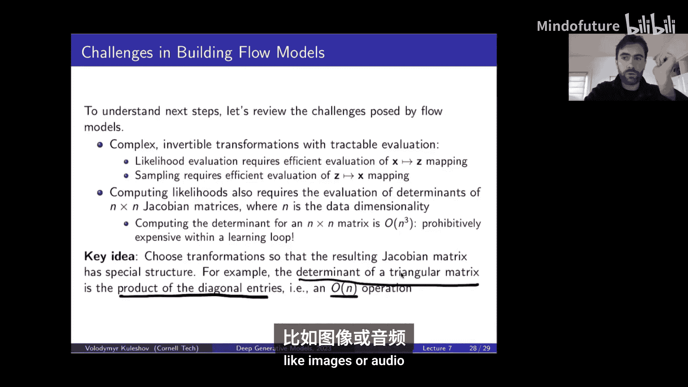

# 【康奈尔大学】深度生成模型 ｜ Deep Generative Models, Cornell Tech Cs 6785 p07 P07_Lecture_7-归一化流 -BV1p2awzrEJr_p7-

Okay， so the topic of this lecture is going to be， as I said earlier， normalizing flows。

 which are going to be a new type of generative model。

We're going to be defining precisely what normalizing flows are at the end of the lecture。

 but first I'd like to motivate why they why they're needed why we're going to look at them and then we're also going to see some we're going to review some facts from ccu we're going to be in particular looking at this change of variables formula in probability and calculus and this change of variables formula will be the mathematical tool that will be needed to define what normalizing flows are so that's the plan for the lecture。

To introduce and motivate normalizing flows， let me first start with a quick recap of the two types of geneative models that we've seen in the last two weeks。

Remember that we first started with other aggressive models。

And these models can be essentially defined by the following formula。

 which is the chain rule of herability。They start with this formula and the key insight of an auto aggressiveive model is that you can look at these conditionals。

 you can take these conditionals and you can。Pmetize them using expressive neural networks。

And these neural networks predict the next element of the object， so for example。

 the next pixel in an image based on the previous pixels。And using these models。

 you can now generate images or audio or any kind of data one element at a time or one pixel at a time and there's two main ways of。

Specifying what this conditional is。One technique that we saw earlier which is not an instance of deep gender modeling。

 but it's a classical and important technique in machine learning that's using conditional independence。

 these kinds of models are called Bayian networks。But the more modern way of doing it and what we're looking at in this course is using neural networks for parameterizing these conditionals。

And that leads to models that like WaveNe or Excel CNN。

 there's also a few older models that we have seen。So those are our other aggressivegressive models。

Our regressive models have a lot of advantages first of all it's easy to evaluate their likelihoods。

 which is going to be actually not obvious for most general modeling families so this property is actually。

诶。It's actually somewhat unique to otherregressive models。

 or at least it's much easier to do this in otherregressive models than in other families where we have to do a lot of more clever things。

 but it's really straightforward in an otherregressive model and because it's easy to evaluate the likelihood well it's also tractable to train using maximum likelihood learning。

Now， on the other hand， our rest of models also have some disadvantages。First of all。

 we have to choose some kind of ordering which is not something that's really natural it introduces an unnecessary modeling assumption or bias so why would there be any ordering over the pixels why would we be going left to right as opposed to top to bottom these things are a little bit unnatural so this is more of a conceptual。

shorthorcoming。A slightly more important shortcoming is that because these models are utter aggressiveive。

 we can only generate from these models one pixel at a time or one element at a time so generation is sequential and oftentimes this is going to be slow。

And finally， the third and maybe one of the biggest disadvantages of otheraggressive models is that there aren't any latent variables in these models。

 so there's no natural way of doing unsupervised representation learning。

 which is a key task in generalative modellly。And to address this last limitation。

 we looked in the last two lectures， so last week we looked at latent variable models。

Wwhich are a set of models in which we have introduced this additional variable Z。

 that's our latent variable， and this variable Z， once we have learned the model。

 it can be used to identify interesting hidden factors of variation in the data。So for example。

 if we have a data set of faces， we might hope that Z will cluster similar faces so similar faces will be mapped to similar Z and therefore by inspecting the clusters in latent space we might be able to discover groups of similar individuals so for example individuals that have the similar similar gender or similar skin color or similar age we might be able to discover all of these latent attributes from data in an unsupervised way by inspecting the variables of Z that's our main hope。

And the most famous model， the most well known type of late variable model and the one that we have arrived at the end of the last lecture is the variational auto encoder model。

 which is essentially shown here in this。And we looked at this figure in a lot of detail in the previous。

At the end of the last lecture。Okay， so that's what latent variable models are。

And they also have pros and cons， so the pros and cons are that we can。As I said。

 perform unupvised representation learning， it's also very fast to sample from them。

 we can do what's called ancestral sampling where we first sample a Z and then we sample an X given Z and that's not utterregressive so sampling is fast。

The main problem is that computing exact log likelihoods becomes intractable。

And the reason why it's intractable is that computing this posterior distribution p of z given x is hard。

We have to deal with complicated integrals。What one you see here and that makes things much more complicated。

And to deal with this， we derived in the less to lecture this mathematical machinery called variational inference。

And variational inference allows us to。Perform approximations of this posterior。

 so instead of computing the exact PfZ given x， we compute an。

Approximate Q of z given x and use that to do approximate inference and to approximate look likelihood learning may practice it can still work quite well。

 but it's still fundamentally an approximation and so if if your goal if ultimately your goal is to perform density estimation for outlier detection for example then latent variable models are not the best ones you would probably want to use something like an utter aggressive model instead。

Okay， but as you can imagine， this raises the question。

They're a way to have latent variable models that combine the best of both worlds。

 and by that I mean they have latent variables and they also have tractable likelihood。

So we would like to combine the advantages of utter aggressivegressive models and latent variable models can we do this well it turns out that the answer is yes and that's what normalizing flows are they're going to。

Go of latent variable models that combines both。Lant variables and exact mysterious theory inference and exact。

L likelihood estimation， at least in theory， there's going to be a lot of practical complications。

 but at least in theory， this is going to be a class of models that will combine the benefits of both。

A aggressive and latent variable models。Okay， so that was my high level motivation for why we need normalizing photos。

Let's now look at what normalizing flows are。And as I said earlier， in order to do this。

 we're going to have to use this tool from calculus and probability theory called the changer variables formula I will explain to you in a second why we need it。

 so the next few slides that are going to be a bit of a calculus review。

 but I think understanding this part of calculus will be really useful in order to define and。

And get these models to yeah， in order to define and understand these models。That's the plan。Okay。

 so what is going to be our overall strategy for defining normalizing flows again。

 we're looking for a tractable latent variable model。With yeah。

 so a linear variable more deable in the sense that it has this log density that we can compute and can also perform perform。

Late and variable difference， but let's just say for now we want a an express to。

An expressive model family that has a tractable log density， how can we do this？

Well there's many simple distributions in probability that have this property right if we look at a Gaussian or if we look at a uniform distribution we can easily compute their density These are the types of distributions where pretty much any task is。

Straightfor， very tractable。Unfortunately， Gaussian distributions by themselves are too simple for us。

 we can't really fit a Gaussian to a complex data set and have a good model。

So they're not sufficiently expressive。The key strategy used in normalizing flows is to combine is to start with simple distributions。

 so we start with something which simple could be like a Gaussian or uniform distribution and then we're going to be mapping these distributions to complex distributions using a invertible change of variable transformation so by that I mean that we're going to define a distribution over complex data that will start with a Gaussian and then transform this Gaussian into a very complex multimodal probability distribution using an invertible mapping which will shift around the densities so for example we could start with with a simple Gaussian distribution which looks like this and then try to push some parts down some parts up and then try to make it something like。

This by。Pushing these things here and then this thing might go here right so we can remap these distribution in interesting ways。

Using a particular class of invertible transformations。So let's look at this idea first in a very。

 very simple example， which is going to be one where we have just a single latent variable single latent variable z here that's uniform in the interval between zero2 and let's say we wanted to transform this variable in a really simple way。

 so first of all let's look at what's the density of just z。

Z is very simple Z is tractable so what is the density of P of z of1 so the density is one half right this is our density at one half and then the area underneath the curve has the sum to one。

Okay。So it's one half。Now， let's say that we're going to transform Z into another variable called x。

And the transformation that we're going to use is going to be this one。我're going to。

Define x as being 4 times z。 Now this is another random variable and it has some density P of x。Okay。

 now what will be the density of P of x？Okay， let's try one thing， let's say that we have P of x。

 this is the quantity that we want to estimate and。Let's just do a little bit of math。

 so we're looking at for the density of x at four so we're going to do。三。So math here。

 and now we get four of z given for z equals4， which equals z which is equals1。

 and then P of z equals1 and then one half。Okay， does anybody have any thoughts or reactions to this math？

This is just I'm only computing， I'm only trying to compute the density evaluated at  four。

 so the density is a function it's defined everywhere on the unit line。

 so before we had a density between zero and2 and that was one half right？

It was one half here and it was zero everywhere that was my previous。

My previous density now I'm going to have another variable。And， you know。

 there's a zero and then there's。And then there there is some density here that I would like to know what it is。

 And so now all I have done is I have told you there there's this math that's trying to say that the density is going to be0 So there's  zero。

 there's something else and then there's four and all that I'm saying is that P of。

The density evaluated at four equals also。One half。That's all that this math is saying。

A thereBut is there anything， is this correct or not？So this is not correct， of course。

 so it clearly can be correct because so z is a uniform variable between0 and 2。

 therefore four times z has to be a uniform variable between zero and eight。

And the density has to sum to one。Right so it has to sum to one。

 so it can only sum to one if it's one over eight。So this is clearly wrong。

So why is it wrong Well it's wrong at this step here this is not correct this is not true this is not true because here I'm using something which is a density and I'm trying to equate it to something which looks like the probability of an event that is not comparable so here on the left I have something which looks like a which is a density on the right I have I'm misusing P and I'm using P as a probability measure and a density and a measure or a density and a probability measure or probability distribution or two completely different bow there're too related but different things。

So it's the first step here that is wrong。啊。And at a high level。

 what happened here is that when we went from a distribution over zero and2 and we went to a distribution of zero。

 that's that's over the support from zero to8 the。this volume here。

 the area of support of the distribution has expanded， it has become larger。And therefore。

 but we still have only a unit of mass right here， we had a unit of mass that we have to remap to the other。

To the other range。And this unit has to be preserved。

 We only have one unit here in black that we can map to the。

Other interval and therefore this unit has to be spread more thinly than it is on the left。

 so we have to account for changes in the size of the support of the distribution and when there is more support when the volume that supports the distribution increases。

 we have to scale down the magnitude of the density。Okay， that's very key important。

Fact to understand and this is the problem that all of the math that we're going to do for normalizing flows will try to address so I think it's important to think about this fact if you're not convinced。

Please go over the slides again after the after the lecture。

 because this is the key technical challenge of normalizing flows。 It's the fact that we have to。

I just。Our density， when we transform one variable into another。

 we have to adjust the density of the new variable to account for the fact that the support of the distribution which is distinct here may have changed。

Okay， so that's the difficulty in doing a change of variable transformation how do we actually do a change of variable transformation well we use the following formula this is the change of variables formula from。

Probability theory and calculus。And what it says here is that if we have a transformation from。

Z to x that's given to us by a function F that is invertebible and has an inverse f minus1。

And let's call this inverse page。So H is the universeverse of that。

Excuse me H is the inverse of F then the correct formula for the density of x is the density of。

So we take x， we take we move from the density， we move from the density over x here to the density over z。

 but now we have to evaluate the density over z over the inverse of x。

 so over the z which was mapping to x。So this is what we did in the earlier example in the part that was by itself wrong。

 And in order to make it correct， we have to have this extra adjustment factor。

 which is the derivative of the inverse at。X。So this is an adjustment factor that has to be applied when we perform these types of changes in density。

Cha change of variables and we have to compute the density。So this is the correct formula。

So let's just check if it works in our previous example in the previous example， we said that。

This is our transformation， we wanted to compute this。

Density here we have an instance of changer variables with a mapping。 So F here is for x。

 therefore it's inverse。Sorry， the forward mapping F is。For times Z， therefore。

 the inverse is x divided by4， and therefore the probability of x is going to be the probability of the。

Inverse of x here， we divide by 4， so its probability of z81 times this extra adjustment factor。

And what is the derivative， it's simply one fourth， one half times the one fourth is one/8。

 and now this gives us the correct answer。Yeah so again this is the formula that we're going to be using。

 it's only in one dimensions we need to derive it in multiple dimensions。

 but this is the key formula that will be needed to define normalizing flows in a few slide。嗯。

So again， what happened here is that we have expanded the support by four。

 therefore we have to decrease the mass at each coin by four in order to preserve the volume。

There is also another way of looking at this change of variables formula。

 or there is a way of understanding what's going on using a little bit more math。

 here is a little proof sketch of this formula。And what happens here is that we start with the density of。

Z， let's say we wanted to integrate Z if we were to perform a change of variables， well here I can。

I can divide and subtract by Dx and then remapping the Dx's， I get the following approximate。Sorry。

 I get the following formula and this part here， the Dz over Ex is simply the derivative of H of x。

And what's happening here is that you can think of the integral as being a。

The limit a sum of infinitesimally small rectangles。DZ and so if I do a changer variables。

 I have to adjust by the ratio if I switch from。Little rectangles or little blocks in z space to ones that are in the space of x。

 I have to adjust by the change of volume， so this is the size of a block Z。

 this is the size of a block X， I have to adjust the sum by by the ratio of their volumes in order for this to hold and the ratio of their volumes as as as the size of d z goes to0。

This ratio D over d x will go to the derivative。All right。

 so we're basically adjusting the size of these insimal rectangles。

That's an explanation for what the change of variables。Formula is doing。Okay。

 so everything that I showed you so far has been in one dimension， but we need to go further。

 we need to。We're going to use this formula to define distributions over very high dimensional x x could be it。

The vector that this representing an image or an audio signal。 So x has to be very high dimensional。

 So we have to take this。Change your variables formula to multiple dimensions as well。

In order to do this， we need to define a notion of volume in higher dimensions。

And this notion of volume is given to us by a concept from linear algebra that。

We all know and love called the determinant。So if you remember linear algebra。

 the deterermanant is a measure of volume。In higher dimensional spaces， in particular。

 the determinant， or at least let's start in two dimensions， in two dimensions， the determinant。Of a。

The determinant of a parallelogram， so this red shape here is a parallelogram， okay？

And so its sides are given by two vectors， this is A B， and this vector here is Cd。

I can represent these two vectors in a matrix where I have AB being the first column。

 CDd being the second column。And so now this matrix a is the linear transformation。

 which maps a unit interval into the parallelogram that's on the。That's on this side。So， maps。

The green square into the red parallelogram。You can easily check that。

And then the determinant of the matrix a。Is exactly the volume of the parallelogram。

It is the volume of the range of this linear transformation， this linear function。I guess x equals a。

 Z is R。Is there。Two dimensional mapping and the volume or the area because it's in two dimension。

 we're talking about the area of the support of the distribution of x is given to us again by the determinant of a。

And you can check that this is true in one dimension， sorry in two dimensions。

 you can check that this is true。We know that the formula we determined in two dimensions is just ad minus BCc and that is also the formula for the area of a parallelogram that we would learn in。

School， right， so here I have。A B， I have。CD， those are the coordinates。

 just work out the if you just apply the formulas for the areas of various geometric forms like the parallelogram。

 in this case， the area should be AD D that minus BC。

 which is also exactly the definition of the determinant。

So determinants are ways of measuring areas and volumes in higher spaces。

It also works in three dimensions， so in three dimensions our parallelogram looks like this。

And the volume here， the volume is going to be the determinant of。

A where a is now going to be a matrix， A， B， C， right those are going to be。系。系系啊。

Three columns of the。Of the matrix a， I take it determinant and that gives me the volume of the parallelogram。

And you can also check for fun if C to be if C happened to be coline with either B or A， then。

The depth of the parallelogram would be zero and we would have a volume of0 and we know also that if A B and C are not linearly independent。

 if C is coline in A and B， then this matrix A is not for rank。

 therefore it has a determinant of zero， so that intuition also matches。Okay。

 so these are volumes in 3D and finally。What we ultimately want is the volume in Andy and a。

Parallogram in N D is called a paralleltope and the volume of a paralleltoppe。

 which is again an extension of this parallelogram to n dimensions。

 is still given to us by the determinant of a。This is a fact and hopefully you believe me。

 hopefully you remember from Galculus and you also believe me after seeing the two low dimensional examples I just gave you。

Okay， so now we have a way of measuring volume in higher dimensions。

Let's now use this to derive a changer variables formula for higher dimensions。First。

 let's again start with a uniform random vector Z and a linear mapping in a higher dimensional space。

 which is given to us by an invertible matrix a。A here is a matrix。

 we're performing a linear transformation of z into x。So what would be the density of X？Well。

 we know that because Z is uniform， X also has to be uniform。So x is going to be uniform。

 but its support will be different。Its support will be not the hypercutbe。

 its support will be the alllotoppe that is defined by the matrix A。

And so what is the volume of the paralleltope well by。As I just told you earlier。

 its volume will be the determinant a therefore。So what will be the magnitude of the uniform distribution for x。

 can somebody tell me？It's going to be uniform with。

With an adjustment factor of one or determinant of a and so this here is going to be a z P of z is uniform because it's uniform in the unit hyper cubebe。

 this will simply equals one， so this will equal one over the determinant of a that's what I was looking for。

So。This is the。Formula for a linear transformation， so for a linear transformation。

 we can use the determinant， what if we have a non nonlinear transformation that's what we're ultimately interested in？

Well， in that case， similarly to how we use the derivative to approximate a linearized change of volume in one dimension。

We're going to use the Jacobian of F to approximate the linearized change of volume in f in multiple dimensions。

That's the plan。What is the Jacobbian let's remind ourselves what it is again this is something you should remember from calculus 3 but the Jacobbian is the matrix of all the derivatives of a multi multivariate function F so F here is a vector value function。

 it takes as input a vector and it also outputs a vector so it's a mapping from an n dimensional space to an m dimensional space。

And the generalization of。A derivative to a vector value function is called a Jacobian。

 it is simply the matrix。So Jay here also written as。

Slightly abusing notation written as partial f over partial x， that is going to be a matrix that's。

N dimensional here and M dimensional here， and each entry of the matrix is the partial derivative of one of these terms with respect to one of the input variables。

This is a generalization of the gradient and the derivative。

Now we're going to use the Jacobian to derive a multivariate change of variables formula。

And so how are we going to do this， Well， remember， I told you that in one dimension。

 when you think of the so you can think of the of the density as being。The integr。

So when we a probability measure integrates the density over a volume in order to compute the probability of an event。

Right， I remember that math where we had D where we had the Dz or Dx。

 so we can do something similar in higher dimensions as well right except that our D and Dv here are going to be small parallel toes。

And the adjustment factor for a paralleltope。So I guess you can。When we transform some kind of。

Some kind of shape like。This into another shape in a non nonlinear way。

 we can approximate this by the transformation of a few small rectangles locally by a small linear transformation。

And for sufficiently small rectangles， we can approximate this local transformation by a linearization of the original formula and the ideal linearization is going to be given to us by the Jacobbian。

So。Right。a first order approximation of what a nonlinear function is doing is to take a linearization of the input and then for each little square here。

 we transform it into a different shape。Locally， we transform it into a little parallel top。

And the change of volume between this small region and this small region is going to be given to us by the determinant of the Jacobian at some point x prime。

 which is going to be within this region。That's going to be our approximation。

Similarly to how we had， if you remember， we had the change of formula where we had dz or dx times dx then I we take。

 and I said this is an approximation to the change of volume locally around some point。

Now I am generalizing this to be the Jacoban。The determinant of the Jacobia。

So now putting all of this together， this is the full formula for the change of variables formula。

The full version of the change variables formula where we are in the general case here we have an F that's a vector valued function。

 it's in an invertable mapping from Rn to Rn， so it takes a z and it spits out in x because it's invertable I assume that it has an inverse f minus1 and the correct formula for the density of x。

Is going to be to first take this x here， map it to a Z that's given to us by the inverse of F at x。

And then we also apply this extra adjustment factor for the volume。

And this gives us the correct changer variables formula in the general case。嗯嗯。

I'll make a few more observations about it first of all it's really important to note that x and Z have to be continuous for this to work and they have to have the same dimension。

That's because， again， F has to be invertible， so they have to be continuous and have the same dimension otherwise。

It being inver doesn't make a lot of sense。So if x is in Rn， Z has to be in Rn。Also。

 the other fact that we can use is that for any matrix we have this property which holds。

Which means that we can equivalently take the minus one out of the formula so it can be here instead of be here。

 it is now here on the outside and this is an equivalent way of writing the change of variables formula。

Yeah， and again， these slides are all available on Canva。嗯。So if you， yeah。

 you will have this formula in this exact slide available to you on canvas， the most important。

I guess my hope here is you understand at a high level the intuition for where this formula is coming from and if you need a refresher use these slides or calculus three is going to be a calculus three textbook is where these formulas then I guess calculus3 plus probability would be the。

The background that's needed to review this material。Okay， but for now I have。

And up to now I have done a lot of math， but ultimately what we have is a really useful tool we have this really useful formula that we can now use to define normalizing flows。

I think you probably see where I'm going， I have two variables z and x。

 and I have an inver mapping between them and I have a formula for the probability of x。

I think you see where I'm going and how I'm going to use this next to derive。

The formula and to derive the normalizing flow model family。对。Okay， so then let's do exactly that。

 so the next step is going to be to use all of this machinery to derive normalizing flow。So。

What is going to be a normalizing flow， a normalizing flow is going to be a latent variable model over observed variables x and latent variables Z。

And the formula for x given Z。 Well， first of all， P of Z is going to be a simple。Model family。

 similarly to a variational autoenr， we can make P of Z Gaussian or we can make it uniform。

 but Pf Z is simple。And P of x given Z。Hes going to be given to us。By this mapping F sub theta。

 which is going to be invertible。So now given Z， X will be specified in a unique way by an invertible mapping。

F sub datata。And this Fps sub theta is going to be our model。

 that was the main component that will define our normalizing flow model。And again。

 I just want to reemphasize that this mapping is going to be a deterministic and invertable mapping that maps x to z。

So once we specify this inver mapping， then we have a valid distribution over x。

You could just imagine this distribution you formed。

 you can imagine sampling from this distribution by drawing a Z from the simple prior and then。

Mapping an X。Given a Z so we can at least sample from this distribution right for any F given Z I can generate samples from X。

 they will have some form if z is going to be some kind of simple mapping。

 this one could be more complicated， but there is still some distribution over x that is defined by the reallocation of probability mass as specified by F。

So this defines a valid probability， the question is how do we learn this probability？And。

You can again see where I'm going， we have just arrived。

Tools that enable us to learn these models using maximum likelihood。

So you want to use maximum likelihood here， and we have just derived a formula for the density of x。

When F is this invertible mapping that we're going to use。In particular。

 the formula for Pfx is simply the result of the changer variables formula。

So the density of x is given to us by。The density of the inverse of x so this here is you can think of it as z of x that is the z that uniquely maps to x because F is invertible for each x there's a unique z now I evaluate the density of this Z and I apply this normalizing factor to account for the fact that we have a change of variables and the density。

Has to be adjusted by the local changer volume。So this is just applying to change the variables form。

嗯。And now that we have this change of variables formula， we're going to be able to do learning。

There's two important notes， two important observations that I want to make here。

This is really important we can compute the marginal likelihood exactly this was this quantity P of x was very hard to compute for。

Normalizing for variation auto coders， we had to derive。

A lot of complicated machinery based on the variational inference to approximate P of X。

In this kind of parameterization， using the changer variables formula。

 we get an exact formula for what PFx is。So this is really cool。

Now we still have to pay a price for this。The main price we have to pay is that Xz have to be continuous。

 so normalizing flows naturally work only over continuous variables。

 and they also have to have the same dimension。This can be a little bit problematic because。

Because if z and x， well x can be very large， can be very high dimensional， it looks like an image。

And if Z is also very large and mapping。F that maps one to the other is invertable。

Then it a large it can be a big function in a sense that it maps a big tensor to a big tensor。

 so it might require it will in practice require more memory and more compute than just a formula that maps a small Z to a big X。

So that's a practical consequence of the fact that x and z have to have the same dimension。Question。

 yeah。The inverse may not always be tractable， right。

 like computing the inverse may not always be tractable， right。Yes。

 that's a really great point and that's what I'm going to talk about next。Yes。

 so this is just for some F， I haven't told you what F is。And yes。

 in order for this machinery to work， we're going to have to choose our F carefully。

So I mentioned that。F it might be mapping two high dimensional tens to each other。

 so that is already potentially problematic。And even if you could。

Yeah yeah so it has to be it's it's problematic to map a large set of numbers to another set of numbers in a invertable way and many mappings will be invertable but will be intractable so we're going to have to be careful about that and finally one more subtle。

Well， I guess can anybody see other problems with the fact that x and Z have to have the same dimension。

 let's say we wanted to do un supervised representation learning what might be the issue with Z being of the same dimensionality as x。

You can't compress the dimensions exactly， you're not compressing the dimension。

Wwhichch is also not great， you would hope that the set of latent factors are compact and small。

 you have high dimensional images， but they're explained by a small number of factors of variation like you know skin color or age or gender。

 but here is Z has to have the same dimension。In practice， you could still use Z to。

 you could still inspect Z and learn something interesting there， but。

But it's not as satisfying as when you're learning a low dimensional Z and the fact that you don't have this compression。

 it in some way can discourage the model from learning representations that would be ideal the representation you might have from this model。

 that there are reasons to think why they might not be as good as ones that would not assume they won't be as good as ones that come from models that force Z to be small。

That's another more subtle problem with normalizing flows。But again。

 exact latent variable inference and exact marginal likelihood learning are completely tractable now。

 assuming we can find a decent F。Right， so going back， oh， yes。

Another situation is the function also may not always be invertible right for example you said were going from a simple to a complex function。

 but the space of simple functions that we can map are basically normal or gaussian right again because not all distributions may be like not all distributions are invertible。

Yeah， well。So here we're not talking about inverting a distribution。

 we're talking about inverting this deterministic mapping。

 but you're right that not not all mappings will be invertible but that's just something that we're going to assume if it's not invertible it's not a normalizing flow。

But I think what you're saying and that's absolutely correct。

 is that it's not completely trivial to find an invertible mapping。

And that's another challenge of working with normalizing flows right so we need to construct this transformation。

 we need to construct a function F such that it is invertible。Otherwise， this is not aflo。

 we can't apply the changer variables formula。It also has to be sufficiently expressive to model the data that we're interested in modeling if we have a distribution of images。

 then it has to be sufficiently expressive to。Map a Gaussian to the space of images。

 which is much more complex than just a Gaussian。So the parametertization F has to be very expressive and finally computing the inverse and the forward mapping and the inverse mapping has to be computationally tractable。

And。Getting a good F is essentially the key challenge。When working with a normalizing float model。

So in the previous。And in the previous set of models that we have seen in particular in variational how to encoders。

 we don't have any restriction at all on what the generator and what the encoder can be。

But because we don't have any restriction， we have to do a lot of more complicated probability theory to derive。

A good objective for them。To derive a learning objective and to approximate maximum likelihood learning here we don't have that problem。

 but we have in some way shifted the difficulty to another part of the design space。

 which is how do you choose a neuralNe to parameterize your F while maintaining these three properties？

So in this lecture and in the next lecture， we're going to see a few ways of constructing these apps which are。

Which have the properties that we want。But for now。

 I will give you one simple strategy that can be used to find an F that satisfies these three conditions。

And the strategy is going to be essentially to combine small， simple invertible mappings。

What do I mean by that So let's say we start with something like a Gaussian so our first variable。

We're going to start with a simple8nt variable z0， that's just z。Let's the。

The late variable we had in our previous examples， let's say it's Gaussian。

And then we're going to try to form a sequence of late variables using a composition of simple transformations。

And here， when I have this circle， I mean the composition of functions。嗯。

And each of these fs will be invertible and simple。Okay， and then this final Z M。

 that's effectively going to be x， right？So the final output of this sequence of m composition is going to be the object that I want to output。

Yeah。Why is this a good strategy？It's a good strategy because there's a simple way of computing the。

Log likelihood and to apply。The changer variables formula， when our F is this composition。So。When。

F is the composite so we basically know that the determinant of a composition of functions equals。

The product of the determinants of each term here， so even though this function f can be。

 even though this function F can be very complex， it can have many layers here。

It still has a simple formula for the determinant if each layer is simple。

And in its changer variables formula， we're going to be multiplying the determinant of each F of n and so if each F of n is simple。

 then this determinant will be simple as well。But the hope is that by composing many simple functions。

 just like we compose layers in a neural net， their composition can be expressive。

That's the first strategy that we're going to use。Okay。

 what would be an example now of one of these simple invertible transformations？

One example that I will show you comes from an early paper by President Muhammamed in 2015。

 this is one of the early papers that popularized normalizing flows for generative modeling and the particular formula that they used for a simple mapping is the following so here we start with Z and then we add to Z this extra term here。

Okay， what is going on？What is this actually doing？

This is a visualization of what applying this F recursively does to a uniform distribution。

So we start with the uniform here。And then we apply one instance of this transformation。

 the result is a density which looks like this。And then if you apply it twice。

 it looks like this and if you apply it 10 times， it now looks like this。

 which which is a much more complex form than what we had earlier。Why does it have this for？

You can if you start the formula， you can see a little bit what's going on so you see that there's a line here that's crossing the。

诶字。The square。And so this line corresponds to this formula。

 which is also an equation for a hyperplane in yeah， this is just a。

W transpose z plus B is just the formula for a hyperplane that's defined by a normal vector W。

 so you can think of w as being this this vector that defines this plane and then depending on how far or how close we are from this plane。

 there is this adjustment factor that gets added to Z。And this is why you see this。

This is why these densities look like they're being。

They're the intersection of a number of lines or hyperplanes。So this is one intuition。

 this is one example。Of what type of simple mapping you could possibly use here。응。

And so we've seen here that we can get something that's reasonably expressive。

Can we now compute the determinant of this mapping？

And the answer here is yes。I'm not going to derive this formula。

 but in the paper Rasenda and Muhammad work out the formula for the determinant， it can be。

 so this is the determinant that we have to compute。

And we can apply a lemma called the matrix determinant lemma。

 this is something you can look up easily onkipedia， it is a formula that can be used to apply。

 it can be used to compute the determinants of functions of this form。

Now there are some additional technicalities here， if you use any H and if you don't have any restriction on the parameters。

 this mapping may become non invertable， and so in practice when the author applied this type of model。

 they also they also restricted the parameters in clever way to ensure that the mapping is always invertable。

对。And so this type of model are called planar flows。Yeah。

It also works for other types of distributions， for example， if your base model is a Gaussian。

 then you get。Images which look like these。If it's uniform， then we get the。

The type of density that you just saw。But the high level idea here is that we can transform simple distributions into more complex ones by applying these simple transformations recursively。

嗯。不。Okay， so now we have seen。We have seen what is a normalizing flow。

 what is the general principle principle for learning and normalizing flow， which is。

Maximum likelihood learning where the likelihood is obtained using a change of variable formula。

 and we have also seen challenges in defining this and the inver mapping of a normalizing flow and at least one way of。

Defining this mapping that。That achieves reasonable results in practice。Yes。

Although I have to add the so in the resentent Muhammad paper。

 they didn't use that normalizing full model directly to generate images。

But they what they did is they combined it with within a V type of model。

 so they used it to parameterize the prior of a be and learn the prior I have to add a caveat so the model of presented Muhamd it doesn't generate images by itself。

 but it can be used as a component of。Other models in particular。

 it can be as a component of variational art decoder and makes that model more expressive and we're going to see later normalizing flows that can generate images or。

More complex data I tell you， they can generate that data directly。Okay。

But that's going to be in the next lecture for now， just a quick recap。Again。

 we talked about normalizing flows， so they're normalizing because we're applying the change of variables formula。

 and it has to give us a density which we need to normalize using the determinant of the Jacobbian of PE。

And it's a flow because it smoothly maps a simple distribution into a more complex form。The main。

Charactteristics of flows is that we have to have a continuous x and z and x and z have to have the same dimension。

And's the key challenge is to define this f。One way in which this could be done is via a composition of functions set。

N。And learning and normalizing flows is done using maximum likelihood。So if we form the likelihood。

 that's log of P of x， we apply our changer variables formula to P of x， now products become logs。

 and this is the formula for the log likelihood that's derived right from the change of variables formula。

And the main challenge here will be to compute this term， the log of determinant。Of the function F。

 And in order to。Maintain aable determinant， we have to use restricted classes for the function F。

 restrict families of functions f。For example， for example， compositions of simple functions。

Now the benefits of normalizing flows， again， are exact likelihood evaluation。

Because this transformation x to Z is invertible， we can apply to change of variables formula to get exact likelihood。

We can also sample from these functions easily， we perform ancestral sampling。

 which means we sample from the prior and then we pass Z into F to obtain X。

And we can also perform latent inference， we can discover latent representations by taking an x。

 passing it into the inverse of F， and that gives us a Z。Now。

 the challenges of building normalizing flow models， as I said。

 is that we have to define these complex transformations。That are。

Both expressive and invertible and the determinant distracttractable。Right。嗯。

And the main challenge is to compute the determinants of nbianggibians。Normally， this is。

An operation by the way， that takes N cube time right。

 so taking the determinator a matrix is N cube time。And you can think of。

You can think of the challenge here you can think of。So when we design normalizing flows。

 the main challenge we're trying to solve is to compute functions F for which the determinant can be computed more efficiently than in N cube time。

Right， and so。I guess one strategy to make it to make things more explicit。

 one possible strategy that could be used is to。Use this observation that we need an efficient way of computing this separation。

 we can use this as the guiding principle for defining normalizing flow models。

I haven't mentioned this explicitly， but this is essentially what we're trying to solve。

And our idea of using simple mappings， the composition of simple mapping is thought of being one way in which we ensure that the deterant is tractable。

If each mapping is simple， then。Things are going to be invertible。But more generally。

 there could be other ways of ensuring that we have an invertable Jacobbian in particular。

 if that Jacobian happened to be triangular。That could also。That would also give us an efficient。

Method right because we know that for a triangular matrix the determinant is simply the product of a diagonal entries right it's the product of a diagonal entries。

 which means we can we can do this in big O of n。And that's going to be a completely different way and also in some sense。

 a more practical way of designing invertebable transformations that we're going to look at in the next lecture。

So yes in this lecture we gave motivation for normalizing flows。

 we define changer variables which we need to define flows and then we define what a flow is and gave one simple example in the next lecture we're going to look at some non toy examples of normalizing flows and they're going to be。

Their design will be based on the strategy of maintaining a triangular Jacobian matrix。

And these models， these nontoy model models will be useful directly over interesting types of data like images or audio。

 and that's what we're going to see next。

