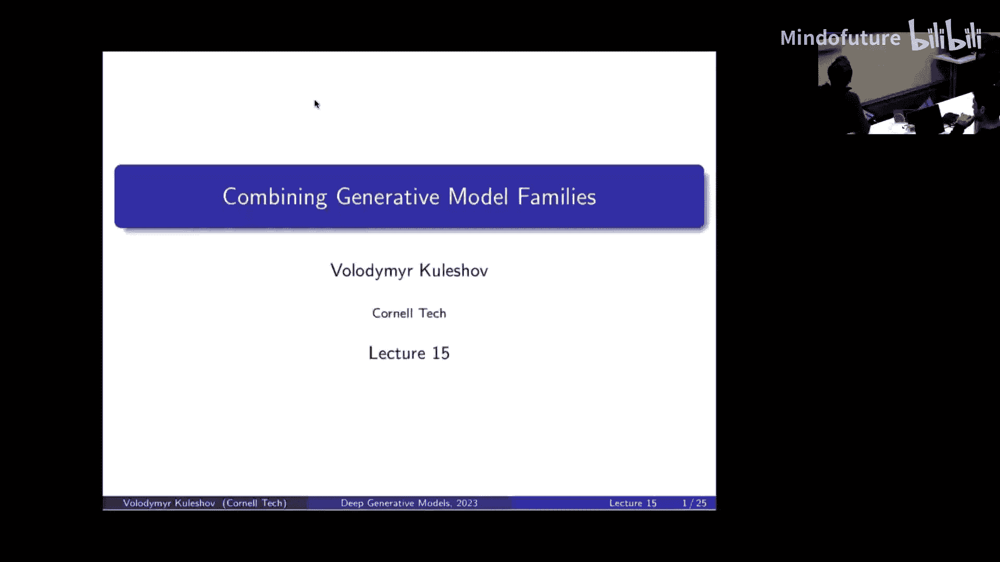
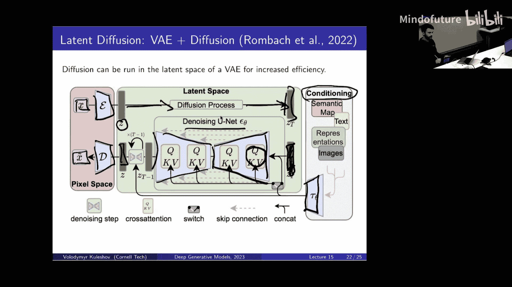
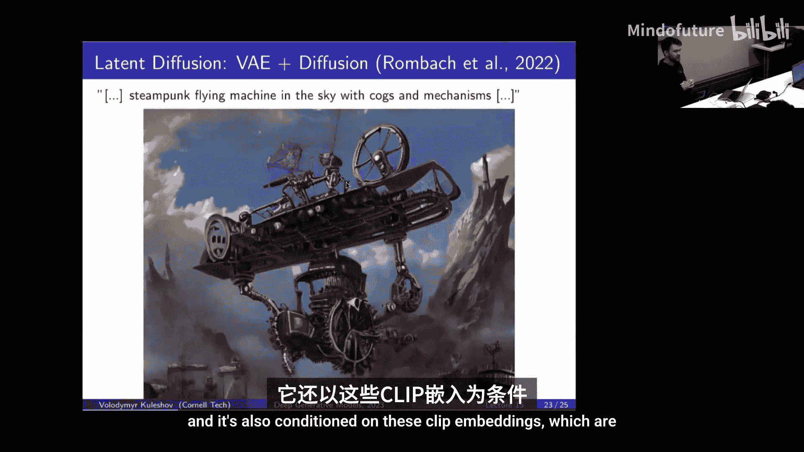
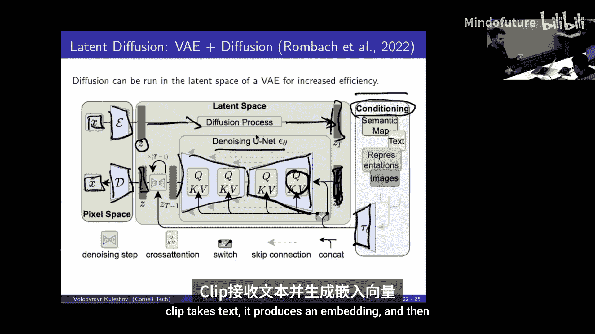
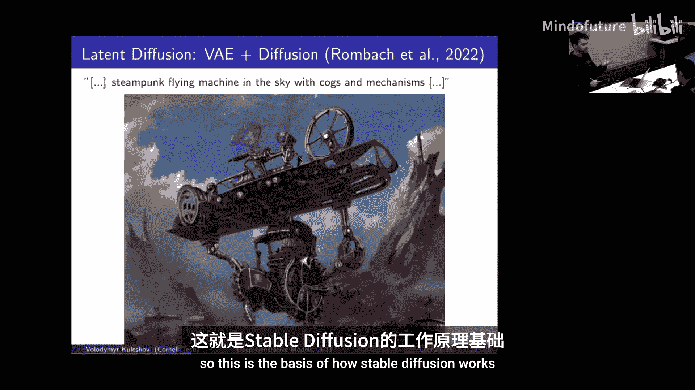
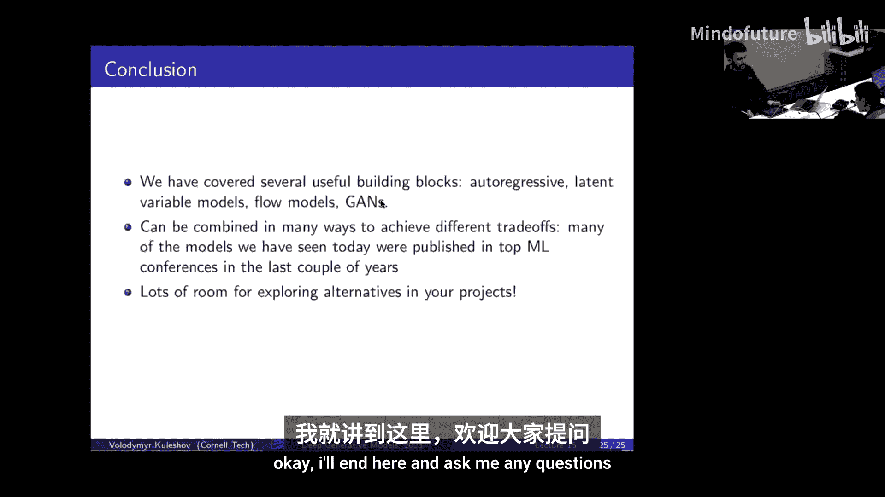

# 【康奈尔大学】深度生成模型 ｜ Deep Generative Models, Cornell Tech Cs 6785 p15 P15_Lecture_15-结合生成模型家族 -BV1p2awzrEJr_p15-

So today we're going to be talking about combining generative modeling families let's let's look again at the。

Various general general modeling tasks and general modeling families that we have been。

We have been looking at this semester。And today we're going to see how we can combine everything that we studied during the class in some new and interesting ways。

So first of all， remember that。From the beginning of the class until now。

 we focused our attention on different types of generative models and different types of tasks that are。

Important and useful and that are part of the field of general mully the first task that we looked at was generation。

In generation， you know， I guess if you follow this picture。

The task of generation is given a data set of， say， images we want to generate。

New images which like which look like the one in our training set， or if not images。

 then this could be texts， molecules， anything。And we started by deriving otheragive models as a way of doing generation and then over the course of the class we introduced many other modeling families which are effective at generation in fact all of them can do generation。

 but for some of them it's particularly easy so I would say late durable models GNs score based diffussion models。

 these are all types of models that are。Very easily suited to generation。Of course。

 generation is not the only task that we might be interested in there's also density estimation which。

In its most general form consists in trying to recover the data distribution using our model distribution by minimizing some kind of objective。

 which is typically the KL divergence， which means that it's equivalent to maximizing the log likelihood and so just simply estimating density is an interesting task that we looked at specifically when we define better regressive models and when we worked with normalizing flows。

 a lot of those lectures were about how to compute densities。

 how to compute the log likelihood and therefore minimize the KL divergence using certain modeling families。

And as I explained in a few previous lectures， not every model is well suited to density estimation。

 ones that are particularly good are aggressive models， normalizing flows are very effective。

Or they give you exact densities but actually for most other modeling families such as latent variable models or GNS or score based models there's no it's not obvious how to get an accurate estimate of long likelihood so density estimation is another task and certain models are better suited for density estimation and finally there's also the task of representational learning which is really important and late variable models are。

Will we propose and introduce them with the goal of doing representation learning。

 but there's other tasks， sorry there's other models which are not as good as latent variable models。

 they're not by themselves suitable for representation learning。So again。

 the high level takeaway from this slide is that there's many different types of models that exist。

 these some of these models are better at certain tasks than others。

The question that I want to look at in this course is， can we combine？

These different families to get new types of models that get the benefits of each modeling family。

 so can we can we get the best of all worlds by trying to combine these different model classes。

And so this lecture will be an overview of several papers from the last six or seven years in generative modeling。

And these papers all try to combine different ideas from different model families in new ways and so there's going to be。

 I guess we look at ways of combining aggressive models， Es， flows， diffusion models， GNs。

And I actually should use several examples of。how they can be or how they have been combined in the past in literature so this is not meant to be an exhaustive overview of all the literature on combining general models that's out there the goal is to give you some ideas for how all of the models we've seen in the scores can serve as building blocks for even more interesting models and how you can solve them how you can use them to solve。

New problems that require going beyond just the basic models that we have seen and also as you're doing your projects。

You might also be interested in exploring。New algorithmic ideas， new ways of。

Combining the basic building blocks that we've seen in the class。

 So these examples maybe they can be useful to you as inspiration for。

New ideas to try in your projects。So that's the goal。

So as a warm up let's start with one simple approach to combining two model families that we have seen at the beginning of the class which are auto aggressive models and variational autors so if here remember we introduced our aggressivegressive models at the very beginning and they're really effective at。

Density estimation and generation。But。But they don't necessarily have any latent variables。

 Therefore， they might not be effective at。Representation learning。

 can we combine ideas from latent variable models？which can do representation learning with auto aggressiveive models and try to get the best of both worlds so that this would be my first example so first let's do a quick recap on what is a latent variable model so in a latent variable model we typically have two sets of variables Z and X and we use a neuralNe to parameterize a mapping between the latent variable and the observed variable。

So one example in which well one way that we have seen to do this is using a deep Gaussian model or in fact this picture also can also represent the process that's used in again。

 so we have a late Z maps to it to an observe variable X and there is some neural net that will take a vector of z。

 we call that Z here is a vector it's a distributed representation for。For the late variable。

 well sorry it's a distributed vector valued。Ebedding。

It's a distributed representation for the data X that we're trying to model so we're're。

We're going to take this vector Z and pass it through a neural net and the。

And the neural net will either spit out directly an image X。

 in which case we have something which looks like the generator of a again。

 or it could spit out the parameters of a distribution， for example。

 a Gaussian distribution or over x which which might。Look。A like。呃。Like this right。

 so this could be either directly the image or distribution or the image this is。

Effective model we used in variational outenrs。If we use variation encodederrs。

 then we set a prior P of Z and then we specify the posterior distribution sorry we specify the likelihood of x given z。

 the probability of x given z using。We specified it to be a normal distribution with immunevari that is parameterized by。

A neural net， which is a function of z now this defines a joint the product of Tx Z and P of x can defines a joint of x and z。

And we can fit it to the data using the principle of marginal。Llihood， of course， it's intractable。

 so we would use variationatal inference。And all of these steps result in the graial atoncoder algorithm and once we train this model。

 we have a latent representation Z， which forms a smooth parametermetturization of the objects that we're trying to model。

 in this case， these are cases。So there are ways of combining this idea with auto aggressive models as well。

 one approach that one paper that tries to do this is Pix B。

 which combines the pixelix CNN architecture with the。

Essentially a pixel V is a pixel CNN that has an additional set of late variable latent variables Z essentially a pixel V is the same model as a regular V。

 except that the Bder if you have x given Z happens to be a pixel C。

And what do I mean by the fact that it's a pixelixs CNN。

 I just mean that it's an utter aggressivegressive model over pixels。

Right so in the previous example， I just had a neural net。

 I had a single feet forward neural net that given asZ would directly print out the distribution over over x here the prior here the。

The decoder is auto aggressivegress。But the additional modification that pixel V does to a regulatoryresive model is to introduce these latent variables of Z we still have to condition on z somehow。

 and in a pixel V we happen to condition every conditional distribution。

 so every P of Xi given the previous Xise， we condition each of these on z。And so now that's a valid。

Distribution of P of x given Z and we can just plug it into our variational autoencoder framework and minimize that instead of and minimize the elbow using that decoder as opposed to the one we've been using before and it still gives us a principled algorithm Now there's some interesting architectural details about how to actually parameterize this conditional and this is what the figure is showing。

So what the figure is showing is that。The way that the decoder is parameterized is that we so we essentially append so this is the image that this is the image that we're trying to model we append to it an additional set of channels which contain Z okay and specifically what do I mean by this if I were to say。

Sample or decode from a latent code initially the latent code is some kind of lower dimensional tensor。

 but it passes through a upsling convNe which is what we have here to produce an upsample tensor that's of the same with an height as the image and it has some number of channels that we get to choose then this tensor gets concatenated to the regular pixel CNN layers。

And then we just run standard pixelix CNN on the concateation of the image channels and delete channels。

So that's the architecture。And of course， we also have to define an encoder。

 and the encoder simply takes an image and applies a standard continent to downs sampleample it into something which looks like our。

呃。Which looks like R Z。So this is the architecture of a pixelO Y。Then the prior also， by the way。

 can be tuned and can be utterregressive， but the main idea of a pixel CNN is that P of x given Z sorry。

 the main idea of a pixelix B is that P of x given Z is a pixel CNN。

And this has the advantage of having very strong log likelihoods。

While also learning features like a pixelix CNN。Yeah。So in a sense。

 it can combine the best of both worlds。You can also use a smaller pixel CNN to get the same result as you would get with a regular pixel CNN right and the reason you can do this is that a regular pixel CNN has to capture within the same neural net。

 the entire distribution so it has to capture all the modes of the distribution whereas here our pixel E distribution is an integral over many pixel CNNs so it's a mixture of many pixel CNNNs therefore each element of the mixture doesn't have to be as big therefore each pixel CNN can be effectively smaller。

So that's an interesting advantage of pixel Ves and one challenge。

That we have when we work with pixel bes is that sometimes if the decoder is。Too powerful。

 then you can sometimes learn to ignore the late right a pixel if a pixel CNN can model distribution even without using lates。

 it's possible that when you train this in practice。

 it will ignore the late and this is an actual failure mode of pixel disease that happens in practice。

 and it requires extra engineering effort and extra。Extra care to avoid this failure mode。

 and I will again come back to this failure mode at the end of the lecture and propose an algorithmic way of dealing with this failure mode。

But okay， here we have an example of how to combine other aggressive models and latetnt variable models。

Here is also， by the way， another example， so this is not the only way in which。

These two model families can be combined again。This is not meant to be exhaust。

 I'm just giving you a few examples， and here is another example that is based on a different approach。

So this example assumes a different。Probability distribution and a different architecture for the model so it will use a different neural net in particular。

 this will use recurrent neural networks， which are a different type of other aggressive model to parameterize the auto aggressive probability distribution。

And using these variational RN ideas， we will also combine latent variables into that RNN decoder。

Imagine here that our task is to model a sequence of variables in principle this could also work for images。

 but this was motivated by。Applications like time series where X1 xt is a sequence of variables evolving over time。

A different type of parameterization of this joint distribution over all the time steps using latent variable。

 a different parameterization adds not one global latent variable， but one latent variable per step。

So that's a different modeling choice that we can make in the pixelix CNNnet example。

 we just had one vector valued variable， but it was the same in every conditional and the goal there is that if you're learning a distribution over an image then you have a single representation for the entire image here if you're modeling time series data you might want to approach the problem differently and have a different latent variable per time step。

Because maybe at every time step， there's a different。Representation that。

That is suitable for that time step and that representation could also evolve over time。

 So let's say your' you're modeling well， in in this case， the Xs are。Ourre。

Scals or at least in the original RN although I guess if it's a dysse， the X would be scalrs。

 but in principle there's nothing that forces them to be scalarrs， they could also be vectors。

 for example， imagine that you're modeling a sequence of video frames and each frame is a separate image therefore it should have its own latent variable it makes sense that it would have its own latent variable which evolve slowly over timeme so this is the kind of task that would be more suitable to this other type of architecture。

And more broadly， my point is that。Given different tasks。

 there are different ways of combining these general models that are more appropriate for various tasks。

Okay， so here this is the way that I will choose to factorize my distribution。Again， for each。

For each so okay technically speaking， sorry I kind of I slightly lied to you in this case all of the previous theses influence a UXT。

 but this could be easily modified to just only use the current ZT。And yeah。

 so here the first term is the decoder and again it's auto aggressivegressive。

 but it depends on one either one latent variable or as in this case on all the previous latent variables that came before time T and in addition。

 these latent variables they have their own autoaggressive model。

 so they also evolve according to some kind of utteraggressive。Process。

So these are the modeling assumptions that I have baked in into my probability distribution now how do I actually model this probability distribution。

 how do I actually sorry parameterize this distribution using a neural net well one way to do this is using recurrent neural nets。

呃。In this case， we have。Well in the parametermetricization that was proposed by the original set of authors。

 we have a neural a single recurrent neural net that parameterizes both z and x。

 so in practice the way this works is that there is a state H right that's just a hidden state of the RN which evolves over time and once we hit a new time step T we do the following first we take our hidden state and we have one。

Dense layer that outputs the mean variance of this distribution over z given the current hidden state。

 so this gives us this variable。It gives us a distribution over this variable。

 then we can take a sample from this variable or we can or if we're learning。

 we can apply the repermetturization trick to pass the resulting。

Sample plus some noise into this component。So into the distribution of x。

So now this is conditional on Z。On conditiondal and ZT， therefore we can put that ZT into into。

Into another fit4 neural net which parameterizes Xt as a function of the previous heading state and its variable of Zt again。

 the way guess the variable Zt is via the re parameterametization trick because everything is Gaussian so now I can sample another Xt and now that I have。

A new Xt and a Z T， I can take both of these and I can feed them into that single RN to get a new H and then the process proceeds so this is the way that sampling I guess what I've described here is the way that sampling would work sorry I kind of mix two things to Mmix training and sampling what I described here is how sampling would work and at training time it would train this using variational inference and so you would have an encoder which is also based on an RN in fact it's based on the same RN which would take so the goal here is to infer。

This new Z， T， given the previous X and the previous state and the way it could be done is by。Is by。

Is by。Again， simply using the X， which is known at training time and the H。

 which is also known at training time from previous access hence that to form the basis。

that these two vectors as input to an RN sorry as an input to a fully connected4 neuralette which outputs a distribution over this ZT。

 so in particular it outputs Q of Zt even H and Xt。Okay。

 so hopefully this gives you at least the high level idea of how an RN can be used to parameterize this。

 I know this was a bit high level if you want the details look at the paper here I just want to give you the flavor of how this method works。

Okay， so this is a different parametermetricization yes。

 so this is the particular pluralistic form of the approximate distribution。And。Yeah。

 and so this is a variational RNA。You can apply this to other type of returnren data。Other type of。

Data， which is suitable for another wresal model like times seriess。嗯。嗯。Oh。Okay。

 so here we have looked at ways of combining theses and otherregressive models。

What about the other type of latent variable model that we have seen， which are flows？

So remember that flows are。Ps are a variable type of late variable model where we have latet Z and the observed variable X。

Z is chosen to have the same dimensionality as x， and we use an invertable mapping F to map z to x1 to1。

And when this is invertible， we can apply the change of variables formula to obtain an exact。

Formula for the marginal likelihood of a data point X。

 and this formula involves this additional term， which is the log。

 which is the determinant of the draconian of the transformation have。So this was our flow model。

And if you remember choosing this， F was a very interesting challenge。

It has to be both invertebible and expressive and it has to have tractable Jacobian。

 it's not obvious how to get a function to satisfy all of these three properties。

One strategy that we looked at in one of the two flow lectures was to use an utter aggressivegressive model for F so in that sense other aggressivegressive models and normalizing flow models are already very closely related right？

Here I'm also proposing， well， I guess。呃。So other aggressivegressive models can be seen as a flow layer。

And these flow layers can be stacked。 And if you were to stack these flow layers。

 you can view each flow layer as having an utter aggressive prior。

 which is what this slide is saying effectively。 So effectively by。

Stacking flow layers we're essentially assuming that the prior of layer t is an utterregressive flow it's an utter aggressivegressive model which is specified by the flow at step T minus1 so in this sense flows can be seen as a way of oil flows provide a framework for stacking through regressive models and still have a tractable density。

嗯。So that's one way in which flows and。Late variable models are and our aggressive models are related。

Here is another approach so this stacking strategy that I proposed。

 the stacking strategy that I proposed in this slide is a way of making is a way of building a more expressive model over x。

You can also use these types of flow models to build a more。

Expressive model over the late variable Z within another latent pod。So essentially。

 we can plug in flow models as components of。Otherly in variable models such as yeasts。

 or to put it differently， we can in a sense， stack the E variable models with fully inver models。

Let me show you what I mean by this。First of all， let's remember the formula for the objective of a variational autoender。

 which is the evidence lower bound。So this is the way we trained a variational out oncor。

 we optimize this objective called the elbow over the parameter space of two neural networks。

 the encodeder Q and the decoder D。And this objective forms a lower bound on the true log light。

And we can rewrite the objective in terms of。This additional term called the k divergence so right I just told you that the elbow is a lower bound。

 we can also precisely quantify the gap between the marginal of likelihood and the lower bound and that gap happens to be precisely the k divergence between the trueop posterior and the approximate posterior key。

So when we optimize over the space of parameters phi。

 we are trying to make the scale divergence smaller so that we end up optimizing a tighter so that when we take gradient steps over P。

 we end up optimizing a tighter bound on the look light view。And。

The takeaway here is that we want to have a very expressive cu in order to make this bound tight。

 it's in our interest to choose Q to be an expressive model。

 either an expressive neural net or an expressive probabilistic model in order to make this bound tighter。

In our。Lure on the E， we just made Q of z given x be a regular Gaussian distribution condition on x。

But。SimilarSimilarly to how we used a more expressive decoder。In the pixel， the E slide。

 you can also use a more expressive encoder in this slide to try to make this elbow tighter。

By making detailed divergence smaller。So what do I mean by this in the when I when I just define pixel the E。

 I kept Q the same well， I kept Q relatively simple， but I made this decoder probability。

A complex multimodal utter aggressivegressive distribution。

If I were to also try to make this distribution Q more complex。

 then that would also be in my advantage because then I could make the version smaller and I would get a better bound on the elbow。

So that's another。Argument for。Why we would want to apply。

For why we want to combine different gene models。 So one way of combining。

Flows that our regressive models with be ease is to use these more complex models to parameterize the encode of a distribution so in particular we could use a normalizing flow for this。

Let's say that instead of only using a simple。Gauian for the decoder right instead of just using a simple Gaussian like I do in a E。

 let's say that I work to。Take a sample from that Gaussian。

 and then I would pass that Z prime into a I would pass it through a flow layer。

That will output the final Z。So essentially by composing a flow with the Gaussian that the standard V decoder outputs。

 I get a more expressive probabilistic model in a regular VE Q of z given x is just a Gaussian。

 but if I compose it with a flow， I could get a much more expressive Q of z given x that's not Gaussian。

 it could be multimodal it could have。A more interesting shape。

So P of z given x can be a very complicated function if I can make my Q of z given x。

Be more flexible then it could probably approximate P of Z given an x better and that's one way of doing it using by by applying a flow and this is what the original paper by resentant Muhammamed did and then King might all further extended it。

Further extended this idea by applying inverse utter aggressiveive flows for this F here right so if you work out the math。

 inverse or aggressive flows are actually a really good fit here because we're evaluating the keyL diversions under its sample。

Under samples from the model， this is where you would want to apply inverse every vessel flow。

And so what happens when you do this is that you can fit a much more。诶。You can。

 you can essentially better fit your pride。 So this is an example of the。Of the type of。

Results that you would get if you apply the technique by King My。In this example。

 we're training a variational。Autoencoder and our prior is a Gaussian distribution and let's say we have four types of points。

Each of these points gets a conditional。Yoian。So oh， in my prior says that。

Taken together all of these samples from Q should form something which looks like a Gaussian well because each conditional Q of z given x can only be a Gaussian and let's say I have four data points well the way that the model will try to back the samples from Q into the space of the prior is to put them like this。

RightBut this doesn't look， this doesn't match our prior very closely if we were to use。

And inverse at a aggressivegress flow instead， then we have the flexibility of outputting not a conditional Gaussian。

 but any sort of distribution， like for example， these little shapes here。

 so this little shape and right like we can output these slices of pizza essentially and that fits the prior space much better so we are able to fit the prior space much better it clearly forms a tighter approximation to the elbow and it's also interesting because if we were to sample from this prior。

 we are likely to get better samples so for example。

 here if we were to sample from the middle picture。

 if we happen to take samples here close to the middle of the distribution if we were to take samples in this region。

It doesn't correspond to any points there's nothing it's just white space whereas here if we were to take samples。

 we're much more likely to get realistic looking data points so fitting the prior better also helps with sampling because this is where we take samples later。

One other interesting extension of。These are multimodal these。

Let's say that in certain tasks we have different modalities。

 let's say that we have different types of images， we have images and their edges or we have。

Or we can also have， maybe we have colored images and grayscale images。Or we have images and text。

 so there are modalities。There are different modalities， but they're somehow related。Maybe， well。

 in the case of these colored and black and white images clearly there's common structure。

 if it's images in text， there could also be some interesting common structure。In that case。

 we can also extend the style models to have multiple outputs。

 and in this case we want them to be conditionally independent。

 we want the model to extract all the we want the Z late variable to extract all the semantic meaning and then everything else are purely you know domain specific details。

That go into x1 and x2 so there's also an interesting extension of variation and autors which does that they're called it's called multimodal Vs and there's some interesting math that goes on if you want to compute the approximate posti here。

 Q of Z given x1 and x2 it turns out that if you have a lot of modalities。

 there are efficient ways of doing this by applying clever parametervatization based on。Make sure of。

Experts， and so in practice you can deal with arbitrary high saying values of exs do at training a training time and you can do that in a principled way it's a neat。

A bit of mathematics， if you're interested I encourage you to have a look at the paper。Okay。

 maybe one。Common theme in all of the methods that I described so far is that they try to combine different。

Modeling。They combine different representations inside the same model， so it flows。

 b are progressive。Another way to combine different general models is to combine their objectives。

Right so we saw many objectives that could be used to train general models。

 we saw we started with the log likelihood， but then we derivedganNs and GNs。

 used the genen Shanon divergence and in the second lecture in GNs we even showed that any divergence can be optimized using aganN。

So。What about combining different generative models， not the other parameters， not the other。

Functional form， not the other representation， but the other objective。

So this is an interesting experiment it can be done within a normalizing flow in particular。

 so remember this is our normalizing flow it's this byjective mapping between Z and x because it's byjective we have a precise formula。

 we have an analytical formula for a marginal likelihood at any point x。And this formula holds true。

 regardless of how we train。The model so we can train our model using an arbitrary objective。

 but we can still evaluate its s likelihood。This is kind of interesting right we could use any divergence that we want to train this generator or you know these weights can be obtained using any process these parameters theta can be obtained using any process but this formula still holds and we can evaluate the likelihood for any choice of theta。

So one interesting experiment and this is called a flowgan is to train a flow model as a again。

 so a flow model is just a mapping between z and x， it's just a generator it allows you to sample。

X's from Z， it has the same structure。 It has the same properties as agan generator。

 except that it has the extra property of being invertible。

 but that doesn't prevent it from being used as a generator in a G。

 So one interesting experiment that was done in the paper called flowgan is to try to train a flow using a G loss。

And。And， and。And the， again， the reason why a flow is particularly interesting for this is that once you have trained your。

Flow as again， you can still measure its likelihood。

 unlike in irreg again where you can't measure the likelihood here you can actually assess the of this model。

嗯。So this。Is interesting。One reason why this is interesting is that it lets you。

Study what happens to the look likelihood if you use a different objective。

And the short answer of what happens is that when you train it as a again。

 the likelihood diverges to infinity。So this is actually an experiment which empirically demonstrates what I told you earlier and I gave some toy examples of why that would be true。

 but here this empirically verifies the claim that I made that samples and likelihoods are highly uncorrelated。

So in particular， if we were to。So first of all， we can optimize a flowgan using an arbitrary combination of decal divergence。

Slash likelihood and dig gen shadow dirgence， which is our。Again， loss that's。

Based on using a discriminator， you can optimize an arbitrary combination between the two with some parameter lamb that controls the strength of the g and divergence。

And what we find is that if we optimize the objective using an adversarial loss。

 we get the best quality samples as measured by inception score。

 but the likelihood is really bad in fact if you plot it it can even in terms of just the pure value of the log likelihood it can diverge to an absurdly large number。

 so this further shows how likelihood and samples are uncorrelated。嗯。

And then when we train with an MLE， we get the best likelihood， but our inception score is lower。

And using something like a flowgan， we can interpolate between the two so we can have some kind of hybrid which achieve use。

You know， a reasonable likelihood， but it has a lower inception score。是。Yeah。

 but I think the main takeaway of this paper is that likelihood and sample quality can be completely de correlatedrelated for certain types of models。

嗯。Yeah。Okay， so here we've combined flows and GNs can we combine bes and GNs of course we can。

 so here is an example of how we could do this。First， what you see here is again。

 the image that illustrates the model that the the probability model used by the log like used by the variation autor。

 and this is the formula。For the marginal of likelihood， which is the elbow plus DLversions。Okay。

 and we can rewrite this in。And a slightly different form。

You can rewrite this in a slightly different form， you can rewrite this as being up to a constant DKL divergence between the data distribution and the model distribution and the DL divergence between the approximate prior and the true prior。

So you can think of this as optimizing the likelihood plus some regularizer。

Now one obvious way of combining these andganNs， and that's the first thing that anybody would try is to just plug in the Jenen Shanon diversions。

In addition to this scale aversion term， you could also add anotheren China diversion term so you could train using both objectives and you will get sharper pictures。

And you could also get latent variables and an end quarter， so this is one way of doing it。And again。

 the value of doing this is that you might hope to get。You will probably get better samples。

 better quality samples if you add the Jin Sha term。

Now another interesting way of maybe a more subtle but also interesting way of combining GNs and Ds is to apply to the Jensen Shannon。

Loss， not in pixel space like here， but instead apply it in latent space。

 and that also happens to be very valuable。 right here， we're using decal diversions。

 Instead of changing it on this side， Can we change it here instead。If you do that。

 then you get a method called an adversarial autocor。All right， so in a VE。

 we optimize the likelihood。Plus， a term that involves the k divergence between the approximatex posterior and the true prior。

We can switch it to， we can switch。All the kL divergences in latent space doL to Jsen Sha divergncencies and the result is that you're going to be optimizing。

 you're going to be trying to regularize the model not using the kal divergence but using digest Jsen Sha versionence so you're going to try to fit your encoder using the Jsen Shan divergence。

Why would you want to do this？Well， if you remember。

 I told you that we just agreed that using a again loss gives you sharper images in pixel space。

 Well， if you use again in latent space， then you also get sharper。Samples in prior space。

 And what I mean by sharper is that it matches your prior better。

 So this is one experiment out of many in the adversarial out on paper。

Here they try to fit a distribution， here they try to fit an autoenr。

 a variational auto enr with a prior that instead just being a simple Gaussian blob。

 it's this more interesting star shape。And you can see that if you train a V。

 which is what we have here， it doesn't really it tries to reproduce the star。

 but they scale divergence。Is not the best loss to use here and similarly to how。

To how using the korgs in pixel space sometimes produces blurry images here we have something which roughly matches the star。

 but doesn't match it perfectly and if we instead were to use the chanceen shine divergence or something like an loss then we get these really。

Then in prior space。The samples look really crisply。

 they very crisply match the objective that we that were the。

They crisply match the shape that we're looking for and that we sat in on prior。对。嗯。

And there's other experiments that see that you can find in the paper they use spirals and other weird shapes so you can enforce prior regularization。

 you could potentially enforce prior regularization more effectively if you were to use other losses。

And also， it has the advantage of not assuming that Q of Z given X is a prior。

 Remember that in the previous example with。Inverse of aggressive flows for the encoder。

 we were able to pack we were able to better fit the latent space。

By using a more expressive encoder here we're also effectively using a more expressive encoder instead of forcing Q of Z given x to be Gaussian。

 now Q of Z given x can be an arbitrary distribution that's defined implicitly purely from samples。

And as a result， you get this。Yeah youre you can also。

 I guess there's there's two reasons why we are able to better fit this prior。

 one is that we use a better loss and the other one is that we effectively use a more expressive。

For for harvestial。Yeah。Okay， next， I want to look at the elbow a little bit more closely。

And come back to one point that I made earlier in the very first few slides about pixel disease。So。

Okay， this is the reparmetricurization or sorry this is the rewriting of the elbow that I had in the previous slide。

 again we have the term where we're matching the the distribution。

 we have this kL diversion based regularizer。We can do a little bit of math here and can massage this term into something else。

 which will reveal some interesting structure and facts about what the elbow is optimizing for。

So I'm going to do a little bit of math here。You don't have to follow this exactly。

 but as you can see it's pretty short there's just a few lines。The main point here is that。

We can rewrite the original objective into a single kale divergence。That。Is。

A single kale divergence that they send two distributions。One of these distributions is my model。

 it's my joint distribution over x and z and notice that it has this interesting factorization。 Well。

 in fact， I can factorize my distribution in any way that I want so I can write it as P of x and P of given x this is。

This is perfectly fine， this is perfectly valid。And on the other hand， I have this distribution。

 which I'm going to call the joint Q over x and z， and I'm going to define this joint as the product of the data distribution times the approximate posterior z given x。

So this is the product of two distributions， one is over x， the other one is over z given x。

 so their product is a valid joint distribution over both x and z。

And what this derivation is saying is that the elbow is the k divergence between these two products。

Okay， so far I just gave you a mathematical statement effect。

Let's now look at why this is interesting。So this is the derivation that I just made on the previous slide。

What this derivation implies is that the elbow will be optimal。

For any choice of Q&P that satisfies this equality。

Let's look at a few ways in which we can ensure this quality。There's many ways。

One way is is to essentially fit。I guess one way， which is kind of degenerate and that we want to avoid。

Is the following？Our。Our probabilities distribution can factorize as。S P of x given Z and P of Z。

 And now let's say that we were to simply ignore Z in our。In our。Deorder。

 and we were to fit the distribution of x unconditional。So in particular。

 I could imagine I was able to model。My data distribution perfectly using the decoder P of x given Z while ignoring the Z。

This is something that could happen if we were to use a really expressive decoder like the pixelixel CNN decoder that I had in the first few slides。

So imagine this is what I learned and then for for Q， I could also just。

I could also just learn my approximate at post to be independent of x and just always output the prior。

 so that's a really easy solution to learn Q of z given x it's just a neural net that always outputs a unit Gaussian it completely ignores x that's another degenerate solution。

This is clearly degenerate because it's not doing latent variable inference at all。

 but it perfectly satisfies this condition。Therefore， this will give us a perfect elbow。Yes。Right。

 so this shows an interesting failure mode of Es when you use a very expressive decoder like a pixel CNN。

 it shows that you can learn to completely ignore the latent variables there's nothing wrong。

 there's nothing that prevents the model when it's optimized using the elbow from just ignoring the latent variables entirely。

And it happens in practice for expressive models like pixelix CNN and also forms of variational RNNs when people who try to create our Vs from text。

This was a problem that they had to deal with in practice。Yeah。嗯。

So there's nothing in the elbow objective that prevents this from happening。

 what we can do is we can try to prevent that failure mode by adding an extra regularizer。

 and there's an interesting line of work on using this concept of mutual information for encouraging the use of Z in X by adding an extra regularizer。

 which is called the mutual information。Yeah。So the mutual information is essentially the k divergence between the joint distribution and the product of the marginal。

So if the mutual information is zero， then it means that we're。That were're completely。That's。

That Z and x are completely independent and that's what we don't want。

 So we're going to add max we're going to add mutual information into the elbow and then we're going to try to maximize it。

Mmm。And that will， in practice， encourage this E to be used in interesting ways within the model。

Right so this is a technique that is used in many models to promote the use of latent variables。

 it's a technique that can be used that can be combined with pixel D or with any expressive decoder to ensure that x that Z is used to generate x。

And it was also used in other model families， not just VEs。

 but also general address networks to introduce latent variables and encourage their use in particular this there is this interesting work called infofoG。

 which introduced an additional set of latent variables within a G。

That were meant to control the output and that were meant to produce interpretable representations。

Within again， so normally and again， we have we sample noise and we generate x from that noise。

What infofo again did is that they added another small lake variable， which can be two dimensional。

 four dimensional。And now they generate a high dimensional noise and an extra latent variable and they train these two things jointly and in order to encourage the use of this additional latent variable。

 in order to prevent it from being ignored， they add a mutual information term the latent variable between the smallux latent variable and the input。

And what happens if you do this is that you find that the G naturally learns to use certain more semantic type of information within the small variable and it learns to use the other variable to represent other types of noise so and it's also。

In their experiment， this led to interesting to this interesting behavior called disentanglement。

 where in each of the latent variables， in each of each of the dimensional latent variables would correspond。

Each of the dimensions of the low dimensional length variables would correspond to a different property to a different interesting factor of variation in the data。

 such as the pose， the lightingning。Shape of the face， another type of angle。

So essentially by enforcing initial information， it's possible to get。Better latent variables。

 even potentially latent variables that are disentangled。You had a question。 I did have a question。

 So let's， for example， if it's。Figure a， then they're only getting the variation across posts。

My question is， can they get like two different representations at a time like variation across two different。

Non yeah， basically like instead of separating one feature out。Can you do it across two features？

Well， the。Yes， but that's considered worse like what's happening here maybe didn't explain clearly so you have。

 I guess yourgan here has two sets of variables it has running space where it has Z and it has this other variable called C and then together they combine to produce x right and this C is going to be low dimensional so C will have say four components C1 C2 C3 C4 those are the four components of the R four dimensional vector C and what happens is that。

So in their experiment， if you're really careful about training， again。

 this is actually there's a lot of。Engineering things that are going on underneath the hood。

 But you can potentially get C1 to correspond to only a C C2 corresponds to only B C 3 corresponds to only C and S1 to correspond to only D。

 something like that。 Now， this is really hard to get。 This is really hard。

But sometimes with good enough regularization and。Careful hyperparameter tuning。

 you can get these kinds of disentangled representations normally when you were if you were to train a regular model。

 this would all be entangled so you would have all of these more vectors。

 but they wouldn't be they wouldn't correspond you would have these four axis variation。

 but they would all be like if you change one component of if you change C1 you change all of them at once so that's worse。

Have they tried something like this for diffusion ones？Listen Yinang and I we tried。

Didn you do sometimes work but yeah。For some scenarios， it can work that one where。

Trying to add in more experiments on this。Yeah， you should have a paper on the archives and but yes。

 it' papers under review yeah， so there's something that we tried for diff future models。

 for example。Cool， so this is infofog and then this idea it also finds itself in other types of general models like in variational error encoders。

 there's this one really simple idea but it got a lot of attention called the beta V by Higgins 016 there main idea of a beta D is that you add a。

You add an extra weight term on your prior regularization term。

 but you can show that this actually corresponds to enforcing。Mutual information。 So if your beta is。

Not equal to one， like an rail V that implicitly means that you're adding mutual information。So。

In other words。In the bitta E paper， they found empirically that tuning B can lead to better representations and even dis endtangled representations。

 and then there was a follow up paper called FOV， which explain what might be going on by showing that this objective can be rewritten to look like this objective and that actually has a mutual information term inside of it so when you tune beta。

 you're actually adding mutual information。And you can see this paper for more details。

And then I just want to also add with a few more thoughts on how the future models can be combined with all of these ideas。

So one work that I want to highlight is latent diffusion。

 which is essentially a way of combining these and diffusion well first of all， diffusion models are。

Already， in a sense， a A VE。But they have been successfully combined with these in the following way。

So what this figure is showing is that。Let's say that you want to generate high dimensional images。

The problem with doing regular diffusion models is that you would need a pretty large unit to model the denoizing process at every step if your image is know megapixels in size。

 you start to mean a very large unit， if you want to train that over a very large dataset set like hundreds of millions of images that becomes computationally challenging or it results in a really big model。

 what the latent diffusion paper proposed is that instead of modeling images in pixel。

 instead of running diffusion in pixel space。You can run diffusion in the latent space of a variational。

Oututto encoder。 And you can essentially view the variational autoenr as compressing the images。

 similarly to how you do Jpe compression， you can do。The style compression。 so it takes an image。

 maps it to a look to a compressed low dimensional representation。

 and then you generate in that low dimensional representation。 So that's what a a。

A latent diffusion model is doing， so it starts with an x。

 and then it passes it through a V encoder in order to get a latetnt Z。

 Then there's a forward diffusion or forward noing process。It'One here to produce。

A ZT that comes from some arbitrary prior and then when you generate， you sample this ZT。

 then you dennoise it for a while until you get a denois z and then you then you go back to pixel space at the very end with the variational out oncor and at each step of the denoising process you use the same denoisizing unit that you would normally use in a regular variational out oncor。

 which means that you have a series of down sampling convolutional blocks and then a series of ups convolutional blocks but this is more efficient again。

 because this input input Z will be much lower it will have a much smaller dimension than the original x。

And what this image is also saying is that you can。

Also easily condition this process on auxiliary inputs if you wanted to model a conditional distribution。

 say maybe conditional text， then you could have an extra encoder that encodes the text and then the unit can be conditioned on this。

Embbedding an additional cross attention layer， which is what these things are。

 so you can also interleave the convolutional layers in a unit with a cross attention layer and that's how you would parameterize a conditional diffusion model。

And then if you， I guess this latent diffusion idea has been very powerful。

 latent diffusion is the model that powers stable diffusion。

 so stable diffusion is essentially a trained version。

 stable diffusion is latent diffusion trained on a very， very large data set。诶。

And it's also conditioned on these clip embeddings， which are multimodal embeddings。

 So this conditioning part here it's done via this open source model from open AI called clip clip takes text。

 It produces。

あい。And embedding。

And then you can get that you can run the process condition on this embedding to generate really interesting imagery given a problem。

 So this is the basis of how stable diffusion works。

一。And of course， these are not the only ways of combining diffusion models end。Other types of models。

 So you can combineganNs with diffusion models。 For example， there is adversarial score matching。

 which is a way of combining diffusion andganNs。 So you know how it in diffusion model。Well。

 in a standard diffusion model you sorry in the standard derivation of a diffusion model。

 you learn the noise， but you can slightly tweak the derivation and you will show that an equivalent way of。

Like in an equivalent objective， it just assumes a different parameterization of the。

So yeah there's a slightly different parameterization， instead of parameterizing the noise。

 you can parameterize a clean version of the image condition on the noisy image。

 and you can train that to approximate the true clean image。

So it gives you the exact so with the same objective that you get for a diffusion model。

 if instead of reparmetizing the noise， you choose to re parameterametize a clean version of the image。

 your loss will reduce to something like the L2 loss between the dennoise image and the clean image。

And it's just an equivalent way of formulating a diffusion model。It leads to the same objective。

 it just leads to a different deturization of the of the。Of the probability distribution。

But if you make that observation now you might ask yourself well why would we be using the L2 loss or the clean image in the noisy image why not use the adversarial loss so this is the idea of adversarial score matching。

 you can also use arbitrary losses there so there's some interesting results there and you can also combine an regressive models with fusion models。

So one interesting connection between your regressiongressive models and diffusion models is that you can view the utter aggressivegressive process as a form of backwards process in a particular type of noiseisy so let's say that you have a sequence say have the full sentence and you generate that sentence one by one so you can view that as a special type of forward process where your noise is to start with the full sentence and delete words one by one going left to right so that you can view that as a trajectory that denos yeah the denos the objective the denos the data in some way sorry when you delete the noise data and and eventually you just get the empty set and now your utterregressive model can be seen as trying to undo this noisy process by starting from the empty set and generating back the original words。

And so that's an interesting connection that has been buttoned out by a few papers。

 one of them is this utter aggressiveive diffusion paper， but if you view it。

If you view the noing in that way， then it raises the question， well。

 can you have or can you have different orderings which would correspond to different types of noising processes So instead of deleting left to right。

 what if you were to delete in a random order and what if you were to just show the model sequences of。

Clean to noisy。Where the deletion is over arbitrary permutations and these permutations are sampled at random。

 So if you do this， you can get any order our aggressivegress models。

 which is an older paper from 2014， or a more recent version of this with some additional tweaks is our regressive diffusion models that can。

That do exactly what I said， they're trained to reconstruct the sentence given。

Delete given an arbitrary deletion order， and as a result。

 they can also generate words in an arbitrary order so you can choose to generate。

Words according to a certain， when you generate， you specify which order you want to generate and it generates for you in that order。

 and you can even kind of tune the generation order as you generate。

So these are additional connections between the two。

I guess I'll just end by saying that we've seen a lot of useful。

 we've seen a lot of basic building blocks， all of these big generative modeling families。

They're not the end of journal modeling they're at the beginning。

Then there's an entire literature and entire yeah， within general models you'll find many， many。

 many papers that try to combine these in different ways and that results in even better diffusion models and even better general models so you should be aware of that by combining these building blocks in different ways you get different tradeoffs。

And there's a lot of room for you to explore。There's a lot of research ideas it could be so there for your projects。

Okay， Ill end here and。

Assk me any questions you have。