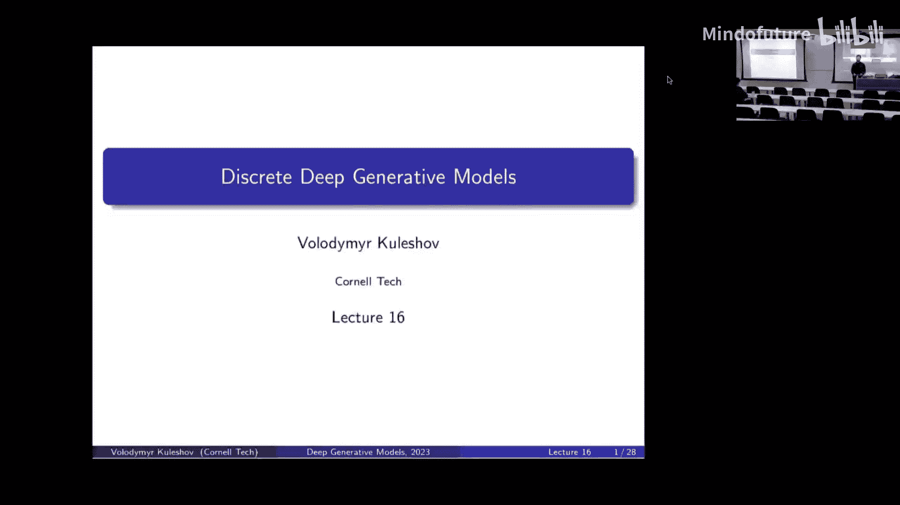
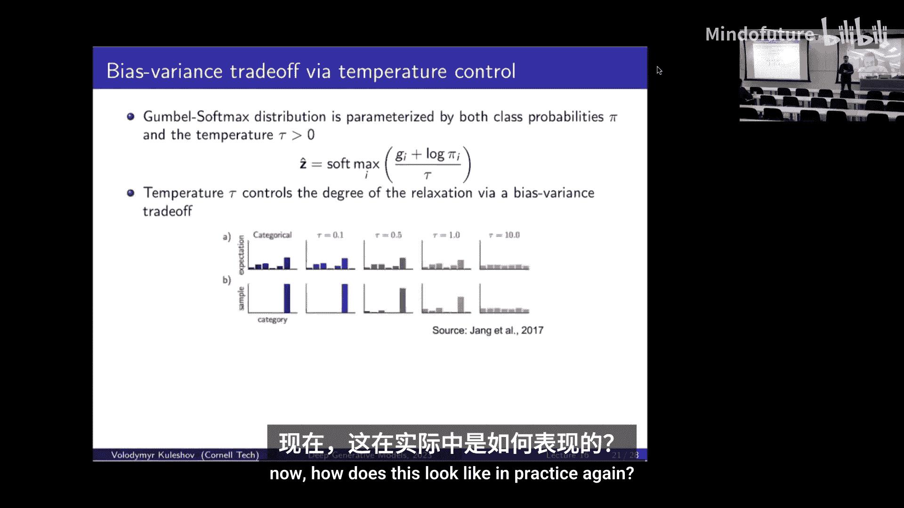
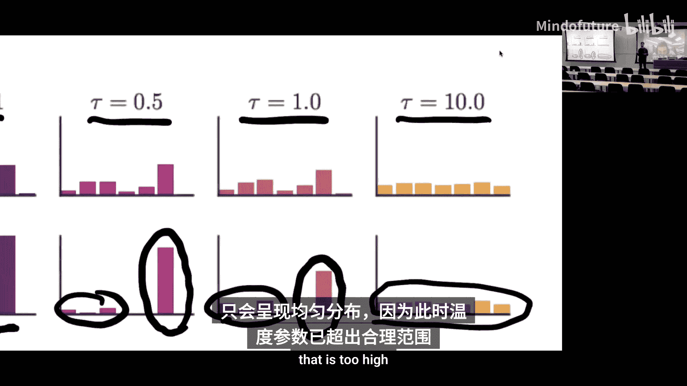
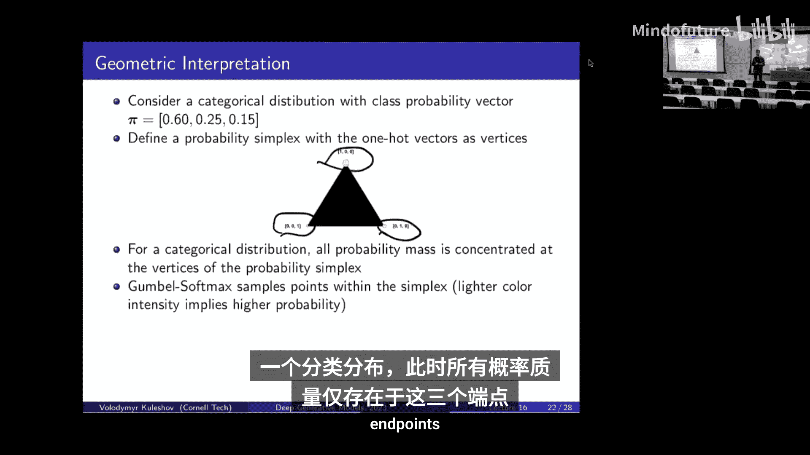
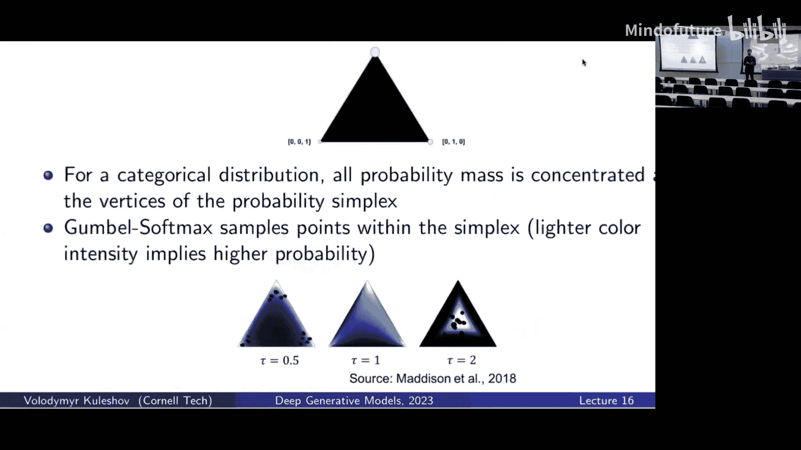
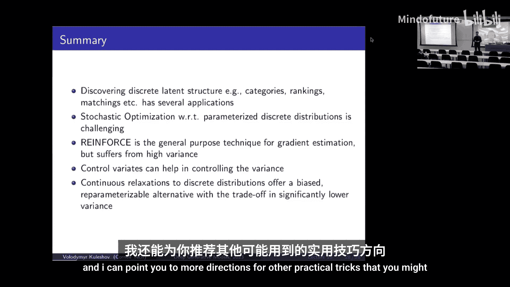

# 【康奈尔大学】深度生成模型 ｜ Deep Generative Models, Cornell Tech Cs 6785 p16 P16_Lecture_16-离散深度生成模型 -BV1p2awzrEJr_p16-

あ。

We're going to be looking at a special topic in generalative models， which is going to be。Again。

 this is part of my final set of lectures on several special topics in generative models。

 so we had a topic on evaluation， a topic on combining variant of generative models and today is going to be on。

呃。The issue of discreteness in generative models。 So why is discreteness interesting and why does it merit its own lecture。

In a lot of the data that we're working with， we have inherently this aspect of discreteness。

 so for example， if you're working with certain types of data like graphs or DNA sequences， text。

 source code， representations of molecules， this data is often really different from the data the type of data that I've been using as my running example throughout the course。

 which have mostly been images。嗯。And if you want to model these kinds of data。

There's going to be some special issues that you will have to worry about and that's some of the things that I want to talk about in this lecture so that's one reason why disputeness is interesting。

Another that might be a little bit less obvious， but equally important is the fact that many latent representations that were。

That we would like to learn could also be inherently discrete。Right。

 so these these two bullet points refer to two types of。

Generative modeling problems that we've encountered in the course generation。

And representational learning。In representation learning discreteness might refer to the fact that you want to learn some kind of discrete binary concept。

 such as let's say gender or some kind of latent par tree that explains the。

The object that you're modeling or you might want to compress your image into or compress your input into a discrete latent code。

 so you might want to do compression， which has to be inherently hisized。So in many cases。

 also these representations。Make more sense when they're discrete as opposed to continuous。

And so in this。Lure， we're going to look at general algorithms for dealing with discrete data both in latent space and in observed object space。

 so both in the space of X and Z。And the plan is that first of all。

 I want to spend a little bit of time defining what the problem of discrete gene modeling is and then we will talk about two important techniques in generative modeling that are useful for solving any sort of discrete discrete optimization problem that you might have one of them is going to be reinforce I alluded to reinforce in our first lecture on these but we're going to talk about it in a little bit more detail I haven't mentioned some important techniques that are needed to get reinforced working in practice that's going to be one topic of today's lecture and then。

I will talk about another technique called relaxed repairmetrictization or you may have heard of the Gambo softm trick if you've been reading a little bit on these so this is going to be another approach that solves essentially the same problem is reinforced but in many cases it can give you improved performance so the other part of the lecture beyond this technique and I know that some of you are working with discrete projects I know there's a project on generating text using I guess either GNs or some kind of reinforcement learning type of models so these。

Approaches， I think， will potentially be really useful or at least being aware of this problem and being aware of these techniques will be really useful for any projects that you're working on that involve discrete data。

 either in input space or in latent space。Okay， so that's the plan。So as I said。

 let's first start by defining what is the problem of discrete？Optimization or dispute modeling。

For the purposes of this class。The problem of optimizing over discrete data or the problem of discrete modeling will be given by this equation。

So here I am trying to optimize an objective which consists of an expected value。

 and in this expected value， I have a parameterized model， which is a probability。

 and we're trying to take expectations relative to this probability。So here。

 Q of Phi is some kind of model。 It's a function of some variable Z。

 And I want to take expectations of。I want to optimize the expectation of some function under the model。

 but the model is itself parameterized。By parameters sphi and want to maximize pihi。

 So why is this interesting and why is this potentially hard。

So we actually saw one example of a problem of this form and this was the elbow of a VE if you have the elbow of a VE。

 remember this is the formula right， this is exactly what the elbow is。And here。

We have an expected value relative to Q， which is our approximate posterior。

And then the ingra or the thing of which we're taking the expected value is a function of both Z and x。

And our goal is to optimize the elbow， or at least in standard variational inference。

 our goal is to optimize this elbow over two sets of parameters， the parameters。

 theta of the model which live here， and then the parameters of the parameters phi of Q。

This is the problem that we tried to solve when we did variational inference。

 and it's clearly an instance of the above formula。And if you remember， this was。

Not completely trivial to solve when we first studied this problem。

As I said there are two sets of gradients there are two sets of parameters here and each of them has their own gradient and the gradient with respect to the first set of parameters theta is easy that's because if we were to take the gradient of this relative to theta well we can flip the expected value and the gradient so I can put the gradient inside the expected value and now I have an expression that's the expected value of a gradient or it's the expected value of something and I can always approximate expected values using Monte Carlo so when。

We are。When we took the expected， when we took the gradient with respect to data， that was easy。

 we just。Put the gradient inside the X and we applied Monte Carlo Now， oh and this is of course。

 the formula that I that I just that I just showed you。

 so we do this and then we approximate the expected value using gradients that's exactly what I just drew on the board。

我。IfIf we want to take gradients with respect to the other set of parameters， phi。

 then this was not neat trivial。When Z is continuous。

 we saw one way of doing this using the reparmetricization chip。

 so we reparametized Q and as a result as a result we obtain a formula that's similar to the one you see here it's a formula that we can easily approximate using Monte Carlo and then we can flip the order of the gradient operator and the expectation operator because again the problem here is that now that。

We're trying to compute the gradient with respect to phi。 now we can't。

We can't just flip the order of the expected value and the gradient operator because my gradient is with respect to the。

Yeah。Distribution。According to which I'm taking the expectation。 So now this。

This change of order of the operator doesn't work anymore。 And as a result， we saw two ways of。

Dealing with this problem， One was a first version of the reinforce estimator。

 And then we saw an even better way of doing it， which is applying the。呃。The re aitturization trick。

嗯。So this is what we did with the elbow and my high level point here is that there are instances。

 there are many instances。Of this problem in generative modeling。

 and oftentimes it is not completely straightforward to solve this optimization problem。嗯。So。

In the first part of this lecture， I want to look at the reinforced estimator again and show you how it can be a general technique for solving optimization problems of this form。

So let's first quickly look at this。Let's first quickly。

Remember what this trick was when we first introduced it。嗯。And sorry， just before we do this。

 I want to mention a few more applications of this identity。In the context of an elbow。

 we could use the repermetturization trick， but sometimes it's inapplicable。

 why would why would it be completely inapplicable Well， I guess there's two scenarios。

 One scenario is that。Sometimes the Z that we're trying to model could be discrete That could be the case of a discrete latent variable inside a latent variable model then we just cannot apply the reprometturization trick so a discrete V a V with discrete latent variables now can no longer be solved using the reprometturization trick you might not even call this a V anymore So we need a specialized method and also there could be other instances of this problem where Z is discrete I'll mention an example where we're talking about generating some kind of objects which are discrete right so this cu here could also be some kind of generator and we're trying to maximize the score of some set of generations for example well the example that I will mention in a moment would be something like a discretegan let's say we want to apply GNs but the。

Things that we're generating are discrete and we want to maximize the score。

 we want to I guess minimize the score of the discriminator under our samples。

 then F can be seen as the score of the discriminator and we want to optimize parameters phi such that。

This score is bad。 Then this is， again， another instance of this problem where F is non differentiable because。

It is a function of a discrete variable and also F could be nondeiable in the sense that let's say that we're generating some kind of text。

 but instead of maximizing the likelihood of that text。

 we're maximizing some kind of downstream nondifferiable score so for example there's a lot of automated metrics and natural language processing their names are typically the names of colors they're called the bluemetric。

 the rouge metric for some reason it's always there's a Move metric for some reason it's always a French color but these metrics。

 they are handcrafted to evaluate specific properties of text， for example。

 the blue score measures how good is a certain translation relative to the original there's another called rouge which measures how good is a certain sentence in terms of being a summary of an original input。

And my point is that all of these metrics are non differentiable。

And there are there could be other non differentiable ways of scoring how good is the output or not maybe we're maybe there is some general notion of reward or some general notion of score that we want to define over various discrete objects that we're generating and then and in those cases again。

These classical optimization frameworks that we've discussed are not applicable because our function F could be non differentiable。

 for example， these NLP scores are non differentiable and in those cases we would also want to apply some kind of more general technique than the repermetturization trick。

To optimize problems of this form and the reinforced trick will be one such general approach。Okay。

 any questions on？This type of problem or the motivation behind windforest。Okay， if not。

 then let's just remind ourselves what the reinforce trick is。

 So this is the essence of the reinforced trick in， yeah， in one line。

 Let's say that we wanted to compute the gradient of this。Of this expression relative to Phi。 Well。

 we know by the definition of the expectation that this。

This this objective can be written as a sum over a different z that's just the definition of an expectation。

 And now let's say that I wanted to compute the partial derivative of this expectation relative to some parameter phi I let's say I wanted to compute this particular expression Well。

 I can apply the definition of the sum and do a little bit of algebra to define the correct formula for this。

Partial derivative because again， recall that I cannot simply change the order of the partial derivative and the expectation that's not valid。

I have to work out the correct expression with a little bit of math and algebra。

 so let's do that now。I want to compute this property。

I know that my expectation is a sum so I can write it as a sum and then once it becomes a simple sum。

 then I can interchange the order of the sum and the partial derivative operator。

 which means I get this expression so here I just apply the definition and now I apply the partial derivative operator to my function Q so that's just plugging in the above formula into the definition of the。

It's plugging in the first line into the second line。

And now I can apply a little trick to get an expression。

 to get an alternative expression for the highlighted term， Here's what I'll do。

 I'll divide and multiply by Q of 5。So this is valid because I'm just multiplying by one right。

 Q of Phi divided by Q of phi， but this expression has the interesting property in that this highlighted term actually equals the log。

 well， it's actually the derivative of the log of Q of Phi。So I can write it like this。All。

 so this highlighted the， the derivative of log Q of phi is just。

So I can do this so far it's just applying the definition of the law。

And then what's interesting about this。Other term is that I now have something which looks again。

 like an expectation。I have here a sum over different C and each to z has a weightq of z。

 which is a distribution， so this is just an expected value over all possible z where the distribution is Q of z and the inside of the expected value contains the three of the log times step of z。

So what I have derived right here now is the correct way of changing the order of the expected value and the derivative operator。

 This is the correct way of doing this。 and this little。

Algebra trick is what we call the reinforced trick。The we for greed trip。Okay。

 so now I have rewritten the gradient of the expected value as the expected value of the gradient。

And the reason that I want to do this is because now that I have an expected value on the outside。

 I can approximate it using Monte Carlo like we did in all of our experiments。Okay。

 so now let's use this trick and let's derive the full reinforce estimate。

If I take this derivation for each partial derivative， and I combine it。Into the full gradient。

 which is just the vector of all the partial grers。 Then I get the following formula。

 which is the reinforced formula。So similarly to how I can flip each partial derivative with the expected value and then there's a log that there's a green of a log that appears inside here I can flip the full gradient operator and。

When I put the order inside the Inte， I now have not just F ofc。

 but I have FOC done just grain of blogography。Okay。

 so this is the reinforce formula that we saw in our lecture on British Chicagos。And again。

 the reason why this is interesting is because after my。

The estimator is written in the form of an expected value。

I get computed approximately by applying Monte Carlo， which is the second formula。

When I say applying Monte Carlo， again， what I mean is that I sample some points Z1 to Zk from Q。

 and I approximate the expected value with the average or。

And now this gives me a valid computable formula for the gradient of my objective。

 and I can now optimize my discrete non differential objective using this。Okay。

 so this is radiant estimation using the reinforce speed。嗯。

And this is a very general trick all it requires is that we can take samples from the distribution Q and evaluate pro abilities under the distribution。

And it works for both the speed and continuouss。So as I mentioned， one application of this。

But this could be in basically variable againNs， let's say that I want to optimize。

Then we can then access the street。So the objective for the generator is this。

 we want to maximize the score of a discrete。Again。

 we want to maximize the score of discriminator under the output of this B。

 but now that Z is discrete and if I'm taking so P of Z is my generator DO ofG is the generator。

 I have to take a gradient somehow relatively this POG now this becomes an instance of the above problem。

 we can try applying this reinforce trick。Since I have an instance of this problem。

 so since is these two highlighted。Terms are instances of each other。

 we can try to apply the reinforce trick to estimate gradients and this is one way that people have studied for。

One thing the people that studied for training。This weekend， we practice this weekend are not。

The very。Successful generic modeling approach， but this is one way in which these techniques work。

Another extension of this technique is as I mentioned。

 training other aggressive models for tasks like like next generation。

 where our goal is to optimize some downstream underfrends or like flu or roe there again。

 you have a generator， you have an underfendable objective。

 you can use the reinforce re estimator in the context。So。Yeah。

 that's how it to be done and this has connections to reinforcement learning because。

The reinforce trade is something that originally was created to train policy networks and reinforcement learning if you know what that is effectively。

 you can view。呃。You can apply the trick also reinforcement learning where the objective where the function Q that you're optimizing is your distribution over actions right so it's your policy。

 distribution over actions that you want to take it given state and you want to maximize the expected reward under this model。

Under this policy and so the same type of optimization problem arises there。

 and this was the original motivation for the reinforce estimateti。

But you can also draw connections between the reinforce learning setting and the generative modeling setting。

 the sense that you can view your generator as a policy or as an agent， which。

Whose actions are to generate tokens， generate these discrete tokens or generate these discrete outputs。

 for example， could be generating words one at a time。

 and the ultimate goal is to maximize the matter of board。

 see score for how good your generated text is or not therefore。

This technique for reinforcement learning equally applies to training a geneative model if you view the geneative model as an agent whose actions are the things that are generate。

So in that sense， there are close connections between be enforcement learning and gene modeling。And。

It even goes beyond that， there are other techniques in reinforcement learning that I haven't mentioned。

 which are more sophisticated ways of estimating the same gradient。

 so today in practice in reinforcement learning folks use more sophisticated green estimators of reinforce and they can similarly be applied to the problem that you see here。

It can similarly be applied to discrete generative modeling。嗯。

And this is along the lines of what you may have heard of if you've been following the news or the literature on large language models。

 they tend to be fine tunes using techniques for reinforcement learning and these are similar techniques that don't use to reinforce to use another more efficient green estimator。

 but the same type of problem is solved there as well。对。Any questions on these applications？If not。

 then I would like to now go back to the reinforce gradient estimator and。Give you a little bit more。

More more material on that and in particular， I want to build on what we saw in the VE lecture and add additional components to this estimator。

 which will make it more reliable and more effective。So this is our reinforce estimator。

 this is our objective， this is our estimator for the gradient of this objective and。

As I said earlier， this is a Monte Carlo estimate that is a function of k random samples。

 therefore that estimator is itself a random variable as a function of the random variables z1 to ZK and when we view it as a random variable。

 we can ask ourselves， what is its expected value and what is its variance。

We know that its expected value will be the correct gradient that is here。However。

 its variance will be non zero。 It will give us some estimate， some number that will be on average。

Centered around the true meaning。But the spread of this estimator around the true correct value can。

 in practice， be large。 And this is what we mean by the green estimator， having high variance。

So estimates of even though multipartlo estimates of greens are on bias， their variance is high。

And the intuition for why the variance is high is that the variance of the inte or the variance of the thing of which we're taking the expected value。

Is in breakfast high， if you remember the lecture on the size of Monte Carlo in lecture 4 I believe。

 we had a formula for the variance of a Monte Carlo estimator and that formula was a function of the variance of the function whose value we were going to compute。

And in this case， the function of whose value we're trying to compute is this。

 whose expected value we're trying to compute this， but I just。What is just highlighted on the slide。

And this involves。A the log of probability。In high dimensions。

 these probabilities can be in practice as small as Q of Z can be very small for certain reasons。

And then when you take the log， it outputs a function that can be very close to minus infinity when this log probability is small。

So when we take。Los of probabilities for small fluctuations of the proability because the log is an eyote that0 that goes to minus epi when we have small values of Q we're operating near that enote and so as a result log up Q can have high variance and the greater of log up you can have high variance and as a result。

 the variance of this estimator。The variance of the variance of this estimator will also be large。

 so even though we will be centered and the correct value the spread around the correct value will be very large and so in practice when you apply this to high dimension D。

 it doesn't work very well it。Doesn't optimize your model very well。

 Your model will get stuck at a high value of the training objective and will not decrease。

And as a result， there are many techniques for improving over this ster degree for screen estimator。

I mentioned some more modern estimators in reinforcement learning on the last slide。

 so that's in entire literature， which I won't get the chance to talk about in this lecture。

 but there's also some standard techniques for improving reinforced estimators that I want to talk about next and these estimators are often used in。

Applications of gender models， which。Involve the meat system。Okay。

 so the main technique that I want to mention that can mitigate。

 that can partially mitigate this problem of high variances is the technique of applying control variances。

Control areas is the important concept here。What is a control period？

Let me give you first a simple example that is a simple modificationification to the reinforce school。

 which you see here。So observe that if I were to take the reinforce force rule and if I were to add any constant P here。

 if I were to modify the multiplier of the gradient of the log of cube by any constant。

Then this will not change the expected value of my。Reforce greenness。So for any B that I add here。

 it doesn't change the expected value of the。嗰啲。It doesn't change this expected value。

 It is still correct。 It still gives us smoking。Why is that the case here， I have a very short proof。

 So if I have。If I have the gradient of。If I have this expression。

 which is just the gradient of the log。Q of z times any constant B and I can simply write out this expected value as a sum。

 I can take B out I can now use the fact that Q of z times gradient log of Z just by the definition of the log of the derivative of the log things simplified and now I get an expression like this that's a sum will receive times creating a P of z。

I can swap the sum and the green operator because。Because the gradient operator is a linear operator。

 I can do this and now I'm taking the gradient of just the sum over all the cus。

 which is just equal to one and the gradient of one is0， so for any B this expression equals0。

Therefore， I can always add this constant E and it doesn't change anything。

 it doesn't change the expected value or changes variance， but it doesn't change the expected value。

So the Monte Carlo estimate using both this reward or using this scoring function and using this scoring function have the same expectation。

However， they can have different variances。And so。P is what I would call a simple example of a controlled area。

 When you put it into your function， it can significantly improve the training of your model if you choose it carefully。

 because it will keep the same。Expect the value of your grade estimator。

 but it will result in a lower gains。So now let's apply so this is the high level idea of a control variant。

 I don't know if anybody has any questions on this or if the math is straightforward forward or if anybody has questions on this little durationrivation。

 I'm happy to answer questions。But if not， if you don't have questions， then I want to。

Give you the full version of the AD controlled area in the context of this。

General station problem that we're interested in。So in its most general form。

 you can think of a control period as defining a modified scoring function at hat。

 whether that is the result of the original function app。Plus， this extra adjustment term。

 which involves two things， it involves this multiplifierier that I。

 which is similar to what I talked about， and then it involves an additional function。

 H of Z whose expectation I happen to know。And I add this expectation here on the side。

 So I'm going to essentially modify。自己。Score function by two terms。

 one of them is a function of H of Z and the other one is this special constant。

 which is in the expected value of H so H of Z will have to be something simple or come back to because we have to complete this expectation。

 I'll come back to what H Z should be in a moment， but this is a more general initial tutorial。

So the assumption is that you can compute the expected value and you can easily show that the expected value。

哦。Both of the green estimator of F and F hat is the same。

 but it's clearly the same because I'm just adding and dividing by this atri of z。

So I'm adding H from Z， and then I'm subtracting the expected value of H from Z。

 So if I were to date the expected value of this term。

 it will give me zero because when sum over all the possible cus。

This we cancel out with the expectation if I were to somewhere all the possible views。Astiition。

 So the value of F hat and the value of F is the same。 But the Monte Carlo estimates。

Will be different。The variance of the material estimates will be different。And you can to you why。

By making one simple observation。Imagine if we took aacy to be exactly efficacyy。

So I think equals one。 and then I define H E to be an accuracy right So the optimal H star I think is。

开分析。If I were to choose this optimal H star， then in my formula。So， I going to raise this。

In this formula， if I make this choice， then these two terms cancel out and then my optimal。

Reward is just。This， so now I have。Now， my Monte Carlo estimate of FPA。

Equals exactly the expected value of h star， which is exactly the expected value of F and z。

 and I can get the correct estimate of my word with one Monte Carlo sample。

 which means that it has variance zero。Right， so if I choose this。Perfect control variant。 H star。

 Everything cancels out。 And my expectation over iPad pad is simply the sum。

Over a number of terms where each term is a constant and it equals exactly the value that I want。

 which is the expected value of then this becomes the expected value of。在生隙。

And because I assume that this is known by Monte Carlo estimator at zero variance。 so in that sense。

 the optimal H star is the true apple。Now， of course， in practice。

 we can't choose this optimal h star because if we couldt。

 then we would computee the expected value directly and use that， so we can't choose this H star。

 but it tells us that the optimal control variant is one which tries to mimic efficacy as much as possible。

Okay，This is similar to how in recal difference we would choose。

A Q that is as similar as possible to P of Zga N x。

 which is our trueerior here our optimal control variant H star should be at。

So we're going to try to craft some h which would be somehow correlated with F C and if it's somehow correlated with FMC。

 we will get the reduced theories for our control area。Okay， so this is one application of control。

 this is one example of how a control variant might look like。

 and now let's use this control variable let's see how this control variant can be used to train a particular type of degen model called a belief network or a sigmoid belief network。

So a Soid belief network is essentially a V with a discrete lant space。RightRemember。

 I said that in many applications of late variable modeling。

 we might be interested in having in discrete just intuitiveably。

 a lot of latent concepts in the world are not continuous， they're discrete， for example。

 you know maybe you want to know whether an objects present or not present in an image or you're want to model things like eye collar or hair color。

 there's only a discrete number well， and you can even argue， but with this。

 but there are clearly some properties that are naturally modeled by discretes。

How many people are present in this student？There are some discrete concepts that we want to learn and it's more satisfying if our models can reason in terms of discrete concepts。

 so this is what a belief network is trying to achieve。

 it is a be where the latent space is going to be discrete and instead of assuming that C is Gausian。

Like in a regular meeting， I'll assume that Z is a uniform。Corical variable。 Well。

 it's a vector of categorical variables， which means that it has some number of dimensions and along each dimension。

 I have one of K possible values。So this is the prior that I'm going to assume and then everything else can stay the same as an E。

 so my decoder P of x given P is going to be some parameterized distribution with parameters theta of psi。

 so theta is the parameter of distribution of a P and psi is the parameter of the neural net that parameterizes the。

For data， which I just highlighted。This is where for example， you have x given if x is continuous。

 if x is a。Fixbook data looking model using continuous distribution。

 then p of x given and Z can be a Gaussian， theta are the parameters of the Gaussian and the parameters theta are a function of the latetntency variables。

 or if x is also discrete， then x can be a the P of x given and z can be some kind of categorical distribution。

 these parameters are again some parameterized function of。走。

The de orderder is the same as the ver regular D。And you can think of this similarly to how A V is an infinite dimension is is a。

It's a mixture of it's a continuous mixture of an infinite number of Gaussians here。

 you can think of a belief network as a mixture of an exponential number of Gaussians。

 one for each assignment to the late area。So how would we learn these belief networks？

Because our disease are discrete， we can't apply the reametricurization trip。Instead。

 we can apply the reinforceestator， which is something that was done by this early word called Anvil from Deep Min。

 So this was the paper that。They allowed to popularize the use of the reinforce screen estimator for learning dispute variable discrete variable models so what the。

And what paper does is that it trains sigoid belief networks with a modified objective where I have a scoring function F。

 which is the true scoring function F that I'm interested in。 So in this case。

 we're optimizing the elbow over discrete Z。 So F by true objective is the elbow， which is just this。

And then An applies that control variant that I had in my earlier slide。我嗰呢个思我哋睇过。Eello。

 so it adds this extra term H of x and some constant B。So here， H of X， you can think of。

You can think of it as。Or the term that the an paperr uses is input dependent baseline or input dependent control variant。

Because my expectation is over Z here， I can add any function of text。

And because this is a constantency， then this is an example。Excuse me of that district。

Of that constant control variant that I had in my very first slide。Right。

 so here I have effectively added a constant with respect Z to my。Network to my objective。

 and it doesn't change the gradient for the reason that I had on my first slide on control areas。

Okay， so now this is the modified objective used by hand build。 And now。

 so I have these two control variances， constant baseline and inputdepend baseline。

And both of these baseline can also be learned。 So I said that the optimal control barrier is one that is。

Similar to the true expect value of。Of the thing that I'm trying to optimize so we can learn H and D by optimizing this。

Objective we can train the parameters side of H by minimizing the L error with respect F。

 and this gives me in my。I into independent baseline， so I do this using training。

I do this while I'm training my main networks Q&P by optimizing over refine data。

 so now the full gradient estimator。For this for。For the elbow is going to be this。

Reinforce estimator with these extra control areas and in practice， when you train these models。

 this is the difference between not being able to learn a stigoid belief network at all and getting reasonable samples on。

Basic image datas。So these control areas are actually needed to get the green estimator。

 but to get the reinforce green estimator to do anything or latent dimensions greater than。6。

This is a useful tool， you know。However， as I said earlier。

 the reinforce estimator is not the only tool that can be applied to。To learn discrete models。

As I said， there are， in principle， more sophisticated estimators inL。

 and there is also a complementary approach which tries to apply ideas from the reparmeturization trick for continuous variables which we saw in our lecture on these so there's another approach。

 which is going to try to apply these techniques to the discrete setting。

This is what I want to talk about next， this is the idea of applying relaxed wheat barmateturtization。

So what is this major？Again， this is the problem that we're working with and sorry there's a question。

I'm just curious about the control variance ideas where they were they present before what was。

These ideas seem very much the same as the actor critic algorithms in RL。

What came first is it I mean seems like Nvil， the paper was in 2014。

 but the idea of control variance is that's kind of like a well-known idea and optimization in general and both a critic methods and thenvil used these ideas of reducing the variances with adding that baseline or was it fully an idea that was created inRL and was used for。

Generative AI afterwards。Yeah， that's a really interesting question。

 Control areas are a general idea in statistics。They're found in other areas of statistics as well so there are example。

 control areas for important sampling estimates to think it's a more general technique than just。

Then even organization or。Sorry， then either reinforcement learning or geneative modeling。

 it's an idea that is decades old。Yeah。The question interesting。具体。Okay。

 so control areas were one approach。 But as I said earlier， this is。There are some。

There is another interesting。So let's say that again， we have the same。

Theization problem that we've been interested in。 And again， Z is a discrete。When variable。

Wrimaturization check does not apply。And the reinforcement learning trip。

 whether the reinforced trip is applicable in practice。

 it is a bit of a pain to get working well and it requires these extra patches its the sense of control areas and these patches require careful tuning and they require careful thinking in about to design them it's not it's sometimes not possible to design a good control that sweet hard so are there any other solutions？

Ideally， we want to use something。As simple as the re parameteriturization trick where we just。

Wer formula in a different form， and then we apply back propagation or you know we apply automatic differentiation in our favorite。

deep learning framework you just got a great freedom and we don't even have to think about。

Unfortunately， it's not as simple when Z is discrete。

 but what we could try to do is when we have a discrete C。

 we could try to relax this discrete C into a continuous variable。

 and then once we have a continuous variable， then we can apply our favorite remeturization trait。

And of course， this is not going to give us the optimization problem that we want because we're actually interested in discrete sweet problem。

 but what we could try to do is we could start with a continuous variable and then start training with that and overtime as we're training with our continuous relaxation。

 make that relaxation more time and we gradually interpolate from a continuous variable to a fully discrete variable and so at the end of training。

 we're going tighten our relaxation， we're going to make Z look less continuous and more discrete and we will ultimately end up optimizing something close to what we do。

So that's going to be the idea of relax with parametermetricurization。And I'm going to show you。

One way， at least one and a half ways so one detailed example and one less detailed example of how this relaxation trait can yield like。

In order to give you the first example of the strip， I will need a tool。

 and this tool is going to be called the go distribution。

m so don't worry if you've ever seen the double distribution。

 give you a formula and a bit of intuition， and then it will give you one important property of the double distribution。

 which is the key thing that we need to know about。

So first of all what is the gumble distribution well it's one of these distributions that is out there in statistics textbooks。

 this is the formula for the gumble distribution is this sometimes called the double exponential distribution it is used in practice in applications like modeling extreme events。

I'm not going to dwell too much about the intuition of these parameters。

 it kind of looks like a Gaussian， but we have these two exponentials as these like。

You and beta parameters， which kind of look like the the variance of a Gausian and like you can control the center of the distribution beta can control。

Withth of distribution， if you were to plot the distribution， you would see things like this。

Different。Denssities for the gu supplementm。 So with different values of human data。And。

The main reason why the gunbell distribution is interesting to us is that it can be used as part of this really non obvious trick for sampling feedback。

So I'm not going to prove this， but this is a really surprising fact from probability theory。

Which says that。If we have a categorical distribution。With parameters by one to by K。Again。

 we call that the categorigorical distribution is just a distribution over a fixed number。

Dsre outcomes， so it's like distribution over the outcome of a dice scroll that would be。

This is like categorical institution， for example。So let's say I have such a categorical distribution and let's say that I want to sample from it there is this one really surprising and clever way。

Of sampling from Z， which involves applying the gumbell distribution。

 And it's called the gumbell max parameterurization。So the way this trick works is as follows。

 First of all， my goal is to sample a discrete。诶是。I can represent any discrete variable as a one odd improving right that's just what we normally do in machine learning when we have any categorical。

So let's just say for the sake of this。Nrrvation that Z is the one odd vector。

 and we want to sample one odd vectors using these class probabilities by one by two p。

There is one really not obvious sampling procedure that involves the gumbell distribution and it works as follows。

 I start with my class probabilities。 I take the log and I add a gumbell variable。

 a random gumbell variable to it。 So these are these Gs or I D gumbe variables drawn from the。

You didn't know distribution。So I take my known log probabilities， my lock by eyes。

 these are the class probabilities， I take their log， I add random and gumble noise。And then。

 I think。The max。Co， sorry， I think the a maps。And the A Maxax is going to be my class。

The class that I claim is in， right， so I have the K numbers。I have k log five probabilities。

 I randomly perdbed them， so I have K perdbed numbers。

 I take the largest and the index of the largest is going to be the class that I will send。

So for each random draw of gumble distributions， I have a different max。

 therefore I have a different category。So the max is or the arc max is what defines the category that I have seen。

Right， and then I choose my Z to be the one hard encoding of。Of the category that I had chosen。

Does this sampling process make sense？Right， so I just start with my glass probability。

My class probabilities， I take their law。I add random double noise。

And I bit the index of the largest noise class， this will be the distribution of that largest index will be。

The same as the distribution of bus under my categor distribution。

This is the idea of the goal max trick it's a clever way of sampling from the categorical distribution。

Now， why is this interesting， Why do I show you this trick？Well， observe that this formula here。

 it looks a lot like thermo parametermetricization。

I have something that's a function of the parameters of my distribution。

 plus some random noise that's not a function of anything。

This really looks like the reparmeturization trick。

 remember for a Gaussian I had U plus epsilon dim sigma and epsilon was just randomoids here I have block by plus G and G is of randomoids so effectively what I have here is a type of reparmetization trait for categorical variables。

Is there any problem that you see with the， I guess？Yeah。

 is there any problem that you see with this？Trick so far。 Can we apply this directly or。Learning。

We're learning generalative models or is there anything that's missing？

I'm assuming there's going to be some。Like one hot argm these are non differentiable operations exactly so I have a reurization trick but I still have a problem my my remetricurization trick when I use z as a function of log5 it's me parametermatized but it's non differential because I have the one hot operator and I be R max operator so this is still not fully。

Sod because it is。Because the aig max is not differentiable with respect by it。

And this is where the relaxation idea comes in。What if instead of taking the one hot encoing and taking the art max。

 I took the soft max and I took an approximate like guess the softm will give me a vector。

So what if instead of thinking a art max， I took the soft Mac。

 which will give me not an exact 100 coding， but a soft 100。So what do I mean by this？

So this is my non defable gunback， gunbell map sampler。

 let's instead replace the art max with the soft Max。To get。The Vbell soft next sample。Right。

 so this is my gobell max sample。 It has the hard max。 This is my go be stuff Max sample。

 and I have received。And ZI receives the soft next。First of all， what is the soft next？So。This this。

This here is the soft next。So it's an operator that has。An extra parameter called temperature t。

So what happens here is that I have these scores GI plus block5。

 what the softmax operator does is that it takes their expected value， it adjusts。

 it divides the expected， sorry， don't expect it takes the X。

 it takes the it does e to the power of that thing and then it normalizes and divide each。

Each x provides the temperature cow， and then it normalizes so that everything sums to one right so here I'm here I have the formula for the highest component of the。

Of the so next。And the reason it's called a softm is that this temperature interpolates between taking a hard art max and taking a relaxation。

In particular， if I were to divide。By a tau that is very close to0 or in fact， a tau goes to0。

 this go this becomes an amat。 So when tau equals0， all of these terms， all of these X terms。

 they go to infinity。 but the term that is the largest goes to infinity faster than the others。

 And so the limit of this。Bector Zha， when。Tal goes to 0 is a one odd vector where the one is at the index that correspond to the max of the interest in the subm。

So when thou goes to zero， I get a hard max。 but with thou is non zero， I get some。新年。

Some relaxation I have。Some entries， which are so that the。

I guess when x is that when ta is not zero， I have a vector here。

 this is going to be a vector with some numbers and。These are going to be。So， these will。Someone。

RightSo the some of these vectors， the some of the entries that he had will sumg to one。

 and the maxs will have the largest entry。But it won't equal， it won't be equal to one， exactly。

Right so in other words。Sorry on the previous slide， the taO is inside the exponential。

The doubto is inside the exponential。Yes， so yes。ItDespite basic。Okay's great， oh。

 this this layer on display。But I guess yeah，好好。This stuff yeah is missing。Okay。

But my point here is that the。This Z had vector it lives。

 so the original Z were all discrete they all。One part。Right so let's say this is100， this is010。

 this one is 00， so let's say I have three classes and these are the three possible factors。

That correspond to these three plus now the now the Zhad vectors will live in this space that's between them。

 so they will so they will be。They would be mixtures of these different。

PointsSo basically the Zha will be a set of numbers， which all sum to one。

live in the convex hall of the art classes。Okay， so now my Z hat will be a continuous relaxation of the。

Hard variables Z。对。And also the main benefit of applying to softmax is that。

I can now backrupagate through the soft effects so I can differentiate through the soft effects so now that I have this variable。

I can。Usee this variable as a continuous relaxation of the original z。And in addition。

 one that is fully to be parametermetizing。So now the idea of the Gombel soft next trick for generalative modeling is to take my original。

Cateorical。Sampler and replace it by the following soft sampler。

 which samples a variable Z hat that is a continuous relaxation to the original variable ZH。Now。

 how does this look like in practice again， let's look at let's look at a few examples。

 so this is an example where I would like to draw from a real categorical distribution。

And let's say that what you see here are the distribution of different pies。

 So if I were to take a sample from this， I will get some kind of。Dis speed sample from。

So this is where you might。D street。Category that I sampled from distribution。

If I do the same thing with a reasonably low temperature that tau equals 0。5。

 I will get as my output， a vector where most entries will be tiny。So in particular。

 there will be some entries here which will be non zero and tiny。And this。B嗯。

For or this one component will be really close to one， but it will not be close to one。

 but it will still be large at the index of the variable that I have to sample。Great。

 so basically what you have on the left is the result of applying the combbell max strip。

And then on the right， you have the result of applying the Goundbe softm trick and the output of the Gobe stopm Tra is a variable ZA where most entries are small and then one entry is really large corresponds to the formats。

They can also take this further I can make the temperature smaller。

That these small variables have almost completely disappeared and almost all of the weight is where my max should be。

Or you can also go in the other direction。 You can make the temperature larger。

 And if you make the temperature larger now。There's still most of the weight that's on the max category that we want to sample。

 but the Z hat variable also has a lot of non zero components in the other dimensions in their order。

And if you make your temperature too large， then the output Z hat from the continuous sampler will not look like anything at all。

 it will just be a uniform distribution because now you have chosen a temperature that is too high。

This is how this thing approximates。一份。The different institutions。Right， so again， Sta equals zero。

 we have samples from a categorical distribution， and so what we could try to do now is to。

Plug in the seeAd directly into the elbow， for example， to try to optimize this function。

Avantage of this is that。If we have a small enough temperature。

 we will almost get a categor of air evolutions， we will almost be optimized for we want。嗯。

Now the problem is that we make our ta too small， then we will almost have a discrete variable and if we want to try to back propagate through something that is almost an underdifferferentable artrc max。

 our gradient will be。Very。Large and as a result， the green estimator will have high variance。

And so in practice， what you want to， and of course。

 the other problem is that if the temperature is too large， then。

Our greening estimators will have low areas， but we will be sampling through the different distribution and more。

Its in practice， what we will do is we will interpolate that for the course of learning and we will start with some very diffuse to see how can gradually make them tighter。

 we will gradually make the temperature smaller， make the approximation tighter and as a result。

 it can work quite well。This is again this geometric interpretationation that I showed you earlier。

 imagine weve got three possible classes， then this see hat lives in the simplex or in the convex hall of the three hard classes。

And you can view the distribution。As。But a placingacing weight you can view the style is determining where to place weights。

Within the simplex， if t is very small or if t is zero and you have the categorical distribution。

 then the probability all of the probability mass lives only in these three end points。

But if we were to increase the temperature， then this blue region shows the parts of the input space where the Zhad are allowed to live。

So if you increase out， then you allow the sampling of points。Close to the edges。

 but within the simplex， if you make that really large。

 most of your points will be within the simple。

对。All right， and so let's look at an application of Googleumbgle Softmax。

One way to apply one place where gunmbel suspects can be applied is in。These sigmoid belief networks。

 which I showed you。A few， a few， a few moments ago when I defined the。

But I was getting an example of the reinforce estimator。

 So let's say that now we want to solve in an elbow。

 let's say FMC is the elbow what we could do is we could replace。F by it replace C by C hat。

 and then gradually anil the。第啲。S。Nemper during learning。 Now。

 one note here is that you describe this。We have to have an F which supports discrete approximations。

 which supports continuous approximations， so that F has to support some continuous H or some F。

It might not be defined for a relaxation of he hat。

 so this only works with objectives that are defined over it can use relaxation。If it's not defined。

 then we can apply the sctization step in the forward pass to still perform this。

And still use the same green estimator and backwards best。

 it to be a certain backward approximation known as the straight true green estimator。H。

You can get upright and fill you more after the lecture。Okay。

 and so what is the result of applying all of this。 Also here， these are some。

Examples of the elbow as a function of dying for various reading estimators。

 so for some of these estimators。I guess here I am looking for。This doesn't even have， I think。

So essentially， these are two versions of the。到呃。Of the softm estimator and then everything else。

 I think some of these should be really similar to reinforced in some of these instances of this straightforward estimator dynamic I。

But essentially in practice， the Google softmax trick works quite well and it's also quite easy to implement。

 you can just apply， you can just plug in that formula directly into Ptorch in for your favorite framework and then run the forward pass you get degreess for free in the backward pass for in choiceice。

So try this is really easy。So this is the gogg sub next trick。

 and I'll just conclude briefly by saying that。Actually， this idea of。

This idea that I just described is much more general than just the idea of branchizing discrete variables there's a lot of other objects that we might be interested in。

 for example， there's a lot of other discrete objects that we can be。

That we might want to try to model， for example， permutations could be another object or maybe latent syntax trees are another discrete object we want to model。

And in fact， for most of these discrete categories， trees， crafts， grautations。

 all these discrete objects tend to admit a。Relax the parametermetricization trick that can be used to obtain great estimators for these stochastic optimization problems when Z is that。

So just an example here for permutations is something called the plaet loose distribution。

 so the plaet loose distribution can be thought of as an extension of the categorical distribution to permutation。

 similar to how the categorical distribution is a。Is a distribution over。

Fixed classes will work categor categorical variables。

 the like at whose distribution is a distribution of autations。

And we might want to sample for from perutations as well， right， So there is a。A relaxation of。

The black loose distribution or those there is a sampling trick。

 there is a re parametermetized sampler for the blanket loose distribution where we also perturb the scores of each element using gunbe noise。

 and then we apply a sort operator。And we can update a discrete rem out of that。嗯。Again。

 this is me parameturized， but not。Differentferable and similarly to how the softm can relax that hard。

Differentiations that。Can how we can how it can lead to。

To a differentiable approximation to un differentable objective。

 there is a similar relaxation that can be applied here to the flight system。

Okay so I'll just summarize all of this by saying that discrete latent variables can be even thought of it as its own special topic within geneative modeling。

 discreteetness is found in many places either the things we're trying to model or in latent space and it has its own set of challenges I've just mentioned two important tricks in gene modeling that address some of these challenges and there's any more there's an entire literature on this so if you're working with any of this or your own projects I encourage you to talk to me and I can point you to more it can start with these ideas and I can point you to more directions for。

Other。Iical tricks that you might want to use。

