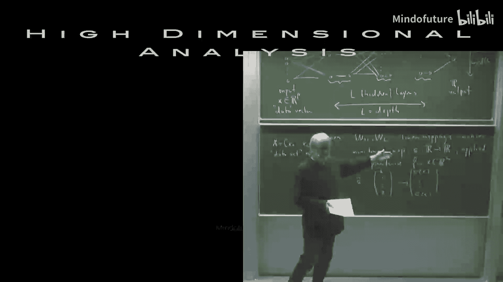
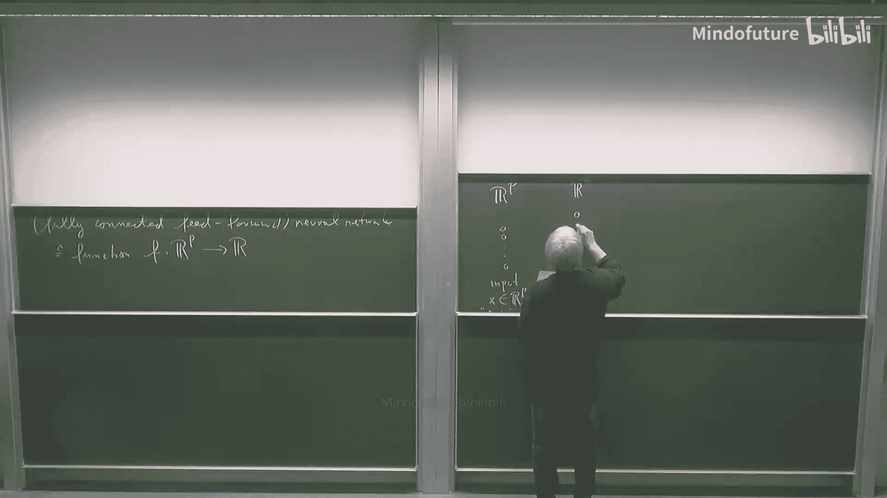
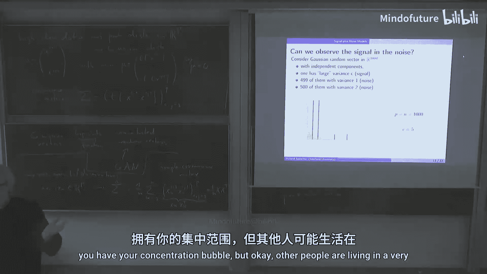

# 【德国萨尔大学】高维分析：随机矩阵和机器学习 ｜ High Dimensional Analysis p01 P01_引言与概览 -BV1XkkWBFEi6_p1-

Yeah， so I want to。Talk about mathematical ideas or concepts or maybe better ignore results behind。

Machine learning in this is， I essentially understand deep learning and new neural net。

 So neural neural net is really what I'm trying。To get a little bit of interesting mathematics。

 And so may， maybe let me just give a survey。 I suppose more or less everybody knows about neural nets。

 but still let me say a little bit what， what is there and then what kind of questions in this context I。

I want to address。 Okay， so what neural network， neural network。 So what is this， I mean。

 this is essentially a function from high dimensional space into， let's say， R of specific form。

 Okay， so I mean， what。I'm really looking at。Neer networks or maybe more precisely。

 probably a fully connected fit forward。neural。Yourural network。Okay， and so this is a function。

 I mean， essentially， this is a function。Let's say F。

 which goes from usually a high dimensional space。 and high dimension is really what。

 what will matter because it's， it's really about high dimensions where we are going to talk about where interesting phenomena happens。

 Also it's， it's a function。From this space to， let's say， a。I mean， I could also here go to。

 to a more dimensional version。 But I mean， having here more dimensional version is just a collection of functions from this to R。

 So I mean， usually。If I have functions from high from， from some dimension to some dimension。

 then this here is the crucial thing。 here， it's， it's just a couple of functions。 Okay。

 but this is not an arbitrary function， but it's a specific function， usually of of a specific form。

 and maybe I。I try。To draw it here， just to collect。Or the things。 Okay， so I'm going from。

 let's say， R to the P。So P is usually the dimension of the space from where I start。

 So that's the data。 I mean， a vector of the data， which which I consider。 And so I have， let's say。

 I have a。A vector of。Of entries。 And also， this is my， my input。And these are the essential X。

Is in R to the P。 that's my data vector So I'm dealing with status。So usually。

 I try to use P for for the dimension of the data。 Okay， I mean。

 everybody uses different notations for。For the dimensions， which are around。 So I try at least two。

Keep consistent way。 Okay， and then you usually embed this into a。Space of maybe bigger dimension。

 And so maybe， maybe， let's say I， I go。2R 2DM。好。

This might be a different dimension。And then， I mean。

 I usually I do this by by linear mapping So I'm， I taking a matrix and embedding this in a linear way。

 Okay， and then essentially， I iterate this。 But the crucial thing is that I also compose this with non linear mapping。

 Okay， so I mean， if I have done this here， let's say。就是lin麦冰。Let me call it this。呃我 yeah说，I mean。

 this is somehow。And bedding this year。In a linear way， everything is connected with everything。

 Then I go to the R to the M。 But then I also apply non linear mapping， But in in a specific way。

 namely component wise。 So I mean， essentially， I， I stay here and maybe here。哎。

Apply entry wise to my vector fixed non nonlinear mapping。 Okay， so that is my first layer。

 and then I I go on， and I do essentially the same。 I am that this here。 and I might change it。

 I mentioned here from each layer to the next one。 But I want to keep this。 I mean。

 I want to keep it simple So I say here I always stay on on the level M。

 So I go here again to R  to the M。So here I have a mapping， let me call it W1 a linear mapping。

 which means a matrix a matrix from linear mapping from p dimensional to m dimensional。

 And here I do the same。From M to M is another matrix so。I do hear all my。connections。This is W 2。

 And then I apply again， my non nonlinear mapping here。So I stay essentially here。But。

 I changed this。Thing here， entry wise。 Okay， and then then I go on like this。 And I might have。

Arbitr or yeah， fixed number of of layers。 and deep learning usually means that I have many layers。

 the deep really means to how many layers I have。 but it， it's just。A number of layers。

 And so maybe the last one， let me call this。The last one， W L， So I have here L。layers。Okay。

 I go here again to R 2 theM。Maybe my。No linear mapping。 And then in the last step， I go down to R。

 and then I apply a linear mapping to this。 Okay， so here。系个。Essentially。Down to R。

 and that's my output。Here， I mean。いな。That's my output。 And I mean， this is my function。

 That's what I'm doing。 I have an input here。 vector and R to the P。 I apply my mates。

 then this non linear R mappings， entry wise， again， matrices， entry wise and so。

 And in the last step， I'm projecting it down in a linear way to R。Okay， so that's essentially。呃。

Yeah， that's， that's a neural network。 And this is what I want to understand what it does。 Okay。

 and so Im。So I mean， what， what one has to understand is essentially， I mean， how， I mean。

Two things， how yeah。How how does it what does it do with input vectors if I have chosen all my my parameters here。

 but of course the crucial thing is that I want essentially to produce a net which does what it has to do So the training usually means to finding the right parameters here。

 That's of course， the most interesting thing but of course mathematically first step is easily to understand how does such thing。

 maybe if the parameters are given act on the input and what does it produce as an output。嗯。Good。

 okay， so that's maybe。Yeah， so what I have here。I mean， I mean those guys here。I mean。

 those are the layers of my。Of my net。 And they are it。 Yeah， usually hidden layers。

 I don't see them。 Okay， And， in this case， I， I think I would have L， L layers。Okay。

 and this number， number of layers。 That's the depth of my。Of my。Network also。

 So this here is the the depth。And deep， deep learning refers to depth。 Okay， but then， of course。

 I also have somehow the the width of the net net， namely， how big is this M here。

that's usually that the width。 And， and okay， usually this is also very large。

 And this means I have a white network。 Okay， and controlling somehow large Ms。

 La width is is somehow easier。 Or maybe that's better thing I can control than making this L here bigger so。

So this direction here， that's the。The width of my network。 And usually if this is large。

 then I have a white network。 Okay， so maybe in a sense。

 a lot of what I'm talking about is more about white networks than deep networks。 But of course。

 one has to understand all， all of this。Good， okay， so， I mean， here I'm putting in。ADa，1，1 vector。

 and usually， I mean， I have not only one vector， but I， I'm making measurements。

 So I have a set of vectors， which I'm putting in and which yeah。

 which maybe has some correlation or whatever。 And I want to understand what happens with this if I feed it through the network。

 So usually instead of just looking on on one vector here。I have a collection。Of data。

 And let's say I， I say I have n of them。 And usually I put them into a matrix。 So， I mean。

 instead of having a vector here， I consider then maybe。AMatri。Where I have。N of those vectors。

 So each of them is a p dimensional vector。 And now I'm putting them N of them into matrix。

 So I have an n times P matrix here。 So this is then in。P times N， So it's。Yeah， it has a。

And columns and， and P rows。 Okay， and that that's my data set matrix。

 that that's the the measurements or that that's my input， which， which I want to understand。

So let's see my data。Said Matrix。Yeah， okay， good。 So that's essentially。Yeah， neural net。 And what。

 I mean， of course， it depends on many things。 So what I have here is essentially these linear mappings。

 which I do in each steps， which I have called double use。 So I mean， I have。W1。Up to W L。

 those are linearar mappings。 So matrices。 So in the first step， it goes from P to M。 Okay。

 in the last step， maybe I should also give it a name。 I mean， I。Cordiia。W A plus  one。

 So all of them are mates。 Of course， this is just a vector。AR vector Okay。

 and the others are mappings are M times M matrices。Those Aair mappings。Which， of course。

 I can identify these matrices So they are given in terms of matrices。 Okay。

 if I only have this and I don't have these non linear mappings， then it would be a linear。Yournet。

 and it this is easier。 This is somehow easier。To， to deal with。 And the non linear mapping somehow。

 they seem to make the interesting stuff。 Okay， so I have here。In each step。

 I have an a nonlinear map， maybe which I call。呃。Yeah， so this map。From here to here。

 maybe I call it sigma Twitter。 So this acts on my vector with M components gives me another vector with M components。

 but usually this is a very simple one because it acts just entry wise。 each component of the vector。

 It acts on this with a given nonlinear mapping。 So I have one nonlinear mapping and this acts on each of the entries。

So， this。Yeah， so what what I need for this is a nonlinear map。But this is only。

 this is only a map limit。 Let me call it sigma。hich just acts on on。On a component from R to R。

 And I apply to my vectors component wise so。Applied。Component wise。On vectors in 2D M。

 So this means the sigma twi， which I have there。 I mean， usually we would also just write sigma。

 but maybe。As a math mathematician， I like to be precise。 Also the sigma Twitter。

 So this is a map from R to P to the R P， which actually， I mean， on a vector。

It just takes the sigma of the corresponding entry。Okay， so that that's my mapping。

 which I have here。Good， O， so that's the。And neural an net。

And that's something which I want to understand。 and of course， I mean this this mapping。

 this mapping from p dimension space to P of this form is determined， of course。

 by by the ws and the sigma and of course I can make more complicated versions of this by having I mean。

 I could change the non nonlinearity in each step I can。Also change it。 I mention in each step。

 but I want to keep it。Yeah， simple in some sense。 Okay， so this is determined。So this is a function。

Of this form。This form。As I have it there， and it is determined。By yeah， of course。

 I mean all the input which I have there。 and I mean， of course one is this non linear map。

 and this is usually chosen from the beginning。 Okay。

 so there are canonical choices for this for this non linearity。Sigma。From R to R。

 And this is usually fixed。 And， for example， as this rail railro map or there are specific ones which often used now。

 So this is usually。Fixed。And E G1， prominent one is thiso。 what rectified linear。

What is the youth standing for unit。 Okay， so this this is just the mapping， which is0 here。

 and it's linear here。🤧Okay。Yeah。Good， okay， and then， of course， it's auto mates。

 which I have there。So all。Themerices。W1。Up to W A plus one。 And those are usually called。 I mean。

 they are， they are the parameters of my model。 No， I mean， I mean， this this sigma is is fixed。

 But those are the guys on which I want to yeah。To find the right ones Okay， so they。

 they are my network。Prait。 and they have to be chosen in the right way。 because， I mean。

 I really want the function to do something specific。 And I okay， and it's not that I。

 I know exactly which parameters I should choose for this， but the net。Should。

chooseose it by themselves via training。 Okay， so that that's。What one。Yeah， wants to understand。

And the problem is， okay， I mean， this is a kind of simple function。

 And if the dimensions are quite small， I mean， you can just see what it does。

 But the problem is that the dimension of my， my data is very high。 Okay。

 that makes it somehow complicated。 okay， so。That此。The problem。So， the data sets。Our data。Said。

Is high dimensionary。Okay， so P is large。And what we want to do is， of course。

 we want to have functions which somehow characterize or distinguish specific data sets so。Yeah。

 so what what we want is to。Characterize。Or distinguish。Data sets by such functions。 Okay。

 and for example， I mean， I mean， for example， this data set can be the， the vector of。

 of a high dimensional picture。Okay， I mean， I'm choosing here。Here the entries。

 the components are are real numbers。 Of course， they can just be plus -1。

 or they can be something between 0 and 255 or whatever。

 But maybe here I'm just saying it can be real numbers。 But of course。

 they could also be discrete versions of this。 But so for example， I mean， X。

 my data could be a vector of a picture， high resolution picture。 And of course， I mean。

 then P is okay1000 is probably in millions So something like this red datata。

 we have to deal with nowadays。 Okay， and so I mean。So the sets。

 which I want to consider are something。Like information about， yeah， for example。

 pictures of vector of， let's say a high。Reolution。Picture， and then I want essentially。

 I want something like this that I can distinguish different kind of pictures。 So， for example。

 cats and dogs。 So， for example， I would have to something。Have something that I have。Let's say。

 subsets。In this space， C And D， where C is is are the pictures of cats。

 And D is the pictures of dogs。And what I want， what I would like to have is a function which distinguishes me those two sets。

So， we would like。Not we have a function， F。Which goes from these pictures。To real numbers。

 or but now let'， let's say essentially I want to distinguish it。

 So let's say I want to have a 01 decision， whether it's a cat or dog。So such that。F of x is。1 or0。

 or maybe。Close to one。 if， if I have a， if I have a cat picture。And0， if， if I have a do picture。

 Okay， so I mean， that's something which I would like to have。 But， of course， the problem is。

That we don't really know how to define this function， because we don't really know what。

How can we describe a picture of a dog and a picture of， of a of a cat。 And so what should we。

 I mean， Yeah， how， if I have a picture， how should I decide whether it's a cat or a dog， if I。

 if I would know this， then I could， okay， then I could just tell the computer what what。

What it what it should do But， but we don't know this。 we cannot really。Distinguished this。

And I think in in the good old times， I mean， that was really how， how。

 how you tried to teach the computer， how it should。Distinguished pictures by trying to。

 to tell the computer how you know that that it's a cat or a dog or what， what should。

 what should should you look at， But this is， this doesn't really work so well。

 and what works somehow well is that yeah， the computer should essentially learn this function we are not telling the computer what the function is。

 But we are just giving。Giving it some examples。 and then it should adjust the parameters such that it it it works in the end。

 Okay， so， and so so， I mean， we do some training of such a network。 And we start some。

 we are initially by random in in some random way or so。

 And then the the the computer should learn change the parameters such that this function really does in the end what it is supposed to do。

 Okay， and I mean this。This looks okay， somehow ridiculous。 But in the end， it works very well。 And。

 and it's really， I think it's， it's still a mystery why it works well okay， so。Yeah， okay。

 so this is somehow the big mystery。 And yeah， we want to understand a little bit about this and。

Yeah。I mean， it's。都是。A functions in very high dimensions。

 and they look very complicated as if they could do anything on the parameters。 And so how。

 how can you say any anything specific about this， And somehow the point is that because your dimensions are very large。

 you have some kind of of control， What happens。 Okay， so maybe， maybe。Something I won， let me say。

So what。Works well in this picture here。嗯。Yeah。I have to， somehow。These hidden layers。

I have all this this many。 I applied this non linearity， and I applied this this matrices。

 And then I have the last step。Where essentially I projecting down from a high dimensional space to a low dimensional space。

 and this last step is somehow， this is not so bad to control。

 And also what what I have is is essentially I go from R P。

I go to RM by essentially doing this composition of the non linear map with a linear map。

 Then I go to another RM and so on。I stay in these M dimensions with these non linearities and the linear maps。

 And in the last step， I'm going down。With a matrix， then I mapping to R。

 So this just means I take the inner product with with some vector here。 Okay， and usually， I mean。

I think the idea is that。Yeah， this last vector here。

 this somehow is the vector of features of your objects。 So the that idea is， I mean， here。

 you should have got some special features of of your picture。 Okay， and then in the end。

 you take some weighted version of of the features。

 So the idea is the network should have learned here。

 really something as maybe we do if you're looking on pictures of cats。

 So what what should we see So maybe I we should。I don't know eyes and maybe a fur or whatever。

 So those are features which you would like to see。 And maybe they。Should。Show up here。Okay。

 and then in the last step， we just take a weighted average over the features to decide whether it's。

 it's a cat or a dog。 Okay， and so if。If those guys here。

 if everything here is somehow fixed and the learning only happens here。

 then this is a kind of of of somehow easy problem then it's a kind of of linear problem So I mean。

 essentially I have those guys here fixed。And go from。From here to here， then what I have here is。

 is a kind of embedding。 And this corresponds to having to to kernels。 So So I。

 so this this is usually what what gives is given by kernel methods， which means I'm embedding my。

 my data into maybe a high dimensional space in a。Specific way， not linear way。

 But this is somehow fixed or given。 Okay， so it is。Is are embedding， which comes from somewhere。

And doing this usually corresponds to， to doing kernel methods。

 And then it's only in the last step that I go down here。

 where then maybe I should choose for the last step to write。N라이 parametersititas。Okay。

 but this is a linear problem。 and this， this can be easily controlled So this。

This is somehow easy to do。 Okay， yeah， but the problem is then。That essentially。

The network is not lean learning the features， but you， this should be given some。

 somehow from the beginning。 Okay， so so kernel methods usually don't， don't learn the features。 but。

 but it seems， I mean， feature learning is very essential for the success of， of， of。

 of neural networks。 Okay， and， I mean， in this context。Where we go for high dimensions。

 If M goes to infinity， actually in this setting here， you， you converge to some kind of kernel。

 So namely， there's something which is called a neural attentionent kernel。

 which has become quite popular in the last years。 So this is if M goes to infinity Then what you have here converges。

To specific object， which is your。Which is a kind of corner。

Which is called neural attentionent kernel。And which yeah can help to understand you a couple of things。

 But the problem is， I mean， it， it's a kernel。 and it's。

 it's not changing to during the the the learning process。 So okay， you are not learning features。

 And somehow， okay， this， is， this is a nice starting point。 but it's， of course。

 not good enough to explain why why everything of this works。Okay， but I mean。

 this is something maybe about which I also want to talk at some point。 Good。 Okay， but yeah。嗯。Good。

 so， I mean， really interesting thing。For those。Neural network is， of course。

 the the learning process and。I mean， it's。It really works better， as you would expect。呃， yeah。

Maybe there's also this problem of over parameterization。 So， I mean， usually you have here your。

P dimensional data。 And okay， you have N of them， which you want to learn。 So you're given N of them。

 And then the network should learn how it deals with this。 But then， of course。

 you should also do predictions。 then， then you should， you get new pictures。

 and you should say the network should say whether it's， it's a cat or not。 And， of course。Usually。

 I mean。Clical learning theory tells you， I mean， if you have too many parameters。

 then this is actually bad for learning because if。

 if your memory is so big that you just can memorize everything you have seen。

 then you don't learn any anything more。 But then， okay， you cannot make predictions。

So if if you do interpolation for for a number of points with polynomials， of course。

 you can take very high dimensional polynomials to interpolate five points。 But then I mean。

 between the points you will have very very weird stuff。 Okay。

 so it's much better to take a polynomial of degree4 or5 for five points。

 This gives you a much smoother interpolation Okay， and that's the idea I mean， here。

 you have many more parameters。 I mean， I mean， here each step you have m squared parameters And if if your thing is deep。

 you have really many of them。 So you have much more parameters than then you are learning here in your data。

 So the conventional wisdom would be that actually such a thing is over parameterized and it should not。

Not be good for making predictions， but astonishing it。

 it does that that's maybe it's one one of the big mysteries at the moment。 So why。

 why does this really work so well， So in particular， if you over parameterise so。啊。Good， okay。

 but so that's。Yeah， things we want to understand。 But maybe yeah， before we go on。

 on those hard questions， where I'm not sure that my。But， mathematically， we don't really have。

 have good answers for them。 Maybe we have some。Some things we can understand。

 but maybe we should first start with trying to understand what does such a function do on input vector。

 So how does it。Change them。 Okay， and so maybe。In particular。

 we should now also think about how do we actually model our data set， Of course， I mean。

If our data set is given by。By， by cat pictures， I mean， I don't know how to describe them So how。

 how should I mathematically deal with them。 Okay， so what。So how we can really。

How we can describe our data sets is actually by probability distributions。 So we have a。

 we have a collection of points， which we would like to describe。 and。

 and we do this in a probabilistic way。 Of course， essentially， I， I could say I have my pictures。

Of the cats。 And I take the uniform distribution on on this set。

 And then I want to make statements about this。 This gives me then probabilistic statements about what happens in this context。

 of course， I I don't order the set of all cats。 So I the uniform distribution on this set is also not。

 not a very concrete thing。 Okay， so but I will replace this by other distributions where I can work better with and maybe I can also do at least abstract statements。

 even if the distribution is not。Not so explicit。Okay， so all data。So that's a high dimension there。

And yeah， you want to describe them by probability distributions。 Okay， and I mean。

 probability distributions。In particular in high dimensions， yeah。

 there are not so many where I really can do concrete calculations， but there's a very nice one。

 name Gausian distribution we where really one can calculate a lot of things。 So that will be our。

Our basic。Characterization， which gives us a lot of， of， of of ideas and。我fully。Also resides。 Okay。

 so。Yeah。So we have high dimensional data sets。And I want to model them by probability distributions。

In啊 to the P。Okay， so maybe the most canonical would be one a uniform distribution on the set on which I'm interested but uniform distributions。

 Okay， it it's not so easy to deal with。 So if I have more distributions with the density。

 I can calculate more in particular， I can calculate really concrete concretely for Gaus distributions so。

One of the things which we really have to understand will be gaussian distributions in R to the P。

 So that's we will。Yeah， talk about this quite a bit。Cause in distributions。And so， this means。

My vector， the R to the P has components， X 1。Up to X P。Okay。

 so I'm not using the lower index because this somehow I want to reserve if I have。

 if I have yeah copies of of my ex on， okay， so。So those are real numbers。

So my vector X is P components。 and the Gaussian distribution， essentially， I mean。

 the main information is contained in the mean。So they ever rich。And this is the average of。

Of each of them。So this is a vector of the ever richs。

So this is the expectation of the first component。Up to the expectation of the last one。 Okay。

 and maybe in many situations， maybe I can assume this is equal to 0。 So let me do here。

Let's say this is0。 And then the other information are the second moments。 I take the。

 the variance or the covariance between those guys here。 Okay， so that's a matrix。

 So if I assume U equal to 0， then。The main information is in the second moment of this vector。

 This is the co covariance matrix。So it is a p times p matrix it's the coance between those p guysa。

 So let me call it sigma。So this is a matrix。Where I J entry is the。

The expectation of the product of X， I and X J。So because I minus 0。

 this is the covariance between those， those two components this。

Is a vector where I NJ are running from a matrix where I NJ are are running from12 P。 So this is P。嗯。

By P matrix。Okay， so this is the correlation between those guys。Okay， and so。Of course， from maybe。

Practical point of view。Of course， assuming。That I have a gaussian distribution here is not very realistic。

 So I mean， data with which you use also， of course， not of， of this nature。 So， for example， I mean。

For example， if I would say I have here independent entries， and each of them has given variance。

 Of course， that's not what you have in， in your data sets。 If you， if you have a vector of。

Of the pixels of， of a picture， of course， those guys are are correlated。

 if you have a picture of a of a ke or so， I mean， many of them have have a big correlation and other don't。

 So it， it's clearly not a Gaussian distribution， which。Which is anything close to， let's say， the。

 the uniform distribution on on this this set of the cats。 Okay。

 but so somehow the interesting point is and that actually。We can compose。Suchurors。

 which have a ga in distribution。With some specific functions， namely lipsitz functions， functions。

 which which are smooth， which which I can control。

 And then I'm transforming this Gausian vector into a vector。

 which doesn't have a Gaussian distribution anymore， but which still has a lot of properties。

 which one can s which one has for Gaussian vectors So what I get then are concentrated random vectors。

 So these are vectors， which still have this kind of concentration。

 which we will see that we have for Gausian vectors。

 And those guys are maybe much better or they are somehow closer to real data So actually， I mean。

 we will essentially work and calculate for Gaussian vectors。

 But the point is that many of the properties， which we see there are preserved under composing undertaking lipssheds functions of the entries。

 and then I'm destroying the Gausian distribution totally。

 but I still preserve interesting properties， which I can control okay。So。So I mean， I， I mean， I。

I have my Gaussian to us。The ones which I can。Write down nicely。

 And I can also calculate many things。 But they， of course， not really。Any， any。

 any anything close to real data But I can compose this。With slip sheets functions。I mean。

 lips sheet functions are functions， which are kind of。Yeah， continues， I mean， functions。

 functions of all the variables， but in a controllable way。 And then what I get are now vectors。

 where I don't really know explicitly the distribution which I have， they have。

 but they still have many properties， which I had to fly。 So I get concentrated random vectors。

And there are somehow。Yeah， they。Should。Be somehow closer to real data Okay， and maybe in particular。

 O， this。These are， those are really things which we show up in applications。 I mean。

 there are this this， this， this this gun things。What is it。

 generative adversial adversarial networks， which are very popular。

 which can be used to produce fake pictures of cats and dogs， for example， Okay。

 and they essentially， they start from a gausian distribution and apply lips sheets functions like this。

 I mean， they apply neural networks。 But the neural neural network is composed of functions like this。

 So， so， I mean， what you produce there are vectors of this form。 Okay， so this means。

This here really is something which should be closer。Sorry。I mean， it means that those vectors。

 they concentrate if you apply functions to them。啊。I mean， essentially。

Gusian vectors do this and leap shit functions of them。To give you concrete the other ones is is not。

 it's not so easy。Yeah， yeah。 I mean， I mean， if， if you have here vector， okay。

 and then you apply a function。You make a new vector out of them by。

 by taking functions of all the entries here。 Of course。

 you will get a totally different distribution。 Okay， but this distribution has。

 has this concentration property。 I mean， we still have to talk about what con。I mean， essentially。

 it means that if you take lipsit functions from this vector that they concentrate so that that essentially they are almost always very close to the average。

So that that's the， the concentration property about which we， we will talk， I mean。

One of the big themes of the whole thing is that in high dimensions， you have concentration。

 which means that if you take functions of variables of of many variables。

 that actually this function is more or less constant。 So it's very close to to the average value。

But， of course， this is depends on， on an underlying probability measure。 So you have。

 you have you have a probability measure on your vectors。 But if。

 if this probability measure has this concentration property， then it means if you apply。

Lips shit functions to this vector door， Then they will concentrate so。Yeah， okay so， but。

 but those are the things which we are going to talk about more So that that's really。

The main things。Yeah， okay。 but maybe let me say a little bit more about this statistical idea。

 I mean， this this。Yeah， that I have here an input distribution。 Let's say of， let's， let's say I， I。

 I model this by Gaussian。Distribution and then， of course， this is determined by， okay， the mean。

 let's say the mean 0。 So it's determined by the covariance matrix the covariance of the vectors is is the crucial property。

 Okay， but now， of course， we don't。 usually we don't know the distribution。 we only see。

 we make measurements。 So we see samples of， of our vectors。 And from this。

 we want to get as much information about the distribution。 Okay， so。Yeah， so our knowledge。

About the data。Is given by measurements or observations。So we do samples。 And so let's say， I mean。

 we have we have n measurements。 we have observed n instances of our vector。 So yeah， let's say。

 so we have x1 up to x N， and each of them is。In R P， Okay， so that。

 that's the data which we are given。 I mean， that's the thing we can work with。 Okay， and of course。

Usually， the idea， in particular statistics is that if you have your samples， your observations。

 they should give you estimators for the real underlying properties。 so you should get estimators。

For the covariance。 Also we assume， I mean， I have here independent copies of my Gaussian distribution in to the end。

 this Gausian Gaussian distribution is determined described by the covariance matrix。

 And I want to estimate this covariance matrix from the concrete data， which I have here。 And。

 of course， what do I do， I take the corresponding。Quantity here for each vector。 I mean， one vector。

 of course， I can， I can take this， this product here So I mean。

 then I I approximate this ex expectation by taking an average over my measurements。

 which I have made。 So this means。From this， I can。Look on a estimator for the covariance matrix， my。

 my， my sample covariance matrix， which I call seek my head And there I'm ever reaching over。

The quantities。Which I get from each vector So for each vector， I can look on X， K。Hi。X K J。

Doing this for all I andJ。From one up2 p。So I'm just， I mean。I'm， I'm just taking。 So for， for。

 for each fixed K， for each of my observation， I just do this combination here for all I N G。

 Yeah So I get P times P matrix， which is essentially。呃，呀这。第四呃。

This kind of covariance version for this one vector。 Okay， but then if I have n measurements。

 I average So I ever average over this。 I have sum over this and average1 O Y N。

 So this is the average version。 So this is my。Sample covalance matrix。Yeah， okay。 and of course， I。

 I mean， I can also write this maybe a little bit more nicely。More in terms of。

You are products of vectors or matrices。So namely for X， each fixed K， what I'm doing here。

 I'm essentially， I mean， x， x is， is a vector。 So it's， it's， it's a column。 Okay。

 and what I'm doing here is essentially taking the matrix product of。Of， of， let me see of what of。

 of a column with a row。 Okay， So I mean， column with a row gives gives me a matrix。

 the other way around， it would be the inner product。 But。

 but here I'm doing it in this way that what I have here is X K times the transpose。Of XK。So。

 this is my， my vector。 This is the transpose of the vector So this is the。I mean。

 the vector is is is is a role。And this is the， the column version of it。 If I multiplied。

 I get the matrix exactly the matrix with those guys as entries。 Okay， so you see。

 I can write it like this。 and then if I'm summing over these things， essentially。

 I can say what I'm doing here is taking the same kind of product of the。

 of the matrix of the data matrix。 So this actually is。1 over n。

 And then this sum here is really that I'm doing the product X， X， T， where X is the collection of。

 of the。And back to us。So as I had it to 4， So this is x1 up to x n。

So each of them is is a vector of dimension P。 and I'm putting them into this matrix。

 So I have times P matrix。 And if I multiply this this like this。

 this is exactly what I'm doing here。 Okay so it's just writing it in a nice form and and really。

 I mean， that this doing those things into a matrix is is meaningful because I can really the interesting quantities。

 I can write them in very nice and compact matrix form。 Okay。

 anyhow but but what I really have is this this thing here。 okay， and now， of course。

The idea in statistics is that if you make enough observations。 If your sample is is big enough。

 then you can really recover the the underlying property。 So in classical statistics。

 you would say I make sufficient many observations， I make n big enough。

 And then this guy here should approximate。The， the the covariance of my distribution。

 that's classical statistics。そ that。P is fixed。Oh， we have a fixed。

Set of quantities in which we are interested。 But then we send n to infinity。 We make。

Infinitely many observations or a large number of observations。 And then。

This P times P matrix S my head， which I get from my observation converges。This year means cons。

 So if angleng goess to infinity to。To the， the real。Do这 read。Good， okay， but that's， I mean。

 that's the。Classic frame where you can make as many observations as you want。

 But that's not the setting we are， you know， because， I mean， what what we have is we have。

 we have a number of observations。 We have many of them， but we also， the P is also large。

 And actually P and N are of the same order So you， you have。

 you have many data and you have on the same order of observations。 Okay， and usually， I mean you。

 you cannot say， okay， I make more and more observations to get。Get in the classical regime。

 because okay， you really have to go very high This is and usually Okay， so that。

 that's not what you have。 So the， the point is that， I mean。This is nice statistics。

 but it's quite useless。For our considerations the question is， can we replaced by something。

 Is there anything else we can say， And the point is that actually。In the regime where we are。

 if n is proportion， proportional to P， we can really make rigorous statements。

 So there's a different regime where you can make precise statements。 So I mean。So what we。

Are dealing with in this big data businessness， but in particular in in this class here， because。

 I mean， that's， that's really what we want to understand is。

The setting where p is proportional to n Okay， so again， we say we make a limit。

 we say that the situation which we consider is somehow an approximation of an infinite dimensional situation。

 but not the infinite dimensional situation where P is fixed and n goes to infinity。 But one。

 where P and n both go together to infinity， such that the ratio is fixed。 Okay， so， I mean。

 those are of the same order。Of the same。我的。And this regime is actually a regime which we can control。

 that that's the， that's the whole part of this。 So really， we can make very precise statements。

 So it's a different regime than a classical one。 So this means。

This guy here will not be close to this guy， but it will be of a form that we really can control it and say how it depends on this guy。

 Okay， so。So， I mean， this。So， this is different。From the above。A different regime。But the point is。

 and okay， maybe it it's more。it's more complicated in a sense。

 But the point is we still can control it。 We can make precise statements。Good， yeah， Okay。 And so。

 I mean， I want to give you maybe some ideas。Of this。嗯。Yeah， so what。And I mean， of course。

 in our net， Okay， I mean， I I also have here， I have here P and I have also M and I have n So n is a number of observations。

 which I make。 P is the size of my data。 And M is maybe the the the higher dimension where I be everything。

 Okay， and so what we are dealing with is the situation where all those。

 let's say P N and M of the same order。 Okay and。So， so we assume that P and N and M。

Can go to infinity。 but in the same order。 So the ratio of them is goes to a fixed number。

 So maybe all of them are the same。 Yeah， O and。Of course， I'm going to infinity。

 You see is is really that I'm looking on white networks。 so I， I make them white Okay。

 so L is is not， I'm not telling about L here。 So L is a bit more。 okay。

 I'm not saying that the depth also should go to infinity in the same sense So usually， I mean。

 the depth is maybe fixed， might be big， but it's not going to infinity like this。

 or the roll off of the depth is is not so clear。Okay， good。 So it's more the， the， the， the W。

 the width which。Scales here and where we can make precise statements。Good， O， and so I mean。

All of this。Is related with his concentration。Phenomemenna in high dimensions。 And so now。

 maybe I want to。Show you some slides。嗯。Which gives you an idea。 I mean。

 essentially in high dimensions， things concentrate。 Okay。

 so I suppose some of those things you have seen and so， but maybe some not。 So， but let， let's see。

And here you see， I mean， maybe one of the overall titles is the curse and to blessing of high dimensions。

 So high dimensions， in one sense， are bad。 That's the curse。 that's。Usually in statistics。

 it's okay。Big frame。 But I mean， I think we now we come out of the conviction that that actually。

 there are also good， many good things in high dimensions， which we can use for us。

 And that that's the blessing。 the curse of high dimension means that high dimensions are really very large。

 And so， I mean， if you want。呃。To sample things there。 Okay， it's， it's all， it's。

 it's impossible to really sample the distribution of of of of something Okay， so I mean。

 yeah high dimension spaces are quite large and quite empty。 Okay。

 so that that's the cursor for many algorithm， Sta methods in high dimensions。

 they don't work because things explode exponentially。 and then you would have to， to visit too many。

Space， too many points in， in your space， which which you cannot do。 Okay， but on the other hand。

 the blessing is， and I mean，Want to convince you of， of some of those blessing things that actually。

That many things show deterministic behavior。 That's this concentration idea。 And so， actually。

 I mean， this is this idea that if you take smooth one dimensional functions of your high dimensional vectors。

 they usually concentrate。 Okay， and that that's， that's the good thing。

 That's the concentration phenomena in high dimensions。That's what we。We'll talk about。 okay。

 and so maybe， maybe let me give you just a few pictures of of， of。

 of this concentration of random vectors and such things。 So maybe， okay。

 maybe concentration of random vectors is something which you have seen or， or no， I mean， yeah。

 okay， and so I'm looking here on on the Gaus distribution So I mean。

 this is the one dimensional Gaus distribution。 Okay， and so I have here， I， I take。A vector。

 which is gaus distributed with variance1， and I draw a histogram。

 and I take here 1100000 samples So I mean， even in one dimension to get a good picture of the normal distribution。

 you have to sample really many。 Okay， maybe you see it with a little bit less。 but to get a smooth。

 nice picture of the gaus curve。 You really have to sample many， many of your vectors。 Okay。

 and so now but the point is， I mean， this thing is nothing which you want to look at in high dimensions。

 What we want to look at is the length of a vector。In one dimension， I mean。

 the length of a vector is， is a mapping from R P to R。 In one dimension， of course。

 the length of a vector and the vector itself is not a big difference because in R。

 either it's positive or negative。 So I mean， it's just。

That the length of the positive vectors is just the vector itself。 And here on the negative side。

 they are get flip flipped over here。 Okay， so the distribution of the of the length is。

 is essentially just twice the distribution of the ga itself。 Okay， so in two dimensions。

 in in one dimension。 I mean， it's still， okay。Nothing interesting。 Okay， but now in two dimensions。

 So here's a is a two dimensional gas。 So now， now I take a a vector vector to an R2。

 So both components are now gas。 They are independent。 I'm choosing them independent。 and usually。

I'm normalizing my distribution here so that the average length of the vector is equal to one。

 So the variance of of each component is， is one in this case， one over square root of 2。Okay。

 so you see here the the distribution， again，100000 samples of such vector。

 And now I take again the the length So the length is now a one dimensional thing。 And you see， okay。

 I mean， a length here is， I have。Plootted it between 0 and 2。 Of course， it extends to infinity。

 but okay， you see it。Mostly。So in in this O length。Somewhere here。 Okay， so you see something like。

 like this。 So it still spread out。 Okay， and if I now go to higher dimensions， of course。

 I cannot plot anymore。This year， I mean， for three dimensional vector。 Okay。

 I would have to plot it in four dimensions， which is already beyond my possibilities。

 But the point is， is also that， I mean， I would need really。

Many more samples to get a picture which shows essentially the distribution in higher dimensions。

 Okay， and so what I what I'm consider， consider now is， is， is those kind of picture。

 I'm just looking on the length of my vectors。 Okay， and so here。And。

 and probably everybody also has heard that， I mean， actually。

 I have a concentration of my gausian distribution on the surface of the unit ball。

 which means that the the length of the vector concentrates around one。So I。

 I have normalized it that the average is one。 Okay， but usually， I mean。

 I could have a wide distribution around the average。 So here you see P equal to one。 Okay， you see。

 I mean， actually， the length is。It's not even。Close to1。 Okay， in P equal 2。

 So that's the same picture which I had before。 But now if I go higher。

 So this is in five dimensions， the length， you see it， it's center around one， but it。

 it shrinks and shrinks more。 So in 20 dimensions。呃。80 dimensions，320 and thousand0 So this is a。

1000 dimensional vector。With a gaugeuss distribution and now you see essentially it concentrates the norm concentrates on one。

 So of， of course， the directors themselves， their distribution。

 So this this means they are lying somehow on on the surface of of the u of the of the of the sphere in this dimension。

Okay， which， of course， is very high dimensional one。

 So they are not concentrating themselves because they， they are distributed over a big sphere。

 But if I'm looking on their length， this is really something which concentrates。 and that that's。

The， the main I or idea of this concentration that if I'm looking on functions like lipsut functions。

 I mean， like this of my vectors， they will concentrate the vectors themselves。

 they don't con concentrate。 I mean， they still spread out over a very large thing。

 And it's very hard to find them in， in this high dimensional space。 Okay， but for。呃 for。

For functions like this， I have this concentration that's， that's the idea。 Okay。

 and so maybe another thing is。This statement， if I take two independent vectors， gaus in ones。

 they are nearly orthogonal in high dimensions。 Okay， in low dimensions。 So if I take p equal to1。

2 gaus vectors， I mean， either they show in the same direction or they are show in opposite direction。

 which means they are either parallel or anti parallel。

 which which means if I take this normalized in our product between the two vectors So this。

 this is the， this is the。This is the cosine of the angle between them。 Then I have just plus and -1。

 So either they are parallel or they are not parallel。Okay， in two dimensions。 Okay。

 it it looks more like this。 So this means still。There are many who are close to parallel。

 close to anti parallel， close to parallel， but there are also some which which are close to being autoal。

 So I mean， in the plane， of course， you have vectors which are autoal okay， but not。

 not the majority of them。Okay， and now if I go higher in five dimensions。 So you see now it。

 it goes more towards the the0。 So theyre becoming more of them are close to orthogonal。 And again。

 if I go higher and higher。 so p equal to 2080。320 and 1000， you see now it concentrates around 0。Oh。

😮，So0 is the average value here。 but but it it's it's also concentrates around this。

 So 0 was always the average value。 I mean， even， even if I had pleasant -1， the average is 0。

 but plus -1 are very far away from 0。 But in high dimensions， I mean。

 everything gets closer and closer to 0。Okay， so that that's maybe。The idea。 And， I mean。

 those are things which we are going to try to prove in a rigorous way with these statements， how。

 how do we formulate and in particular， how do we prove such things rigorously Good， Okay， but maybe。

 so this is about the random vectors。 So maybe those are things which。Some of you have already seen。

 But now maybe let's go to this estimation stuff here， because this might be closer。To the data Okay。

 so I mean， we have。Yeah， let's see here。 Okay， so let's say we want to estimate a covariance matrix So。

 so say I take here a Gausian random vector and r to the P。

 I make the components independent and the variance， Okay。

 I'm not taking that all of them have the same variance。

 but let's say half of them have variance  one。 half of them have variance 2。

 and then the covariance matrix is diagonal。 but on the first half of them。

 I I get two on the other half， I get a one Okay， so so the eigenvalues usually， I mean。

 I'm looking only eigenvalues of the covariance matrix。 that's。

 that's the the main thing So the eigenvalues of this covariance matrix。 half of them are one。

 half of them are two。 that that's the real。The real covariance matrix of my distribution。 Okay。

 but now I make observations。 I take now n samples of such a situation。 And then the question is。

 what do I see then， Okay， so now I take， let's say， P equal to 100 and n equal to 100。

 So I make 100 observations of。Chosing。Samples， independent realizations of this vector of length 100。

 Okay， and then I'm， I'm calculating this matrix。 the one with which I have written down here that that's my estimator estimator for this guy。

 And then we see a distribution like this。 We brought the eyeigenvalue distribution And you see。

 I mean， you don't see the the the one and2，1 and the two are real eyeigenvalue。

 which which I in hidden in this distribution。 But what we see is a distribution like this。

now the question is， I mean， do we understand this and。Is this of any use for us。 And， of course。

 I mean， the classical statistic tells us。If we make。This end here， bigger。And keep P fixed。 And。

 of course， we should converge to eigenvalue which are sitting at one and 2。 So maybe let me do this。

 So now I， I， I fix P。Still is 100。 So I always have a 100 by a 100 matrix。

 and I calculate these are always histograms of the hundred eigenvalues of this 100 times 100 matrix。

But this matrix is given by averaging over more and more of those guys。

 So here I'm averaging over 1 thousand00。 And still， okay， you see。

 maybe one and two are now more prominent， but it's still not so clear。 then for 10000。Now。

 you see you have a kind of separation between one and 2， and here is 100000。 So you see。

 I have go very high to really see something where I can maybe。

Optimistic that one and2 are the right ones is step one or that that's it。 Okay。

 so so that that's classical statistics。 Okay， but but I mean。

 we don't have 100000 observations or samples So what we have are this00。

 And we cannot really make more And so the question is。

 is this picture now of any use or can we still understand it。

 And so what what I was saying before is that this is actually now an approximation of a situation where we still go to infinity。

 but we go to infinity in in a way that P and N both still are equal。

So this is somehow an approximation of a situation where I have P and n equal， but maybe bigger。

 So now I have pictures where I make the n bigger， but P is is still the same。 So this you。

500 by 500 matrices for4000 is this 2000 like this。 And you see you have a a smooth picture。

And this is a picture which we can really describe in a limit。

There we are able to make precise statements。How to get this curve。 So there is a limit curve。

 I mean， it， it's a smooth curve in the limit I mean， it doesn't。We resemble one and 2。 I mean。

 in the background， there's still one and two in the background。

 But this here is somehow a function of this， but a function which we can control and calculate。

 And then actually， I mean， our situation。For n。For P and N equal 200 is not so far away from this。

 So， I mean， the limit really， it it's good to know the limit because this picture here really tells us something else。

 So if I observe this， then， of course， Im essentially， I have two possibilities。

 Im I'm saying I describe this by classical statistics。But then n should be very large， But I mean。

 then。The end， which we have is too far away from the very large， which we would need because。

 I mean， one and two in this picture， we we just don't see it。 Okay。

 but what we see is that we are actually close to the situation where we go。This N to infinity。

 But P goes to infinity in in the same spirit and this。Yeah， this is an approximation。

 which we can control。 it's not given by sigma。 I mean。

 we still don't see the one and two directly here。 but in principle。

 we know how from the one and 2 matrix we can calculate this guy here。So， we have a。

Kind kind of understanding of this。Good， O， so that's。I mean， that's I mean。

 what we are looking here at， those matrices， these sigma matrices。

 those those are random matrices in particular， those are wishard matrices and so what we are looking here is that the distribution of weard matrices in a limit。

 and this is what is called the Macenco past distribution So those are things which we also going to talk about and and really try to understand how to calculate those things。

Okay， but maybe。Another thing which is maybe also interesting in this context going even a bit further is this signal plus noise models。

 So let， let us look on the same situation。 So again， let's say I have a。A vector of dimension 1000。

 So I have 1000 components。 And I want to say that actually one of them is really a signal。

 So this is， this is a component in which I'm interested。 And the rest is just noise。 And again。

 I I have， I say here， half of the noise has eing value 1。 half of it has eyeing value 2。

 And then one has a variance， which is equal to C here I have put C equal to one。

 which means I'm back to the to the one before where I don't have a noise。 Okay， so I mean， the real。

Angvalue distribution is 1，2， but the one which we observe If I take p is equal to n is equal to 1000 is this here。

 the Macacheco pass to a distribution。Okay， which you can understand。 Okay， but now the point is。

 if I now have I change one of these components to having。Really a signal behavior。 Also it。

 it should have。I canvalue， which is bigger than one and 2 So I'mm choosing a bigger one。

 Let's say I'm choosing 7。Okay， I mean， this is very big。 I mean， the eigenvalue is， is just。

 there's just one eigenvalue just so that you can see it。 I have put a bigger bar here。 So。

 so I have， let me see。 I have 499 eigenvalues here。I have。500， I should here。Okay。

 and I should have one here。Okay。Okay， I have one here。 Okay， and now。

 now if I do with this calculating this。 So will I see somehow this one eigenvalue。 I mean。

 this is the signal， which which I really want to observe。 Can I still see it in the noise。

 which which is produced by this finite dimensional by by this situation here。 and if if you do。

The simulation， you see that actually。You get those eigenvalues which you had from before。

 and then you get an eigenvalue here。 Again， it's just one eigenvalue just I have ploted it with the bigger bar so that you can see it。

 So I mean， the the signal the real signal has variant 7 okay。

 but here you observe something around 9 Okay， so so you really see see it。

 but it's not at the same position where you would expect it in the same way as as the one and twos。

 which are sitting here I mean， you don't see them here， but but they are。Smash there， yeah， they。

 Do have a noisy version of them。 Okay， but somehow this one。

This one eyeing value is not just mixed into the noise and disappears， as you would expect。 I mean。

 it's， it's just， it's just one of of thousand eyeingvalue。

 but but still it it it's sitting here and you can observe it。 Okay， and now if。

 if you move here closer to this one and 2， I mean， this this will also move So here。

 if C is equal to 5 So you have one。Signal eigenvalue you're sitting at 5。 and then you。

 you do this calculation here。 Then then you will see。That you still see。

One eenvalue sitting outside here。So in particular， those anglevalue here。

 they are really very strict。 I mean， they are sitting here and there's not one of them， which。

 which is just sitting out somewhere So which which you could then also think it its， it's a signal。

 So I mean。I mean， this， this year is also a very rigid situation So you get this distribution。

And the eigenvalues， which you observe， are just really sitting inside this distribution。

 There are no。No outliers there。 And if you really see something here， it's coming from。

 from the signal。 Okay， so here maybe it's a situation where C is equal to 4。

 and then you still see something。 But now you see you are moving closer to the edge of。

 of this noise spectrum here And now if if you go further in。

 then this will disappear it will disappear in this here and you don't see it anymore。

 So if I have now C equal to3， then you don't see an additional eigenvalue the one has moved inside this spike here and and you cannot distinguish it anymore。

 So there you don't see a signal。 Okay， but if， if you are far。Farre enough from here。

 Then you really can can see this。 So that's， that's also something which。

Which we will try to describe in particular， maybe also。Yeah， if， I mean， if you observe。Yeah。

 if you observe something here， Okay， we， I mean， the real eenvalue you sitting here。 I mean。

 maybe that's the one which we would like to know。 So we should know how to go back from here to here。

 What is the relation between the position of this one and this one。Okay。

 but that's things which we can understand And that's also things which which you are going。To do。

 Yeah， O， so that was my。哦。Survey on things I want to do。

And these those are things which which are clear that I want to to do。 Of course。

 I also want to do more on understanding training and over parameterization and feature learning or not feature learning。

 Okay， but I'm not sure whether I can really do or whether I can understand it。

 So if we will see how far we can go and。Maybe if， if there's feedback from you。

 maybe also interesting， maybe interesting new papers in this direction。

 which have mathematical statements on this。 So I'm quite interested in this。 And of course， I'm。

 I don't know。All， I mean， it's the literature on machine learning is also in high dimension also So you can get lost very easily。

So if you know what you're looking at， okay， you， you find something is's concentrated。

 You have your concentration bubble。 But okay， other people are living in a very。

 very different regime of this high dimension。

Okay， good。 Okay， so I think that that's it for today。

