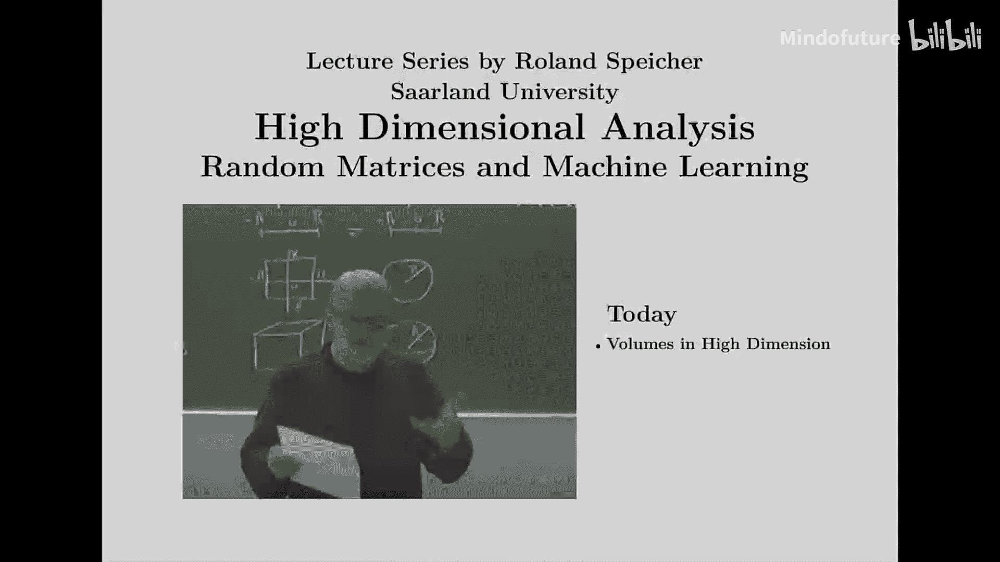
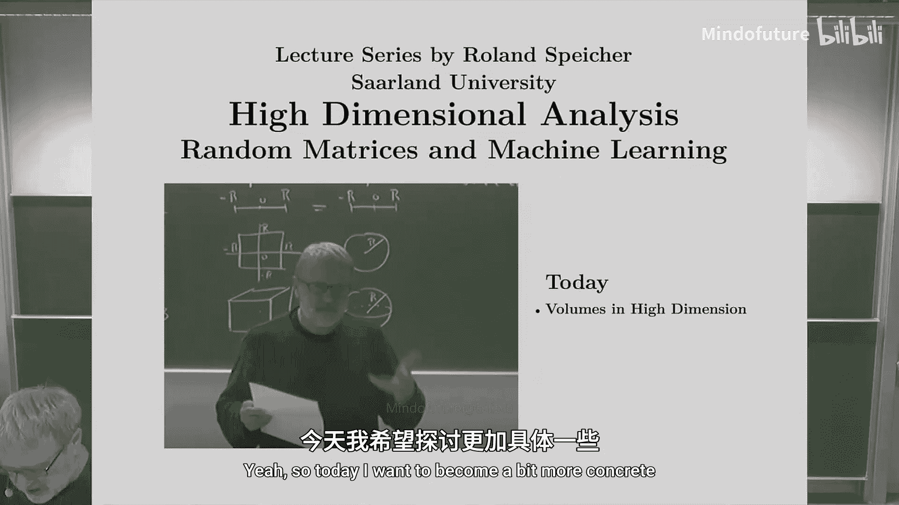

# 【德国萨尔大学】高维分析：随机矩阵和机器学习 ｜ High Dimensional Analysis p02 P02_高维空间中的体积 -BV1XkkWBFEi6_p2-

Yeah， so today， I want to become a bit more concrete。

 So last time I gave kind of survey what we want to do。 we want to understand somehow。

Data in high dimensions and functions acting on the data and the functions should be like neural networks specific form of functions。

 Okay， but the main thing which we first should understand is how sets in high dimension behave or we have the data sets。

 and we want to make statements about them and those statements we typically be a kind of probabilistic statements I mean。

 we don't have statements which are true for all our variables， which we consider。

 but for most of them and this means， of course， we have to specify how do we measure probability or the size of our sets。

 And of course， yeah， we will do this essentially by probability distributions。

 and maybe the simplest one is to take just the uniform distribution on the set。

 which just is the volume So I mean， that's the easiest thing。 if I have if I have a。A data set。

 How do I measure its size。The easiest thing is just to take the volume of this set。

 down the volume in our R to the P。 Okay， and then， of course。

 I have one data set in which I'm interested all。All the data I consider。

 And then I'm asking which of them have given properties。 And then， of course。

 the probability is the ratio of of the two sets。 And of course I I need somehow I have to normalize for probability。

 of course， I have to normalize things also the whole set。

 I consider this is the volume by which I normal。 And of course。

 this means I cannot take talk about all all elements and r to the P because the volume is infinite。

 and this is also， of course， is a reason that maybe it's better to consider other other probability distributions。

 which can extend to all of r to the P。 And this will be gaus in distributions which of course are also relevant from many other aspects。

 so。First， we should get a feeling。 how do volumes in high dimensions behave because they behave quite strange。

 Okay， maybe if you have worked with them， you have a feeling for them。

 But if you haven't have never thought about high dimensions， some things are。

 are indeed a bit strange。 and we should get a a feeling for this。 Okay。

 so what we want to talk about。Volumes of we are looking on specific sets where we really can calculate things。

 And those are essentially balls or hyper balls and maybe also cubes in high dimensions。 Okay。

 so we are talking about volumes。Of hyperbols。I mean， hyper just means it's high dimensions。

 very often I just say balls。And cubes， hyper cubes。But the main focus is。

 how do they behave in high dimensions。And then in particular， we want to see the feature。

 which will be one of the driving ideas of the whole stuff namely that we see concentration。

 So namely properties and high dimensions concentrate or the volumes concentrated at specific places。

 Okay， so in high dimensions。And。Where they concentrate。I mean， concentration。

Is one of the big things which we should better understand in Here we can。See things somehow。

 quite explicitly。Good， okay， so I mean， what， what we want to understand。let's say。

Sets in R to the P P dimensions and A is some set。 Let's say our our data set。And。

We want to understand。This for P is large。Okay， and we want to understand the typical or maybe the average behavior。

 And in particular， also how much how big is the difference between the typical and the average behavior。

 Okay， and so， as I said， we describe our sets by probability distributions。 So， I mean。

 we are not interested in one particular data。 but we are interested in the collection of sets and we want to understand the behavior of those elements in the typical or average way。

 Okay， so we need a way of of talking about probability。Probity distributions。In R to the P。

 And now the most basic one is somehow， if I take the uniform distribution on the set。

 which I consider。 of course， then better the be the set should be bounded so that the volume volume is finite。

 And then I can take this set and ask about subsets of this and compare the volume of the subset with the volume of of the whole set。

 And that's essentially the probability of the subset or of of the property。

 maybe in which I'm interested。 Okay， so。The distributions， which I consider at the moment。

It's a uniform distribution。On our sets。 And this is just the volume。 I'm。

 I'm just measuring the volume the usual volume integration with respect to the back。

 the back measure。 Okay， but that's the volume of our sets。 And then later。

We will consider also gaussian distributions。 Okay， because in many respects。

 Gaussian distributions are are somehow maybe more important and also more easier to deal with okay。

 so。We will have to understand quite a bit about gaus distributions in R to the P。

 but for the moment， we do the uniform distribution yeah。

 because essentially this is just ordinary integration over sets and at least for balls and such things we can say quite a bit about them。

Good， okay， so this means。So what do we consider？So if I have such a subset。Of R to the P。

 So P is always my， my fixed dimension， which， of course， I consider for。

 for for large P or somehow P should go to infinity。 Okay， so we consider。The void room。啊，我 maybe。

Maybe a bit more mathematical terms than the back measure。EOf such a set。 So I didn notice。

 let's say by volume of a。 and of course。How， how is it given or what is it or how can I calculate it by integrating over the set So。

 I mean， I'm integrating over the set。With respect to D X。 So this is P dimensional integration。

 or maybe。Can also say I'm integrating over R to the P。

 but I'm integrating the characteristic function of this set So the function which is one on the set and 0 outside and T X。

Okay， and integration in high dimensions， of course， is a nice theory。 and it works。

 But the important thing is how do I calculate it， and I calculate it via Huini via itated integration。

 So I think everybody knows how to integrate in high dimensions So this is。Nothing else than。

Iterated integral of my P coordinates， and I have to integrate over over the set。

 So I have usually I， I denote。Coordates by my vector door by T， T1 up to T P。

 because I don't want to use X with a subscript as， as a component， because I will later have。Yeah。

 several of my xs。 Okay， good。 Okay， so I write the vector X。 I write it as T1 up to T P。

 So those are the components of this vector。 Okay， and I'm only integrating over the set A and I'm integrating with respect。

To my T IP P variables。 And， of course， I mean， depending on a， Okay。

 one has to see how one can do this integration Okay， but in principle， everybody。

Should know how to do this in principle。 Okay， now we want to look on specific sets and the two sets。

 which I already have in my heading， is the the ball and the cube very easy sets。 And I want to just。

 I want just to calculate their volume and see how it depends on the dimension。 Okay。

 so if we consider in particular the ball。I did notice this by B， put the dimension here。 And then。

 of course， I can take a radius， capital R。 That's a radius of my ball。

 And so this is nothing else than the vectors in R to the P。 So vectors X。

Where the components are denoted by T1 up to Tp。This is an element in R P。 And that's the ball。

 So this means this， the sum of the square of all the coordinates has to be less than R squared。

 So the length of the vector should be less or equal to R I is the radius。 Okay， so this means。

I have T1 squared。Plus T。P square。To be less or equal to R squared。And of course， this here。

Is the norm of my vector squared。Okay that's the usual Euclidean norm of my vector。 Okay。

 so that's the ball or the p dimensional ball or hyper ball of raius R Okay。

 and I I consider here balls about  to。0。 Of course I could shift it to somewhere。

 but it's good enough to look on this one。Also， this is the P dimensioner。M。H怕 boy。But usually。

 I just see ball of radioius R。Okay， and that's the main guy of which I want to calculate。

We talk about the volume。 But maybe let me also write down the hyper cube， which is somehow easier。

 in particular， if I want to calculate the the volume。 So namely the hyper cube。I denote it by C。

Also， depending on R， which is now not the the radius， but it's， it's the side length。

 but I started 0。 So this， this has the， the， the length two R on the side。 Okay。

 so this means this is just。The product of each coordinates。

 where each coordinate is just between plus and minus R。 So this is。Just a product。

Of the intervalwards。From minus R to R。 So it's again， the cube center at 。0。

 So I have these p times。In this。So this， of course， is just again， a vector door in R to the P。

With components T1 up to T P。In R P， but now my constraint on the components is just that each of them has to lie between a plus and minus R so。

So the condition is that the absolute value of T I。Is less than R。For all， I。From 1 to P。

 So that's the hyper cube， P dimensional hyper cubee or cube。 And the side length is 2 R。 Of course。

 I mean， So is in the middle。 And then I go R to1 and R to the other side。

 So the the length is in I each direction， it's2 R。So。This is the P dimension hyper cubebe。

Of side lengths， to R。Good， okay， and maybe let me just。T all a few pictures。嗯，呀。Okay。

 so maybe maybe here。 So for the dimension， of course， I mean， drawing pictures。

 I can only do in very small dimensions。 And， of course。

 those pictures are usually misleading five dimensions but nevertheless。

 maybe just to make clear the distinction between the cube and the ball， maybe let draw it in 1。

2 and  three dimensions。at least I we can。Do a little bit。 So here' is the。Hes just a cube。

And here's the ball of Radius R。And in P equal to one。I mean， it。

 it's just interval and both are the same。 This means just one dimension。

 And I just have distance from from 0 So so the。The cube。It's just the interval。From minus r to R。

And the ball is the same。Okay， so in dimension1， there's no， no difference。 But， of course。

 in higher dimensions， they are not the same anymore。 And， of course， in P equal。To2， I mean。

 the cube is just a square。So in the middle。And， of course， I mean， this here is minus minus R。Yeah。

 and the the ball in two dimensions is the disc。 the interior of the soccer。O radio use are。Okay。

 and then in three dimensions。Okay， the cube is really the cube。Always0 somewhere in the middle。

 And then， I mean， yeah， the side lengths， each of them are two R。 And， of course， here。

 I really have the ball。呃。In three dimensions of radius R。Good， okay， but then for higher dimensions。

 of course， maybe it's not so clear anymore how to draw pictures。

 Maybe some people can draw two dimensional projections or four dimensional cubes or high dimension of one。

 but it's， it's okay。 It's， it's hard really to get， yeah， to really see。

What they mean and how they look like， like， Okay， But what we can do in any case is to calculate wall volumes of such guys。

 Okay， because， I mean， we have this formula。 And this is， of course。

 quite clear how to deal with it。 Okay， and of course， the volume。Of the cube is trivial because。

 I mean， the volume。 Yeah， I mean， that's more or less the definition of how you define volumes。

 You di， you define what is the volume of， of a cube or rectangle。 It's just the product of。

 of the sides。 And then the rest you approximate by this。

 that that's how you do integration high dimension。 So essentially how you define the volume。 Okay。

 but so the。The volume。Of the。Cube of radius R。 So this is， of course。

 is just the product of all the sides。 I have P sides。 Each of them has a length to R。

 So it's just2 R。to的屁。Okay， and this means in particular， of course。

 if I want to have a nice behavior of the volume， I should take the length equal to one of the sides。

 which means R should be one half。 Okay and then I have a unit cube which has volume 1 and it has volume  one in each dimension。

 Okay， so the unit cube is trivial in any dimension， it has volume 1。 That's more or less。

 I mean the the normalization of my my volume。好，OK。收以。Particular。The volume。Of the cube。

 where I is equal to one half， then two eyes equal to one。 This is one。For oil P。Good， okay。

 but now more interesting thing is how about the hyperbols。Of radioius yeah， R or of of Raius 1。

 Okay， so how does this behave in high dimensions。 Okay， and of course。

 we can just do the integration。 We can calculate it。And maybe you have done it before。

 maybe in some analysis class also， I mean， this is something which once in your life， you should do。

 Okay， but I'm not sure whether I have done it before。 So I'm doing it here now。 And then we will。

Yeah， we will see and try to。To understand the behavior in high dimensions。First of all。

 maybe one should should observe。 how does it behave with with with R， Of course， I mean。The cube。

嗯呀呃呀。Goes with the radios to the power。P， I just eraed it。 And that's clear。 So， of course。

 the ball should be the same。 But maybe we just should check this。So what is the volume？Of the ball。

In。Dimension P of radius R， also by definition。Of course， this is。

The P fold integral over the components of my vector。

 which satisfy T1 squared plus plus up to T P squared。Less or equal than R。

 And I have to integrate over D T1 up to D D P P。 Okay， and now I can rescale this to the ball of。

 of of of radius 1 by essentially writing the Ts as r times S So I can also say this is the same。

As the integral。 And I write now， the T1。Ass R is 1。Squared plus。 And I write the T P as R times。SP。

Squared， this should be less than， of course， here R squared less than R squared。

 And my integration I can， of course， also do in terms of the S in instead in terms of the R。 So， so。

 so T is just R times S。 So I'm integrating here。With waspect to the。R 1。Up to D。P， okay。

 so us are just coming out if I'm changing from integration from a from T to S。 So I'm just getting。

So for each change of the variables from T to S， I get here effect factor R。 So I get the R to the P。

And then I'm left this， is the integral， which I now write in terms of the S。 And， of course。

 you see now， of course， I have an R squared here everywhere。 so I can。Yeah， cancel this with this。

 And I get the condition that I'm in a unit B。 So I'm integrating now over the Ss where as one squared。

Plus， S P squared szo equal 1。D S1。Up to D S。P and this is now the volume of the unit ball。

 of course now I'm integrating over a ball of， of size 1。 So this is the volume of the unit ball。

 And so the difference between a ball of size R and the unit ball is R to the P。 I mean。

 as it should be。 I mean， the the volume scales with with the P power in， in P dimensions。 Okay。

 but this is this。Is shown by this。Simple calculation so。The volume of。The ball of radioius R。

Is r to the P times the volume。Of the。Ball of radius 1。 Okay， and so maybe it's。

 it's enough to understand the volume of the ball of radius 1。 And maybe instead of P。

 P P of B P of1， I just write P， P with this， I mean。That r equal to  one。 So I put。嗯。皮。Without。

Explicit mentioning of the radius。 This should mean that I consider the radius 1。Okay， and now。

 of course， we have， we want to calculate the， the unit ball。 Okay， and so what is this， Of course。

 we can， maybe we can do it for some。 we we know it， of course， for small dimensions。 Okay。

 so the volume。Of course。Of T1 So this is， this is the interval from minus R to R。

 Or maybe if I write it as our integral。 This is integrating over D T 1。

 I only have one variable from -1 to 1。 And， of course， this is， this is 2。

So this is the the interview from。Yeah， minus。1， to one。The volume of B 2。 Okay， maybe， of course。

 that that's the。That's the。Disk， the volume of the disk。Of course we know。

 but maybe let us do the integration。呃，NC。Because， okay。

 we want to get an idea how how to go to higher dimensions。 So what is the volume of， of the B 2。

 So this is the integral， of course， the double integral。 Now I'm integrating over T1 and T 2。

 which satisfy T 1 squared plus T 2 squared。Should be less or equal to one。DT one。D T 2， Okay。

 now you can， we can do the iterated integration。 We first integrate T 1。

Or let's say we integrate first T 2。And of course， this can run from -1 to plus1。

 But then depending on the 2， the T1 has to satisfy this condition here。

 So the T 2 has to run between plus and minus square of 1 minus t1 squared。Okay。

 so the second integration。Goes from minus1 minus。T1 squared。Up to plus。1 minus。T1 squared。

 and I'm integrating， yeah。O T1 and T 2。Yeah， so， so I mean， here， I've written。

The integration domain， just as a description， a constraint on the Ts。

 But now I have really written that it as a iterated integrate。

 which which I really can then do one after the other。 Also， I mean， I am just integrating here。

 if I integrate over this。I first integrate over T1。And if T1 is fixed。

 I'm integrating for T2 over over this。So， this means。有。That's the usual fubin integration。 Good。

 Okay， And now， so the first integration， of course， I'm integrating the constant function 1。

 This is trivial， but I get now a non trivial thing from the boundary here。 So the first integration。

 which I'm getting here。So this is， I'm integrating from minus this to plus this。

 So I get twice this term， which is2。And then。1 minus， and T1， I。Coorn now just t。

So the square root of 1 minus t squared。DT。From -1。2 plus one。Okay。

 now I'm back to one dimensional integration。 that that's one which we can also do by changing the variables to sign or something like this。

 I don't want to do this。 But if you do this。You just get pi。Which， of course， is the the area of。

 of the unit disk。 Good， Okay， but you see， I mean， if I want to iterate this here， maybe okay， it。

 it's not so nice。 And actually it's， it's much better。 I mean。

 to do the integration over a circle in polar coordinates。

 because this is much more adapted to the situation。 So may， maybe let me do this。

Because then I really can do all the steps very easily。

And this is also how I will address the higher dimensional situations。So the same。Calculation again。

Bypolar coordinates。So， better。B Pol coordinates， which means instead of T1 and T 2。

 I consider the radioius and the the angle R and phi。 And so I'm writing。T1 is r times cosine of phi。

And T 2。As our times。Sine of phi。 also， I mean。I'm going into polar coordinates So if I have here my point。

T 1， T 2， I write it as r times。Cosine phi。Sine phi。 we have Phi is here。

 The angle and I is the radius of this point。 And then， of course， this integration。

Over T1 and T 2 can be rewritten by the usual transformation formula for polar coordinates by integrating over R and phi。

 But， of course， we get。The， the change of the volume element。So instead of the R， D5。

 you also get an R Okay， so the integration over T1 squared。Plus， T2 squared。There's or equal  one。

D T 1， D T2， which we。Have to do and which we can do by iterated integral。Okay， I mean， that's。

 that's fubii。 do it it iterate your integral。 But the other thing you usually use for calculating integrals is to。

 to go over to make a change of coordinates。 And here we are changing it。To our。Polar coordinates。

 And I mean， the function doesn't change。 This was the function 1。

 but now we are integrating over D R， D R， D P that， that's the。To change the formula。 And。

 of course， we are integrating now。 Yeah， I mean， of course。

 now the condition that we are in inside the circle becomes very easy in terms of， of the radius。

 I mean， that that's why we should， it's a good idea to use the polar coordinates here because this condition here just tells us that R as O equal 1。

 And Phi has no constraint。 because I I mean， it's symmetric in phi。

 So we're integrating the radius from 0 to 1 and the angle from 0。To2 pi。

 And these are now integrations， which we can do very very easily。 So， I mean。

 Phi is not showing up here。 So the integration of a P just gives us a two pi。And so， of course。

 you see where the pi is coming from in the final side and the integral over R。 I mean。

 we have now here an R。 So it's not a constant function anymore， but we have to integrate over R。

 but of course， that's we can do。 That's one half squared。

 That's the indefinite integral some function of R。

 and we have to integrate from 0 to1 So of course this is just one half。Okay。

 and one half times2 pi is， of course pi。 Okay， so we see very easily how we get the volume。 Okay。

 but that's things which everybody knows。 We could now also maybe integrate over over the ball in three dimensions。

 but let now really do it general for higher dimensions。 And the idea there is that essentially。

We do integration like this or we reduce the p dimensional integration by integrating our two of the variables in a very similar way as here and then compare the P and the P minus two dimensional volume。

 So we we derive a recursion formula for the volumes。 okay， so。So， for general P。呃。

To arrive a recursion。嗯。And we do this by not integrating out one variable。

 but by integrating out two variables。 So essentially doing what what we did here。

 also in higher dimensions。 and we integrate them out in polar coordinates。So。By。Integrating out。

2 variables。因土壤。Coords。O， so。Let uss do this。So what we want is the volume of the unit ball in P dimensions。

 So the volume。Of D P， which， of course， is just in general。

The integral over our P coordinates such that a satisfy T1 squared plus up to T P squared is less or equal 1。

And I have to integrate all my coordinates T1 and T P。Okay， and now I introduce again。

 polar coordinates， but only for， let's say for the。2 last variables。

 So I I just change the two last Ts into polar coordinates。 And then essentially。

 I can do the integration over them in a similar way， as here。So I'm writing this。S。

Still an integral over P variables。And so， the first。To P-2 variables。 I keep the same。T P-2 squared。

 But for the last two， I introduced polar coordinates。

 So in the subspace generated by the last two coordinates， I go over to polar coordinates。

 So I have an R and a Phi。 So I write this as。So I write the T P-1 as r time sign。

 So I get here ask squared。Sine squared phi。 And I write the。T P as R times cosine。

 So I get here the squared。 I get an R squared。Cosine squared or phi。

 And this has to be less or equal 1。 And now you see why it's a good idea to introduce those two variables because I have here the sine squared plus the cosines squared。

 which is equal to one。 sort of phi falls out in this constraint here in the same way as before for my polar coordinates。

 if I only yeah， So， I mean， it's， it's much better。

To reduce it by two by doing this instead of trying to do a recursion in steps of one。 Of course。

 you can also do this， But this， is maybe a bit more complicated。 This this year is nicer。 Okay。

 so and then， of course， I have to integrate。Over。My coordinates。 So the T1。

Up to E T P -2 are the same。 And then， of course， I have replace the last two by R and phi。 So again。

 I get the volume element or the yeah the area element is this integration。 So it's R D R D P。Okay。

 so that's as before。Yeah， okay， now you see。That I， of course， do this now in a iter way。 So first。

 I integrate over those guys， or no。I integrate， I integrate over R and phi。 And if they are fixed。

 then I'm integrating over the other ones。 and the constraint。

 which I have here is then a constraint。Yeah， which。Essentially tells me。

Then I'm in the P minus2 dimensional C， but of red ball， but of radius 1 minus R square。 Okay。

 so maybe let me write this here again。 So I'm integrating here。Over the two last variables。

 So Phi is running from。0 to2 pi。 And R is running from 0 to 1。Because I'm in a unit ball。

So Im also have to be in a unit ball in a smaller dimension。Okay， and then I'm integrating over。

Those very birds。呃。Then， I'm integrating。Or， whatever variables D T1 up to E P-2。

And then I'm integrating over RDR and T5。 Okay， but now I have to。R write the condition for。

 for those guys。 And you see， I mean， the condition for those guys is now that T 1 squared plus T P-2 squared。

呃。Yeah， plus r squared， sine squared， plus cosine squared。 But this is one。 So it's just r squared。

 and R squared。 I bring on the other side。 So it's now really a condition in terms of R。

 So this is less or equal 1 minus R squared。And so now you see I'm integrating here over a ball in dimension P -2。

 but the ball of size of of radius 1 minus r squared。So this integral or the P minus2 variables。

 So this is the volume。In dimension of the radio of the ball， in dimension T-2。 But of radiodius。

1 R squared。 And， of course， the square root of this。 So this， this is the square of the radiodius。

 Okay， and now it's good to know that。That in。I mention P， how we scale with the radios。

 Because now we really can。Right this here， by what we observe the for。

 this is just the radius to the power of the dimension。 So to the power P -2。

 So this is 1 minus R squared。Then I take p -2。But here I have the square root。

 So it's P minus-2 to the dimension。P times。Do unit ball in this dimension So times。The volume of。

P minus。对。土。Okay， and so you see， if I do this integration。I get here something which depends on R。

 So I still have to integrate over this。 But this volume here doesn't depend on R。

 So this just comes out。 So you see I get as a common f factor。

 really the the the unit born and dimension to lower。 And then I'm left with a factor， which I。

 which I still have to calculate。Yeah， so I have。So this in our integral。

 I calculated as the volume of the p-2 dimensional unit ball times this factor。 Okay。

 this doesn't depend on， on R。 so I can take this out of the integral。 So this is the volume。Of。

To P -2。E dimension a unit ball。Then I'm left with the two integrals over phi and R。

 phi is not showing up anywhere in this integral。 So I just integrate the constant function in phi from 0 to to to to2 pi。

 So this gives me a factor2 pi。That's integration over P。

 And I'm just left with the integration over R。 This is now is a non trivial integration。

 but that's quite easy one。 So I'm left with the integral from。0，2，1。Then I have the R from the。

Area element。 And then I have this function here， which I got from the doing the integration in the first P-2 variables。

 So this is 1 minus。Squared， and I have to power P-2 divided by 2。 And this has to be integrated。

With respect back to R。 Okay， and this is an integral。 we can do because， again， very nicely。 I mean。

 we have here R squared。 But here we have the derivative。 So this is really okay。

 by the substitution， this is really integral we can do in the same way as we could do it before for the for the circle that's the nice thing going over to polar coordinates。

 You get here。 the R， which you need to do the integration over this guy。

 which has an R squared here。Good， okay， so let us do this。So what is the stumpfus youion？

The indefinite integral of this guy。Yeah， so this is essentially this here，1 minus。

Squared to a power， which is 1 degree higher。 So did this is P over 2-1。

 So I just have here P over 2。Okay， but so then we have to correct things。 So I， I mean。

 if if I differentiate this， I get， of course， the outer derivative is this guy。

 and then the inner derivative is two times R in the minus sign。 The R I have here。

 but the2 and the minus sign。 I I still have to cancel away。

 so I have to multiply it with minus-1 half and。And of course， here I'm， I'm getting， okay。Yeah。

 of course。This factor also comes out。 Okay， so， so let me see I have to cancel away。雅迪。

The inner derivative-1 half。 and from the out derivative， I also get the factor P over 2。

 which I also have to cancel because it's not showing up P。 So I have to to。

 I have to multiply it with two over P。OK so。Anyhow， the derivative of this is this guy here。

 And I have to。Evaluate this from 0 to  one。 And， of course， the two goes away。

And if I do this or this at P at R equal to1， of course， is 0。

And then I get minus this at I equal to 0， and the minus goes nicely with this。

 So I get something positive， which is good because of volume should be positive。 And if this is 0。

 this disappears and I just get1 over P。OhSo this year is just。1 over P。

 And so you see we get here in the end a very easy relation between the volume。 And dimension P。

 and you mentioned P-2。 namely， I just have a factor2 pi divided by P by。So。To pi divided by P times。

To volume。Of B P。-2。Good， okay， So the volume of the p dimensional unit ball is the volume of the p minus-2 dimensional unit ball times2 pi divided by P。

 So so the dimension P。嗯。Yeah shows up so it's not something which is independent of the dimension。

 And of course， we can now iterate this here or maybe first。

 let's say maybe let us use this to see that everything is okay。

 maybe let us calculate the dimension of the unit ball in dimension 3 because that's also something we know Of course here we can reduce it to the dimension 1。

说。This tells us， for example。That the volume。Of the ball， in dimension 3。Should be。2 pi divided by P。

 P is 3 in this case。 And then I have the volume。Of P1 B1 was the interval from -1 to plus 1。

 So the volume of this is 2。Okay， so you see the。I have two times 2。have4 pi divided by3。

 That's the volume of the ball in three dimensions。Go， okay， but we want really。

What we really want is， of course， a general formula for arbitrarybit P。And then， of course。

 if iterate this So if I want dimension P， I I go up down to p-2。 and then， of course。

 I can do the same going down to p-4。 and I I go up until at the end。

 depending on whether I started fromaught on even number I ending I'm ending at at2 or one or maybe two。

 I can go down to 0。 if I really interpret the dimension of 0 in a right way。嗯。Okay。

 so we just have to do this and see what what we get。 I mean， in each step， essentially。

 we collect a factor two pi over over P So you see we get a factoria like。Thing in the end。

 But we are going down in steps of2。 So it's a bit。bitit more tricky。

 It's not not just ordinary Victoria， but it's。It's close by。Good， so let us do this iteration。

For general。P， and then okay， maybe we should distinguish the case where we start an even dimension or we start at an odd dimensional because the formulas will be a little bit different。

Of course， they have the same nature。But it's better maybe first to distinguish them。Okay。

 so iterating the recursion。Gives what。Yeah， so let us start in even dimension。

So write the P as a 2K。And then， okay， in the first step。I get a factor2 pi over the p is 2 k。

 So I have here 2 k。 and then I have the volume， and I'm going down in steps of 2。

 So I'm getting the unit born in dimension 2。K -1。 So K is just replaced by k -1。 And I iterate this。

So， I get the。Tup piei。Over 2 k from the first step。 And now I go down one step further。

 and then I get a two pi。 And here I get the two。K -1。And then I'm left with the volume。offff。

对 again to。Toement smaller。 Okay， and of course， you see it those two here cancer nicely。

 And essentially， in each step， I'm really a。Collecting here K， a K -1。 So here。

 I really get the factorial not the usual factorial about the one of of K。 Okay， so， I mean。

 if I go down， so I can iterate this。 And at the end， maybe I go down to 2。 or maybe let's go down。

 down to  one。We just you think what is。Only let's go down to0。Okay， well。

 what is the volume of a zero dimensional ball， of course， this， this is nothing。 but， but it。

 it's good to normalize this to one。 I mean， if， if you do this iteration going from 0 to 2。

 you see that the0 dimensional ball should have volume 1。 So you could also stop at 2。

 but in a sense， it's nicer to go down to one because then we do exactly k steps。

So if we iterate this。So in each step， you see we are collecting a P over k。

 and then the k is getting smaller。 So we get， if we do K steps， K means we are going down yeah，20。

 Then we get k factors of pi。 And T on the bottom， we just get k factorial。 so we get。P to the K。

And here we get K factorial。 But then we have went down to。Be0。And， of course。

 the volume of p 0 this is something which we have to define because the0 dimension ball doesn't make sense。

 Also in0 dimensions， we don't have volume。 There is nothing， but this nothing should have volume 1。

 That's the only thing which makes sense。And， of course， it has to make sense。With our recursion。

 because， I mean， we， we could stop at B2， and then we should have the same formula。 So maybe。If。

 if I do our recursion up to 0， then， of course， the relation between the volume。

In B 0 and B2 should be the same as our formula。 And the formula was。

 I have here pi or what I have two pi。Divided by P。 But this is here 2。

 And then I have here a volume。Of。Be 0。Okay， the two goes away。 The volume of B 2。 That's a disk。

 That's pi。And here I have a pi。 So you see， I should define this as equal to one。 that makes sense。

 Then I can use my recursion also up to be 0， okay。But anyhow。

 so you see we have a very explicit formula。 So in principle， the volume is， is very nice。

 There very explicit formula for， for the for the even dimensional。 It's， it's very simple。

 It's just pi。To the K and K factoria。 And maybe let me write it in terms of P。 I mean。

2 K is our dimension。 So this is the P。So what we have here。4。Even P is the volume。Of the unit ball。

In。This dimension2 k or the two dimension P。 Let let me write here。 P。 So this is。Pi to the K。

K factoria， but， of course， the K is P over 2。 So it's pi to the P over 2 divided by。The factorial。

Of P over2。Good， okay， but now we also should look on the。

What dimensional case In principleibly it's the same， but。Okay， the factors have to be Yeah。

 coming together in a little bit different way you， so it's。Because P over 2。

Is now not an interteger number anymore。 So， I mean。

 of also the factorial doesn't make a sense in a usual way。 Of course。

 you have to interpret it what it means。 And then you still have the same formula。

 But let us look on it concretely。So， we have。Now， let me take what。

Dimenssion and write it as 2 k plus1。Yeah， so what do I have then， I mean， I。

 I do the same recursion So of volume of。The born in dimension 2 k plus 1。I compare this。

To the ball of a dimension  one lower。 And okay， I mean， whenever I do a step。

 what do I get as a factor， I get two pi。 And now I have to divide here by the dimension。

 But so I'm dividing here by 2 k plus 1。And you see， I mean， I can divide by 2 and then。

 but then I have K plus1 half。Okay， in the next step。I will get2 pi， and then I am down to 2 k-1。

 So I have to divide here by 2 k-1。 in the next step， I have 2 pi divided by 2 k-3。

 And I'm going on like this doing yeah， how many steps K steps。 And then I'm， I'm ending at。

One dimension。Okay， and so in the last step， I have here2 pi， and I'm dividing it。By the dimension 3。

And then I'm comparing it。With the volume of P1 and the volume of P1， that is 2。Yeah， okay。

 and so you see。What I have here， again， I'm doing K steps。 So I get pi K times。

 So I get pi to the K。Yeah， okay。 but then on the bottom。 So if I divide by the two。

 I get here again a factorial by the factorial， which starts at half integers。

 So I'm starting if I divide by 2， I'm starting here at K plus 1 half。

And then I'm going down in a step of one。 But the next is then， of course， a K。-1 half。

 And then K minus。嗯。Yeah，3， half and so on。 And I'm going down up to 3 over 2。

 And maybe if I want the last 1， I can also write。诶。MaybeO。3 over 2， and maybe let。We add one over 2。

 so。2 over two。Yeah， so where do I start and where do I enter。O。Maybe okay。 So So okay。

 let's say I'm starting at 5。Then I'm going to 3。And I'm going to one。So what do I get。

 I get in the first step。So， this is。This is two times 2 plus  one。 So K is 2。 So I'm getting a。图。

Plus，1 half。 And here I am getting one。Plus，1 half。OK要。Yeah， good。

 So I'm not sure why I should write here1 half， or maybe not， but。What。O O， O， O， here， here。

Here's the tour and the tour is on top So I right it below。 it's O， okay。So you see it。

I really have the one half here。 And that that's nice。 I mean。

 if I would think of having a factorial， I'm going down up to the point where， okay。

 if I go down further， I would fall below 0。 And that， of course， the last guy is one half。

 So so this product here is really like a factorial， but starting at half integer guys。 Okay， and so。

 I mean， those guys are coming from here and this one half is is really the volume of of B1。

 but written as one over1 half。Qu， okay， and so maybe if we collect things， so what do I have？

Maybe if I want to write it as before， before I had P to the。P pi to the P over 2。 but now。

 of course。I have here K as before。 but now the K， this is not P over 2， but it's P over 2 -1。好。Okay。

 and so if I want to write this here as before。As a pi to the P over 2。

 I have smuggled in a square root of pi， which I should cancel again on the bottom。

 So I can write it as， I mean， this here is exactly this is。呃，第四是P。So happy啊。P over2。

Times p over 2-1 and so on up to 3 over 2，1 over 2。 But this year。

 I have made a mistake because K is not this， but I have this。Difference。

 which is just the square root of pi， which I'm putting here。Okay， but。

 but you see this here is essentially。Eectial。In P over 2 as before。

 but only P over2 is non integers or but it's half integer。 But of course， I mean。

 if I want to define factorials for arbitrary numbers， that's how I should do it。

 And that's how one does it。 And in general， it is then called the gamma function。 Okay， so I mean。

 I can define a factorial or an extension of the factorial from natural numbers。To， let's say。

 what all positive numbers， which， of course。Is something like this。 But but you see。

 I have this extra pie here。 It's， it's a bit strange。 This is then part of the factorial。

 but this fits together because there is a general function， which is called gamma function。

 which for。Natural numbers is this guy， and which for these half integers is is this guy。 Okay。

 so this is I I can really write this in a uniform way。好。Yeah， so let me write this。Here。

 but if you don't like the gamma function， I mean， you can take either this or this as， as， I mean。

 this or this as the explicit formula。 But let me write it。In general。For both。O and even P。

For general P。The volume。Of the P dimensional unit ball。Is given。By pii。To the P over 2。

 And then what is on the bottom in one case， it's just this factorial and the other case。

 it's also this kind of factorial。 But this the addition of this pi。

 And this is what is the gamma function。 So this is really gamma function。

And usually as a shift of one。 So this is the gamma function of pi plus 1 the gamma function thats。

Oil esa function， which at。Integers and that half integers is exactly this。

 but which you can also define for general arguments with an integral formula。

 Also maybe let me just write this down。 I mean， it's not really important for us。

 What will important is that we have an asymptotic understanding of this。 I mean。

 the thatting formula， which you also should know it which I recall， which is true for both cases。

 Okay， so we gama。Is Ta gama function。Which goes back to Oola。Gmma function。And we can just say。

 okay， it's for。Integer K， iss the factorial for non integer。Have integer K。 is's this other thing。

 So gamma of K。Is just k-1， Victoria。And for the half in one。Gmma of K。Plus，1 half。So case。

 you're always in。Natural numbers。 So it's this product。In the factorial way。

 starting at k minus-1 half。K-3 over 2， going down up to 3 over 2 and one over 2。

 But then you have this additional square root of pi。好。W if you just want to define a factor。

 looks strange。 But maybe here you see why， why it comes into the gamer So and。I mean。

 this makes sense to give this and this the same name because you have a general formula。

 very nice integrate formula， which really specifies to those two situations。あそ。In general。

And there you can take arbitrary real arguments。Which are bigger than cril。

A gamma function is defined as an integral。So， come off S。

Is the integral from 0 to infinity of t to the S -1。E to the minus T。D题。啊。Good， okay， so I mean。

 that's just background。 I mean， we don't need this。

WeEssential just need those two formulas or what we really need。

 if we really want to understand how these volumes behave。 I mean， we have no explicit formulas。

 but they involve factorial quantities in the dimension somehow。 And factorial guys are a bit okay。

Not so nice to deal directly。 but there's a nice formula in terms of exponential。 I mean。

 what what we better understand is exponential behavior。 So I mean。

 Victoria guys behave in some sense， like exponential one can compare them with them。

 And that's dealing formula asymptotically。 that's， that's the。

 the main thing which we need for getting understanding of those guys here behave for。

 for big dimension。 Okay， so that's。What you are going to use， which is true for。

 for all of them here。So， that's stling。I mean， at least for the factoria。

We should have seen this before。But this is also true for， for this gama function。

 So it's also true for for this quantity here。 Okay， so stirrings approximation。For factorial。

好像手机是 actually。Approxiation of the gamma function。Let me write it at S plus one for a large S。 So。

 I mean， S will correspond to item dimension。 So that's what we need。 And it behaves like。 yeah。

2 pi S， the square root。 And then I have S divided by E。To the power S。

 so that that's all loss constant E， E and pi are showing up here。 And S is the argument here。

 So it essentially goes like S 2 D S。Okay， for large S。Okay。

 and so this gives us then approximation for the volume。 I mean， in terms of exponential things。

 which we maybe have a better feeling for。 So this gives for a large dimension。For large P。

The approximation。 So what is the volume of the unit ball。

So the volume of the unit board in P dimensions。 So the exact formula is pi。

To the P over 2 divided by the gamma function。At P over 2 plus 1。Okay， and for the gamma function。

 we can now use this asymptotic expansion。 So this behaves like。 Yeah。 So how does it behave like。

 Okay， I have this pi。To the power P over 2。And here in the bottom， I have， I mean， this is exactly。

 I S is here。 P over 2 So it's exactly this here where S is P over 2。 So I have。呃。To pie。

P over2 square root。 So this term。 And then I have a P over 2 and divided by E。

 So actually I have P divided by 2 E。To the power。P over to。Okay。

 well maybe if I write it the other way around。 So essentially， what do I have。

 I have factors of pi2 more or less P over 2， and I have E to this， and I have the P to this。 Okay。

 so I have here。Let me write it2 pi E， divided by P。To the power P over 2。

 So I have everything to the power P over 2。 So I have here the pi。To the P over 2。

 But then I have here an additional pi， which I should write down。Extra， so I here is square root。

Of pi。 So that's taking care of the pis。 So this two here goes away with this one。

Then I have here the E。Goes up here。 So goes up as a P over 2。 That's here。 and also the P here。

So this P S here， P over 2。 But then you see I have here an additional P， which I should put here。走。

コピ？Good， okay， so that's the asymptotic for large P。

 Also this means the ratio of this and this for P to infinity goes to1，Okay， so this。

 this just gives us an idea how the volume behave。 And， I mean， they go somehow exponentially in。

 in the dimension。 But it， it's a， it's a bit complicated and maybe。Not directly clear。

 even with this formula。What。We get。But so maybe let me write it down。 And of course， I mean。

 if I have now a ball of radius R， then of course， I just multiply this with R to the P。Okay。

 so in B we have now。Good exact form exact formula in terms of the gamma function。

 And we have an asymptootic formula via St formula， which tells us how those guys behave。

 and we should now yeah look a bit closer what this really means。 So how do they really behave。

 So in particular。If P goes to infinity， I mean， what what happens with this guy。I mean， the cube。

 always。Of a fixed side length 1 half had always volume 1。 So if I fix here the。

 the radius of my ball， But the dimension goes to infinity。 So what is with with this。

Does this explode is a constant or does it go to0。I mean， I have essentially run over。皮。

To a high power of P， I mean， if P goes to infinity， I mean， of course， this goes to 0。

 So it's essentially like one over small number， to a high power。Okay， so this this goes to0。

 So the unit ball。In dimension P， that dimension， if P is getting large， goes to0。

 So the unit ball really for very large P has almost no volume compared to the， to the cube。

 of course， I mean， we have。Somehow， of course， we do a normalization somehow。

 if we go between different dimensions and our normalization is that we always say the cube。

 The unit cube has volume 1。 So we compare everything with the unit cube。 but in high dimensions。

 the ball compared to the unit cube is， is shrinking to nothing。Okay， yeah， okay， you would say。

 okay， this this dimension。1， and， of course， the， the。

 the ball of dimension 1 is sitting inside the。The， the unit coupon of of。Of size。Oh， not really。

 it's， it's。It's not sitting totally inside。 Okay， but somehow it it's， it's compared。

 and the corners are， are going。To0。Yeah， but O， but。You might think， okay。

 so maybe if I make my ball bigger。Then it is something like for the cube。

 if I take a cube where the side length are not one， but let's say two。 then of course。

 it grows exponentially。But if I take my。My ball of radioius R。Yeah， so what happens then， maybe。

Let me first write down what we know up to now and then think about this。

 But you might already think about this。 So what happens if I have a radius R。Maybe a very big R。

 but fixed radius。 What happens with the ball of this radius。But first， let me write down。

What we have seen up to now。 So this is maybe。Equality the theorem。So。just have proof。 So the volume。

Of the。Let's say， Hybo。Is given by。Yeah， and now I write it down with radius R。

 So what is the volume。off。The ball of raius R in dimension P。

 So the exact formula is pi to the P over 2。And then the gamma function of P over 2 plus 1。

 That's for the ball of radius 1。 And then， I mean， if I have radius R。

 then I'm just scaling with R to the P， R to the dimension。Okay， so that's the exact formula。

 And of course， I can use sterdling again for approximating this， as we saw there。 So what is it。

 It's one over。P times pi。And then， I have yeah。2 pi E divided by P。

 That's this here to the power P over 2。 But now I also have an R。

 and I can also put it into this to the power P over 2。 But then I should put here in R squared。

Asked quiet。 And then the whole thing。Is to the power， P over2。Yeah， okay。 And I mean， of course。

 this year is for P。Guoing。To infinity。Yeah， and now maybe as a quarollary。

 So what can we get from this， How does the volume behave， So how does it behave if I'm fixing R。

 So what happens then。Is it still shrinking or is it exploding or。I mean， if the eye is fixed here。

 this eyes of the same h as E and pi and 2。 I mean， this can be very big。 But I mean。

 in the end P is always getting bigger。 So this ratio is getting smaller than one。

 And then I still have powers of this。 So， I mean， the volume of the ball still shrinks to 0 independent of its radius。

Okay， so maybe I have to go high and high in a dimension to get it really small。 But yeah。

 any ball of a fixed radius and a high dimensions goes to0。 That's a bit strange。 I mean。

 it's at least in our small dimensions where we are living。 that's not maybe what we would expect。

Okay， so let me write this down。So what we get from this。Yeah， okay。

 so it's not only that the unit ball。But the ball of any fixed radius， So for any。Fixed。Radius。啊。😮。

Be good in Cyril。The volume。Of the ball of radiodius R， in dimension P。Gs。To sur。4海。Dimenssions。

 also if I take the limit。P going to infinity of the volume。offff。The ball of radius R。D is a Cyril。

Okay， also， so the boards are shrinking away。Okay， I mean。And， of course。

 we can give estimates how big they are。But very often， I mean one。Also wants to invert this somehow。

 So， of course， I mean， if I make R bigger， then the volume is getting bigger and let's say I want to keep。

 So， I mean， I want， I want to ask the question。 So how big has the radius to be in P dimensions so that the ball has。

 let's say， a radius 1 so that it has more or less the same radius as as the cube。 And this means。

 of course， I must make the R also bigger and bigger in the dimensions So one。

Might also be interested to understand how do I have to scale R with a dimension so that in order the radius that the the the volume of the ball of this radius has more or less one。

Volume 1 So this means， essentially， I mean， this quantity， I should choose the R depending on P。

 such that this guy goes to one。Okay， and I mean， if， if I bring this here and that this here， this。

 this doesn't count。 So essentially， you have to see that I have here balance to ask Qs to P。

So the R should go essentially like the square root of P。 And then I have a ball of more or less。

Volume 1， a ball， which has more or less the same volume as as the unit cube。

 So maybe let me write down this here as the second。Part。嗯，说明单 that。Usually estimates I want to make。

 I want to see that things are getting small， but。On the other hand。

 maybe I also want to see how should I consider the dependence on some quantities on the dimension so that they keep more or less the same。

The same size。that's something which we can see here。In a very。Basic version。So， in order。

For the ball of radioius， R in dimension P。To have volume 1。

So this means to have the same volume as the as the as the cube in this dimension。

We have to scale the raius。 Also with P。 So the raius。Has to scale。Mr。 Dimen。

And the main thing is that essentially this quantity here is of the order one So this should be one So R squared should should be1 over this So it should be p over P over 2 pi E So R。

Should behave essentially like the square of P。 but maybe we can also。more precise， say。Like this。

Good。O。And。Yeah， I mean， this is。Maybe this is quite。 This is strange。Behavior that the volume。

 I mean， okay， let let us let us look on the unit ball。

 that the volume of the unit ball really shrinks away in high dimensions。

 And maybe it even more surprising because in low dimension in low dimensions，'。

 it's the other way around。 So I mean， first， the volume increases up to some point。

 And then only it goes down。So namely if you write down the volume of the unit ball for small dimensions。

 it's， it's not that it that it goes directly to 0。 So I mean， if if you compare 1。

2 and three dimensions， we actually we see that the volume grows。 Okay。

 but this is totally different in higher dimensions。So maybe if I have P。And the volume。

Of the unit ball。 So in dimension one。 So what is it， that is2。 That's just the interval from minus。

1 to 1。 Then in dimension 2， it's the the area of the disk， which is pi。

 which which is bigger than2 So okay， and then in dimension 3， it is。4。Pi。😔，Over  three。

hich is something like 4。19， which is still bigger than pi dimension 4。It's。Pi squared over 2。

 I mean， we have the formulas。 We just have to use them。 And this is something like。4。

993 still increasing。 And then at 5， that's the maximum in dimension 5。

 the unit ball has the biggest volume。Okay， I， I don't know。 There's probably no reason for this。

 but it's， it's strange。 Okay， so 5， it's8。Pie to the。Squared。By 15， so this is about 5。Pot24。

 And then it's going down。 So in dimension 6， it's。5 point17。 So it's going down。 And then it。

 it's going down。 And in the end， it's going down very fast to 0。 so somehow。Oh its it's like。To。3，4。

5。OhSo it's here。 it's2。Then， it's pie。It's going up a bit。 Okay， and then it's going down。

So that that's。 so if we are in small dimensions。 And even if we would have a good picture of maybe even four and five dimensions。

 we still would get the wrong picture， what the， the wrong idea， how。

 how the volume of of the unit ball behaves in high dimensions。Good， O。So， that's the first。Step。

 but this year is， of course， maybe not。 this is just the。The volume of。

 let's say all the things we are interested in So I mean。

 let's say we are interested in the unit ball and then of course we should normalize the volume of this to one and then we can ask questions about maybe vectors in a unit ball and that's the really questions we want to ask。

 I mean， this is just oh let's say our whole space and of course in different dimensions the volume is different。

 but this means a normalization constant is behaving maybe in a strange way。

 but still we can say okay the unit ball that's the guy in which we are interested。

 So we normalize this to have volume， or maybe let's better say probability1 in each dimension which means we just have any question we ask any volume we consider we have to normalize it by this guy here。

 And now we can ask questions So namely now we can ask about this concentration phenomena So and this means now we are looking on maybes let's say vectors。

In the ball， which may be sitting somewhere or have some property。

 And what is the probability of them。 So what is the。

 the volume of those guys compared to the volume of the ball and we have concentration。

 So many properties really concentrate somewhere。 And so maybe。Yeah， that's this random vectors。

In the boards in high dimension concentrate。 And maybe they are， okay， there are a couple of slogans。

 Maybe let me just write down the slogans。 And then I want to prove them。Be more precise about them。

 Okay， but， of course， I mean， there is。This long at the volume in high dimensions。Actually。

Is also concentrated in a very。Small part or thin part of the ball name it concentrating at the surface。

Again， something which we don't know， which okay， which we don't see or from some dimensions。

 but in high dimensions， the more or less the whole volume is sitting close to the surface。 Okay。

 then there's also that if you look on the equator。

The whole Mars is more or less sitting at equators。

And maybe if you are comparing two vectors in high dimensions， they are usually they are。

 they are more or less orthogonal。 Okay， so those are things which happen in high dimension， so I。

1ant first to formulate them in a。In an informal way。

 But then we will talk more about them and also to see how to make such statements precise and what we really mean with this。

OK收多少。3。Maybe the main three concentration things you can say about。

Concentration in the balls and high dimensions。呃。It goes back to the volume。And they should。Yeah。

 should give us an idea how。How to make them precise， But also how what， I mean， how。

 how to prove such things。Yeah， what do we really want。 And for， for the ball here， I mean。

 here we have the， the formula for the volume so we can more or less。Calculate。

The quantities which we want。 And then， of course， we can either see how do they we have asymptotically or maybe better we can do an estimates so that we have estimates for probabilities that we are close to something So those are things which I want to make clear in the following。

 So maybe today， I just write down the slogans。 And then next time。We are really going。呃，to prove。

Them or parts of them。So those are phrases， which one。Very often sees about high dimensions。

So in high dimensions。Yeah， and so we are talking about。Our balls， the volume of the balls。

 and then the volume of a ball is actually concentrated close to its surface。So the volume。The ball。

Is concentrated。Close。To its surface， I mean， this is something which is quite easy to see from the formula。

For the volume。But then maybe something which is。Maybe even。More counter intuitive and bit。

 maybe a bit harder to see。 But still we can do this。

 So almost all of the volume of the ball lies near its equator。Of course， maybe I should say。

 what do I mean with equator， in particular in high dimensions。我咧。the volume。Of the boy。来斯。你呀。

It's equator。And one should， I mean， Eqta is is okay， maybe。In， in the ball， I mean。

 you think u the equator is the one which corresponds to。

 let's say the north pole equator is essentially。In the ball， it's， it's a surface。

Which goes to to 0。 So it it's it it's a， it's a it's it's a plane which goes to the  point0 and which is orthogonal to one vector。

 And I mean， usually the one vector is the is the north pole。

 So the equator is essentially what what is in this circle。 But actually， I mean， also the interior。

 So if I'm talking about the the ball， Im。Talking about also the interior of the ball。

 So the equator is also， it's just。The disk， which which。Yeah， which goes through the 。0。Okay。

 and okay， the disk itself has no volume。 But I mean， if I take a small。A small slice around it。

 Then that that's what I mean with Sw or。 Most of the mass is there。Okay， and then maybe。

So it will be more precise， mean。More or less， we are going to prove this。 Actually。

 this will also show up in in assignments。 So today there will come out first assignment sheet。

 and there will be more about this。 Okay， but maybe also something which we have in high dimensions。

Is that any two vectors in the unit ball。Are almost autogonary。Also。

 something which is not true in small dimensions， but in high dimensions。 I mean。

 if you take two vectors at random， then you can be quite sure that they are almost autogonal。

OfThe ball。こ most。我槽个 name。Good， okay。 And so may， maybe let me just maybe draw the picture So what。

 what am I really saying here and in particular。If I'm drawing the pictures。

 they are pictures in small dimensions。 where， of course， those things are not true。 So I mean。

 I want to show you。By pictures in small dimensions things， which those pictures don't satisfy。 But。

 but still they should give you some idea。 Okay， so I mean， the first one。 So I mean， if， if I'm。

So I， I have here in two dimensions。 I I have the disk。 And， of course， I mean。

 my volume is somehow spread over all the disk。 And Im， of course。

 they are sitting a lot of volume also close to the middle or so。 But in high dimensions， I mean。

 the point is the statement is that。More or less， all the volume is sitting in a small shell around。

Around the surface。 Okay， so， I mean， so I take here。Very small。Part， let's say。

 Im go away Epsilon from。From the surface。 So I have an epsilon slice， and more or less。

 all the volume is sitting there。In high dimensions， of course， in two dimensions， not so much。

 I mean， not so much area is sitting here compared to what I have here， but in high dimensions。

 more or less everything is sitting there。 Okay， so another slogan is if you are peeling an orange in very high dimensions。

 nothing is left。Because it's all in the surface。Good， okay。

 then maybe let me also talk a picture about the equator。 So maybe the equator for this。Yeah。

Maybe I should try to draw。A two dimension a version of a three dimensional picture。Okay。

 so that that's CMI。My boy。And the North Po is， let's say， here。Okay， and then the equator is。

 is what is cut out here。 So， and the statement is， most of the mass is sitting close to the equator。

And now I'm talking about the ball， not just about the surface。 So with equator。

 I also mean all the interior stuff here。 And then， of course， I have to。To take a small。

Pace along this with with， let's say， with epsilon。 But this can be very small。

 And then the statement is that most of the Mars is sitting。Hereや。Okay， and， of course。

 in higher dimensions， of course， it's。The equator is a p-1 dimensional object。 So。

 so it's something which is orthogonal to one to one vector。

 or or you can say maybe here those are the guys。 I mean。

 the equator itself are the guys where let's say the， the third component is equal to 0。

 And then close to the equator means means the third component is very small。

Maybe then it becomes more obvious that this might be true。Okay， but he， of course， not。

Not so much Mars is sitting here。 And in particular， I mean， you。

 you are free to choosing which equator， I mean。You're choosing， I mean。

 this is theequta corresponding to the North polele， but you can also take， let's say， the east pole。

 And then you have， you have a a creatorator which is autogonal to this。 So I could also consider。啊。

Let's say here， this is my east pole。Whatever this is。 And then， I mean， I have a。

I cut my thing like this。 and I consider a small。Slice around this。

 And then it's saying all the mass is sitting here。Which is also not true。 But the statement is it's。

 it's sitting in all those equator。 So in particular。

 all the mass should also sit in the intersection of those two guys。 And this is， of course。

 totally ridiculous because intersection of。Those two guys is very small in。In the low dimensions。

 but in high dimensions。The intersection is getting bigger and bigger。 So， I mean， yeah。

 the mass is small less sitting in those guys。Okay， yeah。 and I think。I think I will stop here today。

 but next time I will then make those statements more precise So I mean， first of all。

 I you really should see what do I mean with this So I mean。

 I'm talking here about probabilities that something happens and probabilitybabil is essentially of course。

 in this setting is is the the volume of where I have some property normalized by the volume of my boer and so I have to see that I can estimate those volumes。

And see that day he， I'm claiming。Concentrated close to its surface。

 So this means the probability that I'm close to the surface is very close to one。Okay。

 one can do this asymptotically， but better is to have estimates by saying。

 I can estimate the probability how close it is to one。 And that's what， what we want。

To do next time。 Yeah， okay， but in the assignments， which should come out today， I mean。

 there's also some things around。Those concentration ideas。So， I mean， we very。

We will be more concrete， and we will have much more to say about those in the coming weeks。 Okay。

 thanks， that's it for today。