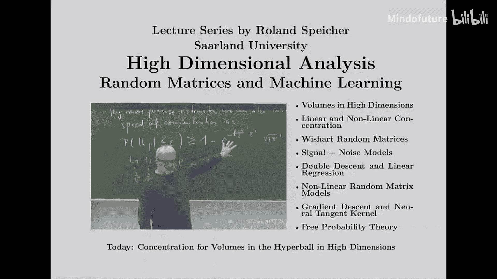
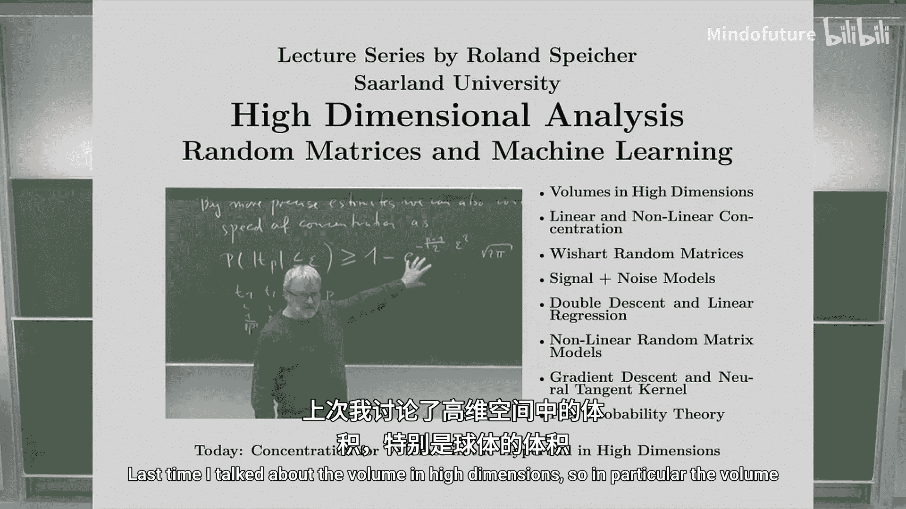
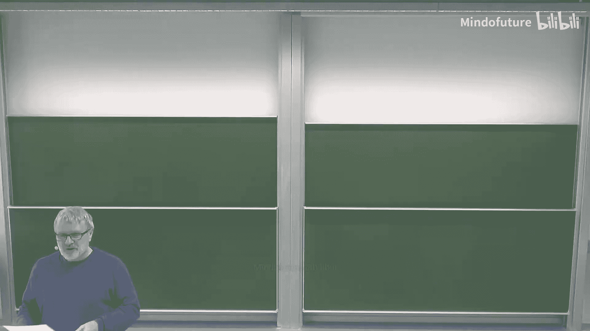

# 【德国萨尔大学】高维分析：随机矩阵和机器学习 ｜ High Dimensional Analysis p03 P03_体积的集中现象 -BV1XkkWBFEi6_p3-

Last time I talked about yeah， the volume in high dimension， So in particular volume of of balls。

 back to understand concentration phenomena。 So this means we are looking， let's say on a ball。

 maybe let's say the unit ball。 Okay， we can and we measure the size of it by its volume。 Okay。

 but because we want to compare。

Volumes of sets with given properties with this one。 I mean。

 we want to talk about probabilities that something happens。

 So this means we we yeah we normalize the unit ball， let's say two probability1。

 and then we are looking on properties of sets there and we want to see that maybe with very high probability。

 something happens So those are the concentration phenomena。

 and I already gave the slogans So in high dimensions in a wall the the mass concentrates essentially at the surface。

 and it also concentrates essentially at any equator and I have two vectors。

 they are essentially orthogonal Okay， and I want I want now to make those statements more precise because we really want to have precise statements estimates which which tell us that those are really concentrating good okay。

 so and maybe so let us go through this。3 slogans。 So the。

 the first was that the volume of the ball is concentrated close to its surface。 So let us。

Look on， first of all， what does this mean and how do we really prove this in a， in a rigorous way。

So the san one was。Now let me write it again， so the volume。Of the ball。Is concentrated。Close。

Towe surface。And of course， in small dimensions， this is， this is not true。

 This is really something which happens in large dimensions。 So in small dimensions。

 if I'm looking at the disk， Of course， the the mass is spread out over the disk。

 And if I take a small slice around the the outer the circle， there is not。

 not so much but in high dimensions， there will be more and more sitting there。 Good， Okay。

 but so how do I really prove this。Well， what is a precise statement， Okay， so I mean。

I'm saying close to the surface。 Of course， the surface itself is a lower dimensional object。

 So this doesn't have any mass。 Okay， so I really have to take a small neighborhood of the surface。

 And so we take epsilon neighborhood。 So we're looking on things which are epsilon close to the surface。

 Okay， so let us fix this。Epsilon， so can be small。Okay， then。We have。For our vectors。

 And now I I I address them as random vectors because， I mean， I'm， I'm looking on their probability。

 I mean， I'm looking on all vectors in a unit ball。

 but I consider this as a probability space where the probability of sets is measured by the size。

 Okay， so that that's， I'm talking about random vectors。 And， of course。

 we we look on the probability， which in this case， of course， iss just the ratio of， of， of volumes。

 Okay， so then we have。For the random vectors。So our vectors in the unit ball。啊。Following。呃，呀。

Statement， or at least， I mean， what do we want to calculate， We want to calculate the probability。

 let's say。That the norm of my vector is close to the surface。 So the surface， of course。

 is is is the vectors， the points where the norm is equal to1。 So the norm is a two norm。

 the Euclidean norm。 Okay， the length of a vector。 Okay， if I'm close to the surface， I should。

 it should have norm， let's say bigger than one minus epsilon So it should be close to1。

 So that that's what I really want to see that this is getting larger and larger and high dimensions。

Okay， and I mean， the P here。 of course， this this now stands for probability。

So we make probabilistic statements， but I mean， the probability I'm measuring here is is essentially the size of。

 of the set with the given probability compared with the size of， of the whole space。

 which I consider。 the whole space is here a unit point So this here really is the volume。

Of exactly the， the set of vectors， which has this property。 So it's， it's the， the volume。

Of the vectors in a unit ball。For which the norm。Is bigger than 1 minus epsilon。And for probability。

 I should normalize things。 So I'm dividing， I'm normalizing this with the volume of the whole unit ball。

 Okay， so。So if I consider all my vector and a unit ball， this set has probability 1。

 That's just everything。 And then okay， I take the ratio， which have this property。 And， of course。

 yeah， I mean， I can also write this。 So essentially I want to see that this this probability should be close to one I mean。

Saying that most of them have this property， This means this probability should be close to one。

 And maybe for this， it's good。 instead of saying this is big。 Maybe if I go here the other way。

 then then I should say this is small。Okay， so I can also。Rightr。

 the volume of the vectors which have lengths bigger than one minus epsilon。 This is， of course。

 the same as all vectors， minus the ones which have length smaller than1 minus epsilon。

So this is the volume of the。You need one minus。To volume。Of the vectors。

 which don't have this property。 And those are， of course， the vectors。Which I。

If lengths smaller than one man is epsilon。 So that that's the vectors on the inside。Okay。

 and of course， the。Dividing by the。Volume。Of the whole unit ball。 and now of course， you see。

 I mean， you see as one minus this okay。So， yeah， this is。1 minus。 And then I'm left is the volume。

Of the elements。In the unit ball。Which have norm， less or equal。1 minus epsilon。Divide it。

By the volume。Of the unit ball。 Okay， now probably you see what it is good to go over from bigger than one minus epsilon to less equal to 1 minus epsilon。

 because this now， of course， is just again， the ball， But the ball of radius1 minus epsilon。

 And we know what the volume is So we just can use the formula which we have。

So what I have here is 1 minus。 And this here， So those are the guys。In a unit ball。

 which have lengths less than 1 minus epsilon。 But， of course， those are just the vectors。

 which are in a unit ball of radius 1 minus epsilon or square root of。Of1 minus epsilon， yeah。Yeah。

Okay， so this is1 minus。So it's the volume。嗯。No， that one minus eps is the radio。 Okay， so it's the。

It's the volume。Of the ball of radius 1 minus epsilon。Divide it。By the volume。Of the unit ball。

 And maybe let me write it explicitly Radius 1。 So we just have to compare the volume of Radius 1 with the volume of 1 minus epsilon。

 But we have explicit formulas。 And the only thing which matters here is how it depends on the radius。

 because， I mean， we have coefficients pi and the gamma function。 but those are the same。For those。

 so they， they cancel away。 And so we just get here the ratio of how things depend on。On the radius。

 So we have1 minus and the dependence on the radius was， of course， the radius to the power P。

 So here I get 1 minus epsilon。To the power P。 Okay， and here， I just get one。

And the the pi factors and the gamma functions， I mean。

 they are the same for both because I'm in the same dimension here。OK是是。dimension is showing up here。

 And now， of course， we see that if now P goes to infinity。This guy here goes to 0。 Okay。

 so thats the idea。 I mean， I'm fixing epsilon。 So epsilon is fixed。

 and then P goes to infinity 1 minus epsilon is number smaller than one can be close to one。

 but it's smaller than one。 So if I take a power of this， this will go to 0。 So this goes to 0。

 and then this here。Converts to one。So this is， of course， for P going to infinity and eilon fixed。

 Of course， you always have to think。 I mean， what do I want to keep fixed and what do do I vary。

 So but in such estimates， usually you， you fix the epsilon how close you want to be。

 And then you make the dimension bigger So this is if。Epsilon。Is fixed。Yeah， so this， this goes to0。

 Okay， but of course， often you also want to see this in this way that， of course， I mean。

 if epsilon is fixed， then you will have less and less mass in the shell outside of this。

 But of course， if the dimension goes higher， you can also scale epsilon with P and then you can ask yeah how should I scale it that more or less I have the same kind of of mass sitting in in this shell。

 which is getting thinner and thinner。 And of course， I mean。

 this formula here essentially also tells us how we should do this So namely we should here scale epsilon Yeah。

 with what I mean what in order to get here something which doesn't go to0。

 but maybe has a finite limit。 So how should I choose epsilon。Yeah。Yeah。1。

1 over P because then I get essentially approximation of E Okay。

 so this formula tells me I should choose epsilon as one over P or maybe a constant by P。

 but it should go like one over P。Yeah， so let me write this down。 So if。One wants。To keep。

The volume in this slide and it is the skin of my ball， of my apple or whatever。Kind of。A constant。

 if P goes to infinity or forb。P。1 should scale the epsilon。Also with P and has to scale Epsilon。

Withs P。Okay， and this formula， which we have very explicitly here。

 suggests that we should scale epsilon。 let's say like  one over key because then。Yeah。

 what do we get then。Then we have to probability。That the norm of x is bigger than one。

 And now the epsilon is one over P。 Let me choose this。

 So I'm looking around the probability that I'm closer than one over P in。

 in P dimension to the surface。 This is then one minus just using this formula。1 minus epsilon。

 Epsilon is1。Over P to the power P。 Yeah， O， But this year， of course， if P is going to infinity。

 this is， is an approximation for E for the oil number E。我 for one了。我把楼房。呃。Because minus sign样。

O so I mean。1 plus x divided by n。屁。P this goes to。E to D X。Okay， so you have a minus sign。

 So this here is approximately。E to the minus one。呃，For P large。Okay， and so this。

 this tells me approximately 1 minus-1 over E percentage of the volume is sitting in a small skin of。

 of my ball of of。Of size 1 over P。And so this this year is approximately。1-1 over E1 over E。 E is 2。

 What is it 7，177，7，1， something like this。 Okay， and so this year is approximately something like 62%。

0。6。 So it's of of this order So this means yeah， if I。

Look on a neighborhood of one over P in high dimensions。 Then in this small， very small skin， I mean。

 in hybrid dimensions， it is very small。 About 60% of the Mars are sitting there。Of course， if I。

 if I take here，5 over no，1，1 or1。Yeah， if if I'm going closer to one。 So I take one over 2 p or 3 p。

 then， of course， less and less mass will be sitting there。 Okay， good。 Okay。

 so that somehow the asymptotic statements。Which we can make， but actually。I mean。

 very often we want more precise estimates。 So I mean， this is saying， okay， roughly， I mean。

 this is saying the probability goes to 1 and roughly 60% are sitting in a neighborhood of one over P。

 But okay， I mean， roughly， what does it mean Okay， so at least in mathematics。

 we really want to make this roughly more precise。 And this means we want inequality。

 So we really want precise estimates。 How big is this probability。 And so let us do this。 I mean。

 just we have to read this。 I mean， we have here， a very concrete formula So in principle。

 we know exactly。What this is， but。This say to the P， is a quantity。

 maybe which is not so directly clear。 I mean， usually we want to have exponential estimates。 And。

 of course， we can this， we can write these very nicely in terms of of exponentials。

 These are very close。 But let let us do this and then do precise estimates。Okay， yeah， on for this。

Yeah， we have。 let us use the following lemma。 So essentially， we just， I mean。

 we just have to compare this term here with an exponential term。And this， I mean。

 this is something which。Inequalities。Which are used quite often。 So let me write it down explicitly。

 I mean， where those are simple estimates。But they are quite useful， So for any P bigger than one。

And epsilon， of course， epsilon between0 and 1。I mean， usually we are interested in small epsilon。

 The estimates are true for all Epsilon， but， of course， Epsilon bigger than one doesn't make sense。

 because I mean yeah， you're looking on 1 minus epsilon。 Okay。

 so it's true for all for all estimates which we are doing。 But， of course。

 usually the epsilon is something small。 Then it's really interesting quantity。 Yeah， so what。

Do we have。 So I just want to estimate this one minus epsilon to the P。EAgaint exponential functions。

 So I'm estimating this against E to the minus epsilon P。Okay， so just that I write。This term。

 more an exponential form， in particular， where the epsilon the P are also coupled I see much better how they should go together。

 you see exactly。 I mean， if I want to keep this constant， Epsilon should be of the order one over P。

I mean， of course， here， we also see this because we know this is an approximation for the e function。

 but here it becomes more explicit anyhow。 And this is a precise estimate。 And this is very simple。

 I mean， but still， let me。Say something about the proof。Essential， of course。

 this is just taking the p power of this estimate for P equal to one If I have it for p equal to one。

 Then if I just take the P power， I get this one because everything is positive。 So it follows。

 So the only thing one really has maybe。To think a little bit about is P equal to1。

 But that's also more or less obvious。 So everybody should be able to do this。 So this follows from。

The obvious。K is P equal to one。 So where just says。Yeah， maybe I write。

1 minus epsilon is bigger than 0， and。It's less than E to the minus epsilon。 So this。

 this is the case P equal to 1。 Okay， and of course， this is bigger than 0。

 So I can take the p power of this and the inequality here stays the same。 Okay。

 and this is now a simple。Calculus property， which you can， for example， see， maybe if。

 if you just look on this function as a function。In terms of epsilon， and you see how it behaves。

 So I mean。If you write this in Epsilon， So we are looking from 0 to 1。 I mean， one minus epsilon。Is。

I mean， this is just this function and this e function。 I mean， this。

 this is the exponential function， which。Which yeah go of course， comes， comes from here。 Okay。

 and then goes like this。 and the derivative of this here is equal to  one。

 So here they are touching。 But then I'm above。 So you just can take the difference of this and see that the derivative is。

呃，positive。Here， okay， so this is， this should be clear。 Okay。

 and so this is for P equal to one and the general， we can get。By taking the peace power。Good， okay。

 so that's a very simple estimate。 But let us see how we can now rewrite this formula in terms of this for precise estimates。

Enthia is a very simple situation where we have， I mean， you have a very explicit concrete formula。

 which is very easy to analyze。 Okay， for more complicated questions， of course， the formulas might。

Be explicit， but more complicated or even if we maybe don't have really explicit formulas。

 But at least we we can try to get estimates。So in here， this is， everything is very。explicitplit。

And so let me just write down the combination of this and what we saw before。嗯。Its a theorem。So。

 namely。Yeah， in the setting where， okay， we， where we have this。 But that's exactly where。

We be interested。 So for any dimension peak greater equal 1 and epsilon between 0 and1。

We have that probability。That my vector to。In the unit ball， in dimension P， have a length。

Which is bigger than1 minus epsilon。Okay， let me write down again the exact formula。

 which we observed here。 So this is。1 minus。1 minus。Epsilon。To the power P。 Okay。

 but now we can use for this， the estimate。 So this here is less or equal。 So here I have 1 minus。

 So here I get the estimate in the other direction。 So this here is greater or equal than1 minus。

 yeah the estimate which we have for this， which is1 minus E to the minus epsilon。P。Okay。

 so that's now really maybe the our form of a concentration estimate， which we want to have。 So。

 so some properties concentrate。 I mean， usually we have kind of exponential concentration So where the dimension shows up in an exponential way and maybe also how close we are should also。

Show up there。 So that's the thing which we want to see。 And so in particular， now， of course。

 I can also now make this with the 62%。 also write this as an inequality。And。The probability。

For the vectors in the unit ball。For which。The length is bigger than 1-1 over P。

 This can also be estimated。 Yeah， just by， by， by putting here epsilon equal to one over P。 I mean。

 this is true for any epsilon， I mean， I can choose also epsilon， depending on P。Okay。

 and now choose it as one over P。 So if this， it is bigger than one minus。Yeah， one over一。

Because if epsilon is1 over1 P， I have E to the -1。 Okay， so this are these 62%。Okay so this， I mean。

This only gives us one direction。 So it says is， it is， it is at least 62%。 I mean。

 if you really want to have a more concrete， better approximate。

 you should also do an estimate in the other direction。 But usually， I mean， is this estimate。

We want to see that that we are close， close to one。 that this goes to 0。

 So that's usually the direction of the estimates we are really interested in。 Okay， of course。

 you can also try to think about estimates in the other direction so that you really know more or less exactly how much mass you have。

Good， okay， so that was maybe a very simple situation。 but it shows more or less what。

 what we really want and， and how we， we are trying to do this。 Okay。

 but now maybe let us look on a bit more。Yeah， interesting， comp also more bit more complicated。

 but still manageable situation about the equator So the， the second slogan。

 which I had was that the mass concentrates close to the equator。 Okay。

 so let let us see how we can prove this。 And let us also see what we really mean with this。 Good。

 So let me maybe also just write down again。 the slogan。嗯。And then make this precise and okay。

 try to prove it。Particular。Almost。哦的。Of the volume。Of the ball。Lice。你呀。It's。 O， and O。Actually。

 there are many equators。 and this is true for any， any of them。

 But maybe we should think about what we。Really mean with this？嗯 yeah， so what。呃。Is theequ。

 So let us consider our vectors。So let us consider the vector。

 and as's usually I denote the components of it by T， T1 up to TP。So this is my vector a unit ball。

And now I equator is with to a chosen direction。 So usually it's with respect to the North pole。

 So I take the vector going the north pole。 and then the equator is essentially what is perpendicular to this。

Okay， and so let let us do this。 And we choose here one direction。 And of， okay， let。

 let's say the North pole there。 that's the last guy here。 So that that's the guy。

 which is a North pole direction。 and then perpendicular to this means that the last component has to be equal to 0。

So we consider this。And we choose， choose now。But this is arbitrary because we can make any choice。

But to explicit。 And it does depend with which， I mean。

 the arguments don't depend on which choice we make， which we choose a direction， T P。

 the last component of my vector as a direction。Into the North Pole，As the north。Direction。

Which doesn't have a real meaning in higher dimensions。

 but just to compare it with maybe what what we think of in three dimensions。 Okay。

 and then we say the。Theequequator。Corresponding to this is the hyper surface。

 which is orthogonal to this。 But this just means that the last component must be equal to 0。

 So the equator itself。This is a P dimension， P minus1 dimensional object。 So this is。

Those are the vectors。In my unit ball， which are autoal to this。

 but this just means that their last component is equal to 0。Also， I mean。For example。

 if I mean two dimensions， then let's say the north would be this and theequta。Would just be。

This line here， Okay， and in three dimensions， it would be the。Yeah， the the， the， the， the， the。

 the plane， which goes through0， and which is autogon。To the vector pointing to the north pole。

 So this is north， and DC C I is。It stay cr。Okay， and now we are saying essentially that most of the mass is。

 of course， not exactly on the equator。 because this has mass 0。 This is。

 this is a P-1 dimensional object。 So this is a。P -1。Dement the region。

Because one of the components is exactly 0。 Okay， so this this， this doesn't have volume。

 at least not a p dimensional volume。 We are measuring。

 measuring everything is the p dimensional volume。 Of course。

 I could say it has p minus1 dimensional volume。 But that's not what what I really want。

 I really want to。Yeah， to have probability in my P dimensional space。So I have to talk about。

To P dimensional volume。 And as before， I'm not saying exactly everything is on the surface。

 but it's in the neighborhood。 And again， I can say here， everything or more or less。

 most Mars is sitting in a small neighborhood of this equator， which means， again。

 I should allow a deviation of epsilon。Maybe in pleasant minus direction here。

 So I would require that the last component has absolute value less than epsilon。

 That's what I mean that it's close to the equator。Good， okay， so and。So this is my thing here。

 And so now I'm looking on the probability of this。So， the probability。Of being close。To theク웨ト。

Is then， of course， given again， from again， I I write it as a probability of。两。Okay。

 let let me write it explicitly the probability of the points。In the unit ball in P dimensions。

 for which the last component is small。 I mean， the other components， I don't care。

 But for one component， I'm really， I want want it to be small。

 and I want again to be smaller than Epsilon。 So I want。That。This last component。

Its smaller than epsilon。Okay， and again， I sang。Yeah， Mars mostly concentrates there。

 So I would like to see that this， again， is close， goes to one if P goes to infinity。And， of course。

 again， what do I mean with the probability， I mean the volume of the vectors。

 which have this property normalized by the volume of the unit ball。 So this is。The volume。Of my。

Elements in the ball for which this T P， Okay， absolute value is less than epsilon。

 This means the T P lies between Epsilon and minus epsilon。Yeah， okay， and I have to normalize this。

By the volume。Of the boy。Okay， and now you see， of course， the volume of the ball we know。

 And here we have now to calculate something yeah elements。

 vectors in the ball with this a given property。 And again。

 this is more or less something which we can do。 because， I mean。

 how do we calculate volume of such elements。 we to iterate integration。 And I mean， here， okay。

 one component is restricted to the interval for minus epsilon to plus epsilon。 But again。

 this is something which we can do very explicitly。Okay， so let me。this down。 So this means， okay。

 if Im want the volume of a set， I integrate over my variables over my components， T1 up to TP。

 And here， the last component is special So namely this one。

 I only integrate from minus epsilon with plus epsilon because that's what it means that this T P is between minus epsilon plus epsilon。

 I should only integrate there。 But the other guys， I'm integrating again。

 over I allow everything which is possible for the for the unit ball。 But of course。

 the condition now。Maybe let me first write， because I'm integrating over all my variables。So T P-1。

 And the last one is special。Maybe I just dided by by T。 Okay， it its T P。

 but maybe I didote it by P。 But now so。So， I integrate。At the last， about this one。

 And if this is fixed， the integration of the other other ones， of course。

 has to satisfy this condition here。 Well， no， I mean， I。

 I still need the condition that I mean in a unit ball。

 and this condition is just that the sum of all the squares is less than one。Okay。

 but if I'm fixing the last T， then， of course， the condition for those guys here is that T 1 squared。

Plus。T P-1 squared。 And now I would have plus T P squared is equal to one， but。

In terms of those guys， I bring the last one on the other side， and I'm just calling it T。Yeah。

 no maybe I I call it T piece。Okay， so I'm just writing it it like this。 Okay， and I still。

 of course， have two。DDivide by the volume。Of this。 Okay， and now you see， I mean， this。

 this integration over the P-1 first variables is now again， integration over a ball。

 But now the ball of size 1 the square of the last coordinate。 Okay。

 so depending on how I choose the last coordinate， I have to integrate over balls of varying size。

 Yeah， but。Bos， we know how to integrate。 So what I really have here。Is the integral。

From minus epsilon， this plus epsilon So this integration over the last variable I leave open and then doing the integration over the other P -1 variables。

 this gives me exactly the volume。Of a boy。In P dimensions。

 But now the radius is  one minus T squared。And okay， it should be the square root of this。

And now I really rename T P to just to T because not only one integration is left。So this is D T。

 and I have to normalize。By the volume。Of this。Good， but again。Yeah。哎，呀。Exactly， yeah， very good。

 of course。Yeah， I have integrated here over P -1。Variable。 So I get here the P -1 dimensional ball。

And you see， essentially， I mean， when we calculated the volume of the ball。

 we made a recursion where I integrated out two variables。

 So I I compared the the p dimensional ball with the p- two dimensional ball Okay， and you see here。

 I'm essentially I'm just going down a step in one。

 you can also do this if epsilon is equal to one here。 Then essentially。

 we are comparing here to P-1 with the p dimensional ball。

 So also recursion we compare dimension P and p -1 is also quite easy So okay。

 that's more or less what we are doing here now。Good， okay， yeah， and so。Yeah， of course。 So here。

 I mean。The radius here， the the the T is varying。 but we know how the volume depends on the radius。

 So it， it's just the， the volume of the unit ball times times the radius to the power of the dimension。

 which is P -1 So what I have here。Is then。呃。Yeah， it's the volume。Of the unit ball。

 which I can take out of the integral。And， of course， it's a unit born in P -1 dimensions。

 And I divide this。By the volume。Of the unit ball in P dimensions。

 And then I'm left with the integral。Over the volume of the of the ball in dimension p minus1 of radius squared of1 minus t squared。

 and this is the volume of the unit ball times the radius to the power p minus-1 So I have here the radius is 1 minus t squared to the one half and I have take。

To take this to the power P -1 into the one half is the square root there。Okay， so that's。

What I have to do there。Yeah， okay， now again， we have a very explicit formula， I mean。

Princally we know those volumes here。 We have the formulas for this。 And， of course。

 this is also integral。 This is now going from minus epsilon。To plus Epsilon integral。

 which we can also deal with。Okay， and。Yeah， maybe I。Wite down。The formulas for the volumes。

 of course， we get now pi and gamma functions。 And of course。

 I'm comparing here P -1 and P So it's these those constants。

 essentially constants depending on P I'm not， not canceling away。 But， but I have。

 that's essentially what I have to understand here。So， and maybe I can write it down。

 So what was the volume of the。Unit ball in dimension P。 Yeah， So maybe let me write it down here。

 So it was pi to the P over 2 divided by this gamma function。

Of P over 2 plus one So this was this kind of factorial。And here， I have the same。

 Yeah I have to replace P by P -1。 So here I have。Pie to the。P-1 over 2。

Divided by the gamma function of。P minus-1。You把 it打 two。Plus one。Okay， and now， of course。

 I have a very explicit formula。 I mean， I understand， in some sense。

 I understand those quantities and this is integral， which I can also easily understand。Okay。

 principle， we understand it， but maybe now we should really。

Try really to make this precise understanding。 And what I'm doing now is， again。

 looking on the asymptotic behavior。 So as before， looking， how does this behave if P is large。And。

 of course， the statement is it should go to one。 that's what maybe we should see。

 And that's what I want to do in the following。 And， of course， for this， we can use， Okay， I mean。

 this is explicit。 the gamma function。 is is， of course， it not， not so clear。

 but we have the stirringerling formula， which tells us how this behaves for large dimensions。

 And we can use this。 And this other integral we can， of course， also deal with。

 that's what I want to do。 Okay， and then。I mean。Yeah， so essentially。

 I want to do the asympttic somehow of the first formula here in the， in the case from before。

 and this estimate that we really make precise estimates。

 That's something which you ask to do in in the assignment。

 So that's really working with this example。Making。

These asymptotic statements precise as inequalities。

 That's something you should do in the assignment。 So I I only want to do now the asymptotic behavior。

 which。Which shows that it really goes to one。So this is just the volume of those two guys。

And then I still have here integral for minus epsilon up to plus epsilon。

1 minus t squared to the power。P -1 over 2。D滴。Good， okay， now to see the asympotics。Let us use the。

Stling formula， or maybe let us first look， Okay， the pies。 I mean， the pies are very explicit。

 Most of them cancel away。 here I have to the power P。Over 2 here to P over 2。

 And then I have a extra-1 over 2。 So the square root， But with a minus。

 so I can bring this to the bottom。So I still have one over pi， squared of one over pi。

 That's what is left over of the pis。 And then I have the gamma function。 Okay now。I bring it。

The one on the very bottom， I bring to the top。 So this is a gamma function of P over 2。

Plus one divided by the gamma function of。P minus-1 over 2。Plus one。

 And then I still have my integral。Minus epsilon up to plus epsilon，1 minus T squared。P-1 over 2。D T。

 okay， and now I use Sterling's formula。 So this is approximately。1 over the square root of pi。

 And for the gamma function， the stling formula tells me so that if I have an argument plus one。

 then yeah， what is it， It's a square root of。2 pi times the argument， which is P over 2。

And then I have。The argument divided by E， so the argument is see a P over 2。And I divided by E。

 and it goes to the power of the argument， which is P over2。So that's a st formula。

Which tells me how this behaves for large P in more concrete terms， which。

 which are easier to understand what they do。 Okay， so there that's for this guy。

 And then I have to divide it by the same kind of object where I replace P by P minus1。Okay。

 so here I have 1。土牌。P minus-1 over 2。The square root。 And here I have P-1 divided by 2 e。To the。

P -1 over 2。 And the whole thing is still。Multipliied with this integral。Good， okay。

 so what do I have here， Of course， I mean。A couple of things go away。 I mean， the two。

 So those go away。 and also this year cancels with this。 Okay， and then here。I have。

The ratio of this is this。 But this year is taking Mr power P -1 over 2。 This is taking Mr。

 power P over 2。 And I want to bring them together。 So I， I give an extra。Yeah。

1 half power to this so that they have the same power and I can combine them。 But， of course。

 then I I have to。Yeah。To repair this。But so let me write it down， so it's a square root of this。

🤧Then here I'm left with P divided。P divided by p -1， the square root。 That's what is left over here。

 and then here。I'm dividing this， with this。We are also take the P over two power of this because then the two Es go go away。

 And I just have the ratio of P and。P minus-1 FP。P -1 to the power P over 2。

 but I have making the mistake that I have taken the power minus yeah。I have an extra power。

1 half taken here to get the same power P over 2。 So I have to repair this by multiplying with P-1。

Over to E。To the power 1 half。Okay， and then I still have the integral here。Yeah， good。 Okay。

 now let's see。 So what。嗯。Where can I see the asymptotics。嗯。Yeah， again。

 this is something which goes like exponential like， like the E function， because。So this guy here。

I mean， maybe I write it better as。Yeah， it's one divided by 1 minus。1 over P。 So I write。

 I divide by P。 So I have one over this。 And then I have this to the power P over 2。

 So I get essentially this to the power P over 2。 And now you see again， this is again。

 approximation of。Of E to the minus1 half。 Okay， so maybe I have P over 2。

 So maybe I should also write here 2 and here 2 and then。This guy here is this guy。

 And then I get the。 And this is approximately E to the -1 half。So this here is， and I divide it。

 So this is one over。E to the -1 half。有O。Good I mean， all this this is is quite simple， but okay。

 just one has to do it and not getting lost in。In order terms。So， we have this。And。Yeah。

This E here now goes nicely away with this one， because this is one over E to the1 half。 here。

 I have E to the minus-1 half。 So this and this， I can cancel。And then so what is now left？

So I still have this one over pi here。So its。1 over。Square root of pi。Then， I have。What do I have。

Yeah， I have here。P -1，2，12， And I have here。This cancer is this p minus1 here。

And I'm left with this this square root of P here。Yeah， okay。

 And then I have the square of2 from here。 So I have this one over pi。Square of。P over 2。

 And then I'm left is the integral。 Okay， so I mean。

 this is essentially the only thing which is left from all is this， this disma functions and pies。

 Okay， and so I still have here minus Epsilon。2 plus epsilon。1 minus t squared。呃。

To the power of P-1 over 2。Dt。呀。Okay， and now what do we see。Okay， we still have to deal with this。

And again， we should see here something which which we can integrate， which we understand。 And again。

 what we have here is essentially a kind of approximation of an exponential function。Okay。

 so so how do we see this。嗯。Maybe first of all， I mean。

 I have here a P and a p minus-1 asymptotically， there's no difference。 So asymptotically。

 I can also replace this here bar by the power P。 or you can say I replace this by the power by P -1。

 And then whether P is large or P -1 is large， it doesn't make a difference。Also。This is。

1 over a square root of pi。Here， I have P over 2。Then I have to integral。From minus Epsilon。

2 plus epsilon。1 minus t squared。 And I say this this is now asymptically the same as P over 2。一体。

Good， okay， and then。Yeah， if I have something to the power P。

 then here I should have something which behaves like one over P because then I get an approximation of the exponential function that that's。

 that was also the idea before。 such terms I control， but they behave。

Closely to an exponential function， because this is somehow this formula one plus x divided by n to the power N。

 this behaves like E to the X。 Okay， and this， in order， yeah， to do this， I make a substitution。

 which somehow writes this T here as something which which also has this factor R P over 2。 So I'm。

Substituting now T。In the variable S。But。Scaling it with this guy。 Okay， so so for T， I plug in。

S divided by this。 And then you see the T squared gives me then factor of P over two here。

 And of course， this this changes the the limits here。 Okay， but but that's okay， because I mean。

 here I'm integrating over a small interval， which maybe it's not so clear how to control。

 If I'm changing the limits。 Then I'm making the。The the， the boundaries， yeah。

 if if I'm replacing T by S， then I will integrate here over bigger and bigger intervalverts。

 And essentially， I will integrate over all of R， which which I can control again。

So let me now replace the variable T by the variable S。 where I I just the yeah， the。

Relation is that T is S divided by the square root of P over2。 So this here。Is now one over pi。And。

亚缩。I'm replacing T squared by S squared。Divided by P over 2。So it's p and the2 goes here。

Then I have to the power P over2。 And yeah， it the D T is now becoming a D， S。嗯。Divid it。

By the square root of P。 And this actually goes nicely with this term。 So this also disappears。

 So actually this。Times this is exactly the D S， okay。So this， this goes away。Yeah。

 and I have hit this here。 And now， of course， also the， the limits here have changed。 if。

 if T runs from minus epsilon to plus epsilon， then S runs from minus epsilon times this and up to plus epsilon times this。

 So here I'm integrating now for minus epsilon。Square root of P over 2。To plus epsilon。

Square root of P over 2。Yeah， okay， and now you see if P is large。Actually。

 the limits go to minus and plus infinity。 So actually， I'm integrating more or less over all of R。

 Okay， and this here is now an approximation of the exponential function。 More precisely。

 What do I have here yeah。I have here P over 2。 that's exponent。 This is showing up here。

So this here is an approximation of minus e to the minus S squared。

So this here is approximately e to the minus S squared。Yeah， okay。

 and this here goes to minus n plus infinity。 So what I have here is approximately。Now。

 the one over pi。The integral from minus infinity to plus infinity E to the minus S squared。DS。Okay。

 and now this is something which we know。Or should know。

 or at least after you have done the next X assignment， you have to know， because that's， yeah。

 that's the first assignment。 I mean， that that's， of course， the， the famous gaus in integral。

 So this integral here is exactly1 is is is pi So this here is exactly  one。Okay。

 and so you see asymptotically， if P is large， this really is close to one。嗯，O。Yeah。

 but now you might say， okay， you have made okay， many asymptotics and maybe something is not clear。

 and maybe it's not clear how big the。The mistake is， and you are right。

 So we better should do concrete estimates。 Na me saying the probability that we are。

Closer to one than something should be。 we should be able to estimate this in really maybe some exponential form or whatever。

 And yeah， you， you can do this in a in assignment So， so in principle。

Instead of doing these more asymptotic statements， one really can do real。Estimates， okay。

 so let me write down what we have seen here more or less。 And then also。

 I let me write down the the precise formula which you are asked to prove as an assignment。Okay。

 so here from this。We have seen。So this is for any。Epsilon， bigger than0。 So Epsilon was here fixed。

 And you see， I mean， okay， I'm。Yeah， if Eppsilon is fixed this year， good this， this was in the end。

 it was only showing up here in the， in the in the limits Yeah， of， of my。

 my integral if eppsilon is fixed， then if P goes infinity I integrate over all of R。Okay。

 and so we have seen。That's the limit of the probability。ThatTP。Is less than epsilon。

If P goes to infinity， that this is equal to one。Okay， if you believe oil。These asymptotic things， O。

 but。Instead of believing， maybe we should prove it really。 And that's what you have to do， so。What。

One can show。By more precise estimates。We can also。Control the speed of the concentration。Control。

The speed of。Concentration。In the following way， so namely， we can show that the probability。That TP。

Is less than epsilon。It has to go to one， but we can be more precise。 So namely。

 it is bigger than one minus。 And now there should be a term which goes to 0。

 But this we can write explicitly as e to the minus。P minus-1 over 2。Times epsilon squared。Okay。

 times a two pi。OhOkay， so you see， yeah。Yeah， yeah， exactly。

 So So this is not only true for one equator。 So we yeah。

 I could also say instead of the of T P small， we could also say T P minus-1 small the same argument or T1 small。

 So we could have those P equators。 and for each of them。You have an estimate like this。

 So most masss is sitting there。 And from this， you can then say if you take the intersection。

 then it's also close to one。Oh。Mind me， because if， if you have。

 if you have a finite number of sets， each of which has a volume or probability。

 which is close to one， then the intersection of them is still close to one。

A bit little bit further away。 But， I mean， you are exponentially close。

 So if you take a finite number， you're still exponentially close。Okay， so for any， I mean。

For any accurate， and there are many more， not not just the the P， but you can also。

 you can take vectors， which you are showing in any。In any strange direction in any direction。

 So for each of them equators， you can do this。 So for it。 So the mass concentrates in all of them。

 So it also should concentrate in the intersection of them。Of course， I mean。

 if you take the intersection of infinitely many， then such things break down。Because I mean。

 you can have for internet many things。 You can have concentration concentration for each of them。

 But if you then take， let's say， exponentially many of them。

 then you're losing the concentration But for any fixed number， you， you can take 1000equators。

And then it's still， the mass is actually sitting in a dissection。

This makes it in one in small dimensions。 This makes it even stranger because in small dimensions。

 you have to feeling nothing is or almost nothing is sitting there。So， I mean， one equator。 Okay。

 that's the equator。 But then if you take the other equator。

 But the intersection of this is just very small spots。 But in Hya dimensions。

 this is still very big。So essentially， O， maybe maybe yeah so what。What are we saying here， I mean。

 we are saying that most， most vectors in a unit ball have the last component quite small。 Okay。

 and maybe maybe we can also tweet it the other way around what， what is essentially。

 what should be the size of the component So it's again， I mean， in order that this is not so small。

 How， how should we choose this， this epsilon such that this here maybe is a finite value。 So how。

 how， how should we do this， So this is， I mean。This。

 this inequality is essentially also showing us how we should scale epsilon with P。 So namely。

 how should we do this。This guy here should be constant So。

 so epsilon should go essentially like one over the square root of P。Okay。

 so this is telling us that most vectors in a unit ball have a P component。

 which is of the order 1 over square root of P。Okay， and it's also saying us， okay。

 most vectors have first component， which is of the order 1 over square root of P。

 And they also have a second component， which is of the order square root of P。

 So this means essentially all components are of this order。 And if you said it like this。

 maybe it's not so。So surprising，I mean， I mean， we are saying here， okay。

 the first component is of the water of the order square of one over。P。

 and then we say the second component。But if you now say both components should be of this order。

 this is。It's an intersection of the two conditions， but still this this looks more plausible。

So maybe from this point of view， the whole thing is is maybe not so crazy。Good， okay， yeah。

 but it is so， so you see it's， it's mean high dimensions。 concentration is okay， Ss are nice。

 and you cannot asymptotically understand it somehow， but， but。Without precise estimates。

 it's easy to fall into traps，Yeah， so even I yeah。

I don't really have a good picture of what really happens in those high dimensions， also。Good， okay。

 so， but let's see。Yeah， but， but in the assignment， I mean。

 you will prove this And then maybe you can try to think more about it if。

 if you add more conditions also。And may， maybe， actually， okay， so we still have the。

 the next slogan， which goes a little bit in this direction， because。There we are。Yeah。

Looking on two vectors， So it's getting。Bit more complicated again。Okay。

 so the slogan is most vectors are autogonal。 So this means I should take two random vectors in my unit ball。

 and then I should。Estimate the probability that they are close to being autoagonal。 Of course。

 it's again close。 I mean， of course， exactly autoagonal is again a situation which has zero probability。

 but being close to it。 that's again， where we say this is。Ass quite high。Probability。Yeah， okay so。

I consider。2 vectors。X and Y。In the unit boil。Now the question is， what is the probability？

That they are close。2 talking。Good， okay， so。I want the probability。Of two vectors。In the unit ball。

 And， of course， I have to measure。The closeness to autogonality and for this。

 I can essentially take the inner product。 because this essentially is gives me if I normalize it。

 the the cosine of the angle between the two or I mean， if the inner product is 0。

 this means they are orthogonal。 So being close to orthogonal means the inner product should be close to 0。

Okay， so I am looking on inner product。Okay， but of course， I mean。

 the product can be small because the length of the vectors is small。

 So I should normalize it because then it's really the， the cosine of the angle between them。

 So I take the in product， but I normalize it。Normalize it。With the length of the vectors。

 And then I ask that this。Should be less than epsilon。

So what is the probability of this So can we estimate this， So the ideas， again， this should。

This should be， yeah， the probability of this for any epsilon should go to one in high dimensions。

Okay， but now， of course， it it's again a bit more complicated。 So in particular。

 we are not talking about one vector， but I'm talking about two vectors。 And of course， in a sense。

 we are talking about independent vectors。 So I take two， two vectors。

 So what I really talking here about is the volume。Let's say of a pair of vectors。

 and they are living。In the unit board times the unit board。 I mean， just， I I just take。

A pair of elements in a unit ball。Which satisfy this， this condition。And then， of course。

 I have to normalize it now with the volume of taking all all pairs，So this， this is the volume。

Of taking just a pair of vectors。From the unit boards。Yeah， but， of course， the volume of。

 of such a product is just the product of the volumes。 So I mean。The volume of a pair。Yeah， I mean。

 this， this year is the volume in a p dimensional space。 If I take the volume， I mean。

 if I have two vectors in， in r to the P， I just put them together and I have a vector in r in R to the2 p And of course。

 the volume yeah， of， of this pair。It's just a volume。off。It's the product of the volumes， okay。Yeah。

 and。Okay， maybe it's， it's not so clear。 how how， how do I calculate here with with two vectors and calculate it。

 it's a set of of vectors with a condition。 But because the whole thing is symmetric。

 as we said before， I mean。As before， it doesn't matter which vector I choose for the equator。

 It's here the same。 I mean， if I want to see whatever is a canonical relation between two vectors。

 I mean， this， this doesn't depend on， let's say， the first vector， which I choose。

So I take just one vector。 And then I'm just asking， how are other vectors sitting with this one。

 Because the whole thing is is is symmetric。 I can rotate everything。 It doesn't matter， which。

 which I take， which I take as the first vector。 So this here is actually the same。

As fixing one vector here， let's say the second vector and then just ask about the probability that the first vector has a small inner product with respect to this one。

So this is actually。The volume。I'm just asking about vectors X， such that x and y。Its small angle。

Between them。Less than epsilon。Where I'm fixing。Thiss why。 And it doesn't matter which way I choose。

And I normalize this。So essentially， essentially for each Y。I get the same volume here。 And then I'm。

 I'm normalizing it by those volumes。 So the volumes of the ys is just going away。

 And I'm just left here is dividing。By the volume of the unit ball for， for the axis。O， so this。

 and this is true。For any。Fixed。Why in the unit ball。Okay。

 so this is somehow reducing the question again just to question about one vector。

It's a prior question about two vectors。 I should choose both vectors randomly， but essentially。

 it doesn't matter which I I make a choice for the first one。

 And then the answer for the second one is always the same。

 The probability that that it's small is always the same independent of which I have chosen for the first one。

 So I can just fix the the first one and just calculate the probability for， for the second one。

 That's what I have written here。So in principle， the original problem would。

 would be calculating like this。 But because of the symmetry of the problem， I cant fix the y。

Arbitrarily， and then just calculate this。 And now fixing it arbitrarily。

I can essentially go back to what I did before， because the inner product。Yeah， I can， for example。呃。

Can calculate this very easily if I choose as my vector Y， a vector。

 which has only a component in the P direction， Because then in our product is just looking on the P component of the vector Y。

 And this is exactly the problem which we solved before。so。In principle。

We can go back to what we did before。 Okay， so it's the volume of this。And yeah， so for any why。

 And now I make a smart choice。So name me。I take for why。The vector， where all components are 0。

 but the last one。 So this is a vector in the unit ball。 So that's okay。 And it also has norm 1。

But in particular， it has a nice property that the inner product of this vector with another vector just gives me the the pi component of the other vector。

So this means the probability now。What I have here。 So， so this divided by this。

 So this is the probability。Of my back doors。P1 up to TP。

In the unit ball for which the this inner product is less than epsilon。

 But the inner product between x and x and y is the。Is the P component。 So this is T P。

 But then I also dividing by the norm of what of the length of x and the length of y， Y has length 1。

 So this goes away， but I have to divide by the length of x。So it's。

 it's close to what we had before。 But now the length of X is also showing up。 namely。

 this has to be。Less than epsilon。Good， okay， so you see， I mean， we have。Somehow， yeah， the problem。

呃。For controlling the angle between two vectors， we have reduced this essentially to controlling for one vector。

 its last component， but also its norm。But for both of them， we had concentrations。

 So we know this year is small with a high probability。

 We know this year is close to one with a high probability。 So essentially。

 we have to combine those two things which we did before to get this estimate here。Okay。

 and essentially， I mean， we get something for this and something for this。

 We should control both of them so that the combination here gives us the epsilon。

 So maybe it's good to define something。For which we control the the P component and the norm。

 and let me call this Eer。And I define this。By saying that Eta divided by 1 minus Eta should be equal to epsilon。

And then I will control this and this in terms of itta。

 And then control of both gives me exactly this Epsilon。 Okay， so it just makes it easier。

 and you see， I mean， Epsilon small。Will mean that Eta is more or less the same as epsilon。So， so。

 so Eta will be more or less the same as epsilon and and1 minus Eta。Will be equal essentially1。

 So for small epsilon， I mean， that's。The situation we are interested in。一旦。

And epsilon will be more or less the same Okay， but it's， it's good to。

 to define this because then we can use this Eta for controlling the P component of our vector and also controlling the norm And there we had the there we had statement。

 So we had this statement here。 Maybe I should leave。This one。And we had the the one for the norm。

So what we know is probability。That the P component is less than Eta。

 So now Ire writing it down for Eta that this we could estimate by bigger than1 minus。 I mean。

 this is exactly what I have here， not just Eta instead of Epsilon is one minus the exponential。

Of minus。P-1 over 2 eta squared。Times2 pi。And we had also that we can control the norm。

The norm is close to one。 So namely that the probability that the norm is bigger than 1 minus eta。

 This was larger than 1 minus。Epsilon。Minus P times Eta That was the first thing we did。Good， okay。

 and now we just combine this。 essentially， if we want this。

 then this can be guaranteed if we have this and this together。 Because if I have this and this。

 then we get exactly this。 So maybe， maybe let us just。Rightr down this first。 I mean， that。

 that's the reason that I introduce this Eta。 because if I have those two for Eta。

 I get this one for Epsilon。 If Epsilon and Eta are related like this。 So this means if I know。

That T P is less than Eta。 And if I know that the norm。Is bigger than1 minus eta。

That's what I have written down here。 Yeah。 Then from this， of course。

 it follows that the ratio of T P。Divided by the norm。 I mean， T P。

 So this is less I want to estimate in this direction。 This is less than it。

And this here is bigger than 1 minus Eta。 So if I divide it again， it it goes in this direction。

 less's or equal。 So it's less or equal1 minus Eta。 Okay， And this， of course。

 is I defined Eta in such a way that this is equal to epsilon。

 So this means if I have both those properties， I have exactly what what I want for Eta。Okay。

 and I know the probability of having this， this probability， this is close to one。

 The probability of this is close to one。 So the probability of having both is also close to one。

That， that's more or less what also came up before。 If I know a probability for one condition。

 I can also estimate a probability for several， several conditions。 that's。

 I don't know what is called some rule so。Yeah， maybe， maybe let me write it down。

 Also So just to be very precise on this， because this is， of course， a very basic。estimate。

It's essentially just。Saying that the probability of the union of two events is less。

Then the sum of the probabilities for them。But here it is written the other way around。

By taking compliments and intersection。Also， maybe that's one of the basic estimates in this context。

 or。So in， instead of saying that the probability is bigger than。1 minus alpha。

 I can say the probability of the complement is less than alpha。

 So this means what I have there is essentially saying I have the probability of the complement。

Of some set is less than alpha。 And I have the probability of some other set to complement is less than beta。

So alpha would be this exponential in the first。 Pta would be exponential in in the in the second and saying that this is less than alpha is saying that probability of a is bigger than one minus alpha。

Okay， yeah， and then I can。Then I can look。On。The union of A B。

Complement of this because this is the intersection。 I mean， this will be the intersection of。

 of this and this probability。Okay， but。No， no。No， what I want is is the intersection。

I want the intersection of a。 I mean， A is really。The set， which， which。Which I'm interested in。

But I'm just writing the above equation in terms of the complement。 Okay。

 so what I really want is is the intersection that I have both properties。 But， of course。

 the complement of the intersection。Is the union of the complements。And now， of course。

 if I have the probability of the union of two things。 I mean， if。

 if I have the volume of the union of two sets， this is in any case less than the the volume of the probability。

 This is sum of them。 So this year is smaller than。The probability of a complement。Plus。

 the probability of P complement。OhThat's， that's just。 I mean， that's just。

Basic probability of the probability。 So if I have two sets。

 probability of the union is smaller than the sum of the probability。 So Okay， and so this tells me。

 okay， and this here was by my， by my assumption less than alpha。

 This here was less than beta So this tells me that the probability of the complement of the intersection is less than alpha plus beta or maybe。

If I really then go back to the probability of the intersection。If I'm interested in this。

 then this is one minus the probability of the complement。 And so this is then。Bigger than1 minus。

阿尔法 plus beta。And of course， this here was just the probability of a。Is bigger than one minus alpha。

 And this here was that the probability of B is bigger than1 minus beta。

So if I know that this here is closer。Then alpha21。 and this is closer to beta to1。

 Then I know the intersection is at least closer than alpha plus beta to 1。

 So it's a little bit worse， but not too bad。 If I find beta are small。

 alpha plus beta is still small。 So that that's the kind of。

Inequality argument you use if you want to talk about having not just one property。

 but several properties at the same time， talking about intersection of of events。Okay。

 and that's if you use this， then this tells us that if I have the intersection of this here， then。

I will have。Then I will be in this set here。 So this means the probability of this set here will be in any case bigger than what I get from the intersection here。

 So this tells me。That the probability。That I have。やな。The probability我。Okay， in this。

 let me say here。 like this， the probability that both that T P is less。

 the P component is less than Eta and。The norm of x is bigger than one minus is Eta。

 So this is by this argument， then less than。1 minus。 And now I have to subtract the two terms。

 which I had for each of them So I have to subtract one minus the first term exponential。

us p -1 over 2。It does create。Squared of two pi。 This is the alpha。

 And then I also have to subtract the other term exponential of minus P Eta。Okay。

 and the probability in which I'm interested。This probability， this is bigger than this one。

Because whenever I have those two conditions， then I also have this condition。 So here I have。

 I have possibly more。More vectors， which satisfy this。 Also， the probability is， is bigger。

 but at least it's already quite big if I just take this intersection。Good， okay， yeah。

 So that gives you the idea。 And， of course， now you see， I mean， this is a bit。Complicated。

 of course， you could now try to make estimate which combining those two。

 But maybe that's really what you see。 And essentially， you see， I mean， for this estimate。

 if you want to be of some fixed order。Yeah， Eta should go like one over the square root of P here。

 it should go like one over P。 So this means for high P， one of the terms will be the。

 the dominating one。Yeah。Yeah， you're right。Yeah， because， yeah， otherwise。

 it would say the probability is smaller than something which is close to one。

 which is not a very useful property， so。So， this is something that should be small。

 And we want to see that。That we are close to one with this。嗯，估家。O， so。Are there more questions。So I。

 I hope this has given you some idea what， I mean， first of all， what we mean with concentration。

 how we precisely formulate this， but also how we can prove it。 Okay。

 this is really basic calculations which show quite a bit of of the tools。 Okay。

 and so in particular， in the assignment， you， you will ask。

 you will be asked to show the first estimate。 Okay， I mean。Starting from the formula。

 which which we had there， we， we had a precise formula for the probability that the pi component is is less than Eta。

 but you should massage this in a way in this estimate like way。 And there there are hints。

 hopefully enough hints so that that you can do it。 So it's not's。

 it's on the same kind of level as here， maybe technically， yeah， you have to know what。

 what you should do。 But there are hints which tells tell you hopefully what what you should do。

 Good Okay， so that's about the volume stuff。And then， the next thing。We will look at is that we now。

 instead of looking on vectors， which have a uniform distribution on sets。

 in particular on a unit ball， we are going to vectors。

 which maybe are more popular and more interesting， namely Gaussian random vectors。

 So next time I will first recall a little bit what Gaussian random vectors are。

 And then we are trying to do the same kind of things， namely getting concentration for them。

 they also satisfy concentration。 So if I have Gausian random vectors in high dimension。

 they also concentrate at。At the surface of， of of a given ball。

 which is maybe even more surprising than for the。For a unit boy。

 because the Gaussian distribution has a dis distribution， which is spread out over， over everything。

Good， okay， but we will， I will do this Yeah， next time。 So that's it for today。

