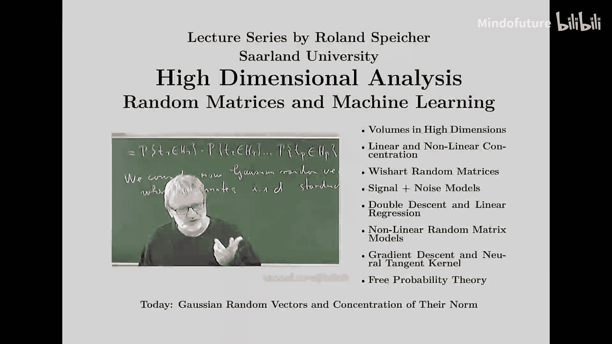
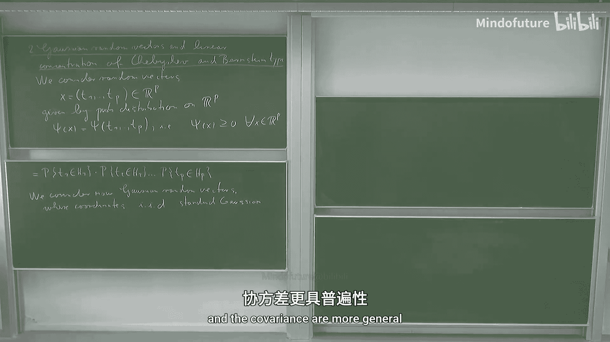
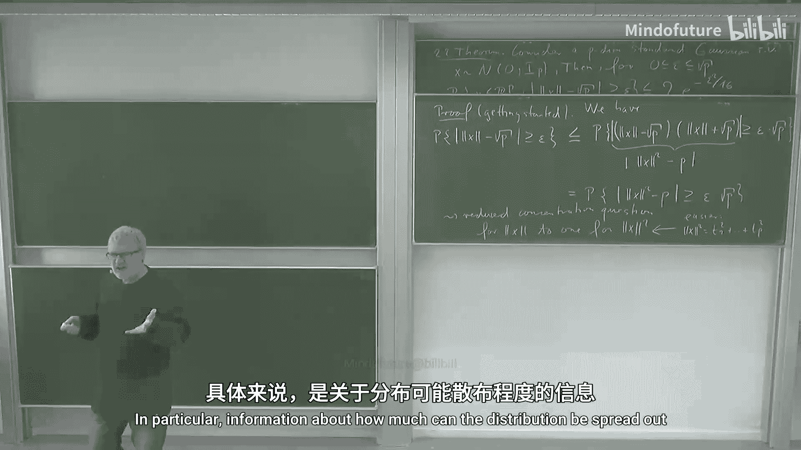

# 【德国萨尔大学】高维分析：随机矩阵和机器学习 ｜ High Dimensional Analysis p04 P04_高斯随机向量及其范数的集中性 -BV1XkkWBFEi6_p4-

Yeah， okay。 so we are。Talking about how to describe。

Yeah functions in high dimensions and the functions should be functions on。Yeah， on our data sets。

 And so we have。To see。 Okay， so what， what we are looking at is functions。

From r to the P to let's say some small dimensions。

 So let's say R and neural net is a function of this form。 but of course。

 we don't know how to describe it explicitly。 but so what what we want to understand at the moment is essentially to set。

Of our data how do we model this Okay， and up to now， I said， okay， our datas are given。

 let's say we we， we take， let's say the unit ball。

 and then we said we take the uniform distribution of the unit ball and try to understand probabilistic properties of such functions。

We still have to specify which functions。 But the idea is that we should have concentration for many functions。

 So， I mean， this set here is a very high dimensional set。 But if we take functions。

 the value in many situations is concentrated close to one value， which then， of course。

 is the average value of this。 And that's what we want to understand it。 And we last time。We looked。

We modeled our data by uniform distributions so in particular， we took the unit ball。

 said this is our whole set。 We normalize and we measure things with the volume。

 so we normalizedize it to one So we divided everything by the volume of the unit ball and tried to understand what is the volume or the probability of sets which have given which we describe in some way by such functions。

Okay， and in particular， we had this concentration that in high dimensions the volume of the of the unit ball concentrates close to the surface。

 it concentrates close to the equator close to any equator。

 and we also had that two vectors are more or less autogonal。

 okay and now we want to go more in the direction of maybe more realistic or at least mathematically more manage data。

 namely we will now instead of taking a uniform distribution or a unit ball or some other sets。

 we will now take Gausian vectors because those are ones which are maybe mathematically the easiest accessible and the ones which which we can really work。

 of course， I mean， real data don't have a Gaussian distribution in general。

 but later we can maybe start from Gaussian distributions to to get other data distributions。

 and the Gaussian ones Gaussian ones are。Mathematically simples ones。 Okay， and for those。

 we also want to see concentration。 So in particular， we also want to see that， let's say the。

The length of a Gaussian vector with respect to a Gaussian dis distribution really concentrates also somewhere。

 So we want to see the analog of what we saw for the uniform distribution on a unit ball。 okay。

 and so。First， I should say a little bit， okay。What do I mean with causingian random vector。

And I mean， in a new assignment， there will also be more on this。So here， I will essentially。

Work with the simple situation where all the entries of my vector are independent。

 Each of them has a Gaussian distribution。 But in the assignments， this can be done more general。

 And then we want to see that we also have some kind of。Of concentration there。

 And what I'm doing at the moment is essentially that I'm looking on concentration of linear functions。

 Those are more classical estimates。 So this is Chebyche and benchstein type estimates。

 But then later on， we want to see that also non nonlinear functions。

 a big class of non nonlinear functions shows concentration that that's the more complicated thing。

 But first， we want to start with the with the linear situation。Okay。

 so we want to talk about Gaosian。Or randomom back to us。And we want to understand。

Concentration properties for them。 But at the moment， it's linear kind of concentration。And。

Names which usually go with this chvychf。Inequality and maybe also more general bench time。呃，type。

Good， okay， so I will explain。What this means by let me first talk。In general， about our situation。

 I mean， also the situation， what what do we integrate， what what are our measures and so。And so。

 I mean， we are we are looking on random vectors in R to the P。So， we consider。Random vectors。

 So I denote my vector with x Lx and the components I denote by T T1 up to T P。

Those are vectors and r to the P。 but I want to consider them probabilistically。 So I， I， yeah。

 I have a probability distribution。On R to the D with which I measure the probability of events。

So the random vector door。Is given。By a。我bil你提。Distribution。On R to the P。

 And I assume I really have have a density。 of course。

 I could talk more generally about probability measures in R to the to the P。

 But let me just do this by by densities， because I mean。

 our Gaussian distributions and most things which we consider， I really have a density。 Okay。

 so have， I have a density。In added to the P， which I didote by Psi。 So this is a function of。

Directors of my。componenton of my vector。And， I mean， that's a density with which I integrate。

 If I want to calculate probabilities of， of some sets。 So this means this density， of course。

 should be positive。他说 I mean。Density， always。Have to be positive。And then， of course。

 if I integrate over everything， the constant function 1。

 it should be one So it should be a probability density。So if I。Just ask。

 am I somewhere in R to the P， Of course， I'm somewhere， so。The probability of this should be one。

 So one should be。The integral。Over my density。Over。to the P And， of course， I mean。

 this integration is just P for。 Iterated integration is my coordinates。

 I can also write it as a iterated integral。P times over R。And then I have my density， T1 up to T P。

 And I'm integrating over D T1。Up to D T P。 Okay， so that's my density。 I mean， before。

 when I looked on the unit board， the density was just it was constant on the。

 on the unit ball and Sarah outside。 Then I had to uniform distribution on the unit ball。

 But now I want to allow more general distribution。

 So true to more more realistic or more interesting things。 Okay， and of course， this means。

So I have my probability density in R to the P， R to the P。 That's all my vectors， which I have。

 And now I want to ask properties about them。 And I ask for the probability of those properties。

 So I want to know what is the what is the probability of some given subset in R to the P。

 And I calculate this by integrating with this density over this set。OhSo。

If I have a subset in R to the P， or maybe a set which describes a property of the vectors in which I'm interested。

 then the probability。That my vector is in this set so that it has this property， of course。

 is given by integrating。Just over this。Said。I respect to my density。 And， of course。

 this set should be a measurable set。 Also， I mean， this integration should be make。

 should make sense。 and， of course。A very simple situation。Yeah， I mean， this is very general。

 I mean， it it he can be anything。 And the basic situation where we really can say much more is if the components of my vectors are are independent。

 Okay， so that's a very common situation。 like this is a situation from where we start。 Okay。

 in general， of course， things are not independent， but maybe they can be built out or you。

 you start with independent components。 So the qua coordinates of my vector。Components。T1 up to Tp。

They are independent。Yeah， if this density factorizes into densities according to each component so if。

Sai。Eectorizes。As a product。Of。saiwa。Up to Pi Pi P。

 where are those identsities just depending on one of one coordinator So。

 So this here just means that Psi。Which is a function of。

P arguments actually is now a product of a function for each of the arguments。 So it's。

 it's a function psi 1。Of T 1 times Psi 2， of T 2 and so on。Pi of。TP that's。

 that's the usual independence that I have the factorization of my density。 or we can， of course。

 also say， what does it mean if I calculate probabilities。

 if I calculate probabilities of properties which which are just given by conditions in terms of each of the coordinate separately。

 then I have a factorization of this So the probability that that I have two independent events happen is just the product of the probabilities for them So this means in this setting here。

If I have also。A set over which I want to integrate， for which I want to calculate the probability。啊。

手。4 sets。Of my。Coordates of the vector， but of the special form。That they also。

 they are only depending on each of the coordinate separately。 So if age。Is H1 cross。Cross H P。啊。

所谓依据。HI is just a subset of R。For all I。From 12 p， then I have a factorization of the probabilities。

 maybe that's the more usual way of how you say that things are independent。 So maybe。

 maybe let me write down what we have in this setting。So， we have。

So what do we have for the probability。De。My red door T1 up to T P。First of all。

 my vectors are always an R to the P。 But now I want them to be in this set。

 and maybe let me write it down what this means。 this means。Yeah， that each， that T1 is in H1。

T 2 is an H 2 and so on， up to T P。Is in H P。I mean， that's。That's what it means。That my tupper。

T 1 up to T P is in this product at H1 cross H2 cross H P。

That's what just what I'm saying this top is in this set means first component is here。

 Second component is here。 Last component is here。 Okay。

 so if I want to calculate the probability of this set。

 this really means the probability that the first component of my vector has this property H1。

 the second component has the property H2 and so on。 Okay， but now， of course， I can use。

My formula for。Calculating probabilitybil。 So I'm integrating over my density。

 So this here is now the integral。Over， do you set here。H1。The product up to H P。

 And I'm integrating over up Psi of T1。Up to TP。D T1 up  to。TP， I mean， that's my general formula。

 And if I don't know anything else about Psi， of course， Okay。

 it doesn't make a difference whether integrate over such sets or not。

 But now if my coordinates are independent， then this C factor rises into Psi of T 1 times psi of T 2。

Times。TP， and then， of course， the structure here goes nicely with this。

 So I cannot now do this integration here in an iterated way。 So I'm integrating。Over T1。

 and this affects only this。 And I'm integrating this over H1。 Then I integrate over T2。

 This only affects this。 and I'm integrating over H 2。

 And then the whole thing factorizes into the product of the corresponding integrates over each for each of the coordinates。

 And also， what I have here is then the integral over H1。s T1。D T1 times。Times the integral over H2。

si。T2。The2 and so on up to the integral over H P Psi。PP。DTP。Yeah， okay， now， of course。

 those integrals are now probabilities for each of the components with respect to the density。

 which belongs to them。 Okay， so this is the probability that the first component is in H1 this is the probability that the second component is in H2 and so on So so here really we see that okay。

 probably what everybody knows or has seen before that the the factorization of my density really means that probabilitybabilities of of。

Of independent events also factorizes。 Also， maybe this year。Is now the same as the product。

Of the probabilities。Of events， where I only。Make a statement about one of the components。Also。

 this is the。Probability。That T1 is in H1。Times。The probability that T2 is in H2 and so on times the probability。

TheTP。Is an H。O so the probability。Did I have a rec door。

Where required that the first component has this property， H1。

 The second component has this property， H2 and so on factorizes into the product of the probabilities。

That T1 has a probability H1 times the probability。 that2 T T T 2 has a property H2 and so on。

Oh okay。Yeah， and of course， this size here， the psi I are probability distributions on R So they are。

 they are densities for each of the components。Okay， so in particular。

 this means if I'm integrating over。Over， over this guy here， over the whole R。 And of course。

 I also get one， the total probability。 actually this here should be a Psi 1。Mside，2。IP啊。

This factorization， they all have indices。 So here also， yeah， Psi 1， Psi 2。Uptop I。嗯。Good， okay。

 so this， this is just， I hope this， this is clear。 Everybody should have seen such things。 So。

 I mean， we have， in principle， we have random vectors， which are given by densities。

 they can be quite arbitrary。 But if they are arbitrary， we cannot really do much concrete， Okay。

 and situations where we can really deal with， we actually。

The components of our vectors are independent。 And that's what I want to do in the following。 So。

 first of all， they should be independent。 And then， I mean。

 each of them should have the same distributions。 So all is psi 1， psi 2。

 and so should be the same distribution。 And then， of course， I want to take the nicest distribution。

 which we have for one dimensional random variable namely the Gausian distribution。

Which is very important from her。Theoretical point of view。

 and which is also very accessible for concrete calculations。 Okay。

 so in the following now now we want to get more specific。 So we consider now。what goes in。

Random vectors。And those are given。Where the coordinates are really independent。

And they are actually also have all the same distribution。

 So that's what usually is denoted by I I D， independent and identically distributed so。Just。

And the distribution should really be the Gausian distribution。

So standard and they should be a standard gausian。About which already。Talked in the first assignment。

 So if we understand it a little bit about this。 Good。 Okay。

 but then I think I'm ready to write down the。Definition of our standard Gausian random vector。

 the one which we want to consider the following and for which we want to show a concentration stuff。

 Okay， but so let me first define it very precisely by really giving you precisely， the density。

But in principle， now， after this， we we know what it should be because， I mean。

 we know what is the density of of a gaus in one dimension。

 And if we just have independent copies of them， we know that we should just take the product also。

So in assignments。Which came up though。Just two days ago or so。 I mean， we。

 we will also look on more general cow in random back to on。 But here， I will。

Restrict to the simplest version。And， and maybe later。

 we will also go to random vectors where the mean and the covariance are are more general。

Good， but for now， these restrict strict。To the standard case。

 the simplest situation which we can have in。In P dimensions。For Gaussian random vector。

 And so that's what I call a standard Gaussian random vector。Standard。Gsian。

I remember Victor is what I more or less said。Before already， So this is a vector。R to the P。

And as usual， I know the components of the vector by T1 up to TP。

 So this is given by a probability distribution。A this。It's given by。A probability distribution。

 a density。呃，呀。Such that we have what I said to4。 We have that all the coordinates are independent。

 So all。T1 up to T P。Independent。And they are all identically distributed。

 and they all have as the distribution， the， the standard ga distribution。

 which means means 0 and variance 1。So， so each of them。So HTI。As。Standout。搞先。Distribution。

So which we noted by N。01 So this means it' a gau distribution with mean 0 and variance 1。 And。

 of course， we can write down the density。 I mean， that's what we did in the assignment。

 And we also where we also calculate moments of this thing。

 So this means the density for each of them。 So C I for T I the density for the ice coordinate。

Is given just by this this this normal distribution which is e to the minus t squared or what 2。

 And then you have to normalize it by1 or y。Square root of two pi。E minus。P I squd。Divided by 2。

 that was the density of of the Gas in one dimension。 Good And now， of course， we have。

 if I now want to write down the density for my vector， because the coordinates are independent。

 I just have to multiply all those guys。 Okay， so what we get。Its does。

Then now distribution for my random vector。Which is。Density for all the P coordinates。

 This is just a product。Of the density for the first coordinate。

Times density for the second and so on， up to the density。For the last one。

 but each of them has this distribution here。 And so this means just collecting our terms。

 So each of them has has a factor one over square root of two pi。 So we get these P times。

So what do we get。Is one over。 We have this two pi。We have it P times。

 but each of them is a square root。 So it's too pi to the power P over2。Okay。

 and then we are multiplying the exponential guys。So， we have then exponential。

So each of them has a minus12。Okay， and then， I mean， the product of the exponentials gives us。

 of course， the exponential of the sum。 So we have here T 1 squared。Plus t2 squared。Plus。TP squared。

Good， yeah。 and now we see that actually， I mean， what we have here， of course， is。

 is a very nice vector quantity。 So name， this is just the square of the length of my vector。

 So I mean， I can also write it directly in terms of of the vector， important quantity of the vector。

 which it shows you quite a bit。 I mean， that it really is。

 it's not just that it's not just anything in the components of the vector。

 where it's really something which takes in， which which depends on maybe the more most。

Only real property were vector to name in ss。 So this year。

Is the length of my vector squared so I can write this directly by not going back to the components。

 but in terms of the vector itself。 So it's one over2 pi to the power P over 2。

 And then I have E to the minus。 And then it's the length of the vector squared divided by 2。

That's the density of， my random vector。 So if I want to calculate。

Any probability for some properties of my Gausian random vectors。

 I have to integrate over this this density。Okay， and so we didote this as before we use。

This shorthand notation， if you want to say that a vector has this dis distribution。

So weote this by saying x has a distribution。 if you write， can n for normal distribution。

 Gausian distribution， normal distribution is the same。 And then we put here。A mean vector。

 So here the mean are 0。 I'm talking lot about a mean。 And here were putting a covariance matrix。

 here， a covariance matrix is just the identity。 It just means that all all components are independent。

 And each of them has variance one。 So I'm putting here the identity matrix。

 the P times P identity matrix。 Okay， I mean， here maybe it's not， not so clear what this means。

 But in the assignments。 I mean， we we we define more general gaus in random vector where where you have a vector here。

 a mean vector and you have a covariance matrix here and of course。

 we we see how this is related with this situation。

 Of course you can transform essentially one into the other。 Okay， but this here is somehow。

The simplest one。 And of O， O， So maybe， maybe I should say this year is a vector of means。

In general。So it's a vector door。But here is just a zero vector。So it's， it's。

 it's a vector R to the P。 And this has a matrix。The covariance matrix。

It's a matrix of the covariances between all my entries matrixtri of covariances。

And here it's just the identity matrix。 So this means a P P by T diagonal matrix where I just have ones on the entries。

Good， okay， so that's my。Situation my random vectors， which yeah， is which I want to understand。

How do they behave in high dimensions。And。Yeah， actually in the first assignment。

 I mean you you moderate essentially this situation and you should have seen that there is concentration so for example。

 you looked on the norm， the norm of a vector with respect to this distribution in the histograms。

 you saw that this essentially concentrated about something into something was the expectation value so that that was in the first assignment and now we want really to to try to prove this or see how how can we prove such things。

Okay， so yeah， so let maybe。Yeah， so what what have we seen on， Yeah， So in numerical simulations。

 we have seen concentration for we saw it for the norm， but we also looked on the infinity norm。

 which is a more non nonlinear objector。 And so the idea is that actually for quite some class of functions。

 we should have concentrations。 So what we expect。呃。And where we， at least。

Hope to be able to prove something in this direction。So， we expect concentration。For this situation。

 also， this means if I calculate the probability。Of my。Gandum vectors， my0 once。

 and I have a function。嗯。Then this function applied to my vectors in most cases。

 should be the same or less the same。 It should be close to one value。 And this value， of course。

 is has to be the expectation value。 So what we want to compare is in the value of。A of x。

With the expectation value。Okay， and the， the difference between this。And the expectation。

 this should be small or to say it another way， the probability that this is is not small should be large。

So we expect the probability that this difference is， let's say， bigger than Epsilon。

That this should be small， at least if the dimension is high。 I mean， in small dimensions， I mean。

 okay， I mean， we have probabilities for everything and they don't really concentrate。

 but in high dimensions， they should concentrate So the probability that the the the value of my function。

Has a distance to。To this constant value here， which is not small。

 that this probability should be small。To be smaller。If the dimension is large。And， of course。

 I have here functions。 So I， I should specify of which functions。

 And the idea is this should be true for quite big class of functions。 So for， and of course。

 they they need some properties。 Of course， it's not true for any function。Because I mean。

For example of。Pick out just single。If I take it as a function。

 just take it looking on the first coordinate。I mean， this first coordinate is a gas。

 and this does not concentrate around its mean even even if I have more and more other coordinates。

 so it should， of course， be functions which take into account all variables on on a similar level。

Good， okay， but this is something which we make more precise later。So， but it should be nice。

Classes of functions。And what we mean with nice， this， we still have to find out。 I mean。

 this this will be this， this class of liphes functions。Okay， so this is。Still to be determined。

And maybe first， we are looking on linear functions。 So where essentially。

 we are summing over the components because they。Okay。

 that's something which we can control much better。 in particular， if you also have independence。

In the background。 Okay， so， I mean， so that this is a quite big program。 So I mean。

 we want to understand this。 And first， we want to understand it more for linear functions where it's more。

 more traditional， quite well understood stuff。 And then later。

 we also want to see that that it's for much bigger class also nonlinear functions。

 those areipit functions。 that's maybe more more on concentration theory and And so this is also very powerful So also also for nonlinear functions。

 We have concentration。 And I mean， of course， nonlinear functions is what we have in neural nets also just having concentration for linear functions is not maybe not so useful。

 but that we also have it for big class of nonlinear functions。 That's that's very。Very important。

 Okay， but so may， maybe let us try to look on。On taking the the length of a vector So to。

 to let us try to prove concentration for， for the length of a gausian random vector。

 at least there we saw in histograms that it it concentrates。Okay。

 so we consider our as our function here。呃。You consider f of x。

As let's say maybe the best thing is to square。Of the angs。 because this， then。

 then this F and X is really the sum of those guys， which are independent。

 So it's really a sum of independent things。 that's something which there's hope that we can control it。

Okay， and then， of course， yeah， in concentration， of course。

 we want to compare the value of the function with a constant function。

 which usually should be the expectation。 So you should also be able to calculate the expectation。

 And in this case， this is very simple。 So if I'm looking on this function， then。

The expectation of this function。So the expectation。Of x squared。So this， of course。

 is the expectation。Of T1 squared plus T 2 squared plus T P squared。 And now， of course。

 the expectation is， is linear。 So it's just the sum of the expectations of each of the square of the coordinates。

 But I mean， this is just the second moment of each of the coordinates。 So this is the expectation。

Of T 1 squared plus and so on， the expectation of。TP squared。And for this。

 I don't need any independence。 this is just true。 This would be true for any， any。呃。V to。

 and now it it's just， I just have to know what is the。

 the second moment of each of my coordinate coordinate has now a gaus distribution。

 The first moment is 0， and the variance is then the second moment。 So this is just one。

 So each of them is one。 So I have here just p times the1。

 which is p So the expectation of my gaussian random vector of of。

 of P squared of the square of the length is， is P。 Okay， and so this means that。

The square of the length of my vector should be close to P in high dimensions。 I mean。

 that that's what we observed。These pictures， or maybe if you have forget the squared。

 this also should mean that the， the length of the vector is close to the square root of P。If。

 if we have concentration， I mean， this calculation here， of course， is easy So。

 it's easy to see what is what is the expected value。 But ex but concentration tells me that。

 that for most vectors， I'm close to this value。 That's what we expect。

 That's what we saw in the histograms。 but that's something which we also want to prove。Okay， so。So。

 we expect。Well that。The square of the norm。Is close。土皮。

And this means we probably should also expect that the norm itself。Is close。To the square root of P。

Okay， but， of course， okay， being close to something and then taking the square root。

Might not be so clear this is O， but， but this is， this is okay here， as as we still。So so。

 so we also expect concentration of the norm of the length of the vector to the square root of P。

 but maybe we should observe that the expectation of the length of the vector is not the square root of P。

 So I mean， it's it's much easier。 I mean， it's easy to calculate the expectation of the。

 of the square。Because then it's just a sum。 But if I take here to square root。

 then I don't really know what what I should do is the expectation。 Okay， so this。

 this is not the expectation of the of the norm。 but of course it it will be close。

 And if P goes to infinity， they will asymptotically agree。But this means in in such concentration。

Concentration estimates， maybe comparing things to the expected value is not always the best thing because you are not really able to calculate precisely expected value。

 Maybe there are other quantities， which asymptically are the same。

for which you can work much more easily。 for， for example， my， you can take the median。

The media of a。Over distribution that's a point where half of the probability lies on one side and half lies on the other side。

 And I mean， this is not the expected value， but in high dimensions。

 if things concentrate the median and the expected value are not very far away and asymptotically。

 they are the same。 but maybe the median is easier to handle。 So so this just means in principle。

 you have concentration with respect to the expected value， But if you're not able to calculate this。

 this might not be so useful yeah。Trying to， I mean。

 first thing you try to calculate the expectation， but maybe this this is not not so clear。

 So this or you cannot do it， but then maybe media or other quantities。

 which asymptotically are close， are much easier to calculate。

 and then maybe it's better to write your concentration inequalities in terms of those other quantities。

Good， O， so that's。Yeah， so that's what we want to do。And let's， let's see。How far we can go。 Yeah。

 and also。Yeah。So let， let us maybe try to prove。 So， So now I want to do， yeah。

 let's say I want to do now concentration of the length of my vector by comparing it with the square root of P。

Which is not the expected value， but still in large dimension。 it should， should be close to this。

 So that's maybe the theorem， which you want to prove。

 And let us try to see what do we need for this。 But so let let me first write down the theorem so that we really see。

That we have a theorem， and。And what is the nature， how does it yeah？

What kind of concentration do we have， But then。Yeah， I mean。

 we have to develop some machinery for really proving it。

 But this shows somehow that the general machinery for。For app proving such concentration。Okay。

 but so first let me write down the theorem。Yeah， so that's what we want to prove。

So that's a precise statement that the square root。

 that that the length of a Gausian random vector should be close in high dimensions to the square root of P。

Oh。We consider。A P dimensioner。Standard。Gusian。Randand vector so x。As a distribution。

 a normal distribution， goesus distribution which mean 0 and proance 1。 So that was。Yeah。

 the one which we had before。 all components are independent。

 Each of them has the standard gaugeus distribution。 And then I'm claiming。Then。For an epsilon。

 which is between0。And squared of P。So I want the probability。Of the vectors in R to the P。

For which the length is。Not close to P。 So the distance between the length of the vector and square of P。

 let's say， should be。Bigger than Epsilon。So we're looking on the probabilities that we are far away from。

 from this guy。 and this probability should be small。

 And what we really would like to have are exponential estimates。 So if we want to estimate this。

 So this is the probability， which we want to estimate。

 this should be smaller and it should be smaller than two times。Yeah， that's what we want to prove。

 E to the minus。Epsilon squared。By 16。Okay， and maybe if you if I write it like this。

Epsilon usually is a very small number。 But here， of course， if epsilon is small， I mean。

 then this is close to one。 then， of course， small。Has to be seen here as small compared to P。 So。

 I mean， if， if p is going to infinity this year grows like square of P。

 but epsilon should be just constant number 5 or so Okay， and maybe。

 maybe here writing Epsilon is a little bit misleading。 So maybe。

 maybe let me rescale things so that if I go with P to infinity the。

 the expected length is kept constant。 Let's say one So I I rescale my normal distribution so that it has variance。

1 over P so that that the expectation。Here is not P but one。 And then， of course， I can look。

 what is the probability for having a distance from one， which is smaller than epsilon。

 And then epsilon can really be a small number So maybe here， according it Epsilon。

 If you see epsilon， you always think it it should be a very small number。 But of course。

 you have to small here means it should be small compared to to this guy。Okay。

 so maybe it's better to do the rescaling。所印的。Re scaled version。

Where I replace my random vector door。By rescaled  one。

 where I rescaled everything by one over squared root of P。

Which has the effect that the expected that that the square root of P here。

 So I I divide now here everything by this。 And then， of course。

 this here gives gives a1 So this means in this recal， the the norm should concentrate about one。

Independent of P， maybe。That gives a better。Idea that that's maybe what you really want if Ps to infinity。

 Maybe you should keep the， the the thing in which youre interested。

 you should keep this constant so that it doesn't explode。Okay， so we risk this。呃。Okay。

 and let me also。呃。You， denote the components of the。Tilda by。T 1 Tde up to T P Thede。 And then。

 of course， the X Tilde has still independent components。

 But now each of them has a risk scale gausian distribution so。The T Is。啊。哎。Id。Or TI Twitter。

And the distribution of them is a normal distribution goes distribution。 There is mean0。

 but the variance is now one over P。OK。But anyhow， So if I rewrite this here。

 essentially by dividing everything by the square root of P and then also replacing here the epsilon by epsilon divided by square root of P。

 I get the du probability。Of those we scaled random go random gaussian vectors。

A probabilitybability that the norm of those guys。Has a deviation from one。

 which is bigger than epsilon。That this。Is smaller than two times the exponential。 And I mean。

 what was the Epsilon。 the new Epsilon is epsilon divided by square of P。

 So here I also on decide side， I also have to do this。 or actually， it is。No， I mean。

 I have here I have。Here， I have to replace Epsilon by epsilon times square of P。

 so that after division， I get the epsilon。So here I have to replace the epsilon squared by。

P times epsilon squared。Divided by 16。Okay， now now you see now I can take a small epsilon。 Okay。

 but then if the P is getting big， then the epsilon squared will be outweighed by this P for。

 for P large。 And then this will become a large quantity。 And then I have an exponential decay。So。

 so here I really can fix epsilon independent of P。 So I say I fix， I fix this epsilon。

 And then if P goes to infinity， I have exponential concentration。And maybe in this form。

 you also see if you want to see where。Where am I sitting in which neighborhood of of the norm。

 I mean， that's where this quantity here is constant So if you choose。Epsilon。

 in the order of one0 us square of P。 that's very essentially。

 if you increase the dimension where your mass is， is， more or less shifting to。Okay， good。

 So I mean， that， that's a statement which we want to prove。 And， I mean， in， in the histograms。

 I don't know。Yeah。Okay， yeah， we didn't really compare it with with precise estimator。

 for in in some， in some of the assignments， I gave you kind of of。

 of concentration inequalities and， and you compare it to this。

 So maybe you can also go back and try to compare the histogram of the norm or the Gaussian vector with this one。

But， of course， the main point now is that we， we have to prove it。 So how。

 how can we prove something like this。And let us first get started。

And maybe that the first problem is， or， I said， if I'm looking on x squared。

Then I have the sum of independent guys。 That's maybe which we can do the。

The norm itself is the square of this。 So this is very ugly to deal with。

 So maybe this concentration here for the norm， we really should transform into a concentration for the norm squared because the norm squared looks much better。

 And that that's the first step， which we can now do right away。I mean。

Even though we want concentration for the norm， we are actually doing concentration for the norm squared。

嗯。Because we can compare those guys quite easily。 Also， this is to prove， but only。I mean。

 the first part getting started。Where we reduce the norm to the norm squared。

And then with the norm squared， we have to proceed what we do there。 Okay， so what。

 what we want is the probability。That the norm of x。Minus squared of P。Is bigger。Then Epsilon。Okay。

 and now I compare this with a corresponding estimate where I compare the norm of x squared with P。

But how can I get from here to x squared。Minus P， yeah。

 by just multilying this guy here with the norm of x plus the square root of of P。

 And I can estimate those， those guys。 So maybe let me write down here the probability。Of。

The situation when I'm looking at。To norm of x。Minus square root of P。

 That's something which is hard to deal with。 So I want to。Take the， the square of those guys。

 And I can do this by multiplying this with the norm of x plus。The squared of P。

So if I multiply this， I will get。Normal x squared minus P， which is easy thing。 Okay， but here。

 what is the estimate now， I mean， what I want is that this guy is bigger than Epsilon。And now。

 I might imply。This with something which is always too independent of， of x。 I mean。

 this guy here is always bigger than the square root of P。 So if I， if I write it like this。

Then I have that， whenever。呃。Let me see。Whenever。Whenever this is true。

 whenever I have this inequality， I also have this inequality because I just multiply this inality with this。

 But then this guy is bigger than this。Okay， so this year。嗯。Let me see。 is this correct。Yeah。

 I want S2。 I want。 I mean， I want estimateating this direction。 Is。

 is my argument correct for this direction。嗯。Yeah， so whenever I have this， I also have this。

 but I might have this in more situations。 Okay， so。

 so the set for which this is true is a bigger set than the set for which this is true。

 So the probability of this set is less or equal than the probability of this set。

Because whenever this is true， this is also true。 So this event here is a subset of this， yeah。

And your absolute value should。呃，Shouldul still be there。哦。ba笔一样。Yeah。Yeah， okay， but I mean。

 this product here。 So this is now the absolute value。 So I mean， I get here the square。

 and I get here the square of the square of P。 So I get here this。

And so now you see here I have now the corresponding。Concentration inequality for this。

 the square of the length。 But here was， here was a change。 So you see， I mean。

 if I want epsilon here， here I have something else。 Okay， so let me write again。

 So this is the probability of the event。We had the norm of x squared。Minus P。

Absolute value is bigger than Epsilon。Times to squared root of P。Good， okay， so if I want to show。

 so I want to show that I can estimate this in this exponential way。

 but I will do this by showing actually that this year can be estimated by this。

So I do not a concentration estimate for this quantity。We suspect to this。

 And then I also get carried for this one。And I mean， this just shows in general how I can。

 if I know something for。For the the square of the norm， how I can go back to the norm itself。I mean。

Good， but now okay， I mean。Now we have to prove this。

 And so why is why should this be easier than just the norm， Yeah。

 Because the norm squared is the sum of things which are independent so。Okay， so we have reduced。So。

 we reduced。Concentration question。For the norm。For the norm of x to a concentration question for the norm squared。

Good， okay， and the norm squared。This is easier。At least we have hope that it should be easier or we can deal with it。

 because the norm squared is the sum of the the the square of the components。

And those components are independent。 Okay， so so essentially。

 this is now a situation where we are looking on a function， which is actually， I mean。

 which is a sum。Of independent guys。 And that's a situation。Yeah。

 which we should now address in general。 And this is something which we can deal。 I mean， we have。

 we have a sum， and we have independent quantities。Good， okay。

 so now I switch maybe first to more general situation。To inequalities， which you are going to use。

1t of all， very general。 where I don't bother about whether it's a summer of independent things。

 I mean， there are there are Markov and chbuchiev inequality， which are very general。

 which are always true。And which applied in the right way will also be very useful for such situations。

 But maybe I first should tell you or maybe recall what Markov and Chabyacheev inequality are。

They are just for any。For for just one variable， the variable doesn't have to be a sum of anything or so。

 but later we will apply to such situations。Okay， so I mean， I will come back。 Okay， so I mean。

 the proof just started。 I mean， I。We interrupted here。 And， of course。

 I have to come back to it later。 But first， we have to calculate or to develop some tools。

With which we can address sums of independent random variables。Yeah。

 and the first very general inequality is a mark of inequality。 and then a chby chip。 And， I mean。

 they are inequalities， which gives us some。Information about what is actually the meaning of the expectation and the variance of a distribution。

 How what， what information is contained in them in particular。

 information about how much can the distribution be spread out。 I mean。

 concentration means our distribution should narrow， in some sense or but。

Expect and the variants tell us， yeah， that they cannot be spread out too much。 Okay。

 so the first one is a mark of inequality。 This is about expectation。Okay。

 and this is now about general。 let's say， yeah， random vectors。 let me call them y now。 I mean。

 x is our gausian random vector to which we will come back later。

 But now I will do some general statement。 So maybe let me denote the the general random vectors where we don't make any specific assumption how the distribution looks like。

 let me call them y。So that why。B random vector r to the P。Be a random back door。With。Probability。

Distribution， Okay， I mean I still call it Psi should have an arbitrary mobility distribution。

 but I know， I'm not assuming that the components are independent also。 And now I want to， yeah。

 I want to look on a function of this vector。 And so let me call this F。

 So F is a function from R to the P。 but now for the expectation somehow I want positive functions。

 So I mean， the idea is， I mean。I the expectation of a distribution。I mean。

 how much does it tell me whether the this this distribution can be spread out or not。If I， if the。

If my variable can take on positive and negative values， then， of course， things can cancel。 Also。

 I mean， I， I might have a distribution where the expectation is 0 like the gauss， but of course。

 there can be very large values。 and the expectation cannot control this。 But if my。

 if my variable can only take on positive values， I mean， then if I have a fixed expectation。

 then there cannot be too many values which are very， very much bigger because I mean， they okay。

 they cannot be compensated anywhere。 So if， if I have very large values with with quite some probability。

 then the expectation value must also be quite high。If they cannot be compensated by negative values。

 Okay， and that's what Markov proper Markov inequality tells us。 Okay， But so this means he。

 I really have to consider a situation。Where my function only takes on positive values so that I don't have cancellations。

 Okay， so this should be a positive function。And then。Yeah。

 then I can control the deviation or I mean， okay， now now I'm。

 I'm not controlling anything to the average value。 But I just ask the question。

 what are the probabilities that I see， La values of my function and this I can control in terms of。

 of the expectation。 So then for。Any I bigger than0。We have the probability。Of my back doors。

You拿 to P。Such that F of y。Is bigger than I。This can be estimated by the expectation of。第四。

Function F or Y， divided by alpha。So this means the bigger I make I， the smaller these gets。

 So the probability that I see very large values is getting smaller and smaller。So that。

 that's a very basic inequality。 I mean， it's very simple and easy。

 but it gives you the idea that if you are looking on， on moments。 I mean， this is the first moment。

 Mo contain some information about the spread of of your distribution。 Okay。

 but this is a bit specific because you need positivity。Okay， but later。

 Markov inequality will actually be the， the basis for many things which we do later。

 because we apply it to， to to， to specific other functions。

 which we build out from the functions in which we are interested。 Okay， so let me give the proof。

And the proof is quite simple。So I mean， if you hand， yeah。So I suppose in your。

Mathematics for computer science。Part 3， at least something like this probably should have seen。

 but if not。呃。Let me just do it。 Okay， so， so， I mean， essentially we start from here。 So we。

 we calculate we， we write down what is this。 and then we want to do an estimate。

 which gives us this。 So let me start with the expectation。Of my function， F of y。So what is this。

I mean， by definition， of course， this is just， I take my function F of y。

 and I'm integrating over all wise with the density。Over all of R P。 mean。

 that's what the expectation is。 So I take my function。

 and I'm integrating with respect to the density of my。Back to us。 Good。 Okay。

 now the idea is that I just this integration here is over everything。 But now I。

Decomose this integration into the wise， which satisfy this and the other。

And then I can do estimates。Okay， so I write this。Integral here as a sum over two sets。 Naly first。

 I'm integrating over to set in which I'm interested。 That's the。

 that's the vectors where the value of my function F is bigger than Ipha。

 So here I'm integrating over y。For which F of y。Is bigger than I。And I'm doing the same integral。

 of course， F y。Si y， D y。 And then I'm integrating over the rest。

 So I'm just decomposing R to the P into two sets， a set。

 and it's complement integral integral over all R to to the P is， of course。

 the sum over those two sets。 So here I'm integrating over。The y for which this is not true。

 So this means those are the ys for which F of y is less than alpha。I'm still integrating over FY。

si why。DY。Okay， now， I mean， here， I know something about F of Y。 This is good。 I can estimate here。

 I know something， but the estimate goes in the wrong direction here。 I cannot really estimate it。

Making a direct estimate by using something on F。 But what I use is just。

 I'm integrating here positive functions。 I mean， density is positive， and F is also positive。

 That was my assumption。 So I'm integrating a positive function over subset。

 And what I get is at least a positive quantity。 So this here。😊，So I'm not using much。 I'm， yeah。

 I'm just using here that everything is positive。 and I。

 I don't care about how big or how small this is。 I I， at least it's bigger than 0。

 So this is greater equal than 0。Because I'm mean， the density， of course， is always bigger than 0。

 But I also assume here that my function F， which I'm interested is bigger than 0， yeah。Oh。

 because I assume I I'm dealing here with measurable functions。Okay， that that's， okay。 So， I mean。

 of course， I should here， if I say here function。 I mean。

 I assume all my functions are measurable And then if you define sets in terms of the function。

 pre images of your functions， then there those are measurable sets So okay， I mean。

 those are the things which。Which， of course， yeah， we should have in a background。

 also we use some kind of measure theory。 But， but just saying， I mean。

 all the integrals we are doing are our K and valid So I mean。Okay， I'm， okay。

 I'm not writing down that my functions are measurable， but that's what I always mean if。

 if I talk about such general things。Okay， so this is bigger than 0。

 So if I just throw away this term， then this quantity here can only get smaller。

 So what I have here is greater equal than just the first term。 the first term is to integral over y。

F， y。Bigger than I are。Fy。是 why。D Y。 And now on this set。

 I know that my function is always bigger than alpha。

 so I can estimate this function against alpha So I can say this is bigger。

 Then if I am integrating just the constant function alpha instead of F of y。So here。

 let me write it like this。 So it's the integral。喂。Yeah。If of y。Is bigger than alpha。

 And on this set， I can compare F O Y with alpha。 So I'm just integrating over alpha。C， why。DY。

 and now of course， if as a constant， I can take it out。

 and then I'm just integrating over this set with my probability distribution。

 which gives me just the probability of this set。啊，So this啊。Is now just if comes out。

 and the integral there is just the probability。Of。The wise， for which F of。Why。

Is bigger than iPhone。Yeah， now you see I have exactly what I want because now we should read it the other way around。

 Naly this probability here， I divide by alpha is smaller than the expectation divided by alpha。Okay。

 so this is a very basic inequality where it tells me that the expectation contains at is for positive functions。

 quite some information about very big values。 So they cannot occur with too high probability。Good。

 O。 yeah， so that's。A basicsic inequality。 But in our context， this is not very useful。 I mean。

 because， I mean， so what do we need here， I mean， our function。

 which we consider here in this context。That would be this， the absolute value of this。 And， I mean。

 we， we cannot calculate the expectation of this function。In particular， because of。

 of the absolute value。I don't know how to deal with the the expectation of an absolute value。

 because there's no algebraic way of of dealing with this。 Okay， so this， this is basic inequality。

 but in our context， it it cannot be used for anything meaningful。 Okay。

 but so let's go a step further。 namely， let's now see， okay， the first moment。

 tells tells us something about our distribution。 So let us look on the second moment or maybe。

 maybe better on the variance。 That's chbycheev inequality。

 chbycheev inequality is really now going in a direction that it tells us something about the deviation。

Of my variable from its mean。 And this can be controlled in terms of the variance。I mean。

 this is just this general idea that the variance tells you somehow how how spread out your distribution is。

 So Cheby Che is just making the this precise。 The variance is really something about the width of your distribution。

 if you have a small variance， it means you， you have some concentration。

So in principle concentration in high dimension， you can do it maybe by trying to see that the variance of your quantities are going to se。

 So， but， but we will we do it even more general。 Okay， but so let， let's do chby Che。

Also very simple。 And actually， Chey Che follows from Markov。 If you do it in the right way。 Yeah。

 So in principle， Markov is at the pace of everything。

You only have to apply it in in the correct way。But Cheby Che is is often much more useful not so。

Okay， I think we。We are not coming back。Today， to the proof of this。

 we first have to develop some tools， but。Next time， of course， you will。Come back to this theorem。

そう。Do we have inequality。So， there we assume。Maybe， okay。 I mean。

 I didn't say here that the expectation should be finite。 I， of course。

 it could be that the expectation is is infinite。 Then it's still true because then it it's not saying much。

 Okay， Cheby Che， I mean， I I should assume that the expectation and the variance are a finite numbers。

 so。Okay， so。So let y， again， be our random vector。In P dimensions， So be。Random vector， again， with。

 with quite arbitrary distribution， no specific assumption on independence or so。 And we consider。

 again， a function。From P dimensions to R。 But now there's no positivity assumption。

 or can be an arbitrary。Measurable functions， function。 And I assume。

That the expectation and the variance of it are finite。So， function。Sucharch that。I mean。

 the average rich。You mean the expectation。 So F of y。This is finite。 and then also the variance。

 I mean， the variance I didote by。By v， so the variance。Of F of y。

 So I suppose everybody knows the variance。 So this is the。

One way of writing it is the expectation of。F of y minus。The expectation。Of F of Y。 So I'm comparing。

I take the expectation of the comparison between the value。And they expected value go。

 And I take the square of this。Itで。Yes。The square of this。

 or I can write it just as the expected value of the square of my variable。

 which is F of y squared minus。This square of。F of y。Okay， just multiplying these artist。

 This is the same。 Okay， so suppose everybody。Ns the variance So in particular， if my mean is 0。

 of course， the variance is just a second moment。Good， I assume those guys are finite。And then。

Chveby Che gives me exactly estimate of the form， which I'm really after namely telling me probabilities of the deviation of my function from its expected value。

 and it's exactly the variance which controls this。 So then。For any。Epsilon created in Cyr。

The probability。Of the vectors in to the P。For which。的。

Difference between F and F of y and the expected value of my function F is。Bigger than epsilon。

This can be controlled by the variance of my function。F of y， divided by epsilon squared。Okay。

 so that that's really， this looks like something which we really want。

We want to compare the typical value or general value of my function with its expected value。

 And we want to control it。 And here we have a very general。 I mean， again。

 this doesn't use any independence between the components of y or anything。

 So it's just telling us the very general。Priinciple that the variance controls how much your distribution is spread out But in in a precise way。

 So if Epsilon。Yeah， if Epsilon is here getting bigger and bigger。

 then this is getting smaller and smaller。 So， so if you have a small variance， I mean， if。

 if Epsilon。Again， I mean， if epsilon is， Epsilon squared is much bigger than the variance。 you。

 you have small probabilities of finding something which is so far away from， from your expert where。

Yeah， and the proof of this is just reducing it to Markov essentially applying it。To。

 to this function here。 But this function has has this problem of having absolute value， which is。

Not easy to deal with。 But then there's this idea in the game。 I mean， if we want inequalities。

 we can get rid of the absolute value or things like this by， by squaring it。Okay。

 and and the inequalities are preserved。 So that's what we are doing here。

 We are looking actually on the square of this。 We apply Markov to the， the square of this。

So to proof。So， we will use Markov。What。For which function， for the function that we call it G。

 which is actually not picia， but which is the square of this。 But and then this。

 this gets med of the absolute value， which is hard to deal with。 So for G。 So G is。By definition。

F of y。Minus the expected value。Of F of y。And the whole thing square。Good。

 and the good thing is that this G is really a positive function for Markov。

 I need a positive function。 So here I take to square。Of something。 So this is positive。

So G is a positive function。And yeah， what is the expected value of this G。Yeah， what is。

 What is this。Expected value of G。啊。I this exactly this。 So this is this exactly the variance。

 So you see， I mean， Markov needs the expectation of a function， but with this G。

 the expectation is exactly the variance of my function F。

 So it's that's that's good that fits together。 So this is really the variance of my function F。

Of why。Good， and now we can use。 now I use。Backk off， well let's see how we use it， so。

I have Epsilon bigger than Cyrro。In what I want。 Okay， I mean， what I still want。

Is the wise for which the absolute value。Of F of y minus the expectation。Of F of y。

Is bigger than Epsilon。Okay， I mean， this is something which is hard to deal with because of the absolute value。

 But now I say， okay， instead of looking on this inequality， I just square it on both sides。

 squaring is is monotone。 So I mean， inequality is still the same。

 So I can say this is the same as looking on the square of this is bigger than the square of this。

So this is the same as probability。Of the y's for which now the square of this。

 And this is f of y minus the expectation。Of F of y。Squared is bigger than epsilon squared。

Just squaring it。Yeah， now you， this is not my my function G。

So I now have now really a positive function。And I'm asking for the probability that this function is bigger than Epsilon squared。

 And that was what Markov was telling me。 So maybe I can estimate this by the expectation of this function divided by what I have here before it was alpha。

 So the alpha is now epsilon squared。 So this is less than。The variance of this function here。

C of not， the expectation， Markov。 So here I'm using Markov。

I take the expectation of this and divide it by what I have here， which is epsilon squared。

 But the expectation of G is just the variance of F。The variance of F。

Of y divided by epsilon squared。 And that's hopefully what Che we have。Was claiming here。

I know you also see why I get the square here。Myco I had just。linearar one I， But this is because I。

 I do this one step where instead on looking what I'm really interested in， I， I'm squaring this。

 And then I go back to Markov。Good， okay。Yeah， and maybe we can now check whether in our case of the Gaussian random variables。

 this gives us something because， I mean， this is， this is really a statement which should tell us。

 I mean， for if we take for F now the norm squared。Then we can calculate this here。

 And this is exactly what we want。 And it should give us us something。Okay。

 it will give us something， but it's not as strong as what we really want in the end。 So， so， I mean。

 Chebychef is is good。 In many cases， you can use it。

 but actually one can do better if you really use the full power of having independent and and also Gaussian variables。

 But let us first check what it tells us here。Okay， so use this。For our gaussian vectors。

 So for our gauss in random vectors。So， so now the Y are again the axis。

 which had this Gausian distribution。To standard goes in distribution。 And， of course。

 the function was the function where we take the square of the length。Alsoso， F of x。

Is the square of the length of our vector。 And then we already know， I mean。

 so this is a situation to which I can apply Chevi Chef。And， of course。

 we know what the expectation of this function is。So me that's。What we already did before。

I meet the expectation of f of x。Is the expectation of。X squared。 but the expectation of x squared。

 That was this was the expectation of the sum of the T squared。

 And this just gives gives P times the expectation of each of them And for each it was one So this was just P。

I mean， that was what we know。 I mean， that's， so， so really， the， the expectation of this is P。

 And we want to compare。 what is this。 Okay， and we can use Chey Chef if we can calculate the variance of this guy。

So。The variance。Yeah， the variance of。The norm of x squared。 So this is the variance of。Yeah， I mean。

 this is， as before， it's the sum。Of T1 squared up to。TP squared， Okay。

 and now we we can use the fact that the coordinates are independent and the variance of the sum of variables is the sum of the variance。

Also， I mean， you cannot。Check this directly more or less by， by using this and basic properties of。

 of independence。 But I hope this is something which everybody knows at this beliefs。

 So the sum of the variances is the sum of the variance。Of those guys here。

 So this is T 1 squared plus and so on。 plus the variance of T P squared。

And here I'm using independence。 for this， I have not used independence。 That was just linearity。

 I mean， this here I didn't use the fact that the components are independent。 but， but here， I mean。

 the variance is only linear。 If I have independent variables。

 So there I use at least a little bit of the special structure。

 which I have for my Gausing variables。Good， so I have here the variance of each of the components and so。

I should calculate the variance of the square of a Gas。

 So this is not the variance of the Gauss variable。 I mean。

 the variance of of our gaus distribution is one。 but here I'm taking the variance of the square。

 which， of course， we can calculate。 So maybe So let me write it down。

 So So the variance is the expectation of the square。 What I have here。 let me just call it T。

 but the square of the square is t to the power 4， And then I have to subtract the expectation of this variable。

Multipliied visits at us。 But so you see the expectation。 this variable is t squared。

And I take this squ。Good， okay。So this is the fourth moment of a gaus， which is 3。

 And this here is the second moment， which is one。 So this is。3-1。 So it's 2。

 What we get here So each of those guys gives two， and I have it p times。I so I have here。To皮。啊，O。

Yeah， I mean， this is okay， this calculation， maybe。

You should do it by yourself just to convince yourself， or it's just using a bit of independence。

 And， of course， you see low moments of gas for the variance here for this calculation， we have to。

 to know at least the fourth moments of gas。 Yeah， okay。

 but then we have a precise formula for the variance。

 And then we can just write down what chy Che tells us in this case。So。

Cherby Chef is a known estimate。For something which we really want。

 So what is the probability of our gausian。Random vectors for which the difference between the square of the length and P。

Is bigger then。Now I era it in this form。 actually。

 we wanted bigger than epsilon times the square root of P。I mean， if without here。

 I wanted an estimate an epsilon， but we have seen that if I want should do the estimate for。

 for the square of the norm， we should compare with this one because then this co corresponds to the epsilon we change to。

 also any idea that that's。what I。Interested in in my estimate。 And so Cheby Che tells me， yeah。

 okay， this is less than， I mean， this here is the expected value of this。 Okay。

 so then this is less than the variance of this function here。Which is the square of the norm。

 And I have to divide it by the square of this here， which is Epsilon squared。Times people。Yeah。

 but the variance of my。Square of the norm was 2 p。So this here is2 P divided by。呃。Yeah。

 Epsilon squared P。 the P goes away。 So I have two Epsilon。呃， squared。Good， okay。

 and so we we see we get some estimate in Epsilon。嗯呃。But， I mean， what， what。

 what we are claiming is that we have an exponential estimate。 So， I mean。

 what we want is something like e to the minus epsilon square divided by I don't know 16 or something like this。

 Okay， And so we get something like this。 So this。This is not。

 this is quite far away from what we really want。 But， but it， it， it's already a concentration。

 It tells us something， but it， the concentration is not really as strong as we really expected。

 and as we can prove if we， if we andvo involve more。

More advanced or maybe more information about our distribution。

So maybe you have seen the idea was Markov is looking on the first moment。

 Chebbby Chef is looking on the second moment or the variance。 And， of course。

 you can ask can I use higher moments for giving me more concentration in principle。

 that's what we are going to do。 But if if you， if you。

 if you want to try to do it directly with the moments， it's getting quite complicated。

 So what you usually do is that you take the generating serious in the moments。

 which is more or less the Fourier transform and you formulate in terms of this。

 Because this contains all moments at the same time。That that's what I'm going to do next time。

 And this is then going in the direction of of benchine type inequalities。 So in principle， it's。

 it's just following this idea that you're looking also on higher moments And if you have information about them。

 they also give you more， more concentration， better information Okay。

 but we do this in a in in a much more compact way by， by considering all moments at the same time。

If if we go to， to the foer transform more or less， and then we can vary the。

 the argument of the foer transform， which means the， the weights between the moments。

 which which we take into account is also we are free to choose the best situation。Good， but this。

呀必须。Do next time。And then the independence will， of course， getting more and more in important。

 And also that we have disc lineararity。 So， I mean， Cheby Chef and Markov are quite general。

 So for this。For them， you don't need any， any independence But， but next time we really will。

 we will have to use independence because otherwise。

 we have very general statements with which are not so useful。Good， yeah。 so that's。

 that's it for today。