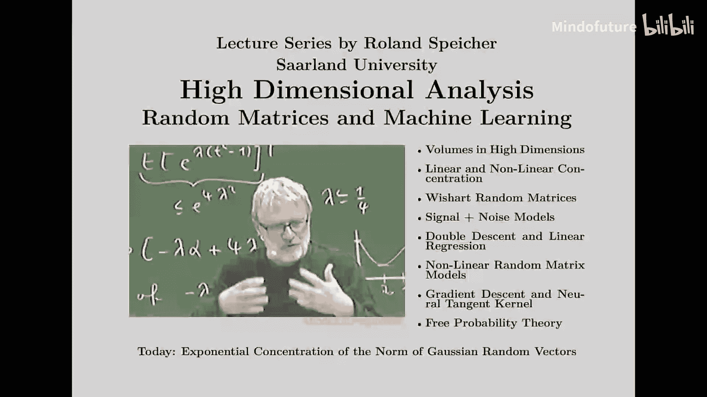
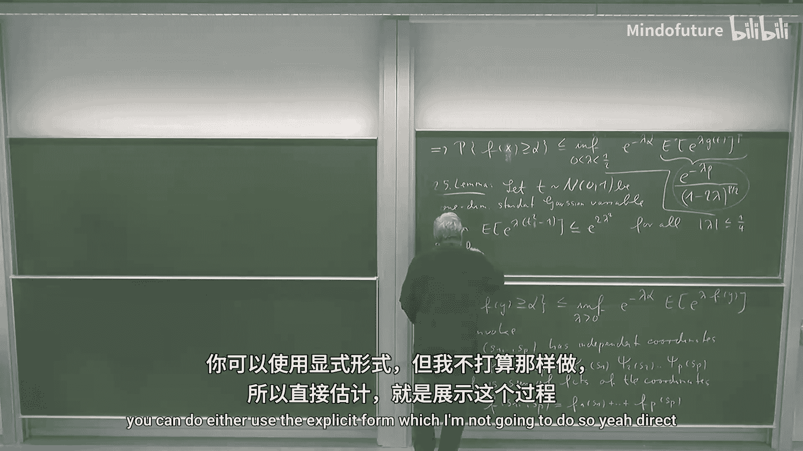

# 【德国萨尔大学】高维分析：随机矩阵和机器学习 ｜ High Dimensional Analysis p05 P05_高斯随机向量范数的指数集中性 -BV1XkkWBFEi6_p5-

Yeah， you are now trying to prove。Concentration phenomena for Gaussian random vectors。

 And at the moment we are trying to do this for linear functions of them。

 So they maybe let me recall what we are going to prove and where we also want to develop some tools which which work more generally。

 but in particular， we want to prove this situation。 So we look on a Gaussian random vector。

 which has a normal distribution。InP dimensions。 So that's the simplest one。

 So namely the means are all0。 and the covariance is the identity matrix。

 And so this just means all the components of my vector of my P dimension vector are independent。

 and each of them has a standard Gaus distribution。 Okay， and then we want to show。

That the norm of such a guy concentrates at the or around the expectation value and the expectation value of this。

 this is P。 So what we want to show is that the probability。

Of the vectors in r to the P and probability measured with this distribution。

 So the probability of those vectors for which the norm。Has a small distance。

To the expectation value。 Okay， that the square of the norm has the expectation value P So。

 so the norm itself should have should be close to the square root of P square root of p is not direct。

 not exactly the expectation， but the guy should be close to this and deviation from this so that this is bigger than epsilon。

 This we want to estimate。By two times E to the minus epsilon squared。

 And last time I think I wrote here 16。 Now， I think I prefer to have 8。

At least that's what I hope to prove later。 Okay， and I mean， all those small constant are not。

 not so important。 very often in books you find here， there is a constant without being specific。

 Okay， but here， I think it should be 8。 Okay， so that's what we want to prove。 And actually。

 we want this for Epsilon。Between0 and small here means actually should be small compared to this one。

 So， I mean， epsilon here is not。Close to 0， because otherwise， this would not be very interesting。

 but it's far away from this guy。 So it could be 5 or 100 or something like this。

 And then piece very large hundred is still small。 So I rerote this also in a re scaled version。

Dividing by square root of P。 And then you see much better that。You can have a small epsilon here。

 Good， O， but。Yeah， May， maybe let me do it also in a re scaled version。

 because maybe this is more somehow intuitive。 So I wrote it with the X Twitter。 So the X Twitter。

That's the re scale。 So this is one over squared of P times x。 So this is。

 this is where all the components have。Have variance of1 over P。And for those。

This estimate goes over。To that ex Twittertter。Yeah， the norm of x is close to one。

 And then the deviation from this。 if I call this now Epsilon。

Then this can be estimated by two times。The exponential minus P times epsidon squared and here should also be over 8。

 not over 16。And now epsilon can here be a really very small quantity because you see if epsilon is small。

 eventually， the P will be overwhelmingly large。 And you see how this goes exponentially in the dimension to to 0。

Good， okay， so I already started to prove this。 And the first step。

 trivial step was instead of doing something for the norm of x。

 we wanted to call to do this in terms of x squared because x squared is really the sum of independent things。

 And that's we we can control。So we started。呃，V。Yeah， I mean， by estimating。

 but this was very simple。That if I want to compare the norm of x with the squared of P。I can。

Estimate this。By the corresponding problem。Where I estimate the norm of x squared。Mus P。呃。Against。

Of course， here， I need。Bigger than Epsilon。Here I compare it。

 here the epsilon is replaced by Epsilon。Times the squared of p。Okay， so， I mean。

 we want to show that this is smaller than this。 But what we are going to do is to show that this actually is smaller than this。

 And then we also get the other thing okay。Good。Yeah， and the point was。

Now that x squared is the sum of the square of the components， and the components are independent。

 So what I have here， x squared is really a function。

 which is given by a sum of independent variables。 And that's something which which we want to use for this concentration。

Okay， but I started with very general estimates。 So I had Markov inequality and chbyche inequality and Markov inequality is maybe the basic one on which all the other others essentially rely So this this tells me what does the expectation of a variable tell me about large values。

 And the expectation because it ever reacheses and science play a role Markov inequality is only something useful。

That's only something if you have a positive distribution。 because if you have， yeah。

 a variable which takes on only positive values and you know expect expectation， then you know。

 you cannot have very large values occurring with high probability because they would move the expectation in the other direction。

Okay， but this was made precise。 Then we had chby chef's inequality relying on this， which yeah。

Tells us what the variance gives us。 And now the general idea is that not。

 we should not just look on the expectation and the variance， but we should look on higher moments。

 Okay， and that that's what we want to do。 And this。Is the main。To we are doing to develop。

 So this will be。Yeah， then。The， the main inequality。 Okay。

 so the the idea is we should look on higher moments。

 but dealing directly with moments is quite tough。 Even for the second moment， it was the variance。

 which is nice because the variance of a sum of independent things is the sum of the variances。

 for the second moment， if the first moment is not zero， this is not true。

 And if we have higher moments。 I mean， the。The， the case moment of a sum of independent guys is not the sum of the case moment。

 but it contains all the lower ones。 So this is getting complicated。 And for this。

 it's much better to go to the moment generating function。 Okay， which in principle is。

 is like a Fourier transform。 this we are peing all the the moment into one function。

 And because this is an exponential function， this really goes nicely with with the independence。

 Okay， so I mean， what we are going to do now。We are looking on all moments simultaneously。 Okay。

 but we are packing the information about the moments essentially into the moment generating function or more or less the same as the Fourier transform。

 Okay， so I mean， the setting。So this is still a general setting where I call the vectors Y。

 let's say why is my。My random vector R to the P。嗯。And I have a function of this vector。Which。

 of course， later on will be a linear function。 Okay， but still we can do it more general。

 So it's a function from our P dimensions to R。 And then I'm looking on the more rating function。

 and this this， I mean， I take the expectation now of the exponential function。Of lambmbda。F of y。

So F of Y is the quantity in which I'm interested。 Okay， and now I take just for。For any Lada here。

 I'm putting here Lada Lada is。Parameter， which I choose later in such a way that I get the best possible information。

 So I consider the exponential lambda times my variable。 And I take the expectation of this。

 And this， if， if this Lada would， if you would replace this by times Lada。

 then you would have to Fourier transform。Okay， but here we do it， Mr。Without the I， but essentially。

 this is the Fourier transform。 Okay， and of course。

 we are using essentially the main property of the Fourier transform or the characteristic function。

 or it is called in probability。 how this goes with the sum。 Okay， but but we。

 we just see this directly。 And maybe just let me exp the exponential So that we see that this is really a generating function in the moment。

 Because， I mean， what is， So what I have here is the exponential。 the expectation and the。

Poruential of this。 Of course， if I do the power series expansion of this。

Is the sum from 0 to infinity of the argument to the power K。 And the argument here is lambda。F of y。

To the K。Divided by K Victoria。 That's just the expansion of the。Exponential function。 Okay。

 and then， I mean， everything here is is nice。 So I can here commute the expectation with the sum。

 So what I have here is really。😊，呃。To some。And then I get， I mean。

 the expectation only applies to the y。 So lambda is just a number。 So I get the lambda to the K。

 and then the expectation xs on。F。Of y to the K。 And then I divide。By Ka Sc。And of course。

 this year is just a case moment of this variable， in which I'm interested。あそう。数第四。This year。

 is the case moment。Of the variable in which I'm interested in F of y。O， and so you see， I have here。

All the moments。 But by choosing Lada， I can somehow put different I I I can choose the way which I put on on the moments。

 Also， I mean， which contributes the most to my contribution。

 I have the freedom of of of shifting the emphasis a little bit So all moments play a role。

 but by choosing different way Ladas， I， I'm shifting which， which play more role。 and okay， and so。

 so that that's why I put Lada here。 So I will choose this later in such a way that I get the best possible。

Information out of this。 Okay， so this is called a moment generating。function。完毕。

You could also do it without this。 Then would it would also be a moment generating function。

 But we take the exponential function because this goes very nicely with Vi sum。 okay， so。And now。

 we want to apply。Essentially呃。A markov to dysfunction。 I mean， Markov。Essentially。

 we have it for any random variable。And what we did also for。

 for getting chby Cheev was we applied a monotton function to our guy because this doesn't change the inequality。

 And so this function here， where lambda goes to this guy。 This is monotton。 If Lada is positive。 So。

 so in the following， I will consider。呃。lambda positive。Also。呃。Yeah， and of course， in Mark Markov。

 of course， I I need a positive function。 Okay， but the exponential to anything is also positive So so I'm。

 I'm in the context I so this function is a good function for which I can apply the Markov inequality。

 because this is a positive function。 but， of course。

 I also I'm not really interested in this function， but I'm interested in this。 But going from。

 from F of y to this is a monotone mapping if Lada is positive。😊，Of course。

 the exponential function is monoton increasing for a positive lambda。Okay， so， I mean。

 so for each lambda in R。I have that。This function here， the exponential Lada F of y。

 independent of the value of y is positive。Which means I can apply Markov to this guy。

 and I also use that if Lada is bigger than 0， then。呃。Disfunction。

If I'm going over from something to exponential in Lambda。

Time still something that this is a mono to increasing function。Okay， and this， of course， I need。

In the following， by comparing F of Y。With this exponential function。Yeah， so namely， what do I want。

 I mean， what I want。Is estimate of the form。 I want to estimate。The probability that F of y。

 let's say， is bigger than alpha。That's what I want。To see whether I can deal with this。 Okay。

 and now I go over to this exponential guy。 And I mean， if this is bigger than， than this。

 then E to lambda times this is bigger than E to lambda times this。 That's the mono's monotonity。

 which I'm using here。 that I'm not destroying the direction of this。 Also this here is the same。

As the probability。That I'm looking instead of F Y。 I'm looking on E to the lambda。Fy。

 but then of course， I have to ask that this should be bigger than e to the lambda alpha。Yeah， okay。

 So because for each y， this inequality is the same as this inequality here。Okay， but now。

I have here， a positive function。With some distribution。

 but now I can apply to this Markov property and for Markov property。

 I estimate probabilities that my variable is bigger than something against the expectation of my function divided by this something。

 So Markov tells me exactly that this here is less than the expectation of this guy。The expectation。

Of E to the lambmbda。If y。And then， I have to divide。By what I have on side， I divide it by E。

To the lambda爱发。Good。Okay。And so this inequality is true for any positive Lada。 Okay。

 so I'm free to choose the lambda。 And so， of course。

 I'm choosing the lambda where this side is the smallest one。 or I can take the inm over this side。

 I mean， this side doesn't depend on Lada。L得vos。Arbitrary parameter。

 which I have put in here to give me some freedom。So this means I'm optimizing this here over the Lada。

And so what I get then finally， is that the probability。F of y。Is bigger。Then if。Can be estimated。

 and I'm taking just infiome。Of this side here over all Lada。 So in the Ladas。

 which I can allow are all positive lambdas。 And then I have here E to the minus lambda alpha。

And I have the expectation of。伊兰达。F蓝达。Good， okay， so this is nice。 And this is。

 this is more or less like jaacheev inequality that we can estimate this probability by something which contains the moments or whatever。

 Okay， but without further information， I mean， without knowing much more about F of y。 Okay。

 it's hard to say something about this。 Okay， so now we have to be more specific。

 So that we really can make concrete use of this。 So this is a very general estimate very powerful。

 But of course， you must be concrete。 What is the nature of your variables。 And in our case。

 this F of y is now really the sum。 I mean， this is this is true， I mean。

 here I just have a variable， which I write as a function of some， of something。

 but it's just the distribution of this variable plays a role。

 But now I want to use that this F is really that the sum of independent guys。O， so。Now， we really。

Invoke more specific information。Which we have in the situation where F is the sum of the squares of。

 of my coordinates。 So namely the y。The underlying why。I actually has independent coordinates。So why。

And the coordinates of this， I call as1 up to S P。Has independent。Coords。also， this means the。

Distribution of this factorizes into the corresponding product of the distribution of each of the component components。

 So the density for for this vector S Y up to S P is actually a product of density for the first component times the density for the second component times and so on。

 a density。For the last component。Yeah， okay。 And， of course， in our situation。

 all these densities are the same。 And each of them has a gausian distribution。 But maybe let us。

 let us still do it in this generality where I'm not really specifying exactly what this is。

 okay and。So this is about the why， the underlying distribution。

 So this consists of independent components。 And then the F is the sum of something on on these components so。

What we have about the F， the function。So， this is a sum。Or functions。Of the coordinates。

 Also this F。this is a function of all might coordinates。

 But now we are in a very special setting where actually it's， it's a sum。😊，Of the coordinates。

 But O， it can be functions of each of the coordinates。 So it's F one of S S1 plus and so on。呃，FP。

Of S P。Okay， and in our specific situation， again， I mean， the F， the Fs are here all the same。

 and each of them is just the square， essentially of the S。 because， I mean。

 the norm squared is the sum of the square of the co coordinates。

 Also those F here are essentially the， the square of the coordinates。Okay。

 but still we can now really say， yeah， continue essentially the discussion above。呃，呀嗯。Yeah。

 in this generality， because now we we can say more， because now， of course， if this F of y is a sum。

 then this exponential function now splits into a product。

 and we can essentially go back to information about each of the coordinates。Okay， so our situation。

Is we have this in general。 But now I have more specific information about my distribution of the components and also about this F and then。

You take the expectation。Of E to the lambda FY。But this。Its then， of course the sum。

 So E to the lambda。F y。 So what is this。 So this is E lambda， and the F is now a sum。 So it's a sum。

Of F1 of the first component plus and so on。 plus F P of the last component。Yeah， and， of course。

 now it's， it's really。 That's the reason why we have chosen here， the exponential function。

 because now E over sum is the product of， of E to the factors。

 So this here is now really just E to the。Lambda times1 of S1 times and so on times E to the lambda。

FP。Of S。Yeah， and now if I take the expectation， then， of course。

 we can now use the independence So here I have used the lineararity of my function。

 But now I'm using the independent of the coordinates。 I mean。

 the the the coordinates are independent。 and this means the function of the coordinate。

 They are also independent。 So this means the expectation of this product of independent guys just factorizes into the expectation。

 into the product of the expectations。So this means the expectation。Of this guy here。E lambmbda。

 FY is now really just。The product of the expectation of I Lada。If one。Of S1 times and so on。

 the expectation of I Lada。FP。Of。SP。Yeah， and now you you see。

 we are now essentially back to information about the distribution of each。Of the variables。Okay。

 and so now， of course。If you now want to go further。This we have to control this。 in our case。

 of course， the Fs are all the same。 So essentially， this year， each factor will be the same。

 just depending on， on the distribution of each of each of the variable。 And Another the question is。

 can we calculate this or at least estimate in such a way that this here gives us a useful。Prob yeah。

 a useful estimate。 And I mean， of course， we want an exponential estimate， which should， of course。

 E to the minus something。 Okay， so here here we have something like e to the minus that that's okay。

 But here， of course， this usually this will explode。

 It will more go like E to the and very often it goes like e to the lambda squared。

But that's actually something。 the combination of this， which we can control。 Okay。

 and that's actually what happens in our situation。 So， I mean， so the idea is that those terms here。

 I mean， they they will grow， but they should not grow so fast。

That this exponential decay here totally disappears。

 So they should grow in a way that the whole thing is is still controllable and we get exponential estimate。

 So so those terms here。If， if we want to use this somehow， I mean， of course。

 this year is true in general， but we need now specific information about this to use it。

 And this specific information should be of the form that those guy here。

 they should not grow too fast。인합니다。And often。And actually， what they do。

 they should go like e to the lambda squared times the constant。Okay。

 that's something which we expect。 And why do we expect this。

 Because that's really something which happens if I take the。

The moment generating function of a gaus's distribution。

 the Fourier transform of a gaus has religious behavior。啊说说每笔。Maybe let us check this。 I mean， here。

Later on， we will not take。依图的。Lambda times gas， but we have to square over gas。So and later。

 we have to calculate this。 But maybe just to see that maybe the thing we should expect from such a thing。

It let us calculate it in a simple situation where S has a gausian distribution that every just the identity。

Then essentially， we have the full transform of the， of the gaus distribution。

 And this goes like E to the lambda squared。 Maybe let， let us just。Check this。So maybe you have。

Calculated the Fourier transform of the Gas at some point。 But if not， so， let us essentially do it。

 So note that。For gas distribution。We can really calculate this， this， this guy。 So， I mean。

 so there we have to take the expectation now over Ga。Distribution in one dimensional， I mean。

 those guys here are one dimensional。 So I take one over square root of two pi integrating。

 Then I'm integrating E to the Lada。And now， F1 of S1， that's， that's。

 I assume this has a gaus distribution。 this。This has a T。

 and the density of this is E to the minus T squared over 2。So that's what this expectation means。

 If F1 of S1 has。The standardand cause distribution。 And， of course。

 this is something which we can calculate。So name me， what is this， This is。

1 over the square root of two pi。Okay， and I mean， we can integrate this thing over all of R here。

 We have a linear term， But， of course， we can shift by using the binomial formula。

 We can write this again as the square of a shifted variable。 So namely， I'm writing this here。

As E to the minus。T minus lambda squared。Divided by2。 So I have the E to the minus t squared over 2。

The square applies here to everything。 And this term here， I this is the cross term here。

 I get two times T times lambda divided by2。 the two goes away， and the minus also goes away。

 So I have this term。But， of course， I'm missing the term is a lambda squared。

 So I correct by this here。 So I also have here the。一。To the lambda squared over 2。T T， okay。

 but this correction by Lambda squared is not a problem， but this doesn't contain a T。

 And now you see where I get the lambmbda squared。嗯， so。So this is the same as this。

 But now I can take this out to the。Lambda squared over 2， and I'm left。With， yeah， essentially。

 the integral of E to the minus T squared over the redux X is just shifted by lambda。

 But if I'm shifting over R， I mean， if I'm integrating over R， a shift doesn't make a difference。

 Also， I have here E to the minus。P minus Lada squared， divided by 2。Integrating by D T。

 And if I replace T by S， which is T minus is lambda。 Then it's， then it's just this integral here。

 So this here is just one。第些啊。It's just one。Just integral over the whole mass of the Gaus。

 And I'm left with E to the Lambda squared。 So you see in the case。

Where I have here a standard ga distribution for F of S1。

 I really get a growth like E to the lambda squared。 Okay。

 and that that's essentially the best thing I can expect。 Of course， of course。

 it would be nice if this would decay exponentially。 But this， this is not going to happen。 I mean。

 this， this thing here really increases in Lada。 And it increases exponentially。 And， I mean。

 it exponentially in lambda squared looks worse。Then this decay here。

 But because we can choose the Lada， we can balance it in such a way that still we get exponential decay。

In overall situation。Good， okay， but now， I mean， okay， so this is just what we expect。

 But now we should， maybe now we really should go back to the norm。

 the square of the norm where we are writing。It has the sum of the squares。 and then check。That also。

 we have something like this。 And then， then I still have to show that this is good enough。 Good， O。

 but so。Let us do now really the calculation。In this situation。We， we are interested。Okay。

 so let me specify。 So in this situation。I mean， all。Random vector is now a Gausian random vector。

 So all the size here are the same。 All the components have the same distribution。

 and actually the density is the Gausian density。And all the Fs， they are also the same。

 but they are essentially the square。So now we really treat this。situationituation where。

My y is now really what I usually call x， the specific x， which has。To stand out。

Causing distribution in P dimensions。And where I F？F of x。 So this is the。The norm squared。Yeah。

 and actually， I， I want to estimate the norm squared compared to P。

 But here you see that the expectation here is no expectation of something like this showing up。 So。

 I mean， I should put。This difference， actually， also here and this F So really。

 what I want to estimate is this quantity。 And I want to see that this cannot become too big。

Actually， I want the absolute value of this。 So for this， I need two estimates。

 So it should not be too big in one direction， and it should not be too big in the other direction。

 but this is symmetric。 So essentially， I have to estimate the probability that this is bigger than something。

I have to see that this can be estimated。In。Exponential way。 Okay， and so this is the square。

 the sum of the squares。 So this is。T1 squared plus up 2。TP squared。Minus p。

And now I want to write it as a sum of functions applied to each of the variable。 And of course。

 I have here that the， the sum of the variables。 But I also have this P。

 And if I want to have the same functions there， of course。

 I can distribute the P by giving a one to each of the P components。

 So I'm writing this as T1 squared-1。Plus， T 2 squared -1。Plus， and so on。TP squared。-1 O。

 And so this year will now be my function G。Of T 1。To function G of T 2。

 And it's the same function all way everywhere。手机off。TP。So what I have here， the F's。

 which I have here in general， are all the same。 and they are actually the function T squared -1。啊。

So。The F1 up to。F P are now one function， which I'm going to call G。And this is just this year。

 So G of T。Is just T squared。-1。Okay， and then the Ts。Other components。 and， of course。

 they factorize， but they factorize into standard Gaussians。

 So the p I also know now very explicitly。 So all the p are also the same。

 So all the coordinates have the same distribution。 So p Psi 1 up to Psi P is the same。

 And let let me call it phi。And phi is just the density of the standard gas。 So phi。

Of T is just the one over this square of two pi。E to the minus t squared over 2。Okay。

 so that that's really。The situation for which we want to prove this concentration。 Okay。

 now we have to see whether for this very specific situation， we can also。

Get our hand on this and see that it really behaves like E to the lambda squared。 I mean， that。

 that's the idea。 I mean， that's， we cannot expect much better。

 but let's hope that it's also not much worse so that we have E to the lambda squared。 And then。

 then we really can。Continue。Good， okay， so let us。Calculate this。 And， I mean。

 everything is here concrete and integrals with respect to discussing in density， we can do。

 at least if we integrate over all of R。 So we really can calculate this explicitly。So what we need。

So it's the expectation of E。To the Lambda。G of T T has a gause distribution。

 And G is just this T squared -1。 So this is just explicitly integrating。

With respect to the Gaus density Z T。Of fuck。Over R for minus infinity plus infinity。 And T。

 what is my function。 It's E lambda。 And this T of T is t squared -1。

 and the density T is E to the minus。T squared divided by2。Oh，So that's what we have。

To integrate here。And again， you see， essentially， we are integrating over。E to the minus t squared。

 Here's a little shift there。But this here is。Yeah， what is it？Okay， we have here T squared here。

 T squared here。 We have something else。 but this is just a factor E to the lambda。

 So it is the minus-1 It's e to the minus lambda， which can get out of the integral。

So I have run over。Tump pi E to the minus lambda。 This comes out。

 and then the rest just is multiple of T squared。Integram。e to the minus。T squared over 2。Here。

 I have it once。 and T， I have T squared。 I have it with a plus sign here。

 So the minus sign here gives me a minus。 And here reriding by 2。

 So I should multiply here with with two。Okay。Yeah， and now you see， essentially， I'm integrating。

Again， this goes in integral， but I have a factor here， but， of course。

 I can change my integration variable such that this guy here together is S squared。 Let's say。

 So let me say I call now T times the square root of1 minus。To lambda。 I call this S。

 And then I have here E to the minus S squared over 2 And then just the D T is the S divided by this。

 So I will get the usual integral， but divided by this here。手。嗯。Yeah maybe呀， maybe maybe。

Let me write this here。 So this is the same as the integral now。

So T squared times this here is now S squared， S squared divided by 2。 And then I have a D S。

 But I also have D T is D S divided by T。 I also have one over1 minus。Scrd of tu lambda。Yeah。

 and I mean， this integral， that's our usual causingus integral， which is exactly。

Square root of two pi。 I mean， that's a normalization of our gas distribution。Okay。

 so you see this goes away with this。 And so what we are left with is just E to the minus lambda from here。

 And here we have this factor。 So divided。By。1 minus。This square root of T Lada。Okay， and， of course。

 this only makes sense if lambda is not bigger than one half。Because otherwise。

 DCC would be negative。But then we also see that T， I have something negative。

 and then I would have here an exponential guy。 if I'm in integrating。

increasingcre E to the T squared。 Then， of course， this is infinity。okay， so I mean， this， this。

 the sign of this has to be positive so that I have here E to the minus T squared， which is integral。

 If this here gets gets a negative sign， then I have e to the plus t squared。 and， of course。

 the integral over this is infinity。 So this means this moment generating function here。 it only。

Exists for lambda smaller than than one half。 Okay， but that that's okay。 I mean。

 here in our estimate， of course， we take the infiome。 And so， I mean， for the big lambdas， I mean。

 if you have here infinity， of course。That's not the Las， which you should should consider。

 We take it infi， of course， only over the Ladas， for which this makes sense。

 gives us something meaningful。Good， okay。 But so this means I cannot now block this in in this estimate here。

 And at least I have something concrete， but still。

 maybe it's not so clear what it really explicitly is。So， what we have。It's the probability。

Did our F of y。No， X now no its。X here。Oh so for。For this specific situation here。嗯。Bigger than。I发。

This is less than。The infiome over lambda。 And now I should restrict lambda between0 and one half。

 because otherwise this guy here is infinity。 and I still have here E to the minus lambda alpha。

And here， Jen， I have the expectation of E to the Lada。Qi。提。嗯。Yeah， and now。Of course， this。

 this year was the sum。So I I get here。P factors of this form。

 So what I have here is actually this to the power P。

Because this here is just one of the terms there for， for the F1 is equal to G。

 for the F 2 is equal to G and for the F P is equal to G。 And that's what we calculated。So， namely。

So this guy here was E to the minus lambda， but I take it to the power P。

 So I get E to the minus lambda P。 and I have to divide it by the square root。 So I have 1-2 lambda。

Square root is to power one half， but I also have to power a P。 So I have to power P over2 here。Okay。

 and now。St。Maybe this， this guy here is something which we don't really see directly how it behaves。

 and。Yeah， you really should see that the whole thing here behaves like E to the lambda squared。

 I mean， still the same as I said before。 We have calculated explicitly。

 but from this explicit formula， we don't really see that。See really explicitly how it behaves。

 because， I mean， this square root here one over this， this will explode somehow exponentially。

 but it's， it's maybe not directly clear from this。 So I really should estimate this。Against。

Concrete form So that's maybe， let me formulate this in the next lemma that we， it's much better to。

 to give an estimate for this against something which we really。Want and can use later。

So let me formulate this as a lema。So， we consider our。Variable， which has a normal。

Gus in distribution。 So this is a。The one dimensional。Stand up。高 in very well。And then I'm claiming。

That， actually。We really can estimate it Lada。提示。T squared -1。Against。

E to the lambda squared times I constant。 And here I can choose to constant E to the two lambda squared。

And this is at least true for all。Lambda， not in the whole interval where this makes sense。

 but in the interval where Lada is less than one over 4。I mean， if if here Lada goes to one half。

 of course， this year will explode on this goes to infinity。 So I should stay away from this。 Okay。

 so I'm claiming this and then this year will be something which I can manage later。

 if I combine it with this one here。If I have it directly in this form， it's not so clear what to do。

Okay， and the proof of this。Yeah， of course， I mean。You can do it directly。

 We know what this explicitly is。 so we should estimate this against this， which can be done。

 but actually， I also want to give another way， namely just by doing estimate estimates for the moment。

 which might be more direct。In particular。I mean， yeah。 It might not be clear why。

Why we should get here something like e to the Lambda square， even if you look on this。

Might not be so clear。 You can prove it somehow。But somehow， it it's not。

If you don't know what you want to prove， it might not be so clear。So， maybe I。

Also do estimates for the moments， where maybe。Maybe it's getting a bit clearer。

 or the estimates show you more or less。What you get。Clear up to now。Okay， I'm proving now thislemma。

 But， of course， point is that it's true and we can use it later。 But let， let me just。

Prove it so that we see it explicitly。And yeah， to proof， you can。Do。Either use the explicit form。

 which I'm not going to do so。

呃，呀。To direct estimate。嗯呃。Yeah， just by。Showing that E to the minus lambda divided by1 -2 lambda。

The square root is less than e to the。2 lambmbda squared。If lambda is less than one over 4。

Essentially， this is a calculus problem。 And in all manuscripts， which I looked up。

 it is that you can prove this by calculus。 just doing a。curveurve discussion。 Okay， when I tried it。

 I can almost prove it maybe in a bit smaller interval。 So it's it's， it's a calculus problem。

 but it's not a straightforward one not。 Okay， but I mean， if you plot this curve。

 you see that it is true。 And， I mean， you can， by calculus， you can do it， but somehow。

It's not just one line。 In principle， you would say， okay。

 I should see that something is monotone increasing。 difference is is bigger than 0。 but。

 but the interval we are looking at is， is you go to。

 you go to the maximum and then you go down bit again， so。Okay。

 one has to discuss a bit more carefully。 And somehow， I don't find it very illuminating。 And I also。

 I don't really see。 I mean， why should this be true。If you plot it， you see that it's true。

 Maybe you should do this。 But maybe so maybe in a nicer way or another way。

 which maybe tells you more why you have something like this is if you're looking on the moment。

 I mean。呃。This function here is a generating function in the moment。

 So if you have estimates for the moments， they should correspond to estimates for the moment generating function And so maybe we should look on estimates for the moments of this。

 of this T squared -1。So maybe that's what I don't want to do a bit more of。Yeah。Detailed。So or。

Estimate。The moments。Of T squared。-1。So the generating function contains the moments of this guy。

 So if you have more estimates for this， it's okay。 So we should have estimates。

For the moment of t squared-1 to the power K for all K。 And in principle， I mean t is a gaus。 So。

 I mean， we know the moment of a gaus's distribution。 And so without the one。

 it would just be the two k moment of a gaus， for which we have an explicit formula。

 this -1 makes a shift， which makes it a bit more complicated， but still。In principle， of course。

 we reduce it to what we know about the cows。Let me write it like this。 So it's less than。

The exponential。At， the expectation of t squared -1。

 And that we take now here the absolute value to the power key。嗯。Yeah， I mean， this。

 this number is less than its absolute value。 and I can bring in the absolute value in the integral。

 And so what I have here is now the integral。Over t squared minus-1。To power k。

Integrated with respect to the density of the ga distribution。So that's what I have to see。

 And now what I want to do， I mean。The two K moment of T， I know。 So， I mean。

 I want to estimate this somehow against。The two case moment。

 And one can see that I can estimate it like this。If I integrate over this， that's what I know。

 That's what you had to do in， I think， the first assignment or so。

Cculating the moments of a ghost distribution。Yeah， and here， I can estimate it like this。

 And you this， you can， essentially， I mean， checking by。Looking on two cases， I mean。

 either the T is less than one， which means this guy here。Yeah， maybe let me write it down。

 So if the absolute value of T is less than one。 you are running here all T here。

 So you need this estimate to be true for all T。 And here， I have the absolute value。

 And so what I have here in between can be smaller than one， but it can also be bigger than one。

 And in both cases， I have to do different things。 So if the norm of T is less than one。 then yeah。

 what I have here。Yes是。T squared -1。To the power K is then。 So if t is less than one。

 then this guy is also less than one， Then the absolute value is actually1 minus T squared。

To the power。Okay， but this guy is less than one。 So this means this will be in any case。

 less than one。Okay， so if T is small， then this guy is less than one。

 That's the reason why I have a one here。 Okay， in the other case。WhereT。Is bigger than one。Then。

T squared -1 to the power K。 So if t is bigger than one。

 then this absolute value is actually t squared -1。 because this is bigger than1。

 So this is t squared -1。To the power K。 But now the T squared is bigger than one。

 So I can't just forget the one。 So this is less than T to the2 k。So you see， I mean。

 this thing here is either less than one or it's less than t to the 2 k。 So in any case。

 it's less than the sum of those two guys。 Okay， that's kind of trivial estimate I'm doing here。

 Okay， and so this is less than this。 So this means the expectation of this is less than。

The expectation of this。 And this is just。2 k moment of my gaus variable。 And T I have one。

 but the expectation of one is， of course， one。So you see， essentially。

 I have estimated against the two k moment of a gas。And this， we know what this is。Yeah。

 now I'm just massaging。This estimate here a bit in， in， in a form， which is somehow nicer。

Where somehow， this one can also be brought in in a form corresponding to this。So I mean。

 so what I have here。 So what is the2 k moment of a gaus。 This is this double factoria。 So I mean。

 this， this is just 2 k-1 times 2 k， -3 and so on。 So I think this is something which we。

Looked at in the first assignment where you derived a recursion for how do you calculate the moment。

 And then if you multiply this out。第四也是第四。What is denied。Is this symbol。Wuble factorial of 2 k -1。

 which means you take the product in a factorial way， but you're going down in steps of 2。 I mean。

 double factorial is not a factorial of factorial， but it means you， you do it like a factorial。

 but you are not going down the factor in steps of one， but you're going down in steps of 2。

And I have the one。Okay， and I want to write this， maybe。Estimate this against something which。

I mean， double factorial is something which I don't really know how to deal with this directly in terms of generating power series in my exponential function。

 Of course， I have factorials。 So I want to write this and estimate this against a factorial because then I really can deal with it easily。

And so I mean， so what is this。 Yeah， let me write it down。

 So this is just 2 k -1 times 2 k-3 times 2 k-5 and so on。 And I'm going down up to。

5 times 3 times 1。And then I have this additional one。 And now essentially， I can estimate this。

 I have period odd numbers， but I can estimate this each of them against the closest the the next highest even number。

 And then actually， each even number has a factor of two， which I can take out。

 And then I'm really left this ordinary factorial。So I mean。

 I estimate this here against the 2 k minus-1 is less than 2 k The 2 k minus-3 is less than 2 k minus-2 and so on。

 The5 is less than 6。 The three is less than 4。嗯。And the one， okay， I'm living。 And actually。

 in order to deal with this， I， I， I say， okay。Replacing the three by4 was not so good idea， Maybe I。

Take this back。But I have to fall here。Because。Let me see。 I should。Yeah， okay。

 because now I can divide out the tools out of this。 And then I have here， the factorial So。

 so this is less than， I mean， I have a factor 2 in each of those guys。

 And how many of them do I have， I have two to the K -1。啊。😮，Yeah。Okay。So I'm。

 I'm not not writing a two here。 So I don't have the last one。 I'm not changing the one here to a2。

 And I'm actually also not changing the， the the3 to to a 4 because I write this。

 But for doing this reduction， I'm。I'm writing it down here。 So I I divide out to two。 So I have。

K -12s。 And then I'm left this K factor。 because here， I have then I have a K， K-1 and so on times。

Three times 2。 Okay， and then 1， I can put it。Anyhow， as I like。 So I have this。

 but I also have this three over 4。 And then I have this one。

And why do I want this strange three3 over four here。

 Because I can estimate the one against one over four of this so that I just get somehow rid of the one So so I say it this one here is smaller than the same。

Thinking here，2 k minus-1 K factorial times 1 over 4。And this is true for all K bigger than 2。

 I mean， one， of course， is usually very small compared to this。 only for the small K。 it's it's。

 it's the same order for K equal to 0 and K equal equal to 1。 This is not good。

 but this here is for K。Great or equal to 2。 I mean， because for two。

 I have here2 to the one times  two factorial。 So this is  two times 2 divided by 4。 This is 1。

And for the bigger case， it， it's， it's also true。 So I can estimate is against this。

 And then the three over 4 and1 over 4 gives me gives me a factor one。

 So what I really have now is that I have estimated this against。2 k -1。Times K factorial。

 And this is true in this setting here。O。Bigger than one。Okay， maybe a lot of strange estimates。

 But what I have in the end is I really have a nice estimate essentially against the factorial。

 That's what I want。 because this is something I can easily now use for estimating my。

 my generating power series。Yeah， now I want my power Sir。So， what I really want to estimate is the。

Expectation of E to the Lada。T squared -1。 But， of course。

 we know that this is the generating power series of the moment。 So this is the expectation。嗯。

Of the sum。K from 0 to infinity。Lada2르케。T squared -1 to the K。Divided by K factorial。Okay， and then。

What I have calculated here was essentially an estimate where I had the absolute value here。

 so I can estimate this against where I'm also putting the absolute value here。And then I have。Here呀。

The sum。K C，0 to infinity， lambda to the K。K factorial comes out。

 and I'm left here with the expectation。 So the expectation applies to this of the absolute value。

Or the absolute value may be here of。T squared。-1。To the K。And thats。 so this is the moment。

 the K moment of t squared -1。 But this is exactly what we estimated here。 I mean。

 that was the the whole thing which I did here to estimate this against 2 k-1 times k factorial。

And you see I why I want to write。Like this， because this goes away with this。 But actually。

 I'm summing here。From starting from 0。 But this year is only true for K bigger than 2。

 So I have to be careful about the first and the second term。 So this year is for。K。

 greater or equal to 2。So this means I should take the k equal to0 term separately。

 but this is just one。好。Then I should take the， the term k equal to1。 But for k equal to 1。

 I take the expectation of t squared -1 and t squared -1。 Yeah。

 what is the expectation of t squared -1。What is the first moment of t squared -1。

What is the expectation of T squared。For my ghost。For my standard goes。Yeah。1， yeah。

 also the expectation of T squared is 1。 So t squared -1 has ex expectation 0。 I mean。

 that's essentially also the reason why my function。 I choose my function is T squared -1。

 because this is something which has expectation 0。And the expectation is not really showing up in。

 in my inequality， which I have。 But I want to compare things with， with its expectation。 Anyhow。

 So this means that the term here， K equal to 1 is actually equal to 0。 So that's good。

 I don't have to put it down。 And then I'm just left with。K starting at 2。 And then， of course。

 I have this estimate here。K factorial cancels this one here。 I have 2 to the k -1。

 here I have Lada to the K。 So maybe let me also write this as 2 to the K and correct with an additional one half。

 which I can then take out because this I'm doing for all K。 So I have a one half。

 And then I have here。 my sum starting from2 to infinity。 And what I do I have here。

 So this is gone away。 And then I have lambda to the K and 2 to the K。 So I have two lambda。

To the power K， right， actually no nothing left anymore。 Okay。

 and so this is essentially now geometric serious。 And now you also see why lambda should not be bigger。

T one half。 I mean， that's where the。That's where this guy breaks down。

 we see it in the explicit formula。 but also here in the estimates， you see that essentially we we。

 we seem to be in the right order。 I mean， the geometric serious only converges if this guy here is less than one。

 which means Lambda should be less than one half。Okay， so this is the geometric series。

 which starts not at 0 but at one。 So this means we should take here out the two lambda to the squared。

 And then I'm left is the geometric series in the two lambda。 So it's  one divided by1 minus。呃，图兰的。

Yeah， or maybe let me write it again。 So it's one plus。I have a。This2 lambda squared。Divided by 2。

 this is these2。 And here I have 1-2 lambda，1。To lambda， O now。I just estimate this against。

1 plus 2 lambda。Squared， if。In the， in the right domain for Lada， of course， if Lada， I mean。

 I'm estimating just what I have here against the fact。Let's say two so this this one。

Now I have two to。 I divide this。Okay， so where are so okay。 I have。So this， this is correct。 I have。

So one half is here。2 lambda squared。 I take out of of this sum here。

 and then essentially after geometric theory is starting at k equal to 0。

 which is1 over1 minus2 lambda。Yeah， okay。 But now I estimate this。Again， okay， I have the one。

And now I want to say that this guy here。I estimate this against。 Okay。

 I have the two lambda squared。No more right though。And I just， okay， I want to estimate。

This division here， of course， if Lada goes to one half， this year explodes。 But if， if， if。

 let's say Lada is less than one over 4， then the biggest I'm dividing。Here is 1-2 times 1 over4。

 So it I'm dividing by， by one half。嗯。Yeah， I'm dividing by one half。

 which means here is this factor 2。 I'm just dividing。by稳。Okay。So it seems to be。

 it's less than plus。1 over 4 lamb squared。Is this correct to you agree or。I mean。

 I have here2 lambda squared instead of 4 lambda squared。But now， I don't see why I should have a。

To there。I mean， this guy here on the bottom， is for Lana less than one over 4。 This is。

Bigger than one。ok。Okay， so maybe it's4。Maybe let's see。 Maybe let's。Should make a big difference。

 But okay， yeah， okay。 And then， of course， I mean， I want to have an exponential estimate。

And now I'm just estimating this against the exponential function。

 So now I'm estimating this against E to what I have here。 And now it should be， okay。

 according to this， it should be for Lada squared。I mean， this， this is if。E to the X。 I mean。

 this is the beginning of the Taylor series of E2 D X。 So this is1 plus x。 And this is E to D X。 And。

 of course， I'm on the positive side。 So， yeah，1 plus x is less than E to the x。Okay。

 well now I have4 Lada squared。And in my lemma， I promised you2 to the lambda squared。 But okay。

 now at the moment， it seems to be a4。Okay， but 2 or 4， maybe that's the reason that the 8。

 which I change at the beginning， is indeed 60。 I don't know。 Let's see。 Okay， so。

 so let us continue with。With the4。嗯。And see。And I mean。

 those are constants which should not make a big difference。 Also the， the main thing is。

 it is the lambda squared。 It is showing up。Good， but now， so now we have。呃。

The main estimates together。 So， I mean， we really have now。呃。Estimate for this。

 And now we can try to。To get the best value for Lambda。 And okay。

 but so now now let's see how we can。Really do them。 I mean， now now comes the main step Oh I mean。

 now we have things so explicitly that really， it's very easy to find the the infam over this and。

Get a concrete estimate。So this is now， now we really do the proof of our。呃 mainor for the。

Concentration of。The norm。Of our variable。So， that was our。Theorem 2。2。So what we have to estimate。

I mean， we reduced the estimate for the norm to an estimate for the norm square。

 So what we really have to estimate is the probability。That the norm of x squared minus P。

Is bigger than and then going over from the norm to the norm squared gave us the square root of P here。

Yeah， and now， of course， of what I have here。This x squared minus P， let me write it again。

 So this is our function F。X squared minus P， which I have written。As a sum of those functions， G。

 G run up to G P。How where those guys here are independent。And each of the coordinates。As oh。

 and each of these function here is T squared -1， and the Ts have a standard normal distribution。

 So just repeating the specific setting which we have here。 So T。Is a normal standard distribution。

And then。So what we get this probability that this absolute value is bigger than this means either the absolute value is positive and then it is bigger to this or the absolute。

yeah， I mean， okay， so this means what I have inside the absolute value is bigger than this guy or what I have inside is actually negative。

 and it is smaller than negative of this。 So for the absolute value， bigger than something。

 essentially， this means I have two estimates in one direction and in the other。Also， this means。

The fact that the norm。Of F is bigger than this。Is the same as that either F of y is bigger than this guy。

Without the norm。Or that F of y is smaller than the negative of this guy。

And those are events which are exclusive。 So ever I can only be bigger than the plus size or can be smaller than this。

 So the probabilities of this just add up So plus the probability。That F of y is less than minus。

Epsilon square of P。啊。😮，Just saying that the square root of that the absolute value of this is bigger than this is the same as saying either I have。

 this is bigger than this or this is smaller than this。 Okay， and those two。Events are disjoin。

 So I have here some of the probabilities， and actually it's symmetric。

 So the probability of this is the same as the probability of this。This means I get a factor 2。

 And you remember my theory， I had an overall factor 2 at the beginning。 This is coming from this。

 And also， what I have here is just two times。 let's say， the probability of this。

That F of y is bigger than Epsilon。Times the squared of P。

And now we are really in in the setting which we had before before we had no absolute value。 And now。

 I mean， yeah， now the alpha is this epsilon times squared of P so alpha。Let me call this IA。

And then， I'm using。Yeah， essentially what I have here。So this is less than I have this factor 2。

And then I have the infiome。Of the lambda between。Princ。Could be between 0 and one half。

E to the minus。Lambda， alpha。 And then I have the expectation。 Now， let me write it again。

Expectation of E to the lambda T squared -1。 So that's the expectation of。E to the lambda G of T。

 G of T is T squared -1。 And then I have P times the same guy。 So I have this to the power P。Yeah。

 and now we have just estimated this guy here。 Okay， we have estimated it now by。E to the four。

Lambda squared。4。A lambda is less than。1 over4。And so this means， okay。

 the lambda bigger between one over 2 and1 over 4。 I cannot use the。Don't give anything， meaningful。

 So I'm have to look here in the domain between 0 and one over 4。So it's two times。The infiome。

For lambda between 0 and 1 over 4， and then。I have here now exponential here。

 I have minus lambda alpha。 and here I have plus。For Lada square。Okay， and of course。

 I have here to the power P。 That's， of course， the important point。 I mean。

 I have dependency on the dimension here。 So this heres multiplied this P。Yeah， know， of course。

 the idea is just I want to find。呃。The minimum value here and the exponent I want to choose the lambda。

 I mean， I I'm free to choose the Lada in this domain， such that this here gives me the best。

Estimate， and， of course， I want T a minus sign。 Of course， I mean， I want E to the minus。

 It should be a exponential decay of the probability T。 So， of course， the idea is that， I mean。

 if I have my， my Lada here。I mean， I have somewhere1 over 4。 And， of course， for Lada equal to 0。

 I mean， this is just 0。 So it's e to the my -1。 So just says of probability is is less than two times 1。

 which is， of course， useless。 So this means， of course， I mean， I。

 I could choose any specific Lada here。 But， of course， the only concrete one is。Lambda equal to 0。

 but there I， I have， I have a estimate which is not useful。 So the idea is that this year goes down。

嗯。Yeah， this exponential thing goes down somehow， and then maybe it grows again。

 And I want to find the value Lambda 0， where actually this here gives me the smallest value。Okay。

 so for this， I just take the derivative and see where a derivative is equal to 0。

So what I want is to find the minimum。嗯。Of。What I have here in the exponent of my。

Exponential function。 So it's minus lambda alpha plus P4 lambda squared P。Okay。

 and so I take the derivative and。Yeah， should check that it really a minimum。This should be okay。

Taking the derivative with respect to Lambda。 So this gives me minus。I发。

And here I get eight times lambda P。Plus。8 times。And let me call the minimum Lada 0， Lada P。

 And the condition is that this derivative is equal to 0。Which means the lambda 0 is。I发。Divided。By 8。

Times。皮。Yeah， okay。 And then， of course， the alpha。 Now， let me write it in terms of， of the epsilon。

 What what I really want in my starting inequality。 So the alpha is epsilon times the squared of P。

 So this is epsilon times。The square of P。Divided by 8 P。 So this is Epsilon divided by。8 times。

The square root of P。 And maybe we should make sure。

That we are already here in a domain between0 and 1 over 4， because if we。

 if the Lada0 would be somewhere here， then， of course， those estimates are not true。 And， I mean。

 this is less than actually， in this case， it seems to be less than one over 8 because we have chosen the epsilon。

 we have restricted them to a specific domain So I mean， this here is true。Because we consider。

 in our theorem。Only epsilons， which are small compared to P。

 and actually should be small compared to the square of P。

 So our condition was that epsilon is between 0。And the square root of P。So Epsilon。

Divided by this is less than one。 So actually， this is， this is smaller than this。 So this。

 this is okay。 This really isn't a domain where everything fits if， if you take epsilon of this size。

 So Eilon should not be of the order P or something like this。Good， okay， but then。

This is the lambda 0。 And then we can plug this in。Our estimate here。 So now we we， we choose。

 So this is， yeah， we choose now for Lada。 We choose Lada 0。 And then， of course。

 we get here specific exponent。So。So what So we have minus。Lada 0 alpha。Plus2。Lambda 0。ENo， actually。

 it's 4。Okay。Minus this plus  four times。 That's what we want。 And now， Lada 0 is。Is what is it。

 Yeah， this guy here。Or maybe， maybe that's it， Let's do it first in in I。 And then at the end。

 plug in。The epsilon。 Okay， so it's。Minus lambda 0 is I divided。By 8 P。Times alpha。

 So I get an alpha squared plus four times。Lambda squared。 So this is alpha squared。Okay。

 but now I get 8 squared here。I'm not sure whether this is better than what I had before。

 but so it's 64。呃。P squared。Times P。Okay， so you see， I mean， they fit now together the two guys。

I have alpha squared。 Al squared。1 P goes away， So they are both divided by P。

 And so let me see this here is one over。Okay， so I have， I have， I have a minus sign。 This。

 is the bigger term。 I have Ipha squared。Divided by P and T， I have -10 y8。And here。

 I have plus one over。呃。16。So， what I have is。1 over 16。Which was my original。

 I shouldn't have changed my， my lemma or my， my original statement。 Also， I'm really back to minus。

1 over 16。Okay， so maybe this was the better calculation。Okay， and now， of course， okay。

 let now now now I plug in for alpha that was。Epsilon。Times square root。Of P。

 So this means I have-1 over16。 Ipha squared is  then0 Epsilon squared。

Time the square of the square root。 So it's P and divided by P。 And now the P goes away。So。

 it's really minus epsilon squared。Over 16。 And that's what what I was claiming in this。This theorem。

Also， maybe。What have you seen here？So， the probability。Off。The Gaussian vectors in R2 D N。Such that。

The norm。Has a distance to the square root of P。Which is bigger than Epsilon。嗯。This。

 we have seen in the very first step。 That is is the probability of。The random vectors in R to D N。

 for which the。的。Square of the norm has a distance to P。Bigger than epsilon times the squared of P。

And that's what we just estimated here。That this is less than。So we had this factor 2。

And then we estimated this here， This is now less than E to the to this thing here。 E to the minus。呃。

Epsilon squared， divided by 8。Okay， that's， that's the end of the proof。嗯， so。I hope。It's okay。

 I mean， I， okay， I mean， I also try to develop the general machinery。 So， of course。

 you can apply such things also to other situations。 But here we can。Do。Things very explicitly， and。

Yeah， you， you see we， we get an exponential concentration quantity。

 that that's what usually you expect and what， what you can prove with such tools。Good， but maybe。

 maybe yeah。Find a remark， which I'm not going to write down， but just just say it。 So I mean。

What we have seen here is。The general machinery and what we have used is that our function is essentially a sum of independent guys。

 Okay， and then yeah。Wecome the to this setting。 And then what we need。

 essentially about the distribution of this T of T is that。Yeah。

 that we can estimate its momentss essentially against the factorial。

 or we can estimate its moment generating function， essentially against e to the lambda squared。

Because I mean， if you have this， then this here works in the same way。

 maybe the constants are different， but you get the same thing so that I mean if you have a sum of independent variables and the variables have a distribution for which you have that moment generating function behaves like e to the lambda squared。

 then these works in the same way。 then you have a concentration and there are many distributions which have this property and they are usually called sub exponential distributions because they can be compared with this exponential So subex distributions are big class of important distributions for which you can prove essentially in the same way this concentration phenomena。

Okay， and what， so what we showed here is that the square of gaus。 So， so our， our。

Variably which we considered was not the Gaus， but it was the square T squared -1。

 And we showed that this is sub sub exponential。And then did this works。 Okay， and so。I mean。

 the theorems， which we get here。 So this is essentially what is called benchine inequality。

 That's this concentration inequality for， let's say， in general， sub exponential distributions。

And there are variants of this where maybe the assumptions are a little bit different。

 but still the whole machinery works。 And I mean， those there are other inequalities which go either under the name of Sha of inequality or hefting inequality。

 but they're all variants of the same idea So it's really about using Markov for the moment generating function。

And then you get those kind of。Of concentration inequalities for linear functions for linear function。

 for for sums of independent guys。 Of course， that's something that's very important。

 But maybe what is more important for us， more interesting is if we look on functions which are not linear。

 because， I mean， particular neural networks are somehow functions of the input data。 But of course。

 they are not linear。And so we should hope for that maybe also we can understand or get concentration in more general situations that's。

What is really the case。 And that's what I want to do next， next time。 or talk about this。

 this is more teleco kind of inequalities， which， of course， you。

 you must have special assumptions on your functions。

 So you cannot expect concentration for everything。

But you have a big class of non nonlinear functions for which you also have concentration。Good， okay。

 that's it for today。