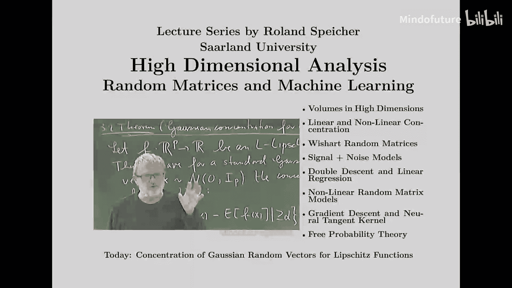
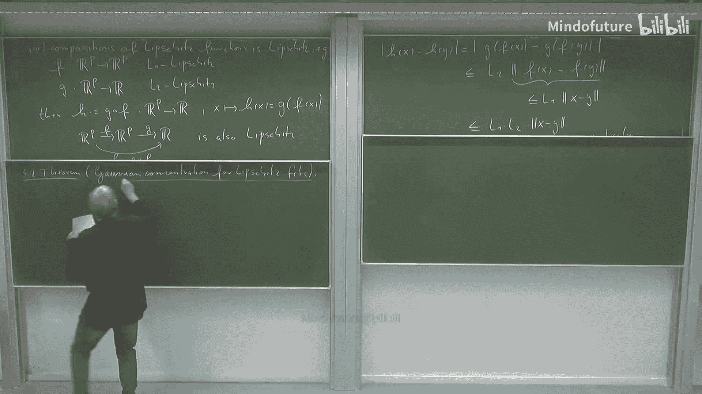

# 【德国萨尔大学】高维分析：随机矩阵和机器学习 ｜ High Dimensional Analysis p06 P06_利普希茨函数下高斯随机向量的非线性集中性 -BV1XkkWBFEi6_p6-

So today， I want to talk about more general concentration。

 So last time we talked about concentration for cow in random vectors。

 but we looked essentially on functions which were linear functions of。

 which were sums of independent random variables。 Okay， but in general。

 we have more general functions。 and that's。What I want to cover today probably also next time。

So it's again， about concentration。And we will do it again。For the Gaussian random vectors。Of course。

 that's。The most important ones， in particular， the ones which we can treat mathematically very nicely。

 So for Gausian random vectors， But the functions we consider of them are now in general。

 non nonlinear。So not just sums of things。 but， of course， we need some condition。

 and it will be lipsshed functions。 some sort of condition we need。

Is that we have Hi shits functions。Yeah， so I will explain。What do you mean exactly？Okay。

 so recall yeah， what we up， what we did up to now。 So we considered concentration of linear sums。呃。

But force may。Last time， so we consider a function of our vector。 our vector has components。

 T1 up to T P in P dimensions。 And what we considered was a sum of functions of the components。

 And also， it was something like F1 of。Tan。Plus， and so on。FP。Of T P。 and last time in particular。

 we looked on the case where those functions here are T T squared -1。 and all of them are the same。

 Okay， and then we could develop a nice machinery， which works also more general than just for causing random vectors。

 but there we could do it very explicitly。 Yeah， So we have a general。

Machinery for getting concentration estimates Good。 But now， I mean。

 this is a very special situation and maybe。We also would like to have to understand or see concentration for。

More non nonlinear stuff or general stuff。 So now we consider。Functions。Okay。

 which in general are non linear， which are not of this form。And so， I mean， we have functions。 Okay。

 I in the moment， I'm not really writing down anything。I'm saying it's just functions。

Where we don't make this linear assumption。 But， of course， we need some assumption。 I mean。

 we don't have concentration for arbitrary functions。 So we need something for those。

Functions and maybe the idea is yeah is maybe phrased in this phrased by Michel Tnacro。

 by saying that a random variable that depends in a smooth way on the influence of many independent variables。

 but not too much on any of them。 This is essentially constant essentially constant means we have concentration for most instances。

 it iss close to this constant， but what we need is is a function。

That depends in a smooth way on the influence on many independent variables。

 but not no of the variables should have a do dominating inference。 Okay， so this is。Yeah， okay。

 maybe I'm not writing it down。 But so this is a phrase of Michel Talaco。

 who did a lot in this context。 about all this concentration theory。 I mean。

 couple of names they do and so associated to this。 And may， maybe just to give an example。

 of course， So what， for example。Works we have a function which depends on many variables。

 but no one is dominant is things which we。Consider。Up to now， for example， if we take it。

The average。Of T1 squared。Plus T P squared。 Also， this is， this is something of this form。 But if we。

Comp compareare this with a function of P variables where we only take。

The square of the first variable， Then it is clear that here。We expect concentration。

 And essentially， we saw it last time。 But here， of course， I mean， we don't have concentration。

 I mean， most of the variables don't play a role This is a one dimensional problem T1 squared always has the same distribution。

 which is smeared out， which is not concentrating if you make the p bigger because the other variables don't play a role So this function is not seeing the other variables。

 So it depends on the smooth way on one variable， but this variable has a dominant influence。

 All the others don't play a role。 I mean， here， all the variables have some kind of the same influence。

Okay， so that that's the idea。 So in both cases here， I mean， the expectation is one if。

 if we take for the Gs for the yeah， if we take here， our Gausian random。Very will， also。

The expectation of F is one， as well as the expectation of G。But still。

 they behave in a very different way。 Okay， so F concentrates about its expectations。Concentrates。

About one for large P， but G。As always the same distribution。

 which is spread out until it does not concentrate for P。 I mean， it doesn't really depend on P。手机。

Yes。Independent of P。Always。The same。Get out。Distribution。Okay， it's good。

 So so we have to make a bit precise。 What do we mean with。That we have a function。

Which depends in a smooth way on all variables without having one variable。

 which is several variables， which are dominant and the right setting for this are lip functions。

 So that's the one which we will consider。 And for which one can prove concentration。 Okay。

 so let me define and talk a little bit about what what is a lips shits function。

So this is something which。操弟。To have seen before。So function F。So let let us consider our setting。

 We go from R。To R so we have a function of our P dimensional data set。 So we call this。

 This is lip shits， and lips shits has a constant in it。 So maybe if we are more precise。

 we call it L lips shits and L is a corresponding constant。 So this is L。Lop shits。

So rib shititz was mathematication。 And this L is now number。 Okay， this L is。

 it's a rip shit content constant， but it's a number， which will appear。The definition。

 and we call this numberma then the lips its constant。Of the。Consider function。

 So this is a real number bigger than 0。Yeah， so what。What is the definition， I mean。

 if we can control the distance after applying our function compared to the distance before。

 So I mean， F should not increase distances too much at most by this factor L also。If I系。

Compare F of x。Minus f of y。This should be less or equal L times the distance between x and y So it's a kind of。

 I mean， it's it's a stronger version of continuity。

 It's really saying us that we can control what happens if I change the argument。

 I can control this in a L way and not just in a neighborhood of a point。

 but this should be true always。 So even if for points which are which are far away。 Okay。

 so this should be true for all。I mean， our functions， let's say， are always defined everywhere。

 Of course， if they are not defined everywhere， then we just require this on its domain。Good， okay。

 and is the lips shits constant。And， I mean， L equal to one， maybe is an important case。

 So maybe if I， if I say， okay， if I say lip shits。Okay。

 I might mean lipss with any constant or maybe specifically with constant one。 But okay。

 maybe it's better to really be precise when I mean constant one than it's， it's one lip shits。Good。

 okay， but maybe right away， of course。We， we should think a little bit about。What happens yeah。

 maybe if we composing lips functions and things like this， Because in general， I mean， of course。

 if I have a neural， I start with my data set R to the P， maybe at the end， I'm going to R。

 but in between I have other mappings where I also in high dimensions so maybe we should also have this notion where I'm not going from R P down to R but to some other dimension and of course the definition is the same。

I mean， whenever you have a mapping between two spaces where you have a distance。

 you can define this。 But so maybe let me also。Just write it down。说的据。

Discuss things a bit more generally。Theres a mapping between arbitrary spaces， also more generally。

I mean， I could have written down directly there， but。嗯。Let me do it this way。

 So if I have a function which goes from P dimensions。呃。To M dimensions。Then I also say， this is。

Is L lip sheets。If I have the same。At the distance。Between F of x。And F of y。 And， of course。

 the distance now， I mean， this is the norm in R to D M。The Euclidean norm， I mean。

 we could take any norm， but we usually take the Euclidean norm。

 if this can be controlled by L times。The distanceist between x and y。For any X and Y。In to theM。

Okay， so that that's the set of functions， which are very nice and。I mean， it's important that。

In the context， for example， of neural net， the operations which we are doing are of this form。 Okay。

 so this is really a set of functions which are relevant in our setting。

And maybe first one should note。Then of course， I mean， a function which is lips shits。

 This is in particular continuous Because if x， or if y goes to x。

 then of course this tells me that f of y goes to f of x。 So it's continuous。

 It's not necessarily differentiable。 but if it is differentiable， then essentially this here。I mean。

 this， this is a condition on the difference quoottion。

 So this means that the derivative should be bounded by L。 So lipidts function。

 which is differentiable。 Then essentially this condition here is。

 is telling me that the derivative is bounded by L。And in high dimensions。

 the derivative is a vector the vector of the partial derivatives。

 the gradient that this has a normity bound by L。 So essentially， I mean。Well it's。

 it's a kind of condition on the derivative。 I mean， that the function is not varying too much。

 but a condition which can also be formulated if my function is not differentiable， but， of course。

 many functions are differentiable。Or they are many places differentiable， at least， but so。

Write this down as a remark。 So smooth or differentiable。Function， F。I mean， this is sleep shits。

 even only if its derivative is bound by n。Also， this is the lipsshs。A differentiable function F。Is。

Deep shits。If and only。If it's gradient vectoror。Okay， so let。

 let me talk about the function going from R R to the P to R， because then， I mean。

 the the derivative is just gradient the vector。 So let's say here from。啊RP图啊。

And then I have the gradient。Of my function F at a point is just the vector of partial derivatives。

 I have P coordinate。 So I have P partial derivatives。 and the gradient is the collection。

 is the vector of all those partial derivatives。 So it's D of。If the roots。

Suspect to the first coordinate and so on。Up to the F。Of x。With the last coordinate。

 So this is a vector for each x。 It's the vector of the partial derivatives。

 And this is a vector and R to the P。 And so， I mean， the norm of this vector is bounded。

 and it's actually bounded by this number L so。This is bound。

So leap shits for continuous for what differential functions is saying that that I have a bound on the derivative and bound on the derivative me。

Haty's idea that the function is not varying too much。 I can control the variation of the function。

 And that's also what Li is saying， more generally。Good， and， of course， there are functions。

Interesting functions。hich areipiates， but not differentiable。 And maybe the rail function is。

 is a protypical example of this。好啊。Maybe。Because this。I mean， those are the non nonlinearities。

 which are black component wise in my neural nets。 They are typically things which which are not differentiable。

 It is not differentiable everywhere， but which are still lip sheets。

 So they also fall to this class。爬梯啊。So， let's say， interesting。Interesting， of course。

It's not very precise， but at least in the context of our neural networks。

We quite often have to deal。With non differentiable functions。

 but they are still usually they arelyians。 So interesting， non differentiable。Lop shits。

Functions R And now， O， now Ra is， of course， a function from R to R。 So this is the case when。

 when p is equal to one。嗯。So Li sheet functions。啊，Let's see。For P equal to one。啊。The real function。

 rectified linear。Unit。Which is， I mean。Which is nothing else。 Then this function。

 which is 0 up to 0。 And then it's just the linear function X。啊。😮，So F of T。It's either zero。

On the negative side。And it's equal to T。On the positive side。Okay， and of course。

 is it slip shits and what is it slip shits constant。I mean， what should it be？Yeah。

 according to what I said to4， if it is that is differentiable， I mean， okay。

I should take the derivative。 Okay， so here it would be1 here，0。 And of course， here， okay， one。

 one has to check about the point0， but there are still， of course， it's。

 you have this estimate with L equal to one。Okay， so this is one lip sheet。

So consensus is equal to one。Good。YeahO， so this。啊。Some generalities。

 But then maybe another one is that usually I'm building。

My neural net out of compositions of functions。 And sort of one of important point is that the component wise or the composition is also lips shit is preserved。

 Okay， maybe maybe I should more precise。 I mean， I'm doing compositions of functions。 I mean。

 I go from one layer to the next。 but sometimes I also do component wise applying this non linearities。

 And both those operations preserve the lips shit stuff。 So maybe let me first。Yeah。

 address this component component wise application， because component wise， I apply， for example。

 the rail function。 So component wise， I apply lips function。

 And then I'm saying that also then the whole。Function together is also leadership。And， of course。

 I mean， we have to see what happens with the constant。 I mean， of course。

 somehow we have to feeling okay， if I， if I do operations with slip shits functions。

 the lips shits property should be somehow preserved， but the constant， of course。

 could become worse and worse。 And of course， I mean， if I。If， if， if。

The becoming worse would depend on the dimension。 Then this would probably be quite bad。

 So it's it's the。The question， what happens with the with the constant in particular。

If I have high dimensions， total the dimension， does the dimension show up in this。Okay。

 so let us first look on the component wise。Pplicationcation。Of Le sheet functions。

And I'm claiming this is again， lip shits。Okay， so。This you believe。 But the question is。

 what happens with the constants。 Okay， so。Let us be more precise。 So assume I， I have， okay， I。

 I mean， R to the P。 So I have P components。 and I know I do something component wise。 And on them。

 I apply functions like this。 So I apply， let's say functions。 Let me call them F1。Up to F P。

 but each could be， for example， the ra function。 Those are functions from r to R。

 And I assume they are lips shits。With some。Oneス error。And now。

I lift this guy those guys to mappings in the P dimensional space。

 So now I build from this a mapping， which goes from R P。And now I'm staying in RP。Essentially。

 here in this more general situation where I'm going from R P to R P。And here。

 I just apply on each of my components。 just one of those functions。 O so。This here。We F of。

T 1 up to T P is just， I mean， applying on the first component。 I apply F1。On the second component。

 I apply F2 and so on up to the last component。Where I apply FP。

 So I'm mapping P dimensional vector into into P dimensional vector。And then I'm saying that this is。

 again， lip shits and。It's just the same constant here。

 I'm assuming all of them have the same constant。 Of course， I could have different constants。

 But I mean， then I should take， take the maximum of them， which would show up here。 Okay。

 so I assume each of them has dip constant air。 And I'm saying this is not getting worse。

 if I don't hear this。I so I'm saying this is also lip shits。Maybe this is。Not so surprising， but。

I say， I have the same air。I mean， L is somehow the sensitivity of my function to variations and the arguments。

 and that's what I want to control。 I mean， my function should not depend too much on variations in the arguments。

 Okay， so let let us check this。 I mean， this is all those things are are very simple and just has to write it down。

 but it's important to， to have those statements and get a feeling。我 really。See how。

Compositions or component wise applications。How day。Are related。It's the sensitivity of my function。

Yeah， so let me write this down。 So what I have to check is what is the distance of F of x and F of y after applying this。

So， I should compare。F of x。Is F， F of y。And I have the Euclidean norm。

 which is the square root of the sum of the squares。 and the square root is always a bit annoying。

 So it's always better to look on the square of this and do the calculations for those。

 And at the end， take the square root。Okay， and so what， what is this guy here I mean， this now。

 of course， is my p dimensional vector where each component， I apply F。The component K。

 I apply the function FK。 So there I have just the corresponding difference of those component functions applied to this corresponding components and the components of X。

 I'm calling T1 up to T P and the components of Y I'm calling S1 up to S P。 So this here is then。

If one of T1 minus。If one。OfS1 up to。FP。Of T P minus F。P。Of SP。

 just taking the corresponding function。Yeah。On those components。 So this here is this is the vector。

 and of this vector， I have to take the normob。Squared， Okay， And so this means， of course。

 I have to take the the sum of the squares of the components。So， this is。

The first component is F1 of T1 minus F1 of S1 squared plus and so on。 The last component is F P。

Of T P minus。FP。Of S P squared。Okay， and now for each of them， of course。

 I can apply the lips shits condition for the corresponding F。 So， I mean。

 F1 is assumed to be lips shits with constant1。 so I can estimate this here。Against the norm。 Okay。

 now I'm back in R。 So the norm is just the absolute value。 T1 minus S1。Times A。

And because I have to square here， I have to square here， everything。And the same here。

 here I use the deep shits condition on the function F P with the same constant L。

 So I get here L squared。TP minus S squared。Yeah， okay， and now you see。

 I can estimate this against the L squared is the same for all of them。So I can take this out。

And I have。L squared。 And then I'm remaining here with the sum of T 1。inus S1 squared， plus。

 and so on。TP。Minus S squared。Yeah， okay， but of course。Does some。Of the squares。

Of those guys is just the the square of the norm of the vector x minus y because x minus y has the components。

 T 1 minus S1 and so on up to T P minus S P。So this year is a norm of x。Minus y squared。I说 what。

We get from this calculation。So if I now take the the square root。 So you see， yeah。

 coming back to L， I have that F of x。Minus f of y。The norm。In R to the P is less than a。

Times S norm X minus y。Okay， so you see， I mean， this component wise application。

Of lipsheditz functions is again， a lipsheds function， and the L is the same。 in particular。

 doesn't matter to which but what is the size of the vector to which I apply it。

 the P is not showing up here。回ri。Yeah， which is good because otherwise it wouldn't。

 wouldn't be so interesting。 Good。 Okay， and then maybe。

The other thing is that if I have compositions， I mean of things。

 I mean that that's this component wise is maybe what I'm doing in each layer where I apply component wise something。

 but then of course I have mappings between my layers which usually are linear mappings and linear mappings are also leaf sheets because they are differentiable and okay I。

They are bounded by， by their， by their norms。 Okay， so between the layers。

 I can say I have lipss functions。 And then I put this component while stuff。

 And then I compose all these things together。 So it's also good to see whether compositions also preserve or how they preserve the lipssheds condition。

 Okay， so then let let us also look on this。😊，Yeah。

 so I'm saying the composition of Le sheets functions is also lips shits。Pociss。shits。Junctions is。

Lip shits。And let me look at example。Maybe just be a bit more precise。I have a function。

Where I'm going from R P to R。 And this， for example。

 could be a component wise application of lipss functions Okay， and then I have another functions。

 which goes。From。猪啊。And in principle， I mean， I could all have all。Or dimension C what。 Okay。

 maybe this is just to maybe have a bit more contact to our neural nets。

 That's things which happening， for example， in a neural net。 So I go from R to R， for example。

 I do the component wise application of lipss functions。 Or maybe I also just do linear mapping。

 And then at the end， I'm going down to R。 And let us assume that this here is L1 lip sheets。

And the second one is L2 loop sheets。Okay， and then what is now the composition。So。

 the composition H。How which is7。After F。So this goes then from RP。To R， also， first， I apply F。

So I go from R P to R。 and then I apply G and go down to R。Oh saw me of course， I mean。X goes over。

HF and this composition， of course， means I take G。Of f of x。啊，Or maybe也是。Diagram， I go from R P。

To R P with my F。And then I go from RP。To R is my G。

 and the composition does this in one step directly。 So the H is the composition。G of dive。啊。Yeah。

 first apply F and then G。Yeah， it's an。Unfortunate。Convention that， okay， I mean， the diagram。

 the diagrams。It's written in this format because we are writing from。From left to right。

 looks see the other way around You always have to remember that this， this means you apply at first。

 and then key。Okay， anyhow。 but you all notice。 Okay， so I'm， I'm。

 I'm claiming that this is also deep shits。And， of course。

Because its iteration of the rib sheets condition twice。 I mean， this， this is clear， essentially。

 But let me write it down。 So that you also see exactly what happens with the Con。说完。

I have to check the lip condition for age。If I compare。2 arguments X and Y。 But， of course。

 H is just G。Of F of the argument。 So here X。 And here is G of F of the argument。 So here is y。Yeah。

 and now， of course， I have here I used our lipst condition for the function G for the argument F of x and the argument F of y。

 so this can be estimated。Against the lips shits constant for G， which I called a 2。

Times the distance between the arguments。 But the arguments of G is here f of x。And here is F of Y。

Okay， here， of course， I'm now in the。In。 So this is the。Is the norm I happy。 And now， of course。

 I still。Have to estimate this further。 But now I can applyliide the lips sheets condition for F。

 So this here can be estimated against the lips sheets constant for F， which I called L1。

And then times the distance of the arguments， which is now x minus y。Okay， and that's， of course。

 exactly。What I need for seeing the lipsitz condition for H。

 that I can estimate it against the difference of the arguments。 And then I have a constant。 And。

 of course， you see the constant which I have here is now L1 times L 2。X minus y。Okay。

 so there is our combination of the arguments， which shows up。 I mean。

 composition is like multiplication。 If I have linear maps， it's indeed matrix multiplication。

 So it should be clear that I should get here a product of， of。The constants。

 so this shows that age is indeed lip sheets， and the constant， which I need for it。

 is the product of the constants for the two。Fs which try。Composed， okay， yeah， I mean。

 other constants are changing。 This might look bad。 but actually， I mean， for example。

 if I have one lips function。 So if the L are one， then， of course。

 the product doesn't make it worse。 Of course， if I have big L for each of them。 and I multiply them。

 then it's getting worse and worse。 Okay， so I mean， I。

 I really should be careful that my lipss constants for each of the steps I'm doing is let's say less than one。

 because then multilying is not making it worse， which is is strictly less than one。

 it even makes it better Okay， but I mean， if I have one lips functions。

 then also the composition is one function。Okay， so in particular。If L at1。And 2 both equal to one。

 Then the product1 times L 2 is also equal to one。 So this means a composition of。1 lip functions is。

 again a one lip function。 Okay， and that's good。 So then we can control things。

 But it means that we should be careful what what the constants are。Good， so now， yeah。

 we have kind of idea about lip change functions。 So any questions on this。

Before we look now on concentration。 So what we really want to see is that for such functions。

 we have concentration。That's。That's our main goal。 And this is indeed true。 Of course， otherwise。

 we wouldn't。Talking so much about this。And so， let me formulate the theorem。And again， I mean。

This is true in more generality， but we do it for our Gausian random vectors because there are very nice proofs。

 which are on a level so that we can do it。 Otherwise， we would for more general statements， Okay。

 the proofs are getting more complicated and technical， but maybe they are not adding so much fast。

 So I just want to show。The one nicest situation that we can use nice properties of causing distributions for getting a very nice proof。

But still， it's not trivial。 I mean， I mean， it's。Still a bit involved。 We have to work。And。

 of course， it should be。More involved than what we did last time for。

 for the specific glass functions between which are sums。 And already， this was not。s so easy。

But somehow， we are following。Same kind of idea。Okay， but but let us let me first。Right down there。

Statement。 And then。Go step first step to the proof。Yeah首先是 theorem。Also。

 this is the Gaugusian concentration。4 lip sheet functions Gaian。In。泼水。

So what is our setting， we consider a function F。From P dimensions。呃。To R。

 And we assume that this is a lip function with constant L so that this be。え。Eious。Function。Okay。

 and then we want to apply this to vectors in r to the P， but those vectors， we yeah。

 we take them as Gaussian random vectors。 So we have our Gaussian probability measure on them and with speak to this measure。

 we want to measure what are somehow deviations of this function from the expected value。Then。

Oh we have。And again， we take stand。Gs in random。ベ多は。We take your standard gauusian。Rranandom vector。

X standard Gaussian means its distribution。Is the normal distribution in P dimensions with mean zero and covariance matrix identity。

 which means nothing else that all the components of this vector are independent and each of them has a standard Gausian distribution with mean zero and variance one。

Okay， and， of course， in high dimensions， usually if we take a function of this， this will。

Get quite big。 And usually， I mean， then you maybe also normalize your function so that you get something independent of P。

 for example， for for the expectation or so， But but here we are not doing this here。 So here。

 I mean， we really， we don't do normalization here。

 because course the normalization would depend on the function which we consider and we don't。

Want to be specific So for this， So we be formulated in this way。

 And so we say for such ga in random vector。We have a concentration estimate。So the concentration。

Estimate， and this is an estimate for the deviation from the expected value and the deviation， yeah。

Be given by alpha。 So for any。I发。Be got in Cyril。Yeah， we have that the probability。

Of the back doors。To the P probability measured with respect to our Gausian distribution。

 for which the distance。The deviation of F of x from the expected value I mean， if if I， yeah。

 I mean， that's the idea。 I mean， my function should be close to a constant value。

 and this constant value should probably be the ex expectation of all values。

 So we compare usually with the。Eected value。 So the expectation。Of f of x。The deviation。

Of any f of x from this， this is bigger than alpha。This can be estimated by two times。

The exponential of minus。I a squared， divided by 2 L squared。

So here the Ipher shows up in this quaratic way。 That was also the nature of our concentration inequalities。

 We have an exponential decay in in this guy here。 and usually it's in the square。

 And then the lip sheet constant also shows up here。 I mean， if if I have big lips sheet constant。

 then， of course， the decay will be smaller。 Okay， so if I have one lip function。

 then this is equal to one。 But it's good to have a control on this。 Good， Okay。

 so that's what we want to prove。 that's a general statement。 And I mean。

You have statements of this also for situations where your random vector has independent components。

 but they might have other distributions。 But then things are getting more complicated and and you needs。

You need some additional assumptions or， so on。 Okay， and we are doing a proof of this。

 which will rely quite a bit on the fact that we have causing distribution。

 We will see this later why， why we can't use this this very nicely。 But。

 but let us start with some general considerations， which essentially our simplifications of what we。

This can assume in our proof。So let us start， Mr。Maybe be more trivial things， general things。

 or some simplifications。Okay， so first of all。We have here the expected value， but of course。

 we can shift our function by instead of of looking on a function F。

 we can subtract its constant value， the expectation。

 and then we are shifting our function from a function which has some finite value of the expectation to a function which has expected value0。

And the lip sheet constant does not change under this。 Okay， so I mean， if I。

 if I get my estimate for the function after the shift。

 then I also have it for the the one before the shift。 And after the shift， I mean。

 then this guy here disappears。Okay， so shifting。So I'm shifting my function F whilem replacing F by the function where I take F of。

 Yeah， maybe heres argument。 heres also the argument。 And then I'm subtracting just to constant。

 which is just。The expected value of my function。 then yeah。I call this， let's say G。

 And then I'm doing G for this way。 And only observation is the lips constant does not change if I'm doing this shift。

So the lipssheditzs property is not affected。So， we can。Actually， assume。

In our what we have to prove that the expected value is equal to 0。 because then by shifting it back。

 we get it also the more general in a case where it's not 0， so we can。Assume。

That the expected value。Of f of x is equal to 0。Okay， and that。So we only have to prove。 And then。

 of course， in this case， we have to prove the same statement， but the expected value is now gone。

 So we have to prove the probability of the axis for which。F of x is。Be got点 knife啊。

It's less than two times。The exponential。Minus I。Sweat。By 2 l squared。Okay。

 and now maybe we can think about， why do we have this factor 2 here。 So where does this come from。

This is just on general ground。 It doesn't have to do with any lips condition also so。I mean。

 it's the fact that we have actually a condition， which involves the absolute value。

And the condition on the absolute value are actually， usually two conditions。好。So。This year， I mean。

 this year。Is the probability， I mean， either。This f of x is positive。

 and then it has to be bigger than alpha， or it is negative。

 and then it has to be less than minus alpha。So if I say the absolute value is bigger than something。

 this means the the quantity itself is bigger than the something。

 or it is less than a negative of this something。 So this means this P here。EYeah。

 this condition here is either。Okay， maybe， maybe I'm not saying it for the probabilities because I'm not。

 I mean， my functions are not symmetric。 So I I cannot really say that the probabilities of both are the same。

But at least I can say。第是有问题呀。This condition here that this is bigger than alpha。

 This This is either。F of x is bigger than alpha or。That F of x。Is。Less than minus if。Yeah， okay。

 and this here。Of course， I can also say that instead of having the minus here。

 I bring it on the other side that。Minus x。Minus f of x。

 and then the inequality gets reversed is bigger than alpha。

And then you see what I have here is that I say I have a function。

 My lipsts function should be bigger than alpha or。Minus of my function should be bigger than alpha。

 But if F is a lipst function， minus F is also lipst function with the same constant。

 So this means if I estimate this event here by。Something like this。 Then I mean， for this event。

 I have the same estimate。And then the probability of this here is less than the probability of this plus the probability of this。

 But if then I have the exponential estimate for each of them。Okay。

 so this means what I really have to show is I can estimate this without the absolute value against this exponential term。

 And then for the absolute value， I get just factor 2。That was as， as before in the。case of。

the linearacy。So I mean the probability of this event， which is the union of two events is of course。

 less than the sum of the probabilities of this plus this。

 and then if I can estimate each of them by this， then I have this factor 2。

 but of course I just have to do this estimate once because if I have it for F。

 then I have the same estimate for minus f。Because minus F satisfies the same assumptions。

the lips assumptions， then F does。Yeah， so what we really have to prove。

Is the one sided estimate in this exponential with us back to this exponential decay。

Under our assumptions， as we have it here。 So I have to prove the probability。Of the rec doors。

Of our cows in random vectors。For which f of x。Is bigger than I。

This can be estimated by e to the minus I squared divided by 2 L squared。And of course。

 under the assumption that the expected value is equal to 0。O。Yeah， maybe。Assumption。

Take the value of f of x。To0。Good， okay， and then we go。Yeah。Little bit on， Make simpler。

Further simplifications that actually we can also assume that we have a smooth function。

 a differentiable function， because then lipssheds condition is actually condition on a derivative。

 and this will be easier to use later okay， And for this one has to think that you can approximate general lipssheds functions by smooth lipssheds functions。

 And then the statement goes goes also over to this。 Okay， so this is something technical。

 which is maybe okay， not totally clear but this can be done And so we we assume this So we will only prove the statement if our lipssheds function is differentiable。

And then ellipus condition is actually telling us that the gradient of the function is bounded by L。

 That's how we are using theipus condition。Okay， so。So， since。1 can approximate。

Arbitrary or generally。Yip shit functions。Byer。Smooth functions。Li shit functions。

 And then so this means we can restrict。So we can restrict。The case。

Where the effort we consider is smooth。So I mean this means differentiable and then the lipsheds condition can be expressed as a condition on the derivative So this means we really have a function where we can control the derivative in the form that the gradient So the vector of the partial derivatives at any point is less than a。

for all。X in r to the P O， so that's。That's how we use the lipss condition in this setting。 Okay。

 and what we are going to prove is actually。Okay， we are not getting this factor here。

 but we will have some constant here。 So we will have a two of a pi squared there。

 This this relies on the proof we are giving。 So we are not getting the optimal constant。

 Also one can prove it is in in this form， but this requires more work。

Other tools and the tools we are using will give us a little bit worse constant here。

 But usually the constant are not just having constants in this exponential decays are usually not a problem。

 So if you get a little bit worse， this doesn't change much， but。Just。To say， do so， instead。

Of so what we really want or what， what really is is true。

 So namely that we have this exponential minus alpha squared divided by 2 L squared。呃。We will get。

The exponential of。And so here we have -2 divided by pi squared。I first created， divided。Byai。

L squared。Or maybe an additional health。Okay， whatever So we will get a different constant here。

 But okay， this is the artifact of our proof。 But on the other hand。

 and our proof is quite elegant and nice。 So okay， we， I think we， are happy to pay this price。😊，O。

然说。So。I would say。我注意。advantage we have。 We have an elegant proof， and maybe。

This proof goes back to Mga。And p。Maybe the statement in this form also goes back to them。 but。

 but statement， similar statements have been around for a while also by other people。O， good。 but so。

Now， now we have made some simplifications。 but now， I think we really should get started Mr。

 P we really should do substantial work。 I mean， this us just saying that， okay。

 we can make some simplifications。May assume more properties on our functions。 Okay， but now。

Let's get started， and。We start in the same way as we did it last time。

 namely by going over from the estimate， which we want。

To estimate where we take essentially the exponential of what we want。

 So we go again over to the generating moment series。啊，So。So for each。And we put in a Lada there。

 which we choose later to to have some freedom， some flexibility。 So for each lambda。

And the lambda will be determined later。This will， of course， depend。On our setting。

And it later we lift this open， but I mean。Or statements which we have are true for any lambda。

So what we want to estimate is the probability that my function。Is bigger than I。Okay。

 but we go over to essentially moments of， of my variable。 F of x is the variable。

 which I want to understand。 I go over to moments， and I want to consider all moments together。

 and I'm doing this in a nice way by taking the exponential generating function。

 So I say this is the same as if I just exponiate this inequality So I take here E to the lambda。

F of x。 And then this has to be bigger than the corresponding exponential of this side。

 So it has to be bigger than e to the。ラだ。爱发。So this function E to the lambda something。

 This is a monotone function。 So it it doesn't。reverse this site here。呃，呀。Okay， and of course。

 Ladas to be positive because otherwise， it would be decreasing。 and then it， of course， it would。

Rework。 So it's important here that Lada is positive。Yeah， so we have this year。 And now this year。

 we just estimate by Markov。 I mean， E to something is a positive function。

 and Markov inequality gives us an estimate for probabilities of。Positive functions。 So by Markov。

 we can estimate this and what。Do we have to take， We have to take the expected value of what we have here。

 So we take the expected value of E。To the lambda。F of x。And then divided by what we have here。

 by what we compare it。 So we have to divide it by E to the。林达。I烦。Okay， now we are， I mean。

 now we are at the same point where we。Where when we did the the special situation where the F was the sum of independent guys。

 But then， of course， we could here continue very nicely because， I mean， E to the sum is a product。

Of， of E to each term， and。Because the guys are independent。 also， the expectation factorizes。

 So essentially， we could。PPring back understanding this to understanding the corresponding quantity where we only have here one of the variables involved。

 But now， of course， we cannot do this。 I mean， is F is not another a sum of independent thing。

 So we cannot continue as we did last time。 but， but somehow we still。 I mean。

 we still need something that we can estimate this here by。Yeah。Hopefully。

 something which is of the form E to the lambda squared。 because that was what。What we wanted。 Okay。

 so we have now to work with this in in a different。 I mean。

 we need different tools for dealing with this。Okay， and we need。Part。A general ingredient。

 which is a general inequality for。For integral， if I apply convex functions to integral or take integral of convex function apply to what I'm integrating over。

 And there's a very general， very p。Yeah， very important inequality。So maybe probably。

 we have seen this or no Any idea what I mean。Exactly Y Okay， so I recall this and talk about this。

 And because it's so important， I will give even give the proof because it's also quite simple somehow。

 But it it's good to see this Okay， because this， this will be what we are going to use here。 And。

 of course， I mean， we are using this because this exponential function is convex。Okay。

 so you see we have the expectation of a convex function。 So that's really a context where Yansen。呃。

Makes its appearance and is important。Okay， so I stopped the general proof now。I make。Yeah很 short。

Break here。 So we will， of course， continue to prove later。 But let me first recall y inequality。

And then we will use it in this context。Yeah， so what is the statement of？The essence inequality。

Yeah， so let me formulate it in our setting， so we have a random vector door。啊。拿 to the repeat。

Clearly， we have a probability distribution。Let's say， I have a probability。

Let's say density P psi with which I integrate。Also， this means。For any function。

Which I apply to my vector functioning。We have the expected value。 I mean， it's just recalling。

Nototation，So if I take the expected value of f of x， This is the integral。

Of M of x integrated with respect to the density and D X are the usual In。 Okay。

 now what we want to do is we want now to apply a convex function， either。I mean。

 we want to compare if I take a convex function of this guy or if I take a convex function of of the result。

 and Yanen allows to compare this for convex functions。 So convexity is， of course。故事的一样。

So I consider now function H。This is a function from R to R。So this should be convex。Okay。

 everybody knows what convex is， but I okay， I will call in a minute。What it means。

 And then the statement is。Yeah， then we have。Exactly like here for any than we have。For any。If。我阿RP。

are in any means， youre， of course， measurable and in in inable so that the integrals。find out。

 But then I have that if I apply my function。To the result of the integration。

 which here is the expectation。 So I take the expected value。Of F of x。

 that this can be compared to the situation where I apply my convex function directly to F of x and then integrate。

 So it's about。To， to exchange， applying a convex function and doing the integration。

 And I can compare this against each other。 So it is less than the expectation of age。Apped to F。

Good， okay， and in particular， I mean。I can take for my convex function， these exponential functions。

 So maybe let me also write it down here， because that's maybe。The situation。We are using it。

 so in particular。Since。For any lambda。So the function H of T is exponential。Of lambmbda times T。

 This is convex。And I mean， here it's， okay， it can be lambda positive or lambda negative。 I think。

 I mean， it's always。It goes like this。 Or it goes like this。 It's it's convex for all lambda。 But。

 of course， the Lada， which we have。Might be restricted later， but you see is for any Lada。

 So for any。男的。Fix number that this function is convex。

 so I can write this here for this exponential function。For any。な。The exponent of。兰da。

Yeah taking this function of the expected value。 So this is the exp exponent of lambda times。

This value expected value of f of x。That this。Can be estimated against taking the expected value of applying this exponential function。

To f of x。 So it's less than the expected value of E to the lambda。Okay， okay。

 so something like this， we will use later。 But maybe let me first talk a little bit about。

Convexity and Ysen's inequality in general。 And also give you a proof of the of Ysen。So。Maybe first。

 let me。Recore， what is a convex function。The fact that H is convex。Means， of course， by definition。

 that if I take H of a convex combination of two points， it is less than the convex combination of。

 of the function of those points。 So if I take H of I 1 T1 plus alphapha 2。T2。

 then this is less than I one times H of T 1。Plus， I 2， H of T 2。T1 and T2 arbitrary。

Elements and I1 and I 2 positive coefficients， which sum up to one。 so I mean。Yeah， I for one。

 I for two bigger than。0 such that iPhone 1 plus iPhone 2 z。Of course。

 I could say I have yeah I and I have here1 minus Ipha。 but in this form， maybe。

It's better if I want to extend this to more。Okay， of， of course， I mean， this means， of course。

 that。Yeah， convex function always lies between the line segment。

 which connects two of of the points on this graph。 So if I have here I。My convex function。

 And I take a T1 and the T2。T1 and T 2， I'm comparing my function with the。Is the line。

 which goes through the two points。It yeah to do。The two points on the graph of my convex function。

 And of course， on this side， I'm taking our convex combination of two is two points。

 which is something here in the middle And then H on this side is this guy here。

 And on the other side， I'm just taking the convex combination。

 the corresponding convex combination of what I have here and what I have here。 And this is。

 of course， the corresponding point on this line segment。

 So I'm always saying that the curve between T1 and T2 is is below this。Okay， and I mean。

 by induction， of course， I can。I mean， this is saying here。

 this is saying that the the value applied to a convex combination of two points is less than a corresponding convex combination of。

 of of of F of H of those points。 And of course， this， this， I can have four more points。 So I mean。

 by induction。 I can from this here， I can also get that H of an arbitrary convex combination of an arbitrary number of points plus if I M。

TM。It's less than the corresponding convex combination of the values of H of T1 up to。A of。TM。

 where the alphas are positive numbers， which sum up to one。So here the Ifi I。

I I in 0 and the sum of the I I。回 to one。Okay， and then essentially， I mean。

 Ysen is a continuous version of this。 I mean， if， if you let sums go over to integral。

 then you essentially， you get Ys。Okay， good。 But， I mean， proving it in this way is not a good idea。

 So there's a much more。Niceer， direct proof of， of Yan。And for this。

 maybe it's also important to notice。That you。Okay， I mean。

 we can also instead of saying the curve is below such lines。 we can also go the other direction。

 namely we can say that the curve is above a line from below， which supports the curve。 And I mean。

 this， of course， is the tangent So I mean yeah convexity also means that at any point。

 at least if I have a tangent。 if my function is differentiable， then。Yeah， it's above。

The convex curve is above thetenent at any point。 That's another more or less characterization。

Of this， maybe I write this down。 And this， this is really something which you're using for proving Yansen。

 of course， not every。Con convex function is differentiable。

 so you might have points where you don't have a tangent， but then you find， actually。

 youll find more， youll find more curves which have this property that they touch the curve at this point。

 but the curve is above this。I mean， that that's what makes convex functions so useful。 I mean。

 about convex functions， you can say a lot。 I mean， convex functions are not linear。

 but they are maybe the best thing after linear， which because you can， in a sense， you con。

 can compare two linear functions。 So because they have a very specific relation to linear functions。

Oh， so I mean。If you have a convex function， then you have a lot of of theory， which， which is。

 is around them now。Yen it's only one of them。嗯。Good， O， so maybe。This is maybe the definition。

 but maybe。保生。Maybe more important， at least in our context is。If we can。Compare it。

Use tangent or more general support lines。 So at first， at points。Yeah。

 a convex function is differentiable。So H。Lice。Above。Thetenent。Also if I have。AConvex curve， I mean。

 at any point， I mean， whenever at any point I can draw tangent。And。I mean， this。

 this is where I'm touching the curve。 That's a linear approximation at this curve。

 and the convex function is above， above this。 Okay。

 but this is also true for other points where it's not differentiable。But。我说。Other points。There are。

Such， let's say， support。Ls。Or kind of sub differentials。 But then they are not unique。 And， I mean。

 maybe a canonical example of a。a non differential convex function is is the absolute value。

 which is not differentiable here And at this point， of course， theres no tangent in a usual way。

 but essentially they are kind of of sub differentials。 I mean。

 there are there are lines which which touch the curve here and are loads。 I mean， for example。

 of course， the X X X itself， but there are many more。 I mean， for example， also just。

Lines like this or lines like this。So in principle， I mean， you have here derivative on this side。

 which is -1， and you have a derivative on this side， which is plus one。

 And you essentially you can take any， any curfe chairs。呃， any any。Any straight lines。

Which have derivative between plus and minus1， which have this property。 So okay。

 so at the points where where it's differentiable， there's only one。

 then it has to be the derivative。 But at other points， there are actually more。

 there are always such lines。啊。Good， okay， and this is the property which we use for giving proof of Yansen。

 Okay， so let me now prove Yansen。いで。Important。And it has a very nice proof， so it cannot hurt。

To do it again， even if you probably have seen it。 Okay， so let yeah， let me erase this。

 We will come back to this next time。 I think you'll have to write it down next time， anyhow again。O。

 so呢。Give the proof of Yans's inequality。Yeah， so I'm essentially， I'm interested。

 The main quantity is the expect expected value of my function F of x。 So let me give a name to it。

Then we call it M。 So this is the expectation。off。F of x。 Okay。

 and now I choose exactly a support line at this point。 I know at any point， I mean， any argument。

 I can find a support line of my convex curve， which means a straight line。

 which touches the convex curve at this point， but lies otherwise totally below it。 Also I choose。

Sup line。At this point， M。あそう見ない。As before， I mean， I have my convex curve。

 and now I take as an argument， I take M。 So M is just the expected value of my function。

 And at this point， I take a support line。 So I take。I mean， if it's differentiable。

 it will be the tension at this point。 Otherwise， it will be just any of the ones which I always have。

 so I choose a support。9ine at M。And this means， so I have here。I have here a linear function。So。

 this means I have。So。linear function is given by constant and biaser。coefficient of。

 of the linear term。So， I mean， I have。80 plus B。 That's the equation for the support line。

 So they exist A And B， which I don't care to calculate。 I know they exist。

 such that this linear function is always less。Then my convex function everywhere for all tea。

But on the other hand， it touches my convex curve。 at the point M， it is equal。 So if I plug in here。

 T equal to M， then I have equality。 So H of M is equal A。Okay， so that's just， I can choose such。

A straighttraight line here， a linear function。So I have A And B。

 such that convex function is always bigger than this。 And at the point， M， I'm touching it。 Okay。

 now I just do the estimate with this information。 And then， then I'm done。So if， I mean， Yzen。

If you don't know how to do it， it looks。Not so clear how to prove it。 but it's this idea， it's。

 it's， it's actually a trivial。 Okay， so， but let let us see。 So then。We have。 So what I want is。

 I mean， I want the expectation of my convex function applied。To f of x。 Yeah， so。

 and maybe let me write it down explicitly。 So this is an'm integrating age of。

F of x with my density T psi of x， dx。OhThat's the quantity which I want。

 But now I can estimate my convex function。At any point with respect to this， this linear function。

 So I estimate this H。F of x。By when it's always bigger for any x。 So for any f of x。

 it's bigger than a times the argument。 So this is the F of x。Plus is constant B。Yeah， okay。

 then of course， I can。呃，呀。Split this up into the two terms。 So the first term is a times F of X。

 I'm integrating here。 A is a constant。 So this comes out。 So I have here A。

 and I'm left is to integral over。F of x。Pi of x。X。

And the second term is I'm just integrating over B。 This respect to my density。

 So and B is again just a constant。 So I can take this out of the integral。

 and I'm just integrating psi of x。The X。Becausesi of x is a probability density。

 So just integrating over this， of course， is equal to one。I mean。

 I'm just integrating constant function 1。 This gives me one and。

Integrating the function F of x with respect to the density， of course。

 is nothing else than taking the expected value。 So this。Is the expected value of。

But that was exactly what I called M。So this year。M was this one。 And I mean。

That was the point at which I took my supporting line。 But then you see what I have here is a。

Times M plus B。一样。So this is a。 This integral here is the expected value of which is M。

 So I have A M。Plus， this integral here was just one。 So I just have B。

But now this is now my supporting line at the point M。 and at this point， it touches。

The convex curve。 So we have that this at this M， I get exactly H of M。Yeah。

 but M was my expected value。 So this is just h of the expected value of F of x。you see， we are done。

Oh，I have。Estimated the expectation of the convex function is bigger than the convex function of the expected value。

 That's what Gen Z。Is telling me。O。说。I think this is。Hopefully clear。 but but you see this is。

Or it's total triviality， you just must know what you have to do because， I mean， of course。

 you could also try to say， okay， disc version is more or less a definition of convexity。

 And then you should could try to approximate things。 And then you should also get it somehow。

 but this is much more tedious here。 You don't have to do any approximation。 It's just。

The very basic properties of of the integral。But it shows the power of having the right idea。GoodO。

 so maybe。Now， let me make。Yeah， okay。Let me now make the remark where we really go into。呃。

To the bone flesh of of the whole thing。 Then now we we do another trick。 Now。

 it there's really a trick for proving。Our concentration inequality。

 which also might look very strange。 But maybe let， let me now。Tell you what the trick will are。

 Next time we will then really work it out， what it tells us。 So we have a few more minutes。

 So maybe。Let me just say。How we continue now。Let me first use this ysen inequality。

For giving an estimate of the exponential function in which we are interested。And then。

 I will do something。bit strange， but。Very， the， very elegant。Yeah， I mean， I can now use。呃，延en。

In the case which we are interested。 And there are， in particular。呃。We have。Yeah。

 we have chosen a situation such that the expected value of our variable F of x is equal to 0。 and。

 of course。So， if you apply to this。Vation of f of x。It's equal to 0。Then in particular。

 Yen tells us if I take now the expected value of。Exponential function Take your minus lambda。

Of F of x。呃For。Lambda positive， let's say。 and Ynen tells me that I can estimate this。

 This is bigger。 So this is the expected value of this exponential function。

 The exponential function is convex。 so we can use ynen。

 This is bigger than the exponential function。This is minus lambda。 And then the argument。

 and then the argument is now the expected value。 This is the expected value。F of x。 Okay。

 but if I looking on situation where the expected value is equal to 0， this here is just e to the 0。

 This is 0。 This is 0。 So it's e to the 0， which is one。

So you see the situation in which we are the expected value of the。Exponential function is always。

Bigger than one。Okay， and this allows me。To estimate the thing in which we are really interested。

 So I mean， what we really want is the exponential function of lambda of F of x for positive lambda。

I mean， that was what we got in when we applied Markov Then we had the expected value of this divided by Etu the Lambda Alpha So what we need is an estimate for this thing。

Okay， and now I， I say， okay， now I， I， I say I write this as the expected value。Of lambda。Of X。Okay。

 and then I put here， just I mightb it with an artificial one。And this one is the one。

 which I can estimate less than。The quantity of this type。 Okay。

 but now I introduce here a different random variable。 So this one here。

So I'm saying I have this here。 but then this year， I'm writing。As the exponential of。

E to the and nowll put a minus lambda。F ofY。And y is a copy of x。 So I introduce， I mean。

 I I have my random vector x， but I introduce a copy of it。 And I mean。

 just if it has a Gaussian distribution， then it's this estimate， which I have used for this。

 And here I have a product of two expectations。 And if I now say， okay， I take a copy。

 which is independent from the X。 then I have here independent things。

 and then the product of the expectation is the same as the expectation of the product。

 So this here is the same。S。The expectation。Of the product of X of lambmbda。F of x。Times。Ex。

Minus number。And for why。If I assume that y is really independent of X It should have the same distribution。

 but it should be independent。 And then， of course， what I have here。Yes。Exponential。Of lambda。

 And then I have here F of x。Minus F of y。Just using the fact that the product of exponential functions is the exponential of the sum。

 So I have this here minus this here Lada I can take out。 I mean。

 I put the same lambda for both of them， but I have put a minus here。 So you see， I mean。

 I have done this estimate with a minus here。Of course， it would be true with a plus。

 but I really put a minus there。 And now you see I have f of x minus F of y。

 This looks like something like lipssheds conditioner。 I mean。

 this is something where I know something about my function。 that's the point。 I mean。

 I have to use something about my function， but it's a kind of lipssheds condition。

 or maybe we have said we restrict to differentiable one。 So it's something about the derivative。

 But for this， I have to have things like this where I compare different x and y arguments。Okay。

 but still， I mean， this looks very strange。 I mean， I want something about one x。

 and now I introduce an additional copy， which is independent。 and it seems I'm looking。

On the same kind of quantity。 So why is， why is this better， And this is better。

 And that is now really。The idea that， actually。That is f of x。Minus F of y。

I can write this as an integral over the derivatives。Of this function。 So， if Im connecting x with Y。

 So， and I can do this。By taking a linear combination of them So， let me write it down here。

 So this is。This year， integrating over D with。Theta of F。 And now here is an argument。

 I take something。 I take a path in theta， which goes from y to x of from x to y。

 So I take here cosine theta of y。Plus。晒 off铁带。Of x， And I。Inegating over。Theta and you see， I mean。

 I'm taking here the integral over the derivative So the functionciion of。

 of this guy here is just this function。 So this integral of this derivative is just this function evaluated at this point。

 minus this function evaluated at this point。But this function at the point， pi over 2。

 the cosine of pi over 2。Is 0。 The s is one。 So at pi over 2， the argument here is x。

 So I have f of x。And then I have to subtract the function f at the value theta is equal to 0。

 but cosine of 0 is1， sine of1 sine of 0 is 0。 So there this argument is y。So you see， I mean。

 this is just a very complicated way of writing this difference。哎呀，你地大面不听你我。Exactly， okay， yeah。

And so maybe let me call this here。X of theta。So this， this is it's a curve of vectors。

 which are going from， from y to x。Okay， and now I have here。 So what why is this good， this idea。

 Why is this good， This is good， Because this derivative of this， of course。

 is given by the chain rule by the derivative of this guy times the derivative of of of the inner guy。

 So it's the gradient of F。Of x。Theita mighty blied with a derivative。Of this guy here。Okay， and now。

The gradient of F。 that's where we have some control。

 That's the lipssheditz condition We know that the gradient of this guy。

 we can control always by L independent of what we have here。 that that's good。 I mean。

 somewhere we have to bring in our information about the lipssheds character of our function。

 And for this， we need somehow the derivative。 So we have to write things in terms of the derivative。

 we cannot really work with it directly or maybe at least for the lipssheds condition。

 we also need there a difference of two arguments。But but really to work this out。

 It's very nice to go to the derivative。Then we get this term。

Which we can control by our lipid condition。 And we get another term。

 We get this derivative of this guy and this guy that that's the nice feature of。

Of Gaussian variables that if I have two independent Gausian variables and I take combinations like this。

 I will get again， a Gaussian variable and even more。I get here1。 And this。

 the derivative is of a similar nature， but。Actually， perpendicular to this。

 So this means that what I get here， this and this is， again， a pair of independent Gaussian guys。啊。

So I have very good control over those things。 And this is enough control to really give estimates for this in the form with which I want。

So， so， I mean， what， and I will recall this next time， the。Talking a little bit about this。

 The point here that doing this is really good。 I mean， this year， this is good， but I also need。

To know。Enough about this。And the point is that if I have to pair X。知打 command慢。Ex primeme。オフィタ。

That this is。我一起抵的。A pair。Of independent。Standard cow in random factors。I mean。

 if theta is equal to 0， then I just getting for this， I get Y， and this actually will be x。

And if theta is equal to pi over 2， it will be the other way around。 And in between。

 I have mixed just between x and y。But essentially， I have x plus y and x minus y。 So those。

 those are statements about gas。 If I have x and y， they are gauss and they are independent。

 then x plus y and x minus y are also gauss。 But furthermore。

 x plus y and x minus y are also still independent。So I can rotate two independent vectors。

In such a way that I still get to independent vectors。 That's a very specific property of Gas。

 That's the reason why this argument here only works for Gaus distributions。 Okay。

 but next time I will， O， I will。Talk about this。 Just， Min， it's， it's again。

 it's just simple to see， but it's a very powerful property， which I should make explicit。

 And then we can see how we really can use this。Concretely， yeah。

 to estimate E to the disk by something in this terms which we can control。

 and which gives us at the end， really the concentration。In quarter TV which we want。Okay。

 so the the main thing will still happen next time， but we are already quite close。 Good。 Okay。

 so thanks。