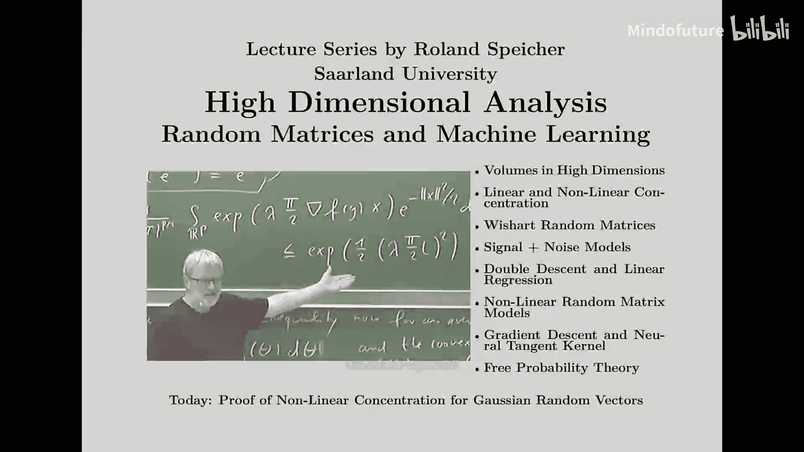
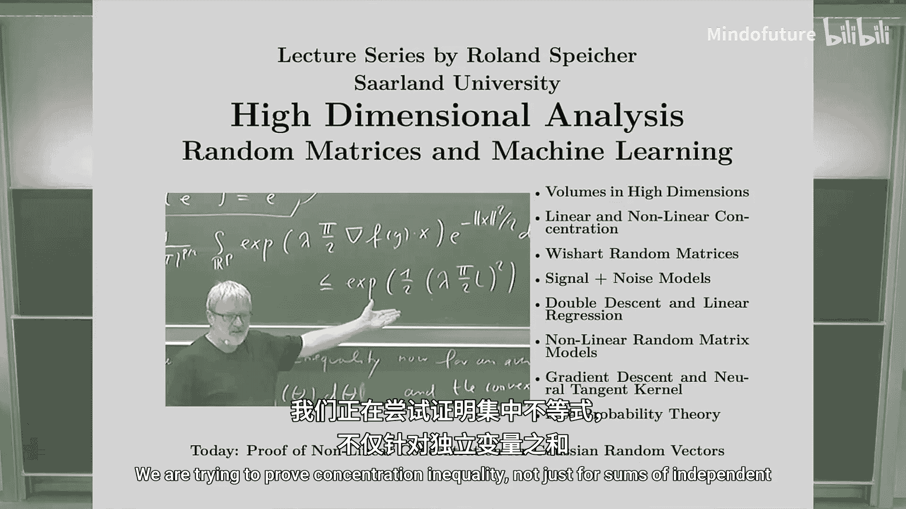

# 【德国萨尔大学】高维分析：随机矩阵和机器学习 ｜ High Dimensional Analysis p07 P07_高斯随机向量非线性集中性的证明 -BV1XkkWBFEi6_p7-

We are trying to prove concentration。

Inequality， not just for sums of independent variables， but for more general functions。

 namely lips functions。 So Okay， so I recall。What we want to prove。And where we are in proof。Okay。

 so this is this Ga it's gausian concentration。 So it's really about gaus in random。A vectorctora。

 So because energy is important。 We will see。 Okay， so the setting is， we have a function。From R。

To R。 And this should be a lip shititz function。And eip function has a constant。 So this is L。Okay。

Yeah， and then we apply this function to Gausian random vectors。

 and we consider standard gausian random vectors。 our vector X has a distribution。

 which is a normal distribution， which means 0。And covariance matrix identity。

 So this just means all the components of this vector are independent。

 and each of them has a standard gausian distribution。 Okay， and then we want to prove。呃。There， yeah。

 there。Dviations of the value of the function from its mean that this is we can estimate large deviations are somehow small now。

 So for all。I发。Beer than Cyril。We are equal。We want to prove that the probability。Of the back doors。

Such that。The distance between F applied to this vector。And the expected value。Of this function。

 that this distance。Is bigger than I far。We want to see that we can estimate this by two times。

Exponential。Minus alpha squared divided。By 2 l squared。Also， the iPhone。对。

Thevi of L is is theit constant here。 Okay， So so， I mean， this is saying somehow。That this， yeah。

 deviation has a kind of of gausian behavior。 I mean， this is， this is the。

Behavior of Ga in distribution。 Okay， this factor 2 here comes from the fact that I have here an absolute value。

 which means I should estimate in two directions。 Each of them gives me the same and the same will be this one。

 So that's really what we are going to prove。 And， of course， we also can assume that。

The expectation is 0 by just shifting things。 So essentially。

 we have to prove the probability that F is bigger than some alpha against this here。 Okay。

 and then we also said， we can assume。That our function is smooth because we can approximate otherwise。

 so we can assume lipsshed condition can be then said that， okay。

 our function is differentiable and the gradient of the function is。Its bounded by air。Okay and。

The idea of the proof is the same as an order concentration estimates， namely， we use。

Markov inequality。 But we apply it to E to our function。 Okay， so what。你。

So what we really have to estimate。Is the expectation。O。The exponent。Of Lambda。F of x。Okay。

 because then we apply Markov to this and ada is a parameter。

 which we choose later in order to optimize what we get。 Yeah， I know okay， up to this point。

 that's the general strategy。 but now we have to use our specific situation and the first step is that actually here this we estimate against the quantity where we we replace f of x by f of x minus f of y。

 where y is an independent copy of x might look a bit strange introducing extra。呃。

Information in the whole thing。 But the point is， because our lipsitz condition is essentially something on a difference of the function between two points。

 So we should be able to， to argue with such a thing。 Okay， so we estimated this。

 And this was Ys's inequality。 that we could say that this is， or maybe first of all。Yeah。

 you estimated this。By the same quantity， where I take the expectation。The exponential function。

And then I have here lambda。F of x。Minus。F of y。This was a trivial estimate。Essential。

 it was because by Jens。 we could estimate the。The expected value of the exponential of this guy by one。

 Okay， so introducing this is not really。Doing much， it seems as if we haven't。Really done anything。

 but not the point is that this quantity。This quantity here， this is something which we can control。

 I mean， it's hard to say something directly about F of x Okay， but this difference， we can control。

And this。We are going to。Right。I mean， we should control it in terms of the derivative of our function。

 because that's where we have control by our lipssheditz conditioning。

And we are writing this just by the fundamental theorem of calculus as the integral。

Over the derivative of its function。 I mean， this is the function at the point。

Between the point X and the point Y。 So this is the same as the integral over the derivative of the function at the two points。

 Okay， and we do this。呃 by yeah。体京。Let's see。This derivative of this function。

Where we have a function which interpolates between x and Y。

 The argument should now interpolate between x and y。

 and we do this in a specific way by taking linear combinations of them。 So we take the cosine theta。

Why。Plus to sign theta。Times x。TheIn over the theta。Yeah， okay。

 And if theta is running between 0 and pi over 2， I mean。

 this guy here is running between x and y for P over 2。 It is P over 2。 It is x。

Because then this is one and this is 0 for 0。 it is y because then this is1 and this is 0。 Okay。

 and I have to integral over the derivative。 So this means I should take the difference of this function at those two points。

 And this is exactly this。 So this is just a very complicated way of writing this。

 But why am I doing this， Because test the advantage。That maybe I call DC C X。X of theta。

Yeah yeah yeah我 yeah yeah看播。Okay， so x of theta and then the derivative of this。

 by the chain rule is the is the gradient of this applied to the derivative of this guy。

 So what I have here。This是啊。Is the gradient of F at the point where I am。 So at the point x of theta。

And this is good because we have control over this。

 But then this is multi blight with the inner derivative。 And if I take the derivative of this。

Repect to Theta。Let me write it。like this。 X prime of theta。O。Yeah。

 and now the point is that this x prime of theta。 I can also control very easily because， I mean。

 this is， of course， it， it's the same kind of combination。 But I get the the。

 the minus sign and here the the cosine。Okay， and the point is。呃。

That this and this are still a pair of independent Gaussians。Okay。

 so this is really something where I have good control over。 Okay， the first thing Im， I'm going。

 okay， just recall or check that indeed this this is okay that X theta and x prime Theta is really a pair of independent Gaussians。

 that's a basic property of Gas。 And this is a property which only works for Gauss。

 Now that's the reason that this whole proof here， is really one which goes for the Gauss distribution。

Yeah， okay。 So I think that's where we stopped last time。 Of course， we will continue here。

 But maybe first， let me check or make precise that the X theta and x prime of theta are for any theta independent gausian variables。

Okay， and maybe I'm doing this in the next lemma。Also， okay， I consider as I have it here。

 X and Y 2 independent standard gas in random vectors。X and y。Be true。Independent。Stand up。Gusian。

Fanddom vectors。In to the peve。Okay， and then I take those linear combinations for any theta。

So forta， okay， principle， I'm running between a0 and pi12。 But， of course， I can take any。きたいな。

Consider。So x of theta is what I have here。So that's linear combination of y and x。

 where I take cosine。Theer of why。Plus， sign。T of x。 And then the second vector。

 which I take is the derivative of this。 But now let me just call it Y。 it's， it's another。

Combination， which I call Y of datata。body its a derivative of the first guy。theta， so it's minus。

Sine theta y。Plus， quoine theta x this。Is。X， the derivative of the first guy。

 But this doesn't play a role。 I mean， here， I'm not。

 I just fix a theta here and argue about this But later， of course。

 it's important that this is exactly the derivative of this。 Okay。

 and then I'm claiming that for any theta now， those two vectors together are essentially the same as as before。

 namely it's a pair of independent causingus in vectors。So then。不一。Pa。The two vectors。

 So they are still random vectors in R to the P X theta。And why he up。Also。To independent。Stand up。

Gusian。Banddom vectors。In to the P。Okay， and I mean， this is quite easy。

 Maybe you have seen this or this is clear。 but still let me give the proof or just。Yeah。

 that we are sure about this。 And in principle， I mean， what I'm doing here is I have two vectors。

 And if if you're just thinking of x and y is being vectors。

 then essentially being independent is like they are orthogonal。

 and then I'm just rotating them by angle theta。 And then they are still orthogonal and their length is the same。

 of I mean， that's what's small less in the background。That's what I mean。If I have here。X and Y。

 then essentially， if I take a theta， then I'm rotating the whole picture。I get T。X of theta。

And y of theta。 And they， they still are orthogonal。W10 means independent。

 and their length has not changed。 So they still have the same distribution。 Okay， but maybe let us。

Make this。A bit more precise。Or maybe let me first make。呃。As an example， specific choice for theta。

 If I take theta 45 degrees， then， of course， I'm talking here about the sum and the difference of of two vectors。

 also maybe。Just to make it。And more concrete。Pe up pi over 2。

Then this says that if I have two vectors， x and y。And they are。

Independent that each has a normal distribution。In P dimensions。 But this is also。

 you can also just think about P equal to one。 So it's just two independent Gaussians。

And then if I'm looking on this combination， and in this case， this is just x plus y。Divided by。

Squad of two。And x minus y。Dived by spirit of two， Then this is， again。

 a pair of independent Gaussian vectors。 So those guys。啊，我说。Independent。And 0，1 p random vectors。

Okay， and so this， this will be very crucial for this proof。 Okay， and so you might think。

 maybe I could generalize this to distributions which have the same property that， for example。

 if I take the sum and the difference， they are still independent， have the same distribution。

 But more or less， this is a characterization of gas。 So its I mean， if you have independent vectors。

 which have some distribution and the sum and the difference is still independent and has the same distribution。

 then it must be a Gaus distribution。 Okay， so there is no no way of generalizing this proof here to more general distribution。

 it's really precisely property of cows， which is used。 Okay， but anyhow， but this is of course。

 a very nice and strong property。 good， but so let let us look a little bit in the proof of thislemma。

Maybe make this rotation thing a bit more precise。Because we know。In particular， from。

One of the assignments quite a bit about what happens with distribution of cows and。Proation。And so。

 of course， I mean， we， what we are doing here is， I mean， we have two vectors。呃。In R to the P。 And。

 of course， this means essentially， if we put them together， we have a vector and R to the2 P。 Okay。

 so I mean。I can look on the pair， X， Y。So this is a vector in R to the 2 P。 and then this。Is。

 of course， again， the Gaus in vector。 So this has the density。Sosi of X， Y。

 What is the density of this guy Because x and y are independent。

 It's a product of the densities for x and for y。And each of them is a standard Gaussian random vectors。

 So we know the density is given by one over。To pi to the P over。2 for the x。

 So name it then density is E to the minus。The length of x square divided by 2。 That's the， I mean。

 that's the。The density， probability， density for standard Gausian vector。

 and then the same for the Y。玩欧巴。To拍。P over 2。E to the minus。Y squared over 2。 Okay， and of course。

 I can also write this as one over2 pi。 And I have a P over2 and P over two times。 altogether。

 I have to the power。P and T， I have E to the minus。Ex square。Plus y squared。Divided by。by 2。 Okay。

 and this， of course， I can also say， I mean， this here， I mean， x and y are vectors and r to the P。

 But if I think of them as being vectors in r to the 2 p， of course。

 this here is exactly the length squared of the vector X， Y。 also this， I can say。It's one over2 P。

To pi to the power of P， E to the -1 half。 And then I take here and my vector in R to the2 p。

 So the vector X， Y， let me write it as a column。 So the square of this。哦。Okay。

 so this is the length in are to the2 p。 and those are the lengths in to the P。 Okay， and now I see。

 of course， So I have now a vector X， Y。 I have not a density for this。 And again。

 this is exactly of the same form as I have it for for a standard random vector in R to the 2 P。

 So this， this is telling me。It this。X， Y， So if I put x and Y together as a vector utter 2 p。As。

 as a distribution， and。0。And then the identity matrix in 2 P。Okay， I mean， this。

 this is kind of trivialvia。 I mean， I have a vector where all the components are independent。

 Each has a gaugeuse distribution。 I have another vector。 It's the same property。

 And if the two vectors are independent， this means the components here are independent from the components here。

 So if I put them together as， as a 2 p vector。 then， of course， I have 2 p independent。Enries。

 and each of them has a cost distribution。 Okay， so this is just writing this down maybe a bit more formal。

 So this should， should be clear。 but now。I mean， in this， if I really。

View my pair of the vectors as a vector R to the 2 P。 I mean， then。

This replacement going over from X， Y to x theta Y theta is really a kind of of rotation in this space。

OK说这。Replacement。Going over from X， Y。2步。X。你的。Why did得。So this is actually a unitary transformation。

In。To the 2 P。 Allright， be more precise。 Actually， it's a transformation。

 which acts separately on each of the components of my vectors。 So essentially。

 it's a transformation in R 2， but applied to all the components of my vectors。

 So namely the basic transformation。I's the one which is there， namely。2 by two matrix， cosine。

 theta。上ed的。Minus sign theta。Cosine提ta。So this is a  two by two matrix。and。If I also write， maybe。

Now， my vectors in。In terms of components， So x theta the components of this， I call Ts。T1。Up to TP。

Depending on theta， everything and the same for the Y。 And then I call the components S。 So S1。いた。SP。

Theta， and then， okay， then， I mean， this vector here would be all first all the T's。

 and then all the ys。 But in order to write it more nicely， I prefer to。

 to rearrange things so that I iterate。 So first of。

 I took the first component of of the y of the x and the first component of the y。

 And then the second component of the x and then the y。 So I'm writing this here。In the form。

 this is T1 Theta。 And then I'm taking S1。滴答。two。As to。Pitita and so on。 up to。TPT答。As Phida。Just。

Reorganization so that I can write to you in a better way。 And then I'm applying。 I mean。

 this vector I'm getting by applying the amplification of this U to my basic vector。 So this。

To my vector door where the theta is equal to 0。So， I'm applying this。To。T1。1。T 2， S 2。And so on。

 up to Tp。SP。Oh right， this is the back door。X and Y， And what do I apply， I mean， essentially。

 for each of the component for， for the case component。

 I take exactly this linear combination of the case component of the X and the case component component of the Y。

 So which means for the first component， I apply this U。Also， this user a  two by two matrix。

Which xs just here。 Then for the second components， I also take the U。

So acting on the second components。And so on， up to the U。

Acting on the last components and everything else is zero。 I mean， the components are not mixed。

Different components are not mixed among themselves。

 It's only the the same component of X and Y are mixed with U。 Yeah， O， but U is。呃。Is as a unitary。

 I mean， U times U star is equal to1。 I mean， that that's just unitary。

 which does a rotation And of course， I mean， U star is rotating backer and u times u star is equal to 1。

 So this is unit unitary transformation， which means in particular it preserves length and and angles。

 Okay， yeah， but then， I mean。说。とい。star or transpose， maybe it's equal to one。 And， of course。

 the same is true for for this matrix， which just consists of several use。 Okay， and now we know。

 so so we we do here transformation。 we act with the linear transformation on our Gaussian vector and in assignments。

 we have checked what this means we get again， another Gausian vector。 And in general， of course。

 the covariance matrix will change by conjuation with a transformation we are doing。

 But in this case， here， this has no effect。好啊。So。And thus。By behavior。Of Gausian。

Random vectors and linear transformations。And， this was。Your last assignment。

 just the exercise number 4。You should check such things。 We know that a new vector。T1。记得。S1。Ta。TP一的。

SP。Theta has a distribution， which is given by taking the distribution。On this side。

 but on this side， it was just the identity。 it was just and zero identity。 And then， of course。

 we are not acting on the means here。 So these are are not going to change。 But then with。

We are acting with our transformation。Maybe， maybe not let me call it the whole matrix here V。

 I mean， you is a two by two matrix and putting all these use together so that I have an action on all。

Components。Maybe let me call this matrix。 B， And I mean， that's the matrix which acts here。

 And then if I'm acting with a。Linear， invertible matrix v。O。呃。On my gauss in vector。

 Then here are the changes that I get here， we。And we transpose congreggation by we。Good， but now。

 I mean， here's the identity。 So what I have here is just V times we transpose。 But now。

 because this is an orthogonal transformation。Then this is just the identity So U times U transpose is is just one because yeah。

 because just cosine squared plus Sine squared is always one。

 that's that's just the main point of this。 Also this。Is。It's one。

 So what I have here is just the same as before。 Nothing has changed。So， I still have here。

A random vector， which has this distribution。 And this is just telling me that this is a vector where all the components are independent。

 and each has a standard。It has a standard Gaussian distribution。 And this means I have， yeah。

 So if I split it again into two vectors， X theta and y theta， each of them is a standard Gaussian。

 but they are also independent。啊，啥命。X tta y theta。Has the same distribution as x as x and y before。

This means。Have。For each起。记得。Again。Stand out。搞先。Branandom vi in。R to the 2 P。

 all this means if I splitting my big vector and R to the 2 P in two vectors in R to the P。

 then each of them is standard Gausian， and they are independent。 That's exactly what I'm claiming。O。

然so that just驶。没见。Thislemma here。Precise， and now we can， now we can use this and continue with。

With our。Proof of our concentration estimate。 I think now we have。More or less everything together。

 So， I mean， essentially， Ysen's inequality was an important ingredient。

 and we are going to use it again。 And this property here is is important。 Okay。

 and this property here is really something which only applies to Gauss。 I mean， Ys's inequality。

 of course， is is much more general。 Their Gaussianity was not the issue， but here。for this party。呃。

Aianity is really very important。Then， let us continue。The proof of our main theorem。呃呃。Yeah，3。2。

So now。Continue。Pro of。3。2。Yeah， and let us recall where we stand there。And then。Use this。 Okay。

 so what we have to estimate。So let me say it again。In principle。We want to estimate。

The expectation of the exponential of Lambda。Times F of x。Good， okay， in order to deal with this。

 we introduced this y。 So we estimated this in the first。Kind of more trivial step。

Against the same thing where we replaced F of x by f of x minus f of y。Okay， and then。

We also rewrote this year。As the integral over the derivative。

We I also choose a path which connects X and Y。 So this， I'm also writing as the expert。Expectation。

Of the exponential。Of lambda。 and then this difference of x and y。

 I'm writing as the integral from 0 to pi over2 of the derivative。Suspected theta of F of。XD的。聞いた。

Yeah， okay。 and this derivative here， of course。The chain rule is the outer derivative。

 So the gradient of F。At the position X theta。Mulipliide is inner derivative， which is x prime。Of地达。

有。Okay， right， I mean I mean， gradient， this is a vector。 and this is a vector。

 So this is in our product。Between those two vectors。 And let me recall， I mean。

 all objects which we have here。所回啊。You have the following。So first， our F， F， of course， is a。

 is a lipitz function。 but we also assume it is smooth。

 And this means we have an assumption about the gradient。 also F。Without restriction。

 or we can reduce the general。Situation to the smooth situation。And， of course。

 our function is always loop sheets。Use the constant L。 But in the smooth case。

 this can be rephrased as saying。That the gradient of f at any point is bounded by L。

The length of this。O， then x。Oh vector x。Is a standard。Stand at Gaussian。Random vector。

 And why is an independent copy of this。So why is just introduced？For the purpose of the proof。

 So why。Is an independent。阔逼。Of x。Y is an independent copy of x。 And then here we introduce this。

Interpolation between x and y。By introducing。X theta。It's cosine。Tta y。Plus， sign。Theta x。

 but then we also need the derivative of this， but the derivative of this is exactly what I call y theta there。

So， I also have here。X prime of theta， the derivative。 I mean。

 this is the derivative with respect to theta。 So the cosine is minus。Sine theta of y plus。

 and the derivative of thesine is cosine theta of x。

And so we know that this pair of x and x prime is for any theta， again。

 a independent pair of Gausian Gausian of standard Gaussian random vectors。I mean。

 that's what we just did in this lemma。打死。れま。2。4。To pair x theta。Bine， Tita。Yes。normal distribution。

In standard normal distribution in。2 P dimensions。For oil。ついた。Okay， so that's where we are。Yeah。

 and now we have to try to estimate this。 And， of course， I mean， what what is our goal， I mean。

 in principle， in order to get。A kind of Gaussian estimate。

 we estimate that the probability is e to the lambda squared。

 We should estimate this expectation of the exponential against lambda squared。

 So it should be an estimate lambda squared because that's what happens for a Gaus distribution。

So in principle， I mean。呃。Yeah， if you want your concentration inequalities。

 essentially in the moment generating function。 So this exponential of expectation of the exp exponential of lambda times your variable。

 you should get something like E to the Lada squared。

 that that's the best thing because then you can get good estimates。

 So that that's where you want to go。 Yeah， But for this，Yeah， we have to estimate this here。Somehow。

啊。And first。Yeah， we we。Okay， so I mean， we know something， I mean。If this x theta。O。

 so we have here something。The point is， I mean， here we have， here， we have a Gaussian vector。

 So this has a Gaussian distribution。 And if we would have， maybe this is just。

 and this is a coefficient， which we can control。 or maybe let me say in a better way。

 What I have here， if I'm fixing x of theta。Then I have here a vector multiplied with a Gausian vector。

 And if I take if I take a linear combination of independent Gaussians， I get again， a Gaussian。

 Okay， so this fixing。X of theta。 This is a Gausian vector。 And so if I have E to this。

 E to the lambda to this， then I could control it。 So what I what would would be good if I could bring this exponential here to this guy here。

 Because then I could use estimates for Gaus distributions。 And that's the first step。

 what I'm doing。 So namely。Estimating in the right direction。

 the exponential of this against something where I take the exponential up to here。

 And this is just again， Yan's inequality， but now applied to this integral here。

 because Yans's inequality is for averaging， taking the expectation with respect to。Distribution。

 I mean， essentially it's saying that that the average of an integral is less than an integral of the average。

 And I mean， here were integrating from 0 to pi over 2。 This is。

 this is just taking the expectation dis respect to this measure。

 but I should make it to a probability measure， because I mean， it's really important in Yen。

 I need a probability measure。 So I should divide here。 I mean， integral from 0 to pi over 2。

 This has total mass pi over 2。 So I should normalize this so that it is a probability measure。

 And then I just kind apply yen。 again for this specific situation。

 which allows me to estimate this here。 I mean， this expectation does play a role at the moment。

 I just want to bring this exponential to this guy here。Okay， so that's what I'm doing now。

We use again Y inequality。呃。No。For ever rich。Of the form。So I'm integrating from0。To pi over 2。

 let's say a function G of theta， an arbitrary function。But I should average of probability better。

 So I should normalize this。 So I should divideide by。1 over pi over2。 because， I mean。

 if I'm integrating here with a constant function 1， I get pi over 2。

 but I should get one for probability distribution。 Okay， so I'm using。呃。Yanzen。

 for this averaging and for the function。For a convex function， I mean， of course， for Y。

 I need a convex function， but the exponential function is， is， is a convex function。So， end。

The convex function。H of T。This is let's say。Exponone exponential C times T。Okay， so this means。

What I get from Yenszen's inequality is。Let me write it down in this。呃。Setting， so this tells me。

That my function， So of function。 Yeah， the function of the average is less。嗯。

In average of the functional。呃。Yeah， so I take exponential。I take my convex function of。

The average So I take exponential of C。 C is see a constant， which okay。

 I will adjust to what it is there。 And then I have to take the average1 over pi over2。

 the integral from 0。To pi over 2。Time some function。Theta， the theta， Oh this。

 So this is the convex function of the average。 This is less than。The average， Okay。

 so the average is now one of。Pi overva 2 integrated from C。Pi over 2。 And now I have here。呃。

My function applied to this guy。 So I have here the exponential of C times。G of Tta。D记的。Okay。

 so that is what Jensen is saying me in this setting。 And now， of course。

 the geofita is this quantity here。So I'm using this now。For。She ofta。This is the gradient of F。

Of x theta。Times x prime of theta。And to see which I have here， of course， I mean， I have。

 I have here。 What do I have。I have the Lada， and then I have introduced here。

Theres additional one over pi over 2。 So I have to prepare for this。 So I have this here again。呃。

To multiply with it。 So the C is lambda。Times pi over2。嗯，OK。And then I again estimate here。

 And then I also apply the the expectation value。 So I mean， I have the expectation value。

 This is respect to， to my Gauss in distribution。 This is the integral over the density of the Gas。

 But here I have used the enen。 I just little respect to this integral here。Now。

 not with us respect to this expectation here。Good， okay， yeah。 So for this。 So what we get。嗯。Yeah。

 okay， so maybe。Continue here。So。It's less than。 Okay， so the expect expected value is still there。

 And now I'm estimating this exponential。According to this here。

 where now I just use what I have here。 So I get it's less than。1 over。Pi over 2。To integrate from 0。

pi over 2。And then I get the exponential。And my constant there is Lada times pi over 2。

And now my function G is exactly distinct here。 So I have the gradient of F at the。

Point x of theta multiplied。IX prime。At the point theta。哦， so thats啊。The g of theta。And then。

 I'm integrating。Suspect to theta。Good， okay， So now， of course， this expectation。I mean。

 this applies to my random variables， So this has nothing to do with theta。

 but of course this applies to those guys。 Okay， so I can of course bring this out and this expectation in in the integral also commute because everything is linear。

 So this is the same as one over pi over2。2 over pi。 And then I have to integrate from0。To pi over 2。

 And now the expectation goes up to this point here。 So I take the expectation of。TheX。

Fncial function of lambmbda。Times pi over 2。The gradient。Of F of。Exeda。Multi bed。Is X prime of theta。

一体的。Good， yeah。Okay， and now。So here， this expectation here。

 this is now with respect to the Gaussian underlying Gaussian。Distribution of x and Y。 Okay。

 but we have seen if x and Y are standard gauss in random vectors。

 then the same is true for those two guys。 And they are independent。 So I， I mean， essentially， I'm。

呃。So what I have here is for each theta。 I mean， I'm integrating here a theta。

 but this quantity here， this depends。So for theta fixed。 what do I have here。

 I have here a Gaussian random vector。 I have here Gausian random vector， and they are independent。

 And I'm taking the expectation over this。 So this means this expectation here is actually independent of theta because it's just taking the expectation over a pair of independent Gaussian standard Gaussian。

Variables， also， this means this expectation here， which I still have。To estimate。

 But at least it's the same for each theta。 So， I mean， it it has looked。 I mean， I have X and y。

 and I'm connecting them them via a path。 And I mean。

 I have to know everything which happens on this pass。 But essentially， because for each theta。

 it's exactly the same。 So not nothing really strange happens there。

Because the pair is always the same kind of pair。 So this is just the expectation。off。Exponent。

Of lambda。Pi over 2。gradient， let's say for theta equal to 0 and for theta equal to 0 X。

 X 0 is the y。So I have here， let's say my original y。

 and this here is just the derivative is just x。啊。So this is just the expectation over the gausian distribution for the pair X。

 Y， and they are just。Independent Gaussians。Yeah， okay。 and now。嗯。I have。To calculate。Essentially。

 you estimate this quantity here But now， now I'm really in a situation where I can say something about this。

 because now what I have here， I have， I have to。To take the expectation with those back to x and y。

 Okay， so I have to integrate with respect back to the density of x and the density of y。

 but x and y are independent， which means I can， let's say I can fix y and then take the expectation over the x。

Because they are independent， these factorizes。So， and for each y。I know。 So if， if I'm fixing why。

 then I have here。I have here a vector， which is now， let's say。

 constant vector over which I average reach later。 But for this argument， it， it's constant。

 And I'm multiplying this with a vector， which has independent Gaussian。Components。

 so this means I'm taking here a linear combination。Of this vector with independent components。

 And if I take a linear combination of independent Gaussians， I just get another Gaussian。

 And I know also what the variance is。 namely， this is just the al2 norm of the vector。

 which I have here， so。Let me write it here。 So for each fixed。Pted y。I know that the vector。

 which I have here。The gradient。 And let's let me say， I mean， I have here the gradient of F。

Is the gradient of F F disposition position。So I know。 so this is a vector。 the gradient of F。

 And now my lipsitz condition tells me that this vector has lengths less than L So F at any point or the gradient of f at any point is always bounded by L。

 So for each fixed y is the gradient of F at the point Y， and it doesn't matter what y is。

The length of this vector is less than L。 That's the lips constant。And so。

The gradient of F of y times x。This is a linear combination of independent Gaussians。 So this is a。

 is a Gaussian again， And the variance of this is less than the the length of this vector。

 That's just。A simple property of， of course， if I take。Yeah。L combination。Go on。

 the fixed vector times a standard Gaussian random vector。 I'm getting a Gaus distribution。

 and the variance of this is， is exactly the length of of this vector。 Okay， and here。

 the length of this vector is always less than L。 So what we get for each x。

 is a Gaussian distribution， which has variance less than。Or l squared。Okay。

 the variance is the square of this。 Okay， So so this here and this。Is a Gaussian variable。

The one dimensionary。This。Variance。Less than l squared。 Yeah。

 but then I'm really now back to something which which I can do。 namely then I have here。

 So for each fixed y， I can do the expectation over the distribution of x。

 X has a Gausian distribution。 But then I if I look on this。

 what I get is a Gaussian variable variance less than l squared。

 So I'm taking here the expectation of E to the lambda times a Gausian distribution。

 And that's something which at least the case for standard Gaussian。 I already showed you。

 But of course， this is something yeah， which is easy to see。 So I okay， maybe So if， if。

 let me see if。X is a normal distribution。One dimensioner。The sigma squared。

 then the expectation of E to the lambda x。This is呃。E to the lambda squared sigma squared。

Maybe a factor too。 I'm not so sure about this。But it's essentially， it's this one。 I mean， I mean。

 I get here E to the lambda squared that that's really what I want。 I mean。

 that's what I really want。For my overall estimate。 but I'm using this now。

 deep buried in the proof that in the proof， I really have Gausian one dimensional Gaussian variables。

 for which I know this estimate。 And then I'm just integrating。Everything up。 Okay， so。上ですです。

I get then。That呃。If I'm。Ting。Let's say that。Expectation。Yeah。The expectation here over x。

But for fixed y， then I get estimate like this。 So maybe let me write it down。 So if I'm doing。

F over。To pi to the power P over 2。to the P。 So let me write the expectation， maybe in a。Explit form。

 So I mean the expectation I'm doing here is the expectation with respect to x and y with respect to the densities。

 which are e to the minus norm of x squared over two for x times e to the minus y squared over two for。

 for the y。 And then I'm just doing iteratively。By， fubi。

 I'm just fixing Y and first do the integration over Y x。 And then for this， I can use this here。

 So for this， I have the X。是老是蓝的。Pi over 2。Craient。え。position Y multiplied。Its x。

And then integrate it。With the density of thex。 So the Gauussian distribution。This is then less than。

What I have here， and I think here I have effect factor one over2。If sigma squared is the variance。

 So I get here less than the exponent。One half。呃。야ラ得스。Lambda squared。

 And then I it's getting multiy b with the variance of this thing。 I mean。

 this here is less than L squared。 And， but then I also have this extra pi over two here。

 So I get altogether here， Lada。Pie over 2。And squared。O so I get this for each y。Just because。This。

 if I'm fixing Y， you see is just a constant vector multiplied with a Gaussian vector。

 which gives me a Gaussian vector， and the variance of this Gaussian vector depends on the length of this guy。

 which I can bound by L。So I get something which is the， which is the length of this。

 But I can always estimate this by error。 So I get this。Okay。

 and so this means in this expectation here。I have now done for each Y。

 I have done the integration over the density of x， but I get an estimate， which is independent of y。

 because， I mean， y only property。 I mean， y didn't really come into it。 It was just， I mean。

 F of y is everywhere。 I can estimate it Okay， well now I can just do the remaining expectation over the y。

 But of course， then this doesn't change anything because for every y， I have to say result。So。

Integrating this now。Over the density。In respect to why gives me then。More or less。

 my final estimate in terms of Lambda。For the quantity， which I really need。

For applying my mark of inequality。嗯So now。海度。Integration。Over why。And then I get that。

 I can estimate。The exponential。Expectation of the exponential。Of lambda。F of x。So this thing。

But this， I have estimated against this。And now I have estimated in this expectation。For each Y。

 I have estimated this against this term。 And now I'm just doing the remaining integration。

 Then I just get。Again， this term。Of course。This was for each Y， integrating over why with a。

Probity distribution doesn't change anything。 So I get the exponential of。1 half。兰达。Pi over 2 L。Scr。

Okay， that's。That's what I I was after。 I mean， that's the main step。

 which I have to do if I want to apply my mark of inequality。 I mean。

 I still now have to go on and choose the optimal lambda。

 but but what I really want is for this quantity， I want estimate and the best thing if if I can get a lambda squared here。

 Okay， and now now we just continue in the same way as we did it before in a linear case。 I mean。

 also in a linear case。 when E was a sum of things。

 it was much easier to arrive at such such an inequality。Okay， but。

 but now we can continue the same way。 So name me what we really want。Is the probability。That f of x。

Is bigger an I？Yeah， and let me record by Markov。I mean。

 this is the same as saying that E to the lambda times F of x is bigger than E to the lambda Al。

 And we apply Markov to this， which means we have to take the expectation。Of异议。To the兰达。F of x。

Divided by E to the。兰da艾法一。to the lambdaァ。Yeah， but now for this， we have now got our estimate。

 This is less than。第一。意图的。one half。Lada pi over2。Squared。Dide it by E。To lamb的。Or maybe this is。

 of course， now the exponential。Off。呃 one half。Let me take out the Lada squared。

 because Lada is now a variable， which I want to optimize。 I mean。

 this is true for all Lada for all Lada bigger than0。 And I want to optimize now。

 I I I'm free to choose a Lada， because， of course， Lada does not show up on this side here。

 I have introduced this in artificial way。 This is。Inequality for or lambda。And T I have。He over two。

And squared minus， O， this is minus lambda alphapha。Good， okay， and now I want to optimize this。 And。

 of course， the optimize one should give me something here， which is negative。 Of course。

 the probability I would like to have something like e to the minus something。

 And I'm choosing the Lada for which here this here is， is is the。Is the the minimum value。

 So I had just choose the。You extreme home。Of what I have in the argument of the exponential。 And。

 of course， this is。1。To do。Yeah， so I minimize now this idea。In Lada。Let me call minimize a Lada 0。

 So I should take the derivative。 So it's。1 half times 2。Lambda， we call it Lambda 0 is the one。

For which derivative derivative 0 multiplied with。P over。To a。Squared。And the derivative。Yeah。

 this side is just alpha。 So the di difference should be 0， or this should be equal。呃，赌爱法我。

This two goes away。The numberumber 0 should just be呃。I发。Yeah， maybe呃。

We are putting this on the other side。 So it's4 over pi alpha divided by L squared。So that。

 that should be the best choice of Lambda， which I can do here。 And then I plug this in。

 and then I get hopefully what I want。Yeah， so what is then。This。One half。P squared yeah O here。

Should be啊。Okay so it should be pi over2 squared or to the other side。 Good， But but let。

 let's plug it in。 So one half lambmbda squared is now。Okay，16。Over， okay。

 I to4 now the square of this。 Yeah， the square of this is Ipha squared。Divided by。4。

 that's lambda squared。 And then we multiplied， of course， again with。Pi over 2 is squared。2 squared。

Good， okay。And then we are subtracting lambda times alpha。So， it's for。Over pi squared。

I divided by L squared。 and we multiplly this an additional alpha。 So we get alpha squared。

 And you see it， it's good。 You really get here I squared。 Okay， and here on this side。We also have。

那没。Let me take out the I square。And what remains is。Okay，16。Okay， I have here 2 to the 2。 This is 4。

 This is 8 from the 16。 There remains a two。 I pis。 I have here pi squared。 I have here pi over 4。

 So I， I have a pi squared， and I have here an L squared。嗯。Yeah。What happens to there。

It was there was no square here。Was pi over to L。 Okay。

 so this is just to get an L squared with this1 over L to the 4。 I have a。

1 over L squared in the bottom。And Tia。I have actually the same， but just a 4 instead of a 2。

 So I have -4 divided by pi squared l squared。 And so what I get is really， this is the bigger term。

 So I get a minus。 So I get really minus two times。So 2-4 is -2-2。Pi squared。I ask it。

You write by E squared。Okay， and so this means we get。For this， we get an estimate。Where this here。

Is given by this。And this is more or less what we wanted to prove。 I mean。

 we have an alpha squared divided by l squared。 And then I mean， this is not the optimal constant。

 One can improve this a little bit。 but then one has to use different proofs。

 which is getting more complicated。 But I mean， it doesn't really matter so much what I have here。

 the main point is to see that I have here really。Decrease in I squared。

 and also to see how it depends on air。Good，Okay， so maybe。So what you see here。Yes。The probability。

F of x。His beot an I far。Is less than。The exponential of minus。2 over pi squared， alpha squared。

Derivided by Ed Squaret。OK so that's all。Concentration， inequality， which we have in this。呃。Setting。

But， of course， this is quite specific。f。Thous0 distribution。 And maybe I want to make a few remarks。

Going away from this。 because， I mean， Gausian distribution is， of course， very special。

 So one would like to have estimates also for other distributions。 I mean， independence is， is okay。

 mathematically， it's okay。 I mean， you cannot go really too far away from independence。

 So you need independent random variables， but the distribution of them。 I mean， usually， okay。

It's not necessarily ours。 So let's see what。What we can do or what what is there there in general。

And maybe let me also come back to the linear situation first because I already addressed this when we did this。

 because there actually， I mean， the tools usually go， go much further in this setting here。

1 can also generalize things， but then one needs more assumptions， so。So I want to talk a little bit。

About this。Good， okay， so time is over for today。 So next time I I maybe I will write down maybe just a statement of general。

Concentration inequalities in this setting， or say a few words about this。

 And then maybe also make one more remark about the the non。

A non nonlinear case because there things are getting a bit more complicated and there is maybe a famous Taco concentration inequality。

 which at least I also want on to side。 Okay， but maybe today， time is over。 So making。

 So that's it for today。