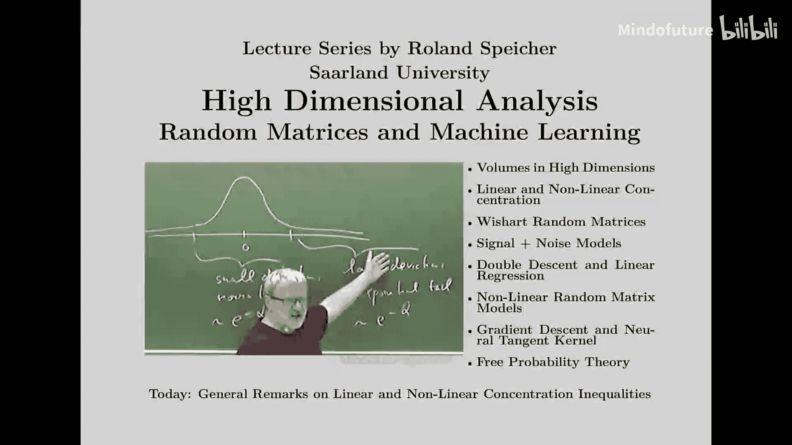
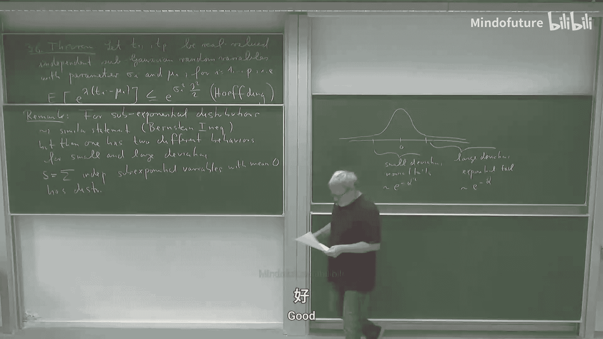

# 【德国萨尔大学】高维分析：随机矩阵和机器学习 ｜ High Dimensional Analysis p08 P08_线性与非线性集中不等式的一般性评述 -BV1XkkWBFEi6_p8-

Yeah， so let me first make maybe general remarks。On our concentration inequalities。 I mean。

 concentration inequalities are somehow of the form， the following form。 So our。Concentration。

Inequalities。Of the form。Yeah， we have an input and the input are variables which are independent and have some distribution。

 I mean， we have an input。Then we take functions of them。And then we get an output。And， of course。

 we want to control the output。 The output is the function of our variables。

 This should show some concentration and the input usually are given by independent variables。

And up to now， I mean， what I always。EConsidered now essentially was that those variables had a gaussian distribution。

So。To know。They were Gaussian distributions。 And， of course， that's what we want to generalize。

 So this can be generalized。In particular， in a linear situation。 And I mean， for the functions。

 essentially， we had two situations。 So I mean， the more。

Classical things where we had linear functions， sums of independent variables。

So we had linear functions。 Or then what we did just now， more general functions。

 which are not necessarily linear。 And we lip shit condition was exactly what what seems to be a good conditioner。

 So all lip shits。Yeah， and on the output side， of course， the concentration。Essentially。

 you got a statement saying that the output， the function concentrates about its expectation like a Gaussian distribution。

 So the tails are e to the minus I squared。 If I is is the deviation of。

 So So what binary really wants is here。Concentrates。Like。It goes in。Distributal。

 so this deviation should go like I squared times a constant。 And usually， I mean。

 if I have a dimension， of course， the dimension usually shows shows also up there。 I mean。

 it should be like a Gaussian， but somehow， I mean。

 there should be something depending on the dimension so that you see that if the dimension is grosss。

 it really concentrates about it But but that's the estimates which one usually wants to show。Qu。

 okay， and I mean， the question is， I mean， if I go away from Gaussian distributions， what can I do。

 How much of the tools extend and in a linear situation。Actually， I mean。

 I already said that things extend。 Yeah， but maybe I I should also say， of course。

In all those approaches， what we did was that we really could control this quantity。

 The expectation of the exp exponential of lambda f of x。 that's really。 I mean。

 it's really just going back to the mark of inequality for this exponential function。

 And then one has to control this distinct。Also maybe here the main ingredient。In the approach。

Its always。The control of the exponential of E to the lambda。 And then I have here， my function G。

 which I want。To control。Yeahや。Good， okay， and in a linear case， essentially。

Controlling this thing in the end is we have to go back to controlling this for the distribution。

 Okay， And so this means if this guy here for my distribution behaves somehow similar as what we needed for doing our stuff。

 then it should still work。 and essentially， so the best thing is。

 if we have here also gaus in behavior。 So if we， if we have a。

Kind of Gaussian tail in the input distribution。 Then this goes over to the output。

 at least in in a linear case。 Okay， and this means distribution， which have these properties。

 They are very important。 And they， for this concentration， usually works。

 and they are called sub Gaussian。Okay， and then maybe one can also make it a bit。Instead of。

Ts which go like E to the minus Ipha squared1 also have exponential ones， which go a bit slower。

 just exponential。 And those are sub exponential distributions。 Those are the the main two classes。

 Maybe I want just to， to give a kind of definition and maybe in the assignments one can see a little bit about their。

 their properties。I mean， that's the guysise for which。At least the linear case can be extended。So。

 let me。Start twist。Goose。O。And so， I mean， this is really now about a distribution of a one dimensional variable。

 So I mean， we take functions of many variables。 They are independent。

 and each of the variables should have specific kind of distribution a specific property。

 And this property should be either subcausian or sub exponential。 And so what does this mean。

 So let X。One dimensional。We use a random variable。And in order to make things a bit easier。

 I assume here they are centered。 I mean， you can also extend this to the non centered case。

But maybe some of the characterizations are easier。If。If it is sent up， okay。

 and let me first look on the subcos in case。So， x is called。

distribution of x or x is called subcaussian。Yeah。If and there different possibilities of how one can characterize this。

 And in principle， I'm just writing down the two main ones。

 Naly essentially saying that the tales of just saying something about the tails。

 how they should behave。 They should behave like the tails of a Gausian distribution and then also equivalent characterization is in terms of the the moment generating function because。

 I mean， that's what we always use in our proof that this should behave like the one for Gaussian。

 which is e to the lambda squared。Okay， so and those， those are equivalent properties。 So So。

 and so I'm saying here， if one。Of the following。equivalentvalent。 and I'm just giving two。 I mean。

 there are more。 You can also say something maybe about the moments， how they increase。

 They should more or less increase like the moments of gas。 But I'm not putting this down here。

But unjust。Taking。Following one。 So the first one is about a tail。 So namely that I can estimate。

The of my。Distribution like a Gaussian tail。 So there is a constant C bigger than0。Such that。

F alpha bigger than0。The probability。That x。Is bigger than alpha that this can be estimated。

By two times， and now the exponential is of this form。 I have alphapha squared。Divided by sea。

So it's， it's a kind of this dysdia。And that's， of course。

 exactly what we usually also want in our concentration estimate for functions of those guys。

 They should also show behavior like this。But so in particular， for the input variables。

 we should have this behavior。 Okay， but this can also be。

Equivalently reformulated as a property for the generating exponential generating function。

That they should also behave in a。In quadra， it has a exponential。To， to lambda squared behavior。

Yeah， so this is equivalent。To the fact that they exist， a constant。Different one。 But O， of course。

 they are related。 Let me call it see。See Twitter。Such debt。For lambda in a。

I can essentially compare。The moment generating function E to the lambda x。

 So the expectation of E to the lambda x。 So this is a function in lambda。

 I come can compare this to the corresponding object for the gausian distribution， which goes with E。

To the yeah， there's a constantsancy Twitter here。 and then I have here Lana Square。

SoSo in principle， the moment generating function is small less the Fourier transform。

 If you do it in in a complex way， but。Okay， so it goes like E to the Lada squared。 Okay。

 and this is equivalent。Yeah， good。 So that's sub causian。 That's。Very important class。

 And they behave in， in some， in this respect， likega was in distribution。Good， but then， I mean。

 when we did the proof for the norm， essentially， we had to look on the square of a Gaus distribution and the square of a Gaus distribution has not this property。

 It's not sub Gaussian， but it had a property which was good enough for doing our estimates。

 And this it was sub exponential， which means it doesn't go like E to the Lada squared。 but it goes。

It doesn't go like like E to the minus alpha is greater density。

 but it goes like e to the minus alpha So it's。Des in exponential way。

 though those are sub exponential guys。And for this， essentially， I mean。

The property of the square of gas wall， which we used in our proof was that it。

 essentially that it was sub exponential but so。This can be generalized， or this is called。

Sub exponential。Yeah， if and again， I'm giving。Those two properties in this situation So again。

 it can be characterized in terms of the tails or in terms of the behavior of the moment generating function。

 So if。One of。对。Following equivalent。Properties。satisfied。 So， first of all。

Details are not going like in the Gaussian case， like e to the minus I squared。

 but only exponentially。 So like e to the minus I。 So， so this means there's， again， a constant。

You in Cyril。Such that for all I。Be good in Cyril。We have the de probabilityability。That x。

Is bigger than I can be estimate by 2。 I mean， is two is always coming from the fact that essentially this estimate is。

 is two estimates，1 on on the left and one on the right side。 But then。We have here the exponential。

 and now we only have minus alpha divided by C， not alpha squared。Okay。

 and now this can also be characterized in terms of the moment generating function。 But now， okay。

 you might think maybe I also have there only e to the lambda instead of e to the lambda squared。

 but that's not the case。 And that's not。 I mean， if I have if I would have here E to the lambda。

 then I could not use this for my concentration because I mean。

 I wanted in the end I wanted to minimize the exponent。

 and there's important that I have a lambda squared and a lambda quatic polyno。

 Otherwise there is nothing to minimize。 okay， so I still need something like this。

 but only a weaker version of this。 and this is the following。

 So there exists C twi again some constant。Such that I still have an estimate like this， but not。

 not for all Lada， but only for Ladas in some domain。So， such that。For or lambda。Which。啊，Sll了。

Then one oversee Twitter。I have。Yeah， the same kind of inequality e to the lambda x。

Is less than e to the C to the squared times lambda squared。Okay so you see essentially。

 I have the same estimate like Lada squared。 but this is not true for all lambda。

 but only between0 and this sky。And maybe if you look back what we did for the square of the。

Of the gas， I mean， there we could calculate。This function explicitly。

 And then we gave an estimate against this。 But this was only exploding。 Actually。

 this generating function does not exist everywhere。 it existed only up。In some interval。

 And after this， it was infinity。 But in this interval， not in the whole interval， but。

Some part of the India， we could estimate it against this。 Okay。

 and then still we could do our concentration。Okay。And so， yeah， you see。呃。Yeah。

 this year looks a bit stranger than than this one。

 But that's exactly what we had in this situation And， which is good enough。 Okay， and maybe。

 maybe let me give a few examples of this。First of all， of course， it is clear。

That if I have a sub Gaussian distribution， this is something stronger than sub exponential So。

 I mean， sub Gaussian is， of course， sub exponential， which is very clear。 I mean。

 it is here from both。 But in particular， here， a second1。 I mean， you require。

For the moment generating function， the same kind of inequality。 But for the sub Gausian。

 you have it everywhere for the sub exponential， you only have it on on a smaller interval。

 So if you have it everywhere， of course， you have it also on some small， smaller interval。Okay。

 so we have。First of all， okay， maybe。This is more remarked than an example。

But if I have a sub Gausian。Distribution， this is， in particular。Sub exponentialial。Okay。

 and of course， a Gaussian distribution， a normal distribution is sub Gaussian。SoX。I。

Normal distribution。And this means x is subcausian。Of course。Yeah， we essentially compare。

The properties with the properties of a Gausian distribution。 And so yeah， X is sub Gaussian。

 So in particular its it's also sub exponential， but it's stronger。

 but we also saw that if I take x squared or maybe if I want to have it normalized。

If we take x squared -1。Then this is sub exponential， but not subcausian。 That's what we。Essentially。

 calculated when we did our。Concentration inequality for， for the norm squared。

Because in norm squared， we wrote as some of independent guys like this。 And then essentially。

 we had to calculate a moment generating function for this and estimate it in this form against E to the。

E to the lambda squared， O。Yeah， but， but we also saw that the moment generating function explodes at some point。

 So it's not that we only could not show the estimate everywhere。

 but it is clear that it cannot exist。Because the moment generating function did not exist everywhere。

 So， so x squared has tails growing too fast， and this prevents the moment generating function to be finite everywhere。

Okay， so x squared times-1。Is sub。Exponential。But， not。s高性。Yeah， okay。

 but this was actually good enough for proving our， our concentration estimate。 I mean。

 in a concentration estimate， we still got something where in the end， we had。Scausian behavior。

 So even if our input variables have only a sub exponential behavior。

 we could show something which is of a subcausian type。 Okay， but only maybe。For。

 for specific alphas。 Okay， and maybe in one of the in the new exercises。

 which should come out today， those things will be made a bit a bit more clearer。 Okay。

 and maybe the third example， which is also part of the exercises。

 is that if I have a bounded random variables， that they have a good behavior。

 because very often one has bounded random variables。 For example。

 if I just have beul quantities which take only value plus -1 they are bounded。

 and then maybe it's not so clear what。What are their tales also so and。If I have a bounded variable。

 and then this is actually subcausian。Okay， I mean， this is not totally trivial， but this is。

 this is also quite nice。 And this， this is one of the exercises， one of the assignments。

 which you should show。 So the bounded variable is always。Sub Gaussian。

Which mean one can also get concentration estimates for， for sums of bound random variables。Yeah。

 okay。 so today， I still want to finish what we talked about concentration in general。

 and we had essentially two scenarios。 I mean， one was concentration for some of independent variables。

 and then there was the more general where the function was not。Some， but it was more general。

 typically non nonlinear。 And then we had some lips sheets condition。

 And at least for gaus distributions， we could show something。 Okay， and I mean。

 also for the linear case， essentially， I did it for。

 for the sum of cows or maybe more precisely for the sum of square of gas。 Okay， and2。Yeah。

 I started to say little bit。 I mean， of course， all those things true more general。

 and it essentially depends on properties of the distribution。

 And last time I already gave you the precise definition of sub Gausian and subex distributions。

 I mean， those are distributions， which have the behavior which we need for proving concentration in particular subcausian means that I have a distribution whose tails are comparable to gas。

 either in looking on the probability of the tails or looking on the on the moment generating function that it behaves or can be estimated against the one of a gas。

And in this setting， we have this concentration phenomena， at least for the linear case。

 And maybe I just want to give you the theorem。 And maybe yeah。

 let me give you one precise the one of 15， which is for the subcausian case。

 So what can we say there。 So that's， I mean， I'm not going to prove it。But essentially， I mean。

 what I did in the case of the。Of the norm， this works in the same way。 I mean， in principle。

 you should be able to do it。Let me be pre precise。 So I'm taking distributions。

 One dimensional variables。 Let me call them T1 up to T P。So these days should be， of course。

 all we consider is real valued。And they are independent。Okay。

 and each of them should have a subcausian distribution， subcausian。

But I will recall again what this means。十狗 in。Andandom variabless。Okay， and I mean。

 in this subgaussianity， I mean， we have parameters。

 And last time I only only considered mean equal to 0。 Maybe I'm now more general。 So I mean。

 it could have a mean。 and then they have essentially a parameter， which is more or less。Yeah。

 comparing it to the variance of the Gaussian。Okay。

 so there are two parameters for such a distribution in general。So last time I only had one of them。

 because I。Consider the mean zero case。ButT had to do it more general。So each of them has parameters。

Sigma I and U eye。 So for all of them。Okay， what does it mean。Subcaing with those parameters。So I。

 I can either formulate in terms of details of the probabilities or let me do it in terms of the moment generating functions。

 because maybe the。Clear， so I'm taking the expectation of E to the Lada。TI。

 and if they have a moon a mean， I'm subtracting the mean。

So this is the more more generating functions。 It's a function in Lada M is over the variable。

 And this I should estimate against essentially the same thing for a Gaussian of mean Sigma I。

 So this can be estimated against。Sigma ice square。Lambda square over 2。

 that would be the same thing for gaus distribution。 Okay， so that's。呃。🤢，What we want as input。

 And then the output is， then I can also control the sum。

 Then I also have a concentration for the sum with a similar kind of。Estimate， and for concentration。

 it's nice。 I mean， of course， we want to write it in terms of the probability of deviations are smaller。

 But of course， in proof， we are proving， of course， essentially something about this。Then。

We have for all。I fat bigger than Cyr。That the probability。 And now I' am summing my variables。Okay。

 but I'm subtracting the mean。Okay， so， of course， the sum of the means is the mean of the sum。

 So essentially， I'm looking on the deviation of the sum of the variables from。

 from the mean of the sum。 And I want to。See if this is bigger than iPhone。

And the probability of this。I can estimate against exponential minus。

And then I get I squared This time appears as a squared。 So this is again the sub gausian behavior。

 which which I get。 So if each of them is sub gausian， then also the sum is sub gausian。

So I get here alpha squared。And of course， the parameter which I get here is coming from the sigma square。

 so it's divided by two times the sum。Sigma I squared。From one。To p。Okay， and then， of course。

 I mean， in this thing， you don't see that I mentioned P。 but usually， I mean。

 if you sum those things， then their mean goes with P and then you divide it by P so that you get something which is independent of P。

 And then P will also show up on this side。 And then you see， of course， if P is getting large。

 that you have a kind of concentration。I mean， so in this form。

 it doesn't really look look like concentration。 It just says that I have a kind of gausian behavior。

 But， of course， this behavior is getting smaller and smaller。

 if the dimension grows in specific cases where。Where we choose on this side。

 maybe the alpha also depending somehow on P。Okay， but so did， I mean。

 in the case of the norm of the norm of describe， we saw that really， I mean。

 it really was a concentration that things are really very， very close to the mean。Good， so that's。

The T M， And I mean， this is usually quite shifting。I mean， the theorems in this context。

 there are different names corresponding to this， depending on the situation。 So this one usually is。

 is。Is named according to Ha。Okay， and then maybe for sub exponential。

 So if I make the assumption that my random variables are not subgussian， but only sub exponential。

 sub exponential is is a weaker condition， then one still has a kind of concentration， but it's。

It's a little bit more complicated。 in particular， because you have two different concentrations。

 depending on small or large deviations。And maybe I don't want to write it down precisely。 I mean。

 there's in a new assignment， there is something which goes in this direction where you move things like this more precisely。

 But so let me just put it here as a remark。What is the qualitative。Behavior there。

For sub exponential。Distributions。Theres also a similar statement。There is a similar statement。

And this is then usually called penine inequality。I mean， this is hefting。 This is Bshine。

 I think Chanov is also name which is around in this context。Okay， but anyhow。 So。

 but I I don't want to write down explicitly what Benstein is。

 But I just want to say that essentially， it gives you two different types of behavior。Estimates。

 namely in one for small alpha， you have it like this with E to the minus alpha squared。

 And for large alpha， you have behavior like E E to the minus alpha。 So this means， I mean。

 if you put， I mean， here you put in subcaussian。Distributions。

 and you also get subcausian for the sum。 Okay， so you would expect maybe if you put in sub exponential thing。

 you should also get sub exponential。And that's true for the large deviations。 But for the small one。

 you get even something better。 namely you， you， you still get sub subcausian。

 And that was what we did for the norm， because， I mean， the norm。The T squared is just。

 is only sub exponential， but still， we saw a kind of subgausian concentration。

 but only because we looked on small deviations。 Okay， and in in assignments。

 you are asked to complement this by， by the precise property for what happens for large deviations。

 See， I only want to give you the qualitative picture。呃。But then。One has。To different。Behave yes。

For small。At large。Deviations。From the mean。Okay， so this。This means so if I take S。

Let's say this is the sum。Independent。S exponential。V birds。

And all let's say they have mean zero because okay。I can always mobilize things。君？So。With mean zero。

 Then the sum， of course， also has mean zero， and the sum has。Has a distribution。

Which qualitatively looks like this。三面男 have。So I have around toce。 I have a kind of。有。

Exponential behavior。 And first， I have a， I have a s。Subcaing behavior So it looks。

It looks like I can estimate it against gausian behavior。 Okay， but then up to some point。

 and then later on， it has more sub exponential behavior。 So I mean。

 sub exponential means it's going more slowly to 0。 It still goes exponentially to 0。

 but not like E to the minus squared， but just E to the。Mineus not here it's somehow。是6啊。Okay， yeah。

 probably don't see a difference。 Okay， so that's not the tail of a gause anymore， but slower。

Decrease。To sell also here。These essentially are small deviations。 I mean。

 where I'm still close to the meme， Of course， small depends on the problem What What does it mean And。

 I mean， when we looked on the norm。For the norm of of a Gasian random vector。

 we compared the norm with its mean， which was。The square root of P。

 And then small was something which was also of the order of square root of P。

 which in absolute terms is not necessarily small， but small compared to the mean。 Okay。

 and then we saw behavior like this。 that's what we proved。 Also for small deviation variations。

We have essentially normal tails。Whats up causinging behavior。

So this means here we go like e to the minus alpha squared。Okay， but but further on。

 for large deviations， we have exponential tails。 I mean。

 there you see really the what you give as the input。

 the sub exponential behavior also appears as the output。 But here， actually， you are。

Able to improve it。Okay，But so here in general you have， so those are large deviations。

So there you are very far away from the mean。 So those guys also appear。

 but there the probability cannot be estimated like e to the minus alpha squared。

 but only like e to the minus alpha。So we have an exponential key。I mean。

 exponentialentary Ted is still going quite fast。To 0 better than any polynoial thing。 But。

 of course， it's not as fast as yeah。 but still usually this is a quite good estimate。Good， okay。

 and so I am one of the assignments。 I mean， you asked to， I mean。

You are reminded that we proved for。For the norm。I mean， there， the input is the square of a gause。

 which is sub sub exponential， proved small deviations up to some point here。 And there we saw this。

 And there in the assignment， you are asked to really check that if you have larger deviations。

 you see something like this。Okay， but I mean， we have all the tools for doing this。

 it's not really that one needs something new for this。 It's just if we， if we do what we can do。

 then if we go further here， then we just get estimates which of this for。

O， good转。Questions。Around this。So that that's what I wanted to say for the。

For the problem of the sums。 So they are actually。I mean。

 sum of independent variables there we can deal with quite a big class of distribution for the individual variables。

 sub exponential or subcausian。 And we get essentially all those concentration inequalities。Good。

 but then we also had。The non nonlinear case， the lipstitz function case。

 and this be proved exactly for the Gaussian case。 and the annual proof we we saw。 I mean。

 the proof we gave was just made for the Gausian case。

 There's no possibility to extend dis proof to more general situations and in particular。

 you can also not extend the theorem in this form to more general situations。

 So if if you want to have other input distributions than Gas， you need more assumptions。 okay。

 and there is quite famous theorem of teleco， which。Makes it more general。

 But then you have to put in more assumptions。 And the main assumption there is convexity。 Okay。

 So I mean， lips functions don't have to be convex。But if you want to go further。

 then very often convexity is， is， is the thing you need。 And so maybe。

 maybe I just want to give you this theorem。 I'm not going to prove it because this is bit technical。

 Probably we could do it with our tools， but it would be quite technical and。Take some time。

 So I just want。To give the statement。Seen this。Also， this is， according to Tlacro。

 who did quite a bit in this direction more。 I mean， I'm only giving maybe the basic version of this。

 and I'm giving the version that's say for where my distributions arebounded， I mean。

If I have a random variable。Which is bounded。 Then its distribution is sub sub exponential。

 That's also something that you should prove in your new assignments。 Okay so in the。Ger case。

 this is a situation which you can deal with。 Okay， but here， I mean。

 the sub sub exponential feature of this does not allow to get the same result as for the Gausian case。

 but we need something more。 Okay， but so let me see。course。Concentration inequality。Okay。

 so let me take again P variables， which are independent。 Let me call them T1 up to T P。Upenent。

And in our Gausian concentration theorem， we assume they are gauss。 but now I assume they are just。

 they should have each of them should be bounded。 let's say they are bounded by the same constant。

 So I have an interval from minus k to plus k and all the values they take on I this interval。

 for example， they are just taking on the values plus -1。 that's not the density。 but of course。

 we still can order things with it。 I mean， it it's a very common thing to have such Ben variables plus minus-1。

Okay， so I assume they are independent。Random variables。嗯。And they all。 There's one common bound。

 Let's call it。K， so all the absolute values of them are less than K。嗯 for all呀。I from one up to P。

For some constant key。Of course， bigger than 0。 Okay， now I consider a function。 And again。

 I need the lipss condition。 I mean， I need some control that， I mean。

 small variations of the of the variables only give me small variations in the value of the function。

 So I assume a lipss condition。So， that F。So this is a function on my P variables。

Which takes on values in R。 So this should be。Liip sheets with lipssheds constant L。

 So it should be L lips shits。Okay， that was what we。Required in the Gaussian case。

 But now I need something more and。No哎。Have to assume that the function is also convex。 Okay。

 mean last time I defined convexity for function from R to R。 But， of course， I mean。

 also functions from R P to R。 convexity should be clear as the same。 Okay， and in this situation。

 I have more or less the same concentration。哇啊。Let's say a subcaing behavior of dysfunction。So then。

我爱你。I have bigger in Cr。I can estimate， the probability。Of yeah。

 let's say a vector door of the vector x。T1 up to TP。

This is the guy which I'm putting in in my function。And then I'm checking。

Whether the value of my function is far away further than I from the expected value。

 So I compare this to the average。The expected value。Of my function。Yeah。

 weighted with their probability distribution so that this is bigger than I。

 And maybe I put here to the K。呃，对你退啊。Could also put it on the other side， but。嗯。

Let me put it here because K is somehow the scale on which I should compare things。 So， okay。

 so so the probability that I'm further away from the mean by such a quantity can be estimated。By。

 yeah， the usual thing， I mean， as a constant C1。Times the exponential。

 And then I have here minus another constant C 2。 And here I have alpha squared divided by L squared。

Okay， yeah。 and I'm not going to give those constants。 They are， they are universal constants。

 And so they don't depend on the function， but anyhow， usually in the proof。You also， at some point。

 you make some general argument that there is a constant。

 but you don't bother to make it too explicit because it it doesn't make a big difference。 What。

 what kind of constants you have。 And the main behavior is that you have here， Ipha squared。

 and of course， you want to see the dependence on the lips sheets constant。Because very often。

If you compose functions or you have complicated functions built out simpler one。

 you see how the lipss constant changes， and it might also depend on the dimension or so， so。きふて。

可能です。Good， okay， so that's tele。And， yeah， I mean， one can show that one really need needs convexity。

 So even if you have， for example， plus -1 random variables， I mean， there are are examples， but。

Not so explicit that we could make a nice assignment out of it。

 or this I haven't really found a nice way of seeing it in in numerical simulations。 But， I mean。

 there are examples which you can write down somehow which show that you。

Can have one lips function such that if you apply it to those plus-1 independent variables。

 it doesn't show concentration like this。 So， so one has to be careful。I mean， convexity， of course。

 is a bit tricky because if you are thinking about our neural nets。 I mean。

 neural neural nets as functions， they are composed of linear mappings and our non nonlinearities。

 And those things are usually lips shits。 And if I compose lips stuff， it still lips shits。 So this。

 this means I usually can assume that my neural networks， the functions are lips shits functions。

 But of course， in general， they are not convex because， I mean， even if the simple guys are convex。

 the composition doesn't preserve convexity as you should， for example， also do in a new assignment。

 Also convexity is is， I mean， that you need convexity is maybe。A bit pity for。

The a direct application to to neural networks， Because then， then you have to look more carefully。

 whether you really need it or not or， or whether you have it or not。O， in the Gaussian case。

 we don't need it。 which is good。 But， of course， Gaussian distributions might be very special。

 but still， I think。For some purposes， and in particular， for general investigations， it's， it's。

 it's good to have this。Qu it anyhow。 So， I mean， we leave it like this now。We finished this。

 And now I want to go over to random matrices。Because， yeah， random matrices。啊。Of course， I mean。

 matrices， Yeah， random mat are showing up very canonically in。Our neural network。

Maybe even in two versions。 I mean， one of them is that if if if we put in our our datas and if we have several copies of the data。

 then we put them into a matrix。 so you can say I'm inputting actually not just a vector。

 but I'm inputting a matrix into my neural net。 and of this matrix。

 maybe I want to calculate covariance mates or whatever。

 And then then it would be good to understand what happens with such a matrix。 And on the other hand。

 of course， I mean， the connections from one layer to the next are also modeled by mates。

 usually also by random mates So mates， of course， very important thing。

 which we should also understand up to now， essentially we understood vectors。

 vectors where we put a distribution and then understand what。

Can we say about functions of those vectors。 But now， essentially， we rearrange our vectors。

In matrices。 And then， of course， there is a very canonical function on matrices。

 which is looking on the eigenvalues。I mean， for vectors， okay， it's it's。On general grounds。

 it's not so clear what are interesting functions in which your interests。 I mean， we open a norm。

Okay， this， this， this makes sense。 But the norm is。

 is essentially an additive problem or the sum of the squares of the components。

 But now for matrices， if youre looking on the eigenvalue， this is a very non nonlinear problem。

 So there we are much more in such a context。Okay， but let's stop。

