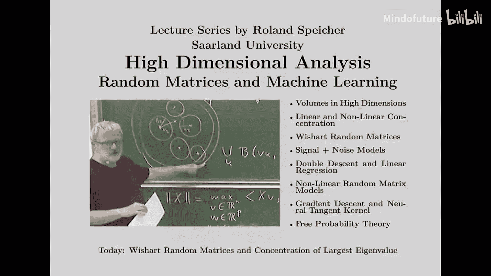
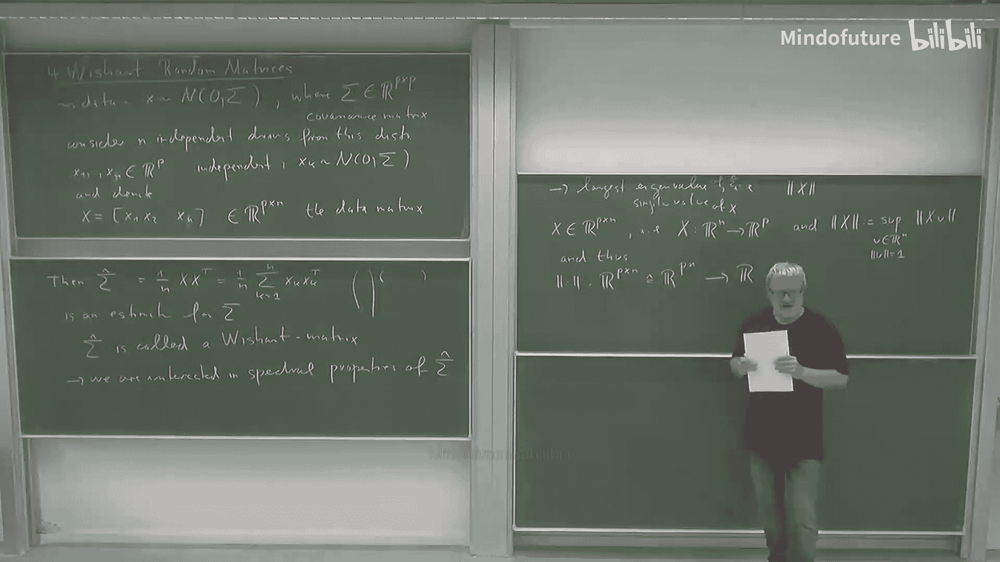
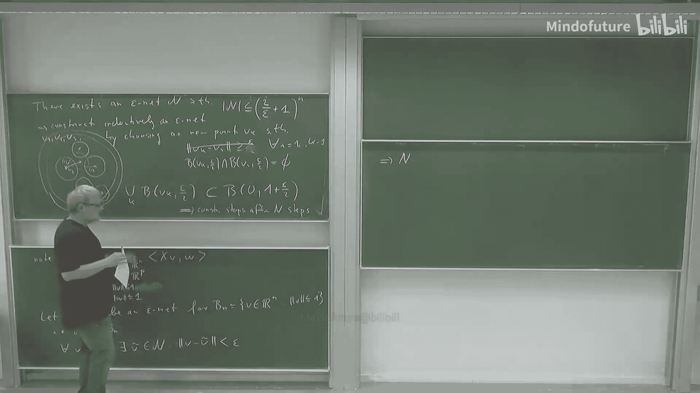

# 【德国萨尔大学】高维分析：随机矩阵和机器学习 ｜ High Dimensional Analysis p09 P09_Wishart随机矩阵及最大特征值的集中性 -BV1XkkWBFEi6_p9-

Okay， so random mates。And the mates， which we consider， are usually called Vichar random mates。

 I mean， so that's the main。Once were interested in。I mean， there are many oss。 I mean。

 random matrix means， of course you have a matrix where you specify somehow the entries in in a random way。

 and of course， how you specify this gives you different kind of osombles And I mean。

 the most famous one maybe the Wina or Gaussian random the vina matrices。

 but those are symmetricmetric matrices。 and they were introduced by Wina， more infrics。

 And so about in our more statistical context。 I mean， our matrices are more like。Yeah。

 the data matrices and they are not， they are not a sage joint。 They are not not even a square。 Okay。

 and those are Wiard matrices。 And actually， Wiard was a statistician who maybe， for the first time。

 really introduced random matrices in particular in the context of statistical problems So the 1920s or so。

Igno was。1950s also， so later。 Okay， but so I'm not。Probably not going to talk about Vietnam mates。

 but really。The ones which are more relevant， our context。Which are called Richard。Banddom matrices。

Okay， so I mean， where do they show up。In our setting， yeah。 So， I mean， we are looking on。

 let's say， random vectors， cow in random vectors。哦。So呃。So that's our data。 our data。

 let's say we model them by Gaus random vectors。Our data。 So this is a vector， which let's say。

 a P dimensional。A vector， which has a normal distribution， and it might have a covari answer。 So。

 I mean， we don't necessarily assume that all the guys are independent and unit variance。

 but could be more general。 And very often， the point is， is to。

Statically problems to make from observations to get some information about this covariance here。

 Okay， so， so the sigma。Is the covariance matrix of my P components。 So this is a P times P matrix。

So this is the covariance matrix。And in the assignments。

 we talked a little bit about the cow in random vectors。 So that's should what we should know。 Okay。

 but now usually， I mean。Yeah， statistical problems。 also， I mean， O， usually you。

You have some observations。 Let's say you have n observations of， of your data。 So we。

 we'd make an independent draw of a vector from this ensemble。And that's， yeah。

 information with which we can work。 we want to understand and maybe also in something about the distribution or whatever。

啊所款 say的。Sa in。Independent。Draws from this distribution。

So this means I have now an independent copies of this X。 So I have vectors x 1。To X P。No X， N。

 I have N of them。 and each of them is a p dimensional data vector。 And so they are independent。

And each of them has a distribution。Normal distribution， between means0 and covari and sigma。 Okay。

 now I can put。Those P vector。It's very convenient to put this into a matrix。

 because many things which I'm doing with those guys really are matrix operations。

 So it makes sense to put them into a matrix。Where I put them， let's say， as。As the。

As the columns in in a matrix。 And also， this capital x。

I didn't know the matrix where the first column is the vector x1。 Then I have the vector x 2。

 and so on the vector X P。嗯， so this is nowP time。To X and， I have n of them。Okay， so n is a number。

 which I have。 And each of them is P dimensional。 Also， I have here， I have here N and columns。

 and each of them has P rows。 So this is a。Is the P times N matrix。 I mean。

 that's somehow the the data matrix。 that's the data， which we have as our observation。Okay。

 and then maybe one thing。I might be interesting in is from a statistical point of view to get from this observations information about the sigma。

 I， I mean， I I know somehow the distribution of the X is a normal distribution with the sigma。

 but I don't know the sigma。 And so I should estimate somehow from for I have measured here。

 and then the。Canononic estimator for this is if I take yeah， x10 times x transpose。I mean。

 that's what I already devotednoted。It load by S my head。So this is one over n。

Times x and x transpose， or maybe if I write it in terms of my observations。This is one over n。

 And here， I mean， x， x transpose。So if I multiply ex just the other way around。 and so。Yeah。

 you see， I'm， I'm just summing over taking x 1， x 1 transpose plus x 2， x2 transpose and so on。

 So I'm just， I'm not mixing my data actually。 I'm just taking。The sum。off。K from one。And。Of Xk。

XK principles。Okay， I mean， X K is a column vector。 X K transpose is a row vector。So this is enough。

有。You see， what is this。This is a matrix。 Okay， this is not the inner product， but it's a matrix。

T xK。第谁。XK。Its column vector。 X K transse iss a row vector。 And if I multiply this， I mean。

 I just multiply the I entry here with the J entry here。

And this is an estimator for the expected value of this。 So particularly if I'm doing this。啊 so。Okay。

 and of course， I mean， classical statistic tells me if N goes to infinity。

 if I can make arbitrary many observations， then this here will really converge to sigma。 Okay。

 but the only problem in our modern times is that usually I cannot make infinitely many or a very。

 very large number of observations compared to the size of my data。 I mean。

 P is the size of of my data the features in which I'm interested and n is a number of observations。

 but now there are more of a comparable behavior So I mean， what I get here。

 the sigma had contains some information about sigma， but it's not that it is equal to it。

 And in particular， we are interested in eigenvalues。 And I mean， we had some。Istoograms。

 where we saw that you get。Here shape where on first， look， it's very hard to see the。

 the underlying real sigma。 But， of course， there is some relation。

 And if we understand this theoretically， of course， we can make some info。Good， okay。

 but so that that's the quantity we are interested in。 Okay， so this。This guy here。

 So this is an estimator。For sigma。 And this is actually the sigma hat is what is actually called a V shot matrix。

S my head。His cord。There we下。Mattrix。And so this is a p times P matrix。

ForFor each n it's a P times P matrix。 and what we want to understand。In particular。

 of this matrices， or maybe also of the matrix X itself， is there spectral behavior。 I mean。

 usually you're interested in the spectral， eigenvalue or many things you do in statistics estimation。

 And so if you are trying to find maybe eigenvalue。

 maybe you think it's a good idea to only keep the large ones and throw away the smaller ones that that's things you do。

 But， But you have to understand how this looks like。 So we are interested。In the spectrum behavior。

呃。spector。Properties of。This sigma head， Okay， So， I mean。

 we want to understand the eigenvalue of sigma hat。 or maybe if I want， if I want to look on x。

 those are the singular values of x。So I take x times x transpose。

 the eenvalue of this are the singular values。 I mean， x itself is a rectangular matrix。

It doesn't really have aigenvalue itself。 It only has singular values。

 but those are just avalue of X ex transpose。Good， so that's what we want to understand。And maybe。

I mean， in the assignments in histograms， you already plotted some histograms for。

 for seeing some structure there。 But maybe now maybe we look on maybe a。

If you have not on all of the eyeenvalue， we look on this later。 But now we just look on one of them。

 they we the largest one。That's， of course， also very important information。 And， of course， this。

 the largest one， the largest invalue。Of this guy is， of course， the norm， the norm of the matrix。

 So essentially， we want to understand what is the norm and in our。Probabilistic context。

 What is the typical behavior and deviations may be of the norm of such random matrix。

And we want to check whether our tools， which we had developed。

 allow us to deal with such questions or maybe whether we have to， to go further。Okay， so。

You look on the latticeches are value。呃。我 think you的 where you。Just like can value。

Not just addingvalue of sigma head or a singular value of of x， Or maybe just to say another way。

 looking on the。On the norm。Of a matrix。 So， okay， and so。Yeah， so what is our matrix。

 So our matrix is a P times n matrix。So비 looking on an엑나。So this is a data matrix。

So it's a p times n matrix。Or as a mapping， I mean， as a matrix。

 it maps the n dimensional space to the P dimensional space。So's没。From I end。RP。Okay and。

We' are looking on。The norm of this mapping。So of the norm。Of this。

 So what is the norm in general matrix。I mean， this is just looking how， how much can。

This matrix increase the length of vectors。 So what is the。

 the largest possible factor for increasing it， So essentially。

 you are taking the soup over all vectors。And I mean。

 you can restrict to the ones which have more than one。Of course， otherwise。

 you just can rescale things。 And then you're looking。What is the length。 Okay。

 so you start with the vector of length 1， And then you check how long is the vector after applying x。

 And this is the norm。 Okay， if if you don't have this restriction here， then then you take the。

 the ratio of the norm afterwards the norm before。 Okay， so this is。This is the。Yeah。

 this is the general definition of the norm。 And， of course。

 because we are here in finite dimensions， this soup actually is a maximum So it's， it's。

 it's achieved somewhere。 So there is a vector such that this is really equal to the norm。 okay。

 so we can also write here。The Mars。And。What else do I want to say， And， and， of course， I mean。

 the norm of x is the same as the norm of X， X transpose and X， X transpose。

 This is a symmetric matrix。 of course， the norm is the largest eigenvalue。 So this the norm is， is。

 of course， the largest eigenvalue of x x transpose， which is the singular value of the guy here。

Got anyhow。 But， but that's what we are interested in。 And so。Yeah。

 what we are looking here is now actually the map。呃，呀。嗯。we have。 we have here our x， our matrix。

 And we are looking on this function here， which actually assigns to each matrix。It's normal。

The value。 So we have a function here。So what we have to understand。诶的。This value， I mean， it's。

 it's a function， which。Is defined on mates， P times n matrices。 But T P times n matrices are。

 of course， just a vector of dimension。 P times N， just arranged in a matrix form。So， I mean。

 if we want to go back to what we had before， where we we had functions from， from vectors。

 then we should say， okay， our matrix is just。A vector written in a matrix form。 So， I mean。

 of course， we can identify。As linear space， the matrix is a P times n matrix with an R to the p times n。

Okay， so this just means as as a vector。 And so， so what we have here。

Is mapping from this space here to this guy here。I mean， it's just saying， I mean， we are looking。

 in principle， we are looking on functions defined on vectors。 Okay， but I mean， what。

 how can we build interesting functions on vectors， We can take norms， but okay。

 the antithesis maybe not so interesting， but much more interesting is if actually we interpret our vector as a matrix。

 and then we can take eigenvalues。 eigenvalues are， of course， things we are interested in。

 but they are also non nonlinear， I think， I mean， they are not。

 they are not given by explicit formulas or theyre given， I mean， by something like this。

 but this is not not really very explicit formula with which we can work directly So you see， I mean。

Okay， so this is really。We have here functions。 and now we should check does this fit into the frame of what we had to form。

 For example， of course， this is a non nonlinear。Functional。

 So so the hope is that it fits into our gaussian concentration inequality。 And for this。

 we need lips shits， but， but。This mapping， which assigns to a matrix。 its largest as eigenvalue。

 This is a lipsit functional。 So why is this。So， so we have here function from this space。So呃。

And thus。It's a function like this。And considered as a function from here to here， as such。

Is a lip sheets function。And， of course， it may be interesting to see what is the lips sheets constant in particular。

 Does it depend on the dimension or not。 Okay， so what， what means lips shits。So， I should take two。

Marices。And compare。What I get。When I calculate your eigen largestes， eigenvalue or their norms。

I should compare this to the norm of the difference。 Also what should I do， I should。

Compare the normal of X1。And the norm of x 2， those are guys in R。 So I should take distance in R。

 And I should see that I can compare this to the distance of those vectors。 But now， I mean。

 in this space， and in this space， I have the L2 norm。But first of all， I mean， of course。

 I can compare the difference of the norms by the norm of the difference。

 that is just a general triangle inequality written the other way around。 So these is two four norms。

 So I can say this year。Its less than the the norm of the difference。That's triangle inequality。

 but just written get way around。 thiss true for any norm。 Okay， but I， so I， I mean。

 I want to compare this to the difference of my matrices， but not with the operator norm。

 which is maybe canonical norm here in this space。 but with the norm considered here as a Euclidean space。

 So I should compare with the L2 norm， which is given by the sum of the squares of all components。

 And I mean， that it so。And this is actually the case。 I mean。

 that is what usually called the phobeius norm or something of of matrices，I mean。

 you have many norms on mates。 And one of them is really the one where you interpret your matrix just as a large vector。

 which means you just taking the sum of of the squares of all entries。 That's exactly the the norm。

Which you have here， if you have it as a vector。 and， I mean， operator a norm。

Is always smaller than this。really have this。Yeah， he， I picked the norm。In are to the PM。And I mean。

 this year is a general norm， which is just compares the operator norm with this2 norm or this phobiious norm。

 I mean， there are different names， depending on the community。 There are sure， sure norm。

 I mean there are many， it's always confusing even if you put。

If you put here in this sense where if you put a two here for some people， this means the L2 norm。

 But for other people， this means the operator norm the respect to L2。 So it's。

 it's always confusing。Which norm you actually mean though， So maybe。呃。

Let me write it down here explicitly So its last step。We use。前的人。Estimate。呃。For the norm。Of a matrix。

 And with this， I always mean to operate a normal， as I have defined it there for the norm。

And matrixtri。Compared。To its norm。Of a vector。 Also， I mean， if I have。If I have my matrix。

 let's say X I J。The eye is running from one。To P and J is running from one to n。

 So this is my P times n matrix then。Okay， I have to operate norm of such a matrix just defined in this general way。

And normal x。 And this is less。Then this other norm， which often is called the phobinus norm。

 but which is just。The Euclidean norm of all those guys just considered as one big vector。

 instead of writing it in a matrix form， to just put all the。The columns。Together， and then I mean。

 you， you just what you then have as a vector。 You just take the sum of the squares of each of them and the square root。

 So it's the sum overall。Components， which you have。Someing over all eyes and our Js。

 And you just take the absolute value of the I J entry squared， some old。All of them up。

 And this is the square of the， this is the square of the norm。 So you take the square root of this。

And I mean， this is a norm。 I mean， these Euclidean norms。 They are quite easier。

 You can write them down very explicitly。 And， I mean， we could calculate。Concentration for them。

 because they are very explicit。 The problem with， is the operate is it's not so explicit。

 It's hard to deal with it。 You have to work more indirectly。Okay， but anyhow， I mean， this year。

Shows us that， actually， the。呃。Yeah， the operator norm is actually aipit function。

And then we can just go into our Gausian concentration。

 So if we now take the Gaussian distribution for our matrix。 I mean， now， if we take now the matrix。

 where we say all the entries should be independent Gausians。

 then if we just consider this as a as a large vector， this is just。The Ga vector。

 which we considered before， all the entries are just independent。

Whether I arrange them in a large vector or in in a matrix。 Of course， it's the same assumption。 And。

 I mean， of course。The we had mates。 I mean， now I'm in a situation where the scy identity。

 where all all the entries in my matrix are independent。That's what I can。ていうです。O。

 so maybe this F here。Stands for Rubinius。Good， okay， but， I mean。

 so the whole upshot of this is that actually the norm。Is lip shits。

Condition that actually the ellipiate function and the constant here is one。So in particular。

 it doesn't depend on P or N， I mean， you would。That many things are lip shits is to be expected。

 but it's the question is more。 does the constant which I have there。

 is it really small or does it might depend on on P or N So very often， I mean。

 if you go to higher dimensions。 you might have an estimate for each dimension。

 but they might be put together just in an additive way， which means， of course。

 they are getting verse and verse if you go to higher dimensions。 but here actually， I mean。

 it's always one here independent of P and N。So， so this， this is good。 So the concentration also is。

 is not getting worse and worse with increasing dimension。Good， but so this means we have。Yeah。

 we have this lips sheet condition， and then we can use our Gausian concentration。看到没了。Of course。

 convexity， you see not so clear。 but I'm not going to talk about convexity here。

 whether we can use teleco or not That might be a different questioner。 So I mean。

 let's just use Scian because there I don't。 I just need lipsts for this。Yeah， okay。

 so let me end write down the theorem， which we get from specializing our gausian concentration to this situation here。

 And now， of course， I mean now I I take yeah， data input was。

 I had a gausian random vector where all the entries are independent So this means in my setting with the weardt matrixes。

 it means the co matrix is is equal to the identity。Okay， so I mean。If I take x。Our matrix。

 And I consider it just as as a we door， which。I mean Cyr。And all。

The covariance matrix of this vector is the identity。

 which just means all elements in my vector are independent。

 and each of them has a standard causal distribution in the language of our matrices or we matrices。

 This means that all。Or the entries of my matrix are independent。

 and each of them has a standard gausian distribution。

 Or this means if I take the covariance matrix of the vectors。

 this means I have the identity matrix because that's saying exactly this。

So this corresponds to the fact。The thema is just。对。I identity matrix there。 Okay， So so this means。

 I mean。Yeah，For for the visual matrices， maybe， maybe there， I had， I had some independence。

 name I had independence between the rows。 but with within the row。

 I had a Gaussian distribution where things might or might not be independent depending on sigma。

Okay， I mean， the sigma tells me what is the， the relation between the guys in a row。I mean。

 different rows are always independent。 And because I assume I make independent draws of the same data。

From the same data set。 but within。呃。My， my column。columnlum， I mean column。 Okay。

 I Sigma governs the independence。 And if sigma is the identity there。

 then this means all the entries in a colour in a column also。Independent。Good， so O， but so。

Pacifying。哦啊。Good old Gausian concentration theorem for eipit functions to this setting。

 So we have to follow it。So， I suppose。I look on the matrix， now。I J。

Where eyes running from1 up to P。And she is running from one up to end。

So if this is a standard gausian random matrix， let let me call it like this。 Also， standard is。

The most。Specialist situation， standard。高音。Orandum matrix。

So it's better to say what I really mean with this。 So this means all the entries are independent。我咧。

X I J。Depenent。And they are independently distributed。 And， of course。

 we assume that distribution is standard gaus。 So the gaus means 0 and variance  one。And。一起。X IG。

Has a normal distribution， which means ser variance 1。Okay， and then。Yeah， then I can apply。

My gaus in concentration to this one lips shits function the norm。

 And I'm taking the norm of this matrix。Okay， and then our。

Thouous concentration theorem tells us that the probability。That the norm that you operate a norm。

 I mean， this is now a matrix。 and this is to operate a norm of this matrix。

 If I compare this with the expected value。off。This operator norm。嗯。That this is bigger than alpha。

This can be estimated against two times two is just because I have very absolute value。

 And then I get the exponential。Concentration， let's say， e to the minus I squared divided by 2。

And here， I would also have the L squared。 L is the It's constant， but L is here1。Okay， so you see。

 I have。Estimate like this。Okay， and this is。Yeah， on one hand， this is nice。But on the other hand。

 it's maybe it。Just as in this form， it's not so useful because actually。

 we don't know what the expected value is。Oh。And so， I mean， usually we would say， okay， I mean。

 we normalize things in such a way that we divide by something such that the expected value of the norm。

 let's say is's one or two or something like this。 And then， of course， we get a dependency here。

 and then we really see concentration in the dimension。Okay， but， of course。

 the main main point is what was the expected value And now we have here kind of problem， Because。

 yeah， at the moment， I mean， this theorem itself doesn't tell us what this is。

 This just tells us concentration just tells us what is the probability of having deviations from the expected value。

 It doesn't tell us what the expected value is。In the case of the， of the norm of a vector。

 in particular， the norm of the square of a vector， we could calculate this very easily。 I mean。

 the norm。Does the square of the normal vector goes like P。

 which means a norm should go like the square root of P。 Okay。

 and maybe here we also expect maybe it should go like square root or something like this。

 But this is not clear， because。You don't have a formula or maybe the， maybe the only thing。

Which we really have， which is as close as possible to a formula is this here。 But you see。

 this is not， not very explicit。 I mean， I， I cannot just say I take the expectation here。

 And then I know what it is。So， this。And this is not clear。 And what I want to do now。

Is to try to get some more information and really try to use this formula here， because essentially。

 I mean， it tells us the operator norm is to soup over such quantities。

 And this quantity here is applying my matrix to a vector。

 And this is something which in the end is just another Gauss in variable。 So I mean。

 this is the the norm in the vector norm。 Okay， so this is something which I can control much better。

 But I have to take to soup over many of those things。 actually。

 infinitely many And so the question is， does this help me okay and。

I want to show that we can use this formula to really get some more information。

 which gives us at least an idea what。What the expected value of， of the operator enormous is。

 So we're not really going to calculate it exactly This would be for this。

 we would need need some other tools。 But， but I want to show some general ideas that if you have a quantity which is given by the supre over quantities for which maybe you are able to derive。

concentrationcentration inequalities， where you also understand the the the expected value of those guys。

 then， then you might get something for this。 But usually this is not。

 This is only up to some constants。Okay， but I want to give you the idea， of course。

 this is also a quite general principle。 maybe it gives us an idea。How this depends on P or N。O。

 so that's what I want to do。The following， But you should be aware。 I mean。

 concentration inequalities are nice， but usually you have to complement them by the knowledge of what is the expected value。

 because the concentration inequalities only tell you how things concentrate around the expected value。

 And if you don't know the expected value， this is maybe not so useful。And usually。

In interesting situations， maybe much work goes into calculating the expected value。Okay， so later。

 then we come back， not just looking on。On one eigenvalue。

 but on all eigenvalue of such visual matrices。 then， I mean， we we should get a distribution。

 and so。Deviation tells us that， yeah， usually。The eigenvalue distribution is very close to the expected eigenvalue distribution。

Okay， but then what you really have to do is calculate the expected eigenvalue distribution。

 And this is quite some work。嗯。I you talk a little bit。About is later。Not today。

 but next lectures but。Yeah， you should be sure that。The task usually is split into two。

 You have to calculate the expected value。 And maybe this is really， I mean， this。

 this is the thing about which in very high dimensions。

 more or less everything concentrates So that's really the quantity， which you should know。

 because that's maybe the output。Of， of your algorithm Okay。

 and then so calculating this really gives you an understanding what what this function does。

 And then this this concentration is more of a theoretical nature， which tells tells you that indeed。

 in high dimensions， you're very close to this expected value。

 but it doesn't tell you more about the expected value。呀过去。Okay， but so now let。

 let me try to give you some idea how。We could use this formula， or maybe let me even make it。

More accessible。So not。I can also write this。The operator norm。 I can also。

 I'm mean the norm of my vector。 I can also compare this with just taking in our products。

 So I prefer。To writing。 And now I write really instead of the soup。

 I write the maxs because this is assumed somewhere。 But now I'm looking on the in product。

 So I have X V。 I want a norm of X V， but I can also calculate this by taking。

In our products with other vectors and running over all possibilities。 And also， I take it a maximum。

Of vectors。R to the end。And then on this side， I'm in R to the P。Okay， and again， I assume。

All of them have non one。So that's， that's another possibility of， of writing this。In a form。

Which involves inner product。 I mean， I still have here the norm and in our products are even better than this。

Good， okay， so that's。Simple reformulation。I mean， this here is in any case smaller than this。

 And it is achieved because here you have a V where this is achieved。

 And then you can choose for the W。 You can just re， can just choose a reized version of of the X V。

So this is is quite trivial。 Okay， and now we have written this guy here as a maximum。

Over those quantities and those quantities。 I mean， what is this， This is my matrix here。 So those。

 those are the X I Js， and then they are multiplied with coefficients of my vectors。

 So what I have here actually， is a linear combination of the entries of my matrix。Okay。

 and such a linear combination is just again， a Gaussian vector。

 So what I have here is actually Gaussian vector。 And so for each V and W， I have concentration。

 that's something for which I know concentration。 And I also know it， it's concentration about。Yeah。

O and。So， the question is。If I have a quantity， which is defined in terms of。Yeah several conditions。

 whether concentration for each of those conditions gives me concentration for what I'm interested in。

And I mean， we we already had this idea， of course， I mean， if you have。

 if you want to several conditions to be fulfilled。 and I mean。

 you can control each of them sufficiently good， then you can also control their intersection。So if。

 if you know， each of them has probability close to one， then altogether。

 they also have probability close to one。Because you take essentially the union of them。 But。

 of course， I mean， if you have more of them， you're getting a little bit far away from one。

 And now if you have infinitely many of them， okay， it might break down So I mean。

 each of them might have probability close to one。 But if you want to satisfy all of them。

 if it's infinitely many， this might be too much。 then the the mistake。

 the errors which you have might become arbitrarily large。So so the point is， I have such a quantity。

 I mean， I don't want to control it in infinitely many conditions。

 but I want to control it infinite infinitely many conditions。 So the question is。

 that I can go over here from having the max over all points on the on the unit spheres to something where I only control a finite number of them。

 And that's a general idea because I have here functions， which are continuous。

 So this means if I control things on a finite number of points。

 And then I can also control it at points， which are not so far away。So， if I cover。My units here。

 by points， which have small distance then control on what happens there should give also me control on what happens everywhere。

And that's this general idea that I should cover the space of my constraints。

 which you say given by the vectors in this。Unit sphere here that I should cover this by a finite number of points such that any point there has just a small distance to this。

 that that's this idea of what is called usually an Epsilon net。

 So a number of points covering everything。Covering the things such that any point has distance at most epsilon from any of them。

 And then if I can control it there。Then I can control it everywhere。 that's a very general idea。

 which I want to make a bit precisely in this context， so。OK， so。And maybe I here， here。

 I would have to cover this the sphere。 the surface of the balls， but maybe yeah， maybe it's easier。

 not much easier， but maybe a bit easier to just cover the balls themselves。 And so maybe I I， I。

Change this here by saying that， okay， it's enough。To look on。situation， I can increase here。

By taking orders also the situation， we had the V and the W are inside the ball。

Because the maximum is achieved anyhow on the， on the surface。 Okay， so I just take here everything。

And then。I want now to cover。 So Im I'm here in a ball of Radius 1 in R to the N。

 And here I'm in a ball of Radius 1 in R to the P。 and I want to cover those balls by nets。

 which have， let's say， a distance epsilon。そうね。That end。あデ。Epsilon net。And Epsilon is a distance。

 which I will prescribe later。 And actually， it will be one over4 or something like this。 so。

It doesn't really have it。 It doesn't have to be a tiny one。 But， I mean。

 the epsilon in this context usually are。啊。Numbers， which don't have to go to0 in some sense。 Okay。

 so it's an epsilon net。For my ball， Let's， I mean， I I take one here and I take one here。

 So let's say for the ball。B N then dimensional， let me just recall B， N other vectors in R to the n。

 which have norm less or equal to one。In the Euclidean norm。

 we we are here R to the N with its two norm， the Euclidean norm。 Okay。

 and so what what do I mean with Epsilon net。So this means。In。Consists itself of points in the ball。

 Okay， but they should have nice property that for any arbitrary point in the ball。

 I can find at least one point from here， which is close at than Epsilon。So this means。Yeah。

If I take the， the epsilon balls about those points， they cover everything。Yeah。

 so it's such that for any we。In the ball。嗯。There exists， at least one。The prime from my epsilon net。

Such that the V and the re primeme are not further apart than Epsilon。And this is then the idea that。

 if I know。Properties on those V brs。They should also tell me。

Corresponding properties on all the ways。 So it， it should be enough to know the properties in which I'm interested on。

 on the points in the net。Good， okay， and of course the。Main point is to see， I mean。

 okay such nets exist。 of course I cant just take any point。

 but then the net would the net would be as large as the ball itself。 The point is。

 of course to make the net as small as possible in particular to see that it's enough to have a finite number of points and also to understand maybe how many points do I need。

And so， the point here is。That actually， one can estimate， of course。

 a number of points in terms of epsilon。Yeah， so I'm claiming。Yeah， of course， we。

 we want this net to be as small as possible， okay。

And I'm claiming we can find a net where we can estimate the number of points in the net。

 depending on epsilon as follows，Exists。An eppsilon net。can。Such that the number of elements。

In this set can be estimated against the two divided by Epsilon。Plus one。呃，土地。Yeah， okay， maybe。

 maybe we should see why this is the case because this is an important ingredient that we really。

 I mean， we have an exponential growth in the dimension of course， I mean。

 if if you want to cover in one dimension， the interval， Of course。

 it's essentially like one over epsilon， how many okay， then if if you have the the disk。

 how many points do you need to cover this is an epsilon distance。I mean。

 it it should grow it exponentially in the dimension， but。

 but maybe letting lawyers check that isn't really the case。 And in order to see this， I mean。

 let us see how， how， how would we construct such， such a net we want something which covers the whole thing and。

You can do this。By constructing。Inductively。An Epsilon net。啊。And let's say， I mean。

 this consists of points， V1， V2， V 3， and maybe， maybe a priori。

 we don't know whether we can do it with with a finite number。 I mean。

 it should go with a finite number。 but even this might not be so clear。 But so okay， we。

 we just create a sequence by choosing。A new point。

Such that this new point has distance bigger than Epsilon over 2 from all the previous one。

 New point。Let's say， we car VK。Such that。The distance over。V K minus all， the V As。

 which I had already chosen before， is bigger than epsilon over2 So this should be true for all the previous ones where I is running from one up to。

K minus-1。Also， this means I am starting by choosing just a point V1。Okay， and then I say， okay。

 I mean， this is。And I'm looking on the Epsilon， not。Not on Epsilon ball， but Epsilon over two ball。

 And， and then I say， okay， now I choose something new， which is outside of this ball。

 So maybe I choose here。Okay， no。 So what what I want is that。呃。有。That I have a point such that。

This epsilon over two ball of this new point doesn't intersect the epsilon over two balls。

 which I had before。Maybe here， I should。Maybe I should better say sort of ball。About V。

Of epsilon over 2， intersected。The ball about the previous ones。It already epsil over 2。Is empty。

啊嗯OK说。Okay， so I， I look on epsilon over two balls。

 I I try to put as much as many epsil over two balls as possible there without intersecting。 Okay。

 so I choose one here， then I choose one here。 And then okay， if， if there's a possibility。

 I put another one， it's radius epsil over two and so on。Yeah， okay， but then at some point。

 it might be that I don't find any balls， any any new point so that I can put an Epsilom over two ball about this。

Okay， but this means。But so this means at any point with which I try as the next candidate。

 If I look on the Epsilon over two ball of this， it it has intersections with the ones which are already there。

But this means， I mean， if， if this epsilon over two ball has an intersection with this epsil over two ball。

 this means that this distance here can be at most epsilon。So this means if I'm not finding。

Any new point such that the epsil over two ball of this new point doesn't intersect the epsilon over two balls。

 which I already have。 This means that any point must have a distance at most epsilon from the points which I have already chosen。

 And I mean， that's what I really want for my net。Okay， good。 O。 So， and so this means I'm。

Yeah I'm choosing here sequence such that the epsilon over two balls。 Yeah。

 I'm getting more and more， but they should not intersect。 And there， I mean。

 there's only a finite number of possibilities for finding such balls。

 before I can estimate the volume。Yeah， okay， so I construct those。And。I mean， they are disjoined。

And， of course， all of them。Have to lie in a ball about0， which has a radius1 plus epsilon over 2。

I mean， all。So all those balls here of radio Eppson over 2。 I mean， they are about points in in。

 in a unit ball。 so they might。TheThe ball about Epson Over2 might fall out the， the， the。

The ball of radius 1， but it must be contained in a ball of radius 1 plus epsilon over 2。Okay， also。

 so we have。So all of those guys are disjoined and to union for all of them。Of the boards。呃。

Of those bolts here， they all lie inside。The ball of about 1。0 of radius 1 plus epsilom over 2。

I mean， somewhere he's a cir。 And I mean， there's a big ball。Of raius 1 plus Epsil over 2。 I mean。

 there there is， there's， of course， the ball of radius 1。All my points are in inside this ball。

 And I mean， I might have here a point like this。 And then this absolute over two ball。

Might go a little bit outside， but not outside of of these radios。 So this means I。

 what I try to find here are as many balls of radios Epsil over 2， which are all destroyedjoin。

 but all of them together have to lie in this sky here。Okay， and I mean， all those balls have radios。

 I mean， they are all all balls of radioius Epsilon over 2。 So they all have the same volume。 No， no。

 I just take the volume。 I mean， the sum of their volumes must be less than the volume here。 Okay。

 but I mean， this means I get， I get a bound。 How many I can have of them。

So this means in particular， I can only find a finite number of them。So this means。Number n。おきそう。

So this means a。The construction。Stops。After。Let's say， N steps。

Because then I will not be able to find a new point。

 which satisfies this condition because yeah after n steps， I mean， I have n times。

I have n bolts， which are disjoint， and each of them has a volume。Which is。

A ball of radius epsilon over 2 in dimension N。I mean。

 whether it's about 0 or some other point doesn't matter for the volume。

 and they are all inside the ball。Of radius 1 plus epsilon over 2。 So， I mean。

 n times their volume must be smaller than the volume of of this big ball。 So it must be smaller。

Then the volume。Bm of。1。Plus， epilom over 2。We have constructed n of those small balls of radius epsilom over 2。

 which are all disjoin and all of which are sitting inside this big ball here。

 Then n times their volume must be smaller than this。 And this gives me an estimate for。

How big N can be。So they and end。Must be smaller。In the volume。Of the ball of radios。

1 plus Epsilon over 2。Divided by the volume of。The ball of radios。Eppsilon over 2。Yeah。

 but now we know how the balls over given the radios in a fixed dimension behave。 I mean。

 they essentially go like the radius to the power N。 And then there are some constants。Gmma function。

 whatever。 But I mean， I'm dividing here two volume。 So the constants go away。

 So the ratio is just this to the power N divided by this to the power N。Also， this is one plus。

Eppsilon divided by 2。Took the power， and divided。By epsilon over 2 divided by n。

 Or if I divide this here， then I have here  one divided by this is two over epsilon。

One divided by this is one。I have this two power in。Okay， so that's。That's what I I came here。 Okay。

 so this is just making this precise。Or you just can believe it。

I think an exponential growth is something which， which is meaningful。

 But this year is a precise estimate。 Well， actually， I mean， if you want to cover。

Something by balls。You should also try to， to pack smaller balls inside， which don't overlap。 I mean。

 I have here use a pecking kind of argument instead of arguing directly with how do I。

Find things which are grow at an epsilon to anything。 I had done it the other way。

 I' am trying to pack as many balls of radius Epsilon over to inside the thing。 And if， if I do this。

 this also gives me a solution to the other。 I can。Can can compare those those two things。 So。

 so covering and packing is somehow connected。You can estimate one in terms of the other。 Okay。

 so that that's。呃。This general thing。 Okay， but so this tells me。I have known。I can。

 I have an Epsilon net for any epsilon。Of my unit ball。嗯。And。

I can estimate the cardinality of this set in this exponential way。 Yeah， now I can。

Just do the same for the W。 So I can。Cover R to the end or the ball in n dimensions by an net。

 And I can cover the ball in P dimensions， also by an net in the same way。

 And then I can try to see whether I can。The operator are norm。I can also express it。

By something like this， where I'm just running over the net。

 which are then only finite many conditions。So。Let me do this。 So let us fix。 I mean。

 Epsilon is fixed in the following。 And at at some point， I will choose it as one over 4。

 So maybe for now， maybe。That be right。 still Epsilon。 But at some point， it will be one over 4。

 because  one over 4， you see then one plus Epsilon over2。 If epsilon is one over， no， I mean。

 this quantity，2 over Epsilon resistant a plus 1。 So then the cardality is 9 to the n。

Most of this net。 Okay， so anyhow， so we choose。So I'm choosing an Epsilon net。And you call it n。

For B N， and I'm choosing an other Epsilon net for the same Epsilon。Let me call it M for B， P。

InN dimensions and in P dimensions。 And then， of course， according to this， I know that in N。

 I have at most。2 over Epsilon plus one to the power and elements in an M。

By the same element I have at most 2，2D，2 divided by epsilon plus  one。呃2DM。Elements。M aC a P so。

Good， okay， now let us。C。Whether I can estimate the operator norm。我说。

By quantities like this over the net。And so for this。I mean， I。

 I know that I have this and let me take the maxim V and W for which this year is maximized。啊。

And then see how I can estimate this by data from my， my net so that we。In BN。注个意。皮。Be the maximr。4。

For my norm， for my operator norm， So I know that this is the same as taking x on B in a product with W。

Okay， and now I want to check whether I can express this in terms of my net。

 So I have an Epsilon net。 This means I can approximate V by something from its net from them。那。

And dimensions and W， I can approximate something from the Ar net。Also。

 I know that there is something an element。 Let me call it V Twitter。In N， in a net N。

 such that the distance between we and we Twitter is less than epsilon。

And I also know that there is a W t in M， which approximates the W。 So W minus minus w ttter。

It's less than epsilon。Yeah， and now I want。To compare。X，V。W。

 I want to compare this with the corresponding quantity When I replace V by V Twitterwi and W by W Twitter。

 And I want to see how， how big is the mistake， which I have made。So this is。 And for this， I。

 of course， I write。The， the V here， as we Twitter plus the difference between we and we。Twitter。

And the W， I write is W ttter and the difference between W。AndWt okay。So I just have split it into22。

 two summons。 But now， of course， this is piing air。 so I can multiply it out。 So of course。

 I get here the term V twi w twi。 I mean， that's the one to which I want to compare V twitter。

AndW Twitter。But， of course， there are mistakes。 So namely， what do I have。I have， of course， here x。

With。To be Twitter， I also have the term going with this。So here I have W minus W Twitter。And then。

 I also have。This term going with the whole thing。 And I mean， the whole thing is just W。

 So I'm not splitting this one， but I just write it here。V minus。V minus。We Twittertter。

And here I have just a W。Okay， and those I can estimate。And， of course。

 they contain epsilon because I have the difference。 That's。

 that's the point that those are terms which contain the difference between the point and the corresponding point in the net。

 So I can estimate this against the norm of x times the norm of this times the norm of this。

 So it's less than。OfX。Times the norm of Twitter， times the norm。Off。嗯。Yeah。We minor。

W minus W Twitter。 And， of course， yeah。Normal x is here。 This element。

 this here is in a is in a unit ball。 So this is less than one。 But， of course。

 this year is less than epsilon。And here in the same way。

 I also have this is less than the norm of x times。The norm of this is one。 And this is。eppsilon。

GoodAnd so you see， I get here。I mean， this this year。Is the norm。And you see， on the other side。

 I get a norm again， which might look as， okay， maybe not a， not a very useful thing。 But you see。

 I have here coefficients。Which are less than one。 So I can bring this on the other side。

 and then I get an estimate for the norm in terms of this this quantity here。So， I mean， so maybe。

 maybe so what what I have here is the norm of x。Is less than。This while here。X， we Twitter。W。

 Twitter plus， And then each of the two terms here。Is the norm of x times epsilon。Now you see。

 I can bring this on the other side。 Then I have hit norm of x times 1 minus2 epsilon。

 and then I just divide by the 1 minus-2 epsilon。 and then I have a norm。

 the operator norm of x in terms of just quantities from the net。Also， maybe。Let me write。Yeah。

 let me write it here and then continue next time。 So oh maybe， maybe bit more space。Yeah。

 so I get here。At the normal。X。It's one minus。To Epsilon。

 So I bring it this on the other side is less than。The x。We Twitter。W95。Ttter。Okay， but now。

 of course， the V twi and the W twiddle depend on the V W from which I have started。

 which I don't know。 So， I mean， this， these are just elements from the net about which I don't know anything more。

 So， I mean， I should。 so this means there is。Something in the net， which maximizes this。 So， I mean。

 I， what I really should say here So that it's kind of uniform。

 I estimate this against the maximum where I'm running over over my net。 So。Et。The maximum of。

We Twitter in the net。And W Twitter in the other net of。X。We Twittertter。W推tter。Okay， I mean。

 in principle， I have to control all the points in the net because I don't know which ones appearing here。

So there are some of them。 So I mean， I need。All of them。Okay， but now and， and then， of course。

 yeah， I can divide this on the other side。So。The norm of x。It's now less than one over 1 minus。

To epsilon times。Dqu呀。The maximum of this。 And all you see， I have essentially replaced the original。

Kind of definition of the operator norm by having a maximum over infinitely many guys by an estimate where I have the same kind of quantity but running over the finitely many elements in my net。

Okay， and I mean， I have， it's on the expense of having here one over 1 minus-2 epsilon。

And of course， if epsilon is is too big， this doesn't tell me anything。 But I mean， if I now choose。

 for example， Epsilon is equal to one over 4， then this here is a factor 2。

 And then I also know how big the nets are。 And then I mean， I can control each of those guys。

 and then I can also control the maximum or finite many and this gives me something for for the operator norm okay and maybe next time I will I will put all these together。

 But this was here essentially the crucial step which shows how quantities which are given in this form by having to control infinitely many conditions。

Can be reduced to controlling only a finite number of conditions。

 If you' are in a situation where you have this epsilon net。

 So you can approximate this infinite number of con conditions by a finite number of conditions。

 So that yeah， still control。For those guys gives you enough information for for。

For the control everywhere。Okay， and then it's just， I mean。

 then it's more or less just taking the concentration。

 which we have for all those quantities and put them together。

 That's maybe more or less what we already。Should be able to do。 But next， next time。

 I will be a bit more precise on this。 Okay， but let's stop。Yeah， for today。

