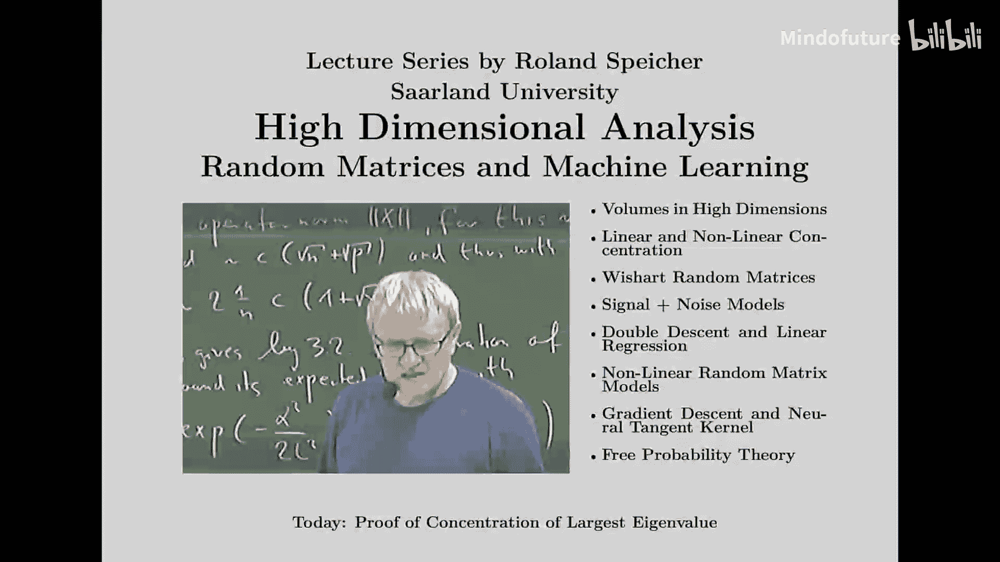
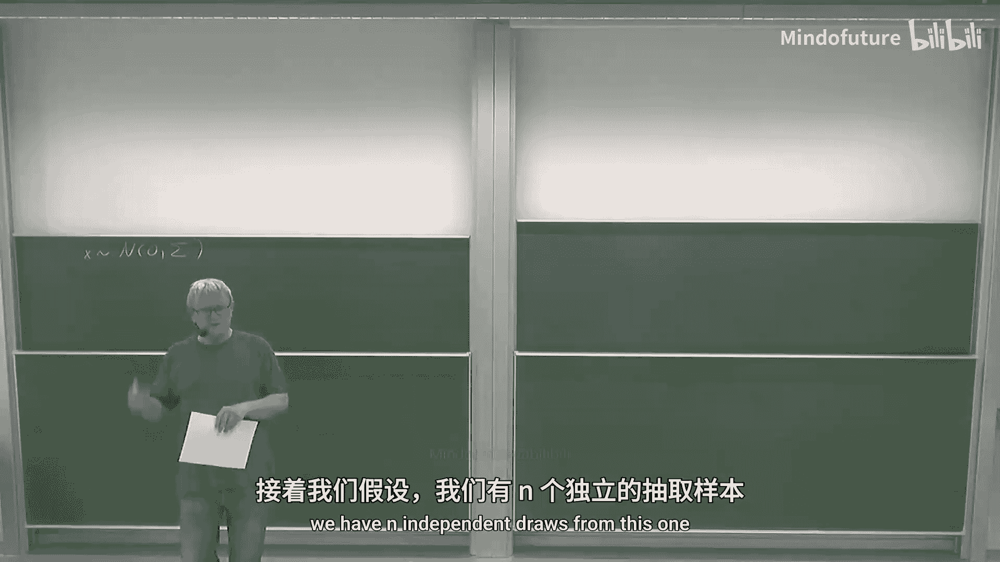
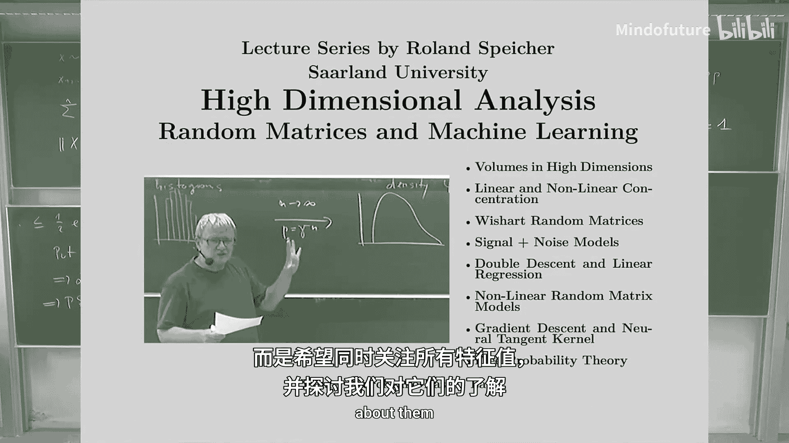

# 【德国萨尔大学】高维分析：随机矩阵和机器学习 ｜ High Dimensional Analysis p10 P10_最大特征值集中性的证明 -BV1XkkWBFEi6_p10-

Yeah， so at the moment， we are looking on random matrices。

 So we made a transition from vectors random vectors to random matrices and also want to understand maybe concentration in particular for the eigenvalue and also what is the eigenvalue distribution in a meaningful regime。

 also the setting was the following。 So， I mean， we are talking about which are random matrices。

 And also the setting is we have， let's say， yeah， we have data which are distributed according to a gaus distribution。

 So x is distributed。As a gaus with mean 0 and a covariance matrix sigma in r to the P。

 and then we assume that we have an independent draw from this one so we have an independent copies of such a vector so we have x1。

Up to X N， each of them。Is vector in R P， and。Yeah， they are independent。

 And they have the distribution like this。 Good。 And then we are putting those guys into a matrix。

 data matrix。 And we want to understand the properties of this matrix。 Also x。

 capital x is now a matrix where those vectors here are the columns。 So So we have n column。Yeah。

 and columns and each each has a length is a vector of size P。

 Also I'm putting here the first vector X 1， then the vector X 2， and then the vector X N。

So what I get。Is a P times and matrix。Okay， and then。Maybe。Yeah， important square matrix。

 which we can form from this is the the is the the estimator for the covariance。

 which I call sigma head。Which is 1 over n。And then I take X， X transpose。

 Or if I want to write it in terms of those guys， it's sum1 over n。The sum K from one up to N， X， K。

X， K T so each vector gives me， I mean， this is a matrix of P times p matrix。

 So this is somehow the estimator for the covariance of my distribution。 And I mean。

 the law of large numbers would tell me if n goes to infinity P fixed。 And this goes really to sigma。

 but that's not the regime we are interested in。 Okay， but anyhow， So that's the matrix。

 which you want to understand。 And that's actually a V had matrix。 Okay， and so， yeah。

 maybe let me write it down。 So we shot。Statistic。ho introducedtro。

Random mat is exactly in such a context now for dealing with making estimates or yeah estimates for Gausian distributions in high dimensions。

 okay。Good， yeah。 and now。The first thing we looked at was what is the。

where we are interested in the eigenvalues of this And in particular。

 we want to understand concentration so that maybe the eigenvalue also concentrate around the average value And we want to understand the average value。

 Okay， but first， we looked on the largest eigenvalue。

 and we we try to see whether we can from what we know up to now。

 whether we can deal with this in particular concentration。

 Can we also do concentration for the largest eigenvalue。 And there。I mean， first of all。

 the largest eigenvalue of a matrix is really a lipsititz function one lipit function。

 which means we can use our concentration phenomena So yeah。

 so we know that we have concentration just by our gausing concentration concentration for lipshiitz functions。

 But the problem is we don't know the expectation。 that's usually the strange thing。 I mean。

 we can show concentration often quite easily with our machinery in a background。

 and it tells us that things concentrate about the mean。

 but usually it's not so easy to calculate the mean in particular for such nonlinear functions for the norm of a random vector。

 I mean， this was quite easy but for for the eigenvalue of a random matrix， I mean。

 what what is the mean。 okay and so。😊，We tried。To get a better understanding of this and also develop tools for let's say see concentration more concretely in such instances。

 But the problem somehow is that we don't really have a very concrete formula for the eenvalue they are very non nonlinear。

 but also not very explicit functions of of the matrix entries。😊，Okay。

 but last time I started to show you how we can address this question。

 And the point is that actually， I mean， we have a kind of， of course， we have a kind of formula。

 And yeah， so what what I'm looking at is is is the is the opera， is the operator norm。 of course。

 the largest eigenvalue。 I mean， the largest eigenvalue of this guy is the norm。Of， of this。

 And this is connected to the norm of X。 So what we really want to understand at the moment is the。

 is the norm。Of x or you can also say this is the the largest singular value of the matrix。 Okay。

 so we have， of course， a kind of formula for operator norm by definition。

 It's the supre or the maximum overlooking how much can we increase length by applying this matrix X。

 And so maybe I wrote it in the form。 So it's a supre。 But it's achieved。

 So it's really a maximum over。Let's say。Vs。In where be here in to the let me first write down。

 So it's x。X， v comma W。 So x is a matrix which goes from R to the N to r to the P。

 So V is an R to the N and W。Is an R to the P， and they have length。Both of them have lengths。

Less than one。 I could also take equal to one。But for our arguments。

 maybe less or equal1 was better because the argument， which we made。

 was that this maximum over infinitely many possibilities can be replaced by a maximum over finitely many possibilities。

 So I mean， we have yet kind of formula for x。 it's a maximum of quantities。

 which we can control quite easily。 I mean， this this here is a linear thing。

 essentially or quadratic thing which we can control very easily， but we have to take the maximum。

 and we have to take this over infinitely many guys。

 So even if we have concentration for each of them。

 if I have to take the maximum over infinitely many possibilities， this is not very helpful。

 So for each of them， I have a small deviation probability for a deviation。

 But if I have this for infinitely many， then the deviation can be everything。 Okay。

 but the idea in such a context is that actually we can cover the space over which you have to take the maximum by an epsil on net。

 by a finite number of points。Which are close at an epsilon to any point。

 And then it's enough to control these quantities on this net。

 So what we showed last time is that actually， I can replace this maximum over all the points in the balls by points from Epsilon net。

 Okay， we have we have make a small mistake by this because we only approximate things。

 So I have here。Effector1 over to Epsilon， which is coming because I'm only approximating guys from here from points from my net。

 And now， the maximum is running over elements。From an epsilon net for R to D N and Epsilon net。4。

For R to the P。 So this means every point， I mean， for the ball So every point here in the ball in R to the N。

 I can approximate up to epsilon by some point from this net here in the same here。 Okay。

 and we also saw that we can control the size of such net。So this depends on epsilon。 And so。

 for example， maybe in the following， I will choose Epsilon is one over 4。 So you see here。

 of course， I should not go bigger than one half。 Okay， but one over4 is good。

 And I get here 1-1 half。 So here I get affected 2。 and the size of the ends。 So this was bound like。

 I don't know，2 divided epsilon plus one to the n。 So in this case， this is 9 to the n。Or here， it's。

 it's 9 to the N and 9 to the P。 So here I have， okay， I'm still missing。 Of course， of course。

 I have hit the same thing as before X， V W。 But now V and W are just coming from this finite set。

 And this finite set has a size， which we know how it depends on the dimension。Okay， so I'm fixing。

 I'm I'm fixing epsilon in the following。And then。The dimension of n， the size of n is less than。

9 to the end。And the size of M， the epsilon net for the ball in dimension P is less than 9 to the P。

Okay， so the size， of course， of those balls also grow exponentially in the dimension。

 but it's a finite number and this exponential growth in the dimension is still good enough compared to the exponential concentration。

 which we have for， for each of the guys。 Good。 Okay， but so let let us check this out。

 So what we really can do with this。 So I mean， I have this。Compareed to this。

And now I want concentration。 I mean， I want concentration of this norm。

 which means I should say what are large sizes of this guy so。I want to have probabilities。

For the fact that x。Is， let's say， bigger than alpha。okay。Yeah， and of course， by this estimate here。

 if x is bigger than alpha because x is smaller than this guy here。

 then this means in this maximum must be bigger than alpha times this1 minus2 epsilon。

 and so at least one guy appearing here must have a bigger value so this means if x is bigger than alpha。

This means there must be at least one V and W from those nets such that their corresponding quantity is bigger than alpha modified with this guy here。

 And also this must。So there is a V in my net in n dimensions and the W。In my net for。呃。

Per mentions such that the quantity X， the matrix x applied to the vector V。

 The inner product is W is bigger than alpha times。1 minus2 epsilon。Okay。

 and this is now a quantity which we can control。 I mean， I mean。

 this idea is now a very easy function in the entries of x。

 for which we know concentration quite well。 Okay， so so namely what this is。Or maybe， first of all。

So if we have this here， this allows us to reduce probabilities for this。

 two probabilities for this so namely if this guy here is bigger than alpha。

 then it must be in one of those sets for which this happens， so it must be the union of those sets。

So， this means。I mean。的。Situation where the norm of x is bigger than alpha is contained in the union of the sets here running over my nets。

呃。Of the sets where this X we。W is bigger than I1 minus-2 epsilon。Okay。

 but now what I want is estimate for the probability of this that I can estimate it against。

Something from above and the probability of this is， of course， the probability of the union。

 but the probability of the union can be estimated against the sum of the probabilities。

So this means。That the probability。That the norm of x is bigger than if。

Is smaller than the probability of this union， which is smaller than the sum of the probabilities over my nets be in。

This net N and W。In M。And then I have here the probability。

That this essentially quadratic form in the matrix x。Is bigger than I。Times 1 minus-2。Epsilon。Okay。

 and now for those here， for those， we have our concentration so Naly let us see what we can say about this。

So namely what is this。X， V W。Of course， I mean， this is the matrix。 I mean。

 the matrix x has the entries X I J。 that's our independent Gaussians。 That's the guy which we know。

 And here I apply this to V。 And then in our product with W。 and of course。

 this is just a quaratic form。I'm taking。There sum over the in， So I'm taking。

The entries of the x multipied them。M the vector V J So this is the matrix product X applied to V。

 And then I take the inner product with W， which gives W I So the V Js are the entries of the vector V。

 W Is are the entries of the vector V and the X I J are the entries of the matrix。

 And I'm summing here， of course， over。I from one to P and J。From one。To end。

And those guys here the X I J， that's our random elements。 So they those are。

They are all distributed。Like standard Gaussians and they are independent。Yeah。

 and so what I have here is not just a sum of independent Gaussians with some coefficients。

And I mean， we know what is the I mean， okay， we know that the sum of independent Gaussians is again。

 Gaussian and how do how do we， I mean， of course everything is is center So the minus 0。

 So the only information is the variance。 and what is the variance of the sum of of independent guys。

 that's just the sum of the variances。 So that's just I mean， so the variance of X I J is one。

 It's getting multiplliied with those numbers。 So the variance of of those whole whole thing is is multiplliied with this。

 the square of this So the variance of each of them is those guys squared。

 and we are summing over everything。 this means。Yeah， so。This whole thing here。

This is the Gausian distribution because it's the sum of independent Gaussians。And it has a variance。

Sigma squared， which is given by summing all the variances of all the sums which are having this sum。

 But I have， of course， the sum consists of， of all the terms where I is running from one to P。

And J is running from one up to n。 And then the variance of this individual term is just。

We chase squared times WI squared。Okay， now we see that what I'm doing here is I'm summing the Vj squared over the js。

 and I'm summing the W I squared over the I。 but this means if I sum those guys。

 I'm getting just the norm of those vectors So the sum over the j gives me just the square of the norm of the vector V and the sum over the I over the W I squared gives me just the square。

Of the norm of W。 Yeah， but， I mean， my net was in a unit ball。

 So the norms of those guys are less than one。So what I have here is yeah。

 something which is less than one。 So I get here Gaus's distribution， which has norm less than one。

Yeah， okay。 and of course。We know what is the。What is the probability of a gaus being bigger than alpha If I know the gause has has a given variance。

 for each of those guys， I have the probability。That this patriotic form here。X。

 v W for each fixed V and W， that this is bigger than alpha。This is just the tail of the Gas。

 mean integrating the tail of the gauss， But we know that we can also estimate this against。1 half。

E to the minus Ipha squared over2。 And T I would would have to sigma squared。 Of course。

 it depends on sigma， but sigma squared is less than one So I can estimate it like this。So I mean。

 each of those guys has a kind of concentration in this usual form。Okay， and now。Yeah。

 now let us go over again， go back to this essentially so we can estimate the operator norm if you're interested。

The deviation for the operator norm against。The probabilities for this， but instead of Ipha。

 I have here I 1 minus2 epsilon， so maybe let us use this。 so I replace now I。Bye。😔。

Ipha is 12 epsilon。 And now maybe I I really use the explicit value。

 Epsilon equal to one over4 so that I also have something concrete about the sizes of my nets。

Then this is。1 half if。For epsilon。Is one quarter。 and so the probability。That。

This X X VW is in our product。Is bigger than one over2。Can be estimated by one half。E to the minus。

I first squared over 8。啊。Because I replaced I squared。By one half i squared。Okay， good。 Yeah。

 And now this probability is less than the sum over all those probabilities。

 each of them for each VW， I have estimated in the same way by this factor。 So for this。

 I just have to multiply with how many summons I have here。Yeah。

 and this gives me then more or less my。Final reside。4。Estimating。The probability。That。

The norm of my matrix。It's bigger than I are。So this can be estimated against the size of the net N。

 So the number of elements in this net M N times the number of elements in。

The net M So this is for the sum over the Ws， and each of them gives me。1 half E to the minus。

I first create。Over 8。Okay， and this here。Okay， I have the one half and the size of n for this choice of epsilon is less than9。

9 to the n。And for M， it's less than 9 to the p。 and then I have e to the minus I squared divided by 8。

Okay， and I think we agree that we should write all ex exponential guys in terms of， of E。

 not in terms of 9。 So let me just estimate 9 against E against e to some power and 9 is less than E to the power 3。

 So let me just， okay， so 9 is less than E to the 3。 So I just estimate this against E to the 3。

And then。Yeah， I have here less than one half。 and then I have E to the。

 So this here is less than E to the 3 n。 This here is less than E to the 3 p。

Minus e to the minus I5hi squared over 8。Okay， or maybe just put out the minus-1 or y 8。

And then see how。How的。Deviation compares to the dimension。 Of course。

 that's something which we want to see。 I mean， the deviation should。

Should be somehow small compared to the dark dimensional。 Of course， we have here。

 something which grows in the dimension。At that。The deviation。Should be compared to this。Of course。

 I mean， this grows in the dimension。 Of course， we want a small probability。 I mean， otherwise。

 this is not very useful。 So I mean， of course， this is a term which makes things smaller。

 And this make， of course， this should make it smaller than those guys make the exponential growth big So this tells us essentially how we have to choose alpha compared to the dimensions so that we get a meaningful estimate。

And you see somehow， I mean， we have alpha squared here， and here we have。N then P。

So you see essentially the alpha should be of the order square root of n or P。Yeah， okay。

 so let's yeah let me write this as。So our estimate in the end is less than one half。

 and then I have the exponential of and I take out the minus-108。

 which is in front of the Ipha squared。 and then I have the alphapha squared。 This is good。 So then。

 of course， I have here， guys who want to grow in a different direction。 So I write this as4。

24 n minus。24 p。Okay。Yeah， and now， I mean， this tells me how I should essentially choose the order of alpha so that I get a meaningful estimate。

 and let me now just put alpha essentially as the sum of the square roots of those guys。

 And then an additional deviation。 So let me write alpha as let's say the square root of 24。

 And I take here the square root of n。Plus， the square root of P。Plus you。

And this is the idea that this should be somehow things which。

 which are the mean and this is litigation from the mean。 I mean。

 we don't really know what the mean is， but this should give us give us give us an idea of the order where the mean is going because then。

Dvis from this should， should be small。 Okay， so I'm doing this because then the alpha squared。

 I mean， I want to see that this guy here can be estimate against something which still grows like a square。

 So if I put alpha equal to this。Then I squared is at this bigger than okay， I mean。

 the square of this plus the square of this plus the square of this plus many other terms。

 but they are all positive。 I just throw them away。 So that the。The interesting terms are U squared。

Plus， the square of 24 N square of this。 So it's 24 n plus 24 p。And then。

If I plug this in So the alpha。 So you see now that that this and this goes away with this。

 And I'm left is to U squared。 So what I get。Finally， by this is that the probability。

That the norm of x is bigger than。This alpha。Wch is 24 square root of。Squad root of n。Plus。

 square of P。Plus some u。That this is less than。1 over2 e to the minus。U squared over。Okay。

 and this tells me that deviation from this quantity by U are small。 If u， of course。

 let let's say U is is 10 and 10， I mean，10 is if if this here is big，10 is a small number。

 So having deviations of 10 from this quantity here is quite small。嗯。Okay， and this。

 this tells me that this here should be， should give me the order of。

 of the average value because deviations from this， this are small。And， of course， I mean。

 this is not the ex exact value of the average value。 But we the， but the order is im principle。

 Okay， I mean， its 24 is， it's just accident。 It could be some other number。

 But the main point is that we have here something which goes like a square root in N。Of course。

 I have here N and P and they are in principle， independent。 But maybe you should think。

 let's say n is equal to P。 maybe that's。That's the thing we are mostly interested in。

 We N and PR are of the same size。 So essentially， I have here the square root of n。

So the expectation of the norm of such a matrix should be of the order ask square of n。

 and then we have a large deviation from this。Okay， good。

 So this gives us at least some idea and also some precise estimate for the norm。

 how we can estimate it。Against dimension。 but still， it's not。

 it's not really giving us the precise value。 Okay， but so that's。I mean， good enough for now。

And now I don't want to look more into the largest eigenvalue。

 But now I really want to look on all eigenvalue at the same time and。

 and see what we know about them。

