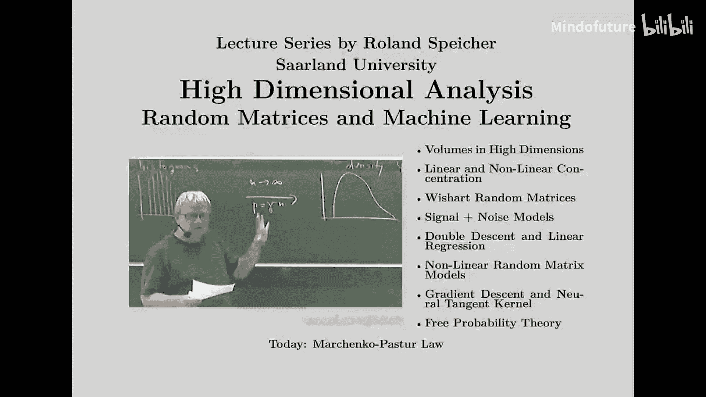
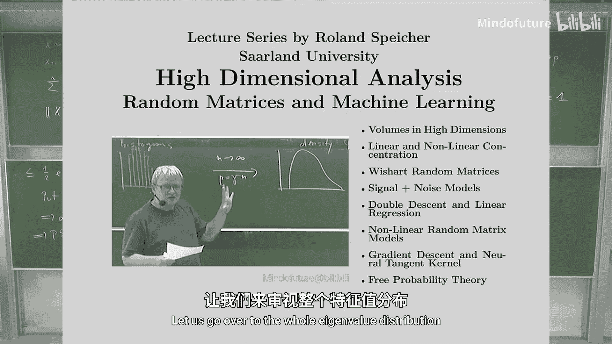
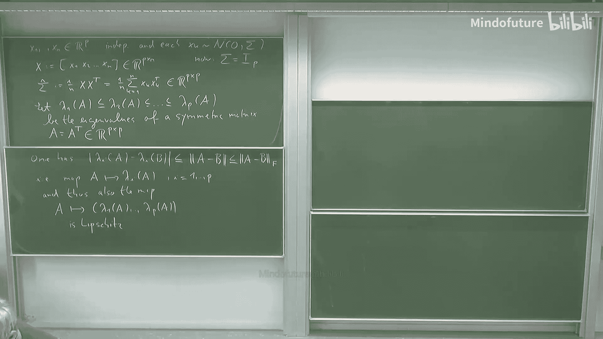

# 【德国萨尔大学】高维分析：随机矩阵和机器学习 ｜ High Dimensional Analysis p11 P11_Wishart矩阵的Marchenko-Pastur定律 -BV1XkkWBFEi6_p11-

Let us。Go over to。

Yeah， the whole eigenvalue distribution。And in assignments， you already looked on。

 on eigenvalues of which had mates。 And you saw that there。Is in our regime a quite meaningful limit。

 but we should try to understand， first of all。That we also have concentration on this limit。

 And in particular， can we really calculate this limit。 I mean。

 I gave you the formula and assignments， but can we also derive this formula？

 That's what I want to do， maybe。Today， and。Probably also next time。Yeah， so may。

 maybe let me recall our setting again。 Okay， we are looking on。Independent draws。

 independent copies。Of our P dimensional vectors， which have a a Gaussian distribution。

 And now I want to specify to the simples case where the covariance of this Gaussian distribution is the identity matrix。

 it just means that all。Allil components of my vector are independent。

 and each of them has the standard ga in distribution。 So okay， so they are。Independent。And each。X。

 K。Has a distribution。Cil。And in general， we can here have here covariant matrix。

 But now in and in the following。I will specify to the case where this is the identity matrix on the simplest case。

 And so this means I have yeah all， all。The entries。

 which I have here are independent and they are go distributed。Good， then we look on x。

This is this matrix where I'm putting in all my data， x1， x2 up to xn。嗯，手的是意是。P times n matrix。

And we look on the corresponding， essentially， the。The square or or x times x transpose。

So we look on what I call sigma head， so this is 1 over n。X， x transpose。

Which is written in terms of the vectors is one over n to sum。K from one to n。X， k。X K transpo。

So this is p times p matrix independent of n。um。O。Yeah。And may。

 maybe I have here this this one over N， which is， is also good normalization。 As we will see later。

 this actually guarantees that if we go to a limit， that this really converges to something。I mean。

 I mean， if I take here one over N， this means means I'm rescal the entries of my axis by one over square root of n。

 which means that I'm changing。I， I could also say I， I take auto matrix1 over square root of x。

 which meanss the entries of this are still independent， but each of them has a gause distribution。

 where the variance is one over n。re not one anymore。 And， of course。

 this guarantees that things don't explode if n goes to infinity in a meaningful limit。

 So this is a good normalization。 having the one over n here。Good， but now the question is。

 what can we say about eye values。O， so this is。I mean， X itself， x is a rectangular matrix。

 So this doesn't have eigenvalue。 This has singular values。

 but singular values are essentially the eigenvalue of this guy。 So， so this my head is。

 is a square matrix P times P。 and， of course， it's also silver joint or it's symmetric。

 which means it has real eigenvalue。 Okay， so。Let me ignore them。 So I mean。

 it has P eigenvalue counted with multiplicity。 So and I call them lambda 1 up to lambda P。Yeah。

 okay， and maybe。Let me do this more general。 If I have a matrix， if I have a symmetric matrix。

 I call ya values。I denote them by lambda1 of a， and I order them。 So lambda1 is the smallest。

Then the next one is Lambda 2。And so on， up two and the last one， the largest one。Is lambda P。

 So this should be。The eigenvalue counted with multiplicity of。呃 matrixtri。

And we consider here symmetric mates or that we really know we have。P Ivalue。

 And we also know they are real。Okay， so of a symmetric。Matrix。Also呃。A issymmetricsymmetric。

 so a is the same as its transpose， and it's a P by P matrix。Yeah， okay， and of course， again。

 our question is， for our gausian random matrix， do we have concentration And we know we have concentration for our gaussian inputs If we have lips functions。

 So it's a question again， are the eigenvalue， lips shits functions for the largest eigenvalue。

 we saw this and for any eigenvalue， this is also the case。 So that that's an important point。

 I mean， really eigenvalue are。Complicated linear functions without really having concrete access to them by a formula。

 but at least they are really lipsit function。 So they are not too bad so they are not varying too much。

AndSo then one knows。Some， one has。As for the maximum eigenvalue that if I。Yeah， but。

 what means slip sheet functions。 I should。 I should take two matrices and I should compare the difference of the eigenvalues by the difference in the corresponding norm。

 Okay， and so I should compare。The highest eigenvalue of a。

With the I eyeing value of B for two matrices。 And I should compare this with a corresponding norm。

And a norm。I mean， which I'm using， I mean， if I'm looking on my function as a lipiditz function。

 I'm going from r to some high dimension。 I'm looking on my， my object as a vector here I arrange my。

 my X I J into a matrix， but for the point of view， whether it's lipids function or not。

 I consider this as a function from R to some high dimension that here is p times n to R。

 and the norm， which I consider for a vector is， is the Euclidean norm。

 which for matrix is called phobiius norm， Okay， so this means but in particular。I mean。

 I can estimate， first of all， this difference against the operator norm。

 which is really the the thing for matrices。 So one has that this can be estimated。

Against the operator norm of a minus B。 and I mean this is some property which may be okay。

 it's not totally obvious， but theres some wild inequalities or wild formulas which tells something like this So we take this as given and we know that we can estimate the operator norm against the Euclidean norm。

 which is the phobinius norm。A minus。So the phobeius norm or the Schwar norm or the Hber Schmidt norm of a matrix is just the square root of the sum of the squares of all entries which just means I I'm looking on my matrix as a vector and calculate the usual Euclidean L2 norm of this vector。

Okay， and I mean， this is， this is really considering my， let's say n times n or yeah。

 n times n I a P times p matrix as a vector in in p squared。Okay， but usually this year is quite bad。

 I mean， I'm losing here quite a lot。 I mean， looking on my guy as a matrix is really the good thing。

 And there this year is much better。 But okay， but from Lihi's point of view， it's really。

I have a mapping from the R to the P squared to to R。

 And this here tells me that this is the lips sheets mapping。So。This means。The map A。

Which is the map， which maps A。To the eye。呃。I canvalue of a。For each。

eigenvalue for each alumda I for each for the lambda eigenvalue is lips sheets。 And then， of course。

 I'm usually not interested in just one particular eigenvalue。 I mean， if I'm interested in one。

 then probably will be largest one。 This is special。

 but I'm usually not interested in in the 17th eigenvalue。

 but I'm interested in all of them together。 So I want to know all of them。

 So I consider the mapping where I map a to the collection of all eigenvalue。

 But this is just putting together lipss functions。 Each of them goes to R。

 And then together they go to R to the P。 And this is then still， again， lipss。

 that's also something which we address when we talked about lips function。

 Also also the mapping which maps a matrix to the collection of all its eigenvalue is the lips sheets function。

😊，And I mean， the collection of the all eigenvalue is usually what you what we draw in our numerical simulations as。

 as the histogram。 and looking where the eigenvalue are， okay， so。So for each eyeing value。

 this is lips sheets。 but then maybe more to the point what we。Really want。

Is the map where I'm going from my matrix a。To the collection of all its e values， so。

So going essentially from P squared space to the P。Space， namely， the vector of its eyeing values。

 these are slip sheets。Okay， so this looks good。 So this。

Seems to say that I can use my gaus in concentration for the eyeenvalue。O。I this true。

Or is the kind of problem。

I mean， Gaian。Concentration would say if the entries of this guy are now Gaussian。

 are now my independent Gaussians。Then the eigenvalue have concentration。

But what do I consider as for a。I mean， the entries of a themselves are not。My independent guardians。

What is a， I mean， A in my setting is， is the this wishard matrix。

 which is x times x transpose and the entries of x are independent guardians。

 So I still have to see whether I can check this intermediate。stepep that I can control this。Okay。

 so what we are interested in， of course， is the mapping。

 which maps X to the eigenvalues of the corresponding visualard matrix。Okay， so。But。

We are interested。In the mapping， where X。Gros。To the eigenvalues of the wishard matrix and the wishard matrix is1 over N X X transpose。

So the first eyeing value of this up to the last eyeing value of this one over n。X。Ex trans pose。

Yeah， okay。 And so this means， I mean。Going from here。

Go goinging from this matrix to the eye various slip sheets。

 But the first step we have to do is to go from x to X X transpose。Another way is to， to， to see。

 we have really to see that we have the lipsious condition for this guy。And of course。

 this also has an effect on a lipshiitz constant。 I mean， here， the lipshiitz constant was， was one。

Okay， but now if we do this。1 has to control this。So what I really have to see is what is Lada I of the Viard matrix 1 over n。

X transpose compared。To the same to the e value of a corresponding other matrix of this form。

the eye of。One or way in。Why， why transpose。I mean。

 that is what I should control in terms of the difference of the entries in x and y。

Or in in in in the forroenious norm of x and y。 Okay， so essentially。

I have here an intermediate quadratic thing， which I have to estimate。 And， I mean， of course。

 we do this in the usual usual step。 I mean， if I have control on linear terms。

 how do I get control on quadratic differences by just like for differentiation going to quadratic in two steps of。

 of doing twice I mean， I mean， here， I have to replace x by y and x transpose by y transpose。

 So I should。So， I should。对。I should。Replace things twice。

But I'm doing this in steps of replacing only one of them in one step and then doing it again。 Okay。

 so maybe maybe let me write it down。 This is the usual thing。 So I say this。I can。Estimate this。

By this year， I know how to estimate it in terms of the operator norm。嗯。

I could go directly to for forbius norm， but this would not be so good because then I don't really know how to control。

Pro。So I estimate this。Against here， this first step。

 this is just the difference in the operator norm。Between X， X transpose。

 this guy here and this guy here， Y， y transpose。 So each of them has a factor one or y n， which。

 of course， I can take out of the norm。Okay， and now。

I make this transition from x squared to y squared by just replacing the first x by y and then the second x by y。

 So I'm just writing this here as one over n。And then I have here。X， X transpose。

 But in the first step， I compare this where I replace only the second x by Y。

 So I compare this with x y transpose。Okay， and then I'm adding this again。

 So I haven't really made anything。But in the second step now， I replace this X by y。

 So I compare this now with y， y transpose。So that's， that's a usual thing。

 As you also prove the product rule for differentiation。 Okay。

 so I I want the difference between this and this， But I smuggle in this term， this minus and a plus。

 so I haven't done anything。 But now I can make， I can estimate this and this And in those terms。

 I only have a linear difference。So this is by the triangle andality， of course。

Less than this difference， X， x transpose minus x。Whyite transpo plus。呃。X， y transpose， minus y。

Y transpose。 And now， of course， here， I have the common term X， which I can take out。

 So I have here x times x transpose minus y transpose。Yeah。You write it， this one over n。

Then the first term， I can take out the operator norm of x。

 and I'm left with x transpose minus y transpose because for the operator norm。

 the norm of a product of mat is less than the product of the of the norms of demo。 So that's。啊。

What I'm using here for the norm。 And for the second term， I can take out the wide transpose。

And so I have here， the norm of x minus y times。The norm of。Wide trans。Okay， and now， I mean。

 what we want to do is to estimate the difference in eigenvalue against the phorobius norm of the involved matrices。

 And， of course， I mean， here I have the difference。

 And I can estimate this against the phorobius norm。 So this is less than x minus y。

For beingius norm and of course， the one of the transpose is the same as without the transpose because I'm summing over the square of all entries and whether I first transpose my matrix or not that doesn't make a difference。

 and of course this is I can also estimate as against x minus y。Forbans。 Okay， so that's good。

 But now you see， I also have an additional factor here， which I have also to take into account。

 And also， this means the lipss constant， which I'm getting for this estimate is， of course。

 this  one0 Y N， which comes from the rescaling。 Then okay， I have a factor2， because I have here。

 two terms or。But then I also have the operator norm of x and y。Which， of course， is not so clear。

 I mean， that's was actually。Thing which we talked before。 I mean， the operator norm。 Okay。

 we have now some idea， which is good enough for controlling it So it。

 it's good to know something about the operator norm。 But let， let me write it down So this here。

So what we see from here。Is that the lip sheets constant？Is bounded。Byai。So let's say L。

 my computeutes constant is 1 over n。Then I have twice this term。And in each of this term。

 I have either the norm of x or the norm of y。 So I should take the maximum of them。 So I have here。

The maximum。Of the norm of x。And the norm of why。Good， okay。 And now， yeah， I mean。Of course。

 if x are now our random mates。Okay， these norms， we should also control them。

 They should be bounded by something。 So how how can we control them。And， of course。

 maybe the first idea is， yeah， why not， I mean。In all our arguments， in the end。

 we went down to the phobeus norm， to the Euclidean norm。 Why not just doing it here。

 Because that's something which we can control very easily。

But that's something which we should not do here， because the phobeious norm is really much worse than the operate a norm。

 And if we would replace it here， this would not be good。 But let let us， let us have a look at this。

Because， I mean， it also tells us a bit。 I mean， it depends。In which regime we are really working。

Because we have here， essentially， we have two dimensions。 N and P。 I mean。

 P is the size of the data and N is the size of the observations。

 How many data do we have they should be very large。 But the question is， I mean， in which way。

Are they going to infinity， let's say。And in one way， I mean the phobius norm for this would be good。

 but in the other way， and that's the one in which you're interested， it's not good。

 but maybe we should check this because this also maybe gives us an idea by comparing the classical regime with the modern regime in which we are interested for our statistics。

Okay， so what I'm saying is that it's， it's not good。 I mean， the first thing。

 maybe we one should try。 and of course， we should try and see whether it's good or not。

 What I'm saying is's， it's for our case is it's not good to estimate this。呃。Not good。To estimate。

 of course， the estimate is O， but it's not so helpful if I estimate the norm of x。Against。

The phobeious norm of F and the phobeius norm of F is the norm when I。

 when I consider my matrix as a vector。 So I mean， I have here。So what do I have here， So x， Yeah。

 x is a， is a n times P matrix。 So this would be here， the norm。

Of x as a vector in R to the P times n。O， yeah。 and so呃。What do we know， I mean， now， now。

 now we would have here an P times n dimensional Gausian vector where the entries are。Normal。

 independent， normal Gaussians。 And what do we know about the norm of this。

 So where does this concentrate。Of course， we can only do concentration because， I mean。

 the norm of x can be arbitrary large because all possibilities are there。

 but we know it concentrates。 and for the norm of a vector， for a gaussian vector。

 So where does it concentrate。Yeah。Squal of the dimension the dimension is here P times n。 So I mean。

So we know。I mean， that was from the， the easy concentration phenomena for， for linear functions。

 so we know。That the forbius norm。What a norm。As a vector in R to the P times n concentrates。

About the square root of the dimension。 And the dimension is here P times n。 So it's really， I mean。

I mean， I have a matrix which goes between P and N。 So it should be more A p dimensional object。

 But here it is really considered as a P times1 n dimensional object as a vector。 And I mean。

 this is not。Appropriate， or I mean。This says it concentrates here。And this。Is， yeah， I mean。

 this can be good or cannot be good because now we have to specify what in what are we really interested。

 So we have P and n And in classical statistics usually you say I mean P is a dimension。

 P is the dimension of my data the features in which I'm interested。

 And N is a number of observations。 P is fixed and N I can make as large as I want。

 I I make many observations。 And then usually my  estimateators really converge to what what they are So this would mean P is a fixed quantity。

 maybe large， but fixed。 And then n is going to infinity。 That would be the classic Sta regime。

 And for this， I mean， this  estimate here would would be good enough。 But so let us。First。

 look at this。So， if。P is fixed。And N goes to infinity。 And I， I would say。

 this is the classical regime。Of statistics， classical regime。

When you make observations and you want to infer something from those， you have。

YeahF size for the data features， but you can make as many observations as you like。 Okay。

 so n goes to infinity。 Then actually this estimate would be okay。So why。Yeah。

 because what is then L， I mean， our lip sheets constant， What would this be。So this would then be。

 let's say。呃。Yeah， so what。Would it be air。Is here。1 over n。tTwo times。Okay， I have this two。

 I have this one over n。And I have to。The maximum of these quantities。 But this， okay， I mean。

 for x and y， it's the same for by Gaus and vectors。

 And So this is around the square root of P times n。 So I have here。The square root of P times n。

Okay， but so this is like， yeah。2， and then the square root of P。 I mean。

 p is now just a fixed number。 So this doesn't go to infinity。 So I have the square root of P。

 And then I have here square root of n。 but here I divide by n。 So essentially。

 this goes like one over the square root of n。 And if n is going to infinity， this goes to 0。 And so。

 I mean， I can really control this。 So this is bounded by something。So this behaves like a constant。

Times1 over the square root of n And if n goes to infinity， this is， this is very good because then。

 I mean， even my lips。 Yeah， I mean， I have a liphiitzs constant， which goes like this。

 And if I then take a concentration， then， of course， in a concentration in a concentration。

 I get one over L squared。 So I get E to the minus alpha squared times n。😊。

So the end shows up in my concentration estimate。So I mean。

 the L should go to service the dimension because the L shows up in my concentration inequality。

And then， I mean， in concentration， I had E to the minus。

I first created divided by the deep sheet constant。 Maybe with another two or something here here。

 So you see if L。It's like this。P。Then I get here e to the minus I squared times n。

So this means I have concentration。呃。Which goes to Serf Enoss infinity。For， for some deviations。

From this value。 Okay， so this would be good。 Yeah， but that's unfortunately， or maybe fortunate。

 because otherwise， we wouldn't talk about such things。 this is not the regime if we are interested。

 because in our modern times， Usually you have P is very big。

 So maybe you have many features in which you' are interested。

 And the number of observations is also very big， but it's usually have the same order。

 you usually you make N is comparable to P。 and it's much more appropriate to look for the regime where n goes to infinity。

 but P goes also to infinity with the same speed。 So they are proportional。

 let's say that that's the one in which you are interested。

 and which is much more appropriate for describing， I mean。Yeah， statistics of high dimensional data。

 Okay， so this。Would be good if we are interested in this， but we are not interested in this。But now。

We are interested。In。Let's say more on。Regie。From more on data。Analysis， and there。

We have the phenomena that P and N are of the same size， I mean。And so， of course。

 they are very large， so we can try to capture their features if we go asymptotically to infinity。

 but。They should not go， they should not be independent。

 but they should go to infinity with the same speed。And say。

That P is a multiple of n where gamma is fixed so。For gamma fixed。 So the ratio of P by n。

 this is gamma。 This is fixed。 So let's say P is one half of n。Or one third or five times N。 Okay。

 but then what is then。What do we get then from this estimate an L。Would be of the order too。

 I have the one over n。Okay， and then I have in the square root， I have p times n。

 but p is now gamma n。 and I have another n。 So I have the square root of this。 And now you see。

 I mean， I have the square root of n squared。 This is n divided by n。

 and this is constant So this is essentially a constant。 And this doesn't give me good concentration。

 So I mean， I wouldn't see the the dimension here。 things would not go to 0 would not concentrate if the dimension goes to infinity。

 Okay， so。This here behaves like a constant。 And this means we don't have。No good concentration。

I mean， of course， we can still write down our estimates of probability for something bigger than this。

 but the estimates we get there don't show concentration with the dimensional。I mean。

 I always say concentration inequality， but， of course。

 the inequalities are estimates for the probability that the deviation is bigger than alpha。

 And then on the other side， of course， in the， in the right scaling。

 the dimension should show up so that the other side really goes to 0， usually in exponential way。

 if the dimension goes up。 The estimates them。Yeah， I mean。Okay， they。

 they don't show show the dimension explicitly。 It depends on the value of this lips sheets constant。

 where you have to choose things in the right way。 Yeah And here you see， yeah。

 your lips sheets constant doesn't show the right behaviour every the dimension。Good， okay。

 so this means。In this regime in which we are interested。eststimating this against the phobeius norm。

 So this means looking on our matrices as vectors is not a good idea because our concentration。

For the vectors is not good enough。 Okay， and I mean， usually， yeah。This inequality here。

You are very far away from this。 So you should only do this in。Okay， not。

Better stay with the operator norm。 And that's what we should have here。 But actually， we know。

 I mean， in the beginning， I showed you that we have some information about the operator norm。

 And so now we， we， we should use this。 I mean， we don't know exactly。What， what to mean is。

 but we have an idea of the order so。So we we continue here， Mr。 operator Norm。cost of phobeius norm。

 does's not。Give us anything interesting。 So the operator norm。4 x。Okay， and for this。

We have seen seen that we have a concentration around the square root of P plus the square root of n。

 That was what I showed you at the beginning。 So there we had concentration inequalities。

 So for this。We have concentration。Around， let's say constant。

 And then we had the squared of n plus the squared root of P。And now。

 if a P goes with the same speed as n， then this is concentration about a square root of n that that's again。

 good enough。 then then we are really somehow back as is is。In above case。

And so we know that with high probability， the L， we can bound it， or we know that it concentrates。

 so does。Its high probability。The L is of the order。 I want62 times 1 over n。

 that's the general terms there。 And then the norm， I can estimate it Well it concentrates about C。

 And then I have the square of n。 And for P， I have gamma times n。 So I get something like1 plus。

Squared of gamma。Times the square root of n。 And you see now again。

 I have the square root of n divided by n， which goes like one over the square root of n。

 So this means again， in my concentration， inequality， in my estimate for deviations。

 I get as before the factor n there， which means I get good concentration。OhSo。So， this means。

This gives。By theorem 3。2， which was our gausian concentration for lipsit functions。

So this gives then in the end a concentration。off。I can value。

Of my wishard matrix around its expected value。Yeah， this。Probability  two times exponential。

 Maybe let me write it again。 And so it was minus alpha squared divided by 2 L squared。

And this is of the order exponential of minus and the l squared is like one over square root of n。

 So I get here really in alpha squared and n times alpha squared。Divided by2， and0， I get some。Okay。

 I have hear some。Some constant。I mean， the concerns don't matter for those things。O。Okay。

 so we get this as a bound for the probability of deviations by alpha from the mean。It's a bound。

For the probability。Of deviations。Iif发。From the mean。Good， okay， and so I mean。

The conclusion of all this is。That if we are in a regime where P。Is proportional to n。

And we are going to infinity。 Yeah， the eigenvalue distribution of our weha matrix concentrates on its average eigenvalue distribution。

 So I mean， each eigenvalue is very close to its average version， okay， yeah， and so。Yeah， we see。

 we have concentration。 I mean， so this means if I do one histogram for one specific choice for this。

 I will more or less see always the same because it concentrates about the mean。

 So this means they are very close together。Okay， but again， we have the situation。

 We have concentration， which is a very strong statement。 So we know that that I mean。

 more or less every real is very close。To each other。

 and also very close than to the average version。 But we don't know what the average version is。 So。

 I mean， that's still what we have to do in the case of the largest eigenvalue。

 I did not really give you very precise what the average is。 Okay， but now for the。

For the distribution of all of them， I want to give you what this is。

 And this is the famous Macchancho pastua law and， and the distribution。

 the asymptotic distribution is the Macchanco pastua distribution。

 So that's what we want to talk about in the following。 And I want to give you， also。

Main ideas for the proof of this not doing all the details， but。Show you principle how this is done。

Okay， so， so we have concentration。Which means essentially in order to understand what happens with those which had matrices for the eigenvalue。

 we have to understand the average behavior。But this is still something？Which we have to do。And。

 I mean， the average behavior， really， this gives us。Some。Some curves， some histograms。I mean。

 the fact that we know。We always see the same doesn't tell us what we see。

 Its so we still have to calculate what we really see。

IThese is really abstract arguments are nice but if you really want to see something concrete。

 we have to be more concrete。 We we really have to calculate somehow we have to calculate the limit eigenvalue distribution。

 but it's enough to calculate it for the average version。And that that's really。That's the big。

 big thing about this random mates that you really have this concentration and evering is。

 is really enough。Essentially， it's just evering。 And， I mean。

 calculating an average version is much， much easier。 Eververing helps， really。To do calculations。

 I mean， if you want to calculate for for specific entries of your matrix。

 if you want to calculate the eigenvalue distribution， I mean， there's no way how to do it。

 Of course， you can draw histograms。 But if you average over everything。

 then you have much more structure。 I mean， so averaging helps。

 and if you know that averaging is close to the， to the generic situation， then yeah， you， you， you。

 you have， you have randomness， but randomness helps you。

Because randomness helps you to calculate really what the average is。

 But the average is more or less always the same， so。Okay， so philosophical statements are also nice。

 but I think we should do some work。 We really should calculate。Ths。And I mean。

 we already have seen in numerical simulations that there seems to exist a limit of the eigenvalue distribution of those which had matrices。

 course。You were asked to do simulations for them。 And actually in a normalization。

 which we have here dividing by this one or y n， it was really that， I mean。

 that that was the right scaling that if we go we go with n to infinity， really it， it。

 it stabilizebils。Okay， so this 10 Y n is exactly the the right thing。

 which gives us a limit if n goes to infinity。Good， O， yeah， and。So what we saw。

There was essentially， yeah。 I mean， we looked on the eigenvalue。 So I mean。

 you calculated some histograms。 you， you realized your matrix。 and then you。

 you saw some eigenvalue。 And， for this， you saw some。Histogram， you draw something。Like this。

And if n goes to infinity of a very large n， I mean， you've got a。Yeah， I mean。

 this histogram was very close to very smooth curve。 So essentially what you saw there。 And， I mean。

 that's what we， we want to prove and understand is that if n goes to infinity。

 but such in such a way， that P also goes to infinity， but P is proportional to n and gama is fixed。

 then this will converge to some kind of density a limit of this histogram， and this is a density。

 probability density， which is actually called Macenco pastua。 So this goes to something。

 which looks。Something like this， density， So the histograms。Converge for n to infinity to a density。

Maybe。si， and maybe let me put an MP here for Maccho pasttua。 And， of course， this depends on gamma。

 I mean， depending on gamma， you will see different of shapes。Okay， and so， of course。

 whatever is the meaning of this， This means， of course。

 that this density here tells you about how many eigenvalue you see in a given regime。 So I mean。

 if if you're looking here， let's say from a to B。 And you ask how many eenvalue do you have in this interval。

 then， of course， it it's a number。Whi is is come here。Tells you so how many are there。

 And this in a limit is given。By the area， under this curve from。From a to B， if here has A。

 here's B。Then I mean， this part of the histogram will converge to this。And so， I mean。这。

The number of evalue。Average number of eigenvalues here will converge to this year。

 that that's the meaning of of those pictures。 So if you take here， the number of eigenvalue。In。

 let's say， In A B。And then you normalize this by P because you have altogether。

 you have P ivalue So you want to normalize it so that you have a probability distribution。

 And then you get here probability density So this here convertvers to the integral from a to B over。

This density T， D T， which means it's exactly this area under curve。Okay， so this means the。

 the fraction of the eyeen values in this interval converges to the fraction of the area under the curve。

Yeah， and， and， of course。This， this curve here should be a probability distribution。 So this means。

So if I'm inter， if I'm asking here for all eyeing values。 So I think interval。

Where they are all sitting， then， of course， I should get here integral over the whole density。

 and this should be one。Okay， so note， of course， at the integral over everything of my Macchano pasta。

Distribution。Is equal to one。Because I ask about it normalized。I values good。 Okay。

 and so we saw this in。Our simulations。 And actually， yeah， this is really true。

 And we can give an explicit formula for the curve which we get there。

 And that's the Macan pass to a law。 So I， I will write it down now and then。

We will try to prove this。 So that's one of the。Basic theorems about random matrices。

This was proved by Macengo and Pastua。呃。In 1967， so it's usually called Machenko Paa law。

And this is the Macchano pasta distribution。And so what does it say？Okay。

 I will say it a little bit in informal。Terms， yeah。

 I'm saying the histograms of the eigenvalue converge to the Macenco pastua density。 Yeah。

 but I think this。Should be clear。 The main point here is that we really get a formula for the limit。

 and we want。We want to really calculate and understand this formula。 Okay。

 so what we have is our gausian random matrix。P times n。So this should be。Like this。B hour。Stand out。

Gozin。Random matrix of size。P times n， where all the entries have the normal distribution。

 standard normal distribution， variance 1 and all independent。Let me write it down。 So there are。Or。

Enreries。X， I J of this matrix。Just a standard， normal distribution。And they are， of course。

 independent。And then。Yeah， if now P and N go to infinity。

 but in such a way that their ratio is small less constant。

 or at least in a limit goes to a constant， which I call gamma。 So if。呃，皮议。By N。

Go to gamma and gamma is a fixed number and let me fix it in the interval 0 to1。 I mean。

 in the assignments， you saw that you can also go to the regime where where gamma is bigger than one。

 But then actually you also get atoms at 0。 Okay， so here we are in the regime where we don't get atoms。

 And so maybe the formula is nicer to write down。 But it's more or less the same in the other regime。

 Okay， so if P divided by n goes to a constant gamma， which we assume here to be between 0 and 1。And。

 of course， n goes to infinity。Then。The histogram。Of the eigen values of our wishard matrix。

 so the histogram。Of evalue of our visualard matrix。

 which I didote by S my head and which is nothing else than one over n。X。

 X transpose that this converges。 And I mean， I have here this normalization1 over n。

 So this means effectively， you can also say I have rescaled the entries of my matrix x by one over square root of n so that I have replaced here。

 the normal distribution with variance 1 by the one with variance 1 over n。

 this is the right scaling so that you really have a limit。 Of course， I mean。

 otherwise things would explode。 So we have to to scale the variance。

 at least the variance of this guy。 we have to scale so that it has a limit。

 and it is clear that you have to scale it like this。 But then also everything else has a limit。Okay。

 so this converge to what the histogram of the eigenvalue of this。Convers to。

The so called Macchko Patua。点击T。Lets do。点ZT。Okay， which I just call。si and P。

 but for which I can write down the formulas of Psi and P。And， of course， it depends on gamma。

 So maybe I should also put a gamma somewhere。 but okay， we have gamma fixed here。

 So the density is given by one over two pi。 and I have here gamma and then T。

 And then I have the square root of gamma plus minus t times t minus。

Gamma minus the square root of this。 So this is a density which lives on a interval。

 a compact interval which goes from， I mean where this square root here makes sense。

 namely from gamma minus to gamma plus and of course。

 those are guys which are determined in terms of gamma。So namely so gamma minus。Is just1 minus。

Square root of gamma squared and gamma plus the same with a plus here。

 So gamma plus is one plus the square root of gamma。Squat。O， so that's the Macchano Patua。Law。

And yeah， you can。You， you were asked to， to compare really this， this concrete。

 explicit form of a density with the histogram。 So and this this fits really very well。Good， okay。

 and maybe let me start with a few few remarks about the proof。

 So next time we will do the main steps in the proof， the main calculation I mean， somehow。I mean。

 at some point， we should see， how do I get， I mean， where does this formula come from， I mean。

 I have to calculate it somehow。 I mean， it's absolutely not， not clear how， how this comes。

 So I mean， I want to show you next time how you can get it。

 But maybe let me first make a few remarks that， I mean。

 even yeah how do you prove such a statement because it's a statement about the histograms that they converge to density and maybe。

呃。That's not a way we are going to prove it， because， I mean。

 talking about histograms is is maybe not so clear how we should deal with them。So， but maybe。We can。

Forulate。Our statement in the form note that the statement。I。Of the form。So， I mean， I'm。

Taking the average of the eigenvalue。Which are in the interval A B。

 So what I'm doing is for each eigenvalue。 I'm looking whether it's an interval A B or not。

 So this means to each eigenvalue， I apply essentially a characteristic function。 So this means I。

Normalize it by one over P。 And then I'm summing over all。My。Iingvalue。 And for each of them。

 I'm checking。Whether it is in this interview or not， O。

The F is now the characteristic function of this interval。 So it just means it， I mean。

 this guy is one。 If Lada I isn't an interval and it is 0， if it is not。 Okay。

 and I'm claiming that this converges， if n goes to infinity。

But such that P also goes to infinity has come my N， that this converges， yeah， I mean。

To the area under the sub psi from a to B。 But， of course。

 this I can also write as an integral over the characteristic function of the interval A B。

 So this I can write as the integral over F of T。u。Pi MP。地体。Where， of course， here。

This F is a characteristic function。Of the N A B。So I mean， this is just a function。

Which is0 outside of the interval， and it is one inside。So it's just a function which。

 it checks whether my a， whether my argument is in this interval or not。Okay， yeah。 and of course。

 I'm mean Lada 1 up to Lada P are here the the Ivalue of my。Of my Vhat matrix。Good， okay， and so。

 I mean。嗯。Yeah， proving。This in this form is is not really so clear。

 And so how to prove proceeds is usually that you replace these characteristic functions by other functions and you prove the same kind of convergence。

 okay， and then。Things are much， much better。 Okay， because for other functions。

 you can really prove this quite nicely。 Okay， so as， so proving。This here， let me call it star。

Sation， so proving star。Directly。Is not clear。But actually， one knows by general。

Machinery theory that it's enough to prove such a statement for other classes of functions。 I mean。

 here you have to prove it not not just for1 A And B， but for all A And B。

 So for all characteristic functions， you have to prove a statement like this。

 that's more or less what we are saying that the histograms converge okay。

 but knowing it for all characteristic functions is the same as knowing it for other classes of functions and they are typically two classes of functions。

 which one can consider。 So namely yeah。Let me first。 So provinging it is not so clear。

But it can be achieved。By looking on other classes of functions。 so what can be。Achiieeved。F的。

Classes。Of functions。 also， O。 So I'm saying instead of proving this for the characteristic functions。

So， instead of proving。Star。For， I mean， that's what we really claim in our theorem and maybe what we would like to prove that this statement is true for all F。

Which are characteristic functions for some interval。So for all intervals， yeah。

 that instead of proving this。One can also prove it。And proves it。For other classes of functions。

 And there are two possibilities which give two different ways of proving this theorem。

 So namely one is。That I just take powers So I take F of T just as T to the N for some power N。

 And I have to do this for all。 So I consider all。F of T is like。T to the n。For all natural powers。

 And I mean， then what I'm doing is more or less looking on the moments of my guys。 So I mean。

 here here then I have T2 the N。Integrated this to the density。

 Those are the moments of my Marchacheco pasta distribution。 And I have to see accordingly， that。

 in a sense， the moments of the eigenvalues also go to this。 And I mean， proving this usually is。

 so this is looking on the moment。 and this is the moment method， which。

Which tries to understand the moments of this。 So this。These are the moments。

But maybe another possibility。I mean， moment usually is is a comminatorial thing。

 is is a lot of comminators involved to understand the moments and what they are in a limit and。Yeah。

 better can count them or not。 and another more analytic way is to look on functions of the form F of T。

Is equal。To one over。T minus set。Where set is a complex number。 So， so for each complex number set。

 I'm looking on this。 Those guys are usually called resso winds。 So I'm looking on the resson。

 and this is the res method。So I have to do this for all set。And actually， I mean。

I go to the complex numbers because if I'm looking on this function and T is the domain over。

 which I integrate。I mean， if， if this guy would be in a domain which I integrate。

 then I would have here one over 0。 and I might have problems。 So it's better if to set。

 I should stay away from the support of my measure。AndI mean， I mean， here， the measure is。

 is just on a relax axises。 So if I go in the complex plane， I don't have problems。 Then this。

 this thing here is always invertible。 So this means I'm looking on this for all。 Let's， let's say。

 see in the upper half plane or maybe the lower half plane。 But in any case。

 I should avoid maybe the relax axises。But if I know this for。

 for complex numbers outside the relaxes， this corresponding statement， that's good enough。Okay。

 and so， I mean， this this year is called the res。So， that's the。Resolent method。 and so。I mean。

What nose。By general， measure theore。Tools and statements that in our situation。

 proving one for all characteristic functions is equivalent to proving either two for all moments or either three for all resolution events。

So in part and so what we will do is usually I like comminatorics。 So usually I do moments。 But okay。

 I also like an analysis。 So actually， we， we do 3。 So I want to show you how。😊，Pall three。How， yeah。

 how we can prove and in particular， how by understanding essentially the limit of。

Dis functions here。By getting something for the limit， how this gives us the Macn pasta distribution。

 Also， I get it concretely out of this。 So it's。Yeah， so there should be。

 we should do some calculations。 We should calculate the limits what they are。

 And if you know what the limit for those functions are。

 then this should tell us that we have the man past to distribution。 And that's。

 that's what I want to show you next time。 how this can be done。 Okay。

 but maybe the last remark is of， of course。We prove here that this here yeah happens in generic situations。

 So the probability that this goes to this is， is very large。 And by concentration。

 we know this we we know。That the， that。Those functions concentrate and also。

 those functions concentrate。 So by concentration， we know that actually。

Individual realizations have a very high probability to be close to the average。

 So this means what we have to prove is this here only in the average version。

 So this means we average here over all possibilities。

 And then we have to show that it converges to this。And this guy is deterministic。 I mean， this does。

 this is really one，1 limit So we really have one limit object to which we converge。

 And this is more or less also the the average version of this。 But。

 but here we can take the average。 And this makes， makes， of course， the arguments really simple。

 I mean， not， not simple。 But it， it allows us to do the arguments that we really can calculate this here。

Okay， so it it， it's， yeah， it's good to know that we have concentration。

so that instead of proving this for oil reo events。呃。That this happens with high probability。

 for most of them， It's enough to have to show that。The average retri of this converges。

 because by general arguments， we already know that we have concentration。Good， okay。

 but I think I will stop here。 And next time we then really， will。

Well give you the main ideas of of the proof maybe not all all the technical details。 but。

 but the main ideas so that I think we really see how we get or from where we get this explicit formula for Macchco Paua。

Good， that's it for today。