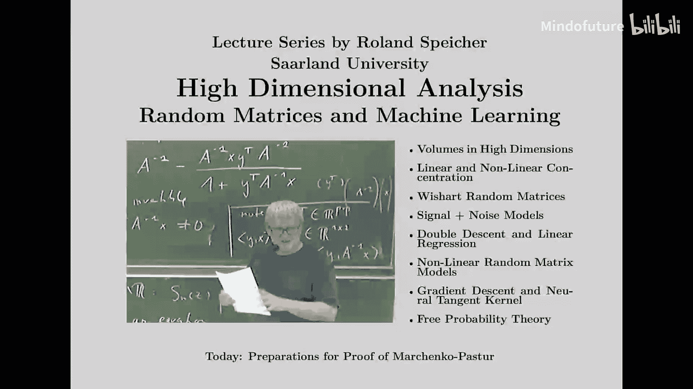
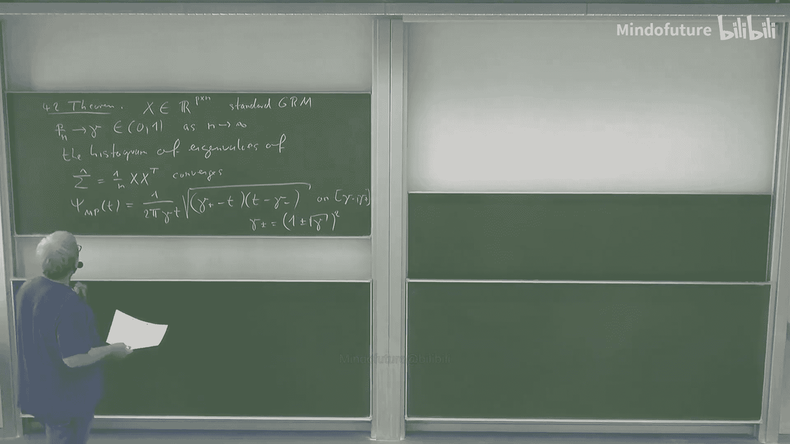

# 【德国萨尔大学】高维分析：随机矩阵和机器学习 ｜ High Dimensional Analysis p12 P12_Marchenko-Pastur定律证明的准备工作 -BV1XkkWBFEi6_p12-

Yeah， so we are looking at Machenco pastal law we want to understand the asymptotic eigenvalue distribution of Vi random matrices。

 and we already saw that we have concentration which means that eigenvalues of those matrices are very close to the average behavior or that they are always very close to。

To， yeah， the positioner。 Okay， so it it， it's enough to understand what is the average eigenvalue distribution of those matrices。

 And that's what is given by this March angle past two long。 So I， I just recall。 So。

 so that's what we want to prove。So this was my past2。 who proved this。 So our setting was， yeah。

 we are looking。On our we chat。On our matrices， okay， which which are coming from our data matrices。

 So x is a matrix P times n。 So it consists of n independent draws of our datas。

 So P is the dimension of our datas。 So this should be a standard Gaussian random matrix。

Standard gaus in random matrix。 So with this， I mean that all the entries of x are independent and they have all the same distribution。

 namely， they all have a gaus， which means 0 and variance 1， Okay， and then。

We want to understand this in a very specific regime。

 So namely not not yet not fix P and let n go to infinity。

 but at a regime where P and N both are large of the same size。 So。

 so we look on the asymptotic situation where， I mean， they both go to infinity。

 But their ratio goes to a constant。 And then the result will depend on this constant So that's what I call gamma。

 So we assume that P divided by n。Goes to gamma in the limit， where gamma。I mean。

 here I restrict to the interval between 0 and 1， but the same is more or less also true on the other side。

 But then I have an additional atom。 So in the form I put it here， it's， it's for this regime。

 but I can， of course， also extend it to the other side。Okay。

 so if n goes to infinity and this means also P goes to infinity like gamma n。

 then we say that the histograms of the eenvalue of the corresponding which matrix。

So the statement was the histogramrum。Of the evalue。Of okay， not， not of x。

 because x is a rectangular matrix。 This doesn't have eigenvalue， but of the corresponding we matrix。

 which are denoted by sigma hat。 And this was， by definition，1 over N x times x transpose。

So this is a symmetric P by P matrix。 So this has relying values。

 And we can look on the histograms and we say this convers。To very specific distribution。

 which we call Mahenco Patua density。 So this is Psi MP P of T。 So this is a probability density。

Which depends， of course， on gamma And so the explicit form is one over2 pi。Gammma T。

 and then I have here gamma plus minus T。Times t minus gamma minus the square root of this。

 whereas is gama plus and gama minus are calculated from gamma so。So， and this here lives on。

 on the interval where the the square root is a square root of of a positive guy。

 which means t has to be has to be between gamma minus and gamma plus gamma minus is a smaller one。

 And so this lives on gamma minus up to gamma plus this interval and。Gma， let me say plus minus。

 this is just1 plus or minus square root of gamma。And the whole thing squared。Okay， so that's。

 that's a statement。 And I mean， we， we， we checked in assignments that this really seems to be the case。

 I mean， we looked on the histograms of those mates and we compare it to this。

 And this is really a very good fit。 Okay， but we want to prove this to understand this and。Yeah。

 how do we prove such a thing。 Yeah， So I already said last time。 I mean， what we are claiming here。

 essentially， that the histograms are converging。

To， to this law means essentially that we have a convergence of specific average functions of the eigenvalues。

 Okay， and so maybe。Maybe， let。Let me。Right again。 So what what do we actually。

What what this says is that， let's say， one over P。Do some over。1 from one to P。Of F。

Of the I eggvalue。So lambda I up to lambda P RI values of my we matrix。

 we are claiming that this converges in the regime we are considering to the corresponding integral。

With respect of this function， with respect to the Macchano pasttuwar density。Okay。

 and for the histograms， I mean， this F， which I'm taking here are characteristic functions of。

 let's say interval A to B So function， which is one on this interval and outside。

 if it's not So so for with this function， I'm here just counting whether the eigenvalue are in this interval or not。

 that's what my histogram is telling me how many eigenvalue are sitting in。 okay， I mean。

The histogram gives me the bins， But， of course， then I can sum over some bins。

 and then I know how many evalue。relativeelative are in this interval and this corresponds to the corresponding area under the Macchano Patual So that that's what we are saying here。

And yeah， now。I already said last time， I mean， to prove it in this form for functions， I mean here。

So the histograms。This means I'm looking on functions where f of lambda。

Is a characteristic function of an interval A B of lambmbda。

And to prove this in this form is not so clear how we should do this。

 because we don't really have good control of the eigenvalues。 We don't have concrete formulas。 Okay。

 so the， and so the， the main idea is that we prove this for other functions。 so namely。You consider。

Instead。Functions， either。We are looking on moments， which means we are looking on powers of n。

 or what we are going to do is we are looking on rather events。

 which means f of lambda is one divided by lambda minus set for some complex numbers。

 So this this year depends essentially on n。 And this year depends on set So it。

 it's a collection of functions。 And we are going to prove this。 and why。

Why should we do this or why， Why should this be easier， The point is。That okay。

 the eigenvalue we don't have direct access to。 If I'm summing here over the eigenvalue， I mean。

 this is essentially like taking a trace。 So this is going back to the matrix itself。

 instead of the eigenvalue， we should go back to the matrix and its entries where we know really how they behave。

 Okay， I have here the sum。Over a function of the eigenvalues。

 This is like the trace of the function of the matrix。 Okay， I mean。

 taking the trace of the matrix means I'm summing over the eigenvalues。

 and the trace of a matrix is something which which which is given in terms of the matrix entries。

 Okay， but we have this function。 and the characteristic function of the matrix。

 This is not clear how we should deal with this。 apart from going back to the eigenvalues。

 But if we talk take those other functions here， then this is something which we really can write down as a genuine function of the matrix。

 I mean， here we take just a to the n and here we just take this function of the matrix。

 this means we really go back to the matrix， we take the trace of something in a matrix。

 And then hopefully we can understand this in terms of the entries of the matrix。

 because the entries of the matrix。 This is something where we have good control。 the eigenvalues。

 we don't really know so much。 it's hard to control them directly。 Okay， so that that's the reason。

instead of proving this， that we don't really know what we should do， we prove either this or this。

 And both of them in this situation is equivalent to this year。

 So this follows from general machinery， which I'm not going to go into， but but essentially， yeah。

 that that is， is well known。 Okay， so， so I want to move it for this function。 And then furthermore。

 we also know because of concentration， it's enough to prove the whole thing for the expected value。

 So instead of taking here the function of my eigenvalues for。Given the realization。

 I can do this for the expected value。 So maybe I can put the expected value here。

So that this converges。 This is good enough because we know already that for each realization。

 I'm very close to the expected value。 So if I know what happens with the expected value。

 I also know what what happens in typical realizations。 Okay， Yeah， and of course， I mean。

 this is deterministic。 this is always the same result。 Okay， so that's what we want to prove。 Yeah。

 and maybe the first thing。嗯。Which I'm going to do is now really making this transition。

From this function function in the eigenvalues for this function to something which is given in terms of the trace。

 Well， I mean， it is very。Easy trivial， but， but maybe let， let me do it explicitly。 also。

 because that's what we are going to use。And I mean， this is a general statement， of course。

About matrices that if I have a trace or a function of a matrix。

 this is the same as taking the average sum of the corresponding function eigenvalues for or several joint matrices。

 And let me do this for， for this function here。Okay， so。For this。Let me consider matrix A。

Which is a P times P matrix。 So A will later be our we shot matrix and。Yeah。

 so let me assume this is symmetric。Assymmetric matrix。So this means it's equal to its transpose。

Okay， and then， of course， we know that such a matrix has with multiplicity， P ienvalue。

 and they are real。 Okay， so that's。What we know from。In algebra。

 so this has eigenvalue and we know they are real。And there are sufficiently many。

 if I count them with multiplicity， know， So I'm writing down a characteristic equation and this has P solutions。

 And I call， I call de them by lambda1 up to lambda P。 Okay， and then I'm claiming。

That if I'm looking on this quantity for this function。

 that this is the same as a corresponding function at the trace of the corresponding function of my matrix。

Oh so then。Okay， here my function depends on this parameter set。 So we have this for each。呃。Seid。

 but， of course， I mean。If I take this function， if set is equal to Lada。

It's problematic problematic。 So I should avoid this。 but I know the Ladas are aen values。

 So if set is not real， then I'm sure that this never gives a problem。 that's the reason why I。

 I'm not taking set on the real axises， but I go to the complex plane。

 And let's say usually I just consider the upper half plane or I could also consider the lower1。

 I should， I should avoid the real axises because I， I don't know where the aing values are。

 So so I I don't know， I'm not so sure what I should avoid。 So better avoid the whole real axises。

 then then it's always okay。 So for any set。In C， or maybe here I'm just saying， okay， maybe。

 maybe just avoid the eyeigenvalue because I have here the eyeigen values。

 I have names for them so I can say I avoid。All of them。 But later， if we talk about。

Collections of matrices， I I just avoid a whole real axis。 But let's say here。

 just for this statement， if I take sets， which are。Different from dying values for all one up to P。

Then we have。That this。Quantity in which I'm interested。 So I'm summing。For one。Up to P。嗯。Yeah。

 and I'm okay。 I'm ever reaching。 So I'm dividing also by one over P。 and I take the function 1。

 and then I take lambda I minus set。So for my function here， I'm just taking now。This function here。

 So for a set is fixed。 So this is a function of the eigenvalue。

 This I'm claiming is the same as the trace of my matrix a。And so I take the same。 I re。

 I replace just the lambda by the a。 So I take a minus set inverse。And of course。

 subtracting set means I'm subtracting。 If I'm now on the matrixes。

 I'm subtracting the identity matrix or set minus the identity matrix in P dimensions。

I take the inverse of this， and then I'm taking the trace。So this here is this function here。

 and the trace is corresponds to this average sum。And I'm avering here。 So this trace。

 which I do note here with this little T is a normalized trace so。Where啊。

Little T R is the normalized trace by one over P of the usual trace。

 usually trace of a matrix is just summing over the diagonal。 but I normalizing this by P。

 because I also have here normalization。So， this is。To normalized。Trace on P by P matrices。Good。

 okay， the proof of this。Maybe hopefully it should be more or less clear to everybody， but let me。

 nevertheless do it。 So because this is， of course。

 important ingredient of what we are doing here so。This is just basic。L algebra。呃。Yeah。

Stuff on diagonnosing matrices。 Okay， so， so we have a symmetric matrix。 And， of course。

 we know that we can diagonalize this by orthogonal matrix。 and in a diagonal form。

 we just get the eigenvalues on the diagonal。 So that's the。Maybe one of the basic statements about。

spectral theory of matrices， if I have an orthogon。Atgonal matrix， no asymmetric matrix。

 then it can be diagonalized。Diaagonized by an orthogonal matrix。 And I mean。

 the orthogonal matrix contains the eigenvectors of my matrix。 It can be diagnosedized by。

Agonal matrix。Also， the fact that this is orthogonal just means that that the eigenves。

 the different eigenvectors are all orthogonal to each other。 I mean。

 that's the two main statements about geosymmetric matrices。 the eigenvalues are real。

 and the eigenves are all orthogonal。Okay。To each other。 So I put them into an orthogonal matrix。

 maybe I called it O。And orthogonal means， of course。

 then that all times O transpose is the identity matrix and， of course， also the other way around。

Okay， yeah， So did this means the columns。I mean， the columns are， are all normalized two lengths 1。

 and they are all autogonal to each other。 Oh And here for the rows。 Okay， and thistagonization。

Of course， is in the form。So that I can write a S O， D， O transpose。

 So I'm making a change of my basis。 I'm going to the basis which consists of the eigenvectors of my matrix。

 And then in this form， the a gets transformed into D。

 which is a diagonal matrix and this diagonal matrix just has the eigenvalues on the diagonal。

 Also D is a diagonal， P pi P by P matrix where I have lambda 1。

 Lada 2 up to lambda P on the diagonal and0 everywhere else。Good， okay， but then。Okay。

 I can now look on this side。 and now， of course， I can。Calculate this side。In， in this form here。

 So now I can， of course， consider what is this。 So here I want a minus set times the identity matrix。

Okay， so let me first write this in this form。 So this is then。I say it's O。D minus set。I P。

 O transpose。 I mean， A is O D， O transpose and the identity。

 I also have written as O identity O transpose， which is， of course， the case because O。

 O transpose is the identity。 Okay， so it doesn't do anything with the identity matrix。 Yeah。

 and then， of course， I can now invert this。So a minus set identity matrix。To the -1。 That's what I。

 by what I want there。 Of course， is now the inverse of this。 Okay， I mean。

 the inverse of a product is the product of the inverse is just in the other order。

 and the inverse of O and O transpose is， of course， just the other one。 I mean。

 the inverse of O is is O transpose。 I mean， that's exactly what this here saying O transpose is the inverse of O。

 So I take the inverse of this。 but it it's move， it's moved over there。 So I still have the O there。

 So this is O。And then I have to take the transpose of this D minus set identity to the -1。

 And I mean， I have the inverse of this， but moved here。 but the inverse of this is O transpose。

 So So you see， I have the same。Conjugation of the corresponding。方是 indeed地。Yeah， and now。嗯。

Yang so now。Of course， I can apply。Yeah， maybe not let me apply the trace to this guy。

 and then of course， the effect of the trace is that the all disappears that's the main thing。

 I mean， up to this point， if I just deal with the functions themselves。

 I mean I have it's a function of the diagonal thing。

 but I still have to transform it back into the old basis， but if I take the trace。

 I don't care about this anymore because the trace does not change and change of the basis。

So let me take the trace of this then。I that's the thing we are really interested。

 where we want to see that it is given in terms of the eigenvalues。 So the trace of。A minus set。

Times the identity matrix to the minus1。Trace of this。So this is then。 So this is one over a P。

 like the ordinary traces of。 Yeah。 And I mean， we have seen this， I can write it as O。

And then the inverse of the corresponding thing where I replace A by D。

D minus set times the identity matrix， -1。Or transpose。Yeah。

 and now the main point is that the trace。 I mean， the trace has the property。

 the trace of A B is the trace of B A， which means I can move something from here to the end。

 So so this， this is the same as this times O transpose times O， but O transpose times O is1。

 So this disappears。 or it's just maybe even more basic fact that the trace is not changing under under orthogonal transformation。

 So that that's what this is saying that this is the same as one over P。

And then taking the trays where the O has disappeared of D minus set。IP。us1。And I mean。

 this really shows that， I mean。I mean， de contains the eigenvalue。 And now now we are almost there。

 But， but this， this， this shows how going from something where the eigenvalue are there。

Going back to the matrix， this is， is achieved very nicely by taking the trays。 Okay， on this here。

 of course， this is now exactly what I have there。 just because here。

 this is a diagonal matrix where the eenvalue under diagonal。 And of this。

 I can of course take the inverse。So， I mean， we have， of course， now that D minus。Sat times。

 identity。So what is this？Yeah， this is。 or let me。 I mean， okay， so this is just the matrix D。

 And then I'm subtracting set times the identity。 set times the identity is just the matrix which has a set everywhere on the diagonal。

 So I'm subtracting from Lada 1。 I'm subtracting set from Lada 2。

 I'm subtracting set and so on from Lambda P。 I'm subtracting set and everywhere else。

 I haven't done anything。Okay， and now I don't want this matrix， but I want the inverse of this。

But taking the inverse of a diagonal matrix， this is easy。 I mean。

 taking the inverse of a general matrix is not so easy， but the diagonal matrix。

 this is very easy because I just take the inverse of each element on a diagonal。

So I take here just the inverse of the first entry。I take the inverse。Of。

The to2 entry and so on up to the inverse here on the P， P entry and everywhere else， of course。

 nothing happens。Yeah， and now you see， I have this metrics and。If I now take the trace of this。

 the trace of this is just a sum here。 and I normalize it by P。

 And so the trace gives exactly what I have here。好。说就是。呃，呀。This gives me。Theception。Right。

Because the trace of this is exactly this。 So this is just， I mean， it is very general。 I mean。

 this does not rely so much on a specific format of the function which I take here。

 but this is true for any kind of function， which I。

 for any polynomial or any rational function which I can write down as such a formula where I can also write down a function of the matrix。

Because it's given in algebraic terms。Good， okay， so we see that。

That for such functions where I have kind of explicit algebraic formulas。

 I can go over from ya values to the matrix。 And that's good because then I'm back to the matrix and。

😊，Me， then I can calculate things in terms of the entries of the matrix。

 and there I have have a good knowledge。Yeah， okay。 And so， of course， what I have done here。

 if I have a specific matrix。I should avoid reset the eigenvalues。So that my function makes sense。

 And if I now。Yeah， take， take matrices and and I， I， I mean， if I take my wish at orsemble。

 I have many matrices and they might have very different eigenvalue。

 So I don't know where they are sitting exactly。 So I'm just avoiding all of of the real access。

 So in the following set will just be， let's say the upper half plane awarding R。

 And then all this is true for any matrix which we consider。O。And now。So we see what we really。

Now should try to understand is this kind of function of our matrix and see that this converge to the corresponding to the integral over the corresponding function with respect to the maco pass density。

And those。都是。Quantities here， which I consider now as a function of set for each set。 I have this。

 These are very important quantities for matrices， and they have their own name。

 and they are called stilles transform。 So what I'm doing here is really the still transform of my matrices。

 And I want to see that they converge to the stilles transform of the Macenco Paual law。Yeah， okay。

 so let let me just define those guys。 You transform is is just a name for those functions。

So let me define the still transform of the matrices and the still transform of the limit。嗯。So。

And our matrices are the we had matrices。祝福奥啊。We had matrices。

So there those we have to form a sigma hat， 1 over n， x， x transpose， we define。

What we call the still transform， we define。y啊。So stillious。我是。A famous mathematician。

St just transform。S。And I consider as a function of this， this parameter set。 So I write as。嗯。不。

And let me put an end here， because。Yeah。I'm looking on the matrix where I have this n here。

 So I have a P times n matrix。 So it also depends on P， but P。

 let's say is gamma times n So it depends on n。 And so I write S n。

 And then it also depends on this parameter set。 and it is given by this trace of the inverse。

 but we also take the expected value because we want to prove things for the expected value。

 So I take here the expected value of the traces， the normalized trace of my。

W had matrix in my head minus set times the identity matrix， taking the inverse of this。

And then the trace of the， of this thing。And then the expectation of the whole thing。

And let me do this。For set， which is。A complex number， but not R。Because I mean， if I ever here。

 I average over all possible numbers all possible wishard matrices。

 and the eigenvalues can be more or less anything。Of course， they are positive。

It would be enough to exclude the pos positive relaxes。 But anyhow， we don't care so much about this。

 Okay， so that's。Still this transform of our Viard matrices， and。

So we want to see that this converges in a limit if nngs infinity to the corresponding quantity for the Macancho past law and there。

 of course， for the Macencho past law， we should integrate over this function here。So， for the。

For our Macacheko past law， we defined a corresponding object。So， for my chain。Pas doa distribution。

Which was a density， Pi and P， which。Is given here in explicit form。

 We also define its status transform。呃。We define。St just transform。S。same kind of object。

 so let me call it S for my Cheo Paa。Again， it depends on set。

 and it is given by integrating this function 1。Divided by Tman set with respect to my Mac pastor density。

And again， I'm doing this。Yin。C minus R。But， of course， in this case， I mean。

 if I'm outside of this interval then it then it， then it would be okay。 But still。

 let let us just exclude all of our doesn't make a difference。Yeah， okay。 And so what。

 what we have to prove。Is that actually。A dis guy here。

For any set the upper half plane converges to this year。 That's what we have to see。I mean。

 that's our idea。 I Gr， we would like to see that if I have here a characteristic function of my matrix。

 it converges to this。 but okay， the characteristic function。

 I cannot really express in nice terms so that I can handle it。

 But we know this is the same as proving it for this kind of function。

 which I can express very nicely。 And so we have to see this。 Okay， so。SoTo prove， maybe。So。

 what we have to prove。Is that for all。Sat which are。Not in enough。That we have that S N。Offset。

Converges in the regime which we consider， which is n going to infinity and P also going to infinity as a multiple。

Of n as a as a yeah fraction of n gamma times n。 So in this regime。

 this should converge to the corresponding still transform of Macenko Patua。Good， okay。

 And so the question is， how do we do this， I mean， now and of course， Okay， the the main work is。

 is to prove this there and， and。In this proof， I should also see why we get Machco past2 in a limit。

 I mean， we start somewhere here by our wish matrices， and we want to show a converge to something。

 and we should identify this something And in this language， here， of course。

 we have to identify there the still this transforming a limit。

 So we need to get somehow still this transform， which tells us that we have this distributional。

And the idea is that what we are going to derive is an equation in a limit。

 So we are trying to get equations here and then see what happens with those in the limit so that we get an equation for the limit。

 which then should have the solutional。 Okay， but so let， let us see。How this will work。

 So the idea is。We will。Do you arrive。N creationation。For the limit。And， of course。

 one also has to see that the limit exists of， of of， of this year。 I mean。

 that that's part of the proof but， but this， this follows by by maybe general。Theory。

 if we have enough information。 also we derive an equation for the limit。In this regime。

Where N goes to infinity。Like this。And we will assume that the limit exists。

 So I don't want to talk too much why the limit exists。

 So there are additional arguments where we see that if we have equations that we also know by compactness arguments that there must be a limit。

 Okay， so so okay， but I just want to look on on the equation itself。

 So because that's the main information， how we see what we get in the limit。 Okay。

 so I will assume that the limit exists。 And then， of course， we have to check that this guy here。

 what what we get is to see the transform of the match and pasta。Then。Have to check。That。As of。

 is actually Macanko Paua。do just transform。Good， but the main point， of course。

 is to get an equation。 And so what， yeah， how， how should I get an equation for the still to transform。

 And the idea is。I mean， I have here to do just transform of a matrix。

And this matrix is essentially given by。Adding up many data。 So I mean， I have my P vectors。

 and I have n copies of them， and I summing them up。 And now the idea is that I should say if。

 if I have n。Or one less data。 it should be more or less the same。

 it should make a big difference if I have if， if n is bigger， if。

 if I have made n or if I have made n -1 observations。 So if I， if I leave out the last data vector。

 then I should have more or less the same。Still just transform。 But on the other hand， I mean。

 I I see what I do something with my matrix and I can try to， to check what this does。

 So I mean I I'm leaving out one of the data points。

 which means I have more or less the same still to transform。 But on the other hand。

 leaving out one guy， means I'm doing some operation on myes。

 and I can maybe try to see that that what what this really means for the entries。

 And this gives me an equation。 Okay， but this is okay， this is really has to see concretely。 I mean。

 in this abstract way its。It might sound reasonable， but， of course。

 one has to see that it that it works。 And so maybe so let us know。That what I have is， So I mean。

 my matrix X is my data matrix where I'm putting in N。

Independent copies of my vector from R to the P， which has。This standard cause distribution and my。

As N offset my still just transform。 So this is the expectation of the normalized trace of what。Yeah。

 off。Of 10， Y N。呃。This S my head。 S my head has a 1 O Y N。 Maybe I'm， I'm taking out this 10 Y N。

 Then I also multiply this with N。So I have here， me write it like this，1 over n。So to seek my head。

Is X， X transpose。 But， of course， I can also write this as some suming over over those guys。

 So I have to sum from one up to n。 and then I have X K。X K transpose minus。

 And now I have taken out the n here。So I multiply here with n n times set minus the identity。

To the minus1。Yeah， trace and expectation。Yeah， O。 So X， X transpose is the same as this。

 It's a sum overtaking all the products of X K with X K transpose。And so what I have here is is， is。

 I mean， it the sum of， of my data。Vectctors。 and I'm summing over n of them。 And now I say， okay。

 instead of summing over n。 I I'm summing over n -1。 and then I have an additional one。

 And this additional one is a kind of perturbation of what I have before。 It's a small thing。

 And I should make， I should be able to make expansion where express the guy where I'm summing up to n in terms of the guy where I'm summing up to n-1 plus something which I should be able to control that's。

 that's the idea。 So maybe let me。😊，呃唔呀。Let me write it down there， so that's the idea。

How I how I want to compare。The situation where I have n data points is the situation where I have n -1。

Yeah， I mean， I can also。 I can take this out this this one over N。It goes here with。

 let me see one over n。嗯。I think the 101 n is still under the minus sign。So， maybe。

Should put it like this。 So it gives an n， and I can take it out。

 And then the normalized phrase is a one over P。 So let me write it in terms of。

 of the unormalized phrase。 So essentially， I mean， I have here。 I can bring out the N。

This N here and this trace I can replace by the normal trace。 And then I have here an N over P。

And it's good to have this ratio because this goes to gamma This is really a ratio which we would like to have because that's we can control asymptotically。

 Okay， so also， so， so we have to trace here of this sum。 And now I'm saying this sum here。This， I。

 maybe I should see this as a sum where only sum up。From 1 up to n -1。Then I have。Yeah， X， K， X。

 K transpose。 And then I should add。The， the last term， which is X N。X， N transpose。嗯。Yeah， and。

 and this guy here， this is a small deformation of this guy here。And I mean。

 this here minus this is more or less the same as I had to4 but I have a small deformation。

 And this is a rank one deformation。 I mean， this is a matrix。 So x is a vector。

 but I have a column vector at times the row vector。 This is a matrix。

 So So this is a P P by P matrix but it's just a rank1 matrix。 So in a sense， it's small。

 It's a small deformation of this one。 And so we are taking here。The inverse of a matrix， which is。

Deform by rank 1 guy。 And the question is， can we。Write this in a form， which is very useful。

 And actually， this， this， we can write this in a very nice form。

 And that is the next lemma which I want to give， which which also has a。

A name of itself This is a Sherman Morrison formula， but this is also a very nice statement about。

Perturbations of。Taking the inverse of a matrix， which is which is put up by。Wearing one。 Okay， let。

 let me do it。 I mean， all this， I mean， one really has to see the concrete formulas and then really to see that they are useful。

And so let me do this following。So this is， again， this is a statement which is independent of our。

Actual frame。 it's just about matrices adding to matrix， rank one matrix。

 and then taking the inverse and check whether I have nice relations between them。

So let us maybe first do this。So here's dilemma。So this usually goes under the name of Sherman Morrison。

Sherman。Mison formula。But it's a very basic formula， which。Shows up in many constant。Context， good。

 Okay， so the setting is， I have。Let's say a P by P matrix。I mean， this will be。Something like this。

 And then I have rank one deformation which is given by two vectors。 Let's say x。

And Y X and Y will be in our context。 X， K and X， yeah， X， N。 Okay。

 but here they can be more general。 So they are just two vectors。 and then。I'm looking at。

My matrix A。But I'm adding。A rank one matrix to it coming from x and Y， which is given by X。

 Y transpose。So so this this is a P by P matrix。 X， X is a vector。 I think of it as a column vector。

 Y is a column vector， but y transpose is is a row vector。 So it's a column times a row。

 which is a matrix。 Okay So this is a matrix。 A P by T P matrix。

 but it's rank1 because I can write it it's the it's the outer product or whatever of of of vector。

 Okay， so I'm looking on this。 And then I want to take the inverse of this。The question is。

 can I express this more or less in the inverse of a plus something and this here。

Thats me that this is。I it's an exact formula。 It's a to the -1 minus。A to the -1。X， Y， T。

A to the -1。Divided by one plus。Y t。A minus-1。X。Yeah， okay， whenever this makes sense in particular。

 whenever O， A should， of course， be invertible。And I'm dividing by this。And maybe dividing by this。

稳出。Think about， I mean， what is this guy here， Is this a vector， iss this a number。

So here I take y transpose。 So this y transpose is is a row。 Then I have here a matrix。

And this year is now。A column。And so you are multiplied like this。 What is this。Mattrix or number。

Yeah， number it's， it's the inner product I mean， this， this gives a vector。 and then it's。

 it' the inner product。 So if I， if I multiply row with column。

 I get the inner product between the two vectors， which is a number。 If I do it the other way around。

 like here， then I get a matrix。Okay， so this means this year is just a number。

 And this one here is really the， the， the real number one。 It's not not the identity matrix。

Because if this would be a matrix， I should add to it another matrix Okay， so this is really。

 this has a number。 And then dividing by a number is also no problem dividing by a matrix。 I mean。

 maybe I should see。Whether I write it on the left or or the right side But so this here is really just a number。

 And， of course， I mean， this formula only makes sense if this here is different from 0 okay， but。So。

I mean， this formula is true whenever it makes sense， so this means， of course。

 a should be invertible。And what I have here in the。Denominator should be different from 0。

Andever this， and。1 plus。Y， T a to the -1 x。Is not 0。 And when this is the case。

 then this guy is also invertible。 and the inverse is given by this。 So that's a statement here。

And maybe yeah， let me write down。Yeah， maybe。놀力티啊。Also， note x。W transpose， as we have it here。

 is a matrix。Is。AP by P matrix。 and it has， it has rank one， but it， it's a matrix。

 But if I do the other way around Y T X， this。Is a  one by one matrix。

 so it's really just a real number。 and this is nothing else than in a product between x and y。Good。

 okay， And in the same way， if I put something in between here， then it's in a product。 So I mean。

 if I， if I have this here so。So y transpose a to the -1 x。 This。

 of course the inner product between y and a minus-1 applied to x。Like a heavy T。 So I mean。

 this here would be y transpose this here would be y my， y -1。

 and this year would be x applying this matrix to x and then taking the inner product with y。Okay。

 so just to be sure that because it might be confusing， but it's。But it's nice to write it down。 I。

 I mean， it's just matrix multiplication， but matrix of different sizes。

 And if I do it in one or the other order， it gives me something different。😊，Okay， but。

The formulas makes sense。 Okay， so let let me prove this。 I mean， this is basic linear algebra。

 And in principle， you could just prove it by showing that what I have written down here is the inverse of this guy by just multiplying and check it but maybe let me do it in a way that we see where this formula comes from。

 And I mean， if， if I have an inverse of something which is a sum of terms。

 usually only way to get explicit formula is that I have a geometric series in the background that I really have geometric series and then I can expend things and then maybe I can massage them a bit and collect them again together and and get the other side thats what is going to happen here。

 So let let me do this。Yeah， so let let me start from the left hand side and。

 and check what we can do。 So I have a plus X， y transpose。 I want to take the inverse of this。

 and okay， I want to expand it as a geometric series。 So， of course， I should write it as。

Identity plus something。 because that's a geometric or minus something。

 That's where a geometric series gives me an expansion。 And， of course， I mean， if I have here an A。

 which is invertible， I can put out the a to the -1。 And then I'm left with the identity。

 So I'm writing this。I mean， I write this here as a times the identity plus something where I also divide the a to the minus-1 So and the A I'm taking out。

And I'm left with IP plus。X。YT。A to the -1。minus-1。So I'm。

 I'm writing this as the identity plus this guy multi b with a。

The whole thing is multiplied with Ava。 then another inverse comes out。Or you can say。

 I can multiply this here in。As。Yeah， as the inverse of the inverse as a from this side。

 And then I have exactly this here。啊，So this is just。

I putting out the A to the -1 so that I have every identity。Okay， and then， of course， I can。

Now use the geometric series。 so this is the identity plus something。Of course， usually。

 I should think about whether it converges or not。 So something should be smaller than one。 But I'm。

 I'm just doing it formally。 So I mean， if， if things are small enough。

 it converges and it makes sense。 and I mean。Yeah， essentially， I get this formula。

If it does not convertverge formally， yeah， I mean， if it is true for small enough things。

 then it is true always。 So because it's it's， it's a linear algebraraic equation。 Okay， anyhow。

 So yeah， in particular， I just want to see it formally。And then if， if I have the formula。

 I can just check that this is the inverse of the other side。 And for this。

 I don't need power Ser expansion。 But so how do I get this site here。 Yeah， I do。These expansions。

 are I have a to the -1。And then。I mean， the geometric series tells me that I'm getting here the sum of the powers of the guy。

 and I have here a plus not a minus， So I will get alternating signs So I have the identity I P minus。

 And then the first term is x y transpose a to the minus-1。Okay。

 and then the next term is this guy squared， so it's x y transpose a to the minus1。

 X Y transpose a to the minus1 and then so on with alternating signs， minus plus and so on powers。

Yeah， okay， and now。Yeah， we see that we get some。Simplifications， or we get， I mean， we get here。

 if I multiply those things together， I get some interesting terms。 namemely。

 what I have here is Y T。8 minus-1 x。And this is a real number。

 This is the entire product between this and this。 I mean。

 this is what what we have in the denominator later。 So you see that those guys appear here。

 So this here is a real number。 and this， I can commute with other things。 Of course。

 I'm multiplying here matrices。 So in general， I cannot commute things。

 But if I see that some of the products are just real numbers， then I can move them out。 So I mean。

 I can move this here out。And then you see what I'm left with is the x Y transpose a to the -1。

 which is exactly this term。So what I get here， if I also。Take this year into account。

 is I get always X， Y， T A to the minus-1。 This remains。

 But then the other things are multiplying together to real numbers， which are just， I mean。

 this guy here appearing more often。 So the next， the next term， this would appear twice。

So what I have here is this here。 And maybe I I have hit a minus sign。 So I put here the minus。

 And then I'm left with the sum。From 0 to infinity of Y T， A to the -1。X。To the key。For k equal to 0。

 it's just identity。 So it's just this term here。 for K equal to1。

 It's just this term here for K equal to 2。 It will be the the guy in the next term where I get this twice。

 because then I multiply again with this。 And I have here again， Y T a to the  minus-1 x。

And then I'm left with his Y TA。I'm always left with an X from beginning and a Y T A to the -1 from the end。

 But all the guys in the middle， they are multilying， always。To powers of this guy。 Okay， Yeah。

 And so you see essentially where I get this geometric series in in this thing here。

 So this sum here， of course， this is now an ordinary geometric series for real numbers。

 So this is one divided by what I have here，1。嗯。And okay， I probably。I have minor signs here， to。

-1 to the corresponding power， because I have here also alternating signs。 So Okay。

 and this means I have here again， the plus。And I why。Transpose a to the -1 x。Yeah。

 and so let's see you so what do we have。I have。A to the -1 times the identity。

 That's the first term。 That's a to the -1。 And then the rest is a to the -1 multi blite。

With this guy here， X， Y transpose a to the -1。 And then I'm dividing by this guy。

 That's exactly what what I'm claiming there。Okay， so you see。

It is is just a very simple expansion of the。Geometric series。 But in between。

 we get terms which we can control。Which are coming from the fact that X and Y here are vector。 So。

 I mean， it's really important that I have here rank1。The formation， which is given by those vectors。

 X and y。 And then if I multiply them at many places， I will get inner products between。

Y is and x or something。Good， okay， and maybe I will also， maybe go a little bit further with this。

 So actually。Yeah， you see， I have here some nice terms。Which are just numbers。

 namely in our products。 But this term here is， of course， not， this is a matrix。

 And this is not so clear。 But I can also bring this in a form like this。

 If I multiply this here now， again， also with Y and X So from this。From this formula。You get。

Something which we， we will really use in the following， namely， I take a plus x。Y T inverse。

And multiply this now also with Y T on one side and x on the other side。Which is a number。

 I'm taking the inner product between this y and this vector。 So I'm making a number out of it。

And then I don't do the same on the other side。 I have Y T。A to the -1 x minus。 And then I have here。

 Y， T X。没有。I have the a to the -1。D X， the Y T。A to the -1。 And at the end， I multiply with x。 And。

 of course， I divide it by by this number。 This， of course， doesn't change Y T。A to the minus1 x。

Yeah， and now you see that I， I have now everywhere。 I have。The Y T X。

 So I have exactly this quantity。 I mean， that's that's the same quantity which I have here。

 But now I also have have produced it here。 I have Y T A to the -1 x。Which isn't this number。

 And I have the same here。So now now you see， I have everything in terms of， of this number。

And maybe。We can even。Write this in a different way。 So。

 so because what what do I have if I divide by this， I get the geometric series。

But now I multiplied essentially with this， so I started geometric series at the quadratic term。

 So if I call this x I get the quadratic series in x。But starting at x squared here。

 I have the the linear term。 So this means I have to if I put this and this together。

 I get the quadratic series starting at x。 So it's only the constant which is miss missing。

 So this here is the same as the。As the geometric， as the geometric series。

 which starts at at the linear term， which I can， of course， also write as one plus。Y T A to the-1。X。

 and then。I multiplliied with Y T。A to the -1 x。嗯，So this。Really gives。

 gives just this geometric series， which starts at， at this term。 And， of course。

 one has to check that， I mean， the alternating of the science is not， not changed。 So， so you see。

 I mean， we get here a very， very nice expression for。

This in a broader of the inverse of this pertuurbed thing in terms of the corresponding quantity of of a。

Good， okay， and that's what we want。To use in the following。 So now。

We really should maybe go back to what we want。To prove。So， in the following。So we will choose。

 We will apply those things， of course， to our setting。So and， and for the a， I'm going to take。呃。

Yeah， the sum of my wish had matrix， but only summing up to n-1。 So a is the sum of the X， K， X， K。

Transpose。We we are summing from one up to n -1。And then I also subtract the other terms。

 which I also have there namely end time set I P。Okay， so that's more or less。

That's my quost transform as N， but I'm missing。The last term here and the last term I treat as a perturbation。

 which I， I put in this form。 So now x and y are just the n。Term here， also x and y。

In the above are just X N in this language。Okay， and。Then， you see。You can relate。I mean， I mean。

 this， this here is now where I'm summing up to n。 This is really my crot transformer。

 the one which I want。 but I'm trying to to to rewrite it in a form that which gives me an equation in the end。

 And I， I mean， I get it in a form that I get essentially the crochet transform of a to the -1 or here。

But， but then I have this term Yeah。 So the question is whether I can something say about this term。

This is a to the -1， but taking inner products。 And now the point is， I mean。

 this a contains only the vectors X up to n -1。And X and y are now the the vector X N and my vectors were independent So。

 so the the x1 up to x1 up to x n minus-1 are independent from X N So this means this a here is independent。

From those guys here。A， this means also a to the -1 is independent。 And so this means that I can。呃。

H离。Express this here。嗯。Yeah， in a， in a nice form。 I， I can really say what this is。 I mean。

 as is it written there written there， it might not be so clear。Can I really do something with this？

 But essentially， I mean， we know， by concentration， this here is more or less the same。

 If I ever reach over the situation。 and if I ever reach here， then I have here。A guy A。

 which is independent from what I have here。 And that's something which I can calculate。

 And maybe that I also write in the nextlemma。 So I have here， I have here a matrix。

 and I have here vectors and those vectors are independent from each other。

 and I take the expectation。And those vectors have a Gausian distribution。 because my vectors， X N。

 they are Gausian vectors。 And for this， I really can calculate this here very nicely。

And essentially， it will give me the trace。So here we are really going to use the independence of my。

 my vectors X K。 So in my wishard matrix。I mean， a wish matrix is a quite complicated matrix。

 but the point is it is built out of those vectors X K， and they are independent。

 and the independence is now going to be used。 I mean， up to now。

 I haven't really used much of the structure。 I have very general formulas。

But they are not so explicit at the moment that they。

 I could use them without further concrete information and the concrete information。

 which I'm going to use， is that I really can say more about this object here in， in our situation。

Yeah， so maybe there's next lemma， one more lemma。In this context。Then after this。

 we really can try to put everything together。So here's an Emmama。So let me take X。So， the x is now。

I mean， I'm taking our x and Y to be the same。 They will be X N。

 And so this means the x's are my gaus in random vector。 So x。Should be。

The goes was in random back door。In R P with the identity matrix。

 that's the vectors which I consider here where all the entries are independent and have the same distribution。

好。standard goes distribution。So x should be a standard。gaaoin。Make door。Y。啊皮。

And then I take a matrix。 Let me call it B。 So it will be this a to the -1。

 But let me call it B that it's the inverse is not important here。 So let B。Be。P times P matrix。

 which is either dataministic or it， it can be random， but the random。

 but it should be independent from， from the X。 I mean， in our situation， it is。

 it is a random matrix。 This is a random matrix， but it depends only on， on guys。

 which are independent from here。 So it's independent from this。 Okay， so I take this。

 either a dataministic。Or a random matrix。But in this case， of course。

 the random matrix should be independent from x。I mean， that that's the main point。 I mean， if。

 if I make。Yeah if I'm splitting my sum up to n in the sum up to n -1 plus the n term。

 It's important that the next term is independent from what I had before。 Otherwise， I。

 I couldn't go further。 And so it's， but that's the situation which I have here。And then。

I have that the expectation。Of what I have there， namely。X transpose B， X。

So that that's what I consider here。 If， if y is the same as x and I call it a minus-1 let I call this B。

 So then this expectation， and I'm taking the expectation over x。

 So if I also have some randomness here， I mean， I only average over the distribution of x。

 And then still I get something which depends on， on the random randomness， which I have here。 Yeah。

 okay， but so this expectation， I'm claiming， yeah， what is this。Trace， yeah So it's， it's the trace。

 actually， So it's， it's the trace of B。So that's a statement here。 and let us check this。 So I mean。

 this is， this is again very easy， but。Again， very important thing。Yeah。

 just write down what we have here， So I mean the expectation。Of。X T。B X so maybe。

Let me write it also as inner product。 I mean， this is the same as the inner product between X and B X。

 Okay， now， but now let me write down this in terms of the entries。 So of of， I mean， x is a vector。

 So it has entries X I and B is a matrix。 So it has entries B I J Yeah。 So let me write this。 I mean。

 I'm doing here a matrix multiplication in our product。 So， of course。

 I can express this very nicely in terms of the entries。

So I have to sum over the indices I and J from1 up to p。I take the expectation here。Okay。

 so I have here X I， and I have to multiply it。I BIJ。XJ。So I mean， if I'm summing here over J。

 this is B acting on x。 and I get the I component of this。 and then I take the inner product with x。

 This is this here。Or maybe it's easy in this format。 It's just matrix。

 matrix multiplication of this vector with this matrix with this vector。 I mean。

 I just identify the indices and I'm summing over all of them。嗯， yeahO。But now。This expectation here。

Is the expectation which applies to X。 So I'm ever reachinging over the distribution of x。

 And the B I J is either just a constant or it's it's a random thing， which is independent of the X。

 which means I can take it out。 So this here。Is just。The BIJ。Times the expectation of。X I times X J。

Yeah， but now， I mean， X I， this is my Gaussian random vector。

 where all the components are independent。 So what， what is this expectation here。Exactly。

 it's just thatta I J it's either if I N J are different， it's 0。

 because then it's a product of the of the means which are0。 And otherwise。

 it's one now we have normalized the。Ting to one now。 So this is。Delta I J times times1。 Yeah。 O。

 But then you see I Delta I J。 So in my sum here， I'm only summing over the I I and Js。

 which are equal。 So this means。Yeah。This some here。It's just the sum。Over I from one。2P。So， I mean。

 this， this here is just than one in this case。 And then I have here， I is equal to J。

 I have just B I I So I'm just summing over B I I from one up to P。

 but this is just the trace of this matrix。So this is the trace。Of B。Oh。Okay， so you see very。

Very simple， very nice， but。Yeah， very important。 So it really， I mean， we we really can。

Get we can we can describe this in terms of of matrix quantities again，Yeah， okay。

 now I think we are ready。2， try。Our hands at the proof of。Of Ma Paua。 we have all those。

Bits and pieces。And we just have to use them and apply them and hope。That now， we really can。Massage。

 change our steeles transform for the mat in such a form that we get an equation for them。

 at least asymptotically。