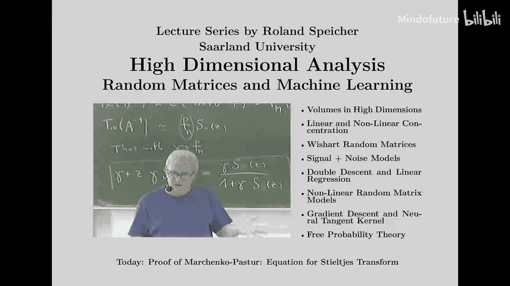
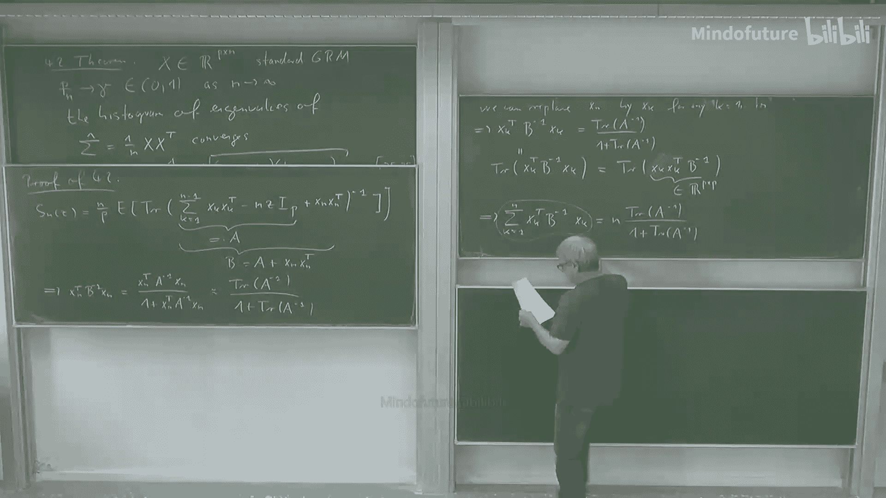

# 【德国萨尔大学】高维分析：随机矩阵和机器学习 ｜ High Dimensional Analysis p13 P13_Stieltjes变换的Marchenko-Pastur方程证明 -BV1XkkWBFEi6_p13-

Yeah， okay。 now I think we are ready。To try。Our hands at the proof of。Of Machko Paua。

 we have all those。Bits and pieces。And we just have to use them and apply them and hope。

That now we really can。Massage， change our steeles transform for the mat in such a form that we get an equation for them。

 at least asymptotically。So the proof of 4。2 of our Macchanco pastua。Yeah， good。 O， so。What is our。

So we have our steel just transform。 That's the idea。 That's what we want to control。 And that was。

 I mean。I already put out the N and the P。 So this is N over P。

 The expectation of the un normalizedmalized traces。And then I'm taking here to sum。I mean。

 it should be the sum from。1 up to n。 But I'm splitting this into the sum where are only sum up to n -1。

Of X， K。X， K transpose。 and then I subtracting n times set I P。

 But then I'm missing here the last sum。 And so I writing Luc see extra X， N。X and transpose。

So I take here minus1。I have to trace and the expectation。Okay， I mean。

 this P is just because I have hit normalized trace。

 and this n was because I had the one over n here。 But then， of course。

 I also have had to put it here And， I mean， I do this because this N over P， this is the gamma。Good。

 okay， now。I call this here。A， and this is my rank one de formation of this。 So this is the a。

From before， essentially， and the whole thing。Like Corll B。So this is this a plus。

 And then I have this transformation， this X， N。X N transpose。

 So this means in this language here the x and the y are just the x N both of them。Yeah， okay。

 and then I can use this formula here for this situation for for this guy here。So， then I。

Get x and transpose。B to the -1。X， N because B to the  minus-1 is really what I want to calculate。

 Okay， but about I'm multiplying it with this X， N。I mean， here you see， I have the trace。

 So if we still have to see how I can。Get to this。 But let， let us look on this because for this。

 we have a very nice formula。 So namely this is。Yeah， by this formula。X and transpose a。To the -1 X。

 N divided by one plus。X and transpose。A to the -1。X N。

 So this is now really using this formula here。For this setting。Yeah， O。

 and now we also have just seen。De。In this in the situation， where the X N。

Is independent from all the guys which I having in a that we really can also say what this is。Okay。

 I mean， I mean， this， I don't have the expectation here， but by concentration。

I know that this guy is close to its expectation and the expectation we just have seen。Yeah。

 that this gives us the trace of the matrix。 So this here。Is close to。 Of course，1，1。

 then one should then really one makes it rigorous。 one should see how close and。

 and that I can control the mistake which I make。 But we have concentration estimates。 Also。

 we know really the expectation and。The actual value。

 with this very high probability is very close to the expectation。 And we have control over this。

 Okay， so this here。Is then essentially the trace。Of this matrix here， which is now a to the -1。

 And here to same divided by one plus。The trace。Of a to the -1。Good， okay， so this means。We can。

We can write this here。 Yeah， so what， what do we have now， we have here。 I have。

Written this thing here。In terms of the traces of a to the -1 and a to the -1 is more or less also our quosi transformer。

 It's just instead of it， it's， it's not S N， but it would be S N -1。

 but this is actually very close。 So this， this quantity here is more or less very close in the asymptotic regime to my quooi transform。

Okay， and so I should see。Whether it's also， yeah， what， what do I have on this side。

Is it close to the。Not to the stilles transform。 I it close to the stilles transform。 for this。

 I have here a trace。 But here I have taken this guy here。

 And this guy is not so clear what this is because here， the X N is not independent from the B。

 because the B also contains the the X N So the B contains this So I I mean， I here， here。

 I cannot say that this is the trace of B to the -1。So for this， I have， yeah， maybe at the moment。

 it， it looks not so good because I， maybe I don't really know what this is。Okay。

 but now the next trick is what we have done here。I have， I have split it off in my sum。

 summing from one to n。 I I have split off the last term， X， N。

And in this calculation just shows up here。 I could have split off also the term x1 or the term x2 and and put all the rest into a。

 So I I would say a is the one where I'm sum over all of them。 but let's say x5。

 And then I'm putting here x 5。 And then I can do the same。 And then I have here the x 5。

 And here I have more or less the same。 I mean， the a would not be exactly the same。

 but for the argument because by concentration， it doesn't matter which one I I take it will always be be this okay。

呃，说。So all of them are very close to the expectation。 and for the expectation。

 it doesn't matter whether I， I take the X N or the X 1， because the distributions are all the same。

Okay， so this means。I have this recite here。Also， if I replace。The end here。

 by any of the other case。Okay， and this。Yeah。Is good？But let's see。 I mean， it's O。 So again， so。So。

 we also。So， we can replace。呃。X， n。Here， by any other K。By xk。For any。

K from one up to n and do the same argument， which I had done before。

 And then I get that X K transpose。B to the -1。X K is close to the trace。Off。A to the -1。

1 plus the trace of a to the -1。Okay， and maybe maybe here I should better take the expectation because I mean。

 the A in principle depends on the K here。 but the expectation of all of them is the same So。

 so maybe。Let's say I take you the expectation。Good， okay， and now。Again， I mean。

 I also don't know what this year is for any of the case。 But now I'm summing over all of them。

 And this will getting me closer to the trace again， so。Oh no， actually， let me see。 I'm not。

Summing over them。Or maybe， maybe。 okay， So I， I have， I have this year。And now。嗯。

Let me see what this is。 This actually is a number。 Okay， so this is a one by one matrix。

And the one by one matrix is the same as the trace of the one by one matrix。

 It is a trivial statement。 I mean， the trace of a one by1 by one matrix is just。

The entry of the matrix， which is just the number itself。

 So I can write this here if I like in a very。Yeah， pumpers way as a trace of this guy。

 So it's a trace of X， K transpose B to the minus-1 X K。Okay， what。

 what is it good to write it like this， It is good because under a trace， I mean。

 this is now a trace of a of a product of mates。 and the trace has the property that I can move。Yeah。

 a matrix from the beginning to the end。 So this is the same。 So this does not change。 If I move。

 let's say。This guy here。嗯。No， let me see。 what do I want to move yeah。To -1。Yeah。Okay。

 let me write it like this。 It's a trace of。呃。B to the -1。 I want to write it like this。 I。

 I start here。 X， K， X K transpose times B to the -1。 I mean。

 I can change things in acycl way instead of starting here and running like this。

 I can also start here and then go like this。 So I'm just moving this to the beginning here。So it。

 it's the same The trace doesn't change。 I mean， if I。I mean。

 a trace of a matrix product does not change， even if if my matrix are rectangular So maybe maybe for for square mates。

 everybody knows， but maybe for rectangular mates one really should think about it， but it's。

 it's still the same。 Okay， but now the point is， this is now not the trace of a one by one matrix anymore。

 But this is the trace of really what is this now， this is a P by P matrix。 because this is， I mean。

 now you see it' it's other way around。 So this is， this is a P by P matrix。 And this is also。

 And so suddenly， this trace here， This is now not a trivial object anymore。So， this is。

This is a P by P matrix。Yeah， and so we see。 So what do we actually see now。De。😔，Yeah。

 this thing here that I can write this as a trace。 Okay， and I have this for each K。 And now I。

I should be summing over the case。Because that， that's what I really want in end。 also that。

Let me now， maybe go back to this。 I mean， I have this equation for each K。

 and now I am summing over all the equations with which I have for， for all the K。

 So I'm taking the sum over this。I'm summing from one up to end。Xk transpose。B to the -1。X， K。

And this， I mean， each of this term is equal to this。 So if I'm summing this over n terms。

 I just get n times this here。 So this is n times what I have here。

 the trace of a to the  minus-1 divided by 1 plus。TheT of a to the -1。Yeah， okay。

 but now this sum here on this side。This is something which hopefully I can deal with。I mean， this。

 this site is okay。 I mean， those， those guys are close to the kci transform。 But the other side。

 maybe thats we have to see whether this is also。Treatable。Okay。

 so so I have the sum here is equal to this， but actually。Those guys here。

I can write as the trace of this， which is the same as the trace of this。

So this term here。I can write as。Yeah， is what。There some。From one up to n。 And each of those guys。

 I'm writing as a trace of the same thing。 But then I I can also write as a trace of the other thing。

 So it's actually the trace of X， K。Xk transpose。B to the minus1。Ya。Okay， and then， of course。

The trace is linear。 So this is the same as the trace of the sum of those guys。

And then we are coming back to something where we have control。Because to some of those guys。

 they are close to what we are interested in。 Okay， so this is the trace。Of the sum。From one up to n。

X K。Xk transpose。B to the -1。Yeah， but what is the sum of X， K， X K transpose。This is actually。

Up to this guy， this is our B。 So B， I mean， B， B is the So what is A， So I mean， B。

 B is just the whole thing here。So B is the sum overall X， K， X， K， X， K transpose over all of them。

 and then。With is the change of this So this the sum of all the x case is just a B plus plus this term here。

So this guy here， this sum here is just B， So it's just the B plus this multiple of the identity n time set times the identity。

Good， but now you see now， now， now it， it's great because this B to the -1。

 well just cancel with this B。 And here we get the trace of B to the -1， which is more or less our。😊。

Yeah。The trace of B to the -1， which which is close to the still this transform again。

 So what I have here。Is the trace of B times B to the minus-1。 This is the identity matrix。

In dimension P plus N time set。E be to the -1。Okay， the trace of the identity matrix in P dimensions。

 this is P。This is P plus， And here I have n time set。 And then I have the trace of P to the -1。

 And this is now good。 Now I really are back to the trace of P to the -1。

 This is more or less the same as a trace of a to the -1。 That's things which I can control。

 And that， that's are things which are close to my cooi transform。And so what I get from this。

 So you see this， this thing here。Is the same as。Going back。

To all this stuff here as summing this year over O。Or maybe here。

 actually here that that's where I started So this。This guy here， this is by this calculation here。

 the same as this。Okay， so in particular， if I divide by n。

 I get a relation between a trace of a to the -1 and the trace of B to the -1。And both of them。

 if n is large， of more or less our koi transforms。AlsoSo。What I get is that。

Maybe this side here and I divide by n because I also have here an n。 So it's P divided by n。呃， plus。

Then the N here goes away plus set times。The trays。Of B to the -1， that this is。

More or less the same as what I have here。The trace of a to the -1 divided by one plus the trace。

Of a to the -1。Yeah， good。 Okay。 And now essentially， this is my equation for the croi transform。

 because both the traces of B to the -1 and the traces of a to the -1 are more or less my croi transform。

Maybe up to， to doing the the coefficients， right， So maybe。Maybe let me just。Still do this。

 And then。Then we have our equation， which then maybe we can solve next time， but。

Let me finish with writing down the equation， which you get from this。So first of all。

 the trace of P to the -1。Okay， so I just erased how we define to be。 But okay， I mean， I。

 I think we still know it it was。It was the sum over all those guys， minus this。

 So it's exactly what we have in a crot transform。 only in a crot transform， we had the expectation。

 but by concentration， we know that this is close。This is close to the expectation of the trace of B to the minus1。

And this here is exactly our khi transform， if I。Also put in the P divided by n。As an offset。Because。

 I mean， the P divided by n， that was what I took out of of the whole thing in the very beginning so。

Because I also put in the end here。I put the end here because I took out an N。 And， I mean， I， I。

The the C transform is the normalized race。 And I have to repair this by putting the P here。Good。

 okay， yeah。 but you see， this is， this is good。 So this means the still transform is n divided by P times times this trace。

And N divided by P is something which we can control asymptically。Okay。

 and for the trace of a to the -1。I mean， it's essentially the same because a。And B。

 the difference between them is just the the small term。 And so if I take。

If I take the expectation on all this， I mean， it's， it's the same。 So the trace of a to the -1。

Is also P divided by n asympically as N offset。I mean， in principle。

 I have replaced n by n -1 because I'm only summing over over n -1 data points。 But if n is large。

 n and n -1， there is no difference。 So asymptically， they are very small。 They are。

 they are very close together。Good， okay， And so this means。In this equation here， asymptotically。

 I can replace the traces of B to the -1 and of a to the -1。By the students transforms。And this。

 this thing B P divided by N， who shows up there。 This is my gamma。 or I， I mean。

 that that's what I'm now defining as gamma。So， if。I put Gamma is P O Y N。 And this。

 I'm looking on a regime where those go to infinity， such that this here is fixed。

 Then what do I have， I have the the P divided by n。 That's gamma。Then I have plus。呃 plus set。

Set times the trace of p to the -1， but the trace of p to the -1 is again gamma times the t transform。

 So this is gamma times S N of set。And this is。More or less equal or very close to what do I have on the other side。

 I have the trace of a to the -1。 The traces of a to the -1 is， again， the。

The steel is transform multiplied with this gama。 So it's gama。Times S N offset。Divided by。

one plus干嘛？S N。Offset。Okay， so that that's more or less the equation， which is。

Approximately satisfied for， for S N， for my kci transform of， of the。In the case。

 I have a P times N matrix。 And now one has to argue that somehow， if I know， I have。

Still just transforms which satisfy this equation that actually， I also have a limit。

 Those are kind of compactness arguments， which， which is okay So， okay。

 so that that we take for granted that one can show that we have a limit if n goes to infinity And then。

 of course， the limit must satisfy the limit of this equation。

 So x so this means I just taking away the end here。 and I have the limit。

And that's an equation for the steel to transform in the limit。Okay， and then， of course。

 I should check that this really。This is an equation， which it's a catratic equation。

 which has a solution which we can write down。 I mean， usually you cannot write down。In。

generalene situations you cannot write toonic。 Yeah， the， the solutions of your equations。

 But in this specific context， you can。 it's a cattic equation。 And we get formula。 And then。

 of course， one has to check that what I get there is really。

Dist still the transform of Machenko Paa。 Okay， but maybe I will say a bit more about this next time。

 in particular， I will also。Tell you how， I mean， if you wouldn't know our priori。

That the result should be matchencho Paua。 How you would get if you only have。

The still transform how you get from this to density。

 because that's maybe the more interesting thing。 I mean， if I tell you this is density。

 then you can check by integrating that you get the still transform。

 But if I don't tell you the density and ask you， what is the density and you have the still transform。

 then you should be able to calculate it somehow。 And this can also be done。

 That's the still inversion formula， But maybe maybe we do this next time a bit more。Explicitly good。

 Okay， so I hope we have seen， I mean， this was the main， the main step。 And this really， I mean。

 this this shows how you get something concrete from。For your， we had matrices。Okay。

 there's a lot of nice， small tricks。 I mean， everything is。

Is nice and so bad but you have to know how to do it。 It it's not it。

 it's a bit trickier in particular。 I mean， this is a trace。

 So you take the trace over one by one matrix。Or you。

 you have a a number you write as a trace of one by one matrix。 But then you， you exchange the order。

 And then actually it's， it's a trace of another。Real genuine matrix。 And， you get some。

 something non trivial out of this。 So So this， these are nice， nice little things。

Which if you know how to do it， it's more less easy。 But if you don't know it， I。

 I think you would have。Strugg quite a bit to， to recover this。 Okay， anyhow。 So that's it for today。

