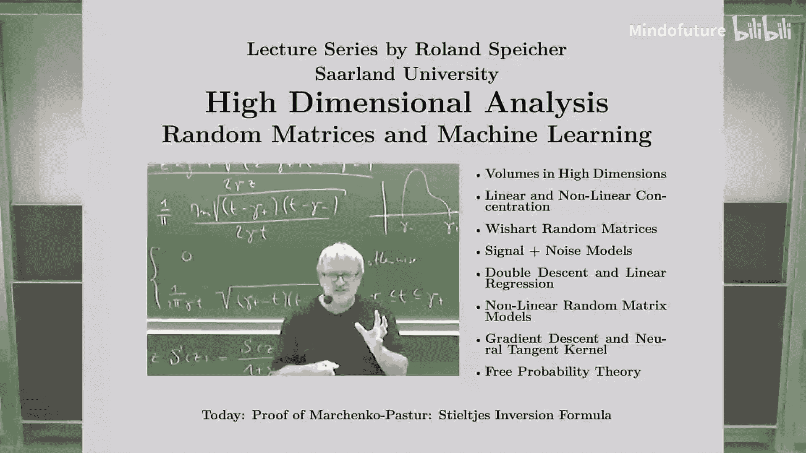
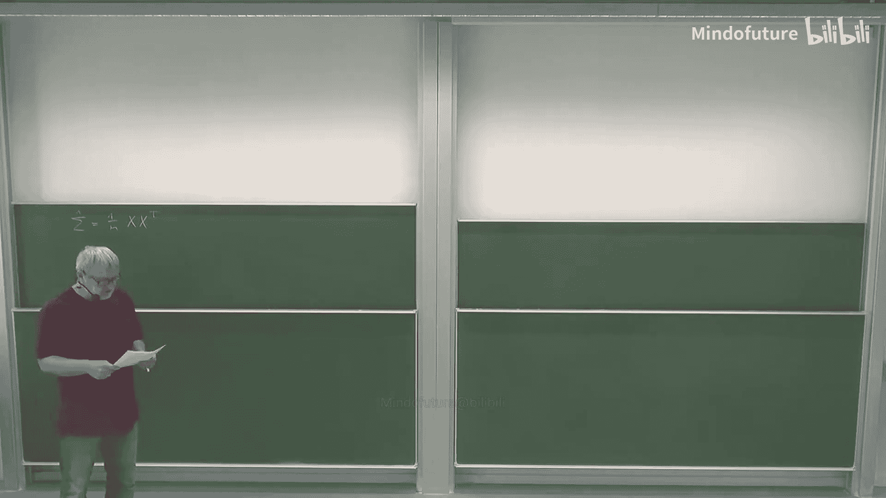

# 【德国萨尔大学】高维分析：随机矩阵和机器学习 ｜ High Dimensional Analysis p14 P14_Marchenko-Pastur_Stieltjes反演公式的证明 -BV1XkkWBFEi6_p14-

Yeah， so we are talking about the proof of Maccopatua。

 So we want to see what is the asymptotic eigenvalue distribution of the wishard matrices。

 the wishardd matrices is given by。Yeah， by our data independent copies of gausian random vectors。

 which are distributed according to a normal distribution which mean 0 and in general。

 we can have a covariance。 But for maenco pass2a， the covariance is the identity matrix。

 So this means in our we had in our matrix x。 all entries are independent and they all have the same gausian distribution yeah this variance normalized to1 or yeah good okay。

 and then we have seen in histograms that we get a very specific asymptotic eigenvalue distribution and maenco pass2a really tells us what this is and we are going to prove this。

 and to proof yeah we do an analytic proof by using the reo So we want to show that the reo of our matrix converges to the to the still transform of the。

Of my angle pass O， so I mean， so we have。呃呀咪 now啊。We had matrix。Is one over n X， X transpose。

 and x are these columns of the independent Gausian vectors。

Yeah， and then。We looked。On the steel transform of the matrix matrices。

 And we have to see that they convert to the still transform of the Macan Patua。 And， of course。

 we look on the asymptotics where the size of。The matrix。

Or whether the size of the vectors and the number of observations goes yeah。

 to in the same speed to infinity So what we look at at is where P。Divided by n also has a limiter。

 So n goes to infinity and P also goes to infinity so that the ratio converges to gamma and gamma is here between 0 and1 so that we don't have an atom at 0。

Good， okay， So I mean， x is here。X is a。Is a P by n matrix。

So each column is a vector in p dimensions， and we have n independent copies of them。 Okay。

 so that's the independent guys， and that's the weha matrix。 And we want to see what this is。

 and I I wrote down a formula for a limiting Ienvalue distribution Maybe I don't repeat it now because I mean our goal is also to to calculate this。

 it's not just to check that indeed it is is a limit。

 but we want also to see how do I really calculate a limit without knowing it beforehand。

 So maybe I'm not writing it down now， but hopefully we will get it later and see how how we get the formula for the limit。

Okay， so， yeah， so maybe let， let me record it to this stimulus transform。

 So that sets the status transform。 So for our matrices， this is， what is it the expected value。

Of the normalized trays。 And then I take my。My matrix。对。

Seek my head minus set is the argument set times the identity matrix in p dimensions and the inverse of this。

 So the inverse of this is the reo of this operator。 I take the trace of this。

 and I take the expectation over whole assemble and we know by concentration。

 the expectation and the generic realization are very close to each other。 Okay， so in principle。

 I can calculate what happens in a typical realization by looking on the expectation and calculating expectation is much easier then really calculating it precisely。

 Okay， and that's here the same。 I mean this here in the limit。

 This is the corresponding integral one over。T minus set。

 And then I have here a myen pass two density T， which I want to calculate。立体。Okay。

 and so what we did was， I mean， how how， how do we get this guy here。

 We tried to derive an equation for it And this equation， I mean， we。

 we try to derive an equation for S N for， for large n and then look what happens with this equation in the limit。

 and the idea of this equation was that we compare the situation with n observations with situation where I have n -1 observations。

 This means I'm， I'm throwing away in my matrix x1 column And I mean， if。

 if n is large it both should be close to。The status transforms should be more or less the same。

 but on the other hand， I can express what I can calculate what happens if I throw raius with the reo。

 So I get relations between them。 and that's what we saw last time。And so we got。

That was maybe stop last time the equation for S N that gamma plus set times。干嘛？

As an offset is close。2。Gamma。As and。Offfs set divided by one plus gamma。As an offset。 Okay。

 and of course， I can divide out the gamma here。 So I have here1 gamma gamma。 Okay。

 and then if I go to infinity， this， this will be an equation for the limiting still transform。 Okay。

 and of course， one has to show that the still transforms have a limit。 But in principle。

 this follows from the knowledge that I have equations like this and general properties of still transforms and compactness arguments。

 So I don't want to go into this。 So we just take this as granted that there's a limit But then this here tells me。

What the equation for the limit is。Also。Let me call this then S。So， as of set。Is not a limit。

Of the still transforms of S， N offset， If N goes to infinity， But， I mean， P also goes to infinity。

like gama in。Okay， so that's the limit which we consider。 And then， of course， this here。Gives us。

The equation。For the limit。 So namely1 plus set times。As offset， is equal。To as offset。

 divided by one plus gamma。As upset。And， of course。

It depends on gamma So I mean the distribution will depend on gamma。

 So this this as offset also depends on gamma。Good， okay， and this is now， I mean。

 this is now a quadratic equation for as of set。 I mean， as of。

 as a function of set set is the variable showing up here。 So this is a quadratic equation， which。

 of course， we can solve So really explicitly。😊，So may maybe let me also write it as a quadratic equation by multiplying it with this。

 So what， what I have here is maybe。呃。Did I have gamma， if I multippl so it's gamma。Set。As of set。

 squared minus。1 minus set。Mineus gamma。Times F offset plus1 is equal to 0。

 So just writing it as a quadratic equation in as offset。 And then， of course， we have the formula。

 I mean， the coefficients are here。 and then I can write down what the solution is。嗯。So， namely。

Resolution。Is given by this coefficient here，1 minus。Set minus kma。

 Then I have a square root plus minus。 Of course， I have two solutions。

 So I have here the square of this。 So let me write as set plus commma-1 squared。

Four times this coefficients set。And then I have to divide the whole thing。By two gama set。

So that that's just a solution of this quadratic equation。 And， of course， we have two solutions。

 of course， the still just transform。We should make a choice。 It should be unique。 And in principle。

 we know properties still just transform。 If the argument is in the upper half plane。

 That's what where we are。 then the result should also be in the upper half plane。

 And this means I have to choose here the plus sign， because with the minus sign。

 I get a solution in the lower half plane， which is not。

An admissible value value for a steel transform。 Okay， so we have。To choose your blast。

Because we have knowledge about， I mean， how a steel this transform should behave so。Because we know。

That the solution。Should be in above half plane， if。The argument。Is in the upper half plane。 Okay。

 for students transforms。 So that's the upper half plane， the complex plane。

 So that's where the imaginary part is positive。Good， okay， and now we have。嗯。Now。

 we have the solution for。The crot transform， Okay， if I say crot transform， I mean。

 stages transform。 I mean， the stages transform and the crt transform are the same up to a sign in different communities。

 One of some of them uses still transform。 usually in random matrix theory。

 others use use the crot transform。 That's more an operator theory。

 And because I'm more rooted in operator theory。 usually I。I think about the khi transformer。 But。

 but here in the random matrix context， it's a still transform。

 as I have defined it But if I say khi transform， I really mean still transform。 Okay。

 the difference is is just a minus。 But what we have here is， is we this sign。

 it's really still transform。 Okay， so we have a solution for the still transform。And， of course。

 this should be then if everything fits together the steel just transform of the Machenco pass2 law。

 Okay， and of course， one has to know that the steel just transform determines the。

The distribution uniquely。 So in principle， we， we would have to check that if I integrate this with the Macchano past density。

 which I have given you， you get this result。But， of course。

 this is a bit unsatisfying because maybe if， if you really。Have to face such a problem。

 Maybe you do your calculations。 You get the still transform in the end。 But a priori。

 you don't know the density。 So maybe I better should tell you how you get from the knowledge of this still transform。

 really the formula for Machenco Paua。 And that's really， that's really。A nice formula。

 is still this inversion formula， which tells you how you get the density out of this。

 that that's what we want to do。Of course， for finishing the proof。You could just， in principle。

Just calculate this and see that it gives you this。 But this is not， not so satisfying。 So let。

 let me。Give you the stilles inversion formula， which tells you how you really get the distribution out of the still transform。

So， this is called。The stilles。Inversion formula。Yeah， and so I。

 I'm doing this in a context where we we are where we have a density we have a distribution which with a density。

 So lets Pi be our density。 and it should be， let's say， continuous。Probability density。1。

read the numbers。And。Then what we're looking at is to see this transform。

So let me write it down again， so as offset。Is by definition， this integral one over。Said minus t。

si of TD T integrating this kind of reso with respect to my density T。

 and usually I avoid with the set。 I avoid the relaxes because otherwise I might have here  one over 0。

 which is problematic， at least。 So usually the C transform。Is defined in the upper half plane。 Okay。

 and now in。Yeah， the still inversion formula tells me that I can recover the density by going to the real axis。

 So I mean， still transform is defined the upper half plane， so I can go to the real axis。

 And in a sense， I converge to my probability distribution。 And if I have a density。

 I will really just converge to this density。 So this means in particular that my still transform has a continuous extension to the real axis。

 And the imaginary part of this gives me the density。 So the statement is the still just transform。

Has a continuous。Extension。To not just upper half plane， but I can also go to the relaxes。And。

The density， I mean， that's what I really want is actually。

1 over pie times times the imaginary part of the studio transform。Or maybe if。

 if you want to say it in terms of this continuous extension， we just take。1 over a pi。

 and then we take the limit。Epsilon going to 0 of the imaginary part of the still this transform。

 So if I want to have the density at T， I should go a little bit in the upper half plane。

 So I'm adding I times epsilon。好，说完毕了。I mean a complex plane。 I want my density at T。

 but then I'm looking at the point t plus i epsilon。 Take the stilles transform there。

 the imaginary part of this and then I let epsilon go to0 So then I really go to T and then I recover this density pi of t that's the still inversion formula and maybe maybe let me give you an idea why this is true So this is I mean not。

Not too hard。Because essentially， one one has to see what。

 what is the imaginary part of this transform。 So let me write this down。So one over pi。

Imaginary part of the stilles transform at this point， t plus I epsilon。So this is。1 over pi。

 And then I take the imaginary part of this integral。 And， of course， imaginary part。

 That's a linear thing。 So this is the integral over the imaginary part of one divided by。

Set and set is now。 the argument is T plus I Epsilon。Yeah， so I have。Let me see。Let me see。

 I this the still just transform what I have there。

This is the khy transform what I have to find there。

So the still this transform is the other way around。T minus set。走。Let's the students transform。Yeah。

 that it was okay。 Good。 Okay， So it's it's imaginary part of T。 T is my inte integration variable。

 And then I'm subtracting the set。嗯 no。T is already used here。

 So maybe better I'm integrating now over S。SoSo I'm writing here thes。S。

 and then I'm subtracting set， which is T plus I epsilon。 So I'm subtracting minus。T plus I epsilon。

Okay， I have to take the imaginary part of this。 And so this is the imaginary part of one over a complex number。

 And， of course， I can write this very nicely in terms of the real and the imaginary part of。

Of what I have here in the denominator also namely。What is the imary part of one overet。

So I mean set is this guy here with the real part S minus t and imaginary part epsilon minus epsilon。

 So the imaginary part of one over set。Of course， this is one over。To I， And then I take。

1 over set minus。Bnova set bar。 That's a general formula for the imaginary part。 I take the number。

 I subtract its complex conjugate， and then I divide by two I。 That gives me the imaginary part。 And。

 of course， this year， I can write in a nicer form。 So this is。2 I and one over set。Yeah， maybe。

W it like this。 This， of course， I write a set time set bar， and then I have set bar minus set。 Okay。

 so that I have something。Real denominator。 And here I have essentially now the imaginary part of。

 of set。If I divide by this and with a minus sign， because the imaginary part is set minus set bar also。

 what I have here now is just the imaginary part of set divided by。Said time， said ba。Okay， so it's。

 it's easy to calculate。This year， let me continue with this。So this is then one over pi。Integ。

And then the imaginary part of this。 So this is the imaginary part of set。

 But what is the imaginary part of So set is this guy here。 Now， imaginary part of this is。呃。Yeah。

 I mean， I always have a minus sign here。So this is eventuallyary part of this is minus epsilon。

 with this minus sign here。 It is plus epsilon。And then I have to divide by set time set bar。 So。

 and this is， of course， the the square of the length of this complex number。

 So it's a square of the real part plus the square of the imaginary part。

 The real part has S minus T。So it's S minus t squared。Plus， imaginary part is minus epsilon。

 So it's plus epsilon squared。Okay， and。Of course， in my integration， I have forgot my density。

Of course you still just transform。It's integrating。This goes respect to the density。

And the density is real。 So this I can take out of the imaginary part。

 The imaginary part is just the imaginary part of this guy。

Because this guy here is is real it's real。Pro density。For my probability here。

 So with three numbers。 Okay， and now what I have here。Is exactly this here。 and in principle。

I want to see what happens if Epsilon goes to 0。 And this here is。

 you can say an approximation of the deelta function at the point。 this is a function of。Of S。

So it's， it's an approximation of the deelta function at the point T。

And then this whole integral converges to psi of T okay。Okay， I mean。

 one has to make this rigorous either by working with distributions or talking about probability distributions。

 But the idea is， is just that。That this guy here， together with this one over pi。

 this is really an approximation for the delta peak at the point T So I mean this。

 so so if t is fixed， this function here， this is something for small epsilon。

 This looks somehow like this So it's peaked around this point here。

 the area and this curve is is equal to one together with this one over pi。 And if epsilon goes to 0。

 this peak is getting smaller and smaller， and what I get is really approximation of the delta function at this point。

 which means this integral here gives me exactly the value of psi at the point T。Of course。

 Pi has to be continuous for， for those arguments。 Okay， so this converges if epsilon goes to 0。

In some way， which one has to make precise。 But okay。

 I don't want to make this precise to to the Delta function at T。

 And then if I'm integrating over the deelta function， I just recover here。

The value of p Psi at the point T So this is if epsilon goes to 0， this converges。2。

 let me say in the de function。At the pointee。In the argument S。Psi of S。The S， and this is equal。

Psi of T。Okay， or maybe maybe more general in the language of probability distributions。

 One can say that what I get here， this imaginary part， pi this guy here。

 this is a probability distribution which converges weekly to the probability distribution from which I started。

 That's， that's a more general。Way of saying this。 So this still this inversion formula also has a meaning if。

 if I don't have a density But in the case of a nice density， it's really。

 I can recover the density directly by taking this limit here。Good， okay。

 so that's the still inversion formula。 And now we can apply it to our situation。 So we have here。

 I mean， we have here the still transform of a density。

And we have an explicit formula so we can look explicitly， what is the limit if。

If if I go with epsilon to0 at the point， T plus I epsilon。Okay， so just combining this is this。

We should now really be able to get the formula for Macenco Paua。I mean。

 if you don't know it beforehand。Okay， so we apply this。2， yeah， the still transform。

 which we got here in our calculation for the visualard matrices。So there。

 just let me write it down again。 What we had there as of set is equal to one minus set。Minus gamma。

Plus， the square root of。呃。Yeah， okay。 and and maybe。I rewrite this in a form which we had also。

In the Macacheko pastua， I mean， it it will be important to see when is what I have under the square root。

 When is this real and when， when when is it positive and when is it negative。

Because if I want to get an imaginary part of a square root， I mean， all the guys which I have here。

 if I go to the relaxes will will be just real numbers。 So I have a real。

 I have a a square root of a real number。 And I can only get an imaginary part。

 if I'm taking the square root of a negative number because then I will get a multiple of of。

 of the complex of of I So it will be important to see for which set or or maybe if I go to the relaxes for which T is this here positive and where it negative。

 So it's， it's good to know where the zero of this guy。 And so I mean this here， I'm writing as。😊。

Set minus gamma plus time set。Minus。Gma minusus。And gamma bla and Gamma minus are essentially the two roots of what I have under the square root。

 And this was what I defined in the Machenko pasta statement。 I mean， this， this depends on gamma。

 So gamma。Plus minus was what was it， I think one plus minus the square root of kma。Squared。Okay。

 so I mean， it's easy to see if multi blood is out， then you get exactly this here。So， this is just。

Yeah， looking on， on the roots。 Good。 Okay， so we apply it to this。 And what I。

 what I have to take is one over a pie。 the imaginary part of， of this thing here so。

I have to take one over a pi。S of T or T plus I epsilon。 And then epsilon goes to 0。 But I mean。

 if I have a nice extension， I can just pick essentially the same formula on the real axises。

 So I get here。 this is。呃。And of course， I have forgotten here。To be by two gama， said。Okay。

 so I I go to the relaxes。 So in principle， I replace every set by T。 And then， of course， I mean。

 this guy here， this is just one minus t minus gamma。

 This doesn't have an imaginary part because T is a real number。 Okay。

 so the only place where I can get imaginary part is， is from this square root。

 So what I get is one over a pi。And then I have the imaginary part of this here， t minus gamma plus。

Times t minus gamma minus。The square root of this。 And this divided by。2 gay。Good， okay。

 And so the situation now is， I mean， I have， I have this。Gma minus。

 and I have this gamma plus two numbers， positive numbers。And then， of course。If。

The number which I have under the square root。 if this is a real number。

 then the square root is just if this is a positive number。

 then the square root is just a real number and there is no imaginary part。

 This means whenever this guy here is positive。 I don't have I get just here0。 And of course。

 this happens if either t is bigger than gamma plus because then it's bigger than gamma plus than gamma minus So this is positive and this is positive。

 So on this side， I will I will get0。 And it also happens if t is smaller than gamma minus because then both guys are negative。

 So the product is positive。 and I have to the square root of a positive number。

 which is real and has no imaginary part。 So this means on this side， I also0。 But if I'm in between。

Then this guy here， I mean， then this is positive， and this is。Negative。

 so I get the square root of a negative number。 And this is I times the square root of。

 of what I had before， but with the minus sign So and then I have an imaginary part。

 So this means what I get here in between。Let me right don't。So first of all， I get0。

 If I'm outside of this interval and in between， I get this one over。土牌。呃。干嘛提。

And then I get the square root。But now， I have to。To multiply is a minus sign。

So before I had the square root of something negative。 and now。

 and this is I times the square root of the corresponding positive quantity。

 So I just switch to sign here。 So I have here gamma plus。Minus T。Times T。

Minus ka minus So this is now a positive quantity inside this interval。 Okay， and so yeah。

 so this happens for。For t between gaarma minus and kma plus， O， and otherwise， it's 0。

And so this is explicit formula。 And that that is exactly what we claimed in a Machenko Paua But。

 but now you see how you really get it from。From our concrete formula for the students transform。

 I mean， this looks somehow， I don't know。 It look this。Some distribution like this。Depending。

 of course， on。On gamma and I mean， gamma is in gamma plus in gamma minus。

 So this depends on on gamma。Okay， so。So， yeah， this is more or less the proof。 I mean。

 I have not some rigorous details I have omitted， but， I mean。

 I have shown you the the main calculation。 which really shows you how you get the result。

 And I think that that may be the most important thing that we really can calculate is。

And in particular， we also， you see from this also that that really you。

 you get something which is only hesit densityity on some interval。So I mean， outside here。

 it is really zero， which comes from the effect that， that， I mean， I have to the square root。

 I have to take the imaginary part of of a square root。Good， okay。So。Questions。About is。Yeah。

 I mean in the assignments you are asked to do similar things。 first of all。

 we looked here on Ward matrices which are in our context， maybe the important ones。

 but then theres another osomal of random matrices， Wikna matrices。

 which are symmetric matrices which are maybe even more famous or I mean they are used lot in physics and maybe they are the ones for which such a calculation was done first and this was done by Wikar and there the eigvalue distribution is Wina semicicle law and you are asked to prove this in the assignments by following similar ideas as we did it here。

Okay， and then， of course， in our context， for the wishard mates。

 one can also consider the situation where the covariance matrix is not just the identity matrix。

 but something more general。 for example， maybe half of its eigenvalue could be one。

 the other half could be two and resource numerical simulations。 and then， of course。

 you get you get also something which has a compact support， but which look somehow different。

 And in principle， one can also follow ideas from here and derive equations for this。 Okay。

 but usually those equations are not leading to quadratic equations， but they are more complicated。

 and usually you cannot really solve them explicitly， but you really。

 but you can solve them numerically。By iteration procedures and in the assignments。

 you also ask to look on one，1 example of this type。 So in principle。

 one can also understand the more general situation。 But then， of course， at some point。

 one has to do numerics even to get the the solution for the duties transform。Good， okay。

 so in assignments， which， which are up。我nder。on the internet yeah。You can do more in this direction。

 You can check whether you are able to， to use these ideas。

 which I have given you here in in a little bit different context。 That's it for today。

