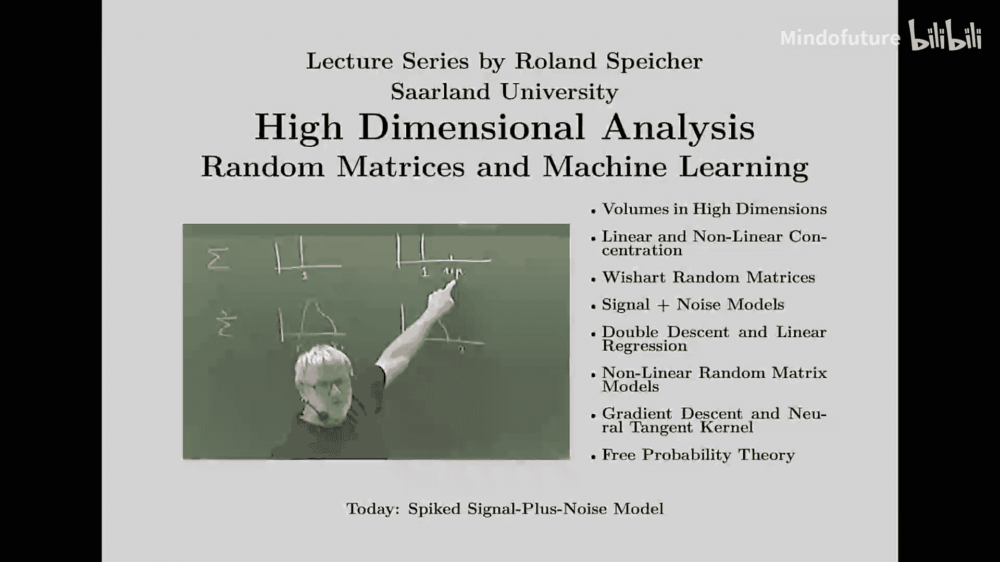
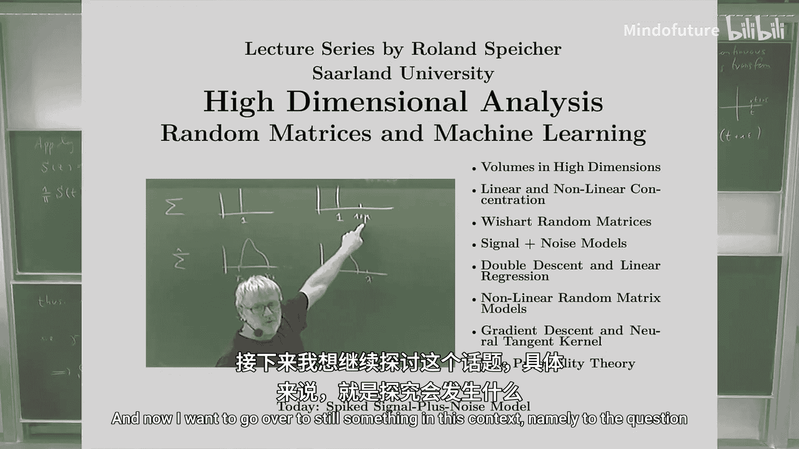

# 【德国萨尔大学】高维分析：随机矩阵和机器学习 ｜ High Dimensional Analysis p15 P15_尖峰信号加噪声模型 -BV1XkkWBFEi6_p15-

And now。I want to go over to steal something in this context， namely。

To the question。What happens？ I mean， I， I want now to change the covariance matrix a little bit by adding maybe one。

Particular eigvalue。 So I mean， this is the situation where my covariants。

 the covariance between the entries of of my of my vector。is identically， which means all of them。

 all of them are independent， but they have also all the same strengths。 They all have variance1。

 Okay， and I mean， I can change now， not， not not changing half of them to one and half of them to 2。

 but say， I only change one of them to something which is different from one。 And the idea is that。

This year is somehow background background noise。 And there is one。

1 eyeenvalue which carries information。 And the question is。

 can I see this information somehow if I measure the distribution of the weha matrices。

 That's what I want to address in the following。 And that's， I mean。

 is those such models are called spike models or random plus noise， S plus noise。And。Yeah。

 so what we want to see。Whether we can understand this。And you already had， I think， some。

Some assignments where you look numerically on this where you saw that really， you can see something。

 But now we want to check whether we can understand this。Also， from a theoretical perspective。

So this will be a small。Chptta， next chp on。Those models which vary。

Very often go under the name of spiked models or signal plus noise。All the question is。

 can you see the signal in the noise？And that's what you usually want to see in statistics on observations。

 And there's a lot of noise around。 but there is some signal hidden there。 But can you really。Yeah。

 get the information about the signal somehow out of your measurements。 Okay。

 and this means in our setting。So we are still looking on we matrices。

 But now I'm changing the covariance a little bit by adding one degree of， of， yeah， one degreee of。

 of， of signal。 Let's say so consider。Couvis。Of the form。So my sigma， that's the covariance of。

 of my， my random vector。 my random vector is in R to the P。

 And so the covariance between them is the identity matrix。 But now I'm adding。

Theformation into one direction。 So me is a number， positive number。 and U is is a eigenve。

 That's the， that's the。the I value。 that's I vector door corresponding to this direction。

1 plus mu So in this direction， I have one plus mu。Okay， and that's the idea in this。

 This is an eing vector， which contains some information。 Okay， so this year。

Let's say this corresponds to the noise。 I mean， this is just background。

 which is uniformly distributed in all directions with okay， normalized two strengths 1 here。

 But then this here。Is a kind of signal， some information， which is。Which has strengths。

M or or actually one plus mu。and it goes in direction U So U is， is a vector and to the P。

 which is the eigen vector corresponding to this。 so u。Lets say， I normallyize it to one。

 So u times U T is a p times T matrix。 So I I'm multiplying a column vector with a row vector。

 and this gives a matrix。 So in a usual way。 So this is a rank 1 matrix so。U times U T。Is a rank 1。

 And actually， I mean， it's， it's a rank one deformation of this guy here。 So P is big。

 So in a sense， this is a small deformation of the identity matrix。Okay， also is a rank 1。Dformation。

Of the identity matrix。Yeah， okay， and now the question is， if I now look。

On the wish matrix corresponding to this。 what do I see in a spectrum， Do I see。

This guy here somehow or for for which me do I see it how。I mean， if， if mirror is very big。

 I expect I should be able to see it。 But how big has it to be and， and is it really there。

 And can I really see where it is sitting。Okay， so I'm looking。On my weard matrix。Which is as before。

 I mean。The sum X， K， X K transpose。K from one up to n。

 where the X Is or the X Ks have a distribution。With this covariance matrix， Okay。

 and there are independent copies of this So I'm making n observations of this situation。

 which is given by this distribution。 And the question is。

 what are the eye values of this guy So that that's what I can measure the eye values of this whichard matrix。

 This is not the wish matrix， not for the identity covariance。

 but for the one which is the form by this guy。 And the question is， what are the eye values there。

Okay， and。I mean， is there anything to see。And， of course， if I。

 if I'm thinking about the Smptotic eigenvalue distribution。This guy will doesn't play a role。

 So I mean， I it， it， it is a is a final kind of question。

 It's is somehow a deformation about the asymptootic limit。 Good， Okay， but but let us。

Think about how the situation。Should look light。黄素梅 maybe。Let me write here here。 Sigma。

 the covariance matrix。 And maybe here I'm writing down our our Vi matrix。 And so Machenco past2a。

 that was the situation when the covariance matrix was the identity matrix。

 So this only had eigenvalue， all of them equal to  one。Okay， and then， I mean， in Siigma head。

 we are not seeing this peak at one， but we see this this smear form of the Macchano pasta distribution。

So that's what we calculated。 So Macan pasttua， somehow。I mean， it goes from gamma minus。Pga a pla。

 and it has some。Some distribution there， which which we can calculate。

 and this corresponds to the situation。呀。Cores into this。 Yeah， O and。If we do an observation。

 I mean， we saw in our， at least in our simulations and we also know from concentration that if I measure the eigenvalues of Sigma head。

 Of course， I mean， I have a matrix which is n by N， not infinity large。

 but I'm close to the asymptotic limit， I'm very close to this picture in the sense that I only see eigenvalue where they really should be So in particular。

 if I'm in this situation the largest eigenvalue is really very close to this at this point。

 I don't see eigenvalue somewhere sitting here。And that that's very important because this means if I see something outside here。

 then this means I must have deformation there。 Okay， So I mean， that's a important point for our。

Random matrices， those kind of concentrations， that the concentrations are very strong。

 and we don't really have big fluctuations of of the eigenvalue。 also So if we do an observation。

 we really see that the eigenvalues are more or less distributed according to this picture。

 and they are sitting very， very close to the， to the， to the place where。

That this picture predicts that there should are。 So in particular。

 there are no outliers somewhere somewhere here or here。 So， okay， And so now this。

 this gives us the hope that if I have here an additional eigenvalue。

 then this might be visible somewhere here。 And because we know it it cannot really come from the bike here。

 this must correspond somehow to the eye outlier， which we have there。 And and beside saw this in。

And simulation。 So namely， if I now look on the situation which I have here。 So I mean。

 I still have four， but one of the eigenvalue are sitting of the eigenvalue of sigma at one。

 And then I have one eenvalue。 So tiny one at at one plus mu。

So that's the situation which I consider there that sigma and then。

What do we expect to see here or what did we see in our simulations that actually。

 I mean we still have， essentially we have this bike here corresponding to all the eigenvalue from here。

So that's still this one。 But then at least if muu is big enough， we really see shadow of this guy。

 somewhere we are popping up here。 So we see one additional eyeingvalue here which sits at one place Lada but but this lambda doesn't have to be this one plus mu's at some place and and we are trying to understand what the relation will be。

 but at least that's what what we expect and what we already saw So so there is one eyeing value here so there are many eyeing values which are distributed according to Macanco pasttua but one eyeing value pops out and this must be coming somehow from from this deformation here okay and and because of this concentration。

 we know that eyeingvalue which should sit here， will never sit there。

That that's a concentration So in particular， for the largest e value。

 we really know that the largest evalue for Macchco pasttua is very。

 very close to this boundary here。 I mean， we didn't prove this。In fully you。Yeah， full details。 But。

 I mean， in principle， with the。Concentration machinery， which we had we。

 we can prove things like this。 So that's， that's a very important point。

 the largest eigenvalue of of this guy here is never moving out far away。

 So it's exponentially close to this guy here then。 So this means if you see something here。

 it cannot be fluctua rate it cannot be come from the largest eigen value from here。

 but it must be something else。 Okay， and so the so the question is。样。

Can we theoretically understand this， And in particular。

 can we also understand where this guy here is sitting at the position Lambda。If we have here。

 the formation by the strengthu。 So what is the relation between Muu and Lada。

That's what we want to understand。Good， okay。 And maybe I give you right away to theorem。 So there's。

 there's a precise statement about this。 There's a precise relation between Mi and Lambda。

 So let me give it to the statement。 And yeah， look a little bit at it。 And then I， yeah。Yeah， so。

 it's one vector。 But I mean， I mean， I'm， I'm only asking here about the eigenvalue。 Of course。

 the second question is， so。This guy here， this will have a specific eyeing vector。

 and this eyeing vector， of course， should remember somehow this is you。

 It should also be close to you。啊。I mean， if I'm looking for on the eyeings for， for those guys here。

 they don't don't contain information。Of course， the information there isn is the strength。

 but maybe the U is even more important because this tells me what are the important features of of my signal。

 Okay， and and so there there's also a statement telling me that if I really see this guy。

 then the eigenvector of this has a substantial overlap is the eigenvector U。But。

 that's not what I'm going to formulate now， but you。You can also see this。And then if。

 if you don't see this， then maybe there is the eye vector corresponding to this。

 but then all information is lost。Okay， so so if you see this guy here。

 then you also can look on its eigenve， and this will give you information about the eigenvector U from your signal。

Good， okay， but I only talk about the eigenvalue。Okay， so consider。So let me fix the moon。

Bigger than Cyral。And I consider the covariance matrix as before。 So this is this identity matrix。

 And then it's this perturbation with mu in the direction U U U T。

And then what I want to understand is somehow the largest eyeingvalue of Si my head。 I mean。

 that that is the largest eigingvalue If something pops out here。 And the question is。

 where is this sitting。And when is it， when do I see one， which is different from。

From the end of the Macchko Paua distribution。Okay， so then。The largest。I can value。

 let me call it Lada of。This wishard matrix hit my head。Yes。And， of course。

 in the asymptootic regime， where N， N is very large and P is also very large。

 such that the ratio is gama。 So this is in。The asymptotic。Rege we are P and N both go to infinity。

 But in such a way that the the ratio of them goes to gamma。 And again， let's say gamma， I'm fixing。

In this interval 0 to1。But I can it's the same statement if it， if it is outside， but anyhow。

 So it's given by。Yeah， this lambda。Okay， so I really see something if。Yeah。

 if the moon is actually bigger。Then the square root of Gama。 So， I mean， mu has to be big enough。

 And how big it's really the square root of gama， which determines this。

 And then I see here something which is sitting at one plus mu。Plus， gamma。1 plus mu。Divided by move。

Okay， and if Mu。Is not big enough。Then the signal is not strong enough， and I won't see it。

 And then the largest eigenvalue is just。This largest eigenvalue coming from the Macchko past to distribution。

 which is sitting at Gama Place。And then it is at Gama plus。

 which was one plus the square root of gama squared。Yeah。Okay。

 and maybe one should note that if mu is bigger than this。

 then this quantity here is really bigger than this。 So this is really an eigenvalue。

 which is sticking out which is bigger than than the endpoint of the Macenco pasta。

 And if Mu is approaching this， then actually this is going to this。So maybe， maybe if。

If I put mu equal to the square root of kma。So if mu is equal to the square of gama。

Then what I get here， this is one plus。Square of gamma plus。Gma times1 plus。

Square root of kma divided by square root of kma。 And so you see I have。

 So this is just square root of kma。 So I have one plus square root of kma times one plus square root of kma。

 which is exactly gama plus。So this this year is a kind of continuous transition。

 If I'm bigger than this， I have this quantity。 But if I go down to the square of kma。

 I actually approach this。So this really means the mu。 if I make the mu big enough。

 I will have a lambda there。 But then if at some point the mu isque of gama。

 this is exactly the point where this has moved to the bike here。

 And then if I'm make making the move smaller， I won't see it anymore then it it just disappear in a bike。

And then I， I， I， I cannot see it this effect of the signal anymore。O， good。Yeah， and maybe。

Those results， they maybe， let me say a few names。呃。By and Suvastein。

Did more or less version of this。 And then maybe there's also work of bike。Beenous。InP。

Who also looked on fluctuations and， and many stuff in this context。 And so all。

 all of this is around 2005 or 2006。And usually， this kind of transition is called。

 according to this paper， B， BP transition。 So bike， Benarus and Peche。B。BP transition。

you have this transition between the behaviour that you you， that you see。This， this thing here。

 And if it's getting smaller， it will disappear。 So you have a transition between just seeing the bike。

 and then suddenly， you see something extra。 And you can also describe the fluctuations of of this。

Okay。But but you should notice that we cannot make an asymptotic eigenvalue statement。 I mean。

 if if I'm seeing something like this。 So this， I have to buy here。

 and then I have one eigenvalue sitting here。 If n goes to infinity， then， of course。

 as the eigenvalue distribution， this guy here will disappear。Because it it。

 it is just weighted with one over n。Or1 over P those those are P by P matrices。 Okay。

 so so I have here P eingvalue。 P minus-1 are sitting here and， and one is sitting here。

 But in the asymptotic regime， this here converts to something where I don't see this。

 So I I cannot formulate the result by saying that I have an asymptotic eingvalue distribution of this situation。

Because then this， this， this individual one eyeingvalue， you cannot see in the limit。 Okay。

 so it's really the statement that if n is very large。

 you see one eingvalue sitting at a specific position。So， so we have。We have to mix somehow。

 asymptotic knowledge with。Knowledge about what happens for very large end。Good， O， so。And may。

 maybe let me。Traw here， maybe this， this picture。Just to。To have a few concrete numbers。

you should have seen those， maybe in your。His sucraumbs， but maybe。Let me。To this again。

 So here I have。So， so maybe let， let me look on the situation。 Gamma is equal to one。

 We are reading my matrix X is a is a square matrix， which which means n is equal to P。

 I make as many observations as the dimension of， of my， my。

Vect to appears So for gamma equal to one， just to have here concrete numbers。Yeah， I mean。

 for gamma equal to1， Macch past 2 has has a singularity at 0， and then it goes down。

Gmma plus and gamma plus in this case， is equal to 4。So it's one。

1 plus the square root of one squared。 So it's two squared。 So it's equal to 4。

 This is what we see if， if。If here my peak is sitting at one。Yeah， okay， and then。

 and then what is the。So what is the。The boundary。 So if k is equal to one。

 then we equal to one is where I really make the transition Okay， and if。u is equal to one。

Which means here， the one plus movie， which is the eigenvalue corresponding to this U。

 So this is a two。 This is the situation where actually somehow this guy here。

Goes here at this position， but it will not be visible。 So it it's the same as the e。

 the largest eigenvalue of what I head to4。 So， so here， if I have this strengths。

 then that's the point where I I， I start to see things。 And then maybe if I take here。3 or4。

Then maybe for3， I'm going to。5，1， third。So this this guy here did appear here。Ha such an eye value。

 and for。Pear as here as 6 over one fourth。So， so you see， I mean。

 I'm not seeing exactly it the same value here。 but， of course。

 I have a very precise relation between them。嗯。Okay， and， I mean， there two here。 I mean。

 it doesn't have to be bigger than the four here I mean。If I'm going here up to2。

 then I start to see something。So， I mean， here I have some smear out things。

 This is the smear out stuff corresponding to the yaen。Vues 1。 But， I mean。

 I I don't have to move here out out of the four so that I see something。

 but I will start to see something earlier。 Na me starting here at 2。 Oh so it's。It's a nice thing。

 Maybe， maybe it's clear that you expect something like this。

 but this precise relation probably is not clear at all。 How do you get this， Okay。

 and so maybe that's what I want。To do in the following。

 Naly to see how can we really understand this relation， How can we calculate this。

 this largest e value in Si May。And in this case， we really， yeah。

Try to calculate our eigenvalue by looking on the characteristic equation。 I mean。

 that that's the thing which we didn't do when we looked on Macchan pasta。

 because for Macchano pastur， you could say， okay， I have a matrix。

 I want to calculate its eigenvalue。 I just write write down to the determinant of a minus lambda is equal to 0。

 But， of course， my matrix is very big and you cannot get directly information from this。But now。

If I make a deformation。By or rank one thing。 Then actually， we will see that this is。

 is a good way to go if， if I'm outside of， of the spec of the bike where I see Macanco Paua because then I can reduce somehow this p dimensional determinant to one dimensional in。

One， one way。Okay， which which is not clear now， but so you really have to do it So it's again。

 it's a nice。It's a nice combination of。Small little algebraic。Tricks and calculations。

And maybe I should also say， I mean， what those people also did was that you are not only looking on a rank  one deformation。

 but maybe a rank 2 or rank3。 So maybe you have a finite number of spikes。

 you're not just adding one outlier， but you add several to them。

 and then you expect that you see corresponding number in the in the spectrum of of the visual matrix and you can also describe this。

Okay， but the one dimension in case is。This may be simpler。

 so I will stick to this because then the calculations are。啊 easy呀。Okay， and so for this， I mean。

 what I want to do， I want to calculate the eigenvalue distribution for this theformation of the ordinary Macco pass2 law。

 And so what I want to do is， of course I， I tried to connect this deformed thing with the we had matrix which I had before。

 Okay， so I mean。You right。To s my head， So the s my head， of course， is 1 over n。X， x transpose。

And now this x is my data matrix。呃。Where I have wreck doors。Which have a covariance。

 which is the identity， plus this rank one deformation。 And， of course， I can transform。 I mean。

 I can transform any Gaussian vector with any given covariance to a vector where I have the identity covariance by multiplying the thing with the square root of the covariance matrix because we know how and linear transformations the Gaussian vectors change。

 essentially， the the covariance changes with the conjugation of the co of of the matrix with which I multiplied。

 So I can write this here as。😊，Yeah S1 over n。And then I write this x as sigma to the one half y。

Why trans pose。S by2 to1 half。So， I mean， I'm writing my X。Which is， which has the。Covariance matrix。

 which is identity plus this deformation。 I write this as。Sigma to the one half。Wai。好。啊，所答明。

The sigma。Yeah， the sigma is essentially a diagonal matrix where I have everywhere one。

 and at one place， I have a one plus movie。 Okay， now if I want to transform a vector。

 which has every， everywhere variance 1， I just multiplliied with this。With this diagonal matrix。

 So that at for one of the arguments， I'm changing the variance from one to one plus B。 Okay。

 so this is just a simple transformation。 And this why this is now the why this is now our good old。

Ordinary V matrix corresponding to the Kvarians identity， which has Macen pass to a distribution。嗯。

Goodod O so做 this。So the y corresponds to Macchanco Patua。 So this means this year divided by 10 Y N。

 This is really the matrix which has Machanco Patua。Okay， and now I want to look。

 I'm looking at eigenvalue of this matrix。 So I want to have an eigenvalue lambda。

Which should be outside of the， the part where I have the eenvalue of Macchano pasttua So we are looking。

For an anglevalue。It called lambda。兰da。Of this guy。 I mean， this this will have many eigenvalue。

 which should be similar， which should be like the Macenco pastua。

 But then I'm looking for the one special one， which should be outside of the interval of the Macenco pastua。

 So I'm looking for an eigenvalue Lada of this。1， which is outside。Of。

The interval from gamma minus to gamma plus。 But that that's where the eigenvalues of Macenco pass 2 are sitting。

 So I want one， which is bigger than gamma plus。 And I want to check。

 Can I somehow calculate one out of this。 Okay， and now I'm really doing this by looking on the determinant。

 the characteristic equation。 So I mean。This is an eigenvalue。

 so this means it should satisfy that0 is a determinant of okay my matrix is 1 over n。Yeah。

 so its this guy here， X x transpose minus lambda。Times the identity matrix。That's。

 that's the equation for， I mean， that's the equation for all eigenvalue of this guy。 And， of course。

 I cannot really solve this。Disecration。In any way， in general， But I'm looking for a special one。

 Okay， and the idea is。That， of course， this x is not the deformed guy。

 but I can relate it with the undeformed which had matrices by going over to y So that's， of course。

 the first thing I I want to do。 I want to rewrite this in terms of y because there I know precisely where evalue are sitting。

So I should take out this。This covariance matrix。So I'm writing this as the determinant。And this x。

I mean， I have here the sigma to the one half and theory the sigma to the one half。

 So I can split it off。 So I'm writing this as sigma to the one half times one over n y。

W transpose minus。 Okay， and then I'm splitting also off on the other side， the sigma。

To do  one half So that is， of course， what I get here。 But then for the identity， of course。

 I have made a mistake。 So I should repair this by putting here the sigma， the the Lada。

Times sigma to the -1。 So essentially， I have moved the sigma from here to here。嗯。😮。

But this is not a quantity of which I know the eigenvalues So this will be。helpfulful， good。 Okay。

 And then， of course， I mean， the determinant of a product is the product of the determinants。

 So it will be the determinant of this times this， which is the same as the determinant。Of sigma。

 And then。It's a determinant。off。Of this thing here。Yeah， okay， but now the determinant of of sigma。

I mean， I I， so I have now here product。 And I want to see when is it is0。 And， of course。

 I have written it as a product of a few things。 the determinant of sigma， I mean， sigma。

So let me write again。 So sigma is the identity plus mu times a U u transpose Okay， and this。

 this is a matrix which is invertible or which doesn't have eigenvalue0。

 So this means the deterant of this is never 0。That that's not a problem。 So。

 so if I have to  zero here， then it must come from here。

So this means what I'm looking for is actually a lambda such that the determinant of this guy here is equal to 0。

So our equation for the lambda is that the determinant of。

 so I can forget about this because this the determinant of this will not be0。

 So the determinant of this has to be equal to 0。 And so this is 1 over n。Y。

 y transpose minus lambda and T I have sigma to the 1。This has to be equal to 0。And now you see。

 I'm back。 So this is my machan pass 2 V matrix。 And now I'm looking， okay。

 I'm looking now for a kind of eigenvalue， which also contains this one。 So the question is， can。

 can we do something with this。Okay， and in general， I mean， for general sigma。

 this would be hopeless。 but， I mean， sigma is here just the rank one deformation of the identity matrix。

 And actually for rank one deformations of matrices， we had a nice formula。 This was this。

Sherman Morrison formula， which formula for the inverse of such a thing。

 That's exactly what I want here。 And I have in here just the deformation of the identity。

 there we had it for general a So a plus the rank one deformation。

 the inverse of this was the inverse of a plus something And so if we do apply this here。

To sigma to the -1。 So this is the identity plus。My rank1。Deformation， this was by this。

Sherman Morrison formula。 This was the inverse of， of a。

 but the inverse of the identity is just the identity。And then I had a rank one deform。

 which also involved the invo of this guy。 But these are just identities。

 So this becomes very simple here。So it was minus mu times U u transpose divided by one plus mu。

You transpose you。 So this was。Thiss Morrison Sherman。

German Morrison formula applied to this specific situation。 So you see it's。Essentially。

 inverse of the identity matrix， which is the identity matrix。

 And I have here rank one deformation U times U T。 That's a matrix。

 And here I have U T U and U T U that， that's in our product between U and U。 But U is a。

This was normalized to be a unit vector。 So this is， this is just one。 So this guy here。

 this is just。一个。To the norm of U squared， which we normalize to one。Yeah， okay。

 but then this is very nice， I can plug this in and see whether this helps us。

So what I want is0 should be the determinant。Of one over n。Why， y transpose。

 that's our ordinary wishard matrix。 And then I have minus lambda times this。

 So I have minus lambda times the identity matrix。And then minus minus or plus lambda times M。

Lalumna times u times this U， U transpose divided。By one plus。Good， and this should be equal to 0。

And。Again。I should now use my information about Macacheko Paua。 So I mean。Because if I。

 So you see did this here。 I mean， this part here。This is actually that。 That is what you write down。

 If you want to see that a lambda is an eigenvalue of this guy。And this we can control。 And actually。

 we are looking now for alums， which are outside of the Macchanco pasta interval。

 which means we are looking for alumnas， which are not eyeing values of this guy here。I mean。

 at some point， we should， we have to use this information that actually we。

 we don't want the 0 coming from the fact that I have an evalue from this guy。

 but it should just be coming from the deformation。

 now I'm using this information because this is not an eing value。Of Maccho pasttua。

 this means that this guy is inrotable。And so， I can essentially。呃，呀。We write this here in the form。

Determinant。Again， I take this guy out。 So I write as one over N， y。

 y transpose minus lambda I transpose。And I want to make a deformation。With this。

 So I write this as the identity。So this is this term。 Okay， but then this term， of course。

 I have made mistakes。If I want to take out this guy， I S， I have to multiply with this。

 So I have to take here plus。 Yeah， and I， I write this。1 over n。Y， y transpose minus lambda。Times。

 I。Lambda times identity。 and I have to write here the inverse times lambmbda muu。You。

 you transpose divided by one plus mu。 Okay， so it's a complicated way of writing。This whole thing。

But I want to separate out the effect， which comes from the ordinary machanco pasta that's this quantity here。

 So I take this out and I can do this because I can invert this。

 if I would be in a the spectrum of Macchanco pasta。

 then I might have problems with this or maybe the real problem would be that this actually deter of this would be equal to 0。

 because now again， I have the determinant of a product， which is the product of the determinants。

 So it's the determinant of this guy， times the determinant of this guy。

 but the determinant of this is not equal to 0， that's not really because lambda is I'm looking for a lambda。

 which is not an eingvalue of the maenco pasta So not an eingvalue of this guy So this is not equal。

To 0， which means my condition is now that the determinant of this guy is equal to 0。Okay， and here。

Okay， I mean， it still looks horrible， but。It will do another small magic trick soon。

 and then it will become a much simpler。 Okay， so。So I mean， this guy here is invertible。😊。

So it's determinant。 It's different from Cy。Which means what we want。For our a lambda。

To be in eigenvalue outside。Of the。Domain of the Macchanco pasttua is that0 should be the determinant of this。

Matrix here。Which is。The identity matrix plus， okay， and then I have lambda。

Mod divided by one plus mood。 Those are just numbers。 Let me put them at the front。

 So it's Lada mood divided by。1 plus mu， and then。I have。This one over n， Y， y transpose。

Minus lambda I。P to the -1。 And then I have you。Newtranspo。Okay。Yeah。

 and this is somehow the resol of my ordinary Macchco Paua。Yeah and now。I mean。

 what we have here is still the determinant of a p times P matrix。 So it's still a horrible thing。

 in principle， I mean。It has P I values。 and we are looking on one of them。

 which has a specific properties。 Yeah， but， I mean， this here is。Very specific form。

 So it's one plus。 And T， I have a product of three matrices。 So So this， this is a matrix。

 U is a matrix。 Okay， it's a vector， but a vector， of course， is also a matrix。

 and I have U transpose。And so what I have here， let me see。 So this guy here。So this is， of。

 of course， this is。AP times P matrix U。Is a vector door。So， it's。It's P times 1。

Matrix and U T is the other way around。 It's a one times P matrix。 So this is a this is a row vector。

 No， this is a column vector。 This is a row vector。 and this is a P times P matrix。Okay。

 and so I'm looking on this。 And of course， the whole thing here， this is a p times p matrix。 Yeah。

 Okay， but now I mean， there's this metric happens。 But if Im looking on traces or determinants。

 and I have things where I multiply matrices in one order。

 this is often related to the same kind of quantity。 if I do it in the other order。

 So instead of multiplying this three matrices in this order， I can also say， okay。

 I multiply this with this， this should be related to multiplying this with this。

 But if I multiply this with this， then I get one times one matrix， which is just a number。

And if this really is the case， then suddenly， instead of having a a problem about a determinant of a。

P times P matrix。 I have a problem about it the determinant of a one times one matrix。

 which is just a number。 And this is really the case。 And so there's actually。A general formula。

 which is Sveta's determinant identity， which tells us that the determinant of identity plus a product of two things is the same as if I multiplied two things in the other order。

Again， this is where this is magic。 It's， it's totally trivial， but still。

 it's magic and very powerful。 So so this is， again， one of the things， maybe。

 even if you f forget everything about what we have done here， just。

Knowing about this or see that it is really useful is probably a good thing。

 So this is usually called sylveta， sylves。deterterant identity。Yeah， so what is this， So this。

 this is just about this。 So I just consider two matrices。And the nice thing。

 this is about rectangular matrices，So it's that let we take a matrix， which is a P times n matrix。

And another matrix， which is a n times p matrix。So I can multiply those matrices in both orders。

 Okay， and then。I'm saying that， if I'm looking。On the determinant of the identity， plus A B。

This is the same as the determinant of the identity plus B， A。Okay。

 and now we should think where are we。 So if I multiply A is B， then I'm in P times P。

 So the identity here is a。Is the identity as a P times P matrix On the other side。

 if I multiply B with a， then I'm。Have an n times n matrix。 And here I'm in n。And I mean。

 what I have a above。 So the P is as a above and the n is equal to one above。

 So this means I have here a determinant of a P times P matrix。Connected or related。 or actually。

 it's equal to the determinant of a  one by one matrix。 And， of course。

 the determinant of the one by one matrix is just the the number there。 So this。

 this means a horrible mate determinant， which I would suppose I have no chance of calculating it。

 Actually， it's， it's very easy to calculate。Okay， and the proof of this is also quite easy。

 If you know how to do it。 So maybe let me also。Do the proof of this。

Because this is also a bit related to things。Which。

You are asked to do in the context of proving Wi semicircle law。And this。

 this relates with the sugar complement formula。Now， the point of seeing this。Is that actually。

You should。See that those guys， which I have here， are ways of calculating the determinant of a matrix。

 which contains both A and B。So A And B are rectangular matrices。

 and there are nice ways of putting rectangular matrices into bigger matrices so that you get a square matrix。

 And then in this bigger world。You can often do nice factorizations。呃。And。

You can relate different factorizations， and this will lead to this here。 Okay， so again， this is。

So philosophical that it doesn't mean anything until I really show you a concrete way of doing it。

Yeah， so namely so in order to see this， one should do the the sure complement。嗯。Formula。

And this is essentially， I'm， I'm peing。 Im， I mean， I have two met A and B。

 but I put them into a bigger matrix， namely the one where I have， I mean， I a putia。

Let's say the identity。DP times。Okay， so I'm taking a P plus N matrix。 and I'm putting the a here。

And to be here。So I mean， this has size。 So this this here is size P。

 This here is size N I theory is the same。 This is， this is。So here is P。 and here is N。 So A is a。

 is a P times N matrix。 and B is a n times P matrix。 So I can put them into such a matrix。

 And I have now a square matrix。 A P plus n times P plus N matrix。And。Okay， in principle。

 I want to calculate。The determinant of this matrix。 And I can do factorization。

 So that's the nice thing。 If I'm putting algebraic objects， which I have into bigger matrices。

 very often， I can do factorizations， which are not there。 If you just do on， on the base level。

 So namely here， I can factorize this。😊，So I mean， I I write it down。 and then it's。

 it's trivial to check it as a product of of three things。 So namely， I put here1。1。B 0。Wan。0，0。

 And all the non trivialbal thing is that I have here 1 minus B A。

 And now you might see how this is related to what we want to do。 And here I'm putting 1，1， a。B。Okay。

 and of course， those are the identity matrices。 And I should check what is the size。

 So here I have P and N。P。And。P and N。Okay， and this is， this is very trivial。

 You just have to multiply。 I mean， okay， you， you see that most things are just coming from a direct multiplication。

 So this one here， you get from one times 1 times 1。 There's no other way of。

 or let me see of getting it。 this B here comes from B times 1 times 1， I think。 and only， I mean。

 only this guy here。 This is something where you have to sum thing。 So let me see。 where do you get。

So where does this here show up。 So， so let me say this this one here。

 you get by multilying this times this times this。But then there's also another way of of getting this。

 namely you get。 So， So here you have to go from 1，1 so you can go one。Okay，1，1。But then。

You can also， what can you also do。啊有。No， no， here you want the22 entry。Okay， so with the 2，2 entry。

 you can go。Of course， you can go 2，2，2，2，2，2。 So this is just multiplying this with this with this。

 but you can also go to，1。 Okay， and then here you must go 1，1， but then you can go 1，2。

 So you multiply this。Times this。呃。Times this。So you see from this。

 you also get the the product of B times a。And if youre might by this with this with this。

 then you also get minus B times a。 So the B times a goes away。 So this one， I mean， I mean。

 all those guys you have written a trivial way。 Only this one is written in in a non trivial way as 1 minus P。

 A plus B， A。Thisis factorization does this。Non trivial W writing Okay， I mean， it， it's trivial。

 Just just check it for yourself。Okay， so that's one way。Of writing this。 But， of course， I mean。

 A And B here somehow。Ssymmetric。 So you can also do a different factorization。

 which involves the a minus P。So you also can write this。This is more as the similar thing as1 a。01。

And here you have one minus。A B。0，0，1 times 1。0irro。B1 again， simple to check。 It's the same guy。

 And now only this this one here is the non trivial factorization。 You get it as。

 as this times this times this plus。This， times this， times this。Okay。

 so totally trivial factorizations。 But now the match is， now I can calculate the determinant。

 I say I want to calculate the determinant of this。 Of course， this is the determinant of this。

 and it's also the determinant of this。Okay， I have here a product of three things。

 but the first and the last term are always very special。

 They are triangular and the determinant of such a matrix you have here the ones。

 and you have here something。 And here 0， the determinant of this is equal to one。😊，I mean。

 triangular matrices where you have one on the diagonal。The determinant is equal to one。

 So the determinant of this is equal to one。 and T， of course， something is wrong。Okay， yeah。

 you should have a cell。 It should also be triangular。 Otherwise， of course， it wouldn't be helpful。

Okay， you should check this factorization by yourself that you believe it。 It's trivial， but it。

 it has to be checked。 Good。 Okay， so determinant of this is one。

 it's one determinant of this is one， which means the determinant of this is equal to the determinant of this。

Okay， but on the other hand， it's also the same as a determinant of this。 deterant of this is one。

 determinant of this is one。 So this means a determinant of this。Is equal to determinant of this。

 which is equal to the determinant of this。 And now， again， the these are diagonal guys。

 So the determinant of this here， of course， is the determinant of this。

 The determinant of this is the determinant of this。Andvoa， that's， that's the booth。

 totally trivial。 But nevertheless， it's， it's kind of magic， I mean。If you would。

 if you ask to come up with a proof of this I mean， if， if you don't try it in the right way。

 it might not be so easier if you do it like this， it's， it's totally。Through you。Good， okay。

 but so let me see。 So where。Where are we。嗯。Yeah， okay。 so I think。Time is more or less over。 So。

 I mean， we， we are more less done， but we have to， to put everything together and maybe。Yeah。

Maybe I write down。So what we get from this。Is that actually。

 so what I have here is a determinant of one plus and then I'm multiplying this matrix with this matrix。

 But by this sve formula here， this is the same as determinant where I do it in the other order。

 So this means what I get here。Is that0 should be。The determinant of one plus。 Okay， and I have this。

 Okay， these factors don't change Lada mu。1 plus mu。 And now， I multiply。First， the U T。

 and then I multiply with the rest。 So I have here this thing to the -1。 and then I have here the U。

And now， of course， this here， this is just in product。

 This is inner product between you this apply to you。 So this is just the number。

So this determinant is just， I mean， this is a number。 And this。

 this identity matrix here is really just the， the number one。

So this is now just that this quantity here has to be equal to 0。And you see。

 I have here a resol of something which is more or less the stillest transform of my Marchenco Patua。

Because I take the result。 I take it in a product with a vector。

 So maybe one has to think a little bit about this。 But in principle， what I have here。

Is the still transform of mymahenko Patua at the point Lada。And then you see。

That I have here an equation which involves to steal the transform of Machenko Paa。

 But it gives me a relation between Lambda and Mu。Okay， and now one still has to think。 I mean。

 this was a very complicated formula。 So maybe it's not so clear that this gives us the nice result which which I wrote down in the theorem here。

 But so maybe， maybe next time I will look on this。 But so， I mean， the main calculation is。

 is now done on and the。The main， main ideas。 now， now it's just to。

 to try to understand that this is equal to 0。 what that this really leads to this。Good， okay。

 so I' ask the questions。On this。So it's， I think it's， it's a nice calculation。 And it really。

 I mean， it's calculations with rectangular matrices。Still surprised me quite a bit。 I mean， I've。

 I've never worked with a rectangular mat， Usually my mat are square matrices。

 But here this is surprising， astonishing， you。You have。A product of two rectangular matrices。 Okay。

 but noise， it it should be the same as if you do it the other way around in many cases。

 but that it really。Make such simplifications from a P dimensional problem。

 which you don't have any idea how to deal with it directly to a one dimensional problem。

 which which is much simpler。Okay， and so maybe next time we see that we really now cancel solve this very easily。

 Okay， so that's it for today。