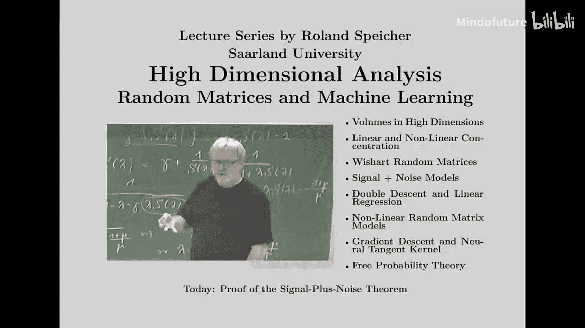
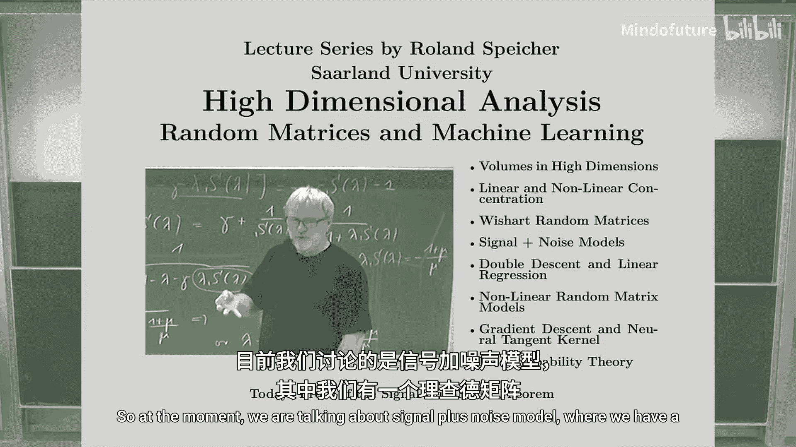

# 【德国萨尔大学】高维分析：随机矩阵和机器学习 ｜ High Dimensional Analysis p16 P16_信号加噪声定理的证明 -BV1XkkWBFEi6_p16-

So at the moment， we are talking about signal plus noise。

Model where we have yeah， wish had matrix。 let's say， with。Covariance， which is identity。 But then。

 but then we perturb this by one by by a rank1 deformationer。

 And we want to see whether for a large n， we can see the the effect of this deformation in the spectrum of。

 of the matrix And so what we want to prove or maybe maybe let's say， so what we consider。

Is we have a Yeah， we， we are looking on our we mates where the covariance is given essentially by the identity matrix。

 but then we do a rank one perturbation。You， you transportse also， so there is a specific eigenvalue。

1 plus mu and U is the eigen eigenvector for this。 and M。Is a positive number Okay。

 So so this is a rank one deform of the Macchan past two situation。

 And we want to see whether the largest eigenvalue of。

This corresponding visualard matrix can be seen So it should be something which pops out of the spectrum of the of of the Macchanco pastua。

 And if mu is large enough， it should be visible。 If mu is too small， it will just be buried in the。

 in the spectrum of Macenco pastua。 Okay， and so the statement is that if I'm looking on the maxim eggenvalue。

Of sigma hat for this situation。 So I'm taking yeah n independent copies of Gausian vectors and the Gausian vectors have a covariance matrix given by this。

 And， of course， we are looking in in the regime where P and N go to infinity with the same speed。

 So namely their ratio is fixed， fixed to be a gamma and this gamma in our setting we say is between0 and1 So。

 so we are looking on the situation。We have P divided by n。Goes to Gamma and Gamma。

It's between0 and1。And then the maximum eigenvalue of this guy。

So it can be seen if mu is big enough and how big does it have to be。

 It has to be bigger than the square root of gama。 And then we can really say what it is。

 It's  one plus mu。Plus， gamma times。1 plus muu divided by mu。 and otherwise， if mu is smaller。Den。

你是干嘛？Then essentially， if mu is equal to this square of commma。

 then this maximumim guy will exactly hit the， the border。The， yeah， the。

 the maximum eigenvalue of maacheco past 2。 and， and then after this， it will just disappear。

 So then the maximum eigenvalue is just the same of maacheco past 2， which is ka plus。

Which was one plus the square root of Gama。Squad okay， so this means in this situation。

 we don't see the spike anymore。 But if mu is bigger than this。

 we see one extra egg value at this position。 And so this tells us that in the underlying model。

 there should also be something like this。Good， okay。

 so we started to prove this and yeah we prove this by essentially looking on the characteristic equation so so namely by saying that the determinant of our matrix minus lambda identity should be 0 and then we try to solve this。

 Of course in general， for our big matrixrices， this is hopeless to look on this equation。

 that's not what we did when we prove Macchanco pasta because I mean we have p iingvalue and we cannot control this but because we have here rank1 deformation we try to isolate the effect of this rank1 and the rest is essentially Macanco information which we already have Okay。

 so what we did。Was， of course， essentially， we tried to reduce questions about this。

 We had matrix here to the one about Machenko pastua， the one which goes with the identity covari。

 So we wrote essentially our。Our vectors x， which have this covariance as。sigma to the-1 times y。

 And y is now the ordinary Macchanco passtua or the the we matrices where all the entries have the same。

 the same variance They are all independent。 and they all have the the the variance，1 Okay， and here。

 of course， one of the variances is is changed to one plus u Okay。

 but this means we can reduce essentially。Information about x to information about y。

 So we try to get in the direction of y as much as possible。 And so in principle。I mean。

 what we want to solve is that。The determinant of our wesha matrix。 And this is the one is x。

 So this is one over our n x x transpose minus lambda times the identity p is equal to 0。

 And we want to find a special lambda。 Of course， this is a P by P matrix。 So this has p eenvalue。

 but only one of them is a special one， which should be bigger than this gamma plus So we want to see whether we find one of them。

 for this， we rewrote this in terms of of y And then of course， we had some factorizations。

 And some of the factors we see they could not be 0。 So we we could specialize on a one。

 which has to be 0。 And so maybe in the end。Yeah， we arrived。Essentially， at。Yeah， the condition。

Like this， after some calculations and using some nice matrix tricks that essentially what we have to solve is that0。

 So it's still deterant， but we have。Yeah。Massage is a little bit so that essentially we have something in the y。

 And so namely， we have the determinant。Of Y P plus。 And then we had Lada divided by mu。

 A lambda times mu divided by one plus mu。 And then we had here。Now， not the X， but the Y。

 So we had one。Dividide by n， y， y transpose minus lambda identity。

 And we had here the resolutiono of this guy。 So this to the -1 and。U U T so that was。

One step in our calculation。 So I mean， here， the perturbation shows up。 And here， this is now the。

The reo of the unperturbed thing。 Okay， in this。W， it's still a P times T P matrix of which we took the take the determinant。

 But then we did this svetas identity trick that essentially we have here， a product。

Over P times 1 matrix。We a one times p matrix， which we multipied in this order gives a p times p matrix。

 but this reverseta identity determinant identity tells us that I have the determinant of identity plus a times B that this is actually the same as a determinant of1 plus b times a so I can just multiply this in the other way and it is the same。

So this year， and that's where we stopped essentially last time。

 So this is the same as a determinant of one plus。Laamda Muu， divided by。1 plus mu。

 And now I multiply here， yeah。I I change this。 So first， I take here U T。And then， I take。

This here to the -1。 and then I take U。Okay， yeah。 and there are now two nice things to observe。

 I mean， first of all， this is now just a determinant of one by one matrix。

 which is just the number which we have here。 And actually， this guy here。

 this is something which we more or less know。 So this is。I mean， of course。

 this is the inner product of， of this operator which with those two vectors here。

 So this is the same as you。Comma， and， I mean， this was one over and。Why。My transpose， minus lambda。

Identity， so this is a P times P matrix acting on U。So this is this inner product。 And now。

 of course， you see that what I have here。This is the reo vent。Of my Macchko pasttua， of my。

 my Viha matrix for the identity covaris。 And if I take the trace of this。

 this is exactly the still transform。Which we understand if n is large。 Okay。

 and now we we are not taking the traces， but we take the our product with a vector。

 But if you think a little bit， I mean， the trace is the sum over guys of this form where I'm summing over an autonormal system。

And because if the covariance matrix is the identity， everything is invari on a rotation。

 So it should make a difference which vector I take here。

 So all vectors should give me the same result for this。So if I take the sum。Then， it's just。

P times the result。 So this means this here is actually also just a steel transform。So， this year is。

More or less close。 if n is large and in the limit， it goes to the stilles transform。

At this guy here， at the argument is for Lada So where this year is the status transform of。

The of this matrix here， which is the visual matrix with the identity covariance。

 And we know that the limit distribution of this is much angle past for which we had a precise formula。

 And even more， maybe even more important， we had an equation for， for this guy here。 Okay。

 so this is the stilles。Transform of。Do Macchanco pass to distribution。off。off why。

Y transpo divided by one or y N。 Okay， yeah。Good， okay， so， so this means， I mean， maybe this。

 this is the point。 I mean， the city transform was the trace of the re event and， of course。

 taking expectations， but expectations are close。 although， I mean。对。

General values are close to the expectation。 so we can take the expectation， if you like。

 at various points， or we can just omit them because it's more less the same by concentration。

 But so the steel transform is the trace of this guy。So this means I have a， I have my P。

 So this is a P P by P matrix。 And then we say if I take the inverse of this and take the traces。

 then this is more or less the still this transform。 But now I'm saying actually more， namely。

 if I take the inverse of this P by P matrix， this essentially， I mean。

 this is still a P by P matrix。 but the entries， at least the ones on the diagonal。

 they are all the same。 They are all the still this transform。 And actually。

 if if you think a little bit more the ones of diagonals are actually all close to 0。

 So so essentially， we we could refine what we did before by saying that I don't have to take the trace。

 But I even know that。That the reso is is very close to still transform times identity。 Okay。

 so here we don't bother about the of diagonal elements。

 but at least it's good to see that on the diagonal， we have all the same guys。

 But this is just because everything is is rotational inry。

 So it doesn't matter which vector I take here。 I should always get the same。

And because the trace is the sum over guys like this。 and they are all the same。

 This means the trace must be equal to any of those guys。 quote， okay， yeah， so that's。

The crucial thing that now。What I have here is the determinant of this number。

 which just means it is this number。 So this is one plus this times the still transform。

 This should be equal to 0。 This is now our equation for lambda。So that's our condition。

 And now we just have to see。Yeah， whether we can solve this one。

And because we know the students to transform， we have enough information for really doing this， so。

Does是。哦啊。Condition。What lambda is。That 0 should be exactly what I have in this determinant because it's just a  one by one matrix。

 So it's one plus lambda U divided by。1 plus mu。As of Lada。Okay， so this is an equation M is given。

 and I have to check whether I have a solution for Lambda。 In particular。

 I want a solution which is bigger than this one plus squared of kma squared。

That's what I want to check when， when the solution there exists。Okay， and so in principle。Yeah。

 I mean， it's it's。It's the equation for。Yeah， it involves S of Lada。 And in principle， we can say。

 okay， as of Lada versus a still transform， we had explicit formula for this。 So in principle。

 we could check whether we have a solution for this。 Okay。

 but maybe I want to do in the following in a way that actually we should look on the equation which is satisfied by S of Lada。

 not on the solution。 So very often， it's better to use the equation than the solution for getting information。

 And in particular， here we see。 I mean， we have to solve it for Lada。

 but actually what shows up in the solution is Lada times S of lambda So maybe。

So what I want is a Lada such that Lada。Times S of lambda is minus。1 plus move。Divided by me。

 So I'm just， I mean， I just take this。This guy here and isolate this。 So this equation is this。

 So this means I should maybe not look for the solution of S of lambda。

 but for Lada times S of lambda and， and maybe maybe the equation， which I have for S of lambda。

 I can massage it in such a way that it tells me right away what this guy here is。 Okay。

 so let us look back。 So， so we had our equation。For the still this transform of Machenko Paa。

 So this was the following。 So test was one plus lambda。S of lambda， this looks good here。

 I have Lada S of lambda， but on the other side， I have S of lambda。Divided by one plus。干嘛？

S of lambda。 Okay， so in this form， it's not an equation which tells me what lambda times S of lambda is。

Depending on， yeah， on gama。 good。 Okay， but maybe I can also write this here as I divide here by S of lambda as one divided by。

1， divided by S of lambda plus gamma。And now， maybe let me， yeah。

 let me write this here down just as a。Yeah quaratic equation。 I mean。

 this is an quadratic equation for as of Lada。 So let me write it down。 So I might bish this。

 So I have one plus。Coma S of lambda。 Then I multiply this with this。 So I get also lambda。

Times S of gamma。 and I get plus gamma lambda。As of Lada squared。 And this is， what is this。

 This is S of Lada。Okay， just writing it down again and now。Let me。Write this in the following form。

So I'm getting trying to get out as of lambda。 So all the terms which have as of Lada。

 I bring on this side and only this one， which doesn't happen as of Lada。 I bring on the other。

 So I have here。This as of lambda on this side， it's a -1。 Then I have here。

Or maybe I put the minus here。And then I have here plus。No， actually。Yeah， you see。

 I'm doing such things that。Okay。It's not clear what you should do unless you really are told what you should do。

 So let me write it again minus S of lambda 1 minus lambda。Minus gamma。Lada。As of。Lada。What okay。

 so this。This is this term。This is this term。 So I keep the catartic term here。 This guy here。

 This is actually this brought to the other side。 And then I still have two terms。

 which I bring to the other side。 So this is equal minus gamma。S of lambda -1。 Okay， Yeah。

 and now I divide by S of lambda。嗯。so I divide by this。 So I have1 minus lambda minus gama。Lada。

As of Lambda。嗯。This is equal。2。And I divide it by minus。 So the minus signs go away。 And I have here。

干嘛？Plus， one divided。By S of lambda。Okay， this doesn't look maybe much better than before， because。

 I mean， I still have not， not just combinations of lambda times S of lambda， but now。

You see this guy here。 This is exactly what I have here。

 so I can use my original equation again and replace it by this。

 which only contains lambda times S of lambda。 And here I also have lambda times S of lambda。Okay。

 so this。This year， by the above is。This is one。Divided by the other side by one plus lambda。

As of Lambda。Or if I take the， So I have this is equal to this。 or if I take the reciprooli。

So this means that I have。1 plus lambda。S of lambda is equal to one divided by this。

 which is 1 minus lambda。Minus gamma。男得。Times is of lambda。Okay。

 now you see that this is now something。But S of lambda only appears in the combination Lada times S of lambda。

 And so I can solve this for lambda times S of lambda。 And now lambda times S of lambda。

This should be-1 plus mu divided by mu。 Okay， so this is now an equation where I can plug in what I really want。

 namely that lambda times as of lambda is given in terms of mu。Withs Lada。As of lambda。

Is equal to minus-1 plus mu divided by mu。 That's the equation which we have to solve。

 We have to find a lambda， which satisfies this equation。

 But Lada times S of lambda that satisfies this equation。 And I can now plug in this。

 this thing here。 So what I get。Is that I have here one。And then for this。

 I'm plugging in to minus-1 plus mu。Divided by mu， this has to be equal1 divided by 1 minus lambda minus gamma and Lada times S of lambda is again this one plus mu divided by mu。

 And actually， this minus becomes a plus because I also have a minus here。And now you see。

 this is now an equation， which tells me。What lambda is in terms of me。Okay， and this is now。

A linear equation So I mean， I have avoided of solving my quadratic equations。

 having square roots and then doing things and getting rid of the square roots again in the end。

 just by doing some manipulations on the level of of the equation such that in the end， I get。

A linear equation for for Lambda。 This is not quadratic anymore。 is no linear。 So this， I mean。

 of course， this here。This is just。Mo by move。 So this year is just。Minus1 divided by mu。Okay。

 and then I can just take the inverse of this。 So this guy here is then just minus mu。So this means啊。

This1 minus lambda plus。干嘛？1 plus mu divided by M。This is the inverse of this， which is minus mu。

 Or if I solve it for Lada。This means lambda。 I'm putting this on the other side。

 and then I have here one。Plus， this move comes on this side as a plus move。

 And I have this plus gamma 1 plus move。Devied by me。 And that's it。 That's really what。

What I claim they。嗯，OK。So I mean， you can say， in principle。

 I was more or less done when I arrived at this point that I just had to solve the equation because I know what as of Lada is。

 but this is just maybe a nice way of solving this equation but but of course you get this。

 And of course you have to think about that if mu is bigger。

 then this squared of gama that this really is a lambda which is bigger than this gama plus So this is really lying where it is supposed to lie And if the mu is smaller。

 then you don't have a solution which is bigger of course you still have a solution here。

 but this is not outside to support of the Macchanco past two distribution。

 So this is not the p you're going to see I mean， all all the arguments which we did in between we are using the fact that lambda has to be outside to support so。

And if we find a solution here in the end， that's really an eigenvalue of our original problem。Good。

 okay， so that's maybe。What I wanted to say about this also this is the end of the Pfiia。Yeah。

 so questions。I mean， this is also the end of this chapter on the spiked model。

