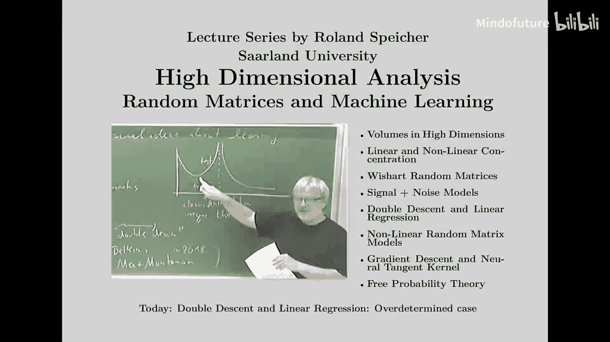
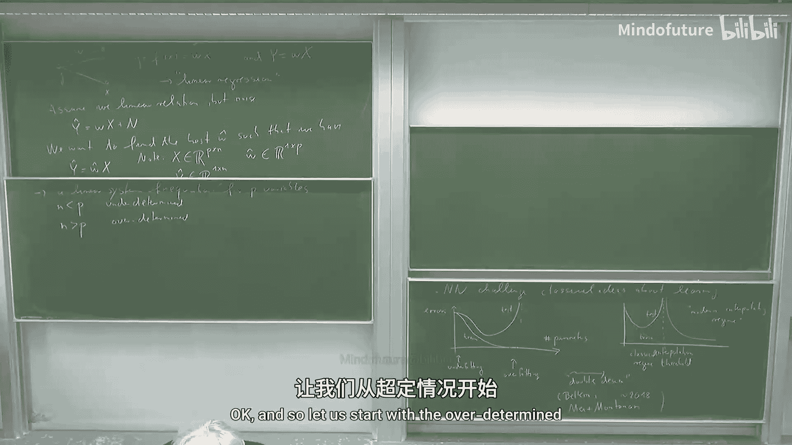

# 【德国萨尔大学】高维分析：随机矩阵和机器学习 ｜ High Dimensional Analysis p17 P17_双下降与超定情况下的线性回归 -BV1XkkWBFEi6_p17-

Yeah， so in the next chapter， I now want really to go。

A little bit in the direction of neural networks。 because， I mean。

 that's maybe what is the most interesting thing to understand。

 And random matrices are somehow related to building up neural networks and maybe also trying to understand it a bit about random matrices。

 we can understand quite a bit neural networks really to understand them is， is not， not so easy。

 but at least we will at least try to get at least a few mathematical rigorous things about them。

 So let me。Maybe yeah， call again， first of all。Neural networks are in general。

 and then I want to concentrate quite directly on maybe a very modern。Issue in this context。

 which is called double descent。W。Descent， which is。Observed in general for neural networks。 And。

 okay， and I mean， to understand it， it's maybe in general a bit too hard。

 but we at least can get maybe some idea of it in maybe the simplest neural net。

 which is very trivial， and which is actually a very classic stuff， namely a linear regression。

I cant。Just to see。What we have。 Okay， so what what is a neural net or neural network。 I mean。

 in German， we usually say in neural all net in English。

 it seems neural network is the more common issue。 But neural net seems also to be okay。 But anyhow。

 So I probably usually say neural net。 Okay， so this is a special function。 I mean。

 this is a function from usually high dimensional space to， let's say。To R。

 which has a very specific form。 So it's， it's a function。也很熟啊。那，你有说。Net。Is a function F， which goes。

 let's say from R to the P and maybe to R。 Of course， I could have here more components。

 I could also go to a high dimensional one， but it's of a specific form。

 which essentially is built out of matrices and some specific non nonlinear functions。Okay， and now。

 so I'm now。Trarowwing the usual picture。 But actually， I'm drawing the picture from。

 from right to left。 So my input is here because if I'm writing down my matrix operations according how。

 how we write it， I mean， it is fits really that essentially you're working in this direction。

 So let's say I have here my input。So this is the R to the P。And then， I mean。

 you have operations where you act with linear mappings。

 Maybe you map this to higher dimensional space or space of some other dimension。

Let me say this is maybe an R2DM。And you have essentially you have a linear mapping here。

 So essentially you have a matrix， which maps this to this。 essentially you have all connections。

 So let let me call this w1 this is just a matrix。 a linear mapping going from here to here。

 And then you also apply in general nonlinear mappings now。

 but you do these component wise So you apply here。 you have here a vector in R to theM。

 And now you apply a nonlinearity， but you do it component wise So in the beginning。

 you are given a nonlinear function from R to R， let's say and then you just apply this component wise So essentially you stay the R to theM。

 and you apply a nonlinear mapping， but a specific one， which just x on the component。

 So very often this is called sigma or something like this。 Okay， and then。

This is the first layout of your net。 And then maybe you go on and you have the same again and again。

 So you have again， linear mappings。Going to the next layer。And so on， up to some point。嗯。Yeah。Yeah。

 so so let me say maybe here you have a matrix W W 2 here。 you have W L L is。

 is the number of layers。 it's the length or actually it， it's the depth of your， of your network。

 And then maybe here again， you have。Your non nonlinear mappings。呃。Sigma， and then in the last step。

 you go down now with a linear mapping again to R。 So I mean， now you just go to R。

 So you just get here one number and you just go down here。 So in principle。

 this is again a linear mapping。 is， it's given by M times one matrix。 essentially a vector。

 you take the inner product with a vector here。 And let me call this here a w a small w。

 So maybe here you are still an R to the M。Of course。

 those guys could depend on the layer you consider， But maybe let me keep it like this。 Okay， and。

 and the action of the function is going in this direction。And， I mean。

You can write the function now just as the composition of all those mappings。 So， I mean。

 the why which you get here。W whichch is f of x。 If x is your input vector and r to the P。

 So this is given。 So in the last step， and essentially it's， its matrix multiplication。

 And in between， you do those those non nonlinear。Functions on the entries。 So So you do this here。

 sigma。WL and so on。Up to W2。Sigma w 1 of x。 So you start with x。 You apply this matrix W1 to it。

 Then you get a vector and of this vector。 I mean， you take this sigma。 And， of course。

 you have to read this in a way that you apply this sigma entry wise to the vector which you have gotten here。

 So the sigma。Is our norm。Liarity， but it's， it's an entry wise action。On vectors。Okay。

 then you multiply with this and so on。 You multily here again。

 You always have the sigmas taking this。 And in a very last step。

 you just take the inner product with this guy。 So this is now a row vector。 So this is a。To see。

 let's say。Is a row vector door。 So this is in。M cross1 So essentially you take it in our product with this vector。

 Okay， and of course， those， I mean， this year is a mapping from R to the P to R to the M and the inner our the inner ones are mappings from R to the M to R to the M So they are all matrices。

Good， okay。 but now in general， usually we are interested or maybe。

 maybe we want to understand not just having one input， but we take more input。

 We have data of input so actually。We calculate this year， maybe for。For input X 1 upune input X， N。

So we feed X1 up to X N vectors and R to P in our neural net coming from this direction。

 And then we get outputs。 And now， of course， we do the usual thing。 We。

 we collect the inputs into a matrix and the outputs into a matrix。

 And then the relation between those output matrix and input matrix is more or less the same as we had it here。

 So， I mean， if I'm writing Y。As the output matrix。

Which is just the vector because the y itself are just the numbers。 They I R1。

 So this is just the one times n matrix。 But the， but the input guys。day。

Given this is our data matrix。As we also consider it for the Macchanco past2。 So I'm putting all the。

P dimensional vectors as columns here。 So I get A P times n matrix。 And then， of course。

 I can also say that this y。This matrix is more or less the same function of this type applied to my input。

Input x， namely， I do exactly the same thing。 Naly， I take W sigma W L up to W 2 sigma。W1。

 And now instead of the little x， the vector， I have here my data matrix X。

 And the only thing which I have to interpret in the right way is the sigma。

 The sigma does now not act on a vector， but it acts on a matrix。 But again。

 I'm just doing it component component wise So I mean， if I have sigma like this。

 then if it acts on a matrix， it just takes the sigma of each matrix。 And of course。

 if I specify these two vector。 This is what I had before。 and of course the w used。

 they are linear mappings。 And if if I multiply them my matrixes with a vector with a matrix。

 of course， it's also it's clear what this means so。So here the sigma。In now the entry wise。Action。

1 mates。Good， okay， so that's my。My neural net in general。 And， of course， I mean， yeah， so it's。

 in principle， it's just。function in high dimensions。 of course， or usually P also so is high。

 right That's， that's a important point， which is of a very specific form， But it seems those。

 those functions are very powerful for。Yeah，For capturing a lot， a lot of things。And so， I mean。

Of course， there are no different questions about such a network。 and maybe one。

Which is mathematically， maybe an easier one is namely， if we are given such a network。

 So if we have fixed all these these， these matrices and these， these， these ws。

 then what what is the effect， So what is the， in particular， the statistical properties of this。

 So if， if I'm feeding in data matrix， What comes out in particular。

 if I have statistical information about the X， What can I say about the Y' So this is a question which is mathematically。

At least attractiveable in in this generality。 So， I mean， that's。That's a question。So， namely a。

What so given。 So if you are fixing a net。Given a neural net。

 So I have fixed all these these W use and。Or seek mass。 So given the neural neural net。Let me say。

 F。So what。Is the relation。Between input x and the output。Okay， and the relation， of course， I mean。

 usually youre asking for kind of probabilistic relation。

 So you assume that you have some probability distribution for the Xs。

 What can you say about the distribution for the y and， of course。As we have seen， I mean。

 if you really。Want to be able to make precise statements。 We should go to an asymptootic regime。 So。

 I mean， the， the numbers， which we have their P and M。

 And so they probably should be large because only asymptoically， like for render matrices。

 we are able to make precise statements。So， I mean。

 so what we want to understand here is dis relation。And we want to have this。Probabilistically。And。

 of course， asymptotically。Okay， and， of course， I mean， if， if I only have one，1 matrix here。

Just the W1 and nothing else。 then it's more or less like we had in a wishard matrix context。

 than then it questions like this。 Okay， and there are statements of this form。

 and maybe let me write it down。 So， I mean， I'm not going to talk about this。 at least not now。

 Maybe I come back to it later。 But so， I mean， one important statement。In this context。

 which can be proved rigorously， is that random neural networks。

And random means that I'm choosing all those those weights， this double use also in a random way。 So。

 so random neural networks。In the infinite limit of infinite width。And the width is this M here。

 So each layer has a width M。 And if I make this going to infinity。

 then the size of my mates goes to infinity。 that that's， that's the， the large。

Size limit of random matrixes where we know that we should expect something nice So the width is， is。

 is this M。 and the depth， usually the depth which we have in deep learning， that's the the size L。

 How many layers I have So the depth is a bit more mysterious。 What the role of this is。

 So So the width is， is more accessible， because is really is related to just having a random matrix and letting think the size of this go to infinity。

 And so there are statements here that the random neural networks in。The infinite。With limit。

Are gaussian processes。Okay， so I'm not， I will not be precise what this means。

 but even if I'm putting in Gaussian vectors， then what I get out and what I can control in all steps is also of Gausian nature。

 And Gaussian things are governed by the mean anti covariance。

 and one can see how this goes through the network。 Okay。

 so maybe I come back to this at some data point。 but maybe at the moment。

 this is a mathematically nice statement， but it doesn't tell maybe not so much about why。

Neural nets are so powerful So， okay， so maybe the second question。 I mean， that's the one which is。

 of course， for applications and really what you do with the neural net， much more interesting。

 So namely not start by saying， okay， we are given one。 and I want to understand what it is doing。

 But by trying to construct one， which does a prescribed task。

 So essentially you you have a collection of input and output and you want to to construct a neural net。

 which realizes the relation between them。 So that's， of course， what。

What is done if you train a neural it。 So how。Can we。Construct。An neural net。This means how。

 how should we choose the parameters or those w。That that。It approximates。Well。function relation。

Between x and y， if we are given a collection of xs and y， so。4。😔，Given。😔，Training set， X and Y。

 So we are given some， okay， some data X。 And we know this should have the output Y。

 And then how do we find a function F of this form， which which has exactly this relation。Okay。

 so this is the training that it is trained to do this。 But then， of course。

 what we expect from our neural net is that we could now apply it to other data set X。

 and then it should also give as a meaningful answer。 So I mean。

 it it should not only remember what it was trained。

 but it should have learned things in such a way that it gives meaningful answers also for unseen data before。

 Okay， so， so this means。That it also generalizes also。Generalizes to unseen data。Okay。

 and of course， one has to make precise what is， what this means Okay。

 but so I want to go a little bit。In this direction。And。Yeah。

 the point of this neural nets is that actually， they seem to contradict the old philosophy about learning and over parameterization。

 So I mean， that， of course， how do you。Yeah。How do you approximate data by functions from fun some function classes。

 This is the old problem in in mathematics。 And there's a lot of statistical stuff about this。

 But somehow the idea there was that actually you should not over parameterize So that's。

 that's the the dictum from classical learning theory。Which is challenged by neural net。

 and neural net seem to be much better doing much better than you would expect from the classical perspective。

 And I mean， that that's the very strange thing， which which one really wants to understand。 And。

 I mean， at the moment， one doesn't really have a full understanding。

 but at least one is trying to go in this direction。 So， but but let me first describe what。

 what this means。 So， so neural net。Challenge， somehow。对。Classical。Ideas。About learning。 Okay。

 so what， what are these ideas。Yeah， so， I mean， essentially， the idea is。

That you have a set of functions with with which you want to approximate the data which you have。

 Okay， and， and you look on the errors which you make。 So what are the errors。And then。Yeah。

 so you have parameters in your system， which you can adjust。

 So you want to choose the parameters so that you。Yeah that you get the the training data So I mean。

 here the neural neural nets， I mean， we we can choose all those ws。

 and we can have many of them Okay， but my classical the idea is that， of course， yeah。

 you have parameters。 So you should try to get the relation between the input and the output for your training data right。

 But if you only have few parameters， which means you have only a small class of functions which you can use and you have many。

Many such connections。 Then， of course， you cannot really fit them so well。

 Maybe you can only approximate them And then you make in the beginning， if you have。

 maybe if you have a very small class of functions， maybe only linear functions。 Of course。

 with linear functions， you cannot approximate so well， very very complicated stuff。 But so then。

 then， then your traininging error is， is， is bad。 But it it goes down essentially。

 And at some point， you have so many parameters that actually you can。Yeah， you。

 you can exactly get the relation at the points which you are given as your training data。 if。

 if you have so many parameters， more or less as， as you have your training data。

 then you can really just memorize。The things which you have seen Okay， so， and then， of course。

 I mean， having more parameters does improve this anymore。 But of course。

 just memorizing is not what you're interested， but you， you' choosing a function。

 which does very well for the training data。 But then you put in。Other values。

 And you want to see how good is now this。Maybe approximating or。Prescribing or making， yeah。

 prediction for what what you get。 And then the idea is that actually。

 so so this is the training error， which means you're trying to get the training data as good as possible。

 but if you have enough parameters at some point you， you can do this。 there's no error anymore。

 Okay， but then if you apply this to new data。 then I mean， in the beginning， of course。

 you're also getting better。But then at some point。

 it turns out that actually you fit the given data very well。

 But what it does in between might be very wggly or whatever。

 It doesn't seem to be connected with It doesn't seem to give， to give a good interpolation。

 So actually， then at some point， it's getting。Bad again。

 And at the point where you really have a totalr。Let， let me say， a total。

Description of all the data which you have。 Then actually F the yeah， the prediction is。

 is very bad So this， this here is the test。Data， okay， and so， I mean， so this year。

 So do this seems to be the best point where you should maybe。Choose your function。 So I mean， here。

 here， here you have essentially the complexity of the class of functions which you consider。

 So this corresponds to the number of parameters。In your model。And if you only have few parameters。

 you cannot really。Fit your thing so well。 So that that's usually the underfitting regime。

You can maybe some do some approximations。 But if you have few parameters。

 then they won't be very good。 Okay， if you have more parameters， they are getting better and better。

 but then if you have too many parameters so that you you fit exactly， you， you get exactly the。

 the points， then actually the prediction。A power of this is very bad。 So I mean， usually， I mean。

 if you， if you say you have a number of points。For， for polynomial interpolation。 So if。

 if you want。2。Interpolate or approximate a number of points with polynomials。 Then， of course。

 we know that if I have a degree，20 polynomial or if I have 20 points， I， I。

 I can fit those points exactly with a degree What is a 21 polynomial。 Okay。

 and so this polynomial will be exactly at those points。 But in between， it will be very。

Very going up and down。 So this， this doesn't have a power So this means， I mean。

 you should not take a polynomial of dec 21， but smaller， I mean。

 maybe a linear polynomial is is too smaller。 So， so there you will be there。

 But if if you go a little bit higher， then maybe you have a quite good approximation， But then you。

 you're getting bad and if you take。As many parameters as you need for f fittingtting I I exactly。

 then it， it's really， it doesn't give good predictions。 So this this year is the。Overfi。Ruiing。Okay。

 and this， this is usually then， I mean， this is over parameterization。 You have too many。

Too many parameters。 Okay， or the that's the classical thing。 I mean。

 if you have as many parameters as you need to do。Exact。呃。Description。

 then actually you get a a very bad thing。 Okay， but now the point is， I mean。

 neural nets don't care about this。 And what people do is， I mean， they really。

They take a thing like this。 and usually you take really many parameters。 you have the double use。

 and maybe if you make your， your net very deep， I mean， you have many matrices there。

 and usually you have many more parameters。 then， then you would need to fit exactly your。

 your given data。 Okay， so classical theory would say， okay， don't do this， this is bad。

 if you put in more and more parameters。 it only will get worse and worse。

 But if you do this with neural nets。It， it seems it's。

 it's getting much better that that's really the， the success of neural nets that you really should over parameterize。

 And so actually， this curve here， the classical curve is now in modern。😊，Statistics， so in the last。

 I mean， this is something which in the last 10 years or so was somehow observed that actually you should。

 should really go much more in this direction。 And then you see something interesting more So the typical thing you see at a neural net is something where you get here。

 something where you improve again。 And the whole curve is then usually called a wcent curve。Okay。

 so I mean。So actually， we go over to this。To double decent。And those things are， I mean。

Maybe a few names or back in and coworkers or my。And Monnari。

So those people who looked on this and tried to understand this also a little bit theoretically in practice。

 this was， of course， observed before and may， maybe it was also observed bit longer before。

 but it was not really put so much in in in the， in the sense of interest。 Also， I mean。

 those are works which are about。20。819 or something like this。 So So just a couple of years ago。

 And so what what is the idea there。There you get， actually。I， you really go more in this direction。

So maybe I throw the same picture again， but I'm not not stopping here。But I over parametermedize。

 which。Plsically， people say， okay， you shouldn't do this。 And we didn't really look on this so much。

 But so the idea is now。That you， you stare， you get。律师。Test error， which somehow here。At。

At the point where you really， let's say you interpolate your， your given data。

 interpoolating means you really get the points which you have exactly。

 And then you want to know what is in between。 So this is then maybe called the interpolation。

Pressure short。Okay， and， I mean， this year's the classical regime。W which， which， which I had there。

 So here， I mean， the training error goes down。 and then， of course， it it remains down。

 So this is the training。But the important one is a test error。

 And here it seems that if you now over parameterized， then suddenly you are getting better again。

 So you， you get pictures like this and you might get on this side better than on this side。嗯。

And so this is the modern。Interolating regime。Yeah， and so。

 this is somehow the under parametermedized。Regime， and this is over parameterized。

 And the point is that over parameterization seems to be a good thing。And maybe， yeah。

 I want to go a little bit in the direction of trying to understand this。 And so， I mean， of course。

To calculate something for such a full models at the moment， not really clear how to do this。

 but I want to look on maybe the simplest neural net。

 which actually has no hidden layers and which also has no non nonlinearity And so this actually is just a good old linear regression problem But linear regression fit somehow in this。

 And maybe you can see parts of this in this picture。

 And that that's what I want to show in the following how。

 how you can see maybe this difference between。Yeah， between this。

 this under parameterized and over parameterized。Reme。

So what I now take is essentially such a neural net where I'm throwing away everything apart from this very last guy here。

 this W。 So it's just linear。 And this is linear。 There are no non linearities。 and also。

 there are no ws in between。 And this is just classic linear。

Linear regression problem where I'm trying to approximate。Yeah。Given thing by bilinear relations。

 Okay， and of course， this is and if I have an， if I have a neural net。

And we are usually I do the the training by gradient descent。 Then I。

 then I would just learn this guy here。And that's also in in neural that's considered as not maybe。

Maybe the， the， the main part is missing， namely。The main part seems to be that I'm， Im， I'm。

 I'm learning what are the ws。 Okay， and so， I mean， this， this is usually called feature learning。

 because what I get at this point， this very often are called the features of。Of my data。

 So I'm calculating some， some interesting quantity of my data， different ones。

 And this W use I just taking a linear combination of them。

 And I just have to adjust the weights for each of the features。How I want to make my decision。 Okay。

 but usually feature learning is considered as as domain。The main thing which happens in neural nets。

 which means I should also learn those guys here。 Okay。

 but so now I I don't have them So in particular， I don't have feature learning。 But nevertheless。

 I think we can see a little bit。About this。Okay， so I'm looking on the simplest。

Situation where the why。Is just calculated from my。

Vectctor x by just taking in a broad with some vector W。Okay， so this this why。

F of x is nothing else。Then W times x。 And so X， X is a。X is a。Yeah， X is a， is a column vector。

 W is a row vector。 So I'm， I'm taking the inner product between those two guys。 and or more general。

 if I'm putting in here， not just one vector， but several of them， and I put them into a matrix。

 Then， of course， I have the same relation between the output matrix。And the input matrix。

 So this is now。呃。A P times n matrix。 This is a one times P。

 And so this is this year is a one times n matrix。Okay， and so yeah， now the question is given。

X is and Ys。 What is the best W2 model data on This is linear correction。Yeah， okay。 and so。嗯。

Of course， we also need a model。 I mean， between， So what we want to do is we assume we have a model。

Which gives me y in x。 And then this model also has a noise。

 which means I'm measuring y's depending on x， which are also noisy。

 And then I want to find the best linear relation relation between them。啊，所需我们。

So we have a linear relation。Between output and input。But if I do measurements。

 I also have some noise because otherwise it， it would be trivial。 I have a linear relation。

 And I want to find a linear relation。 And without a noise。 I mean， this is not， not so interesting。

 So I'm trying to， to approximate the noisey linear relation by a linear relation。

 That's what I'm doing here。 So I assume you have a linear relation。But noise。So this means that。

 let me say， the y hat。My measurements。 So if I have my data X。Then。The Y hat， which I。observebsve。

of this form。 Okay， so without a noise， the relation between y and x is just this W。

 But now I observe given X， I observe the y heads， which are do to。Ptubed by a noise。

 let's say the noise is just a gausian noise。 also。

 And then I want to find between this and this linear relation。 I want to recover this W。

 which I don't know by just measuring those， those things so。So， we want。To find the best。W。

 let me call it W hat。Such that we have。That this y hat is actually W hat times x。 I mean。

 the functions， which which I consider here are are just functions of this form with the linear guy in between corresponding to some measurements。

 I want to find this。And so I， I want， so I'm given the x's， and I'm giving the y's。

 which are actually related by this。 And I want to find this here。 And of course， I mean。

 what I have here is， of course， a system of linear equations。 So。

 but maybe we should think what is the size of them。 So X， let's say。Is a P times n matrix。 So。

 I mean， our data always P dimensional， but I have n of them。 That's our data matrix。

 I have N of them。 then the Y hat。So this is one times n matrix。

 So the output for each vector here is just a number。 Okay， so I have here n numbers put in a vector。

 And so this W had here。This is。This is my。By column vector， which is。

 is also a P dimensional vector。 Okay， so what I have here is， I mean， this here is one times n。

So I have n equations。And I have P variables。 So I mean， those those here R matrices。 And I mean。

 the unknowns are those guys here。 the W。 The W has P components。 So I'm looking for P variables。

 and I have N equations。And now， of course， it is clear that what I get depends somehow whether I have more equations than unknowns or the other way around。

 or maybe in a case when they are the same， this is a very special one where maybe the。

 the solution is unique。 and so。So we have here somehow also two different regimes。

 and they will somehow correspond to the regimes which we have there。 So we have here。

It is a linear system of equations， linear。System。Of equations。 And I have N equations。For p。Varis。

Okay， and now， of course， depending on whether N is less than P。 So I have。I mean， I have。

Less data than I have dimension of my space。 So then the system is under determined。And。Determined。

 and if N is bigger than P。 So I have more。More measurements than P。 than it is over determined。

And the solution of this problem for both cases will， of course， be somehow different。 So I mean， it。

 it's just linear algebra I mean， I have system of equations。 but okay， in one case。

 it's under determineded and the other it's over determinedter。

 And so maybe we we consider those two cases separately and try to see what， what we can get there。

 And whether we can， maybe get。Something like this。 Okay， And so let。

 let us start with the over determined case， which means which is more like classical。 I have enough。

Data more than I need。So over determined。A case。So which means n。Is bigger than P。 Okay。

 and in this case。 So in this case， I have more equations than I have variables。

 which means in general， I I will not have a solution。Because， I mean， I have too many。

 too many equations which contradict each other。 I mean， this is just。呃 yeah， so。

So this what I want to solve。Y hat is W hat times x。没议。呃，Tically。Have no solution。嗯，Just because。嗯。

Yeah， X is a mapping。From P to N。 And so the so the range of this mapping is just p dimensional。

 So if I take on the other side， something in space， this will usually not be in a range。 Okay。

 and I mean， this is a classical problem。 instead of saying， okay， I don't have a solution。 I mean。

 I want to find a solution， which is as good， which。

 which realizes this relation as good as possible。 And this is this is a method of。

 of of least squares。Yeah， okay。 And so essentially， this is saying that。Okay。

 I cannot satisfy this equation exactly。 So I'm trying to find a solution which satisfies it as good as possible。

 which means that the mistake I make by comparing Y hat which W had X should be be as small as possible。

 And this means this is the same that I'm taking somehow I'm not trying to find。Here is this image。

 I not trying to find the y hat， but I I， I want to find the projection of Y hat onto the range of x。

 that that's classical things。 This is the method of least squares。 and actually the， the equation。

 which you solve instead， is what is called the normal equation。

 So I assume that more or less you all have seen this。 But maybe just。What you are doing is， so I I。

 I want to look on this。 This doesn't have a solution in general， in general， of， of course。

 if the noise would， if the noise would， would be0， then there would be one， but then。Of course。

 my X status would also not， not all be independent。 Okay， but in general， there is no solution。

 So instead of trying。offff。Offer。This。We try to solve。weaker equation。

 which I get from this by multiplying this with x trans。 So I， I mean。

 I can multiply this equation with x transport on both sides。 Then I have W hat X x transpose。

 And so if I have a solution of this， I also have a solution of this。 Okay， but this here。

 I cannot go the other direction。 If I have a solution of this。 I don't have a solution of this。

 I only have a solution which approximated solution here as good as possible。 Okay。

 but so that that's what I want to solve。 And this。

 this is this normal equation in the context of the。Of the least square method。 So this is。

Then what is called normal equation。In this context， and it characterises。Characterizing。呃。

TheW had for this original problem。 I mean， there is no exact one， but you can。Find one。

The unique one such such that the difference between Y hat and W hat X is as small as possible。

Its me白。OhThat's the method of these squares。 And here we take the Euclidean normal。

Or if I have matrix， it's a4ius normal。Okay， so， okay， so we， instead， we want to solve this。

And this is now okay because， I mean， okay， I mean， now I。

 I have to invert this matrix and x times x transpose。 So what is this。SoX。X transpose。

 So this is a p times P matrix。 So x is is p times N X transpose the other way around。

 So if I multiply them in this order。It's P times p And this is typically an invertible matrix。

 So if the rank of my matrix X， I mean， x is a rectangular matrix。 So the rank of this can， I mean。

 if if P is smaller than N， the rank of this can only be P。 Okay， but then that's okay。So P。

 So this here is typically invertible。 If my original matrix was head rank P。

 but which is usually the case。 also， we assume， I mean。

 we have generic data where where the datas are not， not dependent from each other。

 but they should be independent。 So this is。If。The rank of x。Which is P。And this is smaller than N。

 So I mean， if I do it the other way around， then it would not be invertible。

 But if I multipied in this this way so that I get get a p times P matrix。

 which is the smaller of the two numbers here then。This is typically inverible。Okay。

 and this means I can just solve this integration here by mying。It the inverse。So， so that's my。

Omega H is nothing else， then。Why hat。X transpose。 And then I bring this x x transpose as the inverse to the other side。

X， X transpose inverse。 and so this is my solution。 that's that's the solution。

 which is given by the least square  one。Okay， and so now we have。A solution or we have this。

 this in a sense， is the best we can do to approximate the given data。Bline relation。

Even if there's no linear relation。 But， but the mistake we made I， is as small as possible。

And so we can approximate this。Relation here by this linear  one。 Okay， and then， of course。

 the question is， and， what we really want to estimate is this， this W， the linear  one And。

 and we have now said， okay， the。The real W。We estimate this by this W head。

 And we want to know how big is a mistake， which we have made。And， of course， I mean。

 this should be as small as possible。Oh， that， that's。The idea that we want to approximate。

Our setting by functions from our class， such that the， the。

 the error which we have make made is as as small as possible。 At least in a average sense。

 Of course， if， if I have noise here， I， I should average at some point over the noise。 Okay。

 but so this means we should look。What is our mistake。So， that。We have made。The error。

So this is the difference between W and W head。O。And I mean， those are vectors。

 So I'm taking here to Euclidean。 It's always the L 2。L2 norm。

 which I take that's also what you take in at least squares。 you you， the the mistake which you make。

 you， you count it in the Euclidean norm it is some of the squares of the difference of the components。

Yeah， okay。So what is this。Maybe I take you to square。对。O， so this is the W。And the W head。

 we have just。Chsn in this way。 So this is why hat。X transpose times X， X transpose to the -1。Good。

 okay， and now， of course， the Y hat。Which， which we get， if we put in x is， is given by。

 by the relation of this。 So the Y hat。This year， this is a W。X。Plus n。How do I head。Okay。

 now I can plug this in。So what do I get then？So， of course， I get， okay， this W。

Then I get here some of two terms。 So the first one is minus。 So it's w times。X， X transpose times X。

 X transpose to the -1。Okay， and then I also get minus。The term where I plug in the n for the Y hat。

 So I also have minus n times x transpose。X， x transpose。To the minus-1。Scr。Good， okay。

 here the first term you see， I have here X， X transpose here。 I have its inverse。

 So this is just the identity。 This is just one。 So I have just here W。

 and this W and this W goes away。So this means this part here really give gives me the the right。

 the right prediction。 It's only that the noise。 the noise is the problem。 If I don't have noise。

 then， of course， I just get to get the correct solution But if I have noise， I mean。

 the data which should be linear suddenly not linear， not on on on a linear line anymore。

 because there is noise， And I'm trying to approximate them by a linear line as good as possible。

 Okay， but I mean， this as good as possible might not be the original W， but I have made a mistake。

 which comes from the noise， But the question is， can I see how big this mistake is。 Okay。

 and so what， so this and this goes away。 So it's， it's just。嗯。That。The mistake。

 the  error comes from the noise。 So it's just the n。 Okay。

 the minus doesn't play a role for the norm。 So I have X transpose。X， X transpose。To the minus-1。

I have the norm。Okay， and this norm， this is the phobiius norm。 Okay， I mean， I mean this。

 let me see。 I mean， I mean， here， okay， those are vectors anyhow。And of course， I mean。

 this is also， this is also just just the vector Okay， so this。

 this is just means it's just the sum of the squares of the component。

 But now if I start maybe to move things around and I multiply in other orders。

 then I might get bigger matrix in between。 But it's always that that the norm， which I consider is。

 is the sum of the squares of all the components which is the forbidious norm of a matrix。

 we I just consider everything as， as a vector in in a big dimension space。 Okay， but anyhow。

 So this here， this is。The norm of the squares。 and I can actually write this as this guy multiblied with its transpose because the norm。

 I mean， this is a vector and the norm squared is just the inner product of the vector with itself。

 But in my vector writing， this is just multiblying the vector with its transpose。

And I even don't even have to know whether it's a vectorctor or not。

 I just multi blood this with its transpose。 And this is the square of this。

 So what I have here is this guy here。 So it's N。Extranspo。X transpose。To the -1。

 And then I multi bliide with its transpose， which means I change the order。

 This guy here doesn't change under the transpose。 So it's。X x transpose to the -1。

 And then I get here an x。 sorry， x transpose。Transpose， this is an x。

 and then I multiplied with the transpose of the noise。Yeah， okay。 and now。So you see。

 I have here a product。 I have here a noise and here the transpose。 And here in between。

 I have some something else。 And now we should see， can we calculate this。

 And maybe you remember that we had。I， in some calculations， we had these trace formulas that I。

 if I take a Gaussian noise。And I take the the vector door and I take the transpose。 And in between。

 I have something a matrix， which is maybe deter deterministic or independent of the noise。

 Then what do I get， I get just the trace of what I have in between。 And so now， of course。

 we have to assume something about the noise。 And I assume， of course， it's。

 it's a Gausian noise and。It has a given covalance。

 And then this guy here is a trace of what I have in between。Yeah， so I assume。That my noise。

Is distributed。As。N门。It means C。And Kovaris。I N matrixtri。So it's a Gaussian。Vctor in R to the。

 let me see。 So where are we in R to the N。嗯。Yeah， so the noise is。 so for each component of y。

 I have a noise。 I have n component。 So it's is R to the N。 And I assume it has a as a， has a。

Given covariana， which I called seek masque。 So this is a Gaussian noise。Okay。

 now I average the mistake， which I have made over the noise。 because， I mean， on average。

 I want to understand what， what is the mistake which I have made So I take the average。Of this W。

 minus W head squared。So this is the average and this norm we just have calculated as n。XT。X。

 X T to the -1。 And then I have it twice。 -1 -1。 So it's just X X transpose to the -2。

And then I have x。And n。Okay， and now we have seen in this trace lemma or whatever that if I take the expectation of here。

 a Gaussian vector which is a joint that I just get the trace of what I had in between。 So this is。

 this was actually 4。6。 This is yeah， okay， and I get the the sigma squared。Yeah。

 I think there we took standard Gaussians， which have variance one。 But of course。

 the the point was that that it was the， the second moment between this and this comes out。

 So we have here sigma squared。 and then we have the trace of what we have in between this is X T X。

 X T to the minus-2。X。Good， yeah。 okay。 And now we have a trace so we can move this x here to the other side。

Which actually， which changes maybe the size of what we have。 But nevertheless， I mean。

 trace of A B is a trace of B， A independent of， of， of the size of the matrices。

 So infr recangular matrices。Yeah， so this is the trace of。 So I bring this here。 So I have X， X， T。

And I have X， X， T。To the -2。 And now， of course， you see this X， X。

 T is the same as I have here is a -2。 So one goes away。 So I'm just left with。Sigma squared。

The traces of。X， X T。To the -1。Okay， and maybe。In our asymptotic regime， I mean。

 we want to understand what is this and we want to understand it。 Let's say asymptically and there。

Yeah， if we now assume that x， the data， which we have as input。

 if you also take them randomly and we take them with a Gausian distribution。

 we have here essentially our Viat matrix。 Okay， so I mean， I should put a one over n here。

 and maybe the trace in a limit， it should be the normalized trace。

 So let me rewrite this in this form。 So what I have here is the sigma squared。

 And then I have here P divided by n。The trays， because。Those are p times P matrices。

 So the trace is a is a trace of p times p matrices。

 and then the normalized trace is one over p times the unized one。

 So p times the un normalizedized trace is the un normalizedized trace。

 And I also want to put a one over n here。So， I have。Actually， I have here the one over n。X。

X transpose。To the -1。 of course， this 1 O， Y N which is -1 comes out as an n。

 So it and its canceled by this one。And now you see it's quite good because P O Y N or our regime is is gamma。

 So this goes to Gamma。 And I mean， this is just our ordinary Vcha matrix。😊。

Of which we know what happens。In， in the limit。 Yeah， of course， if。

 if you now assume that the X have have causingus distributions。 But， of course。

 I must make some assumptions on， on the input which which are put in。 So， so maybe so assume。

X is our standard。Gaozian。Random matrix where are all entries are dependent and all have variance  one。

 Then this guy here is exactly our visionard matrix then。Which we call usually seek my head。

 So this is one over N X X transpose。Is a Vard matrix。Corresponding。

To the covariance one and of which we know that if n goes to infinity。

With this going to Gamma has a much angle pass to a distribution。

 And then so what this tells us actually is So if I let now n going to infinity such that P O Y N is gamma。

 then this converges to gamma times。Yeah， and I mean， the trace of this guy here。

 this is now the reo。At the point0。 I mean， the re was one divided by my matrix minus the argument。

 And if， if the argument is 0， it's just the inverse of the matrix。So， this means。You really。

Can relate this in a limit with a quantity， which we know namely the still transform of Machanco Pasa。

 because this is， this is the still transform of Macchanco Paa at the argument0。So this error。

 let's say。E N， and maybe now we average also over x。off。W minus W hat。 this converges for an。

Going to infinity， but。P is gamma times n， our usual regime。Yeah， these convers。To sigma squared。

 Then I have commma。 And then this guy here is to still just transform at the argument 0。As of0。

Where， of course， yes transform is， is the as transform of Macchco Paua。 So maybe。

 maybe let me write it found again just。So that we remember。 So as of set。Was integral。1。T minus set。

Mchan pass do。电子梯。Integration over T。 Okay， and， of course， in the beginning。

 this was only the the upper half plane。 And now I'm going to relaxes。 Okay， But in in this case。

 we have density， which means that。This still just transform has a continuous extension to the real axis。

 So I mean， this this as of 0 makes sense and the equation which we had for the still transform involving just sets from the upper half plane is also valid for this extension to the real axis。

 So again， we can。Get this information out of our equation for the studio transform So this is the status transform to Machenco Patua。

 And as we already had the beginning， yeah， I mean。

 I could calculate the status transform by going to the explicit form。 But again。

 it's much better to go to to the equation。 because I could can just plug in0 in the equation and see what I get for S of 0。

 instead of trying to， to write a solution for general argument set and then plug it in And because we have square roots one has to be careful what what is really means。

 Okay， so。😊，So， I mean， our equation for the still transform was one plus set。Times S offset set。

This is as of set， divided by one plus gamma。As offset set。 And now， if I plug in set equal to 0。

 this term goes away。For that equal to 0， I get that one is equal to。

As of 0 divided by one plus gamma。S of 0。啊，我啊。Of course， I can solve this for as of 0。So， this means。

S of 0。Is one divided by1 minus gamma。Okay， and so this means。I know this very well again。

 from the equation of facilitiesil transform from Macchecho pasttua。So， I have the expectation。

Of the error， which I make。In this over determinedtered regime。Is sigma squared。呃， gama。Divide it。

By1 minus gamma。Okay， and this somehow。Is。Like this。 I mean， this is this， I mean， this。

 this starts here at 0 and then explodes here at one and the point heres one。

 and one is the point where n is equal to P， which means it's the point where I have as many data as as I have parameters in a sense。

Okay， and they really have have this explosion。 So so this is the point where my equation is not over determined anymore。

 but where's exactly solluvable。But the exact solution is actually not not a good thing because the noise is。

Makes it all over the place。 So the prediction power for an exact solution at this point is not。

 I mean， yeah， I。I get something which which doesn't tell me much about about this one。 Okay。

 so this， this is somehow， okay， in this case， of course。

 the best would would be here very small things。 So I mean， this is a very， very simple example。

 But still it shows somehow this， this behavior here。 Okay， and then next time， of course。

 we want to look on the other side。 namely， if my system is under determined， which means I。

I I it's it's not a unique solution， but there are many solutions。 And then， of course。

 I must decide which solution do I want。 And then if I do the right thing。

 I will get something which which is on this side or which corresponds to this side and and also shows a behaviour like this。

 But that's we want then consider next time。Good， okay， so there this。Yeah。

 hopefully shows you that yeah， okay， it's a very simple model， but we can make some， some kind of。

Calulations， which at least give us a feel。 Okay， at the moment。

 it just gives us a feeling for this side， which is the classical side。 Maybe next， next time we we。

 we should see what， what happens on the other side。 that this is really a good thing to look at。

Good， okay， that's it for today。