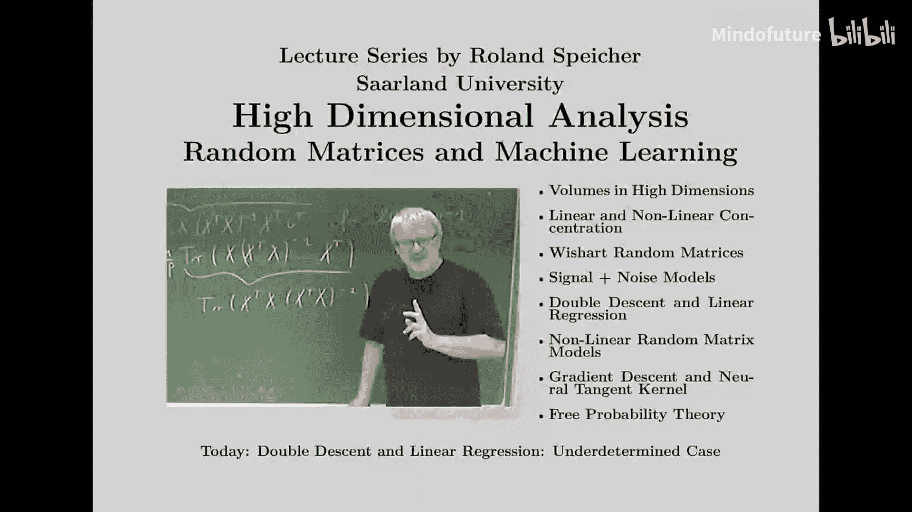
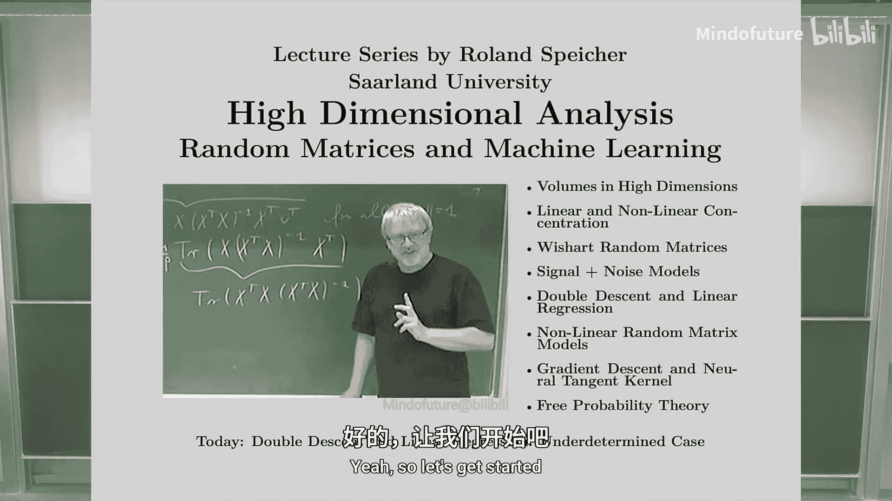
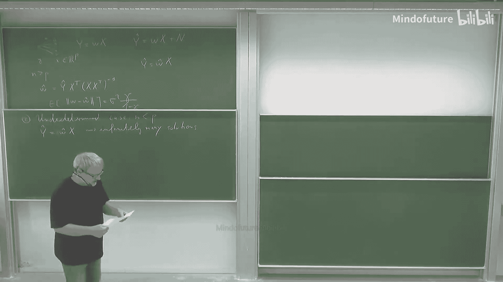

# 【德国萨尔大学】高维分析：随机矩阵和机器学习 ｜ High Dimensional Analysis p18 P18_双下降与欠定情况下的线性回归 -BV1XkkWBFEi6_p18-

Yeah， so let's get started。 We are now looking a little bit on neural nets and I started with maybe the simplest one。

 which is quite classical， namely linear regression。 So this means essentially I have only a net。

 which。

Where all the interesting things are missing。 So there are no hidden layers and there are no non linear narrativeities。

 but still， this gives us maybe some kind of idea。What。Is going on or what what we want。

 what we can see in high dimensions。 And in particular， I mean。

 we want to see this W Dcent that there is somehow a a difference between the under parameterized and the over parameterized situation。

 Okay， so such such a net linear regression is of this form。 So I have here input。

 I have here an output。 and the connection between them is， is just linear。 Okay。

 so so this means a function， which I can model here are just functions of the form yeah。

 let's say why the output data matrix is W times x。Okay， and then。Yeah。

 we want to model with this situation where I have a linear relation， but I also have some noise。

 So I have a situation where。I measure。A linear dependency between y and x。

 but there's also some noise N。 Okay， and then yeah， essentially we are given。

 We have the information about x and this Y hat。 And from this。

 we want to find linear relation of this form， which in some sense， is the best description of this。

Okay， and， of course。I mean， this here is a system of linear equations。

 and there are essentially two regimes。 I mean， we have n and P as our parameters。

 P is a dimension of our vector here And N is the number of observations which we have。

 So this matrix X is a is NP P P times n matrix。 And depending on whether P is less an n or the other way around。

 we have a overdetermined or underdetermined system of equations。

 And some of the situation is different in both cases。

 And so last time we looked on the overdetered case。 So this means。And is bigger than P。 So x here。

It's in R。Okay， and then。Yeah， so this is over determined。

 This means we have too many equations for two less variables。 So this means in general。

 there won't be， there won't be an exact solution。 Okay， of course， I mean。In general， because。

 of course， all the equations could be linear dependent。 but in a generic situation。

 there is no solution。 And then it's a usually classical thing that you try to find somehow best approximation to the solution by the by the method of least squares So you。

 you， you find some solution such that mistakes， the errors you are making。

 if you sum the squares of them is as small as possible。 that's a method of， of。

He squares and solution。Yeah， which you look at is then a normal equation， and you can write down。

The solution in this case， So the omega hat， which which is the， the one which we， we try to find。

 This is given by Y hat。 And then you have x transpose。X。Time x transpose。To the -1 okay。

 and we assume that our matrix X has maximum rank。 So， I mean， if， if p is a smaller one。

 then the rank can be at most P Okay， but we assume the rank is this or that we don't have any trivialvia relations。

 linear relations between our equations。 And this means x times x transpose is invertible。

 This is this is a P P times P matrix。 The other way around it would not be invertible。

 But this way around in this case， it's invertible。 So this is a， is a valid solution I mean， it's。

 it's not， solution of。Of， of why hat is is。亚洲为次。In principle， we are looking。For this。

 there is no solution of this。 But this is the best approximation to this solution。 Okay。

 and then we。And， of course， what we want is that we this W head， which we find here。

 should be as good as possible approximation or guess for this W。 And then we looked on the mistake。

 which we make because it's not， not exactly this this W。

 And we saw that we can express this So the final result last time was。Yeah。

 what was it that actually， I mean， we go to the limit N goes to infinity and P goes also to infinity with the same speed。

 So as we have it for our random matrices， for our visual matrices。

 and then we could connect the result， which we got for calculating the mistake。

 in terms of the still this transform of Maenco past 2 at the  point。0。 And in the end。

 we had somehow the result。That on average reach。The error between W and W head。

Is given by sigma squared。干嘛。1 minus gamma and gamma was this ratio between P and N。 And， of course。

 this explodes If Gama goes to one。 So this is somehow this idea of。

YeahOver parameterization that then things are getting better。

 and gamma is equal to one is going this direction where where we have an exact solution。

 but actually， this is not good because the noise destroys everything。 Okay。

 now we want to go the other direction。 Now we want to see what happens if N is less than P。

 This is somehow the over parameterized situation。 Okay， so that's what we want。To deal with today。

And。Yeah， so it will be similar， but。Okay， little bit different。So under determinedtermined case。

N is less than P， which means I have less equations Then I have unknowns。

 And this means in a generic case， there are many solutions。 Of course， I mean。

 the the equations still could contradict each other。 So it might happen that there are。

 in some cases， no solutions。 But again， we assume that the rank of our matrix is maximal。

 which means yeah， that we don't have。Equations which could contradict each other。 So this means we。

 it's， it's， we， we have solutions。 and actually， we have infinitely many because we have two less equations for the unknowns。

 Okay， so， so this means our equation。Why hat。Is W hat x。

 That's the one that you want to solve x and。Why had a given， and we want the solution for。

For this W head。 So this has infinitely many solutions。Okay， and in principle， we want to find one。

 We want， we want to find a good one。 The best one。

 And the best one in in in this setting is somehow the one which has the smallest norm among all the possible solutions。

 Okay， and there can be written down。 and more or less， this solution。

Has the same formula as we had before。 We only have to replace the inverse by the p inverse。 I mean。

 this matrix。 in in this case， So X X transpose is not invertible anymore。

 It doesn't have an inverse。 but there's a notion of a inverse。

 which yeah is as good as as possible as an inverse。 And so we can use this same formula。

 And actually we can change the formula in such a way that we still have a valid inverse。

 So maybe I'm not going to talk about the pseudo inverse now。 maybe in the assignments。

 we do a little bit about it， but actually we don't need it because I can write down。And yeah。

 a concrete formula with an explicitly with a genuine inverse again。 Okay， so namely。

The W hat in principle， is given by the same formula Y hat。Ex transpose。X， X， T to the -1。

 but the -1 doesn't exist anymore。 So I put here plus， which means a pseudo inverse。Okay。

 but actually， this combination here， I can write as an actual inverse by moving the inverse from here to here。

 So this is actually the same as y hat。 And then I have yeah x transpose x to the minus-1 times x T。

And this is now again， okay， because now X times x transpose， this doesn't have an inverse。

 But if I take it the other way around， then this is now， I mean， this is an N by N matrix。

 This is P by P。 This is N by N， the P by P matrix。呃。This is too big。 I mean。

 the rank of our matrix is the smallest of those numbers。 So it's in this case。

 it's n which means this has no chance of being invertible， but this can be invertible。

 And if you assume we have the maximum rank， then it is invertible。

 And let us assume we have the maximum rank， because that's the generic situation。Okay。

 so we have this formula here if。呃。Dnk。Of x is maxima， which in this case， is n。

Because this is the smaller one of the piece。Good， O。And so I I'm saying now， I'm essentially Im。

 I'm saying two things。 this omega hat。Given by this is a solution， and it is the。

It is the solution with the smallest norm among all solutions。 Okay， and maybe I。

 I just put this in alemma and and we just check this。 I mean， we don't have to。

 to know anything about Surs or whatever。 I mean， I'm， I'm just making here two claims。

 I have a formula， which is okay。 and which is the best in some sense。

 of and this is easy to check So let， let us do this。う。So， this is。The following lemma， I mean。

 so this is just about solutions of linear systems of， of equations。 So and so maybe。

 maybe let me write our equations in the usual form。 A X is equal to B。 I mean， here we have it。

We have a team， maybe the other way around。So for this lemma， let me just say， I have a matrix。

Which is。N times P matrix。 And this a here corresponds to our x transpose here So so that's why I have to the other way around。

because you see， I mean， I have here。My equation is of the form。 Y hat is W hat times x。

 and the W hat is actually the the X， which which which I'm looking for So it's its。

 and so I should transpose this equation to get the one written in in the usual form up。 So。

 but let us just look on this。 So it's still。N less than P。

And I consider the corresponding linear equations。The system of linear equations。Oh， which is given。

By Ax is equal to y。You you notice this by star。 So， I mean， A is an n by P1。

 and x So x here should be a vector of size P。Well， let me write as peak times1。

 and y is a vector in R n。I in。Times 1 So a maps vector from R P to R N。GoodOkay， and so。

 so this is an equation which I want to solve， given why I want to find x。嗯。Yeah， good。 Okay。

 And now Im assume as here that a has fully rank。Which means that I have for， for each Y。

 I have solutions。 Actually， I have infinitely many。 So assume。That a。Has full rank。So， the rank。

Of a。 So it it is as maximal as it can be in this rectangular situation。

 this means N So this means the。The N。Rows of my matrix are linear linearly independent。

 So the rank of a is n。And this means in particular。That if I look on a times8 transpose。

 which is the n by n matrix， this is invertible。 this is。

We're the same yeah So this means a times a transpose。记住。N by n matrix， this is invertible。Good。

 okay， and then I claim I have a very concrete solution for this thing and。

This solution is actually the best one。 So namely this solution。Let me quote it now x0。

So this is given by a transpose。A， a transpose。To the minus1。 So this minus-1 exists。呃Time why。

So this is X0。 And I say this is first a solution of my equation。 And secondly。

 it's the best solution in the sense that it has among all solutions。 It has the smallest norm。

 So this。开始说鲁迅。Of。My equation star。And it is。And it is。Or it has。

 and it has the smallest norm among all solutions。 So there are infinitely many solutions。

So it has the smallest。Test to many tests。The smallest norm。一晚过嘅。Solutions of star。Okay。

 so this is just basic， okay， linear algebra。 it's just yeah writing it down。But maybe， okay。

Very often in linear algebra， you are just dealing with square matrices。

 So very often you this in mathematics。 you don't really consider so much situations like this。

 So maybe， maybe you you， okay， and deals with the least square solution the over determinedtermined one。

 but is under determinedtermined。 Okay， I， actually， I have。

 I have not really seen this this before but of course， it， it's kind of trivial， but maybe one。

Should see。 So， first of all， of course， it's very easy to check that this is a solution。

 Just plug it in。嗯。So we have。 So if I apply a on x 0。 So what is this， just plug in my formula for。

X 0。 So this is a transpose times a。A transpose to the -1。 know， at times y。 And now， of course。

 here is a a transpose here。 It's it's inverse。 So this is the identity。 So this is just y。

 So I have a solution。 That's clear。 good， maybe the second point。 That's that's the。

 maybe the really interesting thing。 That one really can say that this is the smallest one。

 So why is this。 So yeah， assume that I have another solution。

 And then let's try to compare the norm of this other solution with this X 0。Okay， so assume。

That I have another x， which satisfies this equation。And then。Yeah。

 then the main point is that the difference between this x and the x 0 is orthogonal to the x 0。

 So I have an orthogonality， which gives me then something about the norm。

 So then so what I'm claiming is that x minus x 0。So， yeah， then the additional part。

 which is in this x that the inner product of this with x 0 is equal to 0。

 that that's the main claim， which I want to make。 So I mean， transpose of a vector times a vector。

 So that's the inner product。 So maybe let me I really write it as an inner product。

 So this is the inner product between x minus x 0。And x 0。And now I use the concrete formula for X 0。

So this is x minus x 0。 I'm only using using using it on this side。 So this was a。A。呃，弄。

What is the formula。So it's here。 So it's a transpose。A transpose。A， A transpose。To the -1 times y。

And the important point is now I have a transpose here。

 which in a product I can bring on the other side。Of course。

 you also can write it in this matrix multiplication form， but。

Maybe if Im moving in transpos around then okay， at least for me， it looks nice and this form。

 So I bring this on the other side as an a。X minus x 0 in our product with what is left here。

 which is a。A trans。The -1 applied to y。 But this side is not important。

 The only important thing is that T I have now a X minus a X 0。

 and both x and x 0 are solutions to the equation A applied to x of them is， is y。

 So the first one is y。 The second one is y。 So this is 0。

So I have the inner product between something and0， which， of course， is 0。Yeah， okay。

 so this tells me。That X 0 and the difference between x and X 0 are orthogonal。

 And this means I can compare the norms of x and the norm of X 0。🤧Yeah， maybe。I can write this here。

This is not just。Easy application of。타は。So maybe so I can now the norm of x squared。

 I can compare this with the norm of x by writing it as x minus I can compare to the norm of x 0 by writing it as x minus x 0 plus x 0。

Okay。Of course， squared。And now we have seen that this is orthogonal to this， which means by pyaugos。

 the square。Of the norm of the length， of the sum of this。 And this is just the sum of the squares。

 So this is just the。The， the norm squared of this x minus x squared plus。The norm of x0。Okay。

 and norms are always always positive。 So this year。Is always greater or equal to 0。

 which means the whole thing here is greater or e equal。Then x0 squared。

So we have that the norm of x where x is any solution of my equation is always。

Greatre or equal to the norm of x 0 to the norm of this very special solution。Okay。

 and we also see that actually can be only equal to the norm of x 0 if we have equality here。

 but this means exactly that x has to be x 0。 So this means theres exactly one solution with minimal norm。

Okay， so this is。Yeah， very easy， but also quite nice so。So， this formula。Is really。A solution。

 And in a sense， it's the best solution from one， from some point of view。Good， and then。

We can go back to our situation and just rewrite this。 So essentially， I mean。

 if I use this year rewriting it， then I I get in this setting。

 I get exactly this formula for my solution。And so。We should then see， as before， what is the error。

 which I make if I'm using this solution。Yeah， so let's go back to our。situationation。Like this here。

And， of course， I mean。呀我可以说。No。Back to。So Y hat is equal to W hat X。

 And maybe in order to compare to this situation， I should take the transpose of this because then it really has。

 has this formula。 So this means the transpose of this， of course， is x transpose。W head transpo。

Is Y hat transpose。 And this is now， I mean， this is now the form A X is equal to y。So this。

 this is our x we are looking for。 And actually， the A is is。

 is this quantity So this means the solution， which we should take。呃。

We should now take actually the transpose of this。 So I should take the transpose of this。

 which means I'm reversing the order， which， which， of course， is then what I have here。

 So it's just the transpose in between， which means now things are the other way around。Good， O， so。

嗯。说。This lemma。Ts us that our minimum norm solution。Is given by what I already wrote down there。

 But maybe let me write it again。 So the W head。Is the Y hat。X transpose x。To the -1 times x transpo。

So I take essentially the transpose of this。 Then I get here the A， but the A is the x transpose and。

 and the A A transpose is the x transpose x。Yeah， okay。 I mean， the best thing probably is。

 is again to check that this year solves this equation。Okay， so this is now actually。A solution。Whi。

Yeah， which really solves the equation exactly So it matches all the all the data points， which。

 which， which I'm given。 But this means it also matches actually the noise because the data points。

 which I'm given。Is actually。Well yeah， I have。Rte it。 So I mean， our model was that why。Is Wx。Plus。

 some noise。嗯。Wass this。😔，Yeah， okay。 So， so this means， I mean。

 what I see here is not just the linear relation is the X， but also the noise。

 And now this solution matches exactly the noise。 So it， it's really matches the noise。

 And usual idea is that if you really。Yeah， capture the noise exactly。

 This is maybe not not so a good thing but anyhow， we will see。Or this here。

 which error we have made。 Yeah， So what we should do again。

 we should see what is the difference between the W， the。

 the correct W and the one which we have estimated here， the W had。And yeah。

 so we just plug in our formula for W hat and estimate more or less in the same way as we did it in the over determined case。

 So this is W minus and the W hat for this。 I plug in this。 So this is why。Why hat。

X transpose x to the -1 x transpose。Yeah， okay now。

I can put in the relation between the the Y hat and the X， the real one。 So this guy here。

 this is the Y hat。 This is W X plus n。And so what do we get？So， I have to W。And then， I have fear。

Min-2 terms，1 from here，1 from here。 So it's the first term is minus。W。呃。Is this correct there's。

IW X。W X， and then multiplied with this x transpose x to the -1 x transpose。

And then I get minus the noise times this minus the noise x transpose x to the -1。X transpose。Good。

 okay。 Yeah， now in the。Over determined case。 somehow this term here。 I mean， here it was in。

 in this case， it was the other way around。 We had x transpose here and x here。

 And somehow what what we had there fitted with this， but。嗯。I mean， in this case。

 things canceled the way right away。 So this term was just a W and this went away。

 and we were only left with this term。 But now actually。This difference here is not equal to 0。

 but it will give us an additional term。 and we get this one。 So we will have two terms here。

 And so maybe。Yeah， let me。Check first， what is this。Yeah， let me write this。In the following way。um。

So this is， so I take out the W。And then I have a one。The minus x。X transpose x。To the -1。X。Dranspo。

Yeah， okay， so that's that's the first term。And I have a second term， so I have not a norm。

Of some of two terms。 And in general， of course， it's， it's okay， I could use a triangle inequality。

 But in this case， it's even better it is as before that the two terms are actually autogonal to each other。

 which means I can， if I put the square here， I can write this as， as the sum。

 So maybe it's always better to use the square。So I'm claiming now that this term and this term are autogonal。

And then we can just write this as the sum of the square。Of norms。 And so why is this。 So let。

 let us check this， I claiming the first term。 So this is here。 This is W 1。 And I mean， this one。

 What is， what is this， actually， this is identity matrix So in。And this。

 those guys here are P times P matrices。 Also， this is the， the identity in P。And then I minus x。

 x transpose x minus1 x transpose。 I'm claiming that this is orthogonal。呃。

To the second term and the second term。嗯。I。Yeah， so I take the transpose So yeah。

 so I I want to check。 those guys are autogonous。 So I have to take one of them and multi bide with the transpose of the other。

 Okay， so I do now in the order that I， I take this term。

And I'm multiplliied as the transpose of the second term。 And I'm claiming that this is0。

 So what is the transpose of the second term。嗯。Yeah， so I have to start from。From the back。

 So it's x。Then it's。X transpose x to the -1。 This is not changed by taking the transpose。

 and then it's。The the noise trans。Good， O。And。So you see that if I multiply this with this x。

 then actually I already get 0。So the rest doesn't matter。 But if I multiply this， this is x times 1。

 So this is x。 And then I have here x。X transpose x to the -1 X transpose。

 And then here I get the additional x， which exactly is the inverse of this。 So this goes away。

 I'm left this D X。 So I have x minus x， which is 0。Okay， so this， this really means。对。

This term is orthogonal to this term。 So the， the sum or the difference of them。

 the norm of them squared is just the， the sum of the squares of the norms。So this means。对。

This difference between W。And W head squared is given by， yeah， by the。Square of the first term。

 So the first term is W minus W X。X transpose x。To the minus-1。X transpose。Squared。Plus。

 the square of the second term， which is the noise times。X transpose x to the -1。

Times x transpose squared。Okay， and so I have here a splitting of my error into two terms。

 And usually those two terms are called bias and variance term。 So this this here is the。

 this is what is usually called bias term。Because you can make such decompositions in。

 in much more generality。 And this is variance。 That's the one which essentially goes with the noise。

Because this， this contains the noise。So here noise is not there。Okay， but anyhow。 so we。

 we just have to， I mean， I mean， in the， in the over determinedtered case， this term was absent。

 This was actually 0 because there we had exactly w minus w。 there we only had this term。

 So we have no variance term， which is somehow very similar to the one which we had before。

 it's only that instead of x x transpose， we have now x transpose x。Okay， so， so I mean。

 the role of x and x transpose are exchanged。 And so maybe we first look on this term because this is more or less the same as we had before four。

 Let us first look on the variance term。 So this means this term here。 Okay， so and， and again。

 of course， now we also average over the noise which which we assume to be a a Gaussian random vector of variance sigma squared。

So we take also the expectation over。This。This length of n。X transpose x to the -1。Ex transpose。

Square， okay， what is this， So this this square of the norm。 I mean， this is our Euclidean norm。

 So this is， this is， this is this multiplied with its transpose。So this is the inner product。

 essentially between those two things。 So this is。Yeah。Expectation of， okay， I take n。X transpose x。

To the -1 multiliied with X T。 And I multiplly this with the transpose of itself and the transpose。

 So I'm just starting from the other way。 So it's x。X transpose x。To the -1。 And then I get the。

Transpose of the noise。Good， okay， now we have again。

 this situation which we also had last time and which we which which we had this trace lelemma。

 namely if I have， if I have a gaussian random vector and I sent which between n and its transpose some matrix。

 which is deterministic or independent of this， then what I get is actually the trace of what I have in between。

 So that was the basic property of how I calculate expectations of gausian random vectors。

 If I have a matrix in between。 So what I get here is the trace of what I have in between。And。

 and because the variance of my n is not one， but sigma sigma squared。

 I get effect factor of sigma squared。 because essentially， I mean。

 when I take the expectations in this calculation， I have， have， of course。

 to take the expectation of the second moment of， of my noise， which is sigma squared， not one。

 So I get here sigma squared。And then I get the trace of what I have here in between。

Which is x transpose x。To to minus1。X transpose x times x transpose x。To the -1。Yeah， and now okay。

 you， you see all those guys fit together。 it's x transpose x twice I have this -1 Once I just have it by itself。

 So I have， I mean， one inverse is canceled。 So I'm just left。With sigma squared。The trays。Of。X T。X。

To the -1。Okay， and now this is this is the same。嗯。Reult。

 which we had in the over determinedtered case。 It's only now that x is replaced by x transpose。

 I mean。When you look back to what we had in the case where。Where N was bigger than P。

 we had the same result。 It was only that that x transpose X instead of this。

 we had x X transpose because that's the one， which is invertible。 Okay， so this means。

We have exactly the same result as before we can use the result from the before。

 We only have have to exchange x with x transpose。 And this means that we have to exchange the role of N and P。

Because X， X is a P times n matrix， and x transpose is a n times P matrix。Okay。

 and in the case where。Where n is bigger than P， this is again nice because this means that the gamma。

 the ratio between P and N， which was less than1 in the overdetermined case。

 is now replaced by one over gamma， which is which is also less than1。Okay， so。

 so we are really back to the situation before。 And maybe I should also actually， first of all。

I should write it in terms of the。Normalized race。 And for the which had matrices。

 we also have to have here。 I mean， if， if I have the matrix X， which is p times n。

 I have to factor one over n。 But now， because N and P I exchanged， I should put one over P here。

 So I should write this here as sigma squared。N divided by P。To normal ds of1 over P x transpose x。

To the -1。So， I mean， this P here cancels this one over P。

 And this n here is just n times a normalized trace。

 Its the un normalizedized trace because these are traces of n times n matrices。

So this is an n n times n matrix。Yeah， so the trace of the identity matrix is n。 So I have。

 I have to have here N。 Yeah， Okay， and and you see， I mean， this n over P。

 this is really now one over gamma。 So， so I mean， P over n is always over gamma。 Yeah， okay， and so。

 so in this form， it's exactly the same as we had it in one。 It's only that P and N are exchanged。

 So in particular， this means that gamma has to be replaced by one over gamma。

So I just take the result from one and I replace gamma by one over gamma。

 because this is exactly the same。For which I have there。 So this。也是。The same。

As in our first calculation。狐你。P and N have to be exchanged。

And this means in the result which I got there， I have to replace Gamma。buy one over干嘛。

Okay and so this means that this term here in the limit converges to what we had before。

 what we had before was gamma divided by 1 minus gamma。

 but I have to replace this now by one over gamma。So， this means。That the variance term。Converges。

And n goes to infinity and P goes also to infinity S gamma times n。

So gamma is is is is always the relation the， the ratio P over n。 Okay。

 so the this convertverges to sigma squared。 and then it's one over gamma divided by 1 minus1 over gamma。

Which， of course， is the same as sigma squared。 I just multiplly this with gamma。

 Then it's one divided by。Gmma -1。嗯，OK啊 so that that's the。Reite for the。For the variance storm。

 this is more less the same as before。 the same calculation as as before。And again， in principle。

 we calculate this by looking on the stillest transform of machanko pastua。

 But now we are looking on machanco pasta for one over Gamma。 That's good because， I mean。

 I I avoid to talk about Macchanco pasta if Gamma is bigger than one because Gamma and one overgama are somehow related。

 and again here I。here， the gamma is bigger than one。

 but I only need to result of machn pass2 for one over gamma， which is less than one。

 So so that that's good。Qu， okay， but now maybe the more interesting or the new thing is the bias term。

 So this term here。Yeah， what is this。Yeah。that that's a normalized trace。 So this this means。

 I mean。Yeah， so the small trace of a matrix A is just one over n。

The usual trace of a we have where A' is and N by N matrix。So in particular。

 it is normalized in such a way that the trace of the identity matrix is one。We usually trace of。

 of the identity matrix is n no。And in particular， if you go to infinity， then of course。

 things should converge So we should normalize it in this way。 So I mean， in this formula。

 it's hard to it's hard to see what happens if if I go to infinity But but here I know the trace is something which converges on the identity。

 And and I put the dependency on in an explicit way。嗯。Yeah， okay， but I needs to be careful because。

 I mean， very often in books， if you have the little T R， it's the ordinary trait so。It's never。

 I mean。 in my context。The capital T R is the usual trace Unmalized and the little T R is。

 is the normalized one。 But very often， I mean， people only use the ordinary trace。

 and sometimes they them with the capital T R， but sometimes it's the little T R。

 So you always should check what it means。Good， so now。We consider the biasers。To。Okay， so this is。

Yeah， this is this term。 So this is w I be write again， W minus W X。X transpose x。To the minus-1。

X transpose squared。Yeah。And， again。This square of the norm。

 which is the inner product of the guy with itself。 I'm just writing as。

 as this thing with its transpose。 So this is。嗯。Yeah， so this is w minus W X。

X transpose x to the -1 x transpose。 and then I multiply it。With its trans， which is。

W transpose minus。 Okay， now I get this in the other order。 So I start here。

 The transpose of this is x。 The transpose of this doesn't change anything。

 X T X to the minus-1 times the transpose of x， which is x transpose and the transpose of W。Good。

 and now， so multi blood is out。 I have four terms。 One of them is， of course， is W， W transpose。W。

 W transpose， and then I get W。Times。Yeah， times this guy。嗯，好。Yeah， okay。 And then， okay。 And then I。

 then I get 12， So I have a W。At the beginning。Okay。

 I always have a w and a w at the beginning and a W transpose at the end。

 But now I get terms where I have in between something。

 and I get twice the term where I have this here in between。 So I have this times this。

 and I have this times this。 So I have this minus twice。 And then the last term。

 this is this times this。 But actually there I have the same in the middle because， I mean。

 there I have x x transpose x to the minus-1。 And then I have an x transpose x。 And then this again。

 So this cancels with this。 And I just stay with the。M the X。

 X transpose x to the minus1 x in the middle， So actually。

 I the the other three terms are all the same two times with a minus once with a blast。 So actually。

 I remain with a minus W。X。X transpose x。To the minus-1 x transpose。W transpose。So I mean， I mean。

 this times this and this times this is clearly this。

 but also this times this is this because one of the inverse is cancels and it just reduces again to this one。

Good。Yeah， but now。 so what is， what is this， Can we say something about this and maybe。Let me。

Wite it like this。 So I have here the W times W transpose。

 This is just a square of the length of of W So W is。It's a vector。 So this is W。Squared。

 and maybe I take this out。 So this is one minus。And I also take this out of this one。

 which means I normalise the length of this W。 So I， I'm just writing this as W。

 I divide it by its length here， X， X transpose x to the -1 x transpose。

 And here I also normalise it by the length。WU。So what I have here， Okay， I mean， this is。

 this is one。 But what I have here that that's the the， the quantity。 The question is， can we。

Can we understand this？ And so what I have here is my， my matrix， my kind of。Yeah， my。

 my gausian matrix。 and I take here in our product with some， some vectors。 Okay， and this is now。

I mean， what， what we can control about those things are traces。The traces of， of those vectors。

 those， those are guys， which we understand usually。 but now I'm not taking a trace。

 but I take the inner product with a vector。 But I mean。

 the trace is the sum of such inner product over an autonmal basis。哦。So the trace is， is， I mean。

 the dier， this is just taking the inner product between the。Between the the elements for my basis。

 Okay， and now because the X， I mean， we have a situation where x is a gausian random vector and we。

 we can rotate this。 So this is rotational envi， which means it actually doesn't matter with which vector I take in our product because the result is is for all the same。

Because of the im violence。So I mean， in particular if， if we average over the distribution， I mean。

 distribution doesn't change So if， I mean， the Gaussian distribution with identity covariance matrix is very symmetric。

 So under rotations， it' it's not changing。 So this means it doesn't matter with which vector。

 I'm taking in a product。 So it's always the same。 But this means it is actually just the trace。 if。

 I mean， if I'm taking the trace， I'm taking the sum over terms of these forms。

 But if all the terms are the same。 I mean， this here is up to a1 or n or so is actually the trace。

So I can replace this here by the trace。And then then we are again。

 in a good situation because this we can calculate。Yeah， okay。 So I'm saying that this。This year。

 this in our product。Between this vector， this matrix and this vector is actually the same for any unit vector。

 So this is， this is the same as we。X。X transpose x。-1 x transpose times。We transpose。For all。

Vectctorors， unit vectors。Of length 1 just because， I mean， this is just  symmetry。

 It distribution of x doesn't change under。Under distributions。Okay， but on the other hand。

 then because the trace is a sum over such terms where I'm summing over on autonmal basis。

This is actually the same。As the trays， okay， but if I'm summing over basis。 So I mean。

 I have to see in which dimension am I here， So I have here the the X。

 So this is a P times P times P matrix here。 This is p times P。

 So I have to sum over P element in autonomy basis。 So this guy here is one over P。Okay。

 times the trace of what I have here。 X， X transpose x to the -1。X transpose。

Or the trace is p times this quantity because I'm summing over P terms of this form。

 but each of these term is the same。Good， okay， but now this year is not easy because I have here a trace。

 And again， in a trace， I can move things around in a strictly way。 So this is the same。

So this trace here is the same。Ass the trace of X Tx。X， T x。To the -1。Okay， and this just goes away。

 This is the universeverse of this。 So things。Fit together again nicely。

 So I have here the identity matrix。 So I have here the trace of the identity matrix。

 But which identity matrix。Now， now I'm here in the。In the end by N matrices。So here。

 here this was a P by P matrix。 But now if I have moved this around。

 then then I have a n by N matrix。 So this is the identity in the n by N mates。

 So this here is actually， so it's a trace of the identity。Matrix in n by N matrices。

 which is actually N。Oh so I mean， this is， I mean， I can move things around in the trays。But。

 of course， I might change the the size of what I get there。

 because I'm multiplying here rectangular matrices。 and it makes a difference。

 whether I multiply them in in one order or in the other order。 And so one has to be careful here。

 And here， of course， I should take the， I mean， this changing here goes goes with the normal trace it the ordinary trace。

Okay， so this means I get here N。So what I get here is then yeah， N over P。yeah， So you see this。

 this is one over P times n。 And then I also have this term。So， maybe altogether together。

I have here。 Okay， so it's， it's there。 It's the。Length of W squared times。 The first term is one。

And then minus this quantity here， which is。Which is P， No， which is n over P。

N over P And N over P is， again， one over gamma。Gmma was for P divided by n。

 So this goes in the limit。 Let's say we go to the limit， but actually here。I already have it more。

More or less there， but in the limit。If N and P are going to infinity and the ratio between P and and is gamma。

 then this goes to。The length of omega squared times 1 minus， and this is。one over干嘛。Yeah。

 and so now we have calculated all terms。 and maybe I just collect it here。

 And maybe I also collect the result which we had before from the case。 So this， this is the case。

 N is less than P。 And we also had the case before。 And so maybe。唉。Yeah， right down。 It's together。

 So what， What was the mistake， which we have made。In know why。Calculation。嗯。Yeah， so。

The case is gamma less than one。So that was the case which we did last time。

 The result was essentially just a noise term， which was it plus squared gamma divided by one minus gamma。

 And then today， the case where gamma is bigger than one。SoWe had a sum of two terms。

 and the variance term was essentially this term， but gamma replaced by gamma -1 by by one over gamma。

 So it's sigma squared。1 over kma -1。 And then we have this biased term， which is。The norm。

Of W squared times。1 minus1 over gamma。Okay， so that's the result。 And I mean， if， if we。Yeah。

 if you draw。This as a curve。 then somehow we see this， this kind of double descent like feature。 So。

 so if I'm drawing this。So I mean here maybe its干ma。Here， I have this error。

 which I have estimated here。 and then somehow the。The threshold is by one。And so， I mean， below one。

 I mean， this， this guy explodes at one， So it goes with like one，1 over 1 minus commma。 it explodes。

 so it looks。Somehow like this。 And on the other side， I have a sum of two terms and。

This term here is somehow the the image， the reflection of this。 So this somehow。

This noise term goes down like this。 But then the bias term， this is something which。Yeah。

 for one is 0。 And then then it just goes up to some asymptically to， to some constant terminal。

 So the bias。昨然没上号啊。Going like this And to some of both is a picture。Somehow， something like this。

Okay， so that's。So this here is the bias term， and this here the variance。Okay。

 and so this gives at least。Somehow， I mean， same kind of feeling as， as for this double descent。

 So this is， of course， a very trivial situation。 but， but at least you see some feature like this。

 And you can calculate it somehow also concretely of course。

 under quite specific assumptions But but at least this is nothing， I mean。I mean。

 it is just very classical。linear regression theory， you know， So it's nothing which is really a。有。

Which is totally unknown or new， but maybe。The emphasis on this side was， maybe。Was just coming。

Because you are looking on neural nets and， and you want to understand phenomena are like this。

 in a classic context， you， you didn't really。Think so much。 Maybe about， about those issues。

