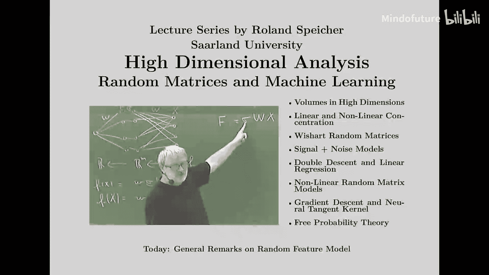
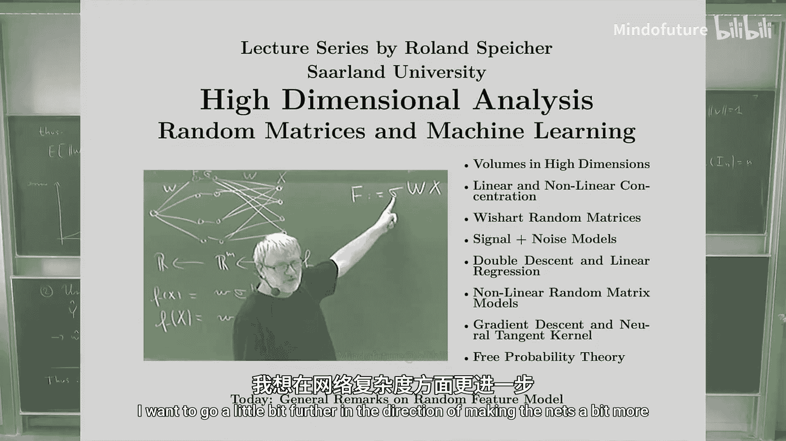
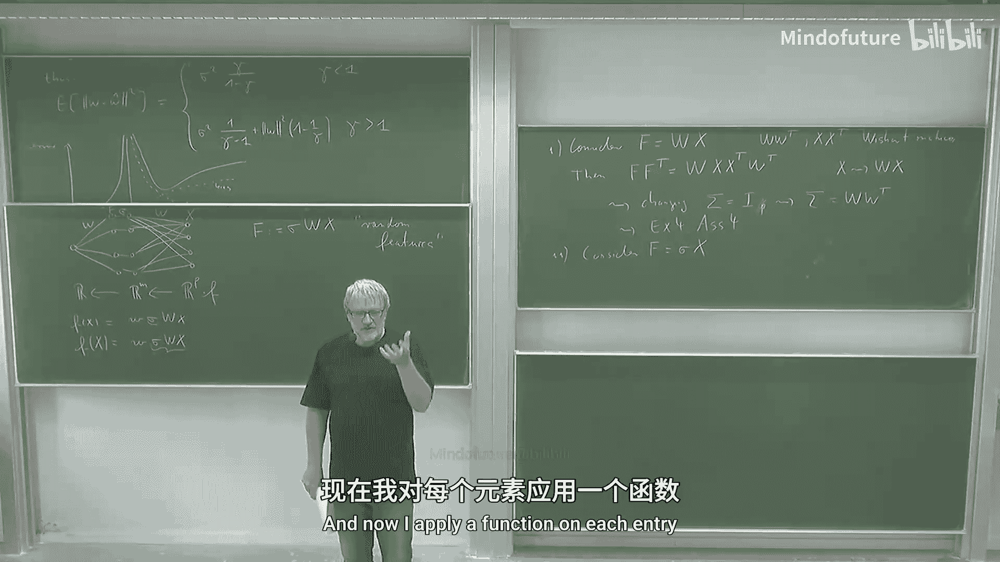

# 【德国萨尔大学】高维分析：随机矩阵和机器学习 ｜ High Dimensional Analysis p19 P19_随机特征模型的一般性评述 -BV1XkkWBFEi6_p19-

I want to go a little bit。Further， in the direction of making the nets a bit more complicated。

And， of course， the more complicated， they get the hard it is to。

 to make real mathematically precise statements。 also， but at least。

You can go a little bit more in this direction and see at least what the kind of problems are。

 which mathematically arise。To make similar calculations like here。More interesting networks。

 of course， if I'm starting to add layers and also non linearities。 Okay， so， I mean。

 I would look now on something。We had a function， which I。Want to calculate。I mean， in the last step。

 still。I do kind of linear regression， just a linear waiting， but before。

I should have maybe non linearities。 Okay， the non linearities usually alsonot by sigma。

 Sigma before was my variance。 So， but I hope it it's clear from the context what I really mean。

 And then maybe I also had。Had at least here one layer。 where I have linear map W here。好骚。Okay。

 something like this。 So I have here matrix W。 I have here non linearity， and I have here small W。

 And so my function。F。Goes from here to here。 So here the are Ps， my vectors or my。

 my data matrices are mapped。To， let's say he an intermediate。Level hidden layer。

 which is M dimensional。 And then I， so this is linear mapping。 This W multiplication by matrix。

 But then I also。Usually allow this， this non linear application of， of a non linear function。

 the sigma。 And then here I'm going down again to R。So this means the F of x。Is。W sigma。W U X。

 or if I am putting in。A matrix， a capital X， is's the same W sigma W X where the sigma here is applied entry wise to what I have here。

 here， I would have a vector here。 I would have a matrix。 I mean。

 the matrix is just the collection of the vectors， which I get if I'm putting in several x's。Good， O。

Yeah， and now， I mean。If my net is essentially， again。

 usually only learning in the last level here So then this is still linear regression。

 it's only that now the linear regression is not directly done with the input vector。

 but with the vector， which I calculate from it by first applying the W and then doing doing the nonlinearity。

 So actually， I mean， I apply to what I get here and those guys are usually called feature So so so I I'm working not on the input X directly but on the random features。

 which I calculated from this So they are feature models or random feature models where I do here this stuff。

 and usually， I mean that those guys are chosen in a random way。 So I I do random。

Calculations from this。 And here I get something， which are then my random features calculated for my data。

 And then in the final step I do， I do the the weighting。 How do I wait the features to get。

 to get the output。 And if I， if I， if I fix this thing here。

 And this is not part of of the training， Then it's essentially just doing linear regression with what I get here instead of what what I have here。

 Okay， so what。1 would have to understand， yeah， to make similar things as before。

 So what is the best W for describing this is then actually that I don't need a distribution of my input data vector X or data matrix X。

 but the one which I get after applying those things。 So this means I should。So here I get。

 So if I put in in here my X， then what I get here is actually something。 Let me call it F， which is。

 is the， the feature matrix。 So F。Is。Yeah， I mean， it' it's it's， it's what I get here。 So this is F。

 So this is sigma。W applied on my data matrix X。 and these are my random features。Good， okay。

 And now。 so， I mean， if I want to understand this。So I I should understand。

 what is the distribution of of this， this matrix x so。Given， let's say X， I mean， the input。

Data matrix， usually I modeled by a Gausian matrix。 And usually， I mean。

 the W here is also kind of of， of， usually。Yeah， also a kind of of gausian matrix。

 And the non nonlinearities， of course， there are also specific choices which I can do。

 But maybe I want to understand this in general。 Okay， and so I what I have here， essentially two。

2 things which I should understand if I want to understand this。 So name me first。

 can I understand if I'm multiplying my mates。 So it's not that I just want to understand1 x。

 but now I have the product of two of them。 So can I also understand them and then， of course。

 can I understand what is the effect of taking nonlinear functions of the entries of my matrix So I mean have my random。

 I have some matrix， which maybe I understand。 and then I take nonlinear functions of the entries So it's it's a very specific。

Action on my matrix and action， which which， which is not a matrix action， I mean， if you have mates。

 okay， you multiply matrix and you add them， That's the usual operations。

 which maybe you have the feeling you understand。 But if you act with with。

 with a function on the entries， what what is this。

 This is going beyond the usual matrix theory But that， that's the。Ts。

Which we should understand here。And so， actually。So， I mean， these are two kind of of problems。

 which I probably want to address a little bit maybe next week or so。

 But maybe now let me just point out again。 So what what do we have here have。

2 problems multiplication of random mates。 That's okay。

 That's something which is classical random matrix theory So such things are known and can deal with them。

 But then the second part， applying non nonlinear functions to the entries of a matrix。

 This is essentially something new。 This is， this was not really considered in classical random matrix theory。

 because this is not an operation， which which usually you see in in random matrix theory Okay。

 and so so this leads into something which maybe you can term a non linear random matrix theory。

 which which is， which is maybe a new。A new era or a new direction in random matrix theory。

 which is mostly inspired by， by the neural net and and questions around this。

 because there are such things are used quite canonically。Okay， and maybe。Let me。Say that。Okay。

 so if， if I look on this。 So this W X， that's the classical thing。 And actually。

 this is something where we maybe have already some feeling what this should be。 So。

 so maybe if I consider the first thing。So， the first problem。So this means I would。

Conuse I say my features， I essentially adjust take my data matrix and multiply it with some random weight。

Some， some random， some other random matrix。 So I calculate random features， but in a linear way。

 Okay， so， and this， this is， and let us assume that both of them are gaussian matrices。

Which means that both。W， W transpose and X， X transpose are we had matrices。

 that's the one which we understand， which have the Macenko Paua distribution in the limit。

But now I multiply them。And so， what I would。Have to understand if I do my linear regression。

 It's always the， the， the singular values of this F or or the eigenvalues of F， F times F transpose。

 So， so then。What I would have to understand is F times F transpose， which， of course， is W X。

 X transpose。Times W transpose。 the question is， can we understand this？ and yeah。

 I'm saying that actually this is not so far away from what we have done before。

 because this is essentially this effect of this W is the effect of changing the covariance of this of this Gausian random vector。

 So my my matrix x is made independent copies of the of a Gaussian random vector and the Gausian random vector usually has the has the covariance1 which corresponds in a limit to the Maceno past distribution。

 But if I'm conjugating such a thing。 Yeah， you could say， I mean， instead of x， I consider now w X。

 I'm acting with a linear mapping on this and we already have seen this in some exercises。

 that this really means we essentially changing。The covariance of x。

 So we still have a Gaussian vector， but the covariance is now getting more complicated， and it。

 it's essentially given by conjugating with this W。 Okay， so this means。Yeah， what， what。

 what I have here is still。Yeah， kind of wishard matrix。 But the covari matrix is not the identity。

 but it's more complicated。 And this is actually something which in the last assignments。

 you were also asked to look at。 So namely to try to calculate the eigenvalue distribution of a wishard matrix where the covariance matrix is not the identity。

 But I mean the co matrix has two eigenvalue， maybe one and2 half half of them are one。

 half of them are two。 and you should try to derive an equation for this。

 in the same spirit as we did it for Macchco pasta。 Okay。

 and this here is a more continuous version of this。

 So instead of just having two eigenvalues of the covariance， you have now more， maybe in the limit。

 you have a continuous distribution for this。 But in principle。

 you can copy or imitate what you ask to do in the。In this assignment， in in this general situation。

 and you can derive some fixed point equations for the still this transform of of this object。 So。

 so the solution is not explicit anymore， because the equation which you get is not a quadratic equation。

 But it it's， it's just a more continuous version of this， which doesn't have an analytic solution。

 but you can use numerical methods to solve this。 So， I mean， in assignment。

 you were asked to do this in a in a very。Maybe not easy。

 but the simple situation like this to to again get a feeling for this。 And this is maybe just， yeah。

 making this more general and also more complicated。 But in principle， it works in in。

 in the same way。 Okay， so this is， in principle。Something。hi。Yeah， so this this is okay。

 So changing。The Kvas， let's say。From。点点滴滴。主。Yeah， let's say W W transpo。Okay， and this。This。

 maybe you should compare。 So this is exercise 4 in the new assignment。Number 4 so。

 so there you ask to do something like this。 Okay， so so maybe I can say a little bit more about this next time。

 but okay， I'm not sure whether it's worth this， but okay， at some point， probably I should say more。

 But maybe let me now also just say， how， how is it about the other thing。

So if I take a non linearity and maybe。If I not doing this on the product。

 but just doing this on the X itself。 So how is the situation then， So I mean in the second point。

 taking the non linearities。 So if I'm just doing this on our basic random matrix。

 then actually it it's also something which is actually part of classical random matrix theory。

 because I haven't really changed the matrix so much。 So if I consider。

F just as a non linearity acting on x。I mean， x was our gausian random matrix。

 So all the entries had gausian distribution， and they were all independent。

And now I apply a function on each entry。 But， of course。

 this means I'm not changing the independence between the entries。

 I'm changing the distribution of each entry。 I mean， they were identically distributed before。

 So they are identically distributed afterwards because I change all of them in the same way with the same sigma。

 but I'm not changing the independent。 So I still have a matrix where the entries are independent。

And identically distributed。 But the distribution is not gas， but some other distribution。

But actually， for those classical theorems， for like Machco Paa， Actually， I mean。

 the Gauss distribution is not really important。 I mean， we， I only formulated it in this way。

 And maybe at some points， I， I use arguments which are easier if you do it for Gaussians。

 but in principle， everything works in for general distribution。

 So so this means if I just apply a non linearity。To my Gaussian matrix， I get another matrix。

 but its asymptotic eigenvalue distribution is， is still my in pasta。So， so in this case。

 as long as I don't destroy the independence between the entries， which I mean。

 if the entries are independent and I just do entry by something， they are still independent。

 So I'm not changing the independence。 And then this doesn't really have an effect。O， good。 But so。

 so this means， I mean， if I。If I have。Matri where the entries are independent。

 then the non linearity or the the， the entry wise acting doesn't change anything。 Okay。

 and so this means if I just do one for itself or just do two for itself without taking a product。

 I'm essentially still in a classical。Rem of of random matrix theory。 Then I know what happens。 but。

 but there are nothing。Okay， I mean， this， I mean， both of them are non trivial statements or that Macenko Paua also is。

Is， is true more general and that that we can deal with the product of random matrix。

 Those are quite nontrivial things。 but we know how to deal with this。 Yeah， but now if we。

 if we do this combination， then， of course， if I take the product， that in this product。

 the entries are not independent anymore。 because they are combinations of different things。

 So they are dependent somehow。 And then if I'm acting with the sigma， I'm changing stuff and。Okay。

 I I don't really。 it's not so clear what I'm changing。 I mean， you you cannot say， I mean。

 things are dependent afterwards， they are still dependent， but okay。

 they might be dependent in some other way。 So it it's， it's much harder to know what happens there。

And this is something which was not really considered before。

 So those are things which now maybe in the last。10 or maybe five years we are considered。

 because that's。Interesting things we， which we should understand for， for example。

 dealing with with neural neural net。 But this is somehow enlarging the classical random matrix theory with new kind of questions。

 which。Which are a little bit outside。 I mean， it， it seems we still can understand a couple of things。

 And maybe next， next time， I want to tell you a little bit about what we can say about such things。

 Oh So there is there a statements there。 but one has to maybe。I mean， not sure。 Maybe， maybe we。

 we can use tools which we have， but we have to adapt them and maybe use them in the right way。

 And maybe if we， if we go more complicated， then maybe we really have to develop very new tools。

 But， but actually， I mean， there is there's evolving something which， which yeah， which。

I like to call non linear random matrix theory， which is trying to。

 to capture and deal with this phenomena like this。 Okay， and so maybe。For for maybe next week， I。

 I want to tell go a little bit into this So and。Okay， but I think I。For today， it it's enough。

 I stop here。 okay， thanks。