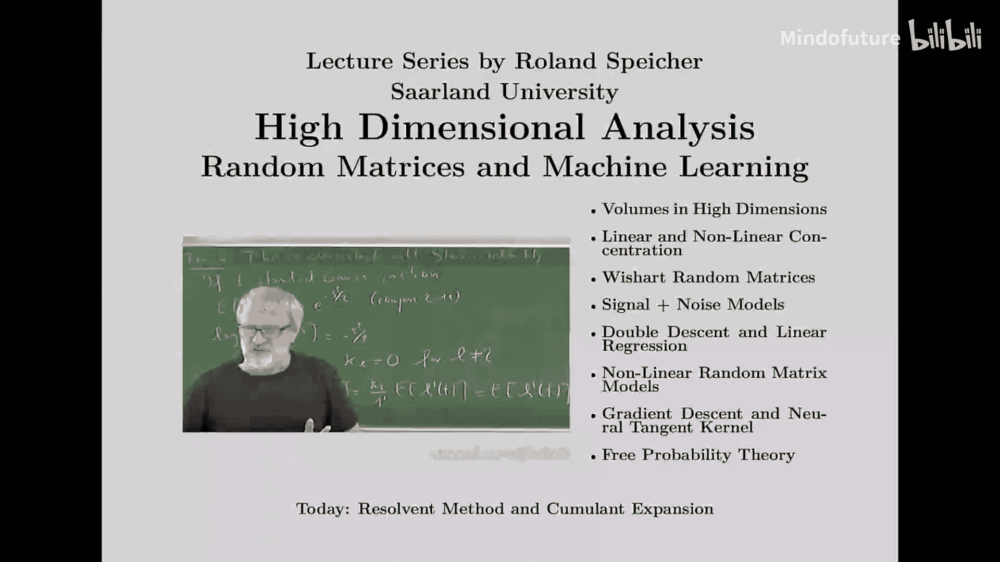
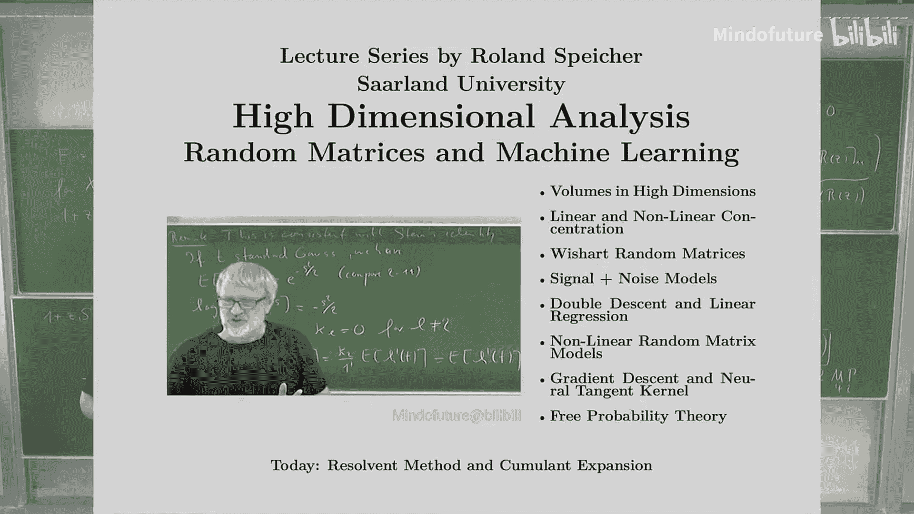
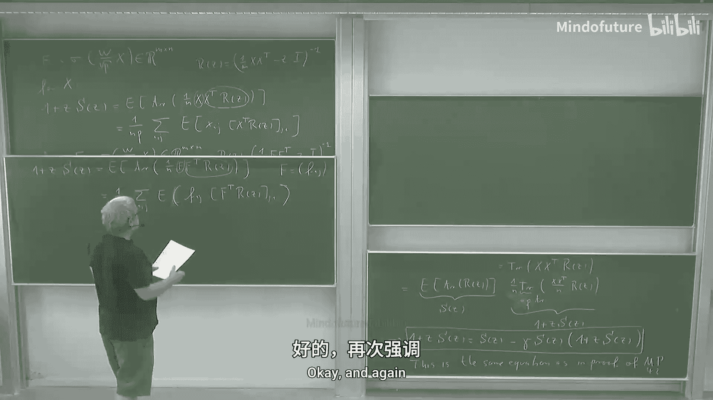
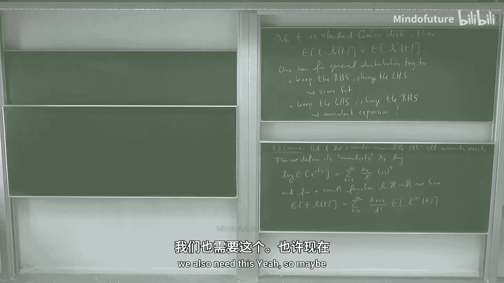

# 【德国萨尔大学】高维分析：随机矩阵和机器学习 ｜ High Dimensional Analysis p22 P22_预解方法与累积量展开 -BV1XkkWBFEi6_p22-

Okay， and now the question is， can we extend this， I mean， now up to now， we haven't。

 we haven't got any new result。 But the question is whether we can now。

Yeah， imitate this or adapters to the situation where we want to calculate the distribution of something more complicated。

 Okay， and yeah， so let， let us see what。What we can do or how far we can go。

Maybe let us try to do the same。 start in the same way as before。 And， of course， it's clear if。

 if we are here， we will have a problem。 but okay， you have to think。呃。Then we can deal with it。

 Okay， so we want。To do the same now。f。Not x， but for this feature matrix， which is the sigma。

You take this w。 You have to normalize it by the square of p times x， which is a。M times N matrix。嗯哦。

O so。This is n n times P。 This is M times P。 And then， okay， this is of this nature。 And yeah， now。

 of course， we look on the reso of this guy。 so maybe。And。Yeah。

 so maybe maybe now would I now be know by the reso。 So this is the reo of this。

 So this will be one over N F， F transpose minus set。Timet entity。Okay。

 and the identity is here an M by M matrix。 So the reso is now m times M。

 because now now we we have m times n not p times n。 Okay。

 so the inverse of this is the reso and the still transform is the expectation of the trace of this。

 and we want to see， can we derive an equation for this。 which， of course。

 in the end should be the aquatic， the equation of fourth order， which we have in our theorem。

 So I mean the point is we can。 or we should be able to， to do it。 But how， how do we get there。

 Okay， so let let us start in the same way as before。So we have one plus set。

Times the still transform。 And then by just using to fact。That if I multiply this with， with。

 with just the thing without the inverse， I get the identity and taking the expectation of the traces。

 I get exactly that this is the expectation of the trace。 And now I get my matrix。一呀。In this term。

 So I get here。You are the traces of one。Over in。If， if transpose。Times the resment。

And the expectation of the whole thing。And as before， of course， I can。

Develop it in this form and maybe the entries of my matrix F。I didn know it by little F。

 So the entries are FI Js。 And then， of course， this here as before is the same as one divided by n。

Times M。 I mean， the P is now an M， and I have to sum of。IJ and I take the expectation。Of， yeah。

 and I write this now again as this is a product of this matrix with this matrix。

 And I write it in terms of the entries。 So I get here， the， the little FI J。

 and here I get just this matrix。Ft。Are offset。呃。Entry I J。Okay， and again， so you see。

 I just have yeah， replaced the entries。 I have the capital X by the capital F and the entries X I J are now the F I Js。

 And again， I have here now， as before， an expectation of。

An entry of my matrix with a function of all the entries。 Okay， but now， of course。

 the problem is this FI J is now not Gaussian matrix anymore。 And the FI Js are not independent。

 I mean， the entries of x。 they were this was a standard Gaussian matrix。

 So the entries were all independent and all Gausians。 And for this， we had this nicesteins。

 identity， which tells us that device I multiplily is one of the variables。

 a function of the of all the variables。 It has the effect of taking the derivative。Okay。

 but this dependent， of course， on the fact that the X I J had a very specific distribution。 Okay。

 and this is now， of course， not the case anymore， because， I mean， the entries of F。

 they are multiplications of independent guys。 But I mean， they are not independent anymore。

 And then at the end， even we take some non non linearity。 know So so it， it's， it's。

It's not so clear what this is。 Okay， but so the question is。

Do we still have a replacement of thisstein identity， Is there a more general version。

 which would also cover this， because， I mean， this was a nice。 I mean。

 this this was a quite powerful tool。 So if we could apply this in more general situations。

 this this would be good。 Okay， and this is actually the case。 So I mean， we。

 we still can do something。 but it's， it's of course getting more complicated。 And in particular。

 first， we should really understand what is this generalization of this。Of thissteins identity。

 this is the scmulantte expansion。YeahO so。Maybe， let me。Write it down， just。So the question。

Which we have to deal with if we want to continue in this direction。 So do we。Still。Ha。The version。

Of Stein's identity。呃。For such a general case。Right， I mean。

 this should should be generally in in this that if we just have some random variables with arbitrary distribution。

 because， I mean， we will get here quite complex distributions。 Also， in principle。

 we should have something which is arbitrary。Good， okay， and maybe。Yeah。

 to see what we get or what we can hope for is maybe maybe we should look on the one dimensional case。

 yeah， so。So what is Ste's identity telling us then， So recall the one dimensional case。

So so this means a T， we only have one variable。 and this has to be a Gausous variable。

 So independence is there on issue it， it's really the question。

 whether it's Gaussian or not the distribution。 So so if。提。So this is a standard Gas。Distribution。

Then thissteins identity says that if I take the expectation of my variable times a function of my variable。

So under the expectation， this is the same as just taking the expectation of the derivative of the function。

 So， so the effect of multiplying with T has the effect of taking the derivative。

So this is the expectation。Of H prime of T。And essentially， this this was just partial integration。

 And using the fact that if I differentiate the density of the Gausian distribution。

 I get effect factor T out。 so differentiation。Produces me a factor T somehow good， Okay。

 but of course， this is a very specific property of the Gaus distribution。 Okay。

 and now for general case， of course， this will not be true anymore。

 So we have to generalize it somehow。 And so one。Kian。😔，For general distribution， if T has now。

General distribution。I mean， try。To keep somehow the spirit of， of this by either。 I mean， okay。

 this equation will not be true in in this。In this form anymore。

 But we can try to keep one side of the equation and check what do we have to do with the other。

 So there are essentially two possibilities。 so， so we can try to。Keep。

The right hand side of this equation。But then， of course， we have to change。

The left hand side to something depending on the distribution。 So this means I still want。

 I want to keep this。 So I want to do something here。

 which has the effect of giving me the derivative here。

 and it won't be multiplication with t anymore。 but in general。

 usually I can find some other function here of T， which has this effect Okay And this is this is usually called the score function。

 So this is the context of of score functions where you do this So this is an important thing。

 which in statistics very often shows up。 So this is replacing this guy here by a score function。

A more complicated function， which depends on the distribution for the gaus distributions。

 is's this one for other distributions I have to take here。 other things I might imply。

And they still have the effect of this。 Good。 Okay， so this is interesting direction。

 This can be done。 But， of course， that's not what we really need， because， I mean， we don't。

 we don't really have the， the freedom of of choosing this here。 So we still。

 we have to multiply with the variable。 So we should keep this site here。

 and see what happens on the other side。So。So the other possibility。 and that's the one。

Which we want to follow here is we keep the left hand side。 But then， of course。

 we have to change the right hand side。Okay， so we still want to multiply with our variable。

 And the question is what， yeah， what does， what effect does it have or can be rewrite it in a form which has something to do with derivatives。

 Okay， and this is then what usually goes under the name of kberland expansions。

And that's what we want to do here。Okay， and so that's what I， the following I want to talk about。

 So I mean， we just have to understand this before we really can continue。Good， okay， and I mean。

 yeah。We should check。You， to get an idea。And in order to get an idea。I will。Now。Yeah， try。

To see what the effect of the multiplication with my variable is by applying it to specific functions H。

 I mean， it should be something which is true for all hs。

 but I mean it's it's okay in order to see what it should be it's good to choose specific Hs。

 specific functions on which you test it what it is and in particular。

 those functions should have simple derivatives because I mean。

 we expect that we get derivatives it should be related with derivatives。

 So we should have functions for which we know maybe not only the first。

 but all derivatives and what are the easiest what are the functions of which all derivatives are very easy it's exponential functions So we check it on exponential functions And on the other hand。

 exponential functions we can use for producing by linear combinations and going to the limit we can produce more or less every functions just by fourier analysis。

 Fourier decomposition So in principle， if we understand what here happens if。If I。

 if I know it for exponential functions。Then essentially， I， I understand it for all of them。

 So that that's what I want to do。 I want to， to see whether I can get this formula if I choose exponential functions for the Hs。

And then， of course， I should get， on the other hand， I should get something which is linear in。

 I mean， in derivatives of， of my functional。Such that I can extend this biinity。And again。

 I do this in a one dimensional case， but actually this also works in a multidisal case。

So the motivation is the one dimensional case。But then I will formulate afterwards。

 the statement in a multi dimensionsal case， which， which we really need。Good， all let us。

Check or try to start from the yeah left hand side for specific functions and try to arrive somehow on a version of of the of the right hand side。

Yeah， so we consider。No， specific functions。Hs， which depend on the parameter S。

 So there are functions of T， and there are exponential functions。 And I put an I here， so。

So it's really like in a foer transform， I mean， it's， okay， without the I。

 it would be essentially the， yeah， if I take the exponential expectation。

 it would be the moment generating。呃，functionction啊。Which we， we already had before。 And with D I。

 it's more or less the Four year transformer。 Okay， but anyhow。 So I take these functions here。

 So for for each S。 I mean， I need it not only for one function， but for sufficient many S。

 And then by four year。Transform， I can write more or less every function as a。

 as a linear combination of guys like this。 continuous version of this。 Good。 Okay， so yeah。

 I take those guys。 and then I， yeah start from the left hand side。 and yeah， let's see where we get。

Okay， so then we have。I have the expectation。 I want to multiply this function， H S of T。

Wt argument T under the expectation， of course I mean， without the expectation， of course。

 I cannot say anything， but under the expectations， those things happen。 So I have here。

T times E to the I T S S is a parameter。 O， and now the question is， I mean， how can I。

Proded this T somehow out of my function in in， in a way which I can deal with。 And， of course。

 if I have it like this， I mean， I can get a T down here by taking the derivative with us to this parameter S。

Okay， so。I can say this is the same as the expectation of， okay。

 I should get also minus I and then the derivative with respect to S of E to the I T S。Okay。

 so if I take this derivative， I will get down to T， but I， I will also get down to the I。 So。

 I mean， I cancel this with this minus I here。 Okay， so I get this yeah。But， of course。

 this derivative。Doesn't help me so much， because， I mean， the derivatives。

 which I would like to have on this side would be derivatives with us respect to T。 Okay。

 do you see as just intermediate step and now。I'm writing this。嗯。Yeah， okay。 so in principle， I mean。

 I can exchange this。 So this is the derivative， the respect to S of the expectation of this guy here。

 and now I also want to have back somehow my。My， my guy here without a derivative。 And this means。

 okay， I take the derivative of this guy， but I also。Divide by it so that I get it back。

 And this tells me that I， I write this。 Let me write it down。 I mean， it's。Maybe it's a bit strange。

 but anyhow。 So I take actually not， not this expo。

 I here I have the derivative of the expectation of this guy。

 but now I take the derivative of the lock of the expectation of this guy。说。This is this。Okay。

And why do I take the expectation of the lock， Because if I take the derivative of the lock of a function。

 then I get the derivative of this function times the derivative of the lock。

 which means I have also to divide by this function So I get a derivative of what I have here。

 but then I also get divided by by this guy here， which means I should multiply it again with this in order I don't to have to make。

 So I I here the expectation of E to the I T S。Yeah， I mean， this this cancels the extra term。

 which I get because I have here a log。Good， okay， and now。Now， I have derivatives with respect to。

 to S。 And now I I， I， I just write this here as a。Power seriously。 I mean， this is a function。In S。

 I mean， S is only parameter， but I consider it as a function in S because I do derivatives。 So this。

 this is somehow a function in S。 And I write it as a power series。 Okay， and the coefficients。

 which I get in this power series， they are very imp important guys， and they are called cuullans。

 Okay， I mean， they are just appearing here as the coefficients in this lock。

 So I say this here has a power series expansion。 and I write it in a sense， in a。Exponential way。

 So I put explicit explicitly a factorial here。So Taylor series expansion type。

 I have here the argument， and the argument is here， let's say。I S。to디。I mean， I mean。

 I take the expectation over T So the T is gone I mean， I take the expectation over this。

 So the whole thing here is a function of s。 or maybe I say the argument is I times S。

 So I put here the I explicitly So it's this one。 And so I start here from one。To infinity。Yeah。

 because at 0， this thing is 0。 If S is equal to 0， then I get here 1， and the log of one is 0。

 So there's no0 of the term。 And so I get terms starting at。powerows of of S。

 And those guys are just。Deor them by Ka L。 And I call them cuullanants。 Okay， so so this。

 this equation here is a definition of of those guys here。Also， this is the definition。

 But those will be important guys， which we have to understand better later。 So the definition of。

The cup heads。Good， but now if I'm here， then I can do the derivative here， applied on this guy here。

And so let me yeah， so let。Let me check what I have now。 So I have now the minus I。Then。Okay， I mean。

 this sum I can take out。So let me put it at the beginning。 This the sum from one to infinity。

 Then I have the K L。Ka else。Okay， and then I do the derivative。 I mean， the S is not only here。

So I do the derivative of this guy with respect to S。 So L comes down。 And here I get X power。

 which is one less。 if L comes down， this L factoria will be changed to L -1 factoria。

 So I have here。L-1 factoria。 And I still also get 1 I from the derivative。

 And then I'm left with I S to the L -1。 And I still have this expectation here。I。TS。啊。Yeah。

 which is， of course， also function of S， But this derivative V only applied to this one here。Okay。

 so I have now this thing。 Yeah。 and now this expectation only applies to T。

 That's expectation over T。 So I can actually move this out here and then see what I have in the inner。

 what I have there。 And I mean， you should recall， I mean， what do I want in the end。

 I want something。Which is acting on my original function by maybe using derivatives or something like this。

 A linear operator。 So， so I mean。And I should have an expectation I。

 I should have an expectation around everything。 but that's good。 I have an expectation。

 So I have here expectation of。 And， of course， this I is this I gives exactly minus。

 So this goes away。 this fits together。 So I have now here the sum。And because I have fear。

Maybe the L -1。I shifting this by one。 So now I， what was before L -1， I call it now L。

 This means what is L here comes now L plus1。 So I write this now as a sum。

Where I'm shifting the index。 and then I'm summing from 0 to infinity。

 But then I have here L plus one。 But here I have L factoria。 and here I have。IS S to the power air。

Yeah， and then here I have the E to the I T S， so。Good， O。Yeah， and now。Yeah。

 now I want to see that this is。Applying something onto this function。

 because that's a function from which we started。 That's our function H， H S。 Okay， and now you see。

 I'm multilying here with powers of S。 And this is actually taking the derivative with respect to T now of this guy。

 because if I take derivative with respect to T， I'm getting down the S。 And I have those guys here。

 So these guys are just the effect of having taken derivatives。

 But now of all of all orders because I'm summing over those guys。 So yeah。This year。This thing here。

 this is the eighth derivative。But with with respect to T of E to the I T S。Let me see。 is is okay。

 Yeah， I mean， each derivative brings down。I times S。Okay， and I have the It as to the power editor。

 So I'm doing L derivatives， which is nothing else。 than our function。The edge derivative。Of tea。

OhSo you see， I mean， I really， yeah， it's it's a strange way。 I mean， I。

 I start with doing derivative with to S， but I'm somehow able to change this into the derivative with respect to T。

 And that that's what， that's what I want Yeah， good。 Okay。 and so what I re。

 so what I have in the end is the expectation of。😊，This sum from 0 to infinity。

Ka L plus  one divided by L factoria and of my original function。 I take the Ls derivative。Okay。

 and so you see the effect of multilying this T on my function。

 H S has the effect that I'm taking linear combinations with those coefficients of taking derivatives of all orders。

嗯，OK。And now， of course， I mean， if I now do four year。Decomposition。 now， if I can。

 if I write a function F as integral over H Ss， then， of course， this here is linear。 And I mean。

 this， this will then also go over two arbitrary functions。O also。Maybe that's what I。

Then formulate in the following。 So just what we saw here。I mean， essentially we have。

 we have a proof view of this statement。Okay， let's call itlemma。It one dimensional case。 So let T。

Be。😔，Random variable。Okay， and maybe yeah such that all moments exist。Okay， so that we can。

Take quick example。polynomials for the H So。 Okay， yeah， and then， okay， then first， we define， Okay。

 we have to define maybe officially those kas and we define them exactly by this equation there。

 So then。We define。It's these capas， and they are called cuullans。카엘？So just by disagreeration。

 So I take the。I mean， I take the four year transform。Essentially， of my distribution。

 So just the expectation of E to the I T S。 So that's， that's a function in S T is my variable。

 I take the expectation with respect to this。Yeah， okay。 And this is I。

 This is the Fourier transform。 I mean， in probabilistic terms。

 this is the characteristic function of the variable。

 which is the Fourier transform of the density Okay， okay， But then of this guy， I take the logar。

And then I expand this logarithm in a power series in S and the coefficients there I call cumullans。

Well，So this is then， as I did it there， the sum from one up to infinity of sum coefficients。

 which are ignored by Ka L。Divided by a factorial I S2 the L。 Okay。

 so that's just the definition of the cumulants。 Okay。

 but then the point is that those guys here are showing up exactly in the general generalization of this Sstein's identity。

 So now， I mean， this is definition。 But now the statement is。 so and。For。A smooth。防身。H from R to R。

呃。We have。That if I take just the equation there， if I take the expectation of t multibide with this function。

 then this has the same effect as summing or L from Sil infinity of the L plus first cumulant divided by L factoria。

And then， okay， maybe I write the expectation here。 taking the expectation of HL。T。Al。

 this is the S derivative。Good， O。So that's more or less what we saw here。

 And maybe go before I go multi dimensional， maybe we should just。

Pause for a moment and see that this really。Is the in。

 in the case of the Gaus distribution gives the right thing。

 because there we know what we should get They actually， we should only have one derivative。

 But this， of course。Is correct because the Fourier transform of a gaugeuse distribution has a very simple form So。

 but maybe it's it's good too。To think about this。Yeah。

 so the remark is that this is really consistent with what we already know in the Gaussian case。

This is。Consistent。Withstein's identity。So namely， if t is a standard gaus。Then， I mean。

 we know what the Fourier transform is。Then， we have。So the expectation of E to the I T S。

So the foier transform of this， this is just E to the minus S squared divided by2。 I mean。

 I think everybody knows this。 But on the other hand， I mean， I actually did this。

 even when we looked on our concentration things。 And then we also， I mean。你 talk。This without the I。

 this was the moment generating function without the I。 And I'm， of course， it for the calculation。

 it doesn't matter。 whether I have a an I or not。 And then， I mean， we got this result。

 but maybe it was exploding now because of the I， we get the minus here。 Okay。

 so that's a four transform of the。So， maybe。If you want to see the calculation， I did this。Back in。

To 11 in the manuscript。 But now， of course， the logarithm， because now the， if。

 if the way transform is of this exponential form， the logarithm of this is very easy And you see now exactly that the power source expansion is even easier because there's only one one power there So。

 so the logar rhythmm of the exponential。Of the expectation of。

E to the I T S So this is the logarithm of this， which is just minus S squared divided by2。 Okay。

 and this means， of course， this is the power service expansion of this very explicitly。

 This means it is a power service expansion where only the quadratic term is there and the quadratic term。

Yeah， I mean， we should。 So this corresponds to L equal to 2 for L equal to 2。 I get S squared。

 I get here the I squared。 I also get the minus， and I get here the。The two factorial。

 I get the two there。 So this means actually the coefficients， the Ka， the Ka。2。

 which I have here is just one。 So this tells me the second cumulland of cows is one。

 and all the others are 0。So。So this means cover 2 is equal to one。And Ka L is equal to 0。For all L。

 which are not equal to 2。 Okay， and then， of course。Then this statement here reduces just， okay。

 I'm summing now only over the case where I have here  two， which means L equal to one。Okay。

 and then， of course， divided by one。 And here I just have the first derivative。

 And that's exactlystein's identity。So then， the expectation。I mean， then this 7。3。

 this general cumulant expansion tells me that the expectation of T times h of T。

Is it should be cup 2。Divided by one Victoria。The expectation of H prime。Of tea， which is just。

The expectation。Of the derivative。O， so this。This is consistent。 And this is really a generalization。

 Okay， So only only in a Gauss case， the effect of multilying with。

 with T only gives me the first derivative。 Otherwise， it's all derivatives are involved。

 but the weight with them。With which they are involved are those cumullans。

 Also this means it's good to understand the cuullans。 And in particular。

 if you have situations which maybe are not so far from gas。

 maybe you can see that those guys are small。 if you can make estimates on them， then。Then you still。

Should be able to， to get meaningful resultss。Good， but， of course， I mean。

 this is the one dimensional case。 And what we need is， of course。

 the multidisal one because we really， I mean， we have to we until， we have to。Yeah。

 to calculate with all the entries of our matrix。 So it's really。

 we have the distribution of all the entries of our matrix of the F matrix。

 And then we have to see what was the analog of this。 And actually， I mean， as。

The analog of this in higher dimensions works in the same way。 Okay， so I'm writing it down now。

 But essentially， you could， I mean， the crucial calculation， which I did at the beginning。

 you could also do this for the multidimensional exponential functions。

 And then then it's more or less the same。 So， So it's really， it's。

 it's getting more complicated to write it down because you have all the indices and so。

 by principle， it's the same。 So let me just。呃，呀呃。Give you the the statement。 and， of course。

 the definition of the cumulantss in this higher dimensional case。 of course we also need this。

Yeah， so may， maybe now let me officially define the cumulan， not putting it into the theorem。 But。

 I mean， they are so important that maybe。We should put them as an official definition。

So now I consider multi dimensionsary。Version， so I have a collection of random variables。

 Let's say T1 up to T K。 I mean， later on， they will be indexed by I J by double indexdices because I put them into a matrix。

 But， of course， this doesn't play a role for， for this year。 So it's it just finite number of。

Of random variables。And， I mean， there is now no assumption that they should be independent or they should be gausing or whatever。

 They could be quite arbitrary。 And then， yeah， I mean， first of all。

1 one defines the characteristic function or the foier transform of them。 So that's the。

Thing as before。 So there are。Usually， it's called characteristic function。Yeah。

 but this is the Fourier transform of the density so。As the。可以。Transform。Of the density function。

 So what is this。 Yeah， So this is the expectation of and I take just a multidimensional Fourier transform。

 So I take E to the I。 and now I have the variable T1 up to T K。

 and I just multiply them with parameters S1 up to S K and I consider this as a function of the ss。

Also， I have here。Tiwan。Times S 1 plus T2 times S 2 plus。T K times S K。

Or you could say I I take the vector of the Ts and I might take the in broad with the vector of of the ss。

And I consider this as a function of S。 So you can say I have a。Yeah。

 I have a function in R to the K。 And this guy thing here is also function in R to the K。 Okay。

 so I take this expectation， expectation over the Ts maybe maybe if I write it explicitly So this is the integral over K。

 If I have a density。 So this is E to the I。T1， S 1。Plus。T， K， S， K multi b with a density。

 probability， density to distribution of the。The tease。提温。Up to D。T T K。

 Okay So so that's the characteristic function。 I mean， that that's standard， of course。

 that's the characteristic characteristic function the fo it transform。

 But now the interesting thing we want is the logar of this。 okay， and then。

The coefficients in the power series expansion of this are called cumulantss So this here are the characteristic functions。

 And of course， you see if you multiply this out， essentially this will be if if you do a power series expansion of this。

 the coefficients there will be the moments of your variables。 Okay。

 but now instead of the moments instead of doing the power series expansion of of this function。

 we do the power series expansion of the logarithm of this。

 and then we get other coefficients and we call them cumulantss。So this is not definition here。

Soれ cuラツ。Of my variables， T 1 up to T K。Defined。As coefficients。In。The power series。Expansion。呃 off。

Yeah， of the logarithm of the characteristic function。Also， I take the expectation。Yeah。

 I take the logar of what I had here， the expectation of Etu the I T 1 S 1 plus T， K S K。Yeah。

 so this is a function。In the Ss。 if I take the logo algorithm， it's。

 it's another function in the Ss。 Okay， and I do the power series expansion。 And this is， of course。

 a multivariate power series。 So I mean， I get all possibilities of having products of the various ss。

 And so， I mean， I'm writing as a sum and I have here， the kas。 and actually， I mean。

 what I'm writing here as L are now multi ins。 And here I don't want to best to be too specific because it's。

 yeah， it's a bit confusing。 So。I write here Kappa L， I T2 the L。

 I'm summing over L and L R multi in the， so。So this means yeah I have it tells me I have L1 S1s。

 I have L2 S twos and so on。 and I have to interpret this。

 This is something which which depends on on all those indices and this factor is the product of the corresponding guys。

 And here I have this is actually t1 to the L1 times t2 to the L2。 So I mean。

 it's the standard thing you do if you do the the multidimensional Taylor expansion But okay maybe it's better not not to be too specific about this because it's somehow just confusing Okay。

 so but actually， I mean， the cuulants， which we have here actually also multidimensional objects So they are indexed by not just one L。

 but this is really a collection of numbers depending on the variables which you have So in principle。

Mine， it it's better to write that the cup as something which depends on arguments saying which random variable you have So。

 so maybe it's， it's good to write it as T I 1， T I 2 and so on up to T I R。So。

 so it's an object which you essentially have for all I 1， I 2， I R。Okay， and maybe maybe。It's， yeah。

 to。Maybe okay， it's better to， to give you the analog of this cumulant expansion because this reveals in the end。

 much better the nature of those cumulants。 I mean， this definition， of course， they are defined now。

 And now it it's， it's， it's a statement。 Which one has to prove that I have the analog of this。

 But then this formula is really telling you much better what the cumulants are。

 Maybe maybe well have a look later。 maybe let me first write down。

The analog of this in the multidisional case。Yeah，O， so that's。Our human expansion。

 So the same setting as before， I have variables。Random variables， collection。Of random variables。

And let。Ka B their cuul。卡巴。Which are defined。By this power series expansion of the logarithm of the characteristic function。

 And then again， we have a statement like this。So， then。We have。Again， for nice functions。呃，H。

But H is now， of course， a function of all my variables。 So it's a function on R to the K。

 So H from R to the K。To啊呃。Yeah， so then we have that if I take now the expectation and I'm multilying my function with one of the variables。

 And， of course， as before， I， I can choose any of my variables。 So I'm multilying here with T A。

My function， which is a function of all the variables。Yeah， and so what do I get there。

 I get as here。I get a sum。I get a couple of sums， and then I have to sum over the cuullans。

But now I have to specify， I mean， the cuant of which variable。 And then I have to take derivatives。

 So I also have to take the cuullan of of those。 So I have here the cuul land of T I。

 the T I is is the one which I have here。 Okay， and then I have to sum over all possibilities for taking derivatives。

 and I will now sum over taking derivatives all kind of partial derivatives for all possibilities and they are weighted with something namely is the cumullan where I put here。

T， I1。Up to T I L。Okay， and I'm summing here over all else。呃。

Starting from one and over all possibilities of the I1 S up to I L the I S fixed。

 the I S is the one corresponding to the variable I have here。

 But here I have the freedom of summing over all of them。 So I1 up to I L。

They are all running from one up to k。I divide this here by a factoria。

 and then I have here the expectation。 And now I take partial derivatives of my function and the partial derivative with respect to。

The variables we showed up here。 Once I take the derivative is。I run up to I L of my function。

 H of T 1 up to T K。啊，O啊 I mean it's。Of course it's， it's a horrendous formula。

 but it it has some structure。 Okay， and in principle， I mean， in principle， all derivatives show。

 show up， of course， I mean， if I have to know all derivatives of all。

I the expectation of all partial derivatives， maybe that's information， which which。

 which is hard to get。 But I mean， if， if I have enough information about here。

 then maybe many terms are0 or very small。 And then maybe I don't need so much information。 that's。

 that's， of course， the hope how I could use this formula。Yeah， I mean， it it's like tailor formula。

 of course， in principle， it tells you everything。 but， of course。

 you must be able to calculate what what are the important terms in this expansion。 And。

 and here it's the same。 So it really depends on the concrete application。

 whether you can use it or not。 whether you have enough information about the things showing up here in particular。

 you should have information about the cumullan。Okay。

 so this means we should understand the cumullans somehow a bit better。Okay， and maybe。Yeah， so we。

 I want。Yeah， to give you a bit maybe a more combinatorial feeling of what cumulantss are。 I mean。

 they are justified here in a more analytic way。 you have a power source expansion and you call it the coefficients that are cumulantss。

 So that's an analytic way of doing it。 But on the other hand， I mean， of course。

 you see that what we are doing here is we are relating the coefficients in the characteristic function with the coefficients in the logar of the characteristic function。

 The coefficients in the character characteristic function。 they are the moments。😊，Okay。

 and the cumolan are defined as the guys in the power series expansion of the logarith。

 Also this means the cuullans should be some functions of the moment and the other way around。 And。

 of course， this， this here tells us which kind of functions。

 but in a way which is not so easy to see。 And actually。

 there's a very nice comminatorial connection between those guys。

 And this comminatorial connection is more or less。Hidden in this formula here。 I mean， this。

 this is really a formula， which has a much more comminatory meaning。

 And so maybe I want to talk a little bit about this and may， maybe just again。

 do it first start in a case K equal to1 So just in this form here to get a feeling what really。

What is the relation between moments and cumullans and what is a comminatoril formula for this which is just the reformulation of of what we have here。

 but maybe a very useful reformulation。Good， so I want to talk a little bit about this。Of course。

 if we。Yeah， because usually it's not so easy to get。

Ma concrete information about human lines out of that definition as the power source expansion of the logarithm of the exponential function。

Sorry you need。Other ways of understanding them。Thats the crucial thing。 I think， in principle。

 we can forget about this formula here。Many if you like， you can also take this year as a definition。

Of the the cu。 because in principle， it's equivalent to to to this year。And in this， I mean。

 of course， this becomes useful。 I mean， to make the contact with moments， of course。

 we can choose now。Specific function H， namely just products of the variables。

 because then we just have here moments。 Then we have here relations between the moments。

 which also involve the cumulanants。 So， I mean， the proof essentially of this formula was for working on the exponential functions。

 but I mean。To get some concrete information out of it， it's better to， to look on monoia。

 because then it， it gives you a。呃，哎呀。A relation between moments。Okay， but let let us start with。

 okay， I mean， I can choose for my H's simple function。 And， of course。

 I can start with the simplest one， which is just a constant function 1。 Okay。

 so it should be true for the constant function 1。 Is there anything。which。Yeah。

 anything interesting。 And， of course， on this side， I have the derivatives of my function and。

 of course， derivatives of a constant function are 0。 So， so if I have derivatives here。

 they are not there。 but actually， you should see that I also also have the term L equal to 0。

 which means that's a term I don't have a derivative。 Then I just have the function here and T。

 I only have， I mean， if L is equal to 0， this means those guys are not here and I just have the cumulant of T I。

😊，So， this means。No derivatives。 but actually， there is a。There is a constant term there， sort of。

Only， only L equal to 0 contributes。 And then this formula tells me that the expectation of T I。

Which， of course， is the same as expectation of T I times 1。

 And then Im then Im here with H equal to one。 And then the other side tells me the l equal to zero term。

 which means there are no eyes to sum over。 So it's just a K of。T I。

 and I have to divide by0factoria， which is1。 And then I'm left with the expectation of。 Okay。

 no partial things there。 just H。 So it's just the expectation。Of one。 And， of course。

 the expectation of one is equal to one。 So this year is just Kappa。Of TI。Okay。

 so this tells me this this cumulland。Our first order is just the same as the expectation。

So the the first cum land is the same as the first moment。Good， okay， but interesting。

 it's more interesting。 Even I'll go on。 So now I take for my function。T1 of T K。

 let's say just one of the variables。 also just one T T A。So that if I。

 if I multiply this with a T I， I have the second moment， T I， TJ。Yeah， but one， what do I get then。

 So I have then the expectation。Of T I。Times TJ， the second moment。

 And what is this formula telling me， yeah， I mean， I can now on this side。

 I can now take no derivative。 That's okay。 I can also take one derivative。 That's also okay。

 But if I take higher derivatives， they are 0。 So this means in this sum。

 I only have the L equal to 0 and the L equal to one to them。Good， and the L。

 what is the l equal to0 term。That's， again， the term as before。 So I have the， the cup of T I。

Divided by。Serofactorial。 And then it's getting multiplied just with the function itself。

 just with the expectation of。The H， this is just TJ。here have the T I。

 this is corresponding to this。 And here I have the TJ， this is corresponding to this。

 So this is the L equal to 02。Yeah， okay。 But then I also get the L equal to one term。

 And then I'm summing over ice。 Also I'm summing。Or what I want。And I get。A cup are off。 Yeah。

 now I have to T I。And then， I also get the。The T of the I1。Okay。

 and then I take the expectation and I take the derivative with respect to this variable here。

 So I take the derivative with respect to I1。Of my function H， which is TJ。Yeah。

 so that's the equal to one term。 And I mean， that's actually。Okay， summing already I1。 But now。

 of course， we see if I take the derivative of。Of the yeah variable TJ with respect to the variable I1。

 And， of course， this is just D time。 is only one is exactly one If I1 is equal to J， and otherwise。

 it is 0。OhI mean， if， if I have my variables then a partial derivative with respect to the variables。

 Okay， for each variable， I just get the delta function。 also if and， of course， the expectation。

So I mean， so I mean， this is either 0 or  one。 And then the expectation is， is also 0 or 1。

 So I get delta of I 1 J。 So only if I 1 is equal to J。

 then I take the derivative of TJ with respect to TJ， which is1。 And otherwise。

 I take the derivative of TJ with respect to other variables， which is 0。 Okay， and then， of course。

 the sum over I1。Only gives exactly the contribution J。 So only the。

 the I1 equal to J is surviving here。 Okay， and so this means what I have here is the first order term。

Kba。T I。 but now maybe if I want to write this totally in terms of Kas， the expectation of TJ。

 the first moment， I already know that this is the same as Ka。

 So I can also write this here as Kappa of TJ。Yeah， okay。 and then from， from here in this sum。

 only the term I1 equal to J survives。 And then I just have cup of T I。Cooma Tj。Okay。

 and so you see the second moment。Is given in terms of first and second order cumulants。

And maybe this has a nice。呃。Yeah， maybe dimatic interpretation。

Which here still looks maybe a little bit。C利o。Maybe easy。 So I， the expectation of TI TJ So this is。

 yeah， let me write it again。 It is is。The cumulant of TI。

 TJ plus the cumulant of TI times the cumulant of TJ。 And if you think about。

 if you want to draw this。In。Diaramatic terms。 essentially。

 you have two arguments And what you have to do on this side is you have to take possibility。

 you have to take products of coppers and you are distributing your arguments。 I mean。

 here you have the arguments I and J。 You have only two arguments。 but you can say， okay， I mean。

 I keep them together and they should go into one cup。 This is this guy here。 or I separate them。

 So each of them should go into a different copper。 This is this term。

 So I have a first order k of T times first order cup of TJ。So at the moment。

 I'm getting by summing over those two possibilities。

 And that's only two possibilities for how I can split the the the two arguments into into groups。

 Okay， and I mean， yeah， of course， this goes on。 That's a point of explaining it like this。

 But that this is also true in in a more general case。

 And so maybe we could also look on the third or a case。

For the third moment where I take now for the H， a product of two of the Ts。

 And then if I multiply visit the I， I have a third order So I should get a formula for the third order for。

 for the third moment， third order moment。 So I take of H。I take T1 up to T K。

 This is just now the variable J times the variable R for any choice of J and R。

 So I keep free to choose this Yeah， and then。So what does this formula。

 this cumulan expansion tell me， So I might deploy T I with my function。

 So I have T I times T J times T R。And then he and my sum， of course。

 I'm running now over L equal to 0，1 and2 because I can take derivatives up to second order higher derivatives are0。

 So this means I get the terms corresponding to this。 And again。

 the first order term is just I take the cumulant of T and I multiply it with the expectation of no derivatives and just my function。

 which is the expectation。Of T J。T2。Then I get for L equal to one。 I'm summing over。I1。

 and I get the cumulant of this T I。 But then also of the second。Argument T I1 over which I sum。

 and I get the expectation。 And in the expectation。

 I'm taking the derivative with respect to thisguo。

 So that partial derivative with respect to the I1 variable of my function， which is TJ。呃，TR。Yeah。

 okay， and then。I also get the third order term。I， I'm summing over two of my variables。

 and then I get， okay， I get this one over a factorial。 So in this case， I get one over two of Kappa。

And I have here T I。 And then I have here。T， I 1 and T I 2。And I take the expectation off。Yeah。

 the two partial derivatives。 I mean， partial derivative with respect to I1 and partial derivative with respect to I2 of。

T J。Ta。Good， okay。 And now， okay， y， we have。To work this out。 And， of course， here， I mean。Yeah。

 this partial derivative here。 I have here a product of two variables。

 I take the derivative in respect to one of them。 So I get the product。

 I take the derivative of this times this plus the other way around。 And again， I mean。

 the indices must fit must fit。 If I take the derivative of the TJ with respect to the I 1 variable。

 the J must be equal to I1 Okay， so this means what I have here is。Daelta I1， J。

 and then I'm left with the T R。Or I take the derivative of the T R。

 and then the I1 must be equal to R。 And then I'm left with the TJ。啊。Okay。

 and this means I'm summing over I1。 So this means here I'm getting。嗯。This is I1。 Okay， so。

 so the I1 must be J。E and Tia， the I1 must be equal to R。OK。Yeah， and here， in this case。

 I'm taking two derivatives。 mean， so one of them。第四呀。Cance is the first variable。

 and the other cancels the second one。 But I mean， I mean， this， I1 can either do this or this。

 And then this has to the other the other way around。 So I'm， I'm getting actually two terms here。

So this year， this is either。The I1 acts on the J， then it must be equal to this。

 And then the I 2 has to act on on this one。 And then the I 2 must be equal to R。

 or it could be the other way around。That namely， the， the I1 x on the R。

 then delta I 1 must be equal to R。 and then the second derivative must act on this。

 Then the I 2 must be equal to J。Okay， so I get those terms。 and now I can。Multiply this out。

 or yeah， collect all the terms。And see what I have。I mean。

 it's a little bit bothering that I have this one half， which。I。In combinatorial formulas。

 It's not so nice to have it there。 But actually， we see that it it will go away。

And we have a nice comminator formula like this， without any。Any non integer。Cos。

So the L equal to 0 term。 I mean， this is clear。 So this is。Kar of T I times the expectation of。

T J T R， okay， and then I have。They are equal to one terms。 And I mean。

 I have two of them because I'm summing those two guys so。I have。The first term。Is the eye。

Where the I1 is equal to J。 and then the summation over I1 gives me exactly the J term。

 So this is Ka of T I。 And then the I1 has to be equal to J。 and I'm left with the other variable。

 which is T R， or I have。The other term。Where actually the I1 has to be equal to R。

 So I have here the T R。 and then I'm left in the expectation with with the other guy with the TJ。

Okay， and then the second order term， which is， yeah。

 because of this one half might look not so nice。 actually。 So what do I have there。I have actually。

 I have the sum of two terms here。I also get two terms here。

 which is good because this weekends with is one half away in the end。 So namely。I have one half。

 I have。Ka of first argument is always T I。 And now the second and the third argument are either the J or D R in one or the other order。

 I mean， the two terms。So the first one gives the TJ T R。

 and then the identity of the expectation of one， which is one。

 So the expectation is not there anymore。 plus Ka。 And then it's the other way around T I。TR。Tjii。

Okay， and now one can yeah check that actually this ks。 I mean。

 the difference between this and this is just that here。

 the arguments are exchanged and they are actually the same because， I mean。

 everything commutes here。 So， so this here is actually just two times k of T I。TJ。T R。

 and then this two goes with this one half away。 So this means I just have sum over terms and all the coefficients are just equal to one。

 which is a nice combinatorial formula。 If I would have one。1 over some factorials in those formulas。

 this wouldn't be so nice。 So， I mean， those factorials are showing up in this formula。

 But in the end， if you really work it out here， they， they all disappear。Okay， and so I mean。

 what would I have now here， So maybe。Yeah， let me。 So I have now 5。 I。

 I have essentially five terms because I， I can replace the expectation again by the k。 You know。

 the first moment， Ka is the same as the first copper。 So this is the ka。 and this is the coppera。

 and the second。Moment is the sum of the second cumulant plus another term。

 which is the product of two first order So this can be replaced by a sum of two guys。

 So its so in the end， I have here 5，5 terms。1，2，3。 And this gives me two terms。

 So I have  five terms。 And this five terms。 Yeah， so maybe。I write it here。 So what I have。

 I have cup of。Tiwan。Pj。T R so this is this is this last term here。 Okay， and this， again。

 if I want to draw it in a pictorial way， I have my three variables， T I， TJ and T R。

 and I should decide following the philosophy， which I gave you before how I distribute this onto k。

 So I could say， okay， I take them all together and they go into one cupa。 That's exactly this term。

Okay， then what， what do I。Have， I have also this term here。 where this here。 I mean。

 here there are two possibilities。 but maybe let me first take the k of T I。

 And then this expectation is the k of T J T R plus another term， which I put down later。

 but T I can say， okay， now I distribute the T I into a cup。 So this is alone。

 and I take the other two together and I put them into another k。

 So that's the interpretation of half of this term。 Okay。

 then I have this and this term where I replace the expectation by the k。 So maybe I have the k。Of T。

 I。TJ times the cuppa。Of T R。 And this year is the cup of。Tai。T R。

 And here I'm left is the cover of the TJ。 And again。

 you see this corresponds to distributing my three variables into groups。 So here I say， okay。

 I take the I and the J together。But leave the other one alone going in its own cuul land。

 And here I'm doing it that I and R， the first and the third are going together。

 and the second one is alone。Okay， and then I have also the term， which comes from here。

 If I put in for this expectation。This term here。 I mean， I already have used this term。

 but I still have this one。 So if I plug this in， then I get here just a product of three cuppa So cuppa of。

T I times k of TJ times K of T R。 And in this case。

 I just decide that each of the arguments should be for itself， has its own copper。

And I just have this。This decomposition of the set 1，2，3 into subsets。 And I mean。

 those are all possibilities how I could distribute my。My three arguments into different groups。

 Okay， and that's， so， I mean， that's whats what you see here， in this case， if you go， go on。

 it will be the same。 So this is actually the， the rule for how moments and cumullans are related so。

Yeah， and maybe， maybe next time I will this then write down more explicitly in general。

 And then we also have to see yeah， what kind of more information we get out from this description。

 But but in principle， this cumulant expansion， this formula here。

 which you can see as a very analytic formula has actually， if you。If you plug in for your functions。

 just monoials， it has a very concrete comminatorial meaning and interpretation by giving you a precise comminatorial relation between moments and cumullans。

 We very nice nature。 I mean， the moments are given by summing over cumullans and products of cumullans and the sum is getting bigger and bigger。

 but the sum has a very specific and very clear structure。

 So your summing over over all those decompositions here。OrPartitions of， of the set 1，2，3。

 and each of them makes a very clear contribution in terms of cumulants。OK， so next time I will。Yeah。

 phrase this， write this down in， in general。 And， and we will come back to this。

 But so I hope you have got the idea from this where， where all this comes from Go， okay。

 so that's it for today。