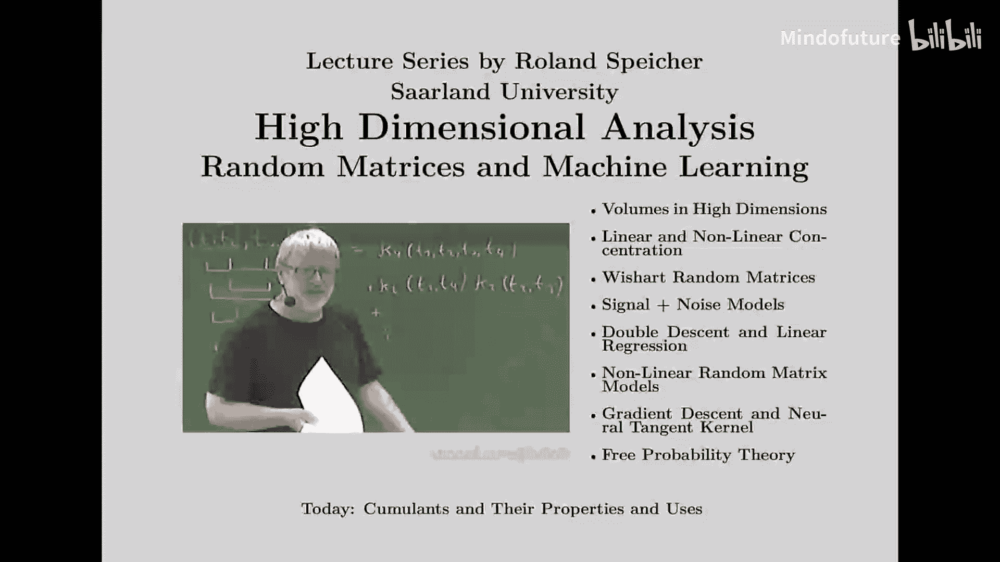
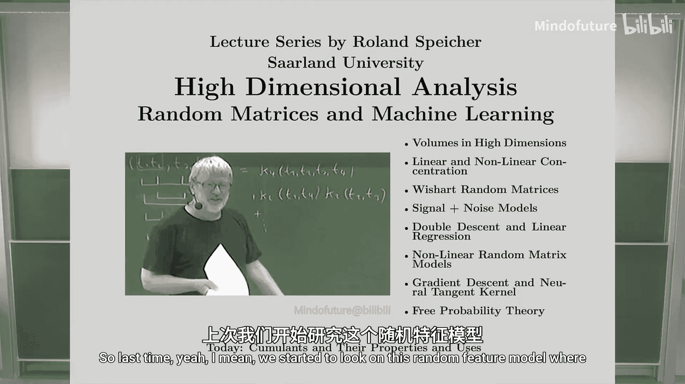
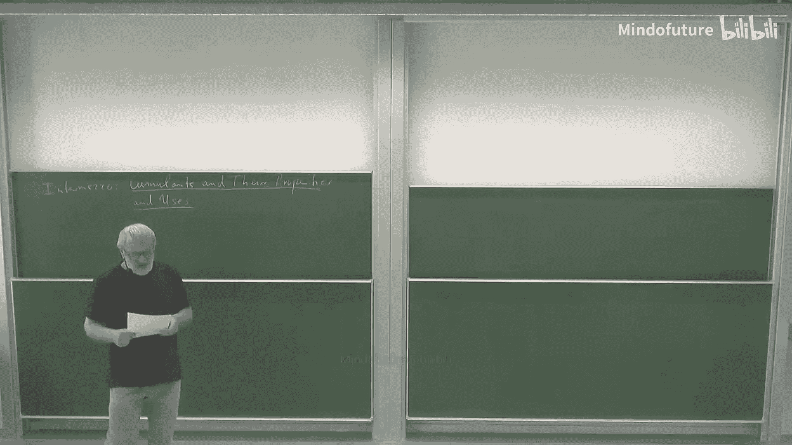

# 【德国萨尔大学】高维分析：随机矩阵和机器学习 ｜ High Dimensional Analysis p23 P23_累积量的性质及其应用 -BV1XkkWBFEi6_p23-

Good， so last time， yeah， I mean， we started to look on this random feature model where we have to multiply our data matrix with random weights。

 And then we also want to take non linear function on the entries and the question is whether we also can calculate the eigenvalue distribution of of F times F transpose。

 And the idea was somehow to。

To use thisstein's identity and see whether we have an extension of this to a situation where our random variables are neither Gaussian nor independent。

 And this was a cumulant expansion。 And I gave last time some idea how this works。

 And we saw that we have to introduce objects， which we call cumullan。

 which were defined by an analytic definition。 You take the logarithm of the。

Of the characteristic function and the coefficients there， you call cumullans。

 And we also saw that we have a kind of extension ofsteinstein's identity in this situation。 Okay。

 but today， I I want to talk a bit more systematic about those cumullans。

 maybe start again and define them and give all their main properties。

 because they are very important objects in general， but also in particular in our case。 and。

 and we have to be able to calculate cumulantss of products， for example。

 So we have to see how to do this。 So。 So I want to。😊，Make a short。Intertsを。

Where I talk about cuulanants。And their properties and uses。O。And so I mean。

 we define them in analytic way。 but last time I already already showed you that there is a kind of diagrammatic or combinatorial interpretation where you have a you define them in terms of moments and this is given by summing overall partitions And so maybe let me。

Be more precise on this or really define maybe precisely。我的意思。Partition。

 So this is a partition of a set， not a part of a number。 In number theory。

 you often have partitions of numbers。 but here we have really partitions offset。好啊。

So this is just the decomposition of my set into non empty disjoint subsets。

 which generate the same set。 and usually I。Dote this by pi。So pi is a collection of subsets。

 we run up to VR。So this is a part。牌啊。Petition。Of。A given set， let me call it this S。 or S is given。

 for example， usually S will be the will be the number one up to n， but it can be an arbitrary set。

 So if， yeah， if what， So if。The V eyes， of course， they should be， they should be subsets of S。

And they should be not empty。SoAll of them are non empty subsets， then they should be disjoined。So V。

 I and V J。Just section is the empty set。Whenever I is different from J。 And together。

 they should just give the whole set。 So the union of them is just everything。 So we won。Union V2。

 union and so on up to， I mean， I have yeah R of them。So this is S。

 So I write S as a disjoint union of subsets。 Okay， so that's a very。A general notion of a partition。

 And wes， usually I call the blockss of the partition。So， we record。In this case。

 we run up to we are。The blockss。Of pie。Yeah， okay。 And then maybe I also write， I mean。

 in principle， you can say such a part gives me an equience relation by decomposing my set into equience classes。

 So I'm not sure whether I will use this in the following， but maybe it's good also to have this。

So if I have two elements in my set。Let's say， P And Q。In as。Then I say， they are equivalent。

Of course， with respect to the given pi， If P and Q are just in the same set V in the same clock if。

P and Q。Belong to。The same。Block。Of pi okay， And， of course。

 if I have an equience relation on my block S， I mean。

 the equience classes are just blockss of a partition So partition and equivalentence relation on。

Once such pi is more or less the same。 Good。 Okay， then maybe I use the notation that I call。

 I I'm looking on all partitions of a given set， and I call this P of S。好说。To set。Of oil。Petitions。

Ofエ。Is denoted by P。P of S or P for partitions。 and usually this set S are just。

 let's say the numbers one up to n。 and then I write just P， N。So， it's a short form。SoPN。

This is just the partitions of the set。Of the numbers 1，2 up to n。You good。 Okay。

 so that's abstract notation。 But I mean， very often， I use this graphical notation。

 So I just can draw the partitions。Of分。Use。Bychromatic。Representation。Of。Partition pi。

 So so for example， I mean， yeah， let's say， let's say I take a partition of five elements。

 Also I have  five elements，1，2，3，4，5。Okay， and then let's say， as a part。Let's say， I take。

Partition， which has， let's say， two blocks。So the first block consists of  one and 3。

 and the second block consists of 2，4 and 5。Okay， then this partition tells me that1 and 3 belong together。

 They are in the same block。 So I throw this like this。 Okay， and 2，4 and 5 are also connected。

 They also belong to a block 2，4 and 5 also belong to a block。Okay， I mean。

 here I have a crossing between the two blocks， but the two blocks don't belong together。

 So I also always do it like this。 So I mean， here here those belong together。 But here not。 Okay。

 okay， so， but but here I'm not going to distinguish between crossing and non crossing so all partitions are。

Good， okay， maybe another one is if， if two and 3 belong together and1 and 4 belong together。

 and 5 is on its own。 So this would be the partition。Where one block is given by one and4。

Another block is given by。2 and 3。 And one p is given by 5。Okay。

 and I usually if I write things down， I mean， those are are sets。 I mean。

 one and 4 and four and one is the same， but usually I order them in increasing order So So usually。

 I mean， I have an order。 I mean， I can yeah， I mean。

 the the set S doesn't need to have an order but usually I have an order。

 And so I I order my numbers， but it doesn't really play a role for this。Good， okay。

 maybe one should also。See that， in principle。I can put an order， a partial order on my partitions。

 namely if if I get one partition from another one by splitting a block or several blocks into smaller blocks then what I get should be smaller。

 And in this sense， there is a there is a largest partition and there's a smallest partition so maybe。

Let me。Yeah， maybe， maybe let me just write it down in this example。 So， I mean。

The smallest partition， of course， is the one where I have de decomposed it in as many blocks as possible。

 which means every element is its， its individual block。 So it， it's this。

We just have singletons So this and this I would denote by So this the smallest one。

 So this is 0 and so， so 0 n in general， But it would be 0，5。 But because it it's 5 elements。 Okay。

 and the largest one， of course， is the one， which contains as few。Plocks as possible。

 So name me just one block where everything is connected。 So I have here。驾驶的。I call it 1，5。Okay。

 so this， this is the。This is the smallest。呃， elementment。In P5， this year is the largest element。

In P5， so that's my。Definition。off。Yeah partition。 And now what we want to do is we want to use those partitions to define cumullan。

 Okay， and so cumullan in a multivariate setting。 So I mean， I have I have variables。

 So collection of random variables。 And yeah， usually I， let's say I。

 I consider them as an al So I mean， I have maybe my my random variables in which I'm interested。

 So maybe I have a random vector。 and then I have the components which might be independent or might be not might be Gauss or not。

 So I have a collection of random variables。 But then， of course。

 if I'm looking on moments I also multiply them and usually I can also take the sum。

 So I take the ibra generated by them， and I want to define moments and cumul lines on on this object。

 So I mean， the following。呃。So usually I have an algebra， so A。

So this is an algebra of random variables， which I consider。So， for example。

 if I have a collection of random variables in which I I'm interested。

 then I take all polynomials in them。 So all， all all things which I can get by multiplying them by。

By real or complex numbers， adding them and multiplying them。 Okay， yeah。 and then， of course。

 on this algebra， I have my expectation。 I can take expectation of sums and products of my random variables。

 that that's essentially if I take monoials， products of my random variables， That's the moments。

 That's the main information。 which I have about my objects。

 And now we want to rewrite this in some other quantities， which we call cumullans。Okay。

 so what we are given。Is essentially despair。 I have my algebra G profile random variables。

 and I can take the expectation。 I just take the expectation of elements from here。

 Elments from here are usually products of maybe my basic random variables。 Okay。

 so this means if I have this。We know all moments。And moments are just expectations applied to elements in my。

As you pray。Good， okay。 but yeah， we can rewrite this and into some objects and those we call cumullans。

 And this is given by a formula which are already essentially， yeah。

Indicated last time that namely the moments are given by sumation over partitions。 But for this。

 also， we need a kind of。My duplicative extension of this moment。

 And let me do this in the following。Notation so namely in in this sum。

 I will have I sum of partitions。 and each partition is not one cumullan。

 but it's a product of cumullans。 Or maybe if I do the other way around。

 I I'm not just looking on moments， but I'm looking on products of moments。

 And the product structure is according to the plots of a given partition。 So if I have。Yeah。

 even have a petition。By。Which consists of blocks， we1 up to VR。Let's say a partition of N elements。

 And I have。Let's say， n random variables。T1 up to T， N。In a。Then I do not。

 I take now a moment of those random variables， but not just the moment where I multiply all of them。

 but I multiplied only the ones which are in， in each block of the given partition and take then expectation of this and multiply them。

 So this means。I take now， which I denote by E pi。 So I'm putting the pi here of the T1。Up to T， N。

So this is now not just one moment， but it's a product of moments。 where for each block of pi。

 I have a。So for each block， we in pi。Okay， yeah。In okay， this is the product sign。

 and this is my partition。 So I have a moment E， where I take， yeah， where I take the T's。呃。

Which calls one to this block。 Okay， so maybe， maybe let me。So this year。I mean。

 this is just the expectation of the elements which are sitting at a position。

 which are given by my clock。 So this is just。一体湾。E T2 up to。T I。If。If my block V。So， I mean。

 this is a， this is a block of a partition of one up to n。 So it's a subset of one to n。

 So it has some numbers。 and I order them because essentially， I mean， I， I want to keep the order。

 which I have here。 I mean， my random variables commute。 So the order is not really important。

 but maybe it's better to really have them in one order and also take the products in this order。

 So I have have here。 The V is E1。Which is less than E2 and so on， which is less than I S。

 So just the numbers I1 up to I S in this block。 And I have ordered them in increasing way。

 And then I multiply the variables， which are sitting at those positions。Okay。

 so that's just a notational。So this is a product。Of morements， according to the blocks。Good， okay。

 and then yeah， we will also have the other quantities， which we call cuullans。 And for them。

 we also use this kind of notation so that we can also multiply cumullans， according to。

To a given part。Yeah， so I do now essentially the same。For cumulanants。And the cuulan， O， Min。

 I still have to define what they are。 But if I have them。

 then I also do this extension with the pi So let me say how I do the extension if they are given。

AndSo so。So if you have a collection。O， and I call them Ka N。

The n is running through the natural numbers。 And actually， the cumulans are kind of more。

 somehow more complicated objects than the than the the moments。 I mean， the moments are just。

 this is just the linear function applied to elements here。 The cups， they get an index n。

 and each cup n is an n linear function。 Okay， so it takes n arguments。

 and I have to distinguish the arguments。 So actually， I I will have those cup ns。So。So， these are n。

靓女啊。Function notes。So this means each cup n。Takes not only one argument from a， but N of them。

 So it goes from a to the N to let's say R。 And so if I plugging in N。Elements for my algebra。

I'm getting the cupa N。T1 comma T2 comma up to T N。Okay， and so suppose those guys are given。

If I'm going to define them。 But if I have those guys。

 then I can extend those cupa ends also to objects where I put as an index， a pi。Arbitary partition。

 And I'm doing this in a multiplicative way。So， given。Given this。We extend。

This in a multiplicative way， as before。嗯。Too oil。P of N So namely， I define now a cup of pi。

And again， so if， let's say， if pi is in P N， I again have n arguments， T1 up to T N。

 But now this is not just one k， but it's a product of k and one cup for each of， of the blockss。

 So it's a product。Of the blockss of pi。 And then I take the copper。whichhich has the index here。

As the size of this block。 and that the Ts， which I put there are exactly the Ts。

 which are connected by my block V。 So I'm taking here again， not all the Ts。

But only the Ts restricted to be， which has the same meaning as before。 So this here。This is a cup。

And I mean， Kpa has a number here telling me how many arguments I take and I take as many arguments as the block V has has number of elements。

 And then I take here， just the cupas of。T of I1。Coma T of I 2， comma up to T of I。 let's say S。

 then then I mean， this this year is S。呃。If。Yeah， if the V is is I 1， I 2。Up to I as before。

So I mean， I mean here， here I'm just multiplying things。

 and I don't need to put commas but here I have to put comm because it it's just a linear thing。Good。

 okay， so this means。If I， and of， and of course， I mean。The original K N in this language。

OfOf let's say T1 up to n。 This， of course， is copper of the largest partition 1 n。

So this fits together because then I just take。I only have one block here So the product is actually just1。

1，1 block， which is everything。 And then I'm just back to the the Ka n。 So in a sense， I mean。

 this year， the K pi is an extension of the original thing。

 namely if pi is equal to one n then I'm back to here， but I have extended it in a multiplicative。

Wei。Okay， so this is essentially just notation。 but now I can define the cu lines。And yeah。

 also the definition is a bit indirect because I'm defining them in implicit way。

 not saying explicitly what is the end cumullan if I'm giving the moments。

 but I'm giving a relation between moments and cumullans。

 which essentially tells me how to calculate the moments out of the cumullans。But this is， this is。

 is， is an equation which can be solved in a recursive way。 And we will look on examples。

 but maybe that we give。The definition in this direction。

Because this is the simplest formula which we have。 Okay， so we are given our setting。

That we have the algebra of our random variables， where we have an expectation。

 so we can take moments， and then we define。嗯。Corresponding cumulanants。EOf the random variables。

In a algebra of the。The random variables。In a。Yeah。

 we define this by defining now the Ka ends So the Ka ends。Should be。

M linear functional from A and to R。 So each cup N should take n arguments and random variables。

 and then it should sp out some number， okay， and。How is it defined？

By relation between moments and cumullan。 And usually I call it all those relations of moment cumullan formula because it relates moments and cumullans。

 So this is defined by。The moment。徐木兰呃。Fors。 So， I mean， we have them for all N。

For all n in n and all possible choices of random variables， which I plug in in those guys。Okay。

 so here's the formula。 So it tells me。What the expectation。Of yeah。

 this moment is corresponding to this where I'm just multiplying this。

 So I take the end moment of those random variables。 And I mean， the the T's。 I mean。

 they could be the same or they could be different I mean， it's just elements from here。

 So all the Ts could be the same。 but it could also be different。 and some of them could be the same。

 some of them different So it's just justote them in general by T1 up to T N。

 And I'm looking then on the product of T1 up to T N taking the expectation。

And this can be written in the cumullan by this formula。Which is a combinator formula。

 So I'm summing。Over all partitions of N。So n is the number of factors which I have here。

 And then each pi gives me a contribution， and the contribution is exactly this Ka pi So I have here K pi of T 1。

 T 2 up to T N。好。Okay， so this means， I mean， yeah。The， the ka ends。 if the ka ends are defined。

 the kpa pies are also defined according to the above。

 But this relation here should define me those objects。 know， Okay。

 and maybe maybe I call this moment cuulan formula。Good， okay， and yeah。

 the point isnt is really to see that this is really a definition because， I mean。

 if we would know the kas， then this would define the ease。 But， of course， we know the ease。

 we know the momentss and it should define the capas。

 So we should see that this is really something which we can solve for the kas。

 And so let us do this in the following by looking on examples。 So of course， we have this for all n。

 So we can look on it for small n and then go higher and higher and see that that in each step。

 we get new information about the N cumulant。Okay， so let us look on examples。

 so the smallest possible n， of course， is n equal to 1。

 and so what does this equation tell us in this case？Yeah， n equal to one。And of course。

 we n equal to one。 I only have a T1 and P1 is， of course。

 just the partitions of the of of the set consisting of one element。 And of course。

 there's only one partitioner because I cannot decompose this in in any way So it's just one block So if。

Yeah， so if， if I have one point and maybe I can also put a。The T1 there And then， of course。

 the only partition is just taking this block。 And then， of course， this tells me that E of T 1。

 I have to sum over yeah， just this element。 So I get a contribution from this element。

 And what is the contribution。 I should take the copper。Corresponding to a block of size 1。

 So I have a cup 1。 And then I put just the argument there。

And so this just tells me that Kappa 1 is nothing else than the expectation So Ka1 is。

 is the expectation of the mean Okay， So I mean， in this sense。

 Ka 1 contains already all the same information as E Okay。

 so that we introduce more Kas is that we reorganize things in in a meaningful way。Okay， but anyhow。

 So， so this means if I solve this， of course， it tells me that K 1 of T 1 is equal。To E of T 1。

 And I can define Ka 1 in this way。 Good。 Okay， now more interesting， of course， n equal to 2。Okay。

 there I have， of course， two points。Corsponding to T1 and T2。 And now there are two partitions。

 I can either take those two guys together or I can take them separately。

 And this gives me two summons in my moment cuulant formula。So this means the expectation of T1 T 2。

 So the contribution corresponding to this。 So there's only one block。

 So I should take a cupa corresponding to this block。 This block contains two elements。

 So it's a cupa 2。 And I put there the two。Varis， which are in this block， Co 1 and Co 2。

 But then I also get a contribution from here。 So this is a product of two ks。

 Each of them has only one argument。 So it's a copper one of the first block， which contains the T 1。

Milti bide with the K one of the second block， which contains the T2。Okay。

 and now you see this tells me what K 2 is because I already know what K 1 is。So I can solve this。

For couple 2。T 1， T 2 T 1。P 2。This is equal to the expectation of T 1 times T2。

 and then minus K 1 of T 1 times K 1 of T2。 But， of course， the copper1s are just the expectations。

 So this is the same as E of T 1， T 2 minus。E of T1 times。E of T2。Okay， and so now this is now。

 I mean， what。How this， yeah， I can now use this for defining copper 2 or that that's what my definition is telling me。

Concretely， and you see also， this is something which we usually know in the random matrix context。

 So this is the covariance of the two variables T 1 and T 2。

 So this is a meaningful object So so this was a mean。 This is the covariance。

 And now we also have higher ones， which somehow have， yeah。

 play a higher order role like mean at covariance。 Okay， and maybe let me also write down3。O。

 so this was。For n equal to3。 Yeah。 So there， what do I have there。嗯。There， I have。Let me write it。

Yeah， maybe let me write it here。So I have the expectation of T1， T2 and T3。

 and I should sum over all partitions of three elements。Let me draw the picture here， so I have。

Tiwan。2。And T 3。 And now there are actually five partitions of those guys。

 I can take all of them together in one block。 I can take two of them together。 One is staying alone。

Or all of them are staying alone。So that's the five possibilities。

 which I have nothing more and nothing less。 And each of them gives me a contribution here。

 So the first one， of course， there's one block。 So I have a Ka 3 where all the arguments。啊。

In this cupa 3。 And then I have three terms where I have a cupa two times a cupa1。 So here I'm。

Taking together T1 and T 2， and then multiply it with。ティー3。But next， I take together T 1 and T 3。

Multiply it with T2。And then by this one， I have two and three together in one block。2 and3。

And one is alone。 And in the last 1， I just have three。3 blocks。

 which con each containing one variable。 So it's just a product of three K ones， K 1 of T 1 times k。

One of the two。Times， Co one。Of T 3。Okay， and you see now again， I can solve this for K 3。

 And the other terms only contain K 1 and Co 2。 And I already know what they are in terms of the expectation。

 So I can solve this。So this tells me K 3。Of T 1， T2 and T 3 is actually this expectation。啊，所以3ly。

I mean。The cup。The end Ka is essentially the end moment。

 but then I'm getting correction from lower or moments， which okay， maybe the moment is not clear。

 What are they good for those corrections。 It looks like a complicated definition， of course。

 it should have some value。 And I will tell you about this value。 But at the moment， this， theres a。

 I mean， theres， there's a clear structure behind this formula So very comminatorial one。

 So we have this。 And then I have to subject all those other guys。 So I have to subject K 2。T 1， T 2。

Times Co one。T3。And so on。 But， of course， I can。Express this in terms of the expectation。

 So this is the expectation of T1 times T 2。Minus the expectation of T 1 times the expectation of T2。

 And this here， of course， also， so this is the covariance of this。 And this is the， the mean。

 So this is the expectation of T 3。 So each of those terms I can write in expectations because they are smaller order cumulants。

 which I already knew from before。 Okay， and then I can multiplide is out and collect terms。

 And in the end， I get a formula。Which is very similar。To this formula here， namely。

 let me write it down。Yeah， so what， what you see， essentially。

 you get terms which again correspond to pis， to partitions。Yeah， so namely， what do I get。

 Of course， I first get this term。Y off。T1， T 2。T 3。

 then I'm subtracting the terms where I have here T 1 and T 2 together times T 3。

 So I have terms like the expectation of T 1。T 2 times。K 3， And then I get， of course。

Corresponding terms corresponding， where I take T 1 and T 3， and I take T2 and T 3 together。

 So minus E of。Tiwan。3 of。The2 minus E of。T to。Three times of。Tian。And then， of course。

 I also get the terms where I have products。 So I mean， here I also have E1， T1， E T 2， E T 3。

 the product of the three terms。 but I also get it from here。 So this term I get more often。

 and sometimes I get it let me see。 I mean， here I get it with a plus。 But from each of those terms。

 I get it with a minus。 So I have it three times with a minus。 once with a plus。 So in total。

 I get this two times with a plus。 So plus two times。Let me see。 iss it plus。嗯。Plus， plus， plus。Okay。

 I mean， I mean， this goes on the other side， too this gives me a minus and those here actually give me a plus because I have a minus here and a minus here。

 So I have three times with a plus。Once with a minus， So I get in total plus two times。E of T 1。

 E of T 2。Y有。T 3。And now you see， I'm summing here again， according to the five partitions of。

Of three elements。 So what I have here is the expectation where I have this partition。

I only have one block here。 I'm subtracting where1 and two are together。3 is alone。

 Here I'm subtracting。 I have one and 3，2 is alone。 Here。 I have E to the。

1 is alone2 and three are together。 And here I have two times the expectation of where I have three blockss of the all arguments。

 So you see， I can solve。This relation， saying that your expectation is given by summing over all partitions。

 And then I just get this multiplicative contribution of the cumulan。 I can solve this， and I get。

Then a very similar formula。 I can say the cumulant is given by summing of oil partitions。

 and I get this multiplcative。Contribution of the moments。 But now I get also some factors。

 you see I have here minus， and I also have here， too。

 So it's not that I always get just coefficient plus one， but I get more complicated coefficients。

 But the structure of the formula is， is again the same。 And this is。This is in general。 So， I mean。

 this was he observed for3。 but this is true in general。 And so what we are doing here is。

 is essentially a kind of， of inclusion exclusion principle。 I mean。

 we are bringing terms on the other side。But then you see， I mean。

 this year also gives smaller or terms， which， which we have to collect。

 And so we do a kind of inclusion exclusion principle or more general。

 this is called a meus inversion。 What we are doing here is a meus inversion on。On this post set。

 which we consider here on this partially or set。 Also， this just means I can。

So if an equation of this type for the guys here， and I get an equation of the same type。

 but I get more complicated coefficients here。 the coefficients which I get here on this side are usually usually called the meus function of what I have here。

 Okay， but anyhow。' it's not so important。 I mean， I can write it down explicitly in this case。

 So maybe let me do this in the next theorem。 So I'm not going to prove it。 But I mean， this okay。

 can be done。 And I mean， in this example， you see it。 I mean。

 here here you see those coefficients are the the meus function of of the pset which I consider here。

Yeah， so let me write it。Maybe here。So it's it's changing the moment cumulant formula into the cumulant moment formula where I express cumulant in terms of moments。

 the structure is the same。 Only the coefficients are getting a bit more complicated。

 but still are manageable。So let me formulate it as a theorem。Essentially。

 it's about solving this equation here for the capasum。Okay， so the。I mean， this definition here。

 which was a kind of recursive definition。Or implicit definition， not giving the kas explicitly。

But only with an equation。 So the recursive definition。Of the。Cumulan。う。

Why are the moment cuberland formula。Is equivalent。主。😔，The explicit formula。cuant moment formula。

 So name， I can really。Write down。The formula。Which expresses。The endcumulant in terms of the moment。

 And this formula is as before， I have to sum over。All partitions of n elements。

And then each of them gives me this multiupplicative form of the moment。

 So it's just a product of moments， according to the blocks of pi。 So it's E pi of all the variables。

 which I have T1。Up to T N。 But then I get a factor。

 and this vector abstractly is the me function of this situation。 But concretely， it's just。

 it's going with a sign。 So it's -1。To the number of pi。-1。 So it's a number of blocks in pi。

 And then I also have a factorial。Namely the same as here。 So the number of。Pi -1 Victoria。

And so you see， yeah， So you see that here， I mean， it fits here。 So I have the minus sign。

 So if the number of blocks is。Is even then this is negative。 This is， this is odd。 Then I have a -1。

 And so I mean， I mean， here the are the three situations where I have number of blocks are  two。

 There I get a minus sign。 for the other cases， I get a plus。And then。The last term。

 they are the number， They are pi the number of。Plocks is 3。 Okay， so I get the plus sign here。

 but here I get 3-1 factorial。 So I get a two factorial， which is this two。 Okay， so this this。

 this fits with this。Good， okay， so that's the。Yeah， that's the moment。Let me call it。

 that's the cumulland。Moment formula， this situation。I mean， I， I have to see very explicitly。 Okay。

 but very often， the exp explicit value is not so important。

 It's more to understand the structure of the formula and being able to see some， yeah。

 some more structure there。 if you apply it to specific situations。 I mean， of course。

 this formula is， is quite horrible。 I mean， if you really want to use it explicitly， I mean。

 you're summing over all partitions， And if n is getting a little bit bigger， I mean。

 there are so many that you cannot really， I mean， you cannot really do anything with it。 So I mean。

 it's really that at some point， you have to do an。Smation in analytic way。

 collecting terms together。 Okay， but， I mean， in between。Maybe you want to。

 to argue that some terms vanish or so。 And for this。

 it's very good to have this comminatorial characterization。 Good， O， but of course。

I should tell you why do I introduce those objects。 I mean， at the moment， they are just defined。

 and， of course， they should have something to do with the problems which we have at hand。

 So in particular， they should have something to do with random variables and check whether they are independent or not。

Because usually what we have in our situation， we are starting from some independent random variables。

 and those cumullans are very good for， for checking。Independence， that that's the main property。

 That's why they are introduced。So， independence。Of course， it's defined in terms of moments。

 You can say， I mean， random variables are independent if expectation of a product of them factorizes Okay。

 so this should now be rewritten in terms of a property of the cumulants。And this property。Is yeah。

 is the vanishing of mixed tumulants in independent random variables。嗯。OK， so to说。12。

 maybe the central theorem。About the relevance of cumulans， why they are really useful。So。

 let us consider。The setting that I have an algebra of random variables。With the expectation。

 And then I consider there are subsets of random variables。

 And I want to know whether those random variables are independent or not。So consider here。Subsets。

 and let me call it M T I subsets of a。For some indexing set。

Could just be a set of two So I just have some random variables in T1 and some in T 2。

 And I want to know whether they are independent。Okay。

 it could just be added that I have one random variable here， in T1 and 1 in82。

 And I just want to know whether those two random variables are independent。

 So those my random variables。And the claim is。This can be decided in terms of the cumulants。

 So then the following。Okay。Equivalent。 so namely first。The fact that the Ts are independent。

Which by definition， is something in terms of the moment。 So we know the factorization of moments。

 But what does it mean for the cumulland， for the cumullans， it means。That mixed tumullanants。Yin。

The T I vanish。So this means many of the cumullans are 0， namely whenever I have a cumullan。

 and then the entries are either coming from from one of coming from one of the T Is。 But if if one。

 one of yeah， if， if at least two of the T I sets are appearing both in the cumullan then it is equal to 0。

 So this means。That K N of。Tiwa。Up to T N。Is equal to 0 whenever。I mean， each of the arguments here。

Should be coming from one of of the sets， which I consider。

 So let's say it should be from the set T I J， but it should also happen that at least two different from those sets are showing up。

 So I should have here。Random variables coming from at least two of those guys。

 So this means I have here a mixed tumulland because the arguments are coming from two different sets。

 So I mean。Each of them comes from one of the set， but at least two different sets are showing up。

 So I have at least position L and K， such that J L。The algebra the T set。

 which I have at the position L， is different。From the T set， which I have at the position K。Yeah。

 good。 O， so let let。Let me make this clear and maybe also give a proof of maybe one direction。

 maybe the one which is most interesting for us， namely。

 if I have the vanishing of these mixed cumulans， that this really means that those guys are independent。

 which means I have the factorization。 So I mean the。

Banishing of mixed cumulants is equivalent to the factorization for the random variables。 And I mean。

 this direction is， is maybe the easier one。 But it， it's also the other way around。

 This is really a characterization。う。But so maybe let me give the proof or。

Just maybe an example of a proof。And only this direction。

That vanishing of mixed cumulants implies factorization of moments。 And so for this， let。

 let us consider， maybe just to be specific。Consider。AMo。

 And let me just take two of these these T sets and the elements in one of them。

 I call little T in the other， I I call little S。 So I have T random variables。

 and I have S random variables， and the T's are independent from the S。

And I look now on a mixed moment in them。 So let， let's say I look on T1， S 1。呃，其。2， S 2， S 3。T 3。

 T 4 something like this so。And I assume this condition too。

 So I assume that mixed tum land in the T's and the ss vanish。We are mixed。Cumulans。In the two sets。

 I mean， the sets are now T1 would be the set， which consists of the T。 So this is T 1， T 2。T3。T4啊。

And the other set， T，2， is the set which consists of the ss as one as 2。Sス3。Okay。

 and so I'm saying if I have a cumulant where I have both Ts and S entries， then this is equal to 0。

 that that's the vanishing of the mixed cumulant。 And what I have to see on the moment is that such a product factorizes。

 I mean， this should factorize。 Of course， I mean， everything commute。 So this is T1 times T 2。

 times t 3 times T4 times S1 S 2 S3。 And then then this should factorize into the moment of the product of the Ts times the expectation of the product of the ss that that would be the independence of those guys from these guys。

It effectorizes。 And I mean， I should see this now from this formula。Okay， yeah so those guys。

 we are mixed cumulants in this vanish。And now we should see the factorization of the moments following from this。

 So I should calculate the expectation。Of this product。Tiwan。S 1， T 2。S 2， S 3。T 3。T 4。

 by using my moment cuan formula。 So I should sum overall partitions of。1，2，3，4，5，6，7 elements and。

each of them gives me a contribution。And the contribution is a product of cuulans。

 according to the blockss。 Okay， and so if I have now a clock of pi which connects a T with an S。

 for example， if I would。Have a partition like this。 I mean。

 those are partitions which are showing up in this sum here。 Okay， but this would have a block。

 So this block here contains both T and S。 And by my assumption， this is equal to 0。

 So this means in my sum here， such partitions don't make a contribution。Okay。

 so this year is not allowed。 I mean， it is allowed， but it will make the contribution 0。 So maybe。

 maybe the cupa pie。Of this is equal to 0。Okay， so this means I only have to sum over partitions where each block only contains either ss。

 only ss or only T's。 And so this means any partition， which I have。

Thecomposeers into it has some blocks which connect the ss。

 and it has some blocks which connect the Ts。 So essentially。

 I have a partition of the S part S positions， and I have a partition of the T partition T position。

 So I mean， for example， something like this where I have here， this one。Maybe this。

This S here could go with this S。And I could have this。 So this would be okay。 So I mean。

 here's a block， which， which only has。2 T1s。Ats， and。Here， I have the Ts。

 So so this block and this block on its own make up a partition of the positions where the T's are。

 And then I have here other blocks， which only connect as here， as one。S 3 and he and S 2。

So this is okay this would be okay。 The con， the couple of this would make a contribution。

 And but here， I can say the pi， the partition of all positions。

 decomposes into a partition of the positions where the S are。 So if I call this pi S and。

A partition of the positions where the Ts are。And of course， the cup。Of this here。

 So this is the product of the。Of the kas corresponding to the blocks here。 I mean， this is。

 of course， the ka given by taking the product over those blocks times the kas taking the product over those blocks。

 So so the， so the， if the pipe decomposes like this。

Then the cup of pi also decomposes as the ka of pi S times the k of pi T。

 And where I'm distributing the arguments， of course， accordingly。 I mean， here， I only get S。

 S as arguments， and here I only get T's。Okay， and so this means。That。Yeah， my sum here。

 which a priori is a sum over all partitions。 and I get this contribution Kappa pie that this actually is a sum。

We only have to consider pies， which factorize。Into blocks， which only contain S and blocks。

 which only contain T。 And then what I get here， this argument， or yeah。

 this contribution also factorizes into the product of the kas corresponding to the blocks of pi S times the kas corresponding to the。

Blocks of pie T。Yeah， but then you see， I'm summing here over those guys。

 and I'm summing over those independently。 I mean， the blocks， which I choose for the T positions。

 I can choose them arbitrarily independent of the blocks， which I'm choosing for the S position。

 So I'm just choosing。All possible possibilities for the blocks at the T positions and all possibilities for the blocks of the S position。

 that I can combine them in arbitrary way。 So this sum here is actually just a product of the sum of all possibilities here times the sum of all possibilities here。

So this year。I then。Some overall pi S。And I have to cuppa。Pi S， And T， of course。

 I only have the S arguments。Sitting at this position times the sum overall pie T。

 And I have hit a cup。排替。Of all the T variables。Yeah， but I mean， now I have here。

The same problem as before， namely I some overall all cumulans at all possible partitions。For。

 for those positions here。 And then this year gives me just the expectation of the product of the S S。

 which I have here。 This is now just again， the moment cumulant formula。

 but only applied to the positions where the S are sitting。So this year is the expectation of。

Of all the S。 So in this case， this would be expectation of S 1。S 2， S 3。And this year。

Is the expectation of the product of all the Ts。 So this would be。T1 times T 2。Times T 3 times T 4。

And so you see， I get the factorization of the product as I needed it for the independence。嗯，你说的。

The the vanishing of the mixed cumulan gives me the factorization of the moment。Okay。

 and when one can also go the other way around。Yeah， anyhow。 But maybe at least this gives。

 gives you the main idea how， how this this is connected。Good， so maybe a few remarks on this。Yeah。

 maybe  first of all， I already said it that， of course， here， everything commutes。

 So if I have a cumullan of T1 up to T N， I can permute the Ts and it's still the same because Im。

 I have here commuting variable。 So the moment， in the moment everything commutes。

 So if I commute here things， I can also commute here things and the structure of this formula goes goes over to itself。

 So those cumullans， even even though I I write things in a specific order。

Because it's somehow nicer for the structure of the formula。 everything is commutative。 So。

 of course， I mean， instead of writing this in this form。

 I could bring all the Ts at the beginning and all the S at the end and then。

I also should have the factorization， but I can also keep it in this order。Yeah。

 but on the other side， I mean， if I bring all the Ts at the beginning and all the S at the end。

 then， of course， here on this side， I also have to say that in my arguments for the cu lines。

 I have all the Ts at the beginning and all the S at the end。If I don't dis do this。

 then I have the arguments are somehow mixed between T's and S。But it's all the same。So note。That。

Human。Do not。Xian。😔，And permutations of the arguments。So for example， I mean， just for example。

 I mean， K 3 of T 1， T2， T 3 is the same。As couple  three of。T1， comma， T 2， T， T 3， T 2。

 or maybe it's the same as couple of。T 3。T1， T2， etc cea。Yeah， because this， this。Yeah， I mean。

 this formula also goes into each other。 I mean， so， I mean， the contribution， which is showing up。

Here is also showing up here。 maybe not for the same partition。

 but the parts are mapped onto each other under such perutations that all the contributions showing up here are also showing up here。

Good， okay， but so may maybe more important。Remark or question is。 So， so， I mean， why the heck。

 am I doing this very complicated thing。 I mean， the cumulants are quite complicated。 I mean。

 these formulas here， they have some nice structure， but still。

 I'm calculating cumulantss in a quite complicated way。And even the vanishing of mixed cumulanants。

Doesn't seem to be so much better than the independence， which is just the factorization of moments。

 So why， why do I really want to introduce those objects So they have something to do with independent？

 So they should be useful。 But are they really much more useful than moments， for example。

 is to introduce them。 And maybe， yeah， so the answer to this。 Of course。

 we will see that they are useful。 But maybe a general answer is that actually。If I。

 if I'm doing expansions around special situations， in particular situations。

Coning independent Gaussians， then they， they are somehow easier to deal with in this formulation。

Okay， and， and maybe。Maybe more concretely in a sense， is， I mean， factorizations。 Okay。

 if you have factorizations， this is the same as having vanishing of mixed cumullans。

 but if you have approximations， then maybe you don't have factorization。

 you only have approximate factorizations。 And this corresponds to having approximate vanishing of of cumulants。

 and usually it's easier， if you do estimates to see that you have small terms instead of seeing that you have terms which factorize or almost So it's it's easier just just to work with this。

 I mean， it's better to have almost vanishing or smallness of cumullans。

 then having almost factorizations of moments。's maybe general one。 But of course。

 we have to see later in concrete applications that it it's quite useful to have those those cumullans。

 okay so。So why。啊。Humanan scoo objects。Maybe better in some cases， of course， in some cases。

 better than moments。Yeah， because， yeah， let's say。Almost vanishing。Of cuulans， tras， yeah。

 maybe almost factorizations of moments is better。Okay。Almost。Hectctorization of movements。Good。

 okay， but， of course。Cumulans。Linear objects， Mo are also linear objects。 But， of course。

 we also have our algebra of variables。 And， of course， of we we multiply our random variables。

 I mean， moments are usually products of random variables。And。For the cuul land。

So in order to really deal with them， we have somehow to be able to calculate cumulants of products of random variables。

 if we know the cumulants of the individual random variables。 Okay， on the level of moments。 I mean。

 taking a product is not a big deal。 I mean， if if you multiply things you just have a moment okay。

 but if you multiply random variables for cumullans。

 we are changing somehow you take cumulants of other objects and you must connect them And so what what we really need to be able to make a good use of cumulants is that we understand how the product goes with with those cumulants And maybe that's the。

Next thing。 and maybe the last thing， this general setting， which I。Want to talk about。

 because this will be important if we go back to our random feature model。

 because there we are multiplying。2， two of our random matrices。 and each of them is very nice。

 So we understand the cumulants。 But the question is。

 do we understand the cumulants of the product of， of， of W times x of of。

 of the weight matrix and the data matrix。 And for this， we need。

To understand what happens if I multiply。Random variables in the arguments of my cumulant。

Let us first， I mean， for the moment， it's essentially just associivity。 So， I mean， moments， I am。

 in a sense。Assocciative。So if I multiply a few things， I mean。

 it doesn't matter where I put brackets。 And I mean。

 putting brackets correspond somehow to putting the commerceas in in the cumul La。

 So So if I would say， let's say I， I take a second order moment of， let's say。T1 times T 2。

Times T 3。 So I mean。I have three variables。 but now I say， okay， the first two I multiply。

 So this would be my new variable。 And this is another one。 And this would be a second moment。 But。

 of course， I mean， this， this is the same。I mean， I don't need to bracket it here。

 I can also say this is the third moment of T1， T 2， T 3。

 or I can also say it's the same as a second moment of， if I multiply here， T 1。With。He to。T3。Okay。

 so I mean putting braggt doesn't really make a difference here。

 and I can move my variables around here on the level level of the cumullan。

 I cannot do this So if I would like to do the same for the cumullan， let's say I take the cumulant。

 the second cumulant。 where the first argument is t 1 T2 and the second argument is T3 So is this the same as if I move this T2 over here。

So I， I mean， I， I can calculate this。 So what is this， I mean。

 the second cumul land is to covariant。 So it's the expectation of the product of。T 1， T2 with T 3。

And then I'm subtracting the product of the two means。 also of the first variable。

 which is T 1 T2 times the mean of。The second variable， which you see T 3。 And， of course。

 I can do the same。For T 1 comma T 2， T 3， where If now， now， I'm not multiplying T1 and T 2。

 but I'm multiplying T 2 and T 3。And consider this second cumulan。 this of， again， is the covariant。

 So it's T 1 times T 2 T 3。 And T， of course， this is the same。 because in leading order。

 Mo and cumulants are the same。 It's just the sub leadinging orders， which。hich make corrections。

 but in the uping orders， of course， this comma here matters。 So namely。

 this is now the expectation of T1 times the expectation。

Of T2 T3 and this term is not the same as this term So this means those guys here in general are not the same。

 So it's I has to be careful And question is now， yeah， this is not true， but this is anything true。

 I mean， can I can I deal with or can I control cumulantss where I have here products in particular。

 I mean， can I can I control it in terms of cumulants where I take all the variables individually。

And indeed， there's a formula like this。 So namely let let us look on the。Let's say， cup 2。Tiwan。T2。

コマティ3。So as， as I wrote it， buff。Yeah， okay， let me write again。 So this is the expectation of T 1。

 T 2， T 3。 And I'm subtracting the expectation of T 1， T2 times the expectation of T 3。Okay， now。

 of course， I can write all these in terms of cumulan。So I mean， I， I want to have a formula。

 which expresses me the cumulant of this situation in terms of cumulants of all the variables T 1。

 T 2， T 3。 And， of course， all this， I can express。 So namely here。

 I know that by the moment cumulant formula。 I can express this by cumulants by summing over all the partitions of three elements。

 So I'm summing over terms corresponding。To those 5。Okay， let me five situations。So I get here those。

 those five terms。 Okay， and here I also get terms， and some of them are the same as here。 So namely。

 so some of them are going away。 So namely here， I get。I mean， for this， I get two possibilities。

 Na I can connect it。 for this， I only always get this possibility， or it can be disconnected。

 which corresponds to this term。So you see that of the five terms here，3 are subtracted。

 So I get here a formula， which expresses this as sum over now， only three terms。

And those are really given in the usual form that I take a product of cuan， according to the blockss。

 So this means that this year actually is， yeah， what remains is this term。Ca 3 of T 1， commma T 2。

 commma T 3。 This is going away。 This your survives plus Ka 1。T 1 times copper 2， T 2。T 3。

 and this one here also survives。Plusus卡。呃，错误。T 1， T 3 times cup 2 of。呃。T 2， is okay。 no， Ka 1。Good。

 okay， And now， of course， the question is， I mean， okay。

 so here I have a nice formula saying I'm getting a sum over some partitions。

 But do we understand the structure of what we really get here。 And actually。

 there is a structure behind here。 So namely the three terms， which I have here。

 the three partitions， which make a contribution。Are the ones which somehow connect。To group。Of T1。

 T 2 is the group of T 3。So you see， I mean， here T1 and T2 somehow belong together。

 They are multiplied together。 They are already connected， but T 3 is not connected essentially。

 And so I have to sum all possibilities where I am connecting to those groups So you see here。

 I mean， I mean， here this is connected to T 3。 But here you see there's no connection between this group and this group。

I only have a connection within this group， but not to this。 Then here again。

 this T 3 is connected to this group。 Y R T 2， and T is also connected。 But here。

 everything is separated。 So there's no connection here。 Okay， so the reason。

And and the ones which are separated， they are subtracted away because they。

 they are also appearing here。Okay， and this is true in general。

 So namely so what I have here is a formula where I can express this here in cumulan。

Of my individual teas by summing over all pies， which are connecting exactly those groups。

 And this is true in more generalities。 So I mean， I can also， okay， I can have bigger cuullan。

 And in each argument， I can have a product of， of cuulan。

 And so maybe thats that's the basic theorem about the multiplicative。Structure about cumulanants。So。

 consider。And random variables and multiply them together in groups。Dly。Together。In， let's say。

 M groups。So this means， I mean， I have variables。 So I， I call them T 1， little T 1 up to T N。

 I have n of them。 I mean， some of them can be the same。 Some of them can be different。

 but I just give different names to them。 And then so I'm looking on T1。Up 2。

 and then I multilying the first， let's say I want together。 So I multily those。

 and I call this capital T 1。Okay， then I have the next one， which is T I 1 plus 1。 And I again。

 take a few up to I 2， and I multi b them together。 I call this T 2 and so on。Until the last group。

 And for the last one。This goes up to the last one， starting somewhere here。 And I call this T M。

Yeah， of course， there can also also only be one factor in in those groups。 I mean， here。

 the T1 would be T1， T 2 and the T capital T 2 would be T 3 where nothing is multiplied But in general。

 I can multiply for each argument， I can multiply as many guys as I want。Okay， and then。

The point is that we can now express the Mcumulant of the capital Ts。 So T1。T2 up to TM。

 So each argument here is now a product of the of， of some of the little Ts。 And I can write this。

S sum over。Cappa pies where here I take the cumulants of the little teas。 So I have here。T 1， comma。

 T 2， comma and so on， comma， T N。 And I'm summing here over pi。 Okay， pi in principle。

 must be a partition of n elements。啊首批。Is in PM， but I'm not not summing over all of them。

But only over some of them and those should have the property that they connect to groups which correspond to the capitalities。

So。Here I have a condition。呃。자起的派。Connect。All the capital T groups together。Okay， I mean。

 this can be written more formally， but I hope it it's clear。 and it pictorial。 I mean。

 there must be ways of。Going via blocks from each T to some of the other Ts。 Okay， but I mean。

 which which of the little Ts I'm using for doing the connection doesn't matter。 I mean， here， here。

 I have a situation。 I mean， here， I I must， I must connect this group with this group。

 and I can do this via the T 2， but I can also do it via the T 1。嗯。I can also do it by both。

 but it's enough to have one of the guys here， which is connected。Good， okay， so that that's the。

General formula， which is also okay。Maybe not totally straightforward。

 but it's also not so hard to prove it by using the moment cumulant formulas。

Or maybe I should say we can check some of the extreme cases that they are correct because we know that they coincide with things which are either trivial or which。

 which is the moment cumulant formula。Okay， so the extreme cases， maybe which。

Should consider as an example is where I don't multiply anything together or where I just multiply everything together。

Okay， so maybe let us first look on the case where I don't have any product。Examples。

So the first case is no products。So I have as many capital Ts as I have little Ts and。

The capital is just a corresponding little。 So because， I mean， there is no。No product involved。

 And so what does this formula tell me then， So it says that I have Ka N。

Of the capital T are now just the little T。 So I have T1 up to T N on this side。

 And now I'm saying this is the side， the same as the sum over。

All partitions of n elements where I have this extra condition。

 and then I take Kappa pi of T1 T2 up to T N。 So now it looks as I'm expressing a Ka n as a sum of other kas。

 But now we should think about what is this condition here。

 This condition tells me that all the groups should be connected。

 But the groups are now just this single guys。 And so I must connect them all and there's only one partition which connects them all。

 which is the one partitioners。 So I need a partition。Which really connects them。 Okay。

 so this condition here。Means that pi must be equal to one n。

And then the k of this guy is just the copper M。 So this year is just。The same as Ka n of T1。To T N。

 because in this sum， there's only one pi， which makes a contribution。 Okay。

 so it's just says K n is equal to K N。Good， okay， but now maybe the other extreme。

We I only have one product。So I multily all my arguments together。

 which means I only have one capital T。 So I only have one T。Which is the product of T 1。

 T 2 up to T N。 Okay， and then the M is equal to one。 And then on the left hand side。

 I have K 1 of T。And this， the formula now tells me that this is given by the sum of a pi in。

PN with some condition here。 and I have here。The cup of pie。Of T1。Up to TN。

But now what is not a condition。 I mean， I have to connect all the groups in the capital Ts。

 but there's only one capital T。 So there is no condition at all。 because， I mean。

 they are already connected。 I mean， this T is just this product。

 I don't have to connect it to anything else。 So I can forget about this。

 So I'm really summing over all of them。 And if I sum over all kas or all cumulantss， Ka pies。

 I just get the moment， I could just get the expectation。Of T 1 up to。体言。But this is okay。

 This is consistent because I have here the K one of T。

 And we know that the K1 is the same as the expectation。 So this is E of T。And T is this product。

So you see that this is， this is consistent。Yeah， and。In principle， in this case。

 we can see directly that the formula is true。 But， of course， these， those are the。

The trivial extreme situations and the formula will be used in intermediate situations where we multiply a few things together。

 So maybe。Yeah， maybe a last example。Is that if we。To copper 3。 And maybe now I'm multilying。

The first two together。 And then I have two more， T 3 and T 4。 So I'm just multilying。

The first two together。 So I have a capital T 1。 This is the product of those two。

 Then I have a capital T 2， which is this guy and a capital capital T 3， which is this guy。

And then what is。The formula telling here。 So I can express this in kas of the individual T 1， T 2。

 T 3， T 4。 where I'm summing over all partitions which have to connect。 I mean。

 this group here with the other guys。 So this means those guys here must be connected with T 1 and T 2。

 This can， of course， be achieved。 If I connect everything。And if I'm not connecting everything。

 then。呃。Yeah， I mean。The T 3 must be O yeah。there are many。Possibilities。

 I S think I have forgotten here a couple of them。 Let me see。 So， I mean。

I still can have both connected， and they can connect。no， no， noオケー。呃。I mean。

 if they are both connected， then they must connect like this。 So Okay， if they are not connected。

 then one of them must connect。To one of them and the other must connect to the other one。 So I mean。

 it could be that T 2 connects to T 3， but then T1 must connect to T 4。 So I mean。

 then T 3 is connected to this group and T 4 is connected。 It could be that T 1 connects to T 4。

And know，2 T3。And T 2 connects to T 4。And。Yeah， or it could be that one of them connects to the other two and the other one is alone。

 So T 1 could be alone。 But T 2 makes a connection to the other two， or T 2 is alone。

 and T 1 connects to the other ones。 So okay， I think that's all of them。Unless you see some more。

And then， of course， you get a formula。 you get the contribution source。 I mean， this would be。

Ca 4 of T1， comma T 2， comma T 3， comma T 4， this year would be a product of Ka 2s。So a cup 2。

 which has T 1 and T T 4 as an argument and the cup 2， which has T 3。

T 2 and T 3 as the argument and so on for each of those terms。Good， okay， yeah， So maybe。

 maybe I leave it with this。You can work it out。 But but you see， I mean。

 if if you really want to write down all terms， in particular。

 if you want to write down a bit more complicated example， you really multiply a few things here。

 a few things here and a few things here， you will really get a lot of terms。

 and usually you prefer not to write them down So you know the structure of the formula。

 and usually you want to use this in some arguments for maybe getting some results that some cumulants vanish or maybe you have。

 you can connect one cumulant with other cumulants。 okay， but but usually。Okay， it's。

 it's not that having this really explicitly is， is what you really want。 It。

 is's more the structure， which is there which you can use in arguments。

 And so hopefully next time we are going back to this random feature model。 And then we。

 we in particular， I have to look what are the。The cumulants of the entries of our F matrix where the entries are given by taking products of。

 of entries from each of the two matrices。 So each of the two mates is is a is a standard Gaus。

 So in each matrix， the entries are gas and independent。 But then I start to multiply them。 and then。

I with this formula， I will be able to say something about the structure of the cumulants。

 which which I get there。 Good， okay， but that's。Yeah， for next time。 So that's it for today， thanks。

