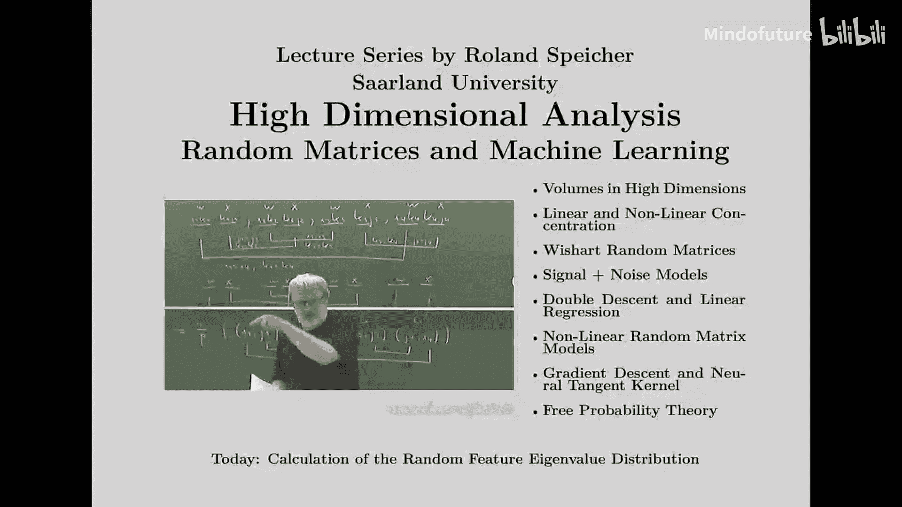
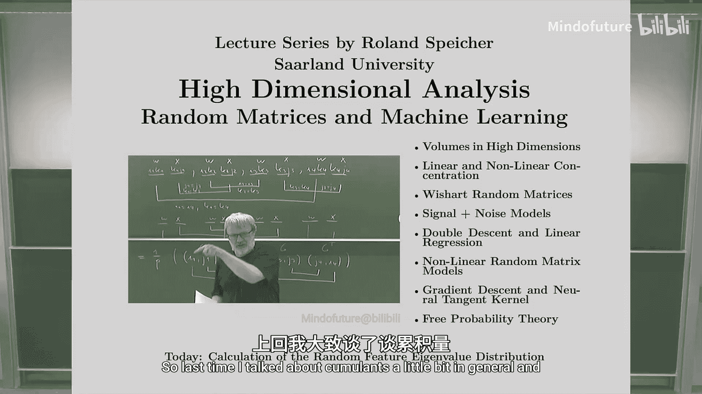
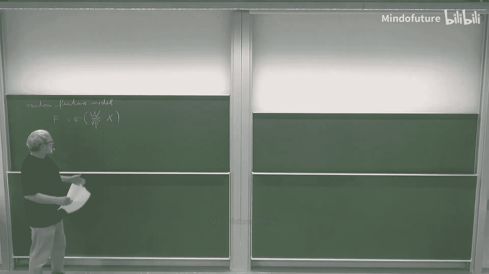
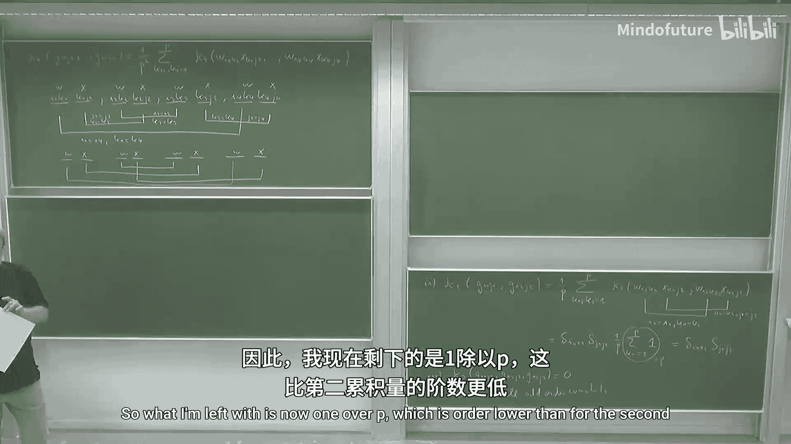

# 【德国萨尔大学】高维分析：随机矩阵和机器学习 ｜ High Dimensional Analysis p24 P24_随机特征值分布的计算 -BV1XkkWBFEi6_p24-

So last time I talked about cumullans a little bit in general and so I defined them by diagramagrammatic rules using partitions of sets and gave maybe the two main properties。

 name one that they characterize independence of random variables and the other one that we also have a nice formula to control the multiplication of random variables So if we take cumulantss and arguments are products of random variables。

 then we can reduce this to the cumulantss of the individual variables by also quite diaromatic rule and of course we want to apply this to our situation and maybe one can also see that the definition which I gave the moment cumulant formula which gives moments in terms of cumulantss really is very much connected to this cumulant expansion which。

Which will really be the tool。We are going to use。 Okay， but may。

 maybe let me go right away back to our random feature model。

 because that's what you want to understand。 So， I mean， the random feature model。So what is this？

That's， yeah， our。Simst non trivial example of a neural net where we are looking on the feature matrix。

 which is sigma。Of。W。Normalized by square root of P times x。 Okay， so x is the data matrix。

 W are the weights in。For for the first player。 And then we also apply。Entry wise。

 a non nonlinear function sigma。 Okay， and this gives us a feature matrix and understanding ya values of F F transpose that somehow what one needs to。

 yeah。To do linear regression for this thing。 Okay， and of course， X and W are easy matrices。

 So we assume them to be standard Gausian matrices。 So so this means all entries are independent。

 all have Gaussian distribution And， of course， each of them， we understand quite well。

 X X transpose gives the Tray gives the Macchan pass to a distribution。 But now， of course。

 we have the problem。 we multiply two of them， which means the entries are not independent anymore。

 they are not Gaussian。 And then even worse， we also applyli non linearity。 And the question is。

 can we also deal with this。 And if we want to imitate what we did。

For the proof of bachanco Paua， then we should。 we will try to use this cumulant expansion。

 but this means we should have a good understanding of the cumulants of the entries of those matrices。

 Okay， and last time I gave you essentially all the tools which we have about cumullans。

 And now we should see whether we can apply them in our context。

 so what we need is the cumulants of the entries of these matrix。 And I denote them。By FI J。Good。

 and so we won't want at least asymptotically the leading order of the cumulants of those guys。

 And of course， we， we should start， of course， x and W that cumulants are easy。

 I just we write them down again。 Then we should see whether we can understand the product。

 and then we should go over to also applying this non nonlinear stuff。

 So so intermediate step will be to understand this matrix here。 Maybe that's the first step。

 So I call this G。And the entries of this。BB GIJ okay。Good， but maybe first， let let us just collect。

 write down what we know about the cumul lines of the entries of x of W。

 X and W are the same kind of matrix。 And， of course。

 those are just the cumul lines of independent Gaussians。 And that's quite easy so。

I collect this in the next proposition。So let me take this matrix x。

Where the entries are denoted by X I J。This is a P times n matrix。 And this should be a standard。

Gous in random matrix。Theres a standard。G in random matrix。

So this means all entries are independent and all have a standard cost distribution。

And then I'm claiming that we takeno cumulants in the entries of those guys that more or less all of them are0 with this exception of a second order one。

Also there， it's， it's very special。 Okay， so the statement is。D。Or cuulan？In the entries of x。

 so in the X I J。So the X I J are the random variables in which I'm interested here。 So they are。

Most of them are zero， and there's only the exception。Of the second order。Orra once。 Okay。

 so the second orura1。 So this is just Ka 2。 So I have two， yeah， two arguments。 And I mean。

 the arguments should come from here。 So I I have。 So one of them is， let's say X。

 I J and the other is x。K， L。 so if， if I'm saying， I mean， the cumullan in such random variables。

 and I meaning that I'm choosing among those random variables for for the entries of my cumulant。

 Okay， so it's this one。 And this also is0。 is the exception that this guy is the same as this guy。

 Okay， so this means。The K has to be equal to I， and the L has to be equal to J。

 If this is not the case， then it is 0， and otherwise， it is equal to  one。And， of course。

 the second cuulland is the covariance of those guys。 Good， Okay， and I mean， this， this is quite。

To reveal by all we know。So maybe first of all， we know that the X I Js are independent and we have seen that independence of random variables is equivalent to the vanishing of the mixed cumulants So this means if I have cumullans indoor those x's and they are not all the same then it is0 because then I have a mixed cumullan so。

Since。I mean， the XIGA independent。Mix cumulants in them vanish。Kun난？When is。

This was our characterization。7。12， which was saying independence is equivalent to the vanishing of mixed cumulants。

And so the only possibility of non vanishing cumulants is if all the arguments are the same variable。

 so。Does。李红利。Possibly non zero cumulant。Cumulan。Are ones where， okay。

 maybe a prior it could be an en cumulant， but the entries are all the same。 Let's say I J， X， I， J。

 X， I， J。So all the entries are X I J。Good， okay， But now we also know that each X I J has a gaus distribution and for the gaus distribution。

 we， in principle， at least know that only the second cumulantss are different from0。 I mean。

 I calculated this， mean， this， this analytic。Characerization， for example。

 that we have to take the logarithm of the characteristic function and the characteristic function of the gausian distribution is very simple。

 And if you take the logarithm， you only have an x squared term which means exactly that only the second cumulant is different from 0 or the other ones are equal to 0。

 So this means this here is。Only different from0。If n is equal to 2。

 and then it is equal to one because we use standard goess。

 we have the second moment and And then also the second cu land is equal to one。 Okay， yeah。

 so I mean， this， this we have。sn。In the remark。After2 point。No 7。3。

we talked about analytic description of cumullanants。 But in principle。

 you can also see this in a comminatorial way because what。

 what is it saying that only the second cumullans。A different from 0。

 If I use the moment cumulant formula， this means。That and a moment of a ga distribution is given by counting the corresponding pairings。

 So， so may， maybe just as an side remark。 So I mean， if， if， let's say if G。

Is a gaus distribution then the moment cumulant formula tells me that if I calculate， let's say。

 the ms moment of this， then I should take the moment cumulant formula tells me I should sum overall partitions。

Of M elements。 And for each， I get a contribution， which is the product。

Of the cumulans corresponding to the blocks。Okay， but if only the second cumulant is equal to one。

 this means that each block that only a block of size 2 makes a contribution because a block of size 2 makes a contribution。

 Ka 2。 a block of another size makes another ka is a contribution。 But all those kas are0。

 So this means because I have a gaus。 So actually here， I'm just summing over pairings。So usually。

 I didn't know them by this。 Okay， and then each pairing， what is the contribution of each pairing。

 I mean， it's a product of the contribution of the blocks。 Each block makes a contribution of cup 2。

 but this is one because let's say we have a standard one。 So I mean。

Phi of g squared is equal to one。 So we get the contribution 1。 So this means essentially。

 I'm just counting or essentially exactly。 I'm just counting here。 the number of pairings。

Of M elements。 And if is， if M is up or， there are no pairings。 I mean， I mean。

 a pairing is a partition where each block has two elements。 And of course。

 if I want to decompose an odd number into groups of two， that's not possible。 Okay。

 so that's and if I。If I have an even number， then discounting can be done very easily。

 And then we are really seeing that we are coming back to the formula。

 which we had in the very beginning in the first assignment for the moment of the cow。 So So。

 so I mean， if， if so what， I mean， if if I want to count。The pairings of。Let's say22 R。

 if M is equal to2 R elements。 I do this in a recursive way。 So pairing means， I mean。

 each element must be paired or matched with another one。

 So the first guy has how many possibilities2 R -1。So。

 so I have two R-1 possibilities for choosing the first pair。 After having chosen the first pair。

 I mean， then I pair this guy is one of the other guys。

 and how much are left there are two R-3 guys to， which it can be pair So so then for the next pair。

 I have this many possibilities and then so on。 then for the third pair， I have two R3 possibilities。

 And then I'm going down up to。呃。Yeah， up to the end， until I have paid everything。

 And so the possibilities for such pairs， such pairings is exactly disk。

This kind of factorial going down in steps of 2， which we dennoted by this double factorial。

This is just by。The notation for this。 And this was exactly the moment of the gaus。

 which which we got from the distribution of Gaus So you see that this also fits very well with this。

Moment cu란 formula。Okay， so， of course， it has to fit because we know that analytic description and this combinatorial description are the same。

 but we can see independently for both of them that the cumulants of a gaus are very simple。

 And I mean， that's also a point a good point of。Of of the cuullan。 I mean。

 some things are getting an easier description in terms of cumullan than in terms of moments。

 Of course， we can write down the formula for the moments of a gaus。 but for the cumullan。

 it's it's even much simpler。 Okay， anyhow。 So so here in this context， it tells us。That。

 for our standard。Yeah， random for， for our thousand random mates。

 all the cumulants are0 with the exception of the second cumulant。 where I have the same guy。

And so he， of course， I also the independent of the axis tells me that it can only be different from 0 if。

 if they are the same。 Okay， so this is just collecting this together。 So so this， this is simple。

 I mean， those guys， we understand very well。 But now the question is， can we also go。

Go over to more complicated situations。So for x， and for W， of course， it's the same。 Okay。

 but how about now W times x， if you take the product， can we still。Deal with them in a。

 in a good way。Do we get。Good information about the acuulants。I mean， if we want to use our。

Cumulan expansion formula。 We need information about the cumulans。And hopefully， I mean， still。

There are many of them， which are equal to 0， because if you have to take the the whole cuulan expansion with all the terms。

 I mean， this， this is hopeless。 it's only the hope that many of the terms are equal to 0。Good。

 so let us look on。This situation。 So now we consider， So this G， which is the product。和手机。This is。

 yeah this is normalization。W times x， which is a。M times n matrix。

 So X is a P times N W is a M times times P matrix。 So the product is a M times n matrix。

 and the entries of this G。I did not buy GIG。Okay， and so let us maybe start to calculate a few small cumulantss。

 Okay， so maybe start with the first one。 So what is the first cumulant of those entries。

So the cup one。Of G IJ。Yeah， of course， we have to reduce it to the entries of the ws and the xs for which we know something。

 And of course， the W and the X are independent。 So the entries here and the entries here are independent。

 So we have all information about them。 The question is only whether we can use this to get something concrete here。

 Okay， so we have to rewrite this here。So if I take the I J entry of G。

 I have to rewrite this in terms of the entries of W and X。 So it's just the matrix multiplication。

I'm summing over the index， K。This goes from one to p。 Then I have this one over one P。

 which I can take out。 And then I have couple  one of。 Yeah， the G I J is the W。IK。X。

K J this is just written down the matrix product of W X。 I mean， the W I K are the entries of W。

 the X K J are the entries of of x。 And I want the I J entry， and I have to sum over K。

 and this one over square of Ps is here。Okay， and so what is this。Yeah， okay。So this， of course。

 is the moment of this one。 K1 is the same as the expectation as the moment。 And， of course。

 I can write this in terms of cumulan。 namely， it is K 2。off。IK X。K， J plus。Cuple  one。W。

 I K times K1 of x。Kj。That's a moment cumulant formula for n equal to 2。

 Or you can say it's a product formula。 If I want to write。Cumulland。

 where one argument is a product。 It's the same。 But in this， this case， it's just the moment。

 cumulant formula。 This is the second moment。 And the second moment is given by this。 Okay。

 but so what do we know about this， So， first of all， this cup 2 here， this is equal to 0。

 because I mean， a w and the x's are all independent So here I have a mixed cumulland in independent variables So this guy here。

Is 0。呃。Since I have the independence。Between the W and the xs。 Okay， and T， okay， I mean。

 here cannot use independence。 But I mean， here， those guys are 0 because the entries of W or also of x。

 they are standard gas， which means they are centered。

 So we assume that the first moment and cup 1 is the first moment of this guy is 0。 And I mean。

 the same for this。Okay， so this means all terms are0。So this tells us that this is equal to 0。Good。

 okay， yeah。SoThis was just a warm up。 maybe more interesting is now the second cumulland。

Because maybe there we can get something non trivialvi。 So I mean， because for the x's and the Ws。

 it's exactly the second cumulant， which is there。 So probably this should also survive here。

 But but let us look on this。 So now I take a second cumulant off。

 So now I should take two entries of my matrix G。 So let's say I take G I1， J1 comma G I 2。J2。

And again， I have to rewrite this in terms of yeah the entries of w and x by matrix multiplication So so I do the multiplication here and here and so I get also a one over square root of P for each of them。

 so I get a one over P。Over all factor。 And then I'm doing the matrix multiplication。

 which means I have to sum over two indices running from1 to P。 And then I have here a cup 2。Okay。

 and the first G， the G I1， J1 is written as a product of W I 1。K1 times x， K1 J1。

So that's the G1 J1。Sming over K1 gives the I1， J 1 and3 of the matrix G。 Okay。

 so that that's one argument here of this couple 2。

 And the other argument is just writing the same for the G， I 2， J 2。 So this is W， I 2。

K2 the summation index now times。X， K2。截图。Good， okay。

 now you see it's getting a bit bit more complicated。 Of course， we I could say K 2 is the。

Is the mom is， is， is the second mom is the ice is。The second moment。

 minus the product of the first moment。 But let us use the， the。

 the product formula because I have here product， here product and here product and。

Our formula for writing this in terms of the cumulants of of this， this。

 this and this is that we have to sum overall all partitions which connect this guy with this guy。

 Okay， but furthermore， we also know that the ws and the xs are gaus variable。

 So this means only the second cumulants are there。 So this means I can only use pairings here。

 So this means and of course， I cannot， I cannot pair an x with the W because they are independent。

 So this means the only possibility which I can do here is pair this x with this x and this w with this W。

 And then， of course， I also connect this group with this group。 So that that's exactly a guy。

 which makes a contribution if， of course， if this。Second， cumulant。Is。

 is different from 0 But of course， those are only different from 0。

 if Im pairing w with the same w and the x the same。 So this means the I1 must be equal to I 2。

 and the K1 must be equal to K2。 So this here， if I want to pair this to get a non vanishishing distribution this tells me that I1 must be equal to I2。

 first index must be the same。 and the second index must also be the same。

 So the K1 must also be the K2。Okay， and here for the x is the same So this entry。

 So this here must be the same entry of the matrix as this。 So the K1 must be equal to K2。

 So that's the same condition as here。 and J 1。Must be equal to J 2。Good， so you see， we have。

Here are some conditions referring to the indices， which we have chosen here。 So we have Delta。

I want。Must be equal I2。And deelta， So J 1 must be equal to J 2。 Otherwise， it is 0。

 If this are satisfied， then I mean， yeah。If also then K1 is equal to K2， we get a contribution 1。

 Okay， so we are summing here over K1 and K2 independently but this condition here forces that they are also the same。

 So we are only summing。 I mean， I have this one over P。

 but then we are only summing over one of them because the K2 must be equal to K1。

So I'm summing over this。 And then， then all。Constraints are satisfied。

 and I get here to contribution 1。 So I'm summing you over one。 So I'm summing P times over one。

 So this gives me effect factor of P。Which， of course， nicely cancels with this。

 And so what I get here is a one。 If those two constraints are satisfied and otherwise。

 it is equal to 0。 So it's delta。I one。I too dareta。J1。J2 So you see， I mean。It's again。

 just saying that the two， So I1 must be I 2 and J 1 must be J 2。

 So the two variable here must be the same。Okay， so on this level。

 it looks like those are independent。 Okay， but for higher cuulants。

 they are not independent because they are coupled by the matrix product。 Okay。

 but here it's the same as for， for the X or the W。Good， but now maybe。

Really interesting thing happens for higher ones。 And first， maybe third order or odd order ones。

 day a day are0。 because you see， I mean， we always。If you do things like this。

 we always need to couple to pair x。 And if I only have what number of xes， I cannot pair them。

 Oh Okay， so this will not contribute。 So this means。That the third cumulant or more general。

 or what all cumulantss will be equal to 0 also。Ca 3 of。Independent what the indices here are， G I 1。

 J 1， I 2， J 2， G I 3。J 3 is equal to 0， and the same。The same。For all。What order。Cumimulan。

Just because if I write down the same formula， I need a pairing between the x's which appear。

 and I have exactly as many x's as the order of， of of here tells me。

 So here I would only have three x's。 and I cannot pair them。 So I wont I won't find any。

 any distribution here。 Good， but okay， of course， the even ones。

 there speaks nothing against having something for the even ones。 So in particular， K equal to 4。

 So let us now look on K equal to4。 That's really where。The first non trivial thing happens。

 That's a thing which we have to understand， yeah。Okay， so， of course， I mean， we cannot hope that。

The thought oraculant vanishes as in the case of a gaussin random matrix。

 but we can hope at least that many of them will vanish。 so that not。

 not all of them are different from 0， so but。Let us look on this。 Good， So I take。呃。

For cumullan or four entries。 And I mean。All points。 I mean， the indices can be arbitrary。

 So I call them I1 J 1 for the first guy up to。J I 4， J 4。 So we have to understand， in principle。

 all of them。And yeah。 so what is this， So this is。Again， for each G， we get one over squared of P。

 So we have 4 g， So we get one over p squared altogether。And then for each of them。

 we do the matrix multiplication So we express each G as sum over ws and x's in the matrix multiplication way as to4。

 So I have now to sum over four k。 I'm doing four matrix multiplication。 So I'm summing。

Over K1 up to K4 from 1 up to P and。I get a cup4 and now each of the G's is replaced by the corresponding product of the Ws and the x。

 so for the first argument， I have wi1 and then K1 multiplied with x， K1， J1 and so on。

 the same for the last WI4。K4 times x。期货啊。J 4， okay， and now again， we have now。A cumulant。

 where each entry is a product of two terms。 and we know how we can reduce this to cumulant of the eight arguments which appear here。

 the 4 Ws and 4 xs so。And yeah， we have to do this by looking on partitions。

 but we know we only are allowed to use pairings because both the Ws and the X's are Gaussian。

 So for each of them， we need blocks of size 2 because they are independent。

 We cannot connect ws with xs。 Okay， so we have to look for pairings where each block。

Connects to Xs or to Ws。 And then， of course， we have to satisfy this constrain that we have connect those four groups。

O， so what。Is the situation？So maybe I try it in a pictorial way。 So I have， let's say。

 I have here my indices。 I'm， I'm writing down the indices。 So I have here。 I1。K1。

 also that that's my W。Then I have here。K1。J1 so that that's the first group。

 Then the second group is I2。K 2， K2。J 2。Second group， then I 3。K3。呃。K3。J3。And then， I 4， K 4。K for。

J4。So that's， that's a W。 That's an X， A W and X， W and X， W N X。 Okay。

 and I have now to look for pairings。 Okay， and so。So let let me start。 So I mean， this。

 this x here must be connected to another x。 And there I mean， it's。

 I have the freedom of choosing one of them So all all are possible So let。

 let's say I connected to this X。 Yeah， Okay， and now I am looking on the W。

 So this W has to be connected to another W。 But now I have some constraints。 I mean， in principle。

 I could connect this with this。 But then actually， these guys here are connected。In total。

 and they cannot be connected to the other guys。 So I have this constraint that after I have done all my pairings。

 I mean， those four groups must be connected among themselves。 Okay， and I mean。

 if I connect this with this。 then these two groups cannot be connected to this anymore。

 So this means this W can only be connected to this or this。 And again， I have to freedom。

 I can choose one of them。 And so let's say， yeah， I'm going。To this one。Okay。

 and now I'm looking on the X here。 And again， this X cannot be connected。 No， I mean。

 there's only one x left。 So I don't have a freedom anymore。

 So this x must be now connected to this one。 and this W。Must be connected to this one。And you see。

 this gives me now again， constraints。 So namely。If I'm connecting， then the inices must be the same。

 So here， for example， I have that I 2 has to be equal to I 3 and also the K2。

Has to be equal to K3 here the。K 3 has to be equal to K4， and the J3 has to be equal。To the J 4。

 So I get conditions among the Js and among the I and， and， of course， among the Ks。 Okay。

 so what else So this。So here， this block， the I I1， has to be equal。

To the I 4 and the K1 has to be equal。To K 4。 And then the last one here， the K1。Has be equal to K2。

 and the J 1 has to be equal。呃，to j two。Good， okay。 And so what what we see is。Yeah， I mean。

 I'm summing over the case。 but again， I have K1 is equal to K2 is equal to K 3 is equal to K 4。

 which means all the case must be the same。 So effectively， I have only one summation over k。Okay。

 and the other conditions are conditions on the indices which I have here。 And essentially。

 they must be paired in， in， in a specific way。 Okay， but you see， this is not the only possibility。

 but I mean， I I had some freedom。 So namely， I had to freedom when I started here， I。

Connected to something which gives me a conditional indices。

 But I could choose this among the other guys。 Okay。

 but but you see what I get here in the end is essentially I go from here to here。

 then I go to here and then I go to here。 So essentially I go in a strictly way to all the guys which I have。

 And I mean in which order I go through this cycle。 This are my choices。

 So this means essentially I can do perutation on the position here such that I I get again the same picture here。

 So for example， another possibility would be so let me maybe。Write it again。u x。X。

 I'm not writing the indices anymore。So， I mean， my choice。 I mean。

 for this instead that this x goes to the next 1。 I could also go go here。And then I would argue now。

 what do I do with this W， I cannot go back to this one because otherwise。

 I could not connect all groups， but I could either go here or either go here。 So， and if I。

For example， go here。 I mean， then the rest is clear and this must be connected to this。And yeah。

 this。Must be connected to this one。 And then again， I get some condition on on the in days。

 So this means I have this and this and other other hamation possibilities。 Okay， and what。

 what other conditions， which I have there。So you see， I get one over p squared。

 and then I'm summing over k。 and for a K， which is equal to K1， equal to K2， equal to K3。

 equal to K4。 And each for each K， I get the same contribution。 if I get a contribution。

 it's always one。Because I mean， each pair gives me a second cumulant of either and x on W。

 which is always one。So this means for all case， I get the same。

 So I get P times the same contribution， which cancels one of the。

P squared one of the two ps in in the one over p squared。 So what I'm left with is not one over P。

 which is or lower than for the second cumulant。 Okay， so what is left is a one over P。

 And then what do I get。 I mean， for for the first term， which I have there。 essentially。

 I get the condition that the indices which I have as the indices at at the G should have a strictlyly kind of pattern。

 So namely， what I have there is I have the。

I mean， the first G is。I1， J1。The index， but the condition which I get from there。

 is that it should be。Related。2。Or maybe maybe let me write down the indices。 and actually。

To see the structure， it's nicer to flip around each second pair of indices。

 because then it's a nicer drawing。 So here I'm drawing essentially the G。Index。

 but maybe here it's better to draw the in index of T transpose。

 which is just flipping the I N J around。 So here I have。J 2， I2。 Then I take again the G， which is。

I 3。J 3， and then I'm taking again the G transpose， which， which is J 4。I4 okay。

 so that's the indices， but I mean my picture gives me some constraints on them。

 And what is the constraint I'm now in the first picture where I'm just taking them in this order。

 So you see that J1 has to be equal to J2 i1 has to be equal to i 3。J 3 has to be equal to J 4。

 and I1 has to be equal。To I 4。So you see， if I draw it in this way。

 we really have a kind of of circular condition that that's the same condition as if we do matrix multiplication here then this index has to be the same as this。

 this index is same as this， this the same as this。 And then if I take the trace， for example。

 I also have this condition So it's exactly the condition， which I also have automatically。

 essentially， if I take traces of powers。AndThat's， of course。

 things which will show up if I calculate products of my mates， which which I will do later。 Okay。

 but anyhow。 So I mean， this is the condition which I need that essentially the inices。

Which I have there。 the Gs must have this kind of cyclic。Behavior， or I， I can do a perutation。

 the other pictures will will be that I do perutations of of the guys here that I draw them in another order。

 So it it must be that I can permute the positions such that I find such a pattern。一样。

And so what we see here， this is also true for higher orderac cuulants。

 I suppose you see that this argument here。Doesn't depend much on that。 I have here four arguments。

 I could have more。 I mean， I always have to pair something with the next one。 So。

 and then I have to go on， and I can never come back to the first one until I really have run through all of them。

 because otherwise， I would not satisfy this condition that all groups have to be connected。好。

So if I go here， I mean， I I cannot go back here because I， I have to go on。

 I have to go until the end。 It's just one cycle that I'm running through all the indices。

 and then I can come back。Good， okay， so let me write down the。General。Statement about general。呃。

Cumed in this case。Good， okay， so let let me just write down。 So what is our setting， W is。

M times P matrix。And x。Is a P times n matrix so that I can multiply them。

 and they should be independent。Standard Gaussian matrices。Gian。T not cause in random matrices。Yeah。

 okay， and then。The cumulland。Of the product of them， so。I do't know the entries by GIG。

And the matrix by G。 So this is just one over the squared root of P W times x。

Which is an M times n matrix。 So those。Given by， Yeah， okay， so what I take。I mean。

 arbitrary Kappa R。And I have here entries arbitrary。 So a priori， I denote them by G I 1。

 J 1 up to G I R。J R， okay， and now I'm claiming this is equal。 Yeah， in many cases， it will be 0。

 and what I， I need some condition on the indices。 So name， namely， I need this kind of。

 ofcyclic structure so that I namely that I can。That I can。Pmute。

The indices such that after this permutation， they really have this kind ofcyclic structure here。

Okay， and I mean， for every perutation， which shows this structure， I get a contribution1。

 So what I get here is actually the the number of perutations that after this perutation。

 I have thiscyclic structure in。In this pairs of indices。 Okay， so and。

 and I got get also factor factor one over P So you see。If I have here R Gs。

 I get one over squared of P to the R。 But then in my summation， again， I will have summations for。

 for each matrix multiplication， but。They all will be forced to coincide all the case。

 So effectively， I only do one summation over K from one to P。

 So one factor P will be canceled by this。 And so I will be left with one over。P are over 2。

 which is coming just from the。From the1 over square of。P in in the definition of my matrix。

 So just from this guy here， I have this over two times。 I have this R times。

 But then I'm losing one because of my summation over 1 K。 Okay， and then yeah， I have to see。

How many perations do I have。Of the positions。Of yeah， the， the， the variables there。

 So let's say a perutation。In S R such that。After this perutation。

 I really find thiscyclic structure。 So this means if I'm writing down this pair， I sigma， I。G一。

Sigma 1 O， so now now I'm moving。呃。The， the sigma  one position to the first guy。

 And then I'm writing down the next one。 But in the reverse order， J。S J of Sigma 2， I of Sigma 2。

The eye of。Sigma 3。Jyoff。Sigma 3 and so on。 up to the last one。 where I have I of sigma R and。Or J。

J of sigma。I of Sig ma。And， of course， now， O。Whether I went with this or the other one depends on whether eyes is even or odd。

 But， of course， in the odd case， we know anyhow everything vanishes。 Okay。

 so eyes actually should be even here。 so that this also is。Is a good number。

 And then then I'm ending with this。 And then I should have this strictly condition that this has to be equal to this。

 this has to be equal to this， this to this and this to this and this to this。

 these are exactly the conditions which which I get from drawing the pairings。

 So this means I I ammute my guys。 And then I just do disconnect。 I， I connect。

The x here with the next X here and the W here。With with， with the W here。

 the X here is with this one now。 And I'm just going through this as a cycle。 Okay， so。

 so this means。Yeah， and I have to count the number of perutations。

 And each possibility like this gives me the same。 I mean， I mean。

 it could be that I have many possibilities for arranging it。 This in particular。

 if all the I and the Js are the same。 then， of course， this condition is always satisfied。

 no matter how I， how I relate them。 and then I will get more contributions。If all。

If all the I's and the js are different， then I mean there is only one possibility to bring them in this in this order。

GoodO呃。Yeah， so this means。This has a cyclic structure。And okay， of course。

 So it should be clear the condition that。I get。Anything， of course， or I mean。

 so this means in particular， many of those guys are equal to 0。 So namely if。

 if there is no permutation such that I can bring it in such a cyclic order。

 So what I really need is that the J1 here must appear again among the other j so that I compare it with this。

 Okay， so so this means the Js must show up in in this in cyclic order and and also also eyes。Good。

 okay， and， of course， yeah， if I is odd， this， this is equal to 0。 Oh this should be equal to 0。

Okay， so。Good， is this clear。Yeah， but this was before doing the summation。

 and after doing the summation， I have this one over P that that's it the final recital。

 So this corresponds to this So in this case， I is equal to 2 Yeah， and on no I is equal to4。

 So4 over2 is is 2 and I have yeah。Okay。But yeah， for， for odd us， everything is0， so。Yeah。

 this R over 2 is a natural number。Good， okay， and now so that's now the situation。

 the description for this product of w and x。 and maybe we can now check whether we can use this information for trying to calculate the eigenvalue distribution of G G transpose in the same way as we did Macacheco pass2a for x x transpose by the cumulant expansion maybe we we see whether we can really use this here for for going in the same way I mean。

 we have to we have the general theorem where we have also applied to sigma here。 but of course。

 as a special case， this contains also just this w times x。 So this is not the full fourth order。呃。

Equation， but it's only a cubic equation。 But， but of course。

 maybe one should also see that that we can get it。

 And so maybe let us look on this before we go to the non linearity， I mean。Yeah。Non linearity is。

 is one level of complexity higher。 so we should at least be able to。

 to say something here if if there's any hope to deal with the non linearity。Yeah。

 so let us try to calculate。The cumulant expansion。Of， or， yeah， for the， for the。

 for the steel transform of， of this object。 I mean， it's always a still transform。

 which which we want to calculate。Okay， so， so now I look on the still transform as offset。Which is。

 by definition， the expectation。Of the normalized traces of our。Matrix， yeah。

 and this is in this case， the G。 but then we take G G transpose and also divide it by n。

 that that's the one which has a chance to have a limit。

 And then we take minus set times the identity matrix。 This here is an。M by N mate， M by M matrix。

 So this identity matrix is the identity matrix of size M。 Okay。

 we take the inverse of this and then。Okay， the trace。And then the expectation。Okay。

 and without the expectation and the trace。 So just the operator， the inverse of this thing。

 that's what I denoted by R。 So the result。 this is R offset This is the operator。Good， okay。

 and then。Yeah。We start in the same way as we did it for Macacheo pastura。 I mean。

 we just arrived in the equation。 And this， this is just using the fact that our offset is the inverse of this。

So we do this now。Y， did。And from this， we get at one plus S offset set。This is now， okay， and。Yeah。

 this is not one over n times M times the sum over I and J。

The expectation of the G I J or the entries of the matrix G times。The G transpose。

How offset in of this the the JI entry。O。Yeah， so essentially what we have here。

 we have to take the expectation of G times G transpo times R That was what we get from the very beginning。

 And then we did the matrix multiplication to get to take out this， this。Variable G I J。

 because then we are in the context of this cumulland expansion。

 So I'm multiplying with one of our variables has the same effect as taking derivatives。

 if G is Gaussian， we only taking one derivative。 That's thestein identity。 if G is arbitrary。

 then we get here some of derivatives weighted with the cumulants， and which is a horrible thing。

 But hopefully we have enough information about the cumulants that it's not so horrible it's still horrible enough。

 but it at least on level that one can deal with it。 so that was yeah， what we have to do。

 And I mean， I wrote this down as a motivation for why we did the cumulland expansion。

 and now we can yeah use the cumullan expansion。 cumulant expansion tells us So I mean I mean。

 I have here the G I that's the entries of my matrix G， that's my random variables。

 so here I have one of those random variables。 And this here is。Just the function of all of them。

And so the cuminant expansion tells me that if I take the expectation of multilying with one of the variables。

 a function of order variables， This is the same as yeah summing over L。 then I have L factorial。

 and then I get。ACumulant of。Or a plus one， where the first guy is the guy which shows up here。嗯。G。

 I， J， okay， and then I'm summing over all the other ones。 So here's another sum。 Yeah。

 so I'm summing here over。 let's say G。P1， Q1 up  to。7。P A Q A。And then I get the expectation。

 And here the multiplication is now replaced by taking the partial derivative with respect to order variables which show up here。

 Okay， so I take here the partial derivative with respect to this variable。

 So let me denoteice by P1， Q1 then the partial derivative is the next one。

 which is P 2 Q2 and here P L Q L of my function And the function here is just。Yeah， is this。G体。

Are offset。JI。So there are a lot of of summations。嗯。Yeah， okay。 And now， hopefully， of course。

Not all of them will be different， but actually， we know something about them。 So， first of all。

 we have to find the s structure here and， and okay， even。C of all， we， we know that we need here。

Even number of guys。 So this means the L has to be odd。So let's say L plus 1。Should be even。

 So let's say this is equal to 2 R。 And then， I mean， I'm summing。Over those guys。

 but I'm also summing here over the first one。 So maybe I， I use a more systematic notation for them。

 I didn't I call them let's say I call here。 I call those guys I1， J1。

 and then I also call this here I and Js。 but now continuing here the numbering So this here is I2 J 2 and the last one。

Is。Oh， no， okay。 so so I call I did not then by I and J。

 but then I also know that I need thiscyclic structure so that。嗯。Yeah。

 so that maybe after some perutation， I have that this is G of。I， to。Cewan。I， too。Up to I 1。JR。

 also I need tocycl structure。Okay， and may， maybe let me write down one more。 Okay。

 I'm not going to do the， the full calculation。 I mean， is this will it's still horrible。

 And so details are。A bit tious。 so， but hopefully we get some idea that one can deal with this。

 So I have here is sum over。 yeah， the L， I'm summing now yeah because I only want to sum over even L plus one。

 and then。The kas， the kas， which are different from 0。 I mean。

 this have this one over P factor So this， they have the factor 1 over P to the R -1。And then。

 I'm summing over。The eyes and the chases here， such that I have herecycl click structure。啊。Okay。

Yeah， I'm summing over I1 up to I R。J1 up to J R。 And here。

 because I have this one over my L factorial somehow。Yeah， I mean。

 I get a contribution for eachcyclic structure， which I have here。

 but this is taking into account but iss one over factorial。 So if I write。

 if I write down one concretecyclic structure， then I can forget the other ones。

 because I have a factorial other ones in general。 And so this is， this is。This is deleted by this。

 So this means I'm， I'm writing down here and my sum。

 the situations where I have this circuit structure。 Okay。

 then the cuulant makes this contribution here。 And then I'm left with this term here。

 So the expectation of。Delta， and then， of course， those guys here are the guys which now satisfy the super structure。

 So I have here， I2。J1 Delta of I 2。J 2 and so on up to Delta of I 1。J R。

 so here the pairs of I N Js are appearing which geocyclic structure。 So this I。

2 is the same as this one， this。J2 is the same as the next one and so on。嗯。Yeah，And I apply this。

 Yeah to what。图。嗯。第是。G of T。offset。G1。Taiwa。Okay， and now。1。Somehow has to deal with this。

 And this is now。The summation。我哇啊。And the term are equal to one。

 This is the one where I only have the first derivative。 This is， of course。

 exactly the one which showed up in Macanko pasttua。We we used tostein。Identity。

 because the entries there of our metrics were just Gaussians。So what I have here。I have。

 in this sum， I have the term。For are equal to one。And then I have the terms。

 the other terms for higher R。f。Bigger than one。And this term。

 this is the same term as we saw in Machancho pasta， in the proof of Macchancho Paa。

 And there we dealt with this。 And there we got a contribution to our equation。

 And this can be done here in the same way。 and we get。A contribution in our equation。

 which is what what we， what we see in Mahenko past2a。 So this was。Treated。In the proof。

Of Machenko Paua。And here， of course， we get something more。

 And this looks quite horrible because we are summing overall all derivatives of all orders。 Okay。

 and the point there， the idea there is that， I mean。

 the next term will be the term which has three derivatives。 I mean， the first has one derivative。

 The next has three， because we only have the odd guys there。 So that the cumulans。

Even and then you're not trying to do all those derivatives， but you only do two of them。

 let's say the last the first and the last one。 And then you calculate these two ones you get something which you can write down and then you are left with all the other ones and what you are left。

 you can again compare to the structure which you have here。

 So you get a kind of recursion where if you're doing two of the partial derivatives。

 you're coming back more or less to from what you started with some modifications which you can control。

 this gives you a kind of of of reduction of this term of the higher order terms two things which which you also know so。

So， here you do。Two of the partial integrations。So you have you have a term with three3 partial integrations with5 to7。

 and then all of them you do the partial integration。

 let's say with respect to the to the first and the last one。

 and then you are left with having one partial integration plus three partial integrations with five partial integrations applied to always the same thing and the same thing is again。

 something which you can express in the st transform and those objects and and then you have to some of all partial integrations。

 and then you have essentially the same structure of the formula here and you can。Essentially。

 go back in your cumulant expansion。Okay， so it's， it's， it's complicated。 Probably， okay。

 it's not really clear what I'm saying here。 but I just want to say it can be done。

 It's quite of technical。 And， of course， you have to do asymptootic arguments because you get many terms。

 some of them survive in a limit。 That's the one which you have to identify。

 and some or maybe many will disappear asymptotically。 So they are， they are there a priori。

 They are not not equal to0 because of the structure of the cumulants。 but they have。In， in a limit。

 they are of lower order。 So they they disappear。 So even in our proof of Macchanko Passua。

 there was one term which was there， but it had factor1 over P in the end。 And so it it。

 it goes to 0。Okay， and so here there will also be many terms of those。

 And a lot of the work really is to argue and， to realize which terms will disappear in the end and that you can throw them away。

 And then you have to， to realize what what is left there。 Okay。

 so we do two of the partial integrations。And。Then reduce what is left。以30离。To from what we started。

 namely two versions。Of one plus S offset。 So we essentially we are going back here and this。

 And we get essentially this here multiplied by some other things which we have collected on the way。

 Good， but I'm， I'm not。I'm not。Want to do this。 And then maybe yeah， finally， okay。

 I can write down the equation because at least。So then what we get is one plus set times S of set。

So， this is。As of set times。1 minus gamma。1 plus set。As offset。And then， multiply。With 1， M，1 minus。

玩 over。Gma twitter。 Also we had two ratios。 because we have N M and P in the whole thing。

 And so we had two ratios。 If you go to infinity，1 was Gama and one was gama twi。

 And here we have one plus。Seid。Times。As of set。Okay， and so without this term here， this is what。

 what we get in Mahenko Patua。 So this corresponds to the first term。This one。

 and then the rest essentially gives us a modification of those things with this vector here。嗯。Good。

 okay， but anyhow。 I I don't want to go more into this。

 but I maybe it it's more interesting to see now about the non linearity。 Can we deal with this。

 Okay， so in principle， we could do this， But okay。

 there are too many indices and too many arguments about what asymptotically vanishes。

 So probably you have to do it five times before you get it right。 So maybe you could try it。

 but okay， I， I don't want to do it。 I I I'm more interested in non linearity。Because， I mean， this。

 this is quite complicated。 You could also deal with。With this situation。In other ways。

 maybe which in the end， maybe not so complicated， but the question is。

Can we extend this here to the non linearity。 So is it。

 is it of any use to have recognized the kind of special special structure of the cuulanants of our product of W and。

And X， Okay， and so now we want to look on。呃。So now that's the main thing we are really interested in。

 We're looking on F。 So this is sigma applied to G。 So G was the product。

 But now we applied this non nonlinear function。And the entries are FI J。

 And so can we still say something about the FI J。 Okay， and this is in the next proposition。That。

 mainly。The structure of the cuullans in the FI J is very much the same as the one for the G。

 So the non linearity do not really destroy the cyclic structure。

 or it it is really just a cyclic structure， which still survives in， in the leading order terms。

Okay， also in。Leading orderura。We have。For the cum lines。Of the FI J， the following things。Okay。

 and the main point is that it's， again， many of them are still0。 And again。

 what we need is the cyclic structure in the indices。 Otherwise， it's 0。 so only。Cumulants。With。

Cyclic structure。ADifferent from 0。Then， in particular。We also have that o cumulants are equal to 0。

Okay， now maybe the main point is really to see what are the non vanishing zero cumulants。

 And in particular， we should see that those two quantities。

Theta 1 and theta 2 coming from our non linear function somehow show up there。

 And they are really exactly。 They are more or less the values of of the cuulanants。 So namely。

 first of all。For the second order， cuulant。So， cup 2。So we have FIG。And it's onlycyclic。

 So this means the second guy must be the same as the first one。 So that's different from 0。

 And this is exactly this theta 1。 So this is now not one as before。

 but now it depends on the sigma and it's theta 1 of sigma。

 And I recall that this was that we integrate。Sigma squared against the gauuse distribution。

E to the minus T squared over 2 divided by。So this is the density of the cows， D T。Okay。

 so so we see that y theta 1 comes into the game and the higher orderac cuulants， actually。

 they go with the other theta， the theta 2。Okay， so if I look on something of length to R。

 when our R is bigger than this， then。Okay， then I need。I need acycl click structure。

 So I have your I1。J1。The next one should then be。I， too。Ciwen。F。I 2， J 2， and so on。If， I are。

J R so thecyclic structure means that this guy must be the same as this guy。

 This one must be the same as this one and so on。 So I mean。

 if you revert the order of the I N G of every every second one， then it really is。

 is this nice picture without a reverseversion。 I mean， it's， it's that that this goes with this。

 this goes。Is this and so on，Okay， so we have this strictly structure。 But if we have this。

 then what do we get。You still get this。1 over P to the R -1， but then not times 1。

 but times this other quantity， which was theta 2 of sigma。

 And this we get to the power R because it depends on this。 But essentially， it's， it's on theta 2。

 Okay， and I will also recall what the theta 2 was。 That was not integrating the sigma squared。

 that that was integrating the derivative of sigma。And， of course， the point is， I mean。

 why the heck should we get those strange quantities for the cumulan， I mean， that's。

 that's what we really should understand。 And if if the cumulant is diagramaramatic point of view is of any use。

 it should tell us why we， why we get those things。哦。Theta 2 of our function。

 So this was integrating over R the derivative of our function with respect to the Gaus。 again。

 with respect to Gaus T squared over 2 divided by two this。 And we take the square of this。

So you see I have here to the power R。 So essentially I have this integral over the derivative for each of the factors。

Yeah， okay。 And this is actually， for the case， where I assume that all the eyes and the js。

 which I have here。disjoint so that there's only one cycle structure there so that there are not more perutations that I could also bring them in other cycle structures。

 because then it would become confusing。Okay， but but in the end， I mean， if I do my。

If I do my cuant expansion， I'm summing over all indices I and J and I can neglect the cases where some of them are the same because they are of lower order so I mean it's really the main information which I need is the one where all of the I and js appearing here are different and then if I have a cycle structure here。

 there is no other way of bringing it into a cycle structure。I mean， if all I N Js would be the same。

 then this would be a psychostructure， but then I could permute it。

 And I would again have psychostructure。 And that's of that's a confusing situation。

 which is not so hard to not not so easy to understand。 but we don't need this later。

 So here I assuming。For。For this jointin。呃。I1， J1。To I R J R。 So all of them should be different。

 And， of course， R should be bigger than one， because for I equal to1， it's this one here。

 So you see it's different。I mean， the second cuulant goes with theta 1 and all the higher ones are going with theta 2。

 which are two different values coming from my function sigma。Good， okay。

 so let us think a little bit about the proof of this。Whether we can understand this。Okay。

 so maybe first。Yeah，1 and 2。 So this says that only cumulants with a cyclic structure are different from0 and odd cumulants are0。

 And I mean， this， this is somehow。Clearly， I mean， you should。

 the best thing is you think that your sigma is， is， let's say， a power of something So， so， I mean。

 if you have sigma。 So if you take， so this， these are the sigmas of the Gs。Okay。

 if you take here power of G here another power of the G， here another power of the G。 then。

 of course， we have you， you have all the Gs， which have this cycle structure。 and now you must。

You must sum over。呃。Partitions where you do connections。

 but those connections must satisfy the cycle structure。

 because you order that the Gs have the cycle structure property。 And this means， of course。

 if you don't find here cycle structure， then also for Gs， you don't find find the cycle structure。

 Okay， so this， this is somehow clear that the cycle structure。For the G。Gives you。Also。

 the cycle structure for。For the Fs。 So this follow。From。Slicity。Of the。Cumulans。For the G I J。Okay。

 yeah， but， but one case is， is not， doesn't does not follow directly。

 that that's the case if I have a K1 because。So， but what。About K1。 So， I mean。Yeah， because in K1。

 if I have a product of cheese。Then， I mean， I don't have to respect the psychostructure because then I。

 I don't need。I don't have to connect groups。 If I have Ka 1， If I have a product as an argument。

 there's no condition of connecting groups。 So I don't have to respect any cycle structure。

 I don't need a cycle structure。 If I have， if I have a ka， a higher ka。

 then I have different groups。And I must connect them。

 And so this means I must have this cycle structure for the connection。 Okay， for Ka 1。

 this is not the case。 So K 1， we should think about separately what we have there。

 in particular here， I'm claiming this is also0。This。

 this does not follow from the cycle structure argument。

 So this is something which we have to look separately。 But what about Ka 1。 So， I mean， the F I J。

The I J entry of the of the matrix F is just sigma of the I J entry of the matrix G The G was the matrix W times x。

 the one for which we know the cuulants very well。嗯。Okay， and maybe。

Maybe now we should think what actually the G I Js， What are they， What is that distribution。 I mean。

 we， we did not really talk so much about it。 We， we only talked about cumulan。

 but more about different ones。 But what， what is， if I have only for fixed I N J， the G I J。

 So what actually is this。 I mean， if I do the metrics multiplication。

 So this is one over a square of P。Suming K from1 up to P。WIK。X， K， J。

 that's just writing down what it means that the matrix G is the product of the matrix W and the matrix X。

 Yeah， and I'm writing it in this form。Yeah， okay， now I'm summing here。 So I'm summing here。

Variables， and no one should observe that those guys here for different K are actually independent。

I mean， I'm multilying。I'm multiplying W and X。 So， I mean。

 the entries and W and X are not independent anymore。 But if I'm looking on one entry。

 it is written as a sum over those things。 And if I have here different case， I mean。

Let's say I have W， I 2 X2 J， and another term is W， I 3 x。3 J。

 then I mean the w's and the x's with different indices are all independent。 So I mean， I mean。

 this guy here is independent from this one because I mean， the w is independent from this W here。

 and the W and the Xs， they are independent anyhow。

 So this means all the terms here for different case are independent。

 So what I do here is I'm summing over independent variables And actually the mean of each of them is 0。

Because the expectation of the broad act。They are independent is a product of the expectations。

 but each of them is a0。 So what I have here is actually， I'm in a， in， in the realm of the con。

 the context of the central limit theorem。I'm summing variables。

 independentdepend variables of mean0。 and I'm normalizing it by the square root of the number of sums。

 And this tells me for big P， this quantity here is close to a Gaus distribution。啊。😮，Yeah， so I mean。

 those are independent。4。Different K。 And they are also sent out。So this means。

That each entry of my matrix G is actually。Close to a gae。So to GI J。Is。For large P。

The gaus distribution close to it But by the central limit theorem。Okay。

 and so this means they are now calculate。The cup one。Then。In principle， we get something。

Which might not be equal to0。Then we have to have a closer look on our theorem because we there had an additional assumption about our sigma。

Which exactly makes this term equal to 0。And maybe now you also see while the conditions or also the theta 1 and the theta 2。

 we calculate something with respect to the gaus distribution。And I mean， here。

 that's the reason here that the G I Js have a gaus distribution。Good， okay。

 but so let let us look on the cup 1。 So if I look on the cup 1。Of such an entry FI J。

So K 1 is the same as the expectation， and the FI J is sigma。Sigma of。GI J。Okay。

 and as we have seen here， the G I J。This is close to a Gaus distribution。

 So what I'm doing here is I take the expectation of the function sigma of a Gausian variable yeah。

 but so this means this expectation here is integrating the sigma of T and T has now the Gauss distribution。

 So this is E to the minus。T squared over  two divided。By described of。wo排DT啊。So that that's cup one。

Okay， and。Integration with respect to the gaus distribution。

 because those entries here have a gaus distribution asymptotically。 Okay， now， of course。

 there's no reason why this should be0。 And the only reason is because we require to be0。

 That's what we did in our theorem。 That was an assumption， which I stated at the very beginning。

 We look on sigmas。 And we normalizedize them somehow such that this guy here is equal to 0。

 So this is an assumption on our sigma。Okay， now maybe it's。

 it becomes clear why we make such an assumption。 Good， Okay， so， and so Ka 1 is also0。

 but not by general arguments， but because we had special requirements on the sigma。Yeah， good。

 and now。Let us look on yeah， K 2。 So what is K 2。So，C 2 of。F I J。 And here we need acycl structure。

 So the second variable must be the same as the first one。 Otherwise it's0 anyhow。

 And what is this now， Okay， for copper 2。Maybe we can2 to co。 So it's the expectation。

Of the product So of FI J squared minus the expectation of F I。J squared。Okay。

 but we have just seen the expectation is the same as the first cumul And so this guy is 0。

 So it's just the second moment of this。 Yeah， but now as before。

 this is the expectation of and F of I J is the application of sigma to the G I J。

So I take the square of this。 But as before， the G I J， I mean。

 here we are just talking about one of the entries。

So you see because here I have the same as as here So it's just about one of the random variables。

 So I take here the expectation of sigma squared of yeah a variable which has approximately a gause distribution。

 So again， this is just the integral of sigma T squared and then integrated with respect to the distribution of this guy。

 which is a gaus。Minus t squared over 2 divided by。Squad of。To pi。Yeah， okay。

 and this is exactly what we denoted by theta 1 So this is theta1 of our function sigma So， so yeah。

 we see why， why this quantity now makes appearance here in particular。

 why we are integrating the respect to cows。I mean， at beginning， this is， this is， is not clear。

 But the reason is that in our matrix G， the product W times x， each。

 each entry has a ga distribution in the limit。Aent limit。Good。

 and now maybe the most interesting thing is most complicated thing is is 4。

 Why do we see this other quantity there， Okay， and so maybe。Yeah， maybe let me。

Try to do this in the last5 or 10 minutes。Yeah， and for this。It's probably the best。To take。

For sick mass， I mean， if if you want to do。Something concretely with using our product formula for the entries。

 I mean， we， we should have sigmas， which are， let's say products So we we， we take for。

We take for sigma， we take a polynomial。 Then by linearity。

 we can reduce this to the situation when each entry we just have a power。

 And then we should see that we have this formula for powers。And then by linearerity and continuity。

 it goes over to more general functions。Yeah， so I'm checking it for polynomials。 So let's say I。

 I'm looking on Kappa。To are。offff。Yeah， and so the sigma of Q is now polynomial。

 but I take different polynomials in different arguments。 I mean， it's a polynomial。

 it's a sum of different powers。 And by multi linearity。

 I can reduce the situation to the case where I have in each argument I have one power。

 but they might be different。 So let's say have here， I1。Chay 1 to the power。 N one， let's say here。

 I have a G。I， to。J1 to power N 2 and so on。 And T I， I have a G， I R J R。

 So the inices have to have the circuit structure and T I have a power N to the2 R。Okay。

 so the question is， what is this？In leading orderura。Okay， and so， I mean， what what I have here I。

 I have here， I have here some cheese So G， I 1， J 1 up to G， I 1， J 1。 That's the first group。

Then I have here she。I to J1 up to G。I too。呃。J1。And then I have more。 And then I have the last group。

 which is the G I R。JR。A couple of times。喂。啊。J R。Okay， good。 And for this。

 I have to calculate my cumullan and now I have a cumullan where I have product as entries。

 And so the rule for calculating this or reducing it to the cumullan of the Gs themselves is that I should sum over partitions。

Where， of course， the cumul corresponding cumullans are not0。

 but I also get disconnect connectedness。Okay， and I mean， I have thecycl structure here。

 So this means。If I connect the Gs， I must also connect them in the s structure because for the Gs。

 I know I need the s structure， and I have chosen all the eyes and the G is different。

 So this means there's only one s structure。 So I cannot close my cycle before before I really have reached the end。

 So this means I must have one block。Ithich connects essentially all the groups here together。

 So there must be。There must be one block which connects a G from here with a G from here。

 with a G from here and so on。Up upp to this one。Because this， this is a contribution which survives。

 And we know that such a contribution in the Gs。 This gives me this contribution1 over P to the R -1。

That's。That's this contribution， which is coming from here。 So so I need。At least one block。

 which connects all the Gs。Because I have to make a connection of all the groups。 And I can。

 I cannot， I mean， such。Connection here cannot stop earlier。 I cannot say， okay。

 I have a block which connects a few of them。 And then I have another block which connects the other one because those blocks won't have acyclic structure。

 So they will， will make a contribution0。 So I only have a， have a block。

 which has acyclic structure， which connects all of them。 Okay， so I have one such block。

 and this makes this contribution。 Okay， but then I should connect all the other Gs。 and。Yeah。

 and then because everything is already connected。 I mean， I don't have to care about connectedness。

 So now I can just make connections at will for the other guys。 But， of course。

 they must have thecyclic structure。 And， I mean， Im， I'm not going to use another。 I。

 I could use another block， which connects everything。

 But this would would give me an another1 over P to the R-1， which would be of lower order。Okay。

 the question is， can I have something which， which is of better order？ And actually。

 what is of better order is if I connect， I mean， I can also connect within the groups here。

 I can connect in pairs。 So， so Im， I mean， within each group， I have the same variable。

And I know that this is a gause variable， which means the the cumulants for them only there of order 2。

 So for those I should make connections in pairs。 So I can connect here in pairs。 those guys。

 and those each of them will make a contribution one， one is good。Because this， this will survive。

 and I connect here。 the remaining ones which I have here。 I can also connect in pairs。

All possibilities for all payers and the same for each of them。I。

 I cannot connect between the groups here。 Okay， because the circuit structure prohibits this unless。

 unless I connect everything， but this will be a lower order。

 but I can connect within each of the guys here。 This gives a very high order。 Okay。

 so this means I'm connecting here。 all of the guys。 But this means what I do here。嗯。Is。Yeah。I mean。

I have one of the Gs。 I have removed， and then I have。And one-1 G is left。

 And if I'm summing over all pairing for connecting them， I just calculate the corresponding moment。

So what I get in the end， the leading order contribution is exactly coming from。呃。Yeah， one block。

 which connects everything。 This block gives me a one over PR-1。 But actually， this block， I have。

I can make a choice which of the Gs I take。 So I mean， in the first group， I have N N1 Gs。

 and I can take any of them。 So this means I have here。The expectation。 And in the first block。

 I can make a choice。I mean， I have this N1。 or maybe I take this N1 out because， I mean， so I mean。

 I have N1 choices in the first group and two choices in the second group and so on up to an our choices in the last group。

For choosing was just one of the Gs。 Okay， and after I have done this in each group。

 I'm left with 1 G less。 And then then I'm summing over all pairings for， for this group of。

 of one G less。 and summing over all pairings。 this gives me the expectation So I get here the expectation of the first group。

 the expectation of。Of the G I 1， J 1。But to the N1-1 because I have removed one。 one of the Gs。

Goes into this block。 And I'm just have to pair the other ones。 So it's one less。 Okay， so this。

 this is the contribution which I'm doing here。 And independently of this in the second group。

 I'm summing over all pairings of the and 2-1 Gs， which I have there。

 which gives me the expectation of。Of a。Cie， what I do I have there。I， too。J1。嗯。To the power啊。

And 2-1。And so on， up to the last one， the expectation of。G。I R J， R to the power and2 R。-1。Yeah。

 okay， but now you see essentially， I can put the N1 equal to to here， the N2 equal to here。

 And then what I have here is actually the derivative of the power。 So I mean， if I。If I say。

 if I call this， let's say sigma1 of the G， and I call this as a function， the sigma 2 of the G。

 Then what I have here is the derivative。 I'm getting down the corresponding power and the power is reduced by one。

 That's just the derivative of， of this function。So what I have here altogether is one over。PR-1。

 And then I take the expectation。 and this N1 times the expectation of G I 1， J 1。

 So this is the expectation of sigma 1 prime of this first。G， very， but I won。J2。And so on times。

 the expectation of G， the function， which I applied to the last one， G， I R。JR。O。Yeah， and so。

You see what I get here。The Ka2 R， if I now just take the same function for all of them， G I 1。

 J 1 up to sigma of。G I R。J R so this is one over。PR -1。And then， I have this expectation。

And it's always the same。 Now it's， it's the derivative applied to the G。

 but the G is just one of the entries。 And this has asymptically， again， a Ga distribution。

 So I take here the， the derivative expectation of the derivative of G。Let's take the first one。

 I won。截图。But all the other ones are the same。 If I， if I say all the sigma are the same here。

 then I get this to the power2 R。But this here is， again the gauss。

 So I calculate here that derivative， the expectation of the derivative of my function applied to a gaus distribution。

And again， this is exactly what this Theta 2 is doing。 So what I have here is one over。PR。in-1。

And then this expectation， this is the integral over R sigma prime of T and then。

Integrated with respect to a ghost distribution。Because each of the entries of my matrix G has a Ga distribution limit。

 And this is just， yeah， function applied to this， to this variable。 Okay， so I'm getting this。

And I'm getting these two r types。Okay， and theta 2 was exactly defined as this quantity to the power 2。

 So I'm getting the whole thing to the power R。 So I have1 over PR -1。

T the two of sigma to the power R。Because the two here was in the definition of the Theta 2。Yeah。

 okay。 and so。Yeah， so we see， hopefully。Clear away why this Theta2 shows up also in this calculation。

 also， also why we have this difference between the the second cuul land and the higher even cumul land。

啊。Yeah， I mean， this， this year is to maybe the most complicated calculation in this， this context。

 But it I think it gives a good， a good idea why we have exactly this structure So， so we have。

We must make this connection somehow in as high order as possible。 So this。

 this will give this factor。 We cannot do without this。 But then the rest we just do by connecting。

W are gas in each of of the guysa So this will not change the order。

 and this will give exactly contributions according。To this year。 good， Okay， And then， of course。

 you can now use this。Again， in a cuant expansion and do what I。

Did not do before because it was complicated enough。 Now it will be even a bit more complicated。

 but in principle， it it can be done So you can use this information。 And then in your calculations。

 the theta2 and the theta 1 will also show up。 And then in the end。

 you really get you get the equation which I short in in the theorem at the beginning。

 Okay so I'm not going to do the details。 Maybe if you want to look it up。

 So essentially this is an approach which was done by Vanessa Picolo and Dominic Schroda。

 So there's a paper。On them。 So I was following more or less their approach。I mean。

 one can prove those things also in other， other ways， but they did it in this way。

 which I found nice。In some way， at least for conceptual reasons。 I mean。

 concrete calculation at the end gets complicated。 but maybe there's one point。

 But I think I will talk about this next time， namely we saw that the effect of the non linearity is the same as adding an additive noise to the problem and maybe。

If。This approach here is at least good for something。 it， it gives you an idea why this is the case。

 So we should， we should maybe see next time that actually。

 what you get for this non nonlinear random matrix model for the F is actually the same as what you get if you take the G。

 and you add an additive noise to it。 Okay， but next time I will。

 I will talk a little bit more about this。 Okay， thanks。

