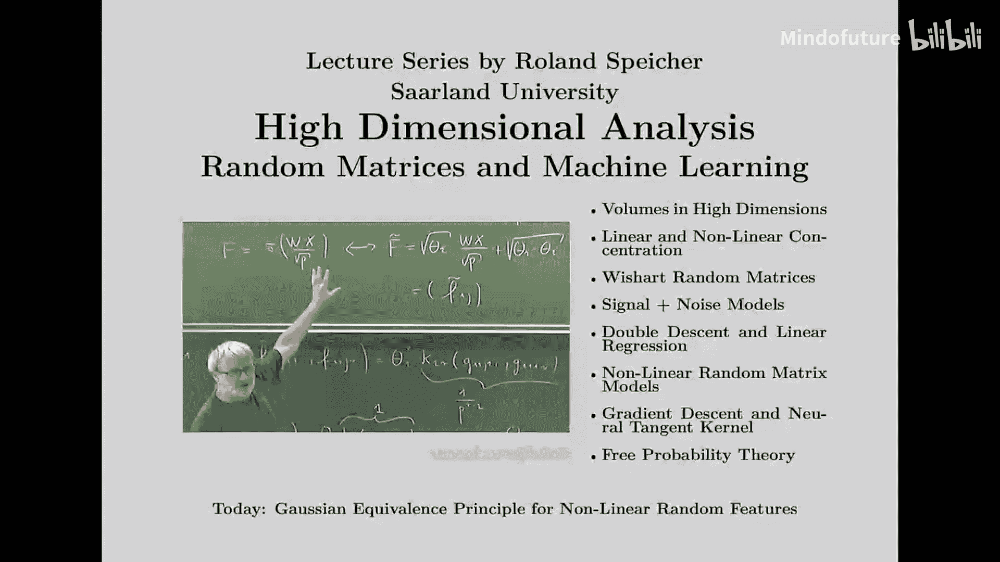
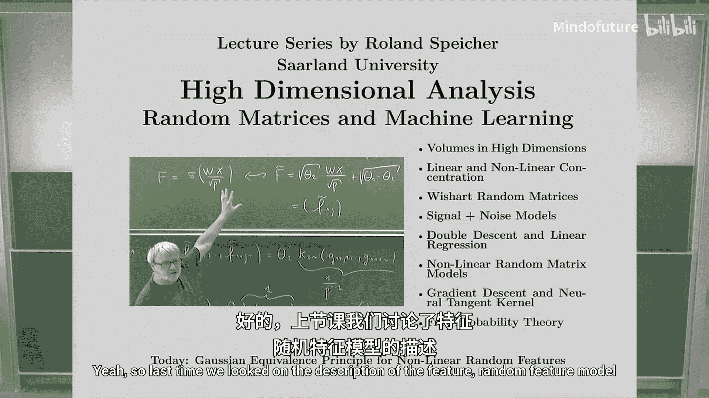
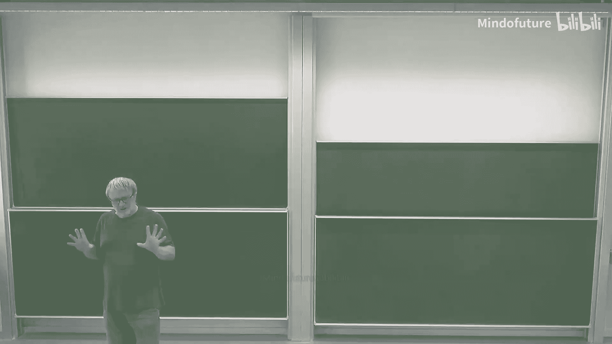

# 【德国萨尔大学】高维分析：随机矩阵和机器学习 ｜ High Dimensional Analysis p25 P25_非线性随机特征的高斯等效原理 -BV1XkkWBFEi6_p25-

Yeah， so last time we looked on the。

Yeah， description of the。The feature， random feature model where we have a non linearity and in principle。

We understood this by looking on the cumulants of the entries of this matrix and we saw that this feature matrix which is given by taking nonlinear function of the entries of a matrix which is given by the product of two gausian mates that those cumulantss have a specific structure at least in the asymptootic regime So in leading order and this was that they must have acycl click structure in the indexdices and then we could describe what they are so here maybe I just recall。

 So the entries of my matrix noted by Fj and we had that essentially they are only ciic structures there So this means we only have a second order cumulant。

And then， the simplicity just means。That this must be the same entries。

 And this was given by a theta 1 of omega。 We had for our non linearity omega。

 We calculated two numbers， Theta 1 and theta 2。 and theta 1 shows up here。 Okay。

 and all the other cumulants， which make a contribution。 So those are cumulants of。Even length。

 but bigger than two。 So I here bigger than one。So that we have here to fourth to 6 at the8 cumulland。

 And then we must have here acyclic structure， which means that I have here I1， J1。

And then I have your eye。I， too。But this J 1 must repeat here。 And then in the next entry。

 this I 2 must repeat here。 And I continue here with a J2 up to the end where I have an F。I 1 J R。

 So I mean， I have always two eyes。呃。No， I I I have two Js repeating。

 and I also have two eyes repeating Only the last I repeats at the last position。Okay。

 so maybe last time I had this。This wrong。 but。 Okay， so that's， that's the。Cumulantss。

 which survive， and all of them make the same distribution， so namely。It is1 divided by P。

 P was the size of our what was the size of our datas to the r minus1。 So this is the R here。

 and then we have here a theta 2 of omega。Okay， so if， if I is equal to one， I mean。

 this guy here is essentially the same as here。 it's it's one。

 but here we get a contribution Theta 2， not a theta 1。Yeah， okay， that was the leading order。

 And of course， they are sub leadingding orders。 But if we calculate the eigenvalue distribution in a limit。

 then only those guys make a contribution。 And of course。

 the bigger R here is the smaller the contribution is So P will go to infinity。

 So this means the higher order cumulants are smaller。 And there are more of them。 I mean。

 I have this here for all the I and J is showing up here。 And if I calculate moments of my mates。

 I take tracees and sum over all those guys。 So each of them is smaller。 But in the sum。

 they are of the same order as this guy。 Okay， and this also means。That here in here I assumed。

 I wrote down this formula only in a case where all the eyes and the js are different。

 because otherwise I have a cycle structure。 I have， if they are all different。

 I only have one maximum cycle structure， which I can control very well if they。

 if some of them are the same。 they are sub cycle structures。

 which would also make a contribution and it's hard to control this。 but okay。

 I I don't need the other ones， because。If some of them are the same。

 they are less they are available Okay， so in in my calculation for the avalue distribution。

 the ones where some of the in are the same don't contribute。 So it's。

 it's good enough to know those。Okay， that， that's good because， I mean， if yeah some are the same。

 its， it's hard to control it。 So I， I， I cannot write down formula for this。 So I， I don't。 yeah。

 I don't。呃。Yeah， but to think about this because we don't need it。 good， Okay， And so from this。

 then we， we saw， this， I indicated how you can use this for arrivingiv an equation for the stages transform and this and the end leads to the stages transform。

 which I had in my， my theorem for this situation。Okay， and this is， in principle。第二。Not easy。

 I mean， I didn't really show you all the steps because， I mean， they are all elementary。

 They they can be done， but you have to look on many cases。

 You have to see which terms asymptotically vanish and so so。 it's it's。

 it's a quite technical and tedious work。 But in the end， and you get it but maybe the。The one point。

 which I want to make at the end， is that this cycle structure， what you observe here。Which。

 in the end， gives you the result。 this also shows that non linear model， which we are looking at。

 is actually equivalent in the sense that it has the same evalue distribution to。

 to a linear model where we are adding noise。 that's what we observed in the beginning with what we also observed in assignments。

 So let me just talk。little bit about this。 Okay， so， I mean， what we are looking at。第四呃。

Feature matrix。 So this is given by taking this W X。 and we normalize this by square root of P。

 But then we also apply an non nonlinearity sigma to this。 Okay， I mean， W X， this is。

Relatively easy to control the application of this。

 We saw that it has the effect that the cyclic structure of the cumul land is preserved。

 but the actual value is replaced by theta 1 and theta 2。 But we got this。 Okay。

 but now the point is that this here。As asymptotically， the same Ivalue distribution， if I take。

This guy here without a non linearity。 But then I'm adding a noise。

 So the effect of applying this non nonlinear mapping to the entries of my my matrix is in the asymptotic。

 the same as adding a noise。 Another Gaussian one。 So maybe I compare this to F Twitter。

Which is a linear combination of this guy here without the sigma。 and this linear combination。

 of course， contains this theta 1 and theta 2。 So I take square root of theta 2。

W X divided by square root of P plus， And then I have theta 1。us theta 2。

 And we know that theta 1 is always bigger than theta 2。 So this is okay。 And T I'm adding set。

 We are set is a。Another Gausian matrix， which is independent from W and x。Okay， and so in principle。

 to see。That the avalue distribution of F， F transpose and the one of F Twitter F Twitterwi transpose is asymptotically the same。

 It's enough to see that in leading order， the cumulants are the same because they determine everything from the knowledge of the cumulants。

 we were able to calculate to the derived the equation for the status transform。So， if I did not。

This year。By FI J Twitter。 So we should see that I have fabricated here a random matrix model where the entries have been leading all of the same cumul lines as the guys of this。

 Okay， and this is quite easy to see。Because。Yeah， we know。That。

That how cuans behave with respect to independence。 Okay， so namely， let us look this。 look。

 look at this。 So let me first look on the。The higher order So the K2 R。 Now。

 I take the ones of the F twi。 So F。I 1， J 1， Twitter up to。If。I won。To를。JR。Yeah， so what is this。

This is now So each of those guys is now a linear combination of an entry from here。

 plus entry from here。 So each， each of the entries here is a sum。

Of something coming from here and something coming from here。 And then cumberans are multi linear。

 so I can multiply it out。 So I will get。Cerms， where I only have here terms coming from here。

I will have terms only coming from here， and then I will have many mixed terms。 Okay。

 but the entries here and the entries here are independent。

 And we know that for independent random variables， mixed cumulants vanish。

 So all those mixed terms are thorough。 and I only remain with the guys from here and the guys from here。

But， of course， this guy here。Is， is a gaus matrix， which means the entries are Gausian variables。

 And this means only second or acuulants are there。 Okay。

 so this means because here I'm in the regime。Where I is bigger than one。

 I have here a fourth or6 cumulland。 and all those guys here don't have cumullans of those order。

 Okay， so this doesn't show up here。 So the only contribution。

 which I get here is really the one coming from here。Okay， and this W X。

 I know they have the same pcyclic structure of the cumulland So it's only the cumullands。

Thecyclic ones， which make a contribution。 And so and those are the ones which I consider here。

 And so what， what do I get， Of course， I mean， each of them has this factor square root of theta 2。

 And I have this two R times。 So I get here Theta 2。To the R， Yeah。

 I have two R times the square root of theta 2。 So I have this to the two R。 And then I'm left。

With the cumulants of。The entry of this guy。 And that was what I denoted by G。

 the G I J So I have here the entries of the G G with the same psycho structure here。 So G I1。J1。

Up to。J I1。哎呀啊。Yeah， but those。The swift cucumulants of this product of the 20s。

 And that was what we also observed before that they make exactly the the contribution one over。

1 over P to the R -1。 So this is one over P。To D R -1。啊。Yeah。Okay， because this。

 this was the situation where I don't have the non linearity where it is had the same structure here。

 But the theta 1 and and the theta 2 were were just not there。Good， okay， Oh yeah。

 they were just one。 Okay， so so you see for。The cumul liness of aura 4，6 and so on。

 We get exactly what we need because I have here， Theta 2。呃，土地啊。Okay。

 so I was missing the2DR over there。I get here this to the。That was what we calculated last time。

And here I get the same。 Okay， and now it's only。The second order cumulant。 I mean。

 if the second order cuulant would also just be theta 2， then， of course， I wouldn't need this term。

 But if the the second order cumulant is a theta 1。 So I must somehow repair。

 I must make out of of theta 2， or Theta 1。 And， of course。

 this is exactly done by adding this this thing here。 because how's the situation。

For the second order， cumulant。So there I have。Cupa 2。Of FI J Twitter。FI J Twitter。 Okay。

 and now again， this is a sum of。Entries from here plus entries from here。 So I multiplied it out。

 but mixed terms vanish because of the independence as before。

 So I only get a contribution where I have only entries from here or only entries from here。But now。

 now I have a second order cumulant。 And now this makes a contribution because the second cumulants of a gaus。

 they， they are， they are one in this normalization。 So what I get here is now。I get the Theta 2。

Because I have twice the square root of theta 2， the cumulland。Of the。Entries from this matrix。

 which which I do not by G I J。GIJ。And then。I get。This to the square。So I get theta 2 minus。

Theta 1 times the second or a cumulant of the entries of this matrix set。

 Let me den the entries by set I J。And those are just。Standard gaus in variables。

So this means there cumul La is equal to one and。Those guys here， they have， yeah， again。

 also the cuulants equal to one。Because those are the cumulants of this。

 and they are also equal to one。I mean， the cumberants of this guy are the same as if theta 1 would be equal to1 and theta 2 would be equal to1。

 Yeah， okay， but now you see。That now I have here Theta 2， and here I have Theta。 No。

 I have here what。Thehita 2。YeahYeah I have theta 1 minus theta 2。Theta 1 minus theta 2。

 So I have Theta 2 plus Theta 1 minus Theta 2。 the Theta 2 canceled。 And I'm just left twist Theta 1。

So the whole thing。It's just T到1。And that's what it should be。

So with this simple linear accumulation， I have fabricated now a random matrix。

 which has in leading order the same cumuls。 Of course。

 the subting orders of this model are different from the subting order of the other model。

 but for in a limit， this doesn't make a difference。Qu， okay， so you see。That， yeah。

 and we can somehow understand this may be quite strange。

 phenomenonmen under that applying a non linearity。 I mean， in this model。

 this is a very specific model， but it is in this model。

 applying a non linearity to the entries of our random matrix has essentially the effect that we forget about a non linearity。

 but that we are adding a a noise。Independent noise。Good， O， so。Maybe that's about the。

Concrete calculation for this。Yeah， and so what we observed here is replacing an online lineararity by addition or。

Of a noise or replacing a linear model by another linear model is actually something which probably is true more general。

 And I think theres is quite some activity at trying to prove this in in general situations。

 So I mean， this is， this is usually very often go this goes under the name of of causingusian equivalence principle that essentially。

 if you have a random matrix。Which might be quite nonlinear nonlinear。

 you are replacing it by another linear one， which has somehow the same leading features or cumulantsants are the same okay。

 but of course， you have to prove that the questions you're interested in really are the same for both of them and at least in this concrete model we sort is more or less in other situations。

 maybe it's not so clear but there are at least conjectures and work going on in this direction。

