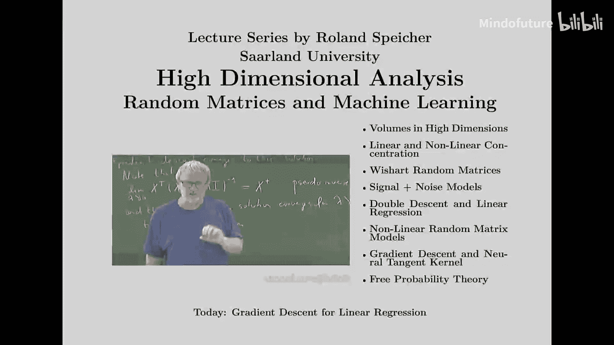
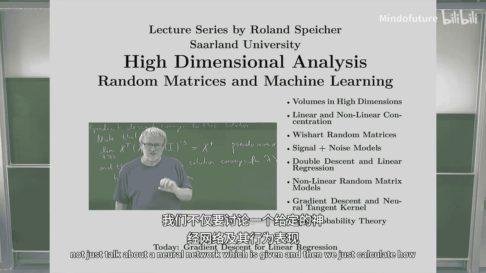
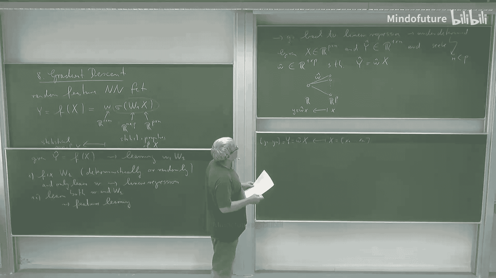
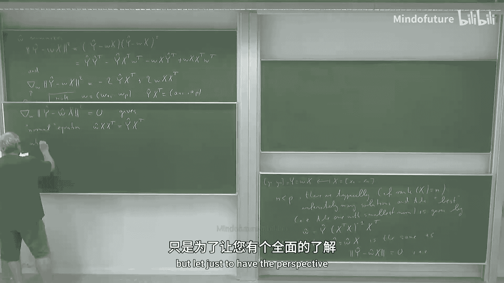

# 【德国萨尔大学】高维分析：随机矩阵和机器学习 ｜ High Dimensional Analysis p26 P26_线性回归的梯度下降法 -BV1XkkWBFEi6_p26-

呃，呀。Not just。

Talk about。Yeah， a neural network， which is given。 And then we just calculate how it behaves if I put in some data and what do I get out。

 But actually， the main point of neural networks， of course， is that they should learn something So。

 I mean， it's， it's not。The configuration is not a given thing。

 but it should be changed according to what function it should represent。 I mean， of course。

 neural net should represent a function， but you don't know how to describe this function。

 You you only know that for， for some input， it should give you this output。 And from this。

 you should。In， in an algorithmic way。Get your net。 Okay。

 and user the algorithm for doing this is gradient descent。Okay， so I want to talk a bit。

About this from various perspectives， very general one。 of course of course， I mean。

 these are things which are getting more and more complicated and it's harder and harder to get precise results。

 Good， Okay， but， but let us go back to our random feature model。

 So because that's maybe the one of which we have quite a good knowledge。 Also， I mean， our。

 our random feature。呃。Neural network。Which actually should describe a function。 So what is this。

 I mean， so we get an output。If we have input， so if we have input matrix。

 we apply F and then how do we calculate the output， I mean， in principle。

 what we looked at was the feature matrix we calculate the features of the inputs which。

Calculated in in a random way， namely essentially， we took sigma of， let's say W1 of x。

 So this is some of the first layer， first team layer in a network。 But then， of course， I mean， I。

 I should now from all these features， which I calculate。

 I usually I go back by linear combination of them to R。 So I mean。

 my functions are usually just real numbers。 So I also apply here， W， little W。 So this is a vector。

Which I write as a rowback door。So， it's in one times M。and my。My data matrix。Is in P times N。

 So my datas are P dimensional。 I have N of them。 And then I have here， this。Weight matrix。

 which is in R M cross N。 So Im， I'm calculating M features out of of my data。

But usually in a random way。 good， okay， And so what we have done up to now。

 we have looked essentially on this thing。 and maybe， okay， then we also understand this。

 But but from the point of view， I mean， I'm putting in X。

 and usually I'm putting in just independent gausian things。 And then the question is。

 what do I get out So essentially we we understand if I have here some X。

 or maybe at least some very nice X， I understand what what I get out here， the statistics from here。

 I can control somehow the statistics there。 So that that was。What we did up to now。But there。

 of course， I mean， this W and this W1 are somehow given。 So， I mean， the W 1。

 we also said you should be gaus in random matrix。 So the statistic。Properties。Now。

 maybe we go this direction。 So maybe I start here。 So the sta。Properties。Of x from this。

 we can maybe calculate understand the statistical properties of the output of y。Good， but now。

 of course， now we want to go more in this learning direction。 So actually this。

This guy here and this W1， they are not。I mean， we。

 we should find them in such a way that the net produces what it should。呃。

What it should really describe。Also， namely。For given X。So。

So we should know the output which are usually denote by y hat so this should be the function applied to my vector x。

 for example， my Gaussian random vector， but I prescribe the output and now I want to know what are little and capital ws for producing such a thing so。

So， we should essentially learn。I little W enter W1。呃。Such that， yeah。

 my net describes this situation here。Good， okay， And so this is the learning feature。 Okay。

 and in this setting here， I mean， I have now， I mean， I have this little W and I have the W1。

 and somehow I have two possibilities。 I can look at this so we could say。We fix the W 1。

 This is just my random matrix， for example。 And then I just want to find the learn on the best little W。

 Okay， and so this。Its property。Which， okay， maybe it's not the one which you really want， but it is。

 it's good to understand this。So， dataministically。

So we could fix this W1 in a dataministic way or more in our setting randomly。 So we choose。

Our random guy。 Okay， and then we only learn a little little W。

 So we want to choose the W in the best way such that we get this one here。And only。Learn a little W。

And this， of course， is this regime of linear recreion。 So， I mean， we， we know essentially。呃。要菩提呀。

And then we want to find the best guy here。 This is linear regressionion， linear regressionion。

 not on the data matrix， but on this feature matrix。

 but this feature matrix is just the new matrix which are given and which we understand somehow。

 Okay， but this is linear regressionion。Which， of course。Is quiet。Old subject。

 and more or less everything is known about this。 And， of course， I mean。

 the power of neural nets is not just linear regressioner。 But the point is， you should learn more。

 namely， you should also。For example， learn the W1， which means you should do feature learning。

 I mean， you should learn which features are good ones， which you should calculate。 I mean。

 if I just。Put in the W1 in a random way， because I don't know how to do it or in a dataministic way。

 because I， I have the idea。 I know what are good features， which I should consider to。

 to distinguish cats and dogs， for example， then yeah， I these are given。 I'm not learning them。

 I have to tell the net， which features it should consider。

 And then I just make the best linear combination of the given features。 Okay， okay， but。

 but feature learning is seems to be the the real thing， which gives the power of neuraler nets。 So。

 I mean， you should also。At least allow the W1。 And， of course， if you have bigger。

 bigger neural nets， than all， all the layers， all the ws there， they should learn。

 They should be adapted。Okay， so， I mean， so in our context there。Maybe more interesting thing is。

That， both。They little double you。And the W1 should learn And this then at least allows。

The possibility of feature learning。Yeah， good。 okay， and。Now， of course， the question is， yeah。

 how should we do this And for linear regressionion， I mean， we talked about this a while ago。

 and essentially for linear regressionion， we have an explicit solution for the best。

For the best function， which， which approximate this。 But， of course， in general。

 we don't have an explicit formula。 So this means in particular， here in this case。

 we cannot write down the formula formula of W1 in terms of of the data。

 And so what one usually does is an algorithmic way for learning So you need algorithm which maybe start somewhere。

 And then maybe you change your Ws。 in。Yeah， in some incremental way。

 and the usual algorithm for this is is gradient descent。Good， okay。

 And even in the case of the linear regression， a gradient descent has， has， has some meaning。

 So maybe what I'm doing now is， again， I'm going back to the maybe trivial thing。

 from the point of view of neural nets。 But at least the thing we mathematically。

 things are quite clear。 So I be looking again at linear regression from the point of view of gradient descent。

 And then maybe next time or so， we try to go further to the， to the feature learning thing。Good。

 okay， and so yeah， let us go back to our linear regression problem， which we did in chapter 6。

 and essentially， I mean， this was solving linear equations。

 but there you have to distinguish between the underdetermined and the overdetermined case okay。

 and for us in for our neural networks。 it's usually the the underdetermined case。

 which is maybe the more interesting。 because this means this corresponds to to the over parameterized。

 you have many parameters。 you have more parameters then actually you would need to describe the thing。

 and this seems to work quite well。 So maybe we are looking again on on this situation now from。

From gradient descent。 So， in this case， we we know what is the best solution， But we want to see。

 I mean， whether we can get in it in algorithmic way。 Okay， so。Yeah so let us go back。Go back。

To linear our regression。AndMain， we will。呃， consider。And a determined case。Determined。

Or over parameterized case。 Okay， so what is the situation there， So there we are given。 I mean。

 essentially， for this， I can again forget about this。 So essentially， I'm given the X。

 and I want to and I want to find the the W such that I reproduce a good solution。So， I'm given。X。

Bym giving my input data。And then I also am given the Y hat， which is the output。

 which is should be the value of the function applied to this guy。 So the Y hat is。

It's just a vector。 So I'm， I'm putting in。 I mean， for each。Yeah for each column here。

I get an output， and my function should should reproduce this output and my function。

 the functions I consider are just linear functions。Which are described by by W。

 And I call it now W hat， because that's the one which I'm looking for。So this is。One times P。Matrix。

 so it's a vector such that y hat。Is。W had times x。Yeah， and I mean， in our case。

 the under determinedtermined case corresponds to the fact that N is less than P。

 So I don't have many observations， yeah。No， what is it。M times P。Is this better don't know。Yeah。

 okay， So if I multiply them， okay， I'm multiplying over the dimension of of， of the data space。

 Okay， and I get a one times M。Yeah， and then I'm multiplied with this。

 And then I'm getting out one times n。Mattrix， okay， I mean， the sigma， of course。

 doesn't change the the size of the matrix。 It's just applied and3 wise。Good， okay。

 so the undertermined situation is if， if I have only few。Data points， observations。

 But the dimension is bigger than this。 Okay， And so， of course， I mean。And the picture， of course。

 is， I have here my。My啊。To the P， I， my data vector。

 And then I just take a linear combination of those guys and this。Lar combination is given by。

 by this W。 This is just the vector of the weights。 I， how I weight this。

 I take the linear combination， and then I get out something in R。So if I have put in here。vector x。

 Then I get here， y。Which is W hat times x。 Or usually， I mean， I， I'm putting in not just one x。

 but I have n of them， and I collect them in my data matrix。 So I'm putting in here my data matrix X。

 which is just a collection。Of n。Da does。 And then。I'm getting out N wise。

 but I also collect them in a， in a matrix。 But in this case， it's just a vector。 So namely the。

The y is then just the W at times x， and the y， of course， is just the。The matrix of y 1。Up to Y， N。

 where Y 1 is is the image of x1 and up to Y， n is the image of x N under this mapping。Okay。

 so that's a situation which I want to consider。Yeah， and X。呃。Exent。Why I give no， do I had a given。

Or maybe in this generality， maybe。I just。Put W here啊。好。And then I want to look for the W head。

 which corresponds with the given data。Good。Yeah， and now， of course。

 the interesting thing is in an under determinedmined case。Yeah， so I， I'm given why hat。And X。

 this is a system of linear equations， but this system has more variables than I have equations。

 So this means the solution is not unique。 And usually， I mean。

 in a situation where a solution exists， but then there are infinitely many。Okay， and then。

 of course， the question is which one should I take which which is a good one And in in this linear regression。

 we talked about there was somehow a prescription which one you should take。

 We could write down a formula， but we also could characterize it by saying that this is among all solutions。

 the one which has the smallest norm。Okay， and so this this， in a sense。

 is considered as the best one。 Okay， so in the under determineded case， So n less than P。呃。So。

 there are typically。And this typically means that the rank。Of my matrix X has to be equal。To N so。

 so， I mean， all the equations which I have should be linear independent so that they cannot contradict each other。

 Of course， I could take the same equation again and again， but change the constant on one sort side。

 And then I I would have contradictions。 There would be no solution。 of course。

 can be that there are no solutions。 But in typically we have the situation。

 So there is one solution。 But then this means there are infinitely many。Infinitely。Many。所炉身子。And。

Okay， the best。Yeah， we have to say what is the best。 But okay。

 a good way of saying what is the best is the one which has the smallest norm。So， I mean。

 that's what I'm meaning here is the best。 So it asked。one。Ws the smallest norm。This is given by。

 yeah， we could write down explicit formula。 So namely this W hat is the Y hat。

 And then I have x transpose x to the -1。Times X trans。Oh，O。Yeah， and I mean。

 this is essentially the same。Solution， as you take in the over determinedter case。 I mean。

 in the over determinedtered case， you have in， you have in general no solution。

 but then you can only approximate a given solution。 It list square。 Okay。

 and then you can write down。A formula like this。 But then you have this see the other way around。

 I mean， in， in our case， the problem is x is a rectangular matrix。

 And depending on in which situation you are P is less to n or the other way around。

 X transpose times x is invertible or x times x transpose is invertible。 And in this case。

 this guy here invertible。好。Okay， and the， I mean， it's easy to check。 We did this。

 that this is a solution， and it's also easy to see that among all solutions。

 this has the smallest norm。Good， okay， so in B， we can say， yeah， okay， we don' hear everything。

 So why bother anymore， That's it。 Okay， so， but now， of course。Yeah。

 we want to understand this maybe more conceptually。 and even from the numerical point of view。

 I mean， you have to take here an inverse of a matrix and this usually is a very big matrix and taking inverses of matrices is something which usually you should never do better are not take inverse of matrices but try to do something else and very often there something else is that you do iteration or maybe you you do algorithm where you do。

Simple matrix operations。 And you hope that you convert to something And that that's exactly what we are doing here。

 But maybe let us also first note that we can also。We write this problem as an optimization problem。

 So namely， of course。Yeah。说啊哇。Our problem。Which we want to solve。 So namely。

 our problem is that Y hat is equal to W hat times x。 So that's what we want to solve。

 And we can also。Right， this， of course。As saying。That the norm of y hat minus W hat times x is equal to 0。

Okay， and so this means， of course， that the W head minimizes the value of this quantity because I'm mean。

 enormous enormous is always positive。C creator equal to 0。 So if I found a value to 0， it means。

 of course， that this minimizes this。 So this means。My W head minimizes this， this quantity here。

 So actually， we have a minimization problem Okay， for minimization problems， of course。

 we can use calculus also。And of course， the minimization， minimization is given by。

By a point where the gradient is appears。And then， of course， if I want to。

I have a numerical American algorithm。Then， of course。

 the gradient gives me the right direction where I should go to improve my， my situation。 that's why。

This is the gradient descent。 I mean， that that's the simplest。Agorithm which。

 which we have around also。Some好车。要得。Strange。Situation with this neural nets is that we are not developing very advanced and subtle algorithms for getting something。

 but that actually the most simple algorithm we can think of seems to work。Surprisingly well。Okay。

 but let， let us look on this。bit more concretely。 Okay， so we， we can say。The W hat， which I have。

Is actually。A number or vector door。So， this minimizes。呃。Yeah。Yhy hat minus。

W times x So the w hat is among all ws， one， which minimizes this。 And， of course。

 it minimizes equal to 0 in over in the under determinedtermined case， in over determinedtered case。

 I cannot achieve equal to0。 And then the least square algorithm is really that I optimize this。

 I'm looking for the best W， which make this as small as possible。 in over parameterized case。

 it cannot be equal to 0， but I make it as small as possible in in the under determinedtermined case。

 it can be equal to 0。 So in principle， I know that I have a solution and I know what it explicitly is。

 but we want。To consider from the point of view of optimization。 And O， and so let。

 let me just multiply this out。Let me take the square of the norm。So， this is。Okay。

 so this is a vector。And the square of the norm is， is the vector times its transpose。

 So this year is a。This is是 column vector。So I have here Y hat minus W X times Y hat minus。

Wx transpose。If Im multiplied out， I get Y hat。Why had transpo。Minus。Y hat then this guy。

 there I get x transpose W transposedse， Then I get this term minus W X。W I head to transpose。

 and then I get this times this， which is minus W， X， X transpose。W transport。Good， okay。 And now。

 yeah， if I have a optimization problem， usually I should look on the derivatives or the first derivatives。

 they should be equal to 0。 this characterizes。Minimma or extremea。

 And in the multi dimensional situation， I should take the gradient。

 So what is the gradient of this quantity。So the gradient with respect to W W is the quantity which I want to optimize。

So I take the gradient。Of W， this goes back to W of。This guy here， so why hat？Minus w。X squared。

 So this is， this is just。A function taking on values in R。 So the gradient is just a vector。

 And yeah， I take the gradient as a row vector。 I mean。

 you always has to this decide if you take the gradient of something。

 should you write a gradient as a row vector as a column vector。

 And it depends maybe on the situation。 what which is better。 So here I'm taking a。

A the gradient as a row vectorctor。That on the formulas， I'm writing down。In the end。

 I should get a row vector out of it。Yeah， okay and。Yeah， so what is the gradient。Okay， of course。

 this is， this does' depend on W。 So this is 0。 Then I take the derivative of this and the derivative of this。

 And if I take。The derivative。Yeah， with respect to this。 I mean， okay， it should be。

 it should be this or this。 Yeah。 I have the transpose。

 So let me just say it is actually both terms are giving the same。 So you have minus。

Two times in principle goes away。 And then you are left just with this constant here。 Y had。呃。

Extranspo。And this is a quaratic expression。 So， of course， taking the derivative。

 you remove one of them and you're left with the other。 But again， it's W and W transpose。

 you at least okay。You might be confused what， what should I take away， what。

 what remains that actually， you again get minus。You know， heres a plus Its minus times minus。

 So it's plus。 So you get here plus two times。 And essentially， it is， as if you take this away。WU。X。

 X transpo So also， also here， you remove this and your left with this， but here。But here the same。

 And maybe we should just think about this， just。That we are absolutely。Clear about this。

 that this is really the the right result。So namely node。 So what， what am I doing here。 So my W。

 let us write it in components。 So I mean， it's nice to have it in this compact form。 But I mean。

 I have to say， I'm， I'm confused if I take the derivative with。😊，Of this with respect to W。 So what。

 what is really the result。 So I can only really。Be sure if I'm writing this in components。 So， so W。

My W is a。Is a row vector to。 Then I have the， the y transpose X transpose。 So this is a vector to。

 And this is also a row vector。 So， and let me。Deote the components just by a1 up to AP P。

 And then I have here X， X transpose。 So this is a matrix。 And I know， you know this。

 I call this a so just。Shorthand rotation and entries。 I call AI J。呃。From one up to P。

 But you should note that this is a symmetric matrix because if I take the transpose of this。

 it's the same。 So this is the same as a transpose。 And this is relevant that I get this recipe。Qu。

 but now now let， let， let me see with these notations。 So what do I get。Let us first calculate。

The transpose。Of a。At to gradient of A W transpose。 So this。

 this is this term here where the a is now just this vector。And so what is this。

So this is the gradient。With respect to W of yeah this year。

 this is just in a product between A and W。 So this is just a 1， W 1。Plus， A N。Or AP。

 you're going to P here A。W P and of this function， I take the gradient。

 So I get a vector door where the first component is the derivative with with respect to W1。

 the second with respect to W 2 and so on。 And I write this as a， as a raw vector door。

 So this means I take the first guy is I take the derivative with respect to W1。 This is just a1。

 The second is。The derivative with to W 2， which is a 2。 And the last is the derivative with to W P。

 which is just the AP P And so you get， I'm just getting back the。Drector A。Okay， and I mean， that's。

What I have written here， I will take the derivative of this。 I'm getting back this vector dot。

 This is here。 Okay， and I'm， I'm claiming here I'm doing the same。

 but here you should observe that actually。This guy here is the same。As W 8。

 because we are here just real value So if， if I take the in product I mean。

 this inner product here you can say this is yeah， this is a multiy bly It a transpose of W。

 or you can say it's the same as w times the transpose of of of a。 So this means here， this。

 I get the same result。 I get， I get the transpose。So if I have the W here。

 I get the transpose of this。 But this is， again， this guy here。 So I get twice this， this term。Okay。

 this is totally trivial。 But， I mean， okay。It's better to check those things。 Okay。

 and for the matrix。So for the quadratic term。So what is this。 So there I have W， A。

 W transpose and the A is the X X transpose。 a symmetric matrix。 So what is this。

 So this is the gradient。 And now this is just a quadratic form。

With the coefficients from my matrix A， know， So this is just a sum over I and J。W， I， AI J， W J。

 just doing matrix multiplication。Or vector times matrix times vector。 Okay。

 now I take the derivative with respect to。W1， and then a derivative with respect to W 2。

 And I write this down as a。As's a row vector door。

So let me write down just the first component where I take the derivative with respect to W1。 Okay。

 so I have to check where do I have a w 1， I have， okay， if the I is equal to1。

 I take the derivative with respect to this。 So I get then I'm left with sumation over J。

 I has to be equal to one derivative with respect to this， this goes away and I'm left with。

The I is equal to one， and I have here the J。W WJ。Okay， and then， of course。

 I also have the derivative of this guy。 But for this， the J has to be equal to one。

 And then I have here the I， W， I， and I have a。I 1， okay， and now maybe I sum over over I。

 but maybe because I just rename this to J。And then I just have sum over J。 Okay。

 and now you see that because I have a  sumsymmetric matrix， this term is the same as this。

 here I have A I J here I have A J 1， But because my matrix is  sumsymmetric。 This is the same as a1。

 J， and actually。So what I have here。Is2。WJ。A J1。Okay， so maybe。

 maybe it's better to take this form because this is the product now of this vector with this matrix。

 I're gonna take the one component， okay。Here， in T， I have used that a is equal to a star。Yeah。

 okay。 And so， I mean， for the other components， I get the same。

 But so what I have here is I have these two。 And then I have just W times a。I mean。

 this year is the one component of this。 This is a vector。

 And then the others are the other components。 so you see， I get。Exactly this2 W A。

 That's exactly what I have written down there。Good， okay， so this。This was trivial。

It's always nice to do trivial things。Because that's something which one understands。Yeah， so well。

 you know。嗯。Yeah， so we see。That， if I want to。Now， optimize。Or minimize this quantity。

 I should find a w for which the gradient of this is equal to 0。 So that's a necessary condition。So。

I， I should look for solutions of。This Y hat minus。嗯。W。X squared。Equal to 0。 So for my W W head。

 the solution which I seek， this should be equal to 0。And then this gives me， of course。

 the equation that the gradient should be equal to 0。

 So this this equal to 0 tells me that this should be equal to 0 or that that this is equal to this and the two cancels away。

So what I get。So， this gives。What is then usually called a normal equation。In this context。

 namely that W had。X x transpose is equal to y hat。Extranspose。Okay， and this， I mean， in the。

Over determined case， this has a solution。 I mean， then then0 X X transpose is invertible。

 And I just can solve this for O for， for， for W hat。

 And that's the least square solution in this case。 But that。

 that's a situation in which we are not so much interested。 but let just。

To have the perspective。So let me also write it down。 So this gives the list square。A solutionution。

Which is just， I mean， bringing this on the other side， because this is invertebible。

 So I can do this If I have maximum rank， which I always suppose So Oomega head is just Y hat。

X transpose。 And then I taking the inverse of this from this side。So， I have here。

XX transpose to the minus-1。So this is the solution in the overdetered case。有 one。Determine case。

Right， I mean， that's usually how you do this list square。Solution， okay， but in the。In the。

And a determined case， of course， we are。Not much better than at the very beginning。 I mean， we。

 we have to find omega head。 which solves this， but there are infinitely many。

 now we have to say which solution should we take。 I cannot invert this， but we can say。

 in principle， I take the pure inverse。 So I take somehow the best replacement for the inverse and then。

We can also get an equation。 That's the one which I wrote down at the very beginning。

 and you get the best。呃。Solution。In the undertermined case。And then， omega head is。I mean。

 I write down the same solution。 Y hat x transpose， and then I take X X transpose。

 I would like to take the inverse。 The inverse does not exist， but okay。

 one has this kind of this pure inverse， which takes as much as possible of the inverse and the rest is more or less a set equal to 0。

 But in this case， one can show that this can be written down with the help of a。

Of of a genuine inverse， if I just take here the other order， because in the other order。

 this guy is invertible。 So this is the the same。As y hat。 And then I have Y X transpose。X to the -1。

 And this is now real-1 x transpose。 I bring this x transpose to the other side。

 But the effect of this that here I'm exchanging the order of the transpose and the X。 okay。

 and I mean。We checked， I mean。Even if you don't know what the pverse is。

 this formula that's the one with which we check that this is a solution and that it is the best solution。

Okay， so this gives this。In。To按的。Determined the case。Yeah， okay， but now， okay， now， finally。

 let's come to the algorithmic point of view until now I have just talked again and again about that we actually we have a kind of equation。

 But now we don't want。To just take this， this solution， this explicit solution and calculate it。

 But we want to do it in an algorithmic way。 And from this point of view， of course。Yeah。

 we have this optimization problem。 And there， if we have。No。TheW， which is not the correct solution。

 What should we do， We should improve it， And the gradient gives us the direction in which in which we should improve it。

 So this is。Yeah， why we do this so。So， the gradient。Gives the direction。呃。

To improve an approximation。So now we say， okay， we don't know what the solution is。

 but we start somewhere。 It's not the correct one。 But then we are going to improve it by going in the direction of the gradient or opposite to the gradient。

 Yeah， okay， so this， this means。You start somewhere。Starting。From。Some。Okay， so w0。 and then I take。

Iteratively improve it by saying that W at time T plus 1。

 Okay so it those are just depth or T at the time， but it's just integer numbers。

 So this is the w which I had before。 and then I'm improving it by adding a little bit in the direction of the gradient。

Okay， I should go opposite。 and I have to take， of course。Yeah。

 step size saying how much I should go in this direction。 And then I take the gradient。

In the direction， W。off。My quantity， which I want to minimize。 And here， of course。

 I should consider this quantity at。At this W， which I had at time T。

 So I have here this this squared。 So I take the quantity of this guy。

 but then I take the gradient at at this position。Yeah， okay that that's。I mean。

 that's a very general procedure。 iss gradient descent for optimizationim problems。 And of course。

 the T here， you should think of T as a time。 but， of course， I'm just doing here integer steps。

 also T。It's just a natural number。But it corresponds to the time。 And this Eta， of course。

 you have to choose somehow。 And this is somehow the， the。

 the step size or maybe in the neural net context， the learning rate。所以的。Step size。Oh。

In the neural net context， also called the。The learning rate。Good， okay， and now。Yeah。

 if you do this by general。Yeah。Properties of。上去。Things， I mean， in the overdetermined case。

 where actually， you have a unique solution， this algorithm will really converge to the solution。

 So in overdetermined case， it's really everything is nice。 So if you only have。

 if you have a unique solution。 And， I mean， here we have actually a quadratic problem。

 So con convexity is is usually the the the thing， which gives you all the tools for proving things。

 So we have here a nice。Yeah， convex problem。 And then we have a unique solution。

 And then this algorithm converges to it。 At least if you choose your Eer small enough or in the right way。

 So in an over determined case。嗯。第一次。Conver。To the to the only solution。

 which is the least square solution to the least square。So really。

 the solution which minimizes this guy here。 And in this case， it's not equal to 0 in general。Good。

 but， of course， in the undermined case， there are infinitely many solutions。 So， of course， I mean。

 it's not clear to which this converges。 And in general， it will not converge to the best one。

 So we have an idea what is the best one。 the best one is the one with the smallest norm。

 This year will converge to something to it will converge to。To some solution。 But in general。

 this will not be the best one。And this is the reason that usually mean improve such algorithm by doing some kind of regular regularization。

Okay， but but let us maybe first look on an example， very easy trivial example to see what。

 what essentially happens and what， what is the problem in the case that we don't what。

 what do we converge。Okay， so let me do an example。And let me call it officially an example， so that。

At least we get。Some number in this chapter 8，1。Example。Yeah， so I consider our function。

Which is totally。Okay， I mean， of course， the function function F of x is of the form W X。

 But now I'm choosing the dimensions more or less as small as possible so that I still have an an under determinedtermined system。

 So namely， I take。呃，呀。The P equal to 2， but the n equal to one。 O and so。I have here Wx。And so D X。

Here's a two dimensional vector。 and the components are denote by ti T 2。So this is two tens or one。

啊。Okay， so this this means。P is 2， but n is equal to one。 So I only have one。1，1 observation。

 and the W。Okay， this， this is a vector and R 2。 I want to multiplyide with a vector。

 So this also must be vector and R 2。 and I want to get out a number。 Okay， so the， the W。

Has two components。 And let me call them Theta 1 and Theta 2， because very often the parameters。

Which I want to optimize。Call theta。 So let me call them theta 1 and theta 2。

 So this is just a vector， but now written as a row vector。In R 1，2， Okay， and so this means。

 of course， that my f of x。It's just。Tta1， T 1。Plus， Theta 2， T2。Yeah， okay， now I'm given one。

Value of my function。F applied to some data vector to So assume now， So the information which I have。

Assume。We are given。That F。At the vector01 should take on the value 1。Okay， also this means。

Data matrix X。Its just0，1。Okay， now， now now you see that n is equal to 1。 I just take one。

1 input to vector to。 Okay， of course， this was just my generic data matrix and the y， the y hat。

So this， this is the。The row vector consisting of all observations， but only have one observation。

 So it's just one time， one times one matrix。 Also it's it's just。I mean， it's just the one。呃，呀把TSS。

It's a matrix or vector， okay， and then。So， what we want。So， we want to find。The best。嗯。W head。

 which has the two components， Theta 1 head， Theta 2 head。

Such that the Y hat is actually W hat times x。 Okay， and what does this mean， This means， of course。

 So the Y hat is just one。And this is just this multiplied with this。

 So this multiplied with this is， of course， just theta 1 head times0 plus。T the two hat。Times 1。

Okay， now you see， I mean， this is already set up in such a way that you see here very precisely how the situation is。

 Of course， I mean， this doesn't have a unique solution because I mean。

 I don't have any information about the theta one had， essentially。 but of course， in principle。

This tells me that the theta 2 head must be equal to one。 I don't have a freedom。

 but I have the total freedom of theta 1 head。 Okay， And， of course， it's clear。 I mean。

 if I don't know anything about the theta 1 head， probably I should set it equal to 0。 And this will。

 of course， also be the solution where this vector has the smallest norm。 Okay， so so I mean。

No unique solution， but somehow there is that it's clear what， what the best solution should be。 And。

 of course， I mean， our general best solution prescription gives us， of course， this in this case。

 But maybe let us just check it。So， how。Solution from before。呃。So this was omega hat is。

 So this is y hat or probablys not。Yeah。 maybe this， this one y hat times。X transpose x to the -1。

X transpose。 So that that's a general solution which we have。 But in this case， So what is this。

 So Y hat is just one X transpose times， Okay， so what is x transpose。 So x is 0，1 as a column。

 So x transpose is 0，1 as a row times x0，1。To the inverse times。Ex transpose， which is。0，1。

 and of course。 So this， this year is now just in our product。 This is just one。 And the inverse。

 of course， is also one。 So this， of course， is invertible。 So this is 1，1，1。

 So what we get here is 0。0，1 Okay， so this really gives us exactly the one solution。

 which is somehow clearly the best。It clearly has the smallest law。 good。 But now。

 now let us look on this from the point of view of gradient descent。 So， so say。Some好。

We can stand this， but we don't know what to do。 So we just choose。Arbitrary W at the beginning。

 and then let us check what gradient is sent does。 So it should produce some。

 some things which hopefully converge to something。So， but now。Craian descent。

 Let us look on Caribian descent。In this setting。 So this means I have now。WTs。Which with components。

 Theta 1 if at T and theta 2 at T。 And I have the。I have the prescription。That the T T plus one。

 So I get this from the previous W T by going this Eta into the direction of the gradient of my。喂hy。

And minus W T。X squared。Yeah， okay， and of course， we calculated the gradient。

But it's not here anymore。 The general formula。 So the gradient of this thing。

The general of a formula。 So this was okay， a factor 2。And then， we had。

The derivative of the qua quadratic term， which was。W辩义5。T。And then， we had。X times x transpose。So。

 maybe。You don't have it anymore。 Maybe maybe I write it。 Let me write it down again。嗯。So。

 our formula。Gna1 W。The gradient of Y hat。Minus W X squared。 So this was - two times。

 And then we had W X， X transpose。So minus here。 And then we have minus y hat。Extranspose。啊，O。

So the first term is this W X， X transpose at。W T and x X transpose is now a matrix。

 X transpose x was a， was a number。 But now the other way around。

 this is just this vector times this vector。 and this is just a matrix。Which has only a one here。

 And， of course， this is a matrix which is not invertible。 Okay， but。Yeah。

 but here we don't have to take the inverse。 but so we get this。Yeah， and then we have minus。

The Y hat times x transpo。 I mean， the Y hat is just one。 and the x transpose is just。呃，My red door。

0， one。Okay， and of course。Yeah， so what I have here。嗯。So this here。Maybe let me。

 So this is two times。So this is。W T minus。伊达。And then here， what do I have。 This W T is theta 1。

theta 2 multiplied with this。 But then you see in the first component， I just get0。I get cral。

And in the second component， I just get the theta 2。So， this is here。See the2。O。So。I。

The two out here， the two out here。 And then I'm subtracting。Minus。0，1。

So this year is is just this year。 and I'm subtracting this。 Okay， and so this tells me that。

The derivative or the change。In the first component， actually， there's no change at all。

 because I have a0 here and a0 here。 So the first component doesn't change at all。

 And the second component is， this changes。 and this converges to the right thing。 Yeah。

 so what we have is。Theta 1。A T plus one。So the first component of this， of course。

 is the first component of this。 So this is。Theta 1 of T。 And then I would subtract it at times。

 the first component of this thing。 But you see the first component of this thing is0。

 So nothing is is。Going to be changed。 So this means this。Yeah， this gradient doesn't is。

 is not able to improve on， on theta， Tita 1。 If I have chosen this in the wrong way， I mean。

 I I cannot improve this for Theta 2， of course， the situation is much better because， I mean。

 there I should converge。To something concrete。 So the theta 2 at T plus1， of course， is the theta 2。

T， and then I'm subtracting two times Eta。 Okay， I'm subtracting Eta。

 and then I have the two from here。 And then I'm subtracting。Yeah， the theta 2 from here。

And one from here。So I have here。The feet的。To at time T-1。This one， okay， and you see that I'm。

 I'm going to have changes as long as theta 2 is not equal to 1 Theta 2 equal to 1 is the solution which which I really want。

 which is the right solution。 And if this is not yet achieved。 Then in the next step。

 I will try to bring this closer to theta 1 of 2。 And， of course。

 we can see that this iteration converges to to one。 So maybe or maybe we should check。

You also to have to to make the it。Change the Eta in the right way。 if we make it much too big or so。

 then， of course， we might not have convergence。 But so let let us check this。 So I mean。

 theta 2 of T plus 1。You want to check whether this is close to one。

 And so I'm subtracting here just one。 So I can subtract the T。 So I have theta 2 of T。-1。

 So I have it here。 But here I have it again。 So what I have here is， is once from here。 and then。

to一到。Okay， and so you see if this 1 minus-2 eta is less than 1， I have a。

Exponential conversiongs to one。 Then this difference is getting smaller and smaller。

It's the powers of this。 So this。This means Fi。2 of T converges to one。But， of course。I should have。

1-2 eta。Less than one。Okay， so I should choose the Eta in the right way。I mean， not too small。 Okay。

 small is small is okay。 then it converges， but maybe quite slowly but。

 but so should make it a bit bigger Then it converges faster。 But if I make it too big。

 then it doesn't converge anymore。 Good， But the point here is that theta 1。Does not converge。

 or it stays where it is。 of course， it converges。 It， it's not changing， but it's not go。

 it's not going to 0。0 would be the best one unless I have started by 0。

 So this means I'm not able to improve on the theta2 so。So this means in general。

 if I just start with an arbitrary W here。 in the beginning。

 I will not converge to the best to the best solution。 not， the solution is the smallest norm。

 I mean， I， I， I must have chosen my starting。Condition， my starting point in the right way。 okay。

 and maybe in this case， I know what what is the best way and so。 but but in general。

 maybe it's not so clear。 And so maybe what one is doing is that one is proving on this by doing a kind of the linear regression by doing a kind of what is called rich regressionion。

 one changes the iteration a little bit by also taking into account that my goal is not just to to to get exactly my my equation right。

 but also to find a solution which has the smallest norm。

 So I want to minimize not just the condition that equation is satisfied。

 but also the condition that the norm is is minimal And so this is what is usually called rich regressionion。

ButLet me。Talk about this。 Maybe first a little bit in general。 And then maybe we go back to this。

Example， again。呃。And there。Yeah， I mean， there we are not just want to。To solve our equation。

 But we want to find a solution which has nice properties Okay， and of course， it's as an equation。

 this is hard to say what this means， but we can put this into the quantity which you want to minimize。

 So essentially， you're thinking of the quantity， which you want to minimize。

 That's your loss or your pen。 So this should be as small as possible。

 So deviations from the smallest possible value are penalized。 And in this function， you can。

 you can put in some quantities which describe somehow the smoothness or or whatever properties of your solution。

 which which you want。In such a form， I mean， you have to。

 to put them into this such that that you want this term to be small。 Okay， so instead of minimising。

And let me not now call it。L， usually it is called L。 It's a， it's a loss。 also So in our case。

 this is。This was this。The square of the norm of essentially our equation。 Okay。

 so this equal to 0 means that we solve the equation。

 But now we know just solving the equation is not， maybe not good enough， but we。

We want also a solution， which is nice。 And so we add a penalty term。

 which characterize or which which。which。Yeah， which penalizes large norms。 So in our case。

 nice means the norm should be small。 And also， we should have a a penalty term for。Large norms。啊。

And this means instead of this， we want。Now， to minimize。嗯。and I'm adding a term。

 which depends on Lada。 So I'm putting also Lada there that I take。 okay。

 the term which describes the equation which I want to solve。But then I'm adding something， Mr。 Lada。

Which。It's just the square of the norm of W。 So if， if the norm is big， then I mean。

 this term will be big。 So I might， I might have a w such a this term is 0。

 but then this term is big。 and still， this might not be the best。Thing I have here。 Okay。

 and I'm doing this for some。Lambda bigger than0， which the lambda is also something which I have to put into。

 Okay， and now， of course， this is now more or less the same kind of optimization problem as before。

 So we can do the same as before。 We take the gradient of this。

 So far for looking for minima for this， the gradient should be equal to 0。

 But now if we have an additional term here。But this is， again， easy to deal with， So the minimizer。

Of this。Is determined by。 Okay， so what we want is that 0。Should be the gradient。

Of this loss function。at the point。嗯，W。Yeah， what you head。 Okay， but let me write it in general。

 Okay， and of course， what is the gradient。 So the gradient of this。Okay， I tried to keep it。

It disappeared， but I think we still all remember。 So the gradient of this So of the first term。

 that was just the two times。W， X， x transpose， minus Y hat。X transpose。 Okay。

 so that that's just the gradient of this。 And now， in addition， we get the gradient of this， but。

Yeah， this， of course， is lambda times。 And so we have to create it of W。 And this is， of course。

 just W， W transpose。And， I mean， we know that this is just two times W。好。

That is mean before we calculate this， where I had a matrix in between。

 Now you can take the identity matrix in between if you like， but maybe you also see directly。

 Yeah so you see we get here perturbation of this term。 So I have two times。 I mean。

 this goes nicely with this。 So I have here w X X transpose plus lambda times the identity。Matrix。

minusus Y hat x transpose。Good， and now you see again， we have now equation。 So if is。

 if we set this equal to 0。 So this gives， gives us an equation for， for the W， Let me。Yeah。

 so so is the equation。 again， we can forget about the two。 And then， of course。

 we get that this in the bracket should be equal to 0。Yes。We have that W hat。

Let me call it the solution of this again， W hat。 So X x transpose plus lambda times the identity matrix is equal to y hat。

X transpose。Yeah， okay， and now you see that we have regular our problem。 I mean。

 the the regression itself was without this term。 and then this equation we could not really solve in a unique way because x x transpose was not invertible。

 But now if I'm adding this lambda times the entity， This matrix here is not always invertible。

 as soon as lambda is bigger than 0。 because this is a positive matrix positive im。

 and this here is is bigger than 0。 So so this this means this here has eigenvalues。

 which are equal to 0， but now I'm adding。Alumna to them。

 So I make all the eigenvalue different from0。 And then it becomes invertible。

 So that's the main point。 or that that's at least from a mathematical point of view。

 the nice thing that I really， I mean， I have now really change the problem that I get a unique solution and then。

 of course， okay， then then it's much better， then， of course， great in descent， Also。

 I would expect that it should converge to this one if there's only one。 if there are many solutions。

 Then， of course， the problem is to which one should I go。 But here， now。

I don't have this problem anymore。So， not this。Is for。Lambda bigger than0， always invertible。But。

 of course， it's important that。Lambda is bigger than 0 because this has positive eigenvalues。

 If for lambda negative， I might subtract one of the eigenvalues which are already heavier here。

 Okay， but this positive lambda， I'm just shifting in a positive direction。

 And if I had nothing below 0， then okay， I just above 0。 Okay。

 so this means I really can take the inverse of this。 And I have now。A formula for my solution。

 So this omega hat is this y。Het。X transpose times the inverse of x x transpose plus。

Lambda times said entity。ETo the -1。Yeah， okay。 And so this means we are getting now a unique solution。

 So I mean， if I'm just choose choosing a Lada， I mean， I'm free to choose any Lada I want。

 I get now a unique solution。 And， of course， I， I have balance between two things so。So， this gives。

Unique。Solution。Which。I mean， on one hand。I have given up the interpolation。 I mean， it's。

 it's not true anymore now that that Yawe is my。That， I mean， I have minimized this whole thing here。

 Okay， but the minimization is， is not， of course， achieved at 0。

 So this means this guy here is not necessarily equal to 0。

 So I have not solved my equations anymore exactly。So this means I。

 I don't have here an interpolation。 I mean， interpolation means that I'm。

 I'm meeting the points which I prescribe in my data matrix exactly。Okay。

 I mean solving this equation。 but this is not true anymore， but。Usually， this is not a big deal。

 I mean， usually， I mean， if my Lada is small， I will also still have here a small deviation。

 So usually this is， is not so bad if I， if I allow this But I'm going away from solving my equation exactly。

 because I。I want。Yeah， I want to have other properties still。 So this does not。Interpolate。Exactly。

Any more。 but we allow small errors now。 this depends on Lada。 Okay， but on the other hand。

 So I mean， we don't， we lose here something， but maybe this is not so bad。 but on the other hand。

 we。We gain something。 And this is that we keep this norm here small I mean， we optimizing this。 So。

 of course， this optimization is not achieved if this is very big Okay。

 so so this means we are keeping this small。 So here。

 so here we have terms which control somehow the properties of the solution which you are looking for。

 I mean， very often you also involve derivatives in more general。

 So you want smooth solutions also you want more derivatives and stuff like this。

 So that's that's things you can put in such penalizing terms。 this this means that you。

That you look for solutions for which you can control this。 Yeah， okay， and then。

We have a unique solution。 and then you can。Then in principle， you are back to。

Your convex optimization problem where you have a unique solution。 and then the gradient iscent。

 I mean， it necessarily has to converge to this one。 Okay， so the gradient descent。

 if you now apply to this， it will converge to this solution now， which is not。

 which is not our best solution in the original sense but it's， it's。

 it's the best solution for this regular frame。So， the gradient descent。Con vituous。To this solution。

Okay， and maybe you should note that actually， if you send Lada equal to 0。

 then you will really recover the best solution which we had before。 so namely。

You should also note that this here is also connected with the pro inverse。 I mean。

 this is a way of defining the pro inverse of a matrix just by， I mean。

 Pura inverse means it's not invertible。 you can repair this by adding something which makes it invertible and then you send this something to0。

 and you hope that the inverse converges to something。 and that's exactly what is happening here。

 Because if lambda goes to0 here， then in principle。

 we would go to the pro in verse of of those thing So note that。So， actually。If I take the limit。

Lamda going to0。Of what I have there ex transpose。X。Ex transpose plus lambda。

1 to the -1 that this goes。To this x plus， which is the pseudo inverse。You see， I mean。

 if this term is not there and if everything is invertible， then， of course， this year is。I is。

 is x transpose inverse times x inverse。 And this would cancel this this would be the inverse of x if。

 if x is inverted in in square matrix case。 if， if we are in other cases， I mean。Yeah。

 this then this without a lambda doesn't make sense， but we can say we just take this。

 which always makes sense。 and then send lambda to 0。 And then， of course。

 one has to see that this converges to something but it does。 And this is the universeverse。 I mean。

 there are many ways of defining the p universeverse。 But this， this is maybe a nice one。

 which which fits very， very nicely with this。Linear regression。 Okay， and from this， I mean。

 then you will can also see that。The solution， the solution， which we get here。

 this rich regression solution convertverges for lambda equal to 0 to the best regression solution。

The one， which I said， is the one which which， which solves the equations exactly and which has the smallest norm。

 So everything fits together very nicely。So。And。So this year is called rich recurreion。

Of course we are adding here some， something which I don't know whether this looks like a rich or not。

 But anyhow， the rich regression。Solution， So this， this is this solution here convers。

For lambmbda going to 0， of course， coming from the positive direction to the。Recreion solution。

Another one from linear regressionre， where we chose the best one。

So that the norm is the smallest one。Good， okay， so maybe one。

Could now go back to our example and check things how they look there concretely。

 but maybe time is over for today。 And so maybe I just leave it to you that maybe you can look for yourself and work out the details for this example and check how how it looks there and also maybe in particular check that you really have a convergence to the best solution if you adding this Lada with this Lada everything becomes nice and you really converge to a unique solution and then if you send Lada equal to 0。

 you converge to the best solution which we had before。呀。Yeah， I mean， again。

 if you look on this example， then you see that if you want to have convergence。

 you should have a combination of Lada and Eta so。And of course， I mean， more complicated problems。

 they are also abstract estimates， but okay， I'm not sure how useful they are。

 but of course it means a Lada。 I mean， you have to ensure to ensure those those things these convergence。

 of course you have to to choose things in the right way。 I mean。

 I mean you can choose Lada and you can choose it but of course， I mean。

 Lada usually you want quite small。 because otherwise， I mean。

 if you put too much emphasis that you don't want that you want small norms。

 but you're not caring so much about your equation anymore。

 then maybe you get something which has nothing to do with your equation。 So I mean， I mean。

 Lada is usually not is a quite small quantity。Okay， and then， of course。

 you must must look for the Eta how to choose this。But maybe if， yeah， if， maybe you。

 can check this example in this case and then you see at least。

There are that the combination of Eta and Lambda plays plays a role for the convergence。Good， okay。

 that's it for today。