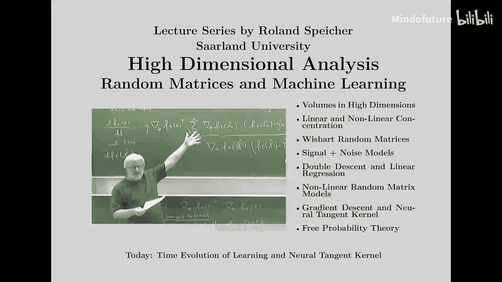
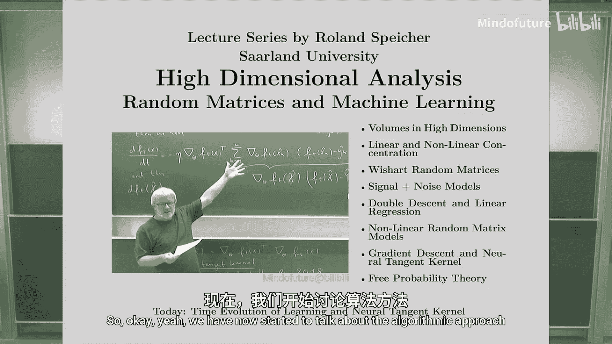
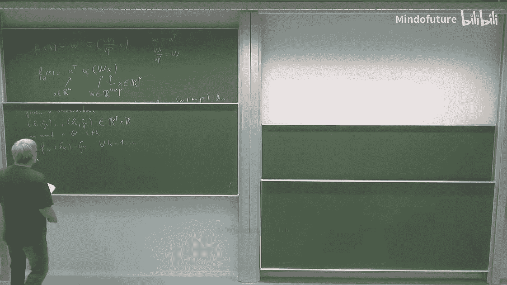

# 【德国萨尔大学】高维分析：随机矩阵和机器学习 ｜ High Dimensional Analysis p27 P27_学习过程的时间演化与神经正切核 -BV1XkkWBFEi6_p27-

So， okay， yeah。We have now started to talk about the algorithmic approach。

 namely how to train neural networks So I mean， neural networks is given by parameters and of course we want to find the parameters or change the parameters in such a way that the neural network is doing what it is supposed to do Okay。

 and we started with linear regression and we check that in linear regression when principlely we have formulas for describing what the best solution in this case is we also can do this via gradient descent。

 Okay and now we want to go let's say one step or one layer beyond a linear regression and we consider our one hidden layer neural network So this is we consider now。

Our neural， which is a function， which is given。That I'm multiplying W。With a sigma。Of W1。

Dived by square root P。Times x O so x is now my， my data vector。

I could could also write it as a matrix。 So this is little X。

 And this here should also be a little X。 And we have two mates， W1。

And a vector W linear regression was that W 1 is given somehow at the beginning。

 And we just want to optimize in this， this W here。 Okay， but now we want to train all parameters。

 Also also W 1。 okay， and maybe I rename things a little bit in particular。

 because I have two ws here。 This is。Beit confusing。So maybe I call W。 and this W here。 this is a。

 this is a row vector。 and maybe I， I， I will now denote all vector。

 I consider all vectors as a column vector。 So if I want to have a row and I write it as a transpose。

 So I write this as a transpose of something。 And let me call this a。And for the moment is scaling。

 I don't care about this。 So maybe later we come back to this。

 So I did not W1 divided by squared of P。 I now do not just by W。 Okay， so I know several ws there。

 okay， so this here。Is now my function， F。Of x。 So I'm just writing it。 It's the same thing， but。

This year， I'm writing as a transpose and then multibliide with sigma。

 Sigma is my given non linearity of。WX。Okay， and okay， So the the dimensions， So x。Is our data。

Vectctor， which is usually p dimensional。 Then this W here。This somehow。

 this is the the random features or， or feature matrix， which maps the p dimensional。

To P dimensional yeah vectors into M dimensional space。 So it is W here。Is。And。Times P matrix。

 And then I'm going back。 and my， my， my result is always a scalar。

 I only consider the case where I'm going to R。 So I take now linear combinations of the yeah what I get here with this here by multiplying it。

 So a。A is here。In I am。 so a transpose is a row。 And I'm just taking essentially the inner product between this guy and the output here。

 And of course， here I' am applying my non linearity So I'm getting here a vector and R2DM。

 and then I apply entry wise this non lineararity。 So I still have a vector and R2 DM。

 and then I multiply scalar product with this。 Okay， and of course。

 this is a function which depends now on the on this a and this W and usually very often， I mean。

 the parameters。 I doote by theta。 So theta is a collection of O parameters。So， so， this depends。

On the parayidita。Which I just denote by theta。 And this is the collection of my vector A and my matrix W。

 Of course， the， the coordinates of a。 So a has M。Yeah， A it's in R toM。

 So this has M components and W U as a matrix。 This has M times P components。

 So this is a collection of。Of M。Component of a plus。M times P， the components of W real number。

 So this is the M plus M times P。嗯。Dimenssional vector。Okay， so again， I I put all the the theta。

 the elements I considered as a vector。Good， okay， so that's my function。 And， of course。

 I want to train my function in such a way that it should do something which is prescribed。

 And this prescription is given by doing observations。 So So I'm for some values of X。

 I measure what the outcome is。 And I want to function， which which really does this。 So what Im。😊。

What I'm given。Let's say， n observations。So， given n。Observations。So this means I have N Xs。

 I call them X 1 up to X N hat。 And then I know what what the corresponding Y value is for them。

 So my observations consists of pairs， X 1， head。Why one head up to。X， N head。Why N head？Okay。

 so those are guys。 I mean， the X's are， of course， my datas。

 which are P dimensional and the outcome come The Ys are just three numbers。 Okay， and what I want。

 So given those n observations。So， we want。呃，C达。Such that with those parameters。

 the function F theta of this specific form really satisfies that F theta applied to the X。

 K head is the Y K head。好 for oil。Observations， which I have made up to n。Okay， so I mean。

 that's what I want of my function。 It really should reproduce the given values for those end points。

 And otherwise， I mean， it should be as nice as possible in between。 But of course， okay， so。呃。

If I have many parameters， theres no no， no unique solution to this。 Okay， in linearar regression。

 we said， okay， we， we know somehow what is the best solution。 But here we don't know。 I mean。

 I cannot give you a formula here。What is the best solution for this。

 you don't know what maybe best means exactly。 But so we， we just do gradient descent。

 So we just initialize somehow choosing a and W。 And then we just， okay， then， of course。

 we have a function which does not satisfy this。No呀，我。In most cases， were not satisfied this。

 So we try to improve the parameters。 Okay， and so this means we have to measure somehow the deviation from the situation which we want and then gradient descent should improve the situation。

 Okay， so we measure。

The deviation from this。Yeah， by a loss function， which just tells us， good that we don't have this。

 And， of course， the loss function should be something which is positive。 I mean， a loss。

 we want that a loss is equal to 0。 If it's not 0， it should be positive so that if we can optimize it by looking for a minimum of it。

 Okay， so we。异议。By。So， we consider function。We call a loss function， which I do know usually by an L。

 And， of course， it depends on theta。 it depends on my function here。

 But the function depends on theta。 Okay， and what I'm checking is。

 and maybe let me put a one half here。呃。Which is convenient later。 So I'm taking F theta。Of X， K hat。

And I check how far or how close this is to the Y K head。Okay， and of course， if it is equal。

 this is0， if it is not equal， then it is plus minus。 okay。

 plus minus in a sum is not good because we want to minimize all of them。 So I take the square here。

 So's the simplest way of doing it。 So I take the L2 error here。Okay， so I'm， I'm just checking。

I'm taking， yeah， the sum of the errors， which I make。 Good。 Okay， and so。This depends on theta。

 And I want now to find a good theta。 And so I， we do this now by gradient descent idea。

 which just says， okay， we want to minimize this function here。 And if we have a theta。

 which is not a minimum value， then we go in the direction of the gradient with respect to theta。

 This should improve then。 This this should us give a smaller one。

 That's what what gradient descent is doing。That's what we are doing here。So we minimize this。

And I mean， in the over parameterized case， if we have many parameters。

 then usually we we can find thetaus for which this is equal to 0。 If we only have few parameters。

 then of course， maybe that's not possible to find in my class a function which which does this exactly。

 But then I mean， what you do in the list square。 at least you try to make the the error as small as possible。

 Okay， but our concern is usually the over parameterized case。 or linear nets。

Have our neural nets have many parameters， so that。You are able to really get here sorrow。Good。

 but so we want to minimize this。Yeah， by changing。Or parameters to tita。Yeah。

 by doing a gradient descent。Yeah， and what does this mean。

 So this means I start somewhere with thetas， usually choosing it in a random way。

And then improving it by changing it in each time step or each iteration step by adding to the thes。

 which I had before， the gradient of this loss function。 And， of course， I should have here。Yeah。

 learning rate or step size， which tells me how much I change it in this direction。 And。

 of course I I take here minus， because this means I should increase it。

 The gradient shows in a direction where existinging increases。 I want to decrease it。

 so I should go in the opposite direction。Okay， and then I take the gradient。Of my loss function。呃。

Of the parameters， which I had in the step before。 and the gradient is with respect to the parameters。

啊，O。Yeah， and so I， I'm writing my parameters as one big vector and this gradient here is， of course。

 also a vector， which takes yeah， the derivatives， the partial derivatives of this guy here with us back to all parameters。

 which I have there。 So this is a collection of partial derivative with us back to the entries of a and with respect back to the entries of W。

Good， okay so that's。What gradient descent is doing。 And maybe， yeah。

 maybe it's nicer to write this in a more differential form。 So maybe let me rename this by， okay。

 really looking at this。On theta as a function of time。 I mean， here。

 I I say the time is just integer。 it's just the steps I'm doing。 but maybe I， I'm really say， okay。

 this I have here time and maybe the step I'm doing， I'm doing in small time。 So， so maybe I just re。

 rename this here。And then I say that it。呃。And I'm adding here a small time step。你是写T的T。

And then what I'm doing here should also be proportional to the time。Of this gradient。Yeah， okay。

 and now you see what I have here， if I bring this on the other side， Theta of yeah， maybe。

So this means I have theta of T plus deelta T minus theta of T。

 And then I can divide it by deelta of T。 So this is minus Eta。The gradient。Of my loss function。

At the time， T before。Okay， now you see why I have maybe changed it in this way。 Now I。

 I sent this deelta T to0。 and then I I， I have here a kind of differential equation。

 So I just prefer to write these discrete things， of course。The algorithm is doing it in a disc way。

 But you can think of this as a discretization of the， of this differential equation。

 And maybe it'ss， it's nicer to write it down and maybe also nicer to argue。 also， I mean， I'm。

I'm now sending this Delta T to0。And then， of course。

 I get the differential equation for the time change of my parameters。 So。

 so what this gradient descent is doing。In a discretized way is essentially described by that the derivative of my parameters is given by minus Eta。

Times the gradient of the loss function。At the time T， the gradient， of course。

 with respect to the parameters。Okay， so that's。Essentially what gradient descent is doing if I formulate it in a continuous way。

 And maybe in the following， I mean， okay， so。I mean， I also write maybe sometimes instead of。

Theta of T。 I also write Theta with a subscript of T。 So that's just， maybe at some point， it's。

Nice to do this。 Okay， so now my theta is changing。 but， of course。

 theta is only a tool for describing my F。 So what I really want， maybe is to see how does F change。

 Because what I want this is to understand F F is given in terms of my parameters。

So if the parameters are changing those guys here， then， of course， this F is also changing。

 And so maybe let us see。 what can we say about the change of F。Because， I mean， of course。

 at the beginning， F is not good， but it should improve under the time evolution， at least that for。

 for this data， this X head data， my observations， I really should converge to this guy。 And then。

 of course， we would also like to understand， what does it for other Xs in between interpolateulated guys。

Good， Okay， so but let let us now。See what this。Time evolution of the parameters。呃 means呃。

For the change of my function。 So this。呃， change。see得。Of course， induces。A change。In my function。

 and the function will does also depend on the time because the function depends on the parameters and the parameters depend on the time。

 So I have a function。 And maybe I put here。 I didn't notice this as F sub T， which is just F。

Of feet of。Okay， and of course， this is our main concern。 That's what we really want to。

 that it behaves in a nice way。 And the change in the parameters is， of course， driven by。

By behavior， which we want to have of F。Good， okay， but so now， now let us see。

 what can we say about the time change of this F。Okay， so。Yeah。

 so if I take now a derivative of F of T， applied to a point x。I mean， F is a function。

 F is a function of my P dimensional vectors X。 And this will also change in T。Okay。

 let I mean this here by this is， of course， just I take the derivative of the function。

Given by the parameters， which depend on T。At a point x。Yeah， now， of course。

 I know how the parameters change。 So I can now use the the chain rule， of course。 So I mean， this。

Divative of F with to T comes from the if that that F depends on the parameters and then the parameters depend on on T。

 So by the chain rule， I have to sum over all partial derivatives of my function with respect to the parameters。

 all the parameters。 and then multi blood is change of the parameters according to T。

 So what So this by the chain rule is I have to take the gradient of my function F of。

Theta with respect to theta。 So that's a collection of all partial derivatives of the function F with respect to the parameter。

 Okay， and then I have to multiply it with a change of the parameter with respect to T。

It is multiplied is the theta of T。Divided by T。And， of course， this is an in our product。 I mean。

 a chain rule。 So， I mean， I mean， this is the vector consisting of partial derivatives with respect to。

 to one of the thetas multipllied with the derivative of the corresponding theta with this。 Okay。

 so this is in our product。 And if I write all my。Vectctors as a column vectors。

 then also gradient gradient now， I should be a column vector。 And to have here in our product。

 I should take here transpose。Okay， but again here， I mean the gradient here。

 I also mean this the gradient a row。 now no column vector。Okay。

 so this is the inner product between this and this， which is just a chain rule。Good， okay。

 So that's。 And， of course， we， we know something about this。 So we should plug this in and see。

What we get from this。Yeah， so what I have here。Oh， maybe I。こ牛。Better on the top。Okay。

 so this is the。This is this， yeah。Okay， this guy here is minus Eta times the gradient。

 So I have here minus Eta。And then I have this first gradient， which is the one which I have here。

So this is the gradient with respect to theta。Of F of T X transpose。

 and then the derivative of D theta is goes back to D T is this minus eta times the gradient of this guy here。

 So I have here the gradient of。L with respect to theta。8。Thetime T。Good。Okay， and now， of course。

 we should think what， what is the gradient of this loss function and the loss function， of course。

 is the sum of the squares。 Also， we take the gradient with with respect to theta。说明呃。Yeah。

 and this loss function。 I mean， this is， of course， dependent on those X hat and Y hats。

 but they are given from the beginning they are fixed。 I mean。

 this is really a function of of the thetas。 This is F of X K hat。 This depends on the thetas。

 And so we want to see what is a derivative。 The partial derivative Thiss back to the thetas。 I mean。

 those guys here are just fixed numbers from the very beginning， fixed。 They are not changing。

 not changing in time。Okay， so what is this。So， this。Derivative。Of my loss function。

Of the parameters at time T。 and respect to theta。 Yeah， So this is okay。

 this And now you see why I have this one half here because I had take the derivative of the square。

 So I get down a2。 Okay， but Im， I have this sum。Of course， I'm summing here over case。

 which are running from one up to n for my n observations。嗯。Yeah， so I'm some in here。

From one up to n。嗯。Maybe let me first write it down。 So I get the gradient of。 So for each K。

 I get the gradient of this F theta of X K hat。Minus Y K head squared。

And I had to factor one half year。Okay， now， now I really do the gradient here。

 So this is the derivative with respect。To this guy。 I take the gradient。

 So what I take here is the collection of all partial derivatives with respect to any of of the parameters。

 which I have here。 So what I get here is a vector of all the partial derivatives。 Okay。

 and for each of them， of course， I have here the derivative of the square。 So I take the。对对对对。

TheWhat is it chain rule， Okay， but in this case， I mean， I have here function， which goes to R。 No。

 So this， this is really something in R。 I have here function， which goes from。From what。

From my parameter space to R。Okay， and so I get。The out derivative。

 So this is just f theta of X K hat。Minus Yk head。And the two comes down。

 So it cancels this one half。 And then I have to multiply it with the derivative is the inner derivative with us back to the corresponding theta。

 So I take the derivative of this guy with us back to theta。

 I take the collection of all partial derivative。 So I take the gradient。 And， of course。

 the Y K hat。 doesn't depend on the parameters。 So I just take the the gradient of this guy。

 So I take the gradient with respect to theta of F T。 maybe I right Yeah F T。呃。At。X， K。Good。Okay。

 yeah， so that's what I get。 And so now， let us practice in there。So what do we have all？

We have that the D， F。TheDFT。Of x divided by T。 So this is minus。い있다。Then I have this sum。

Which maybe。I take it the beginning。The front， So1 to n。

 And then I have the first gradient of F coming。From。The top formula here from the very beginning。

 F theta of F T of x transpose。 And then I get this term here from the gradient of the loss function。

So this is this gradient here。I is the gradient of theta。F of T， X， K。

 head multiliied with this difference， F theta。X， K head。Minus white。Okay。

So this gradient here is a vector。 This guy here is just a number。 So I can move this on either side。

 as I want。 This is just one dimensional。Good， okay， and so now you see。嗯。Yeah， what。I have here。

 essentially， is a time evolution。Which is driven。By this object here。啊。😮，Yeah， okay。 And so。

 so it's in what I have here is a kind of kernel。 I mean， I'm。

 I'm applying this to this function here， and I'm summing over this variable here and the output。

Depends on this variable。 So I have here an object， which you can say depends on two variables。

 So this guy and this guy， and I'm acting with this guy here in a form， as I do it。

 usually with a kernel。 I mean， a kernel is， is something which depends on2。2 variables。 And usually。

 you integrate or use sum over one of them。 And the output depends on the other。

 That's exactly what I'm doing here。 So so essentially。

 this is an object which somehow governs this time of evolution。 And this is a kernel。

 And this is a very important kernel in this context。

 And this is usually called the neural tangent kernel。

 So this is an object which has become quite prominent in the last years。And yeah， so let me。

 maybe give。Name or notation to it。 And then。We have to talk， understand it a little bit better。

So I define。Let me call it K。And， of course， I mean， this object， which I have here。

 depends somehow on the time because I mean， I am taking here the gradients of this function F of T。

 So maybe I should put also。The time。Here， so I don it K， K T， and it depends on two vectors。

 Let me call them X and X Twitter。 So here， the first one is x。 The second one is， is X K hat。 But。

 I mean， I can define it arbitrarily。 And so it， you see it。 it's just。

Just the product of the transpose of the gradient evaluated at one argument times the gradient at some other argument。

 So so this is just。The gradient。Of F of T。X transpose。Times。The gradient。Of F of T。

At ex Twitterwitter。So I'm just taking the gradient with us back to， to theta at2，2 arguments。

 X and X。 Okay， and this guy is called a neural attentionent kernel。 So it's a kernel。

 it comes from these neural networks。 And in， in a sense， it's the。Yeah， it's， it's the tangent。

 It's the linear approximation in things I'm doing here。 Okay， so， so this is called。你个人。Tangent。

Kner， and it was introduced。 I mean， about five years ago。 and since then， it's， it's a very。

Popular and important object。In this context。So it was introduced by Yaakult。给。And tong了。In 2018。

Okay， and of course， I mean， in principle。This guy here。Is a probabilistic object。

 which depends on time。 I mean， it is， of course， given in terms of the parameters which I have there。

 which are probabilistic。 And， of course， they involve in time。

 So this is a probabilistic object evolving in time。 Okay。

 and unless we don't know any anything more about it。 I mean， it's， it's not very useful because it'。

 it's just a notation。For an abstract object。 And here we have just a compact way of writing our time evolution。

 But if you cannot say more about this guy here， then this is not useful。 I mean。

 we cannot get more information out of it。 Okay， but the point is that actually somehow usually one can get rid of the probabilistic and one can get rid of the time dependence。

 So namely it has turned out that actually first of all， if we go to our usual limit。

 the large width limit that M goes to infinity， then usually we get concentration。

 and this means also here that this kernel here also converges to a deterministic object。

 I think I think from our yeah experience with concentration。

 this should not be too surprising that's something which which probably we could believe So I mean。

 so。Yeah， so the point is here。So that in。这垃圾。Withth limit。 I mean。

 that's the width of our random matrices。 That's the M。The M goes to infinity。This is， okay。

 So first of all， it is deterministic。Let's say at initialization。 I mean。

 we have this at at time t equal to 0。 And there is， okay。

 it is given by our random mates and in in what some way。

 and it converges to deterministic object So， so this is essentially is concentration。Good， okay。

 but then maybe the more surprising thing is that actually， So I mean， in principle。

 now we have a deterministic object， but it still should evolve in time。 Okay， but it， in many cases。

In this setting， it's becoming independent of time。 So actually， it's a constant object。

 So it's it it， it is given by something at initialization， but then it does not change anymore。Okay。

 so maybe， maybe this is the more surprising thing。 So at the moment， maybe this is not so clear。

 and maybe at some point， I might come back to this。 But at the moment。

 let us just take this as given。 So this， this and becomes independent of time。

And maybe that that's one of the main results here。

 And which justifies really to introduce this object because then you really can can work with it。

 Okay， and then then maybe we have here something which is independent of time。

 then you see that we have here kind of exponential or we have a differential equation。

 which goes with exponential decay So this means we should exponentially decay to something。

 but this exponential decay goes somehow with the eigenvalues of this object。

 So if we would have eigenvalues which are equal to0， we might also have problems。

 but this usually does not happen。 So usually one can also see that this kernel here stays away from0。

 which means all its eigenvalues are positive， and we we have decay in all all directions。So。

 that's also important things， okay。Stays。Away。For 0。 I mean， it it's。

 it's positive or it's positive semiite because it's， it's。呃，呀。It's。

 it's something times it's transpose。 So it， it's a positive thing， but it could have eigenvalue 0。

 but this usually does not happen。 So it stays away from 0。 and maybe more general。

 one can prove something that K is bigger than delta times the identity for some delta。

Strictly bigger than 0。O。Yeah， maybe I will also come back to this at some point。 I mean。

 this is also not， not so clear at the moment。 So those are statements which have to be proved and have been proved rigorously。

 but they are not， not so straightforward。 Good， Okay， so， but， but with this now。Yeah。

 now we can go back to analyzing。Dis equation。 and just write down what is the solution of this。

 But I mean， if this year is time dependent， then， of course， we don't know what to do with it。

 We could write down maybe a formal solution， but we wouldn't see so much。

 But if this year is a constant object， then this year is just essentially the the differential equation of an exponential function。

In matrices and vectors， But we， we can really write down something for this。 So let us do this。

In the following， but maybe。Yeah， maybe let me also write what about I have here。Instead。

In the the vectors， also in the data matrices。 So in particular， I mean。呃Here。This side， usually。

 I mean， I have my， my data observations。 So I have n of them。 Each of them is a vector。

 but usually we collect them in a matrix。 And then instead of writing for each vector， our equations。

 we can collect them into one equation， which is of the same form。

 we just have to replace the vector by the matrix， which which just is the combination of all the vector equations。

 because the structure of the of the equations， matrix multiplication and so is really compatible with this。

 So if I multiply。A matrix with another matrix。 This is just a collection of multib the matrix。

 which each column vector in the other matrix。And the outcome is just the the outcome of all those metrics multiplication on the vector。

 Okay， and this， this also goes over to this setting。

 So maybe it's also nice to write this in this setting So namely。😊，Not。That if I collect。

Let's say my， my observations， the X 1 hat up to X N head into our。Or yeah。

 data vector and also the wire results in the corresponding vector。 So namely， I'm writing。Exha。As。

The collection of X head up to X N hat。So each of them is a is a p dimensional vector。

 So what I have here is is the n times is is a p times n matrix and the Y hats。

I'm also collecting into a vector to Y Y hat。 So this is a vector consisting of y 1 hat up to y。

So each of the Y hats is just a number。 So the Y hat is just an。Yeah， n dimensional vector。 O， then。

Then I can write。This equation。Here， for the time evolution。Maybe also in the following way。

 So let me worry it again。 So I have T F。T of x。It goes respect to D T。 This is minus theta。

 I have the gradient of theta。FT。X， T transpose。I mean， this year doesn't depend on K。

 so I can take it out。 And then I'm left with the remaining things where I' amm summing over K。So。

here is sum over k from 1 up to n。The gradient of。F theta。X， K head。Might de B with F T of X。

 K hat minus Y， K hat。So that's just writing down the same equation。

 I just have moved the summation over here。 And I mean， this here now。

So here I'm summing over all the case。 This can now be written。S。The gradient of F T。

 And now now I'm putting here in my， my data matrix， this X matrix。

 which is just the collection of all this X， K。vectorects here。 And I'm multiplying this with F T of。

Exha。Minus Yhead。啊，Because。So what I'm doing here is， I mean， I have now here a vector。

 and I have here。Yeah， matrix。 and I Im multiplying the， the， the columns here。 Mr the rose here。

 And this is exactly the product with which I have written down here。

 So I'm summing over this is exactly the same as I'm doing this in this matrix language。Yeah。

 because I'm taking hit the inner product。Between the entries from here and the entries from here。

 But the entries from here are actually vector to us。🤧Yeah， okay。

 And so if I now put in here one of the other X's， and then I can also。Yeah。

 amplify this X to the data matrix。And thus。I can also write it that。DftT。Of my matrix X hat。

This us respect to Dt is minus eta。This gradient， the gradient。Of F of T。 But T I have now。

This data matrix。Transpose， multiplied。With this guy here。Gradient of F T。エ？Ht。

And then multiply it with F T of X minus y。Okay， so this is just lifting the whole thing from vectors to the collection of our data vectors。

 which is this matrix X。 Okay， so I mean， this this here is now a collection of equations。

 And I mean， I have one equation for each column of this X head here。

 but this this is then just a vector X L head。Okay。

 also it's just a compact form of writing this down。 And now you see， essentially。

That we have exponential convergence of this。Of this quantity， to this quantity。

 or maybe to put it another way， this quantity here should go exponentially to 0。

Maybe the best way to see it is that。We also amplify this side here to a derivative of this side。

 But， of course， the Y hat doesn't depend on time。 So we just can edit it on the other side。

 So let me just write。Instead of looking on the time derivative of F T of X hat。

 let me look on the time derivative of this quantity here。

Because this quantity is the one we should go to 0。 That's what we want。 I mean， the X。

 the X head is the collection of our， of our X， X， K heads， our observations。 That's the。

 that's the training points there we， we really want that those go to this one here。

But this is now given by this equation。Of course， I。I add on this side the derivative of Y hat。

 which is 0。 So I take the derivative of F T of X hat。Minus Yhead。This doesn't depend on time。

 So this is the same as this。But this was minus Eta。Deative of Tita。FT。Of。Except transpose times。

This guy here， gradient of。FT。Of X hat。And then the whole thing is multiliied with F T。Of x minus。

Why。Okay， so we have here。ADifferent equation for this difference here。

And it is governed essentially， I mean， the derivative is proportional to this thing。

And the pro proportion constant is this guy here。 And， of course。

 now it is a constant because this is really what I said before。 What I have here is the。

Its the neural tangent kernel。 And this is nearly constant。 So this， this guy here。This is， I mean。

 this， this is what we call this is our kernel。 and now it's a kernel of x。

At comma X hat And as I said before， this is nearly constant。 So you limit it。

 it's constant So this is proportion。To constant。So we have here a constant decay of our F of T。

 Okay， but we should not have a decay with eigenvalue 0， because this would not be a decay。

 And for this， it's also important that this kernel here is really bounded away from 0。

 So all its eigenvalues are positive。 So really， we have a we have a decay in all directions。

 So it's also bigger than at times identity。And this means。

That this thing here really converges exponentially to 0， decays exponentially。

To0 or to put it another way that this guy here converges to Yhead。So this means F T。Of X hat。

Contro其势。Exponentially。To Yhead。 maybe the difference is exponentially going to0。Okay， and of course。

 we can write down。Maybe the concrete form of this。 Maybe let me also do this。

Just driving this equation。 I mean， this is， of course。

 the differential equation for an exponential function， but it involves vector and matrices also。

 So we， we should。Do it。到啊。in the right form。 But I mean， it's the same solution as form。

For just numbers。OrMaybe I just write down。The solution of this equation。

 where I do notice this here is K now And K is a constant， just a constant matrix。Yeah。

Then I have it。This F T。Of exit。Minus y hat。This is given yeah， by the starting condition。

 the initial initial condition times an exponential function。 So namely E to the minus。And I mean。

 this here goes in the exponent。 So it's e to the minus eta times t。 But then， I mean。

 I also have this coefficient here， which is k of x hat。Except。Times。F0。Of Xhead。Minus y hit。I mean。

 F T of X。也是。N dimensional vector， because I'm plugging in n observation。 So okay， and so。Yeah。

 I get here the gradient with respect to all those guys。 But I mean。

 with respect to this gradient with respect to all those here， I take here the in product。

 So what I get here is in product for each of the n components。OhOkay， and so。

 so what I get here in the end is an n times n matrix。Okay， so this guy here has an n times n matrix。

Yeah， and I mean， this this year， this is an n dimensional vector。

 So this year is an n times n matrix acting on n dimensional vector。

 And I'm getting out another n dimensional vector。 I that that's consistent。Good， okay。

 and of course， you see， I mean， I have ex exponential decay now from the starting condition。

 So at at time 0， I have initialized my neural network。 So the F 0 makes something out of my， my。

 my data， but not， not the ones which I want。 So I have a difference。 but now in the time evolution。

 I mean this difference goes to 0。 because if t goes to infinity， then this dis will go to 0。

If all the eye values of this guy here are positive。把把对 day啊。Good。

 so this means what I have here or what this tells me is that the training error really goes to0。

 I mean， the training error is the error which I make on the training data on my given of data。

 which I put in in the beginning the X1 head up to x and had the little and the corresponding Ys。

 those are the guys which which I really want to train at least those should be prescribed correctly by my function and this this year is telling me this because this year is telling me what happens if I apply my function。

 to my my data， which I had as an input。Good， okay， but of course， now what one。

One maybe more to understand is what happens on data on X， on other xes。 Of course。

 the function now does something on other X。 And maybe is this now good or bad。And of course。

 in general， I cannot say is this good or bad unless I really have a function from which I produce my。

 my observations。 And then I can ask whether my neural net approximates。

 at least or is also close to the original function。And so this means for this， I， of course。

 I have to， to prescribe some something。 Yeah， okay， but but maybe， first of all。

 we should see what happens on other xes。 I mean， this year is some of the solution for my training data。

 But now we should look on the solution of this equation for other guys。 What can we say there。啊，O。

 so。呃，呀。So what happens。With my time evolution。Of course， for T to infinity on， let's say。

 unseen data。烦新。Data x。 So those are not the X 1 up to X K hat。

 which I had prescribed in the beginning。 Good， Okay， so， of course， for those， I also have this。

 this equation here or maybe， maybe the one before for the gen X。 So I have。The第。F T of x。

It goes back to D T。So this is minus Eta。 And then I have my kernel。

And the first argument in my kernel is not a little X。 And the second argument。Is this a exact。Yeah。

 so this is just this equation here where I'm putting here the exit。Okay， and then I have here。呃，FT。

Of X hat。Minus y。Yeah， okay。 so that that's the。The general equation。 And， of course， we have now。

 yeah， what do we have， We have now， of course， the solution of this guy here。

 This is just what we calculated because this those X head here。 These are my training data。

 So this here is minus Eer。Dis color X。Exha。And this was this exponential decay with E to the minus Eta T。

 the kernel of X X applied to F 0。Of X。Minus Y hat。Good， and so you see。

 I have now here differential equation again。 And， yeah， I mean， the T。Is only showing up here。 Okay。

 so this is just exponential。And everything else is is constant。 It depends on x。

 but nothing else depends on T。Okay， and for so we can write down equation。I mean， a solution again。

 So that the time derivative of my function is this exponential function with with some。

Coheions coming out。 And so the solution of this。So， this is F of T。Of x。Yeah， so what is this。Yeah。

 I mean， if the derivative of a function is an exponential function。

 then the function itself is the exponential function。 just modified with， with what what I get as。

 as the the coefficient of T in， in the exponential。 So I mean。

 what I get here is essentially the same exponential function。

 I just have to see that if I'm taking the derivative， something like this comes out。

 So let me write it down。 So what。Who do I train？ Do I have here， I have this X。Except。

And then I have this exponential function。But if I take the derivative of this， then this， I mean。

 the minus eta comes out。 This is good。 This is here。 But I also get get this kernel here。 I mean。

 this is the constant， which comes out。 with goes to the time derivative here。 Okay。

 but but this kernel is not showing up here。 So I have repair by this by taking the inverse。And。

 of course， because。Aenvalue are not 0。 The inverse exists。 So I。

 I should repair this guy here by taking the inverse。 So I take X set。Except inverse。

 And then I take E to the minus Eta T。K off。Exit。Except multiplied。With F 0。Of exit。Minus Y hat。Okay。

 because if I take the derivative of this， I only take the derivative of this exponential function and the derivative of this gives me the minus eta。

 which is here。 And then and it then gives me also the K of this X head X hat。

 which is canceled by this one And then I just remain with what I have here。Okay， but this。

 of course， is a special solution。 And then in general， I also need， I can add a constant。

 So I'm adding a constant C。 And， of course， this constant C。

 I can determine from what happens at time t equal to 0。So if t is equal to 0， then， of course。

Did I get here。F 0 of x。And then the t is equal to0， so this term disappears。

The exponential term disappears。 and I only have here K of x。Exhait。Times k of X， X inverse times。

F 0。Except。Minus Y hat。PlususG。Okay， and so this means I can express the C the constant here in terms of the initial condition。

 F  of x minus this one。 And you see if I plug N the C in here。

 I get essentially the sum sum the same terms。As I have in the other， so I can。Now， right。The F。

T of x S。呀。The C is this F of x。 So let me write this。 And then yeah， I also have。

Minus this thing here。嗯。有。Whi you also have here。 So let me write this as I have， in both cases。

 I have T X。X hat。 I have the K of X hat。Except to the -1。Yeah， and I have all the。If。

Maybe I should keep the order because now those are matrices and vectors。Yeah， so maybe。

Let me right here， the -1。And I have here to f cril。ha。inus y head。Okay， so。

 so so what I have written down here is just the C the C is F 0 minus。 This is the minus1 here。

 minus this times this times this。Okay， and then I have to add。To the C， I have to add this one。 But。

 I mean， this is more or less what I have， I have this here。 I have this here。

 And then I get this exponential factor， which I put now here E to the Eta T。K of X hat。Except。

-1 times this one Yeah Okay， so this is just。Yeah。Taking everything together。

 And this gives me the F FT of X。And now I can see what happens if T goes to infinity。

 because that's what I really want。That's the end of my training process。 What happens there。

That's as good as I can get。 That's when the training data really give me the right value。

For the function。So。你说FT。Goes to infinity。 I get。My function at the end of training。

 So this is now this F of x here。Plus， okay， and essentially I have all those terms。

 Only t goes to 0。 And of course， I had a minus here E to the minus Eta。

 which means this guy here goes to 0。Al I'm just left with this -1。 I have to -1， but maybe this I。

I do on the expense of of exchanging here， writing this the other way。 So I put here a plus。

 and then I have。K of X， X hat。Times k of X head。Except， this disappears。And this mine is here。

This changes this year to Y hat minus F0。Of exit。Okay， that's what is happening。Yeah， okay。

 and now maybe I have here the initialization what happens at time 0。

 This is maybe a bit annoying or make make make things a bit complicated。 But actually。

 one can get rid of this in a way that at at time 0， one really starts here with 0。 Okay， so one can。

Iitialize， yeah， the net in such a way that actually， I， I start with0， and then。

Then I get only the effect of the other guys here。Okay， so I don't want to be more precise on this。

So by。By kind of centering。One can get rid of this。呃。One can assume。

Or just restrict to the case where f0 of x is equal to 0。And then， my。F 0 of x。

 So this is really what my net learns about。The function at the point X is just this term here K。

Little X， X。Okay。Except。Except。Of course， here's a -1。-1。Of white hat。By Miss F0。Yeah。Okay。

 and all this F0。I can also get。20。 Okay， so I， I start with a network at the beginning。

F0 is just 0 everywhere。Then I just have this。Okay， so you see， I have a quite simple formula。

 and this actually is a formula which really connects what I'm doing here with kernel methods。

 So I mean， there are kernel methods where you have kernels。 And from this。

 you calculate your function like this。So essentially， you， you take， I mean。

 this essentially means that x is just checking。 How is x。Yeah， the gradient of X。

 How does is this connected with the gradient of of your training data and you try to write this as a linear combination。

 and then you just take the data which you had from your training data。So， I mean。

 you know everything about the training data， What happens there。 And then you have， you have an X。

 which is a different one。 And you are trying to write the X as a。

Is a linear combination of the training data。 And this is the output of your function。

 also im principle， is still a kind of linear regression。

Ting we are getting here in the end So still very， very easy， but， but still。Also。

 very nice and explicit。 Okay， but in any case， we have here。呃。Yeah。

 we have here formula now for the function F on any point x。In terms of， I mean， yeah， I mean， this。

 this year depends on the training data。 Everything here depends on the training data。

 And here this this web， the little X comes in。Okay， and now， of course， we can ask， what is the。

Error， which I make on such exciia。 And for this， of course。

 I have to prescribe a function which I want to model。Because I mean， if I just say I have here。

 I have a couple of points and points。 and I want to interpolate with between them。I cannot say how。

 how good or bad are I for points which are in between。 It's only if I start with a function。

 a function for producing those Y heads。 Then I can check whether I'm close to this function or not。

 And， of course， I mean。What I can take here。And then， okay。

 one cannot try to calculate this in this case and see how how， how good or bad am I。

 And for this one has to specify a function and。Maybe a function one can specify in this case is that。

I have a function of a similar type as my neural net， but maybe also allowing some noise。Yeah。

 so we could prescribe a model for the unseen data。Of all data， which I consider。 So namely。

 I'm saying that it actually a function。Is G of x。That， that's the real function。 the the function。

 which gives me my， my， my data。 And this is also the same type as my neural net。

 So name it is given by an a times a sigma。Of W times x。Pleaza noise。Yeah， okay， but I mean。

 this A and ws are now somehow somehow prescribed。 So let me put a little T there。

 which now stands for teacher because the teacher is the one who who trains the net。 So I have here。

 I have， I have given here a vector A and I have given vector W。 And from this。

 I calculate my function。 But then I also adding some noise。 because I mean in measurements。

 So I might have some noise。 So this here is noise。Which is independent， Gausian distributed。 also。

 And that that's how I calculate。By function。That's my function G。

 And then the Y hats are the ones which I calculate from this function at the point X， X hat。Okay。

 and then I let my neural net run。 And this now gives me a function F infinity of x。

 And then I can try to compare what does the neural net gives me as a。Yeah。

 as a prediction for the point X and compare it V is G。And， and then I can ask。

 is this error small or big that that's the quality of my net。 So the test error is then。Also。

 this is。Now that I'm， I mean， I have trained my net。 So I get this guy。 I get this here。

 But then I want to test it。 How good is it。 And this means I'm comparing G of x。

With what my net F infinity of x gives me。 And I want this to be small。 Let's say in a square norm。

 And I do this for， let's say， randomly chosen x。 And I average over the x。 So， I mean。

 I should have， on average， I should have a small。呃。I would like to have a small。Eror like this。

 Also， that， that's my test error。And， of course。I mean， this E of x。

 this is now my function G and the F infinity of x。

 This is now something which essentially I have a concrete formula， which。

 which is given in terms of all my， my input things。Which I have there。 So this is minus。K of x。

At X hat K of X， X to the -1。To Yhead。O。And discreet。Okay， and so， I mean。

 what I have here is something which in principle I can calculate。 it depends now on many things。

 I mean， it depends， of course， on what I have input here。 So let's say I choose here。

This in a random way， this is a random vector。 This is also random guy。

 So this depends on some random matrices。 And this is random noise。 And here， of course。

 this also depends on the randomness， which I have put in my my my net。

 I have initialized it with some random mates。 So this also depends on some random mates。

 So what I have here is in the end， a kind of maybe complicated。

 but still some manageable function of the involved random mates。

 there are many a couple of random mates involved Okay， and I mean。

 you have to take expectations and。Calculate those kernels。 And so。 But in the end。

 this is a kind of function。 And actually， what， what kind of function is， it's。

 it's a kind of of rational function。 It's not just polynomial， not just multiplication。

 because you also have to take inverses。So it's， it's a rational function of the invo random matrices。

So， it's。Reary。Function。Of involved。Random matrices， which， in principle， one can。Calculate， okay。

 but maybe， maybe。To see this。Let me。Say maybe two words。 Of course， first of all。

 I need this kernel here。 Maybe that's not so clear。 This this is a kernel on what does it depend。

 And， of course， you can calculate this kernel explicitly in this situation。

 So maybe maybe let us first look on this So so this neural attentionent kernel in our setting is actually a kind of of explicit object in terms of the random mates。

 I mean， that's also what I'm saying here。 So maybe that's the main point。

 which maybe it's not so clear。 What is this really in terms of the mates。

 And maybe we should have a look on this。And should not。Yeah， that the， the kernel and I mean。

 the kernel is given in terms of the gradient。 And so this gradient， we can write down explicitly。So。

I mean， the kernel is given in terms of the gradient of F of。Fit of x。And those guys。

Can be given explicitly。In terms of the parameters。

 and the parameters are are the guys which which are in the beginning initialized as random matrices。

 So Okay， but so let let us， let us look on this So， so just so F， what is our function F。

 F theta of x So this was a transpose times our non nonlinearity。Apply to W X。Good。

 And so what what is the gradient of this。 So we have to take the gradient with respect to the components of a and with respect to the components of W。

So。Maybe， first of all。The gradient with respect to a。 So a is just a vector。 Okay。

 so this means I just take the derivative with respect to the a here。 And then， of course。

 I'm just left with this。 So the the gradient of this。This is just the rest here。W X。

So I consider this。 I mean， okay， I write this as an in a product。

 And then if I take the derivative with respect to the I component。Of this guy here。

 then the I component here is multiplied with exactly this thing here。At the I。

 the I component of this。 But then if I write this as a vector equation。

 this just means the I component here is the I component here。Okay。

 so then that's just the partial derivative with respect to the components of a。 Okay。

 then what is a partial derivative with respect to the components of W。 W is now matrix。

 This makes it a bit more complicated and maybe it's it's better to write this also a kind of of。

 of vector language by saying my matrix is just a collection of vectors。Maybe， maybe。Row wise。 Okay。

 so the question is， what is。Ffi达。Of x， if I take the partial derivatives with this any entry of my matrix W。

And， of course， I mean， W is a matrix。 but this gradient here。 I mean， I mean， the the parameters。

 I'm thinking of them really as as a long vector。 I mean， the the。

 the parameters are cut they are entries of a matrix， but I consider this matrix as a long vector。

 And， and this gradient here。 of course， it's just a long vector。 It doesn't have a matrix form。

Even though I take here。The derivative with respect to the entries of a matrix。 Okay。

 so maybe in order to understand this better。Maybe it's good to write this C N components。 So the A。

 I mean， a is a， is just a vector， M dimensional。 So it just has。呃，呀。M real number components。

 A one up to AM。 But now the W， the W is a matrix， but I also write write this as a vector door。呃。

Where each entry is actually a row vector So I write this W as a column vector。But。

The first entry here， that's the， the first。The first row of W。But I said， I， I write。Okay。

 vectors are column vector。 So I should take the transpose of a column vector here and so on。

 And here， transpose of。A vector like this。So W has。I mean， W。I'm thinking of W， as consisting of。

Of just row vectors here。 and this row vector， I say the transpose of this is the W1。

 the transpose of this is W M。Okay， so， so the W is here。Are actually in R to the P。

Because W is a matrix。Yeah， which is P in this direction and M in this direction。Good， okay。

 and then maybe。In this language， or in this notation， I can write。The F theta。Of x。Now， as the sum。

From one up to M。I mean， this is the inner product This is this is AI。Time Siigma。Of the W。 I。

Transpose x。Because this， this is， is just， I mean， I'm multiplying here vector to。

A row vector door with a matrix。 And this I can write as a vector door where the entries are just。

In our product between this and the columns of this guy here。Good。 Okay， so I can write it like this。

 And now maybe now I can take the derivative with respect to those W I C。

 And now now I take again derivative with respect to vectors。 Okay。

 partial derivative with respect to vectors are maybe easier。

 at least I know better what they are than taking it directly with respect to matrix。 So I mean。

 I I take now the the gradient of this with respect to W。

 But this just means I take it with with respect to all those。Entries of W here。 So I can now。

Consider the partial gradient with respect to the WI for fixed I of my function F theta of x。

 So this is this function here。And now， if I take the derivative with respect to W I， yeah。

 then you see。I have to take。The derivative here。And， of course， it's only for， yeah。

 the sumit I only plays a role here。 Okay， and then what do I get， I get the derivative of this guy。

 So I take the derivative of this function。 and then I have to take the inner derivative。

 which is just x。So， I mean， the inner function is this here。

 the derivative of this with respect to W。 I is just the X。 that's S before。

So this means what I get here is just the AI。Times。

The derivative or the derivative of what I have there， W I transpose times x。

 and then the inner derivative is x。Yeah， okay， so this， this should now be a vector here。

 which has the same length as as a W I。And so let me see what do I have here。 X， X is here。X is a。

P dimensional object。A， the length of W I is， is P Okay So this x here is P dimensional。

And this year， this is just in a broader This is just a number。 Okay。

 so this is really this guy here。 Okay， so。And now。Okay， now I have all。All the ingredients。

 Now I can write down my kernel。 I mean， the kernel is essentially the inner product between this gradient and itself。

 so。If I now take the kernel， this neural tangent kernel at two arguments。So what do I get， I get。 I。

 I mean， I have to take the。Yeah in our product。Of the gradient with itself。 and the gradient。

 I mean， the gradient has several components。 some components correspond to the A。

 Other components depend to the W。 Okay， and then the in in our product， of course。

 is just the sum of the inner product between the a components in the inner product between the W components。

 So this is just the the gradient with respect to the a。Of my f theda。

X transpose times the gradient of this。 So that's just the first part of my gradient。

F theta of X Twitter。 But then I have the second part where I have the gradient with respect to my。呃。

Yeah。W and maybe， maybe。I have split my W into this W Is。 So I have， I have said， okay。

 the the long vector coming from the Ws is consisting now of a concatenation of vectors co corresponding to the W Is。

 And so I should take here。To sum overall eyes from one up to M of the gradient with respect to the W I。

呃F。Theta of x transpose times this。Fta。Of X。Good， okay。

 and now I can put in what I have calculated before what those gradients are。Okay， so Na me。

 what is the first。Guy， the gradient with respect to a。 this， this was just the sigma of W X。

 This was somehow the easy part。 When my function， I just remove the A So that that's just this part here。

 So this is then just sigma of W X transpose times sigma of W X to。Okay， and the second part。

From the matrix W， this is not a sum。For one。To M。And this gradient with respect to W I。

 this was the AI。This was the AI。And I have it twice。 I mean， once from here and once from here。

 So it's an AI squared。 And then I have this。Divative。Yeah， here has a derivative。

 I have to seek my prime。嗯。W I。Transpose x。And I have to。W prime。 those are just numbers。

 So I I don't care really。W， I transpose X Twitter。 And then I have the X。Transportse X Twitter。Okay。

 and again， I can write this maybe in a， in a nicer form if I put in here。Marices of vector。

So I not just take one vector， but I take several of them then。Again。

 I can lift it essentially by replacing the vectors by the matrices。 also， So the K。X。X Twitter。

 where now I have capital Xs here。 So this is here given by sigma。W X transpose。呃， sigma。W X。

 Twitter。And maybe you remember。 now now you see， this is really what we calculated when we looked on our random features the random feature model。

 we actually we wanted to calculate the eigenvalue distribution of this quantity。 I mean。

 this what I I call this F at this point So this is just F transpose F and this kernel here。

 This matrix here really depends on this。 Okay， but this is only the first term。

So that's what we already looked at。 We calculated evalue distributions of those quantities。

 That's what we understood。 But now we get here。Because we also have the the gradient with respect to the to this W here。

 we get an additional term， which is more complicated， but still， it is given in terms of。

 of the matrix。 So namely what I have to do here， again， I have to replace。The。

 the little access to vector tos by the data matrices。 But you see， it's not。It's not linear anymore。

 but it's essentially bi linear。 It shows up here and it shows up here。

 And so if you want to write this in a matrix form。

 what you have here is actually this matrix multilied with this matrix。

 but essentially component wise because you cannot lift things。Yeah， jointly two big matrix。

 But essentially， you multiply the this。ThatThe entry X X entry of this matrix with the X X entry of this matrix。

 That's usually a matrix product where you multiply entry wise。 That's a so called Harama product。

You multiply essentially two matrices， but not in in the matrix multiplication form。

 but just that you multiply the corresponding entries。So that that's what you are doing here。

 because here you have the X X t entry of this matrix times the X X twi entry of this matrix。

And if you want to write this in a matrix form， then it's not a matrix multiplication。

 but it's the Harraah。TSo what you have here is essentially， this matrix。This is X T。Ex Twittertter。

 and then you take this Harraama product。Where you take here the sum of。Yeah。

 and you have the other guy AI squared sigma prime of。呃。Omega I T， here you have the。

 the matrix X transpose times to sigma prime of W， I T， the matrix X Twitter。Okay。

 and so what you have here is。Okay， something which contains。The matrix x。

But the matrix W is split somehow in， in a way which doesn't look so nice， but you can。Again。

 write this now as an ordinary matrix products， which involves the matrix W and the vector A。

 if you lift somehow this vector a to matrix by making a diagonal matrix out of it。 So this here。

 this sum here。Actually， one can write as this guy here， Sigma prime。 And now I。

 I lift this guy here to the W。 I'm putting together all。All the。All the the the rows of this。

 Then I get this here times x X transpose。 But then I have to be careful because I'm multiplying this guy here with the AI。

In this， I can write as a matrix multiplication。If I。Put the vector。 If I make out of the vector A。

 A is a vector is an m dimensional vector， but I can make， I can transform this into a matrix。

 a diagonal matrix where I'm putting just the vector on the diagonal every， everywhere at0。

 And then I have here sigma prime。WU。Ex Twittertter。啊。And then then you see again。

 I have written things very nicely in terms of my original matrixes。 So I mean， in in my。

 my model for this neural net， I had the data matrix， which we assumed as a gausian random matrix。

 We had this W matrix， which we assumed as a， as a gaussian matrix。 and we had this vector A。

 which we also assumed as a gausian random vector in the beginning。

 And now I I make this to a matrix。 So I have here also kind of matrix。

 which has a kind of gaussian behavior。 of course， it's diagonal。But。

 but I have written it in a very compact form in terms of， of the matrices which I have here。

 So similarize here， But now is getting more involved I also need information， which。

 which involves the A。But in principle， it is given in terms of my original matrices。I mean。

 that that's the main thing。 What what I want to say here that， I mean， that this quantity here。

 which depends on my kernel， really can be written in this form。Essential。

 it is given in matrix operations of my original mates。 And if I do this calculation here。 and I， I。

 I take the expectation， then I'm also taking traces of such things。 And， and I。

 I'm going back two things what I want。 And maybe， maybe the final point is。

That we also have this non linearity here So youd apply non linearity to a product of two independent。

Gaoussian matrices。 And that's what we saw in a chapter before that such a situation。

 that such a matrix， the non linearity， a non linear matrix of such a product can actually be also replaced by just a linear just by this product plus adding independent noise。

So I mean， non linearities are not so clear how to deal with them directly， but essentially。

 we have seen we can replace this by getting rid of the non linearity。

 but then adding another matrix。 And then then I'm just back to having product and， and sums。That's。

 again， I essentially go back to rational functions。

 Not the non linearities disappear because I can replace them by adding， by adding。

A random mates of the same Gausian type。 Okay， and the kernel here also just involves products and sums of my mates and。

Non linearities， which I can get rid of so in the end。

This whole thing can be reduced to a rational function， maybe a bit complicated one。

 but in principle， it can be done explicitly to rational function of the invo random matrices。

 And if you want to calculate this average， essentially。

 you have to understand the eigenvalue distribution of those matrices。

You have to calculate a steel transform。Okay， and so that's maybe。

The essence of what I wanted to say here， that you can。At least calculate something in those models。

 reducinging it to the calculation of。Eigenvalue distributions of rational functions of cause。

 of caus random matrices。And then， of course， the question is， can we calculate something like this。

 We looked on examples。Where we had the product of two mates， for example。

 so I showed how you can do this kind of explicitly。 But now the question is。

 can we do more complicated situations。 And that's something about which I want to talk a little bit more。

 I mean， yes， we can。 We really can do something in this direction。 And that's actually， I mean。

 this。Yeah。Tools for doing this are actually provided by free probability theory。

 That's a subject on which Im actually working。 And maybe I want to give， maybe。

Yeah in the next few lectures at this a little bit in this direction。

 Ill give an idea how we can address this， because this is something which in this context is。

 is important。 So I want。Not to give a introduction to free probability， but maybe an idea how。

For polynomials， let's say， Or even rational functions of random matrices。 one can maybe， yeah。

Do what we did before in very specific situations， do in a more general， more conceptual way。 Okay。

 but this， this will come， maybe。In one or two of of the next lecture and then maybe I should also say a little bit more on the neural tangent kernel。

 Why is it maybe constant in time and things like this So those are things which I still want at least address a little bit in the coming lectures in one or the other or I mean I' not yet decide how much I will say about what。

 but at least those are the things which I still want to address in the in the last。

2 and a half weeks。 But， okay， that's it for today， thanks。

