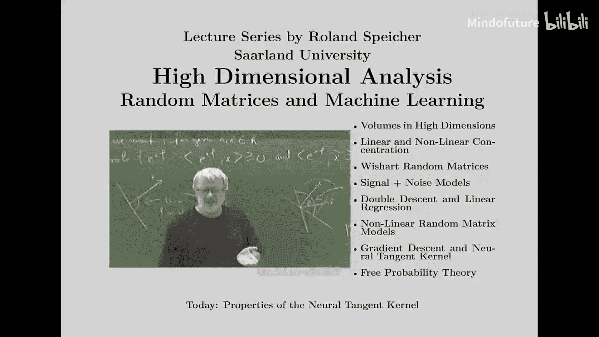
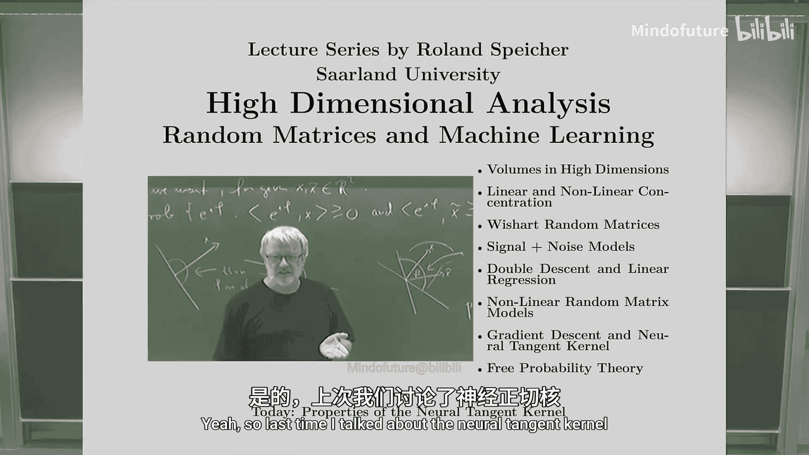
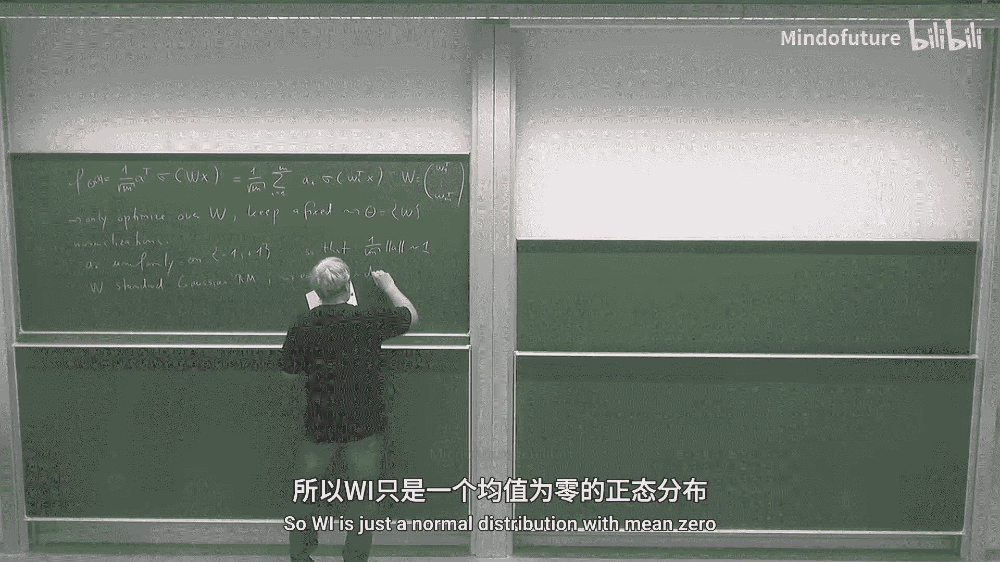

# 【德国萨尔大学】高维分析：随机矩阵和机器学习 ｜ High Dimensional Analysis p28 P28_神经正切核的性质 -BV1XkkWBFEi6_p28-

Yeah， so last time I talked about the neural tangent kernel， which is a kind of。

Linear approximation of our neural network。 If we are looking on very wide nets where the size of the intermediate layer goes to infinity。

 And yeah， we saw that。With this thing， we have a nice kind of linear description。 But， of course。

 this relies on the fact which I mentioned last time namely that this probabilistic kernel in the limit gets dataministic and also more more important that it it's getting time independent and that its eigenvalues are bounded away from 0。

 And so maybe maybe I should say a few words about this。 just to give a kind of idea why。

 why such things can be true not totally rigorous proof。

 but at least talking a little bit about this。 And so let us look again at the。

Model we are considering。 and yeah， maybe with some S simplifications。 So。 Okay。

 so I thought the model is we have a function on neural network， which depends on some。

 some parameters， which are called Tita。 And this is given by。A vector a， and this is multi blied。

 with sigma applied。To。WX。So x， so this is a function of x。 X is our p dimensional data。

 This is a matrix。 and this is a vector。 Okay， and last time we looked on the situation that we wanted to train both A and W and maybe。

 maybe the main。Main yeah， focus is， is maybe on W。 I mean， if if W is fixed and I just training a。

 this， this is， this is just linear regression Okay， so the main thing is w。

 So so maybe now I fix a and just look on， on the behavior on W。

 And maybe if I want to talk about asymptotic limits。 I should also take care of the scaling。

 which Im more less ignored last time。 So in here I should also scale with one over M。

So M is the size of our features。 So W or A is an M dimensional vector， and W is a。

Is a P times M vector。 Okay， and then last time I already wrote this in a form that。Essentially。

 I decompposed this matrix W into a vector where the entries of the vector are given by other vectors。

 So， I mean， I， I write a matrix as a vector of vectors。 by just collecting the。The row vector to us。

 So yeah。I write this。 and then then this here， okay， this is the in。 I mean。

 this is the in a product between the entry of this vector and the corresponding row of this vector。

 So I can write this as one over square of M。Some。呃。From one。Up to M AI。I'm sigma of。W。

 I transpose x。And this capital W， I have written。As we door。Where the， the roles are。

Vectctors by themselves。O。Good。So this is now in our product here， so everything here is scalar。Good。

 okay， and now I want， I want to optimize now over the W， which means over those WI。

And I keep the a fixed。 So also my， my parameters， which I consider here， really as parameters。

 which which I'm going to change， are just the entries of the W。好 far。The W。And I keep the a fixed。

So I choose this in the beginning， maybe in a random way， but I'm not going to。

 to do optimization over this。Also， this means my， my theta is just。The collection of the Ws。Good。

 okay。 And then， of course， yeah， I should now also be precise about the normalizations。 So the AIs。

 I mean， usually I take them as Gaussian。Vectctors。 But now I just take them as plus -1。

 not just to make things simpler。 because at some point， I get the square of them。

 then it's good if they are just plus -1， then they will disappear and it essentially doesn't make a difference。

 Okay， so the normalizations。Which I choose。So the AI， I choose uniformly。呃。

Just from -1 and plus 1 So you're just taking on two values。 So， but。

 but A AI is an M dimensional vector， very entries are plus -1 chosen in a random way。

 And this means， of course， that the norm of this vector A is of the order 1。呃。Yeah。Actually。

 together with this one over square of M Okay， so I mean， that that's， so this one over square of M。

 this makes this。呃。嗯。Yeah， this makes。This of the order  one。Good， okay， And then in Ws。

 we are choosing a standard gaus in random matrices。 and yeah they。A normalizedized， such that。对呀。

Varariance is equal to one。 So W。Is just a stand。Gauussian。Random matrix。

And so this means each WI is just a Gaussian vector， Gaussian random vector。So WI。

It's just a normal distribution。 This means 0， and the covariance matrix is the identity matrix。

 Okay， so this just means all entries are independent and they have variance one。

Yeah， okay。 And okay， we also assume that the input data， this vector x， this has a norm 1 so。啊。

You consider， I mean， this is a function of x， but essentially， I'm restricting two elements on。

On the unit office。是。I assume in the following also that x is non one。Good， okay。

 And then in this setting， we looked on。This kernel last time。

 which governs the evolution of the parameters。 And last time， I mean。

 we did optimization with respect to to a and with respect to W and this kernel had essentially two terms。

 I mean， this kernel is is essentially the gradient multiplied visit save。

 The gradient of the function with respect to the parameters。

 Last time I had the gradient with respect to a and the gradient gradient with respect to W and the gradient with respect to a is now just missing。

 That was the simpler part。 I mean， I mean， I'm living out the simpler part。

 concentrating on the gradient with respect to W， which is which is really the interesting part now。

Okay， so this corner。So let me write it down again。So， this corner。So this is a kernel。

 So it has two， I can consider it as a function of of two input vectors x and x twitter。

 And this is just， I'm taking the gradient of my function F theta at the point X and the gradient with respect to this W and I take the inner product of this with again。

 the gradient。 But now at the other argument So I take the gradient of F。Point x。

 the transpose of this multiplied with the gradient of F。D代。Of X Twitter。 Okay。

 and then we worked this out last time。 Yeah， I mean， of course。

 it's it's easy to do the the gradient of this function。

 This function depends on the Ws and see what the derivative is And the result， of course， is， yeah。

 So what is it。I get the derivative with respect to the Ws。 This means I get the derivative of sigma。

 and then I get the inner derivative and the inner derivative derivatives gives me the vector to X。

 So from here， I get the X here， I get the x。 so I have x。Transpose times x twi。 Okay。

 and then I have the one over square root of M for each of the gradients or for each of the functions。

 So I get all together。A1 over M。And then， I have the sum。嗯。Of the gradient。Yeah， okay。And of yeah。

 and of course， I'm taking， I mean， the gradient， this means this， the gradient is a vector。

 which is given by taking all derivatives We suspect to。To all the vectors W I。

 and I'm multilying this with itself。 So this means in this sum， I multi from this term here。

 I take the part which where I have the derivative with respect to W I。But， of course。

 this is only one term in the sumit， the one corresponding to I。

 And I have to take here the same term。 So I'm summing here over the。The eyes。From one up to m。

 And then I take the derivative bit spec to W I of this guy times the derivative be respect to W I of of this term。

 Okay， and so what do I get， first of all， I get the AI。 This is just a constant now。

 I get an AI from here。 and I get an AI from here， So I get AI squared now you see why。

W if I find it nice to。Have AI is squared equal to one， because AI is just plus or -1。 Okay。

 so this will go away。 But then I also get the derivative of。Of sigma， at its argument。

WI transpose x。呃。Times the inner derivative， which is x。

Which I already have here together with a transpose。 I mean， I mean。

 this this here is is just a real number there。 The transpose doesn't make a difference。 But。

 but here I get the transpose。 And then I also get the same from here。

 So there I have the sigma prime of。W I transpose。yeah， ex Twitter and the another。

 the ex Twitter is here。Yeah， okay， so that's。Just working it out Very easy。

 And now the simplification。 So this is one because of my choice of the AIs。Yeah， and then I'm left。

Maybe let me write it down again。 So what I have here is X T， X Twittertter。

And this is one over M times to sum。I from1 up to M。 this goes away。

 and I have sigma prime of W I transpose x。Time seek by prime。Of W I transpose X。O， so that that's。

Yeah， rigorous expression， which is true for， for any size M。 And now I'm clear， I mean， and。

 of course， this is a probabilistic object because those are random vectors So this。

 this is a random。Number which I get here， but I'm claiming if m goes to infinity。

 this converges to a deterministic number。 Okay， and so why should this converge to a deterministic number。

 Yeah， because you see what I'm doing here is I'm ever reaching sum over m things and okay this suggests that maybe we are in the realm of the law of large numbers for which we would need that those guys for different eyes are independent but that's actually the case because I mean the entries So so w I those are the vectors of my my matrix and all the entries in my matrix are independent So so the w1 vector is independent from w2 vector and so on。

 So this here for I equal to1 is independent from the same thing for I equal to2 and so on So those guys are really。

Independent， and they have have ordered the same distribution， because each W I here is。

 is just a Gaussian random vector。 It' the same covariance。 Okay， so those guys here。They are all。

Independent。For different I。And they have for each eye the same distribution。And。Same distribution。

For each I， Okay， and so this means I have here really II D random variables identically。Independent。

 identically distributed。 And then the law of large numbers tells me that if I take the average over them。

 I converge to the expectation of this。 Also， this means if M goes infinity。

 this quantity here goes to the expectation。Yeah， so。Yeah， so this one over M。Okay right here。

 so this one over M to sum。From one。Up to M。Seek my prime。W， I transpose x sigma prime。

WI transpose X Twittertter。This convers。If M goes to infinity to the expectation of yeah of this situation here。

 where now I'm mean in W I， they have let me let me just yeah instead of writing W1 or W2 just let me write V V is just the random vector。

 which has the same distribution as each of the WIs。

 So I take here the expectation over the distribution of V and here I have sigma prime of V transpose x times sigma prime。

We transpose ex Twitter。Oh that is V here as the distribution S this Ws， which is just。

 it's just a Gaussian random vector with covariance1 So V。

Is a normal distribution in P dimensions the P dimensional vector which mean0 and covariance1。

 which means all， all entries are just independent gausians of， of variance1。 Okay。

 so and this year is just a law of large numbers。Good， okay， And and so this。

 this shows us how we get here a detertaministic object。 And with high probability， we are。

 we are very close to this detertaministic object。 If M is large。 Okay， and then， of course， now the。

 the neural tangent kernel。I mean， that the one in the limit， of course， that this is this guy here。

 may be multiplied with with x transpose x t。 That's what I define now as the limit object。

 and that that is the one which is now a deterministic object， which should determine the evolution。

Also， I define now。呃。The牛。Tentent kernel。Maybe I call it now K star。As as the kernelel。

 which is just given by this。Okay， star of x。X Twitter。

 So this is the expectation with respect to this random vector in P dimensions。

On the quantity I take of this vector is sigma prime of v transpose x times sigma prime of V transpose。

呃， ex。Okay， and then maybe okay， I should also have the。X T。Exttter。Yeah， okay。 and then yeah。

 by the above， by the law of large numbers， I know that。Yeah， this converges to the limit。Yeah。

 we can say by the law of large number or， or just by concentration。 I mean。

 law of large numbers is a is a kind of statement on concentration， that。

That we are very close to the limit。 Yeah， we， we know that with high probability for sufficiently large M。

 the difference between this limit kernel and this thing here is as small as we want。Good， O。

And maybe。Before。We look on the time evolution， maybe I want to do an example where we really can calculate here something concrete。

 So to really to see what kind of object we have here。 And maybe for this， I mean。

 essentially I have to to change now to， to choose now my sigma， my non nonlinear function。

 and for this， let me choose the rail function。Of course。

 tricky speaking the things I'm doing here for this。

 I should assume that my my my function sigma is differentiable and maybe maybe for later things for estimate。

 it should also have maybe twice differentiable。 Also relu is， of course。

 the function which is 0 smaller than0。 and it its just a linear function bigger than one。

 So of course， it's not differentiable at 0。 But of course， I mean。

 this doesn't make a a big difference。 because this one point doesn't play a role。 So in principle。

 it does not fit directly into the general theory， but one can。

Calculate by hand what is happening there。 And， of course， the derivative of the rail is is very。

 very easy。 also very concrete。 So maybe we can calculate this guy here。

Of course it's one thing to have it abstractly， but it's also nice to have it。Concretely。

So I consider sigma。So this is the rail function。And then what is the derivative， of course。

 on the negative side， Ra is 0。 The derivative is 0 on a positive side。

 Ra is just the identity function the identity function。 A T goes to T。

 and the derivative is equal to 1 So then。The derivative of Relu。At a point T is either one or 0。

 depending。On T bigger than Cy。And T less than 0。 And maybe we， we don't talk about what happens at0。

 Okay， and yeah。Maybe in the following。We should， also。Yeah， consider that。

The norm of x and X Twitter is equal to one that I I said that essentially we restrict to this just to make things a little bit simpler。

 So I also。Look on the situation where the arguments of my。My neural attention kernel have norm1。

 Okay， and so what do I have to calculate here so I should now for this limiting neural attention kernel。

 I should take the expectation of this quantity with respect to gaussian distribution and of course。

 the function I take here This is the characteristic function of the argument being positive or negative And so what I have to calculate is the expectation over my random vector v。

Of the characteristic function。 what is the argument in the first sigma prime， it's。

My vector v is multiplied with the vector x that this is bigger than 0。Times。

That the same quantity where I multiply v with x twi is bigger than 0。So in principle。

 I I have here my Gausian vector V， and I'm multiplying it with。

 I take the inner product with two vectors， x and x filter in the same p dimensional space。

 And I want that both those inner products are positive。And I want， I mean。

 this is the probability that this happens。Okay， but the question is， I mean， what， what is this。

 I mean， it is not up clear。What what this is， But because， I mean。

 we want this for all x and x twi I mean， if if x is equal to x twi， then， of course。

 it would be just one condition， then it would be somehow easy。But if。

 if I have those two conditions， maybe， yeah， it's a bit unclear。 So， but maybe one should know that。

 of course。I mean， the the yeah， the entries of V are independent Gaussians。

 And if Im multiplied with x， I take a linear combination of， of those independent Gaussians。

 So this thing here is just a Gaussian， one dimensional Gaussian distribution。

 And this here is also one dimensional Gaussian distribution。 So I have here two Gaussians。

 which have a given covariants。Okay， so so whatever I get here those two guys。

 they are actually two guys in vectors with a given covaris。What is this， So note。I mean。

 that that is what what we already did somewhere the assignments or so that if I have independent Gaussians and I。

 I do transformations on them， I also get new Gaussian families where I get a change Kuvari and structure So。

 so here I get let's say two， maybe I call this T1。 This is V transpose times this。And T 2， this is。

 we transpose。Exwier。So， those are。2000。Vects with the covariance。 sigma。So the coance between them。

 I mean， the variance of each of them， I mean。Yeah， I mean。

 the variance of such a linear combination is just the norm of this guy。Or the norm squared。Yeah。

 okay， but the norm of those guys we have said is equal to one。啊， sort的。

The variance of each of them is equal to one。 And then the covariant。

 So this means the covari between this and this guy。

 this is given by the inner product between X and X Twitter。Oh， that's。Again。

 something no in principle。 and maybe I call this， let me say I call this alpha。然后算菩提挨发挨发啊。对啊。I发。

Is x transpose。So the inner product between x and X Twitter。Okay， also in particular。

 if x and X twiddle are orthogonal。Then， of course， this is 0。

 And I'm just getting two independent gaussian vectors。 If they are not orthogonal， I mean， I have。

 I have somehow a mixture。 and there's a given covariance there。Yeah， okay。

 so what I have here are two gauuss in vectors。呃。With a given covariant structure。

 and we know the density of such a situation。 I mean， it's a gausian density of。

 of random ga gausian vectors with a given covariants。 And in this covariance。

 we need the inverse of of the sigma， which of course， is very easy to calculate here。

I also to seek mind。To the -1。 So this is one divided by the determinant。

 which is1 minus alpha squared。 And then I just get here，1，1 minus alpha。问晒法。Okay。

 and then then the density。Is the following。So， the density of a。Of this。Yeah， two dimensional ga is。

 is one over。I mean， square of two pi to the dimension， but P is， but this is now。2。

 so I have two pi， and then I have the determinant of sigma。To the。1 half。And then， I get here。

The exponential of ya what-1 half。 And I have here the inner product between。

This vector do in itself， but modified with the inverse of sigma。 So what I have here is T 1， T 2。

And here I have sigma to the -1。Q one。T 2， so that。

 that's a general formula for the density of two dimensional Gaussian。

Random vector with a given covariance matrix sigma。Okay， okay， but now， of course， we。

 we know what sigma is so I can write it down explicitly。And this is now。So this is one or1。

To pi and the determinant of sigma is 1 minus I squared。 And I take the square root of this。

 So I have1 minus I squared。The square root， and then the density T。Is this you know。Product。Yeah。

 so I multiply T1， T 2 with this guy here。 So I get here linear combination。

 So I I get T 1 minus I I T 2 and minus I I T 1 T 2。 and I take it in our product。

 So what I get here。It's minus12。T1 squared plus T 2 squared。 This would be the part if。

 if sigma would just be diagonal if， if my two Gaussians would be independent， but， of course。

 they are not independent。 But I get here this covariance part， which is -2 alpha。T 1， T 2。

 divided by。1 minus I squared。Good， okay， so that's a density。 And what we have to check is， I mean。

 what we want is the probability that both T 1 and T 2 are positive because that's what。

What we want here， we want this expectation over this characteristic function。

 So this is the probability that this guy and this guy。 So the T 1 and the T 2 both are positive。

 So in principle， I I have to integrate this density over the part where T1 and T 2 is positive。

And that that would be the answer。So our。Expectation that to V of this quantity。

 which must be the integral over this density， C 1， C2。D T 1， D T 2， but only over the positive part。

 So this means I'm integrating only from。C to infinity for both of them。Okay。

 and without this coupling， of course， this would be very easy。 if they would be independent。

 then this would be clear， then it would factorize into the probability for each of them。

 And for each of them， of course， the probability that it's positive is just one half because it's symmetric。

 Yeah， but now they are coupled somehow。 And of course， one can calculate this。 I mean。

 this is just an integral one can do one can do some change of variable and you can calculate it somehow。

 but actually， maybe one can also maybe think a little bit and argue more directly。

Calculating this integral without， without really doing explicit integration。 So maybe。

 maybe I want to give a kind of argument， which， which gives us the answer。

Without having to do dis ints。Okay， yeah， So I mean， what what we have here。嗯。Yeah， so what。

 what we have here is essentially， we want this probability。That disc， that forgiven。X and x Twitter。

 those two projections of our Gaus random vector is both projections are positive。 Okay。

 and in principle， we can。Yeah， this random vector here is in R to the P。 But I mean， already here。

 we went down to R 2 because the problem essentially lives in R 2 because we are looking on those two combinations。

 And in general， you， you can just say， I mean， instead of of looking。On the V in R to the P。

 I just look。On the projection of what is spent by X and X twitter。

 because it's really I'm just projecting it down to the plane， which you spent by X and X twitter。

 And then things are the projection of Gausian things is again， a Gaussian thing。

 So essentially I can assume that I'm living here in two dimensions。

 so that my re is just a two dimensional thing。 And this is also two two dimensional thing。

 which essentially also also whats there。 Also I can assume。Okay， so this is not calculating this。

 but。More directly。Giving an answer for this。 So we assume。呃。That all my guys。

 So the X and the X Twitterwitter are actually in R 2。And the V is also in a2。

 and it has a normal distribution there。呃。With independent components。Okay。

 and so also what I have to do， I'm now in our 2。 I have a Gausian random vector there。

 and I have two vectors which are fixed。 And I want to see that the projection on each of them or inner product is positive。

 So what would I want to check for each of the two。Is better。

The inner product of M Gaussian random vector which to give an x is positive。Okay， but actually。

For this being positive， taking the inner product with my Gausian random vector。

 I can also normalize this to one。I mean， I'm he。In somehow in in two dimensions。

 and I have my random vector V， which which shows in one direction。

 But actually for checking what is the inner product with a given vector X。 I mean。

 my vector x has norm1。 I can also normalize this to equal to1。

 So I can somehow project my gaus in random vector just onto onto the the circle of radius 1。And。

 of course。If I have a Gausian random vector， I mean， this distribution is Gaussian。

 But if I just want to know what is the distribution of。

Of the normalized gaussian random vector on the unit circle， of course。

 this has a Unii uniform distribution。 I mean， Gaussian random vector is rotational in。

 So this means the distribution of the normalized。Vectctor， my random vector on this is， is uniform。

So that that's easy to control。 And for checking what what I want to know， instead of checking for。

 for the full information about my gaussian random vector。

 it's enough to check for the normalized version。 also， so this bigger than0。It's the same。

If I take the normalized version。Of my guy， bigger than Cyril。Yeah， okay。

 but this means instead of arguing with a Gaussian random vector。

 I can now argue with this vector here， which just has a uniform distribution on the unit circle。

So we can replace。We。Which has a normal distribution。In two dimensions， I can replace this by。呃，VT。

Divided by its length。 Of course， I I want to divide by V。I， I normalize the vector V。 Okay。

 so I replace this by V T normalized by V。 So this is now a vector of length 1， which lives on the。

 on the unit circle， but the distribution of it is， is just a uniform distribution。

So this is the by this。Which has the uniform。Distribution on。Wnder soccer。Okay， and so。

 so now my problem is， I have now。I have given two vectors。

 and then I want to to know the probability for uniformly distributed vector on the unit circle that the inner product of this with each of the two is bigger than。

Then， Cyril。So。You want。And we want this for all X and X square。They are given。

 but they can be anything。So what we want is the probability。Of this。Vectto on the unit circle。

 and maybe let me write it as E， E to the Ifi。呃。So this is my vector on the unit circle or the toros and what I want is that the inner product of this vector which the given x should be bigger than0。

And at the same time， this。In our product of this E to the I 5 is X Twittertter。

Should be bigger than Cyril。Okay， and now we just have to think。

 so I have this vector on the unit circle， and I want to satisfy those conditions。 But I mean， what。

 what， what are the five of which such a condition is satisfied。 I mean， if， if I have a vector X。

And I want to know， for which。Phis， is it true that E to the I5hi x is bigger than 0。 Then。

 of course， I mean， I take here the。Perpendicular erect and all the filess， which are here。

 they are O。I， that that's if I have a vector within this range， then， of course。

 the product with this is positive。 If I have on the other side， it's negative。

 and I have this  for x。And， of course， I also have this for ex Twitterwitter。 I mean。

 X twi is a different vector， which shows in a different direction。 and for the ex Twitterwitter。

I mean， everything which is in this range is okay。啊 so。So， those five。Okay。

 and now I have to check what is the yeah， W， which are the files， which are okay for both of them。

 So now I have， I mean， I， I have my。Both vectors are f the x。And I have the X Twitter。And then。

 of course， for the X， I mean， the range where is O。 is I take the。Yeah， perpendicular direction。

 And for the X t， I also take the perpendicular direction。

And now which what is okay for both of them。This is， of course。

 what is between those those two lines here。Yeah， okay， so， so， so， so this is the range。

 which is okay。 So I mean， starting here from the one which is perpendicular to this and ending here。

 which is perpendicular to this。 Okay， and how， how big is this， This， of course。

 depends now on the angle， which is between x and x Twitterter。So I mean， if I go from here to here。

 this is 90 degrees。 If I go from here to here， this is also 90 degrees。Okay， so if I。

 if I'm adding this up。I get 180 degrees， but then I have counted better twice。

 So this means this range here is。Pi over 2 plus pi over 2 minus speedta O， so。Yeah， so the range of。

Everything yeah。So， this here is。Pi over 2。Plus pi over2。 But then I have counted Pita twice。

 so I should subtract it。 So that that's the， the range of angles for which both conditions are satisfied。

 And， of course， this is pi minus pita。Okay， and because I want the probability。

 I have to normalize it by two pi， because two pi is the。It's the whole angle of the circle。

 So the probability I'm looking for。This is just pi。Minus Pita， divided by two pi。Yeah， okay。

 and of course， now I should express。Beta in terms of X and X Twitter， but， of course。

This beta is connected with， with x and x twitter， because the inner product between x and X twitter is the length of x times the length of x twiddle。

 which is one times the cosine of the angle in between。 So beta is actually the the a， the。

 the as cosine of。Aina product。Also， we have in our product。Between x and X Twittertter。 in general。

 this is， in general， it's， it's the length of。Of them times the cosine of the angle between them and the angle。

 That's what what Peter is here。 So those guys are one。So this means beta。

Is the a cosine of the inner product。X。Transpose times x。And so we see。That our probability。

 which determines the kernel。 I mean， what you really want is， is this kernel。

 But now we rec calculated this by just this quantity here。And， of course。

 if you do the above integration just by change of variables and this。 I mean。

 you should also arrive at this one here。 Okay， but but this is a nice geometric argument so you can get a result without having to do hard work。

 but you need some soft ideas。Good， okay， So this means。The our kernelel， in this case。X， X。

 Twittertter。So this is x trans， X Twitter。 And then we get this probability here。

 So this is pi minus。course， course。Cosine of。呀。Xt。Exter， divided。By two排。Okay。

 so I think this is a nice， concrete calculation， which shows that， I mean， one really can calculate。

At least in concrete situations， this Disc。 you get something concrete。

 which you then can can also use for doing other calculations。Good。But maybe we should now。

Come back to the question of the time evolution of this kernel。 So this here was at initialization。

 I I chose my， my w use in a random way。 and then we saw that the corresponding kernel。

 This tang kernel is close to the deterministic object。 But then we do the training。

 which means we are changing the w use。 and the statement was that this kernel does actually not really change。

 So that's maybe a that's a kind of surprising statement。

 maybe something which maybe we should understand a little bit better。 And so I want to do now。

Going a bit in this direction， too that we see how such a thing。Can happen。Yeah。

 so we look on the evolution of the kernel and the training。 and yeah。

 the statement that this does not change or does not change much depends essentially on effect that the weights are not changing much。

 So we are updating the weights， but actuallyre not really changing a lot。

 So we should look first on the evolution of， of the weights of， of the top the Ws。 Okay。

 so for this recall。 how。Our training work。So we had that the time change of our。parametersarait。

And this is the W in our case。 This was given by the gradient of the loss function。

 So this was in general the gradient with respect to our parameters of the loss function。

Which depends on our parameters。And I also had Eta there， but maybe I just put this equal to one。

 Thats make a big difference。 Okay， and the loss function。

 This was the sum of the square of the differences between F evaluated act at our data points。

 X K and the， the the target values， which they should have there。 Okay， and， of course， we could。

 we can take the derivative of this。 So what this was was minus。And we are summing over。The。

 the training data So we have n data points and there we。Have essentially， F T。X， K hat。

Minus Y K hit。So the loss function was the square of this。Divided by one half。

 So we take the derivative。 So we get this， and then we get the inner derivative。

 So we get the derivative of this guy， which then gives us the gradient of the function F with us back to the parameter。

 So we get here the gradient。Reuspect to theta of F T applied at。Yeah， at the points， X K。Good， okay。

 And then we calculated the gradient of f theta that was is exactly the quantity which we got there。

 or essentially that was half of it。 I mean， the kernel is。

 is this gradient multiplliied with itself。 And so this quantity here。So， of course， this was。呃。Yeah。

 maybe let me write it here and let me just write it down for Tita is now the WI I mean our parameters is now are now all the entries of W but I collect them into the WIs so the gradient withs back to WI of FT。

Of applied to X， K， Twitter。 So this was just this AI time sigma prime。Of W transpose。X， K head。

And then the in， in a derivative， this is the X， K head。 And， of course。

 I have a normalization there。 This one over square root of n。Okay， so that's the gradient。Good。

 okay， also this means for our。WIs。Let me write down again what we have here。说的。Time。The derivative。

Of the W I， which， of course， depend on the time the W I's。

 the parameters are now depending on the time。There are functions of the time。 So what is this。

 This is this one over。Square root of M。Some of。K from one。Up to n。

Then I have this difference F T of X K hat。Minus。Y K head。Multi bte with this one。

 And this is AI and sigma prime of W， I T。X， K head。timess。Xk head。Good。

 so that that's the time derivative， which which governs the evolution。 And now we want to see how。

 how much does our weight change， Let's say if we go from time T or from time 0 to time T okay and。

We want to estimate this。 And to see that this is somehow of small order。

 So if m is going to infinity， this should go to 0。 This means in the limit。

 the weights actually don't change anymore。 which yeah， is a bit strange。

 But that that's what happens Yeah。 Okay， so consider the evolution of the weights。

 So what I want is I take， let's say the weight。At time T minus the rate at time 0。

 And I want to see how much does has this changed。 And because I have the。

I have the differential equation， So I know。The derivative of the change。

 So I just calculate the change from0 to T by integrating the derivative of the change。

 So this is the same。As integrating from 0 to T of the change of the。Do wait。嗯。

Maybe here I'm right right's okay。Yeah。Good， okay， And so I I take here the two normal。 So， so。

 I mean， the w use， each of them is a vector。 So I consider their Euclidean norm， which okay， I mean。

 I could put a two there。 I could also leave it away。 It should be clear。 it's this one。 Okay。

 and now， of course， I have for this derivative。 I have this。equationquation here。

 so I can plug this in。So what I have here。 So this is the norm of the integral from 0 to t。

 And now this time derivative， this is one over the square root of M times the sum。From 1 up to M。

Then I have this F T of。X， K， hat minus Y， K。Head， also， that's somehow the driving force。

If I have not achieved the right value at the point X case， I mean， I want to change the。

The the weights such that things are getting better。 Okay， and then I have the AI。

Times to seek my prime。Of W I。Transpose x。K you head。Times X K。O。And I want to take。This here。

The too long。Of this。 Yeah， now， now， what is the order of the whole thing So we want really to。

 to understand how does this depend。On。On M and N and， and such things。 Okay。

 and so what do I have here， I mean， here， I have this difference。 So this should be of， of order 1。

 So I mean， okay， I mean， those are just real numbers of order  one。

 They are not changing somehow with with M。I mean， and also this here should be close to this。

 So this should be some， something which does not really depend on M。OrN whatever。 Okay。

 then the AI is just plus -1。 Okay， and so here I have to seek my prime of an argument and this argument。

 Yeah， so what， for this this argument， this is， of course， a Gaussian variable， I mean。

The entries of the W I are independent Gaussians。 I multi bly them。

 I take a linear combination of them with with， with the。coefficients of this vector x。

 And so what I get is this is a Gaussian variable， which has the variance of， of this X K。

So this is a Gausian variable。嗯。Of variance， which is。To norm of X， K。Head squared。 Okay。

 but let's say they are also have also length 1。 So our data points are also normalized to have length 1。

Okay， so also the sigma prime is， is a function which。Should be differentiable。

 So this should be a nice function。 And the Gaus variable here is in principle of order 1。

 So this here is also the sigma parameter is also something which which is of order 1。然后说 it呃说不说。

Everything I have here is， is of order 1。So what I have here。Of course。

 I can say this is less or equal。 I can bring out one over squared root of M。

I can bring out out to some。From one。To M。 and then I'm left with the integral of the absolute value of those guys。

 But everything which I have here is of order  one。 So I'm integrating here things of order  one。

With was to D T。Yeah， and then， of course。So I'm integrating here。

 This integral will then be of order T。 So what do I get， So I have here， the order。

 which I get in my quantities， this integral here， order 1。Times t。 So this is T。

Here I am summing over m terms， but。I'm dividing by one over square root of M。 So I get here and or。

 I get here and M divided by square root of M。 So I'm dividing here。嗯。Oh， let me see。 So I have here。

嗯。No， no。The summation here is running to end， okay。Okay。

 so n n is a number of data vectors which I have。Those are the the x1。Haad up to X， N head。 I take n。

 and observations。 So this sum here is going up to n。 And this， this， this。

 this one of our square of M。 So M is the is the number of features which I have in in between And this is what I want to send to infinity。

Okay， so I have here。 this is one over square root of M。 This is just here。 And this sum here。

 which goes to n gives me a factor n。So the order， which I have here is T times n divided by the square root of M。

 And so this means if I'm sending M to infinity。Then this goes to 0。But you see， I should not。

 I should keep n fixed on the arguments I'm doing here essentially for for the setting where n is fixed this divided by this should go to0 So and has to be a little a bit careful。

 which regime one is considering。 But that what is meant here and is context that I in the know in the white regime I go the kernel is not change anymore。

 This is really meant in this way that that M is going to infinity。

 but N n is kept fixed or as a much smaller order than than。Good。

 so this means at the weights are not changing much in the limit， actually， they don't change at all。

 But so that they are not changing much。 And this this， of course。

 now means that essentially also the kernel the change of the kernel is determined in in terms of the change of of of the weights that this this is also not changing much So so this here is the main。

 I mean， that's somehow the reason why the kernel is is not really much changing because the weights。

We are training the weights。 And， of course， in a finite situation。

 we are changing changing changing them a little bit， but they are not changing much So essentially。

We do an initialization。 This means then we get some weights， and then we train them。

 but essentially we all， we always stay very close to from where we started and the kernel which we calculate actually is more or less the kernel which we had at the beginning。

 Also in finite situation， there is a small change。

 but but not not much and actually in the in the limit in principle， nothing is changing anymore。

