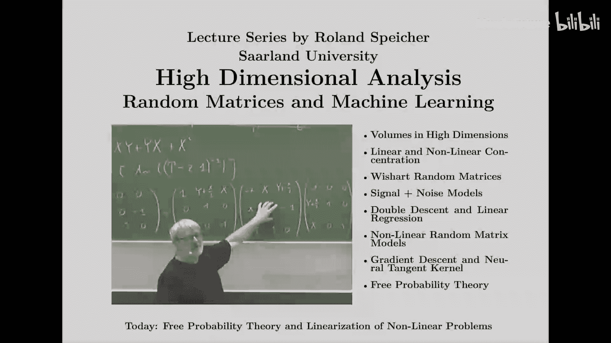
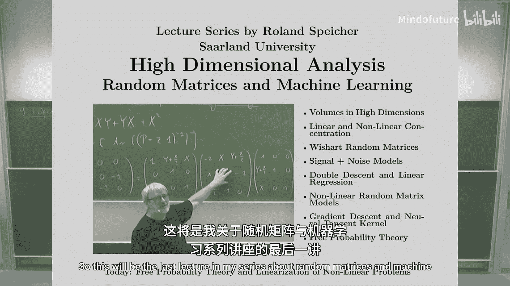
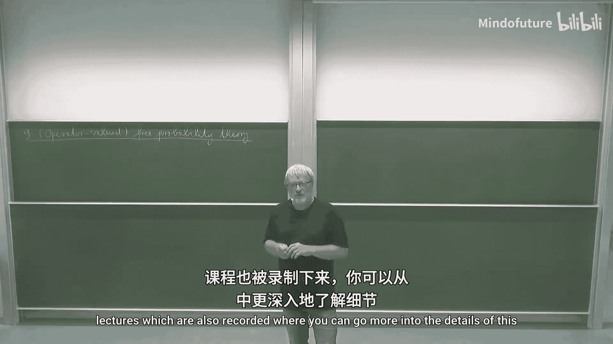

# 【德国萨尔大学】高维分析：随机矩阵和机器学习 ｜ High Dimensional Analysis p29 P29_自由概率理论与非线问题的线性化 -BV1XkkWBFEi6_p29-

This will be the last lecture in my series about random mates and machine learning。

 so I have tried to cover some machine learning aspects。

 mathematical aspects of machine learning but of course mostly from the perspective of random mates so I'm working on random mates So I like to see how random mates can be applied and how machine learning can give us new ideas and problems about random matrices。

 Okay， so we have I think we have covered quite a bit maybe what what is still at the moment not so well understood is the evolution of the learning process。

 how to describe this。 we had the neuraltent kernel。

 but this is of course the first approximation and we have to go beyond this。

 Okay but at the moment I cannot say more about this So I will leave it like this I hope I have。

Shown you that at least for some models， toy models， or at least for some。

 yeah ideas to understand neural networks， random matrices are important and play a role。

 And that being able to calculate the eigenvalue distribution or still just transform of such random matrices is。

 is quite important。 Okay， and so today in the last lecture。

 I want to go a little bit in this direction。 Let me show you that there is a quite a modern。Theory。

 which allows to deal with random matrices， namely free probability theory。

 That's a subject I'm usually working on， which should be relevant for such things。

 And so I want just to give you a very high level overview on what free probability can do or yeah whether how we can address the problems we have。

 Okay， the main problems which I tried to convince you that they are relevant in the in the machine learning context is that we are able not only to deal with maybe with one random matrix maybe just calculate avalue distribution of of the visual mates。

 Macen pasttua， but that if we make more complicated models。

 then maybe we get we have several random mates and we must be able to deal with complicated expressions in them polynomials or maybe even rational functions。

 So the question is， can we actually deal。I this in a， in a very general yeah setting， Of course， we。

 we looked on specific examples， but free probability theory gives you a very。

A very conceptual and general tool for dealing with this。

 So what I want to talk about today is free probability theory。 And in particular。

 maybe also this operator valued version， which allows you also to deal with polynoials in random mates。

 Yeah， so there will be two messages more or less。 I mean， so there's free probability theory。

 which has some other the flavor of classical probability theory。

 but it allows you instead to deal with classical random variables。

 It allows you to deal with random mates， which are non-comuting objects。

 So it has a kind of noncommut flavor。 and in the same way as in classical probability theory。

 we can deal quite easily with the sum of independent random variables in free probability theory。

 we can deal with the sum of free random variables。

 which corresponds to the sum of specific random matrix models。 But of course。

We saw that it's not just the sum。 We are interested。

 but usually we have more complicated expressions in several random matrices。

 namely polynomials or rational functions。 Okay， and the operator value version of free probability theory actually allows to deal with this。

 Okay， so those are two things， which I want to give you a very general idea in the following And if you want to to see more of this。

 I mean， I， I have other lectures， which are also recorded。 you can go more into the details of this。

Okay， so let me start by telling you a little bit about random mates or maybe motivating somehow the structure of free probability theory from our random matrix perspective。

 Okay， and maybe maybe， first of all， I should say free probability theory。

 So this was created invented and developed mostly by Danvo Colescu。And so this started in the 1980s。

Maybe 85 or 86 where the first first papers on this and it is still an ongoing。

 very active subject in mathematics， and it has applications to many other fields because it has relations to random matrices。

Okay， and in our context， we looked on。Matririces， random matrices of this Vi type。

 So I had non server joint random matrices。 let's say W。 And then we looked on its singular values。

 or this means on the eenvalue of W W W star。 of course。

 evalue we can only take of server joint or symmetric matrices。

 And maybe now I don't want to look on the Vi type of matrices。

 But I want directly to look on on the server joint symmetric matrices， which are more of a vi type。

 Okay， so I just want。Just for this motivation here， Consider our mates。Which I actually。

 let's say sumsymmetric。 So the entries。 So X is an n by N matrix。But I assume it is symmetric。

 So X is the same as its transpose， which means， of course。That the entries are sumsymmetric。

 X I J is the same as X J I Okay， and then， of course， we we consider random matrices。

 classical vi matrices are those matrices where the entries are independent， but of course。

 even if we start from such matrices。 and we take products of several matric of these types。

 We get something where the entries are not independent anymore。

 So the independent of the entries is is usually not are not a property which we have for general matrices in our setting Okay。

 but we have seen。That， even after taking。Maybe powers or no， not powers。

 but product of two matrices。 And then even entry wise non nonlinear functional。

 we still have a structure of the random matrices， namely a structure of the cumulants。

 the classical cumulants of the entries。 We saw that at least in leading order。

 it's only the the Su click， kind of of cumulants。Of the entries where we have acyclick structure in the indices。

 all the other ones are not， not of the leading order， and they will。

 in the calculation of eigenvalue distributions， not not make a contribution。 Okay， good。 So。

 and so that that's what of what I want to start。 So typically the random matrices we have to deal with have this special structure。

 and so let me recall。So， in leading order。呃。人。Onlyly。Cumulans。With a kind of cyclic。Index structure。

Survive。Okay， so what do I mean with this。So namely， if I'm looking on cummolan。

 we talked about cumolan， classic cumullans， which are determined in terms of the moment by these moment cuullan formulas。

 So I denoted them by by K or Ka。 So let's say else cumoland。Of the entry。

 So I have L arguments and those arguments entries of my matrix。 So they have in indices。

 So in principle， I could have your all possible indices， but in leading order in the order。

 which contributes in final calculations， only specific indices appear。 So namely only。

The indexice is structure。 O。 let's say for the first index for， for the first。Entry， I have I 1。

 I 2。 but then the second entry X must have the same index as here again。 So I must have I 2。

 and then I 3。 But then the next guy must repeat this I 3， and then have an I 4。And so on。

 up to the last one。Which has to repeat。The I L， which I had before。

 But then the last one has to be the same as the first one。 So， I mean， I have this。

Repeating structure in this way。 But also in acyclic way， because usually if we calculate traces。

 then you see that we also should have acyclly condition。 I mean。

 this here is like matrix multiplication that we repeat the index。The last index。Of one entry is。

 is the first one of the next one。 So this corresponds to doing matrix multiplication。

 And if you also take the trays， then also the last guy should be the same as the first one。

 So here here， the last one is this I1 again。Okay， so only those guys。Contribute。 And they。R in n。

So and the size of all matrices。 they go in this setting here this。And to the power L -1。

So this means the first cumulant is of order 1， the second cumulant of order1 over n and so on。

And maybe we we should remember that， of course， the entries of the cumullanants， they commute。

 So it means that I can do some permutation of the entries here， such that after the perutation。

 I find this structure。 So more general， this means is I2 here must appear somewhere again as the first index of the next x。

 And then the second of this next one must appear again。 So I find。

A cycle where I can go through all the indices。 got， okay， So， so that is somehow the structure。

Of those。Yeah， the the relevant structure of the random matrices。

 which usually are showing up in our context。 Okay。

 they have this structure and actually the value of those cumul lines is independent of the actual value of the indices。

 at least if all the indices are different。 if some of them are the same。 I mean， then okay。

 there there are some more some more subcycle structures and the situation is more complicated。

 But for the calculation of moments。In the limit， the main information is given by those guys where。

Where are all the eyes。 I1 up to I L appearing here are different。 Okay， so。

 so this goes is is of this order。And。They value you。Is。Independent。

Of the actual choice of I1 up to I L， which， of course， are all indices between1 and n。

 But let me here assume or say for distinct。Guys like this。 Okay， and then so the main quantity。

 the main number， which I really need in my calculation。

 is actually the value of those guys for each， for each L。 And so maybe let me give a name to this。

 maybe let me call this R L。 So R L。Is the leading order of this cumulant is this cyclic structure。

 So this means if I want to write it as a limit， it's of this order。

 So I should multiply it with n to the power L -1。 And then it has a limit。

 That's what I'm saying here。 And this limit。 I did not by I。 So this is by definition。

The limit if n goes to infinity of n to the L -1。Time such acyclic。Cumulant， I 1， I 2， and so on。

Up to。X， I， L。排玩。Good， okay， and。Of course， I I say this is the only those are the the cumulants which survive in leading order。

 But， of course， I mean， for different L， I have a different order。

 So first order is first order cumant is of order 1。 Second cumulant is of order 10 N。

 next one of10 n squared。 So， so maybe you would say， okay。

 this means only first order cumulants should play a role in a limit。 But of course。

 you should also take into account。That I have much more cumullands。Of， of this type L of。

 let's say of of of second order。 then a first order which show up in my calculation。

 because I have this for all I。 And if L is bigger， then I have more possibilities for the indices。

 Oh， essentially， I have n to the L indices。 Okay， so， so this， this leading order here。 this。

 for the L cumulant is exactly what survives of what makes。

What survives as a contribution in the calculation of the eigenvalue distribution。 So name name so。

Yeah。So name， namely， let let us look on this that those cumulants here are exactly the quantities which which we need for calculating the eigenvalue distribution and。

 of course， the eigenvalue distribution of our matrix corresponds to knowing the moments of our matrix and the moments。

 of course， are given by taking the expectation of a trace of a power of our matrix。 also the。

Moment of our matrix is。To normal trays。Of the X power of the matrix。

 And then I average it over the randomness。 And of course， this is the expectation of one over n。

 This is the normalized trace。 So this is one over n times the usual trace of x to the L。

 And then I can， of course， write the traces of x to the L in terms of the entries of my matrix。

So then this is taking out of 10 Y N。I have now sum over indices。 name me exactly L of them。

 I won up to I L。Oril running from one up to end。And here， I take the expectation。

 And now I get exactly。A product of guys like this。 Now， I really have matrix。

 multiplication and the trains。 So I have here。X， I 1， I 2。Times X I 2。I 3 and so on。 up to X， I L。

I want。Okay， so summing over this I2 is the product of this matrix with this。

 and summing over I 3 is multiplying the next matrix。 And then I'm summing over。

 I 1 is really taking the trace of this power。Yeah， okay， and now。We know。That， I mean， here I have。

 here I have the expectation of the product of the matrix entries。 And here， of course， I have made。

Yeah， assumptions。 or I observe a property of the cumullans。

 So I should rewrite this in terms of cumullan。 And we have the moment cumullan formula。

 which tells us that such an expectation is given by summing over all partitions。Of L points。

 And then I get a contribution for each of them。Which is a classic aant indexed by this pi of the x。

 which I have here X I 1， I 2 and so on up to X， I L。系晕。Okay， and if pi is now the largest partition。

 which means all inices are taken together， then here I have exactly。A cumulant like this。 Okay。

 But then， of course， I get sub leadingting order contributions。 And one has to see that actually。

 yeah， what are the leading order contributions which survive and maybe if you just think about。Yeah。

 maybe first thing about if I have here the one n So if， if I take here the one n。

 then this here gives me exactly this。this cuulant here， which goes then with n to the minus n -1。

Here， I have another one over n。 So， so this quantity here with the one over n there goes like one divided by n to the air。

 Okay， but now we are summing over all eyes。 And it's enough to sum over the the ones for which the eyes are distinct so that I really have this。

 The other ones。 Okay， will not make a contribution here。 And so you see， I have here a sum over。

N to the L， the orura， and to the N number of terms。 And each term is of the orura 1 over n to the L。

 So the whole thing together is in orura 1 So this means。

This here really makes a contribution in order 1 and the other pis 1 has to think about also have the same kind of order。

 So this means this here really is， is the contribution。Yeah， or the the yeah。

 the asymptotics of the cuullan， which in the end， is responsible that in the calculations。

 asymptically， we get a final result。Yeah， okay， and， and you also see that， of course， here。

 the scaling should be really like this。 So first order。Cumulland should be of orura 1。

 second orura cumul land of the entries should be of of orura 1 over n。

 third orura cumul land of the entries should be of orura 1 over n squared and so on。Good， O， so。

Yeah， this is all nice。 But yeah， question is， can， can we get some more structure out of this So。

 I mean， I have， I have here。😊，Yeah， written now the beginning of a calculation， namely calculating。

The else moment of my matrix writing it down in terms of the entries for the entries。

 we have some information about the cu lines and the main information are just those guys are L here。

 So so in principle you see what what I get here should be something like a sum over partitions。

 And then I get contributions from the Rs。 And the question is。

 can we all sort is out in in a nice and useful and clean way。

 And actually this is possible And in the end， we get。We get a kind of moment cumulant formula。

 but it's a kind of noncommulative one， or maybe a free moment cumulant formula。 namely。

 we will see that we get essentially contributions here in terms of the R's。

 but not all pis contribute。 So it will be only specific ones。

 And maybe we should look let on some examples to see this in a clear way。Maybe that's first to the。

The smallest one。嗯。Yeah， so let me add equal to one。So what。

Is this calculation here doing in this case。 So I want to take the expectation of the trace of x。

Or I actually， I want to take it asymptotically。 So X is an N by N matrix。whichhich。

 if N goes to infinity， behaves like this。 And then I want to look what is asymptotically its first moment。

And， of course， in this case， this here is just one over n。 Then I have just one index to sum over。

 So I is running from one up to n。 And then I have the expectation。 And here I just have X I I。

 I mean， taking the trace of my matrix is just summing over the diagonal。Yeah， okay。

 and here had is expectation of this。This is the same as the first cumulland。Of X Ii。Yeah。

 and the first cumberant。In our matrix ensembles here is of order1。 So actually。

 this here asyically behaves like R1。 Okay， so this all those guys are1。 I sum over them n times。

 but I'm also dividing by one over n。 So this means this here really just gives me R1。

 I just see the contribution of the first cumulant of my entry on the diagonal， which， of course。

 is the same as the moment on the diagonal。 Okay， this is first moment is first R1。 This is。

Not too surprising。 Go So for n equal to 2。If I take the expectation of the trays。Of x squared。

 What do I get there。 Then， of course， I have to sum over two I。 Let me call them now I and J。

 instead I 1 and I 2。 So I have the sum over I and J each running from one up to n。

I have this  one0 n factor coming from the normalization of the trace。

 and then I have the expectation of X， I， J X， J I。

 So this is matrix product between the two x's and summing over the I is taking the trace。 Okay。

 and now again， I write this expectation here in terms of the cumul lines of the entries and the second moment is yeah summing over all pairings of two elements。

 There are two of them。 So I get the contribution。off。I mean。

 the contributions which I get are exactly those two。 I have E and X。 I have E and X。 Okay。

 I combine them together， which gives me a。The second cumulant is the entry X， I， J， comma X， J I。

Plus， this term here gives me a product of first orderaccuulants。 So it's K1， K1 of X。

 I J times K1 of x。J I。Okay， and now we see。This contribution here， Yeah I N G。 yeah。

 for this contribution， we can restrict to the case where I and G are different。

 because if they are the same。嗯。They don't。 They dont will not survive in the， in the sum。

 So if I N G are different， this is， this is order 10 N。What this is always of order1 over n。

 But if I and J are different， it's always the same value。 So this here behaves。

Like one over n times are  two2 is the。Leing orderura of of this guy in this asymptotic。 And again。

 you see this is nice。 This fits。 I have a 1 over n， another  one over n。

 So I have one over n squared， but I'm summing over I N J。 Okay， they are different。 So， but。

 but nevertheless， I'm summing the orderura is n squared of the number of terms which are sum over。

 So I have n squared times1 over n squared。 So this will go away。 And this here in the limit。😊。

Go just gives me a to。Okay， but here's another contribution。 So do we get something from this。And。

 of course， here， yeah， so。We have here K1s and we might get worried because the K1s are of order 1。

 Okay， so I have here something which is of order 1 and here something which is of order 1。

And then the contribution would be R1， and here it would be R1。

But we also have to see that we need the simplicityity and the simplicityity on the for the first。

 if I only have one argument means， of course， the argument should be the same。

 So I get here something of order1。 if I is equal to j otherwise it's lower order which which is not there。

 So here I get actually a delta I J and here I get a delta I which means I get here terms of order1 name r1 times r1。

 but only in the case when I is equal to j So actually I don't have n squared terms for which I get this contribution。

 but only n terms， and each of them has this factor1 or n。 So again， altogether。

 I mean leading order and this here together gives them r1 times r1 And so what we get here。

In the limit is that this here converges to r2 plus r1 times r1。 Okay， now you you， you see you say。

 okay， what I get here is just ordinary moment cumulant formula。

 I'm expressing the moment of my mates in terms of this Rs and this formula is like for for for the cumulant。

 So so it looks as if this R would now just be the cumulants of the distribution of the matrix。 Okay。

 so this is true for this two guys for third order， it will also be true。 but then for higher orders。

 the noncommodivity is going to play a role。 and we will see that we still get a formula of this type。

 but the actual concrete form namely which pis make a contribution， this will change。

 And for this let us look。Yeah， on maybe the fourth order because there。

 we will see for the first time a difference。So let us now look on the case L equal to 4。 So fourth。

 the fourth moment of my matrix。 and to make life easier so that I don't have too many contributing terms。

 let me assume that let's say that R1 and R 3 is equal to 0。

 So if if I have kind of even distributions， then this will happen。

 So this is just to simplify life a bit。 Okay， so I consider L equal to 4。

And I assume that R 1 is equal to 0。 maybe also R 3， but R1 actually would be enough。 Okay。

 and I want now。To calculate。The fourth。Moment of my matrix。 And yeah， so what is this， Yeah。

 but general formula， of course， this is just one over n。Then I have to sum over I1 up to I 4。

 So I have 4 I， in this is。Running from one up to n。 And I have the expectation of， yeah， I have X。

 I 1， I 2， comma X， I 2， I 3， comma X， I。3。I far。Comma X I 4。 and then going back to the first 1。

 I want。Okay， summing over all this。Mattrix multiplication。Here， here and here。

 And the taking the trays is here。 Yeah， And now， of course， again。

 I write this in terms as a sum over cuulan。Yeah， is a sum of partitions。

 each partition makes a contribution， which is given in terms of the cuulland essentially by taking the product of a cumullan for each block。

 And because I have assumed that R1 and R3 are equal to 0。

 the only possibilities which make a contribution are the ones for which I have only a block of size 4。

 or whether。Or the ones where I have two blocks of size 2 the situations where I have where I have blocks of size 1。

 they will disappear。 They are0。So this year。Actually。

 and this assumption is the same as the cumulant of orura 4 plus， and then I have three terms。

 I have three partitions where I have two blocks of size 2， So name me1 and2，2 and three is together。

1 and 4，2 and 3 is together or。1 and 3， and2 and 4 are together。Okay， and yeah。

 in the classical world。Those， I mean， okay， this gives something。

 Those would give the same contribution。 But now we have to see that actually here。

 the situation is different。 But let us first look on。On cup4。So cup4， yeah。So what is this。

 This is just taking the cumulant。And actually， here， I have the product。 So here。

 I don't have commerce。啊，I don't have to。So here I have the product of those guys。

 If I take the expectation， if I take the cumant， I'm putting commas there and I have my four arguments。

 and then of course， I have here just thiscyclic structure。

 which in our models always goes like R4 times n to the minus-3 in this case。

 if all the eyes are different。 but that's。We can assume。So what we have here。

 this goes like 4 times n to the minus-3。 This one over n here makes this to an n to the minus-4。

 but then we are summing over n to the4 order of terms So we have n to the four terms。

 which are of order1 over n4。 So this the limit goes to1 And so what we get from here is the R4 So we just get essentially this guy here。

 Yeah， but how about the other ones。 So how is it now about this product。

We should look on this product。 So this is a product of two second order cumulans。

 one for this block and one for this block。 The entry of the first coppera， the first two arguments。

 So x。I 1， I 2， comma， X， I 2， I 3。And then times。The second dollar aulant of the last two arguments。

 which is X I。3， I 4， comma， X， I 4。I玩。Yeah， okay。 so those are second order aulants。

 So they go like one over n。 So each of them goes like。1 over in。1 over n。And then， of course。

 it's two。And ti the same。1 over n。2， okay， and now again， we have the same apparent。

 apparently the same problem as before。 Naly I have 10， y n，10 M。

 which is 10 y n squared together with this extra 10 y M and from the normalization of the traces。

 It's10 n to the three。 So if I would have now all my indices， which make this contribution。

 This would be a problem。 And things would explode。 But again， of course。

Not all indices make a this contribution because I need the simplicity in the indices。

 and simplicity here means that this here must be the same as this。 I mean， here here it is okay。

 but here， I mean， the whole cycle continues here。 But now this the cycle is broken。

 and I need a subcycle here， which means I 3 must be equal to I I1。

 So this only makes a contribution If I1 is equal to I 3。And here， what is here。 here。

 I also need a simplicity。 So here this must be equal to this。

 But this is the same condition as here So it it's still the same condition that I 3 must be equal to I1。

 So this means in my summation over I1， I 2， I3 and I 4 only three of them can be chosen independently and I 3 must be equal to I 1。

 So I only summing in the order of n to the power 3 number of terms。

 and then each of them gives a1 over。And to the power 3 means。Altogether。

 they contribute of order  one。 And what do they contribute， They contribute are two times R two。

 So this thing here makes in the limit the contribution。two times two， which is， again。

 what we would expect。 Okay， so this still looks like the classical cuant formula。

 If we do this year， I mean， this will do the same so。This year。Well also make the contribution at22。

 And now only the last one will be different。 Okay， and yeah， maybe I already mentioned it。

 free probability is like classical probability， but the noncommodivity Yeah。

 makes extra contribution or has an extra flavor。 namely， it doesn't like crossings。 Okay。

 so this is a crossing partition compared to those。 I mean。

 I won you find crossing explicitly precisely， but I hope you see if I draw those pictures of my partitions。

 I mean， this year has a crossing between those two blocks where the others don't I mean。

 those those two don't have a crossing between the two blocks。 Okay， and this here is is different。

 So namely let us look what is the contribution of this so。第四。Guy here。 So， I mean。

 this is still a product of two second order amulants， one for each of the blocks。So I have a cupa2。

Of the arguments， which are sitting here and here。 And so here I have X， I 1。I， too。

 But here I' am now at this guy here。 So I have。X。I 3。I放。So I'm taking， I mean， I'm taking this。

Partition now of the four arguments。 And so you see， I mean。

 I have take this and this as the two arguments of the first。

Cumulland and this and this as the argument of the segment。So， here。For a second。

 I get a second dollar cuulan of。X， I 2， I 3， comma X。I for。I1。 Okay， and now you see that again。

 in principle， those are second orulants。 So they would make they make a contribution are two times 1 over n。

 But then， of course， only if the indices have thiscyclic structure。

 And now you see we have thiscycl structure， we have it much more destroyed that in the other cases。

 So， I mean， we what we need is essentially that this guy here is the same as this guy。

 because we have symmetric matrices。 I mean， we always have the possibility that this is equal to this or this is equal and this is equal to this or the other way around。

 because X I J is the same as X J I So this makes the arguments a little bit complicated But in any case。

I mean， what we need here would be that either。Let's say， I1 is equal。To I 3 and I 2 is equal to I 4。

 or I mean it could also be the other possibility， which would still give a s structure that I 1 is equal to I 4。

 I 1 is equal。To I 4 plus， and then I 2。Must be equal to I 3。Okay， and here， similarly， I mean。

 here we would have that I 2 is equal to I 4 plus I 3 is equal to I 1 or。The other way around that I。

 too， is equal。2 I 1 and I 3 is equal。To I4。Okay， by that mean， in any case。

If you think about those possibilities， you will see that we have now to identify more indices。

 It's not that we can just say， okay， two indices are the same。 And we still have three indices。

 which we can choose freely， but at least two of them have to be identified， according to this。

 I mean， you， you can take all combinations of this。

 And so you see whatever I have here is a delta where at least two。Indices are the same。

musust be equal。Okay， and so this means I get a contribution two times 10 y n2 times 10 y n。

 So this is of order 10 y n squared an extra 10 y n from the tray。 So I have a1 over n to the three。

As before。 But then the question is， how many inices can I sum over and there are at most two independent ones。

 So I have at least at at most order n squared I have n squared， but I divide by n to the power 3。

 So this goes like one over n， or maybe even depending which of the situations here。

 I have 1 over n squared to 0。 So this means this contribution here in the limit goes to 0。啊，属于C。

In principle， we get a formula for the calculation of the moment of the matrix where we are summing over partitions。

 and for those， we get contributions， which。I like in the moment， cuulan formula， namely。

 we get1 R for each block， and we multiply them。 but it's not that all partitions are now treated on the same level。

 I mean， they are some are special。 Some are better than the others。 Some are bad Partitions。

 and they disappear a little bit。 Okay， and what survives。In this case。

 are only those three contributions， but not this one。 So this will go away。

 And this is true in general。 So if we do the higher order calculations。

 it's actually always the crossing ones， which go away。

So this means in a limit we get for the calculation of the moments of our matrix。

 we can express this in terms of the R's by a moment cuulant formula。

 which has the same structure as the classical moment cumulant formula。

 but it's not that we sum over all partitions， but we only sum over the non- crossssing ones。

 So in general， crossing partitions will disappear in these classical moment cuulant formulas and what we get for the calculation of the moment of our matrixes is。

Yeah， a non commutative projection， in some sense， of the classical moment cumulant formula where under this projection。

 all the crossing partitions have disappeared， and we are only left with non crossing ones。

 So what we get here is a free moment cumulant relation between the moments of。Our mates。

 So let's say。Let's say， the normalized trace of x to the L。In the limit and going to infinity。好。

Yeah， and of course， taking the expectation。Of this。So this， this is the E moment。

 let's say this is M L， the edge moment of the eigenvalue of the asymptotic eigenvalue distribution of our matrix x So this is given by kind of free more cuulant relation where I'm summing over pi。

 but now I only summing over noncrossing partitions So this N of L are noncrossing partitions。

 not all partitions and the contribution， which they make is is exactly the same as they do in a classical more cuulant formula name it R pi So this means this is the product of Rs one factor for each block of pi and the index。

 which I have at the R is just the size of this block。Yeah， so So I mean。

 here I get just two times2 here I get 4 and for。I mean， for。For， for example。

 for something like this， I would get a 2 R 1 R 1 block of size 2 gives an a 2 block of size 1 gives an a 1 and the block of size 1 gives another R1。

 So it's exactly the same。 So it's this formula。 So this is the free。

Moment cumulant formula and the Rs， which show up in this context here。 they are kind of cumulants。

 but not the classical one， but they are the cumulantss in this free probability theory。

 So the Rs are called free cumulantss。Yeah， okay。 And then as in the。Classical setting。

 the full power of this。Cumulant c or the concept of cuulland shows up if we have。

 if we do the multivariate situation and there we have to say moment cumulant formula。

 we can take joint moments of our random variables。 and correspondingly， we have joint cumullan。

 okay and。Yeah， the reason why the cumullands， maybe the main reason why the classical cumullans are so important is because they characterize independence by this property of vanishing or of mixed cumullans。

 which is very useful for， for many applications， okay and。We can see here that we get。

The same kind of property for， for this Rs。 So namely if we here， here。

 I have defined the R only for one random matrix model。 But now， of course。

 I can take several random mates。 And let's say they， they still have this joint。

Each of them has this joint property。 It is this property that only thecyclic structure is there。

 And then if I， if I look on the， the joint。Cumullan in them。 If I take them as independent。

 which means the entries of one matrix are independent from the entries of the other matrix。

 then the classical mixed cumullan vanish， which means the corresponding R also vanish because then there is no leading order contribution。

 Okay， so， so we see。If we go via our random matrices that because the classical mixed cumulants。

Of entries。Of two。Independent。Matririces vanish。So this is the。

 the property that classic aulants characterize independence。

 Why are the vanishing of the mixed cuulants， this means。

That the corresponding mixed free cumulants vanish because the three cumulants in this context are defined by taking the lead the leading order of the cumullanants。

 the mixed cumulants of the of the corresponding matrix models。 okay， so。This means this setting。

That the corresponding。Mixed。Free cuul length。Vish， okay。

 and then this means I'm here in a situation where in the limit， I have two。

Objects to limiting objects， which are described by the property that they are mixed free cumulants of any。

 and this property in analogy to。Classical independence is called free independence。

 So So we have here situation。 We have two noncomitive random variables whose free cumulants， whose。

 whose mixed free cumulants vanish And this we can take， if you like。

 as a definition of the notion of free independence of freeness。 So， so this here。Which is given。

In the limit of such independent random matrices。 So this situation。

 this is called free independence。Or maybe just freeness。And that's the crucial notion。

 which was introduced by Wa Culesco。And which is the。

 which is the main concept in free probability theory。

 So free probability theory is a theory dealing with random variables， noncom random variables。

 where you have moments， And then you can also define free cumulants。

 And you have this notion of free independence。Which you can hear characterized by the vanishing of mixed cumulants。

 or we can define it here。 And then you can develop a whole theory for this。

And you have many things which are parallel to re classical situation。 So this year is。Free。

Probability。てよ理。李零。With this here。Yeah， okay and。Of course， we can now say， yeah。

 if we have now this vanishing of mixed cumulantss in particular。

 if I'm taking the sum of two free variables， this means that the cumulants are additive。

 because I mean the cumulants multi linear object。 So if I take the cumulants over sum。

 it gives the sum of all types of mixed cumulantss。 and and there are and there are one and okay。

 there's one term， which is has this entry just the the one variable， Theres one which has entry。

 just the other variable， those are the cumulants of the two variables I consider。

 And then there are many terms which have some arguments are the first variable。

 some arguments are the other one， but because they are free freely independent。

 all those guys vanish So this means the。The cumulants of free。Random variables are additive。

 the three cumulants of three random variables are additive in the same way as the classical amants of。

 of classically independent random variables are edititive。 And， of course， this。

 this gives you the possibility of calculating the sum of。Of independent variables。

 in a classical setting， maybe you have the Fourier transform which you can use。

 And in the free probability theory， we have a similar machinery， which。Which depends on。

 on the notion of， of free cuul land。Okay， so this means dealing with the sum。

 which which corresponds to taking the convolution， plastic context。

 a plastic convolution in the context， the free convolution。 So taking the sum of free variables。

 which corresponds to taking the sum of independent random mates in the limit。

 this is something which we can deal with quite effectively in free probability theory。 Yeah， okay。

 but of course， now the problem is we have seen or the problem。 I mean。

 we would like to do more So because know machine context also we have seen that we have as input。

 I mean， we have we might have mates， which are all independent So they are all free。

 but then we calculate something which does not only depend on the sum of those matrices。

 but it depends on the mixture of products and maybe even take taking rational functions or all other things。

 So so in the end it depends on taking。Complicated or depending on the model。 in principle。

 we would like to understand polynomials in， in our random matrices。 Okay， And so the question is。

Can we go over from the sum to polynomials。And in the usual， I mean， in free probability theory。

 that's。That's not。What can be easily done。 But actually。

 there is this operator valued version of free probability theory， where we really can。

Can address this problem And so that's the。The last thing or the last message。

 which I want to send to you that actually， we cannot only deal with the sum of free variables。

 which corresponds to the sum of。Random matrices。 but we can also deal with polynomial or even rational functions in free random variables。

 which corresponds to we are able to calculate the asymptotic anglevalue distribution of polynomials of。

Independent random mates in our setting。 Okay， and so I。

 I want to say a few words you following about this， how this can be done on on， again。

 on a very high level。 Just， just give the domain。The main idea， how we really can make this， this。

 this， this transition from that we actually only know linear stuff。

 how we can use this for dealing with polynomial stuff。So how can we。Yeah。

 how can we deal with a polynomial， let's say， in， in three variables。 And the idea is that， yeah。

 we should reformulate a polynomial as a， I mean， which is a non linear problem。

 we should reformte this as a linear problem。Of course， we cannot do this in this direct way。

 but what we can do is we can reformte it as a linear problem if we allow a matrix coefficients。

 So I mean， we go over from let's say， a scalar valued non nonlinear problem to an operator valued linear problem and linear problems。

 we can deal with even if they are operator valued that's operator valued free probability theory which allows us to do a kind of operator valued free convolution。

 So so that can be done but but the main step is actually to linearize in some sense。

A non nonlinear problem And that's what I want to talk about in the following。

 And this is actually a very general procedure， which which is not at the moment at the beginning。

 not really related with， with free probability of free。 So maybe this is just a very general。

 And maybe I just want to give you an example。 So for example。Assume I have two variables。

 which are free， or maybe you can think of of have， I have two random matrices which are independent。

 And I want to understand them in a limit。And what I want really to understand is a polynomial of them。

 And to be concrete， let me take X， Y plus Y x。Plus x squared So this is a quaratic polynomial。

 So I mean， what I can do。Essentially， are sums。 But， I mean， even if X and y are free， I mean。

 those three guys are not free anymore。 So I cannot just take the。The usually convolution。 but okay。

 so what， what do we want in order to calculate the eigenvalue distribution or the this distribution of this。

 we， in principle， want the still transform。 the still transform is really the tool which if we have it。

 we can calculate the eigenvalue distribution。 So what is a still transform of this polynomial So P is my polynomial。

Still this transform depends on a complex variable set。 Well。

 this is by definition the expectation of the normalized trace of my polynomial。

 Also maybe I just noticed by P。 So it's a trace of P minus。Said times， the identity。To the -1。

 taking the trace and the expectation。Yeah， and so that's what I really have to calculate somehow。

 Okay， now I say。This is a polynomial problem， and we cannot really reduce it to linear things。

 I mean， we， we cannot factorize this， for example， in linear terms。 because yeah。

 there is no way of， of doing this in a meaning， in a mean， meaningful way。And。

So how can we calculate the inverse of this， Yeah， without。And。

 and relate this with with a kind of of linear problem。 quote， and the idea is that。

I should embed this problem into。Mattrix problems。 So I should lift this problem。

 which is a problem on， let's say， scalar valued level So just ordinary level。

 But I embed this in a a prior more complicated situation where I em it into mates。

 And then in the mates， I have suddenly。I have possibilities for doing factorizations or into linear terms。

 which on this level cannot be done。 Okay， so this sounds crazy。 But in the end。

 this is very easy and。And， and very helpful So name， what， what am I doing。 So， I mean， I mean。

 whatever I really want is the inverse of this guy here。 Okay， and so my guy is X， Y， let's say。Plus。

 y x。Minus set times the entity。 I want to take the inverse of this。But directly。

 I don't know what to do。 So I embed this into a 3 by three matrix where I just add quite trivial things。

So namely here， I'm adding。A -1，0，2 by 2 matrix。Okay， and I mean， this matrix is invertible。

 So the whole matrix here is inverible。 exactly if this guy here is invertible。

 So the invertability question has now lifted into the mates， but it's still。In the end。

 it's the invertability of this guy here。 So， so can I。Invert this。

 And can I also calculate the inverse of this， I'm embedding this in these 3 by three matrices。

 And why am I doing this， Because here I can now factorize this into a yeah， a non trivial way。

 So namely， this can be written as one。 Can I have here why。Plus x over 2 x。0 water。

this is a factorization， and it's easy to check that this is true， so。I mean， how， so how。

 how do I get this guy here So I， I get this， this guy here by multiplying。 Okay。

 I can multiply this times this times this。 So this gives me the， the minus set here。

 Then I can also multiply。呃This。With this times this this gives me a y times x plus plus x squared over 2。

 So this is I'm missing here X squared。Plus， x squared。

Minus set times set entity the X squared is part of my P。 So half of this。

 I'm getting also from here。 And then I can also multi blood this with this with this。

 which gives me the X， Y and the other half of this guy。 Okay， and the rest is。Is just。

Going away more or less。 So you， you should check it for yourself。 This is just easy。

Very easy calculation。 Maybe the point is， of course， how do I find this。 Why is this the case and。

いや。They are really a。 I mean okay， we know that it can be done And this looks here very special。

 Maybe you think， oh， this is for this very special polynomial。 but actually。

 this can be done for any polynomial and there are algorithmmic ways for doing this。 So it's。

 it's really clear how you should do is there algorithms， but。😊，I'm not going into this。

 It's just that they exist such a decomposition， which is very easy。 And now good， is it useful。

 that that's the other question。 So why I am doing this。 And one point is that actually。

 you see that now the entries， which I have here in all those matrixrices。

 They are just linear in x and Y。 That's what I really want。 I mean。

 I want to go back to linear problems where X and y I only showing up in in a linear way here。

 here they are in a quadratic way where I don't know how to deal with this。

 But here I have factorized it into terms where they are showing up。In linear ways。 Okay。

 but I have factorized it into a product of three terms。 If I want to take the inverse， then。

 of course it depends on the inverse of all those guys。

 But now you should notice that the structure of the first。

 and the last matrix actually is very special。 namely the triangular So I have here one here and I have something there。

 and such a matrix is always invertible。 I mean， the inverse of such a matrix essentially is the same matrix where I have here little bit changed here。

 But because I have one here and zero here， this is invertible and here the same here is' the other way around。

 But such matrixes are always invertible。 So this means the invertability of this guy。

 which is the invertability of the polynomial in which I'm interested is really just the question about the invertability of this middle guy here。

And actually， we can somehow calculate the inverse。 I mean， I' just take the inverse of this。

So maybe。Yeah。So let， let me take the inverse of this。 And this， of course， this is very simple。

 I mean， the inverse of this guy is itself。 And this inverse of this is exactly what I want。

 So what I get here is P minus set times the identity。The inverse。 and then sorrowrro， sorrow。0。

0 and the inverse of this two by two matrix。Is just it safe。

So the inverse of this is just this guy and this guy contains what I'm interested in as a 1，1 entry。

 Good， what do I get on the other side， I take the inverse of these three matrices。

 So this is then the inverse changes the order。 So it's the inverse of this times the inverse of this times the inverse of this。

Yeah， so the inverse。Of this。So this is， is this here。 It's the inner universeverse of this。

 And if I take the universeverse of such a guy， this reproduces essentially itself。 So this is。

 this just have。Has once on the diagonal， and then it has something here。

 which is just a modification of this here。 but it still has zero there。 Okay。

 then I should take the inverse of this guy here。Which is， of course。

 complicated Time the inverse of this。 And this is， again， something which。Has once on the diagonal。

 and it preserves the structure。 There's something here， but serosia。Yeah， okay。

 And so now you see that actually， what I get here。The 1，1 entry of this matrix。

 That's what interests me is given as the 1，1 entry of this product of the three mates。

 But because I have this the zero here and the zero here， the 1。

1 entry in this guy here is just this  one times the 1，1 entry of this guy times this one。

So this means what I really want， namely the inverse corresponding to my polynomial is actually the 1。

1 entry of this matrix here。 Yeah， okay。 And so maybe this matrix。I can write down again。

 So what I get is p minus set times the identity minus-1 the one1 entry here。This is the 1。

1 entry of this。该系啊。And this guy， let me write it down again。

 Maybe I can again separate a set of because you see I have here poly normalmal minus set So this is the still just transform of this P And here。

 I also have something。 I have some matrix。 and then I have this extra set So maybe it's good to also write it in this form。

So I have here。Cyril。Yeah， so I have 0 x。呃。喂。Plus， x over 2， x 0 -1。Y plus x over 2-10。So this。

 that's this matrix with the exception of this minus set。

 this minus set I'm writing here in an extra matrix set 0，0，0，0，0，0，0，0。Okay。

 and then I have to take the inverse of this。So that's the inverse of this， then。I only need the 1。

1 entry or the 11，1 entry on this side is exactly the 11 entry of this whole product。

 But this is the 1，1 entry of this guy。 So this。Is yeah the 1，1 entry。Of this whole matrix。Yeah。

 also DCA means。The one1 entry。3 by three matrix。Yeah， okay。 And this year now has， again。

 somehow the structure of。Still just transform， but maybe in 3 by 3 matrices of this guy here。

 And this is now somehow the version of of my argument set。

 Now it it's something in the 3 by 3 matrices。 But so what I have in the end is really that P minus set times the entity。

To the -1 is。A matrix。 And maybe I call this here P hat。

This is somehow my operator valued linear version of the P。 So I call this P hat。

 and I'm subtracting。Some kind of argument。This matrix here， maybe I call this Lada offset。

And I have to take。The inverse of this。Which is a 3 by three matrix。 And of this， I take the  one。

1 entry。Yeah， okay。 And the point is now that。Instead of calculating this kind of steel this transform of my P。

 I can also calculate or try to calculate this kind of steel this transform in 3 by three matrixrices of this P head。

Okay， so why by should P hat be better than P。 I mean， this is actually lives in matrices。

 but this guy is something which is linear in x and y。

 So name this P hat is actually a linear polynoial in x and y， but in3 by three mates。

 which which means I can write it as a linear polynoial， which has matrix coefficients so。ThePhead。

Is。A linear or linear means a fine here。 So constants are also allowed。lin네apolinoia。In X and y。But。

 of course， I have to pay a price。 I mean， this was non linear。 This is linear。 Okay。

 but this was scalar value， No mates。 We are involved in this。

 But this year is on a scalealar valued level。 So this has matrix coefficients。Yeah。

 and maybe let me write this explicitly。 So the P had。

I'm just separating the x and device and the constant terms。 So I have a constant term。

 which is just a constant 3 by 3 matrix。 So that's just the minus1 there。 So this is 0，0，0。0，0， -1。

Cy， -1， Cyr。Okay， let's say times identity。 Then I have a contribution where I have the X。

 So now I just collect the X in this P head。 So I have here0。1。1 half。1。

 and I'm taking out the X to make it more explicit。

Times x So this means I'm just multiplying x entry Y。 So I have an x， X over 2， X X over 2。

 That's the contribution which I have then。 the P hat。 And then I also have。Devic I have。

Thevic we we are otherwise the are sitting there in the corner。 So here and here。Everything else。

You0。So why here and no Y here So so now now you see this P hat really is a linear polynormmal in x and y。

 whereas the the P was quadratic。Yeah， and， of course。

The point is now that we can deal with such linear guys， even if they have matrix coefficients。

 So if I have now X and y， which are free， then those guys here。

Are also free in this operator valued sense。 And then in this operator valued theory。

 we also have all the machinery for dealing with with with this sum of free variables。

 So So so I mean。The message is just that we can deal with this kind of problems in this operator valued setting。

Okay， I mean， of course the details are。Yeah more complicated and and not so easy。 But。

 but in the end， it， it really can be done We have the machinery who are addressing such problems。

 So the point is that we can。Reformulate polynomial non linear problems into linear problems。

 But the pie， the price we have to pay is that we have to allow matrices as coefficients。

 But the good news is free probability has。😊，A more general version operator will free probability。

 which allows to deal with with such sums。Okay， and then maybe。I also mentioned rational functions。

 So maybe at some point， it's really irrational functions， which we want to deal with。

 or which we need for for calculating something in our machine learning context。 And actually。

 this linearization also works for for rational functions。

 So we can also linearize rational functions。Good。Yeah， I think thats was now all I wanted to say。

 I mean， this was your very vague and， and， in general。 So， I mean。

 maybe the the only message you should keep maybe from this。From this lecture here is that yeah。

 we have free probability， which allows to deal with sums of free variables and free variables are。

Yeah， the limits of independent random matrix models。

 And then we have this extension operator valued free probability。

 which allows even to deal with polynomials in independent random variables or polynoials in free variables。

 which corresponds to to the limits of polynomials in independent random mates。 Okay。

 so I just wanted to say free probability theory has tools for dealing with problems which show up。

 at least in some in some models in machine learning。

 and which might be relevant also for other calculations in in machine learning。Good， okay。

 so I think I will stop here。 That's the end of the whole。Lecture series。As I said before。

 I tried to give some。Yeah， some statements， some interesting facts which which are of mathematical nature。

 which are mathematically clear about machine learning。 Of course。

 maybe the most interesting facts and questions about machine learning and deep learning。

 are the ones which at the moment， we don't really understand so well。

 at least we don't really have a good mathematical theory for them or or precise nice mathematical statements。

 So in particular， the evolution of the learning process is， is such a thing And at the moment。

 I cannot really say more about this。 So maybe in a few few years。

 maybe there are will be more on this。 maybe I also have understand more and understood more。

 And then maybe I。Maybe I'm coming back with with another lecture series on， on such new。

 exciting developments in a couple of years， but I think。For now。

 I have said everything which I can say。 Okay， thank you。

