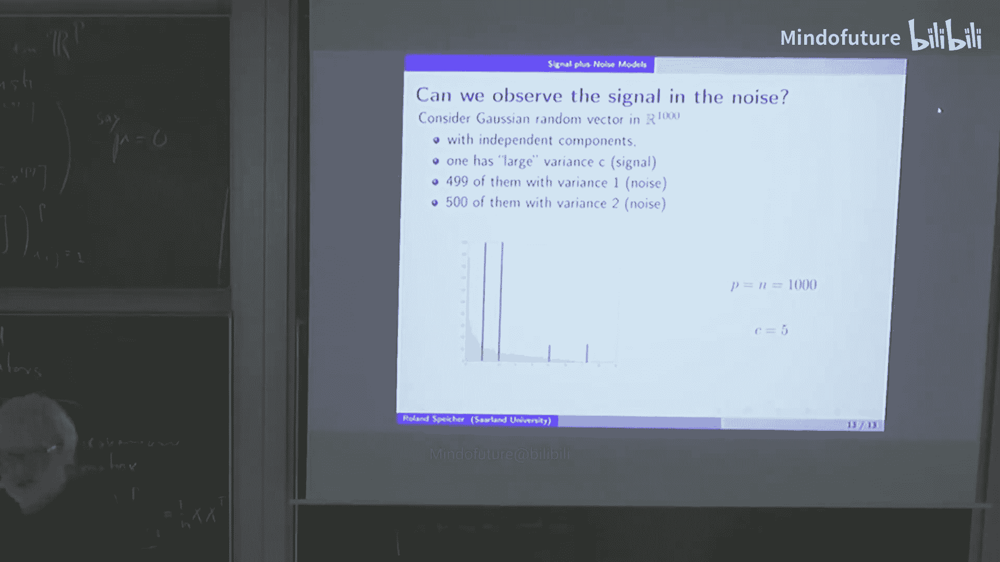
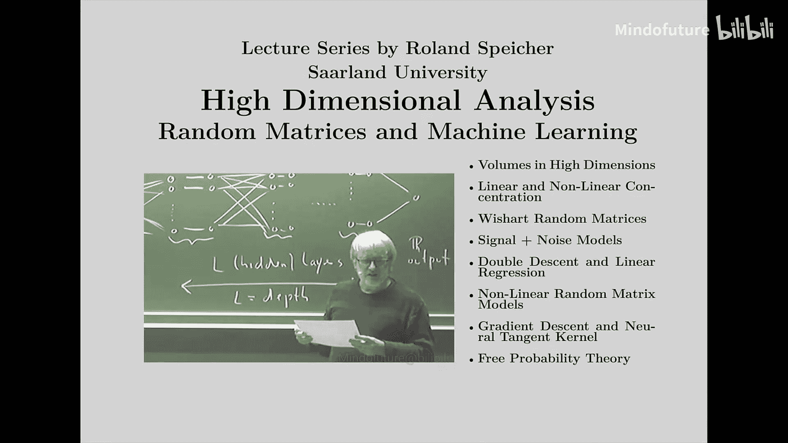

# 【德国萨尔大学】高维分析：随机矩阵和机器学习 ｜ High Dimensional Analysis p30 P30_高维度的诅咒与祝福 -BV1XkkWBFEi6_p30-

Welcome in this video， I want to show the curse and the blessings of high dimensions by providing some histograms of random vectors and random matrices and high dimensions。

 So high dimensions， in one sense， are bad。 That's the curse。 many good things in high dimensions。

 which we can use for us that that's the blessing。 The curse of high dimension means that high dimensions are really very large。

 And so， I mean， if you want。呃。To sample things there。 Okay。

 it's it's all it's it's impossible to really sample the distribution of of of something Okay。

 so I mean， yeah high dimension spaces are quite large and quite empty。 Okay。

 so that that's the cursor for many algorithm， Sta methods in high dimensions。

 they don't work because things explode exponentially。 and you would have to， to visit too many。

Space， too many points in， in your space， which which you cannot do。 Okay， but on the other hand。

 the blessing is， and I mean， I want to convince you of。

 of some of those blessing things that actually。That many things show deterministic behavior。

 That's this concentration idea。 And so， actually， I mean。

 this is this idea that if you take smooth one dimensional functions of your high dimensional vectors。

 they usually concentrate。 Okay， and that that's， that's the good thing。

 That's the concentration phenomena in high dimensions。That's what we。We'll talk about。 okay。

 and so maybe， maybe let me give you just a few pictures of of， of。

 of this concentration of random vectors and such things。 So maybe， okay。

 maybe concentration of random vectors is something which you have seen or， or no， I mean， yeah。

 okay， and so I'm looking here on on the Gaus distribution So I mean。

 this is the one dimensional Gaus distribution。 Okay， and so I have here， I， I take。

A vector which is gaus distributed with variance 1， and I draw the histogram。

 and I take here 1100000 samples。 So I mean， even in one dimension to get a good picture of the normal distribution。

 you have to sample really many。 Okay， maybe you see it with a little bit less。 but to get a smooth。

 nice picture of of the gaus curve。 you really have to sample many， many of your vectors。 Okay。

 and so now， but the point is， I mean， this thing is nothing which you want to look at in high dimensions。

 what we want to look at is the the length of a vector。In one dimension， I mean。

 the length of a vector is， is a mapping from R P to R。 In one dimension， of course。

 the length of a vector and the vector itself is not a big difference because in R。

 either it's positive or negative。 So， I mean， it's just。

That the length of the positive vectors is just the vector itself。 And here on the negative side。

 they are get flip flipped over here。 Okay， so the distribution of the， of the length is。

 is essentially just twice the distribution of of the gau itself。 Okay， so in two dimensions， in。

 in one dimension， I mean， it's still， okay。Nothing interesting。 Okay， but now in two dimensions。

 So here's a is a two dimensional gas。 So now I， now I take a a vector vector to an R2。

 So both components are now gas。 They are independent。 I'm choosing them independent。 and usually。

I'm normalizing my distribution here so that the average length of the vector is equal to one。

 So the variance of of each component is， is one， in this case， one over square root of 2。Okay。

 so you see here the the distribution， again，100000 samples of such vector。

 And now I take again the the length。 So the length is now a one dimensional thing。 And you see。

 okay， I mean， a length here is， I have。Plootted it between 0 and 2。 Of course。

 it extends to infinity。 But okay， you see it's。Mostly。So in in this okay the length somewhere here。

 Okay， so you see something like like this。 So its still spread out。 Okay。

 and if I now go to higher dimensions， of course， I cannot plot anymore。This year， I mean。

 for three dimensional vector。 Okay， I would have to plot it in four dimensions。

 which is already beyond my possibilities。 But the point is， is also that， I mean。

 I would need really。Many more samples to get a picture which shows essentially the distribution in higher dimensions。

 Okay， and so what I what I'm consider， consider now is， is， is those kind of picture。

 I'm just looking on the length of my vectors。 Okay， and so here。And。

 and probably everybody also has heard that， I mean， actually。

 I have a concentration of my gaussian distribution on the surface of the unit ball。

 which means that the the length of the vector concentrates around one。So I。

 I have normalized it that the average is one。 Okay， but usually， I mean。

 I could have a wide distribution around the average。 So here you see P equal to one。 Okay， you see。

 I mean， actually， the length is。Its not even。Close to one。 Okay， in P equal 2。

 So that's the same picture which I had before。 But now if I go higher。

 So this is in five dimensions， the length， you see it， it's centered around one， but it。

 it shrinks and shrinks more So in 20 dimensions。呃。80 dimensions，320 and00。 So this is a。

1000 dimensional vector。With a gaugeuss distribution。

 and now you see essentially it concentrates the norm concentrates on one。 So of， of course。

 the directors themselves， their distribution。 So this this means they are lying somehow on。

 on the surface of of the u of the of the of the sphere in this dimension。Okay， which， of course。

 is very high dimension one。 So they are not concentrating themselves because they。

 they are distributed over a big sphere。 But if I'm looking on their length。

 this is really something which concentrates。 and that that's。The。

 the main I idea of this concentration that if I'm looking on functions like liput functions。 I mean。

 like this of my vectors， they will concentrate the vectors themselves， they don't con concentrate。

 I mean， theyre still spread out over very large thing。 And it's very hard to find them in。

 in this high dimensional space。 Okay， but for。4。For functions like this。

 I have this concentration that's， that's the idea。 Okay， and so maybe another thing is。

This statement， if I take two independent vectors， gaus in ones。

 they are nearly orthogonal in high dimensions。 Okay， in low dimensions。 So if I take p equal to 1。

2 gaus vectors， I mean， either they show in the same direction， or they are shown opposite direction。

 which means they are either parallel or antipar， which which means if I take this normalized in our product between the two vectors So this。

 this is the， this is the。This is the cosine of the angle between them。 Then I have just plus and -1。

 So either they are parallel or they are not parallel。Okay， in two dimensions。 Okay。

 it it looks more like this。 So this means still。There are many who are close to parallel。

 close to anti parallel， close to parallel， but there are also some which which are close to being autoal。

 So I mean， in the plane， of course， you have vectors which are autogonal Okay， but not。

 not the majority of them。Okay， and now if I go higher in five dimensions。 So you see now it。

 it goes more towards the the zero。 So they becoming more of them are close to orthogonal。 And again。

 if I go higher and higher。 So peak equal to 2080。30 R0 and 1000。

 You see now it concentrates around 0。啊。So 0 is， is the average value here。 but but it it's。

 it's also concentrates around this。 So 0 was always the average value。 I mean， even。

 even if I had pleasant -1， the average is 0， but pleasant -1 are very far away from 0。

 But in high dimensions， I mean， everything gets closer and closer to 0。Okay。

 so there that's maybe the idea。 And I mean， those are things which we are going to try to prove in a rigorous way。

 with these statements， how， how do we formulate and in particular。

 how do we prove such things rigorously。 good， Okay， but maybe， so this is about the random vectors。

 So maybe those are things which。Some of you have already seen。

 But now maybe let's go to this estimation stuff here， because this might be closer。To the data。

 Okay， so， I mean， we have。Yeah， let's see here。 Okay。

 so let's say we want to estimate a covariance matrix So。

 so say I take here a Gausian random vector and R to the P。 I make the components independent。

 and the variance， okay， I'm not taking that all of them have the same variance。

 but let's say half of them have variance1。 half of them have variance 2。

 and then the covariance matrix is diagonal but on the first half of them。

 I get two on the other half， I get a one Okay， so so the eigenvalues， usually， I mean。

 I'm looking only eigenvalues of the covariance matrix。 that's。

 that's the the main thing So the eigenvalues of this covariance matrix， half of them are one。

 half of them are two。 that's the real。The real covariance matrix of my distribution。 Okay。

 but now I make observations。 I take now n samples of such a situation。 And then the question is。

 what do I see then， Okay， so now I take， let's say， P equal to 100 and n equal to 100。

 So I make 100 observations of。Chooing。Samples， independent realizations of this vector of length 100。

 Okay， and then I'm， I'm calculating this matrix。 the one with which I have written down here that that's my estimator estimator for this guy。

 And then we see a distribution like this。 We plot the eigenvalue distribution。 And you see， I mean。

 you don't see the the the one and two，1 and the two are the real eigenvalue which which I in hidden in this distribution。

 But what we see is a distribution like this。And now the question is， I mean。

 do we understand this and。Is this of any use for us。 And， of course， I mean。

 the classic statistic tells us。If we make。This end here， bigger。And keep P fixed。 Then， of course。

 we should converge to eigenvalue which are sitting at one and 2。 So maybe let me do this。 So now I。

 I， I fix P。Still is 100。 So I always have a 100 by a 100 matrix。

 and I calculate these are always histograms of the hundred eigenvalues of this 100 times 100 matrix。

But this matrix is given by averaging over more and more of those guys。

 So here I'm averaging over 1 thousand00。 And still， okay， you see。

 maybe one and two are now more prominent， but it's still not so clear。 then for 10000。Now you see。

 you have a kind of separation between  one and 2。 and here is 100000。 So you see。

 I have go very high to really see something where I can maybe。

Optimistic that one and2 are the right ones is there one or that that's it。 Okay。

 so so that that's classical statistics。 Okay， but but I mean。

 we don't have 100000 observations or samples So what we have this0。

 And we cannot really make more And so the question is。

 is this picture now of any use or can we still understand it。

 And so what what I was saying before is that this is actually now an approximation of a situation where we still go to infinity。

 but we go to infinity in in a way that P and N both。Still are equal。

So this is somehow an approximation of a situation where I have P and n equal， but maybe bigger。

 So now I have pictures where I make the n bigger， but P is is still the same。

 So this you 500 by 500 matrices for4000 is this 2000 like this And you see you have a smooth picture。

And this is a picture which we can really describe in a limit。

There we are able to make precise statements。How to get this curve。 So there is a limit curve。

 I mean， it， it's a smooth curve in a limit。 I mean， it doesn't。We resemble one and 2。 I mean， in。

 in the background， there's still one and two in the background。

 But this here is somehow a function of this， but a function which we can control and calculate。

 And then actually， I mean， our situation。For n。For P and n equal 200 is not so far away from this。

 So， I mean， the limit really， it it's good to know the limit because this picture here really tells us something。

 So if I observe this， then， of course， I'm essentially， I have two possibilities。 Im。

 I'm saying I describe this by classical statistics。But then n should be very large， But I mean。

 then。The end which we have is too far away from the very large， which we would need because， I mean。

1 and 2 in this picture， we just don't see it。 Okay。

 but what we see is that we actually close to the situation where we go。This N to infinity。

 But P goes to infinity in， in the same spirit， and this。Yeah， this is an approximation。

 which we can control。 it's not given by sigma。 I mean。

 we still don't see the one and two directly here。 but in principle。

 we know how from the one and 2 matrix we can calculate this guy here。So， we have a。

Kind kind of understanding of this。Good， O， so that's。I mean， that's， I mean。

 what we are looking here at， those matrices， the sigma matrices。

 those those are random matrices in particular， those those are wishard matrices and so what we are looking here is that the distribution of weard matrices in a limit。

 and this is what is called a maenco past distribution。

 So those are things which we are also going to talk about and and really try to understand how to calculate those things。

Okay， but maybe another thing which is maybe also interesting in this context going even a bit further is this signal plus noise models。

 So So let let us look on the same situation。 So again， let's say I have a。

A vector of dimension 1000。 So I have 1000 components。

 And I want to say that actually one of them is really a signal。 So this is。

 this is a component in which I'm interested。 And the rest is just noise。 And again。

 I I have I say here， half of the noise has eing value 1。 half of it has eyeing value 2。

 And then one has a variance， which is equal to C here I have put C equal to one。

 which means I'm back to the to the one the4 where I don't have a noise。 Okay， so I mean， the real。

Angvalue distribution is 1，2， but the one which we observe。

 If I take P is equal to n is equal to 1000 is this here， the Macacheco pass to a distribution。Okay。

 which we can understand。 Okay， but now the point is， if I now have。

 I change one of these components to having really a signal behavior So it it should have。Iingvalue。

 which is bigger than one and 2 So I'm I'm choosing a bigger one。 Let's say I'm choosing 7。Okay。

 I mean， this is very big。 I mean， the eigenvalue is， is just。

 there's just one eigenvalue just so that you can see it。 I have put a bigger bar here。 So。

 so I have， let me see I have 499 eigenvalues here。I have。500 I should here。Okay。

 and I should have one here。Okay。Okay， I have one here。 Okay， and now。

 now if I do with this calculating this。 So will I see somehow this one eenberger。 I mean。

 this is the signal， which which I really want to observe。 Can I still see it in the noise， which。

 which is produced by this finite dimensional by by this situation here。 And if if you do。

The simulation， you see that actually。You get those eigenvalues which you had from before。

 and then you get an eigenvalue here。 Again， it's just one eigenvalue。

 just I have ploted it the bigger bar so that you can see it。So I mean， the， the signal。

 the real signal has variance 7。 Okay， but here you observe something around 9。 Okay。

 so so you really see see it， but it's not at the same position where you would expect it in the same way as as the one and twos。

 which are sitting here。 I mean， you don't see them here。 but， but they are。Smash their， yeah。

 they are。 You have a noisy version of them。 Okay， but somehow this one。

This one eyeingvalue is not just mixed into the noise and disappears， as you would expect。 I mean。

 it's it's just， it's just one of of thousand eyeingvalue。

 but but still it it it's sitting here and you can observe it。 Okay。

 and now if if you move here closer to this one and2， I mean， this this will also move So here。

 if C is equal to 5 so you have one。Signal Ivalue youre sitting at 5。 and then you。

 you do this calculation here。 Then then you will see。That you still see。

One eenvalue sitting outside here。So in particular， those anglevalue here。

 they are really very strict。 I mean， they are sitting here and there's not one of them。

 which which is just sitting out somewhere So which which you could then also think it it's。

 it's a signal。 So I mean。I mean， this， this year is also a very rigid situation。

 So you get this distribution。And the eigenvalues， which you observe are just really sitting inside this distribution。

 There are no， no outliers there。 And if you really see something here。

 it's coming from from the signal。 Okay， so here maybe it's a situation where C is equal to 4 and then you still see something。

 But now you see you are moving closer to the edge of of this noise spectrum here And now if if you go further in。

 then this will disappear it will disappear in this here and you don't see it anymore。

 So if I have now C equal to3， then you don't see an additional eigenvalue。

 the one has moved inside this spike here and and you cannot distinguish it anymore So there you don't see a signal。

 Okay， but if， if you are far。Farre enough from here， then you really can can see this。So that's。

 that's also something which。Which we try to describe in particular， maybe also。Yeah， if， I mean。

 if you observe。Yeah， if you observe something here， Okay， we， I mean。

 the real eigenvalue you sitting here。 I mean， maybe that's the one which we would like to know。

 So we should know how to go back from here to here。

 What is the relation between the position of this one and this one。Okay。

 but that's things which we can understand And that's also things which which we are going。

to住。Yeah， if you want to see more of this， then please have a look on my whole lecture series on high dimensional analysis。

