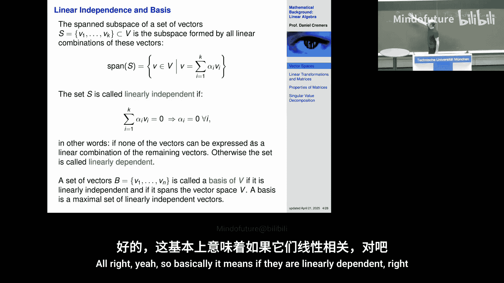
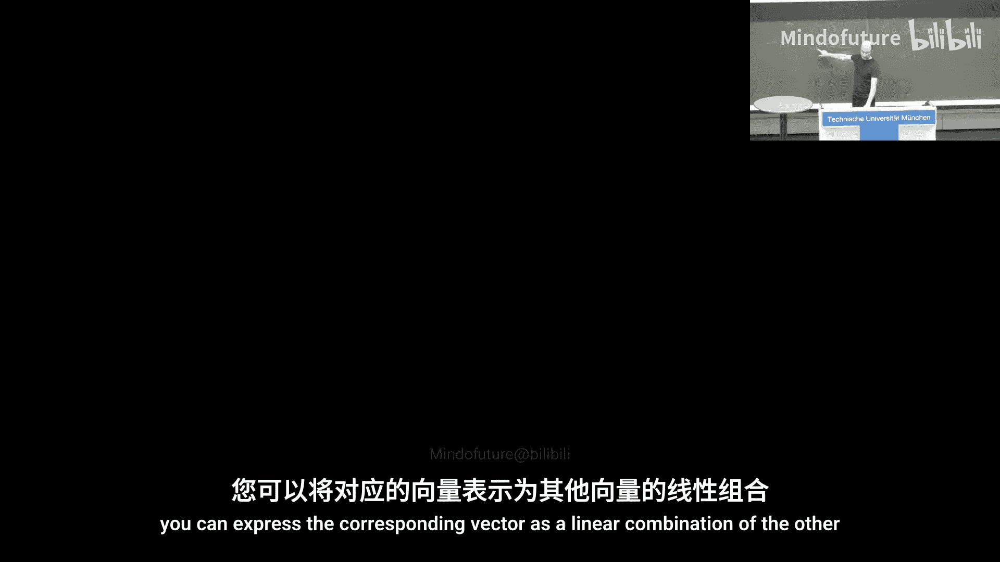
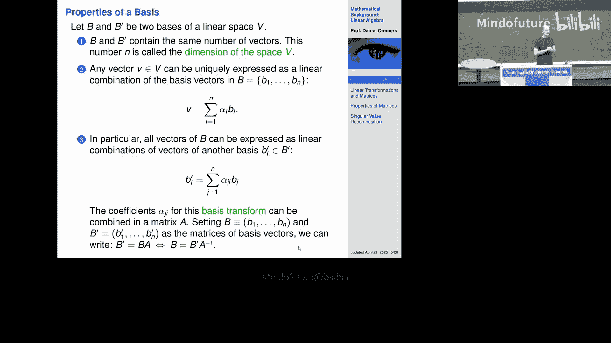
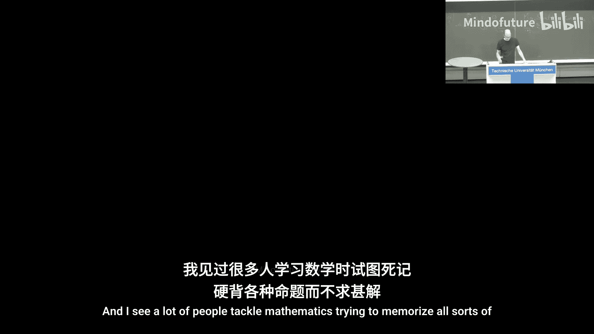
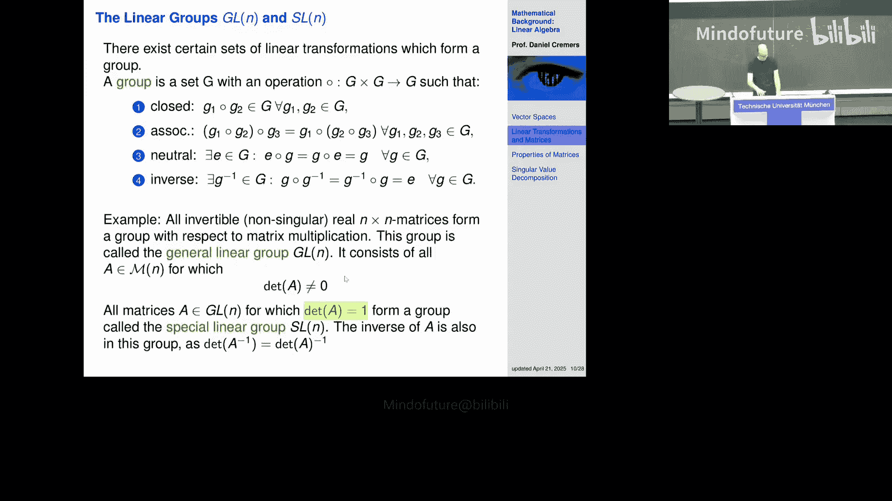

# 【慕尼黑工业大学】多视角几何 ｜ Multi View Geometry 2025 p02 P02_讲座_02_数学背景-线性代数_第1部分 -BV1KgZEBrEXV_p2-

Okay， good morning everyone。 This is chapter one of multiple view geometry。

Yesterday I gave you a bit of an introduction showing you a little bit some highlights of 3D reconstruction from images。

 the challenge here， 3D computer vision， getting the 3D world from camera images。

And now we're delving into the lecture， I should mention。

 and I think I might have that on the slide somewhere， the whole class。

 at least this introductory chapter and several of the following chapters are based on the book by Ma Sowato。

Kssika and Satry， Ko。Ancestry。And the book is called an Invi to 3D Vi。An invitation。To 3D vision。

There are many books and I will mention a few further down when we get more into the technical details of this class。

 but this is the book that I based the lecture on at least the original lecture and so the first couple of chapters are based on the book and this book should be in our library as well。

And one aspect of this book is that it teaches the whole field of 3D computer vision in the formalism of linear algebra。

 so using matrices and matrix computations。In particular。

 it does not require the notion of tensors and tensor algebra and tensor mathematics。

So that makes it a little bit more accessible with linear algebra techniques。

 but it basically means that you have to have a bit of linear algebra background。

And whereas in the book， the linear algebra background is a chapter in the appendix。

 I decided to pull it forward so that were all on the same page that so what I'm going to do now today in this chapter one is a short recap of linear algebra。

 ideally all of the materials should be familiar to you， but in my experience。

One never knows how much is really still there， and so I'm going to briefly go over this。😔。

And on a side note， often people think what is the point of learning that， you know。

 is that what people really care about today， well。

 the whole issue with AI and feels like that is that they move very fast。

So what basically what you learn today is irrelevant tomorrow right。

 and so that means that many of the things you learn in the field of AI tend to have a short half life。

And I think that is not good。I think when you learn things。

 you should focus on things that have a longer halflife。

 otherwise you're wasting your time learning something that doesn't really matter two three years later and there are lots of techniques in the field of AI。

 in the field of computer vision that were super important at some point and that no one knows about today。

The nice thing about linear algebra is it is important today and it will always be and remain important。

 so even if you go out and leave this class and graduate and move on and go into different disciplines。

 possibly the one thing that you might use is linear algebra。

 so understanding how linear algebra works， what you can do with it。

 what the basic ideas are how it's applicable is really useful well beyond artificial intelligence and computer vision。

And so this is why I decided to teach it if there is only one thing that you recall from this class later on。

 ideally， it should be the linear algebra basics。As I said， this is familiar， by the way。

 I didn't mention that yesterday if any of you have questions along the way。

 feel free to just raise your hand and ask。All right。

 so linear linear you know theres a lot of linear algebra is actually just definitions right。

 things get defined， for example， what is a vector space， a linear space。

 a set V is called a linear space or a vector space over the field R。

 if it is closed under vector summation， so you have elements in your set V and you can concatenate them summing them here。

 you know you take two vectors， you add them， you get another vector。

And for all of these structures and linear algebra has a lot of structures， vector spaces， rings。

 modules， groups， you name it， all sorts of different spaces。

 what I find helps you to memorize what is what is for every structure that you have， let's say。

 a vector space。Have some example in mind。 that helps。 And often， you know。

 what properties a vector space has， you can typically deduce them by thinking about what is the concrete example of a vector space and what are the properties for that example。

And the common example is， for example， RN or R or R3， for example， the 3D space。

 this is a linear vector space， and you know if you take32 3D vectors， you can add them。

 you get another 3D vector and closed means that whatever vectors you add。

 you will always get another vector out， you cannot leave that space。

It's also closed under a scalar multiplication， so in addition to adding two vectors， as you know。

 I can scale a vector with a scalar from our typically called alpha and then I can scale it and I get another scaled version of the original vector。

And so as a result， I can do any kind of linear combination of vectors and I will remain in the vector space because I can add and I can scale and multiply without leaving the space。

In addition with respect to the addition， this forms a commutative group that means you have a neutral element。

 a zero element， that's the zero vector you have for every vector， you have an inverse vector。

 so for V， you have minus v。And then in addition， the scalar multiplication respects the structure so that you have this law that alpha times beta u is the same as multiplying alpha and beta together and then scaling the vector u with it。

And lot of this， Ive write it rather compactly， if you don't understand some of the things。

 if you need background， Wikipedia has everything on linear algebra that there is to know， right？

So Wikipedia isn't always perfect as a source of information， but for things like linear algebra。

There is abundant material on Wikipedia or elsewhere on the internet to tutorials that explain everything。

 so if there is anything you're not sure you don't understand。

 just go to the internet and you will tell you。嗯。Then you have this distributive law and what can I say。

 this is something you should really know， my son， he's now 11。

 He learns the distributive law right now in school。

 So so by 11 you should you should more or less learn this stuff。

So that basically means alpha plus beta times v is alpha v plus beta v and the same alpha times v plus u is alpha v plus alpha u。

And a good example as I mentioned is RN or r2 or r3。

 whichever vector space you want to have as an example and having examples in mind is useful。

 like if I were to ask you what is a group， it's useful if you have some example of what is a group。

 for example the integers and the summation， they form a group。

 I don't know if I'll have group here but there is the aspect of group mentioned above。

And so for all of these structures I recommend having an example in mind in addition to vector space you can talk about subspaces。

 a subspace is a subset of the original space but it's not just a subset but it's also a subsetspace and that means it must be a subset and it must be a vector space in itself。

 it must be closed under the summation。So for example， if you take R3 and you just take a sub volume。

Of finite eyes， that will not be a subspace because it will never be closed。

But if you take R3 and then you take any plane that goes through the origin， that is a subspace。

 why does it have to go through the origin because a vector space needs a zero element。

 we see that above if you take any other plane that doesn't go through the zero。

 then it's not a subspace。So then we can talk about linear independence and about this concept of the basis of vector spaces and here first of all we can define the span if we have a set of vectors V。

we1 through VK， this sitS， then we can take any linear combination of these vectors and these linear combinations they form what is called the span of S。

 that is the space that is spanned by these k vectors。And once you have a set of k vectors。

 you can talk about linear independency and very often in linear algebra they give you this definition。

 they say the set is called linearly independent if from any linear combination being zero。

 it follows that all the coefficients must be zero。

I've always found that rather abstract as a definition and this is often unfortunate in teaching linear algebra and math in general。

 mathematicians sometimes have a tendency of making things extremely abstract and then it loses kind of the intuition。

 right？😊，But here the intuition is the following。If you have assume you have a linear。

 assume they are not linearly independent， so you have some linear combination that is0。

But there is some coefficient。Maybe alpha J。That's not zero right if you have that。

 that would be a case of not linear dependency， theyre linear dependent because there is a linear combination where at least one coefficient is non-zero if that should be the case then what you can do is then you can write vj as you can basically take that to the other side and can write it as minus1 over alpha J and then sum over I not equal J。

 I took out the js element。VI， right？ And what does that mean， sorry， Al I， V。

So I just rewrote I just from this whole sum here from1 through k。

 I just took out the Js element and alpha J Vj and then I pull the others to the other side and it divided by alpha j and so what you see here is that I can write the vector Vj as a linear combination of the other vectors。

 the remaining vectors， and that's the issue with linear dependency。

 meaning as soon as you have a set that is linearly dependent。

 this implies that at least one vector can be written as a linear combination of the other vectors and that basically means that vector is redundant。

 I don't need that vector， I can express it in terms of the remaining vectors。

So this is the whole idea of linear dependency， linear dependency means some of the vectors in your set are redundant。

 yes。Yes。😊，I'm sure that is possible。😔，Let me see。And tough。Is that somewhat？Better。😔，Let's try this。

Better better。Okay， but you can still read the slides，Great， thank you。All right， yeah。

 so basically it means if if they are linearly dependent right that's linear dependent。

 meaning linear combination is0， but at least one coefficient is not zero。

 then you can express the corresponding vector as a linear combination of the other vectors。

 in fact you can write this as a sum over I not equal J and then you have the coefficients R minus alpha I divided by alpha J times V。

I right and these are the coefficients that form this linear combination so that you can express that so it's redundant and the whole point。

 if you construct a basis of vector spaces， you want to avoid redundancy。嗯。

And this leads to and so this is linear， independent， otherwise linearly dependent。

 and as we see here， linearly dependent means one is superfluous， it can be expressed by the others。

And what you can then do is you can take vectors and add vectors to the set as long as they are still linearly independent。

 so you add any vector that cannot be expressed as a linear combination of the existing ones。

 you add them to that set。And then at some point you reach a set that is maximal。

 meaning there is no more vectors that you can add and still have a linearly independent set。

And once you have that， it's called a maximal set of linearly independent vectors。

 and this is what's called a basis。More specifically。

 a set V1 through VN is called the basis of the vector space if it is first linearly independent and secondly it spans the vector space。

And then the statement that a basis is a maximal set of linearly independent vectors。

 that's actually a statement and in practice， know in the linear algebraberg book。

 there would be a proposition。😊，That states this。 And then there would be a proof。For time reasons。

 I'm not going to do the proofs here， but I do recommend if you have the time at home。

 go through this and see if you can prove these properties。

They're not often not difficult to prove with what you have。

 so for example the statement that a basis is a maximal set of linearly independent vectors。

 first of all you have to define what exactly you mean by maximal set。

 it means as soon as I take one more vector into the set， I have linear dependency。

Meaning and that basically is the definition of maximal set and why is that in some sense。

 the definition of basis also， well， it means that vector。

 I can express it as a linear combination of the other vectors， right？

And if there is no more vectors that cannot be expressed as linear combination。

 then I can span the whole space， obviously， so it's almost by definition。The notion of basis。

 but I do recommend go home and if you're not sure you can do the proof。

 a lot of this is on the internet in linear algebra classes。Some properties of base。

If you have a vector space B， and most of what I say actually holds for finite dimensional vector spaces。

 I don't want to talk too much about infinite dimensional vector spaces in principle spaces can also be infinite dimensional。

 but for this class it's sufficient to consider spaces of finite dimension。嗯。

If you have two bases then they contain the same number of vectors and this number n this number of vectors in the basis is called the dimension of that space。

 so for example r3 will have three bases vectors and for r3 the three bases vectors are you know there are many but one is 100 and then 010。

And then0，0，1。This is three possible bases that you can have， this is one basis， one possible basis。

 but there are lots of different ones， this one is called the canonical basis。

But you can have different bases and what's nice is if you have two different bases by and they will have the same number of vectorctors。

And that is the dimension of space。And then this is another nice feature。 once you have a basis。

 then every vector can be uniquely expressed as a linear combination of the basis vectors again。

 all these are properties that need to be proven。I'm not proving them。

 but the proofs are fairly straightforward。In fact， for example， property2。

 the proof would go as follows。 you would say， assume there are two different ways to express the same vector。

Right some linear combination with coefficients alpha I and another linear combination with coefficients beta I that expresses the same vector since it's the same vector you can then say sum of alpha I bi must be the same as sum of beta Ibi and that in turn means the sum of alpha alpha i minus beta i times B must be0 and so all of a sudden you get a combination that is0 and then since these are basis and they're linearly independent it follows that these coefficients must all be0。

 that means every alpha I must be equal to beta I so it's not a different linear combination it is the same one。

So this is roughly how this proof goes so you can see the proofs are not really difficult if you sit down and try。

 you will often find in that and why is that useful well once you do the proof yourself。

 then you start to really understand why things are the way they are。

Then you don't need to memorize things。 And this is， for me， always the beauty of mathematics。

 once you understand things。

There is no need to memorize them。😔，And I see a lot of people tackle mathematics。

 trying to memorize all sorts of statements。

Without understanding them， and if you don't understand them， it's very hard to memorize things。

 then it's like memorizing Latin vocabulary， right？😔。

There is a reason why I didn't go into studying Latin。😔，Because in math， things make sense。 And then。

He don't， maybe my memory wasn't very good， I don't know what pushed me into mathematics and the sciences。

 but it's that aspect that everything is logical and makes sense。😔，And in particular。

 this statement that any vector has a unique linear combination of basis vectors。

 it can be expressed as a unique linear combination of basis vectors。

 it entails that if you have another basis， then all the vectors of that new basis can be expressed as linear combinations of the old basis。

So B prime is the new base vector， b b is the old one and here you have some linear combination。

 and these coefficients that might make this unique linear combination。

 they form a matrix that is called the basis transform。

It allows you to transform from one set of basis vectors to another and you can then write it in matrix forms saying b prime so big b prime is a matrix that contains the vectors of the new basis。

 and b is the vectors of the old basis， then b prime is b times a。

 and obviously this matrix a must be invertible because there is also a way to express the old basis vectors as a linear combination of the new ones and then you have b is b prime times a inverse。

And this allows you to move between different bases。

 Sometimes this is useful to have a basis and to express things in a new basis。Some more notation。

Once you have a vector space you can define an inner product。

 so in addition to on top of being able to add vectors， we can also multiply vectors， for example。

 in R3 we would have a scala product or dot product or inner product。So there are different terms。

 I also for those of you who are German， I write down the German terminology scalappook。

 unfortunately you know the terminology I don't like it。

 this is called scalappook once you multiply two vectors but it's not to be confused with a scalar multiplication of a vector with a scalar right so sometimes the terms are very similar。

But it's important to keep track of what you're talking about。

And that basically you take two vectors， for example， in R3。

 you can define the scalar product if you have ABC and another vector D EF。

Then the way you do this you probably know is you multiply a times d plus b times e plus C times F this would be a possible scalar product and what you get out is an element from the real numbers。

And the scalar product， you can conceive all sorts of inner or dot products here。

 but it must have three properties。The first one is that it has to be linear。

 so if I do the dot product between U and some linear combination of V and W。

 then I should be able to pull that inside and say alpha times Uv plus beta times Uw。In addition。

 the dot product by definition must be symmetric， so u times v must be v times u。嗯。And lastly。

You have this property of being positive definite， meaning the scalar product is always of a vector with itself。

 is always positive or zero， and it's zero if and only if the vector itself is zero。

And since that is the case， we can use this dot product or inner product to define norms on vector spaces。

 so for example， for a vector V， we can talk about its lengths and this is often written like this as the square root of the V multiplied with itself。

And once you have links you can talk about metric so you can measure distances， for example in R3。

 the way we can measure distances we take two vectors， you know1 pointing to Hamburg。

 one pointing to Berlin if you want， and then you take v minus W and the norm。

 and that will give you a notion of distance。And with this notion of distance。

 this allows you to measure length to measure distances。

 and that makes the vector space what is called a metric space。

 so a metric space is a space where you can measure distances。And in this case， as you see。

 the way we introduce the metric， this doesn't have to be， but in this case。

 we introduced it via the scale of， this dot product， this inner product。And such spaces。

 once the metric is induced by the scalar product。And they're called Hilbert Space。Now you're saying。

 isn't every metric induced by？Dot product not necessarily， right， I can randomly define distances。

And then it's possibly not based on a dot product， for example。

 I can define distances that correspond to the travel times that I get when I travel from A to B where train。

And depending on how reliable the trains are， these distances can be very different。😔，Yeah。

 and then it's not necessarily Hilbert space and you have a metric space because you define distances between pairs of elements。

But it's not induced necessarily by an inner product。Like here。😔。

We have a lot of conceivable inner products， but one I wrote it down is the canonical inner product that is basically I take the canonical basis。

 and then I take two vectors x and y， and I just multiply the coefficients and sum them up like I showed you。

This is called the canonical inner product and this induces the L2 norm。

 so if I take the canonical inner product and the norm， then based on that product。

 then I get this distance and this length and this is called the Euclidean norm for Victor and the Euclidean distance。

This is commonly the way you measure distances in Euclidean spaces， but doesn't have to be。

As you may know， there are other metrics， for example。

 in a town like New York City you would use what's called a Manhattan metric。

 this is a metric that where you cannot go diagonal but only horizontal and vertical and if you've ever walked through downtown Manhattan。

 then you know this can be very long because you cannot cross in a diagonal，😔。

But the Euclidean norms is this one。😔，And then with a basis transformed to a new basis。

 we can basically express the。And given。The canonical inner product can be written in this way so I can write x times y。

 I can write it like that， and then if I have a different basis so I have coefficients x prime and y prime that express the points x and y in a new basis。

 then I have the basis transform， and then I get the same dot product。

But with this a transpose a in the middle。And so this allows you to transform from one inner product to another inner product。

 so if I switch the base， then I just have to modify my inner product with this matrix a transpose a。

😔，Where is the basis transform。And this letter product here is called the induced inner product from the matrix A。

 so once I apply a basis transform with a matrix A。

 this induces that inner product and sometimes it's just written like this x prime times y prime and then as a subindex here。

 a transpose a it means you put the matrix a transpose a in between。One last thing here， two vectors。

 you know this are called orthogonal if their dot product is zero。Right， and that。

cororresponds to this intuition that if you have two vectors， for example。

 this one and that one right， one pointing in x direction， one pointing say in y direction。

 right then they are orthogonal 90 degrees and you can see that if you multiply these if you do the inner product it's zero。

And for any two vectors where the inner product is0， they're called orthogonal， by the way。

 if you've never seen this if with2 if， very important in math， this has a specific meaning。

 This stands for if and only if。 So this is not a spelling mistake。

 It's a short version for if and only if。And that means it's equivalent。

 meaning the two vectors are orthogonal if the dot product is0 and once the dot product is zero。

 they are orthogonalless。Essentially， the definition of orthogonality， if you want。😔。

Another notation that at least in my linear algebra class didn't show up。

 but that we will use in this class is two definitions that that are not very profound but they're really just definitions or notation if you will。

 one is called the chronica product of two matrices。

 if you have two rectangular mates M by N and K by L then you can do the chronica product so you can do that for any two matrices and basically what you do is you take the coefficients of the first matrix and multiply each coefficient with the matrix B。

And obviously， you get some very massive matrix with dimensions MK times Nl。

And that's a way to basically combine two matrices to do this chronic product。😔。

And it's important here， this can be applied to any matrix of any dimension。

 it doesn't have to be like matrix multiplication is different in matrix multiplication。

 the dimensions， at least some of the mentions have to match so that you can multiply chronic a product you can always do。

And in MatTLp if you ever use MAT， I think MatTlab is not being used as much anymore nowadays。

 but there are lots of function calls， MatLb is really a front end for matrix operations。

 that's how it was conceived， and so that's where it's really good。😔，嗯。And in fact， a lot of。

 maybe to mention that， now that I'm talking about MatLub。

 a lot of progress in computing was generated by making matrix operations。Ultra fast。

And so researchers in computer science have spent massive effort to make a matrix computations efficient。

And lots of the coding languages like C++， like Python， like others， right。

 they all profit from having some library that makes the matrix computations efficient。

And MatTLb is an example， if you can phrase things in terms of matrix operations。

 then MATLb is actually not very slow， it's actually fairly fast。

 but as soon as you don't do matrix computations， it gets a bit slow， unfortunately。

But the reason why a lot of computing got propelled by efficient matrix operations is because a lot of things can be written in forms of linear algebra operations。

Another notation stack， a stack is basically you take the elements of the matrix A and you stack。

 so you take all the columns of the matrix AA1 through AN， they form the columns of the matrix A。

 and you just stack them as one long vector。So that vector contains the same entries as the matrix。

 just not in this square or rectangular form， but in a vectorial form。You could say。

 why would you do that Well， Sometimes this comes in handy。 For example。

 if you have something like this。Two vectors U and V。 and in this bi it's called bilinear form。

 U transpose A V with a matrix A。 Then this is actually the same as taking V chronic or U。Transpose。

 so this is a vector that you then transpose times a stack， so it's a dot product of two vectors。

 one that contains all the elements of the matrix and the other that contains all the pairs of elements of vectors V and U。

this is something that you can use so rather than writing it as vector matrix vector。

 you can write this thing as a product of two vectors an inner product of two vectors。

 one that contains the matrix elements and one that contains the vector elements。

Why is linear algebra important， Why does it matter and what do we do in linear algebra we study as the name indicates the properties of linear transformations between linear spaces。

 so I have two linear vector spaces， let's say V and W， right。

And then I have a map L that maps vectors from one space to vectors in the other space。

 and this map is called linearar， this transformation。

From one vector space to another it's called linear if it fulfills these two properties。

 first of all， it has to be compatible with summation。

 so whether I sum the vectors in the input space，And then transform with a transform L。

 or I first transform， and then sum in the output space， I should get the same for any two vectors。

 X and Y。 If that holds， this is one property that is necessary for L being linear。

The other properties has to be compatible with the scalar product， with this scalar multiplication。

 right？So whether I rescale a vector x in the input space with a scala alpha and then transform or I first transform the vector and then scale should be the same。

And if these two properties hold for any vectors and any scalrs。

 then the transformation is called linear。And lots of things that we do in the world are modeling things with linear transformations。

 and very often when things get nonlinear。The algorithms that we deploy tend to approximate with a linear transformation and iteratively approximate with linear transformations。

 and so linear transformations are extremely common in the sciences。

And as soon as you have a linear transformation， you can use linear algebra and matrix representations to do it。

In fact， due to linearity， you know due to these two properties。

 once I know how the linear transformation operates on the basis of my vector space V。

 then everything is defined。😊，Because once I know how it operates on a basis。

 any vector can be written as a linear combination。

So any vector can be written as some linear combination of my basis vectors V and once I apply the linear transformation。

 then due to linearity， this is the same as writing alpha I times L of V。

 that's what we just said if L is linear， then I can pull this in。

 and that means once I know what L of V is， I can express any linear transformation of any other vector。

By knowing what L of the basis vectors is。😔，And so。So once I write L of the basis vectors。

 let's say the canonical basis， E E1， these are these E1， E2， E3。

 these are the canonical basis vectors here。And once I know how it operates on this canonical basis。

 then I can write this output。 So L of E E1 through L of EN， I can write it as a matrix A。

And then L of any vector x is nothing but a times x。

And that is why matrix multiplication and matrix computation is so useful because any linear transformation can be written by a matrix。

😊，That's what this basically states。And so the space of linear transformations is nothing but the space of matrices。

The set of all real matrices， M by N matrices， we write it as this。Cursive M of M and N。And。

And if m equals m so we have square matrices， then you can compactly write M of n that is the square mat n by n square matrices square matrices。

 and they form a ring。Over the and that basically means that you have a multiplication。

 so in addition you know vector spaces you can add vectors and you can do a dot product but the dot product gives you a real number whereas if you take two matrices in addition to adding them you can also multiply them at least square matrices right。

And you get out another matrix right， and once you have this structure。

 you have more than a vector space because you have this multiplication of elements。

 then this is called a ring。And what you need to have is you need to be closed under multiplication。

 matrix multiplication and closed under summation。So now we've seen group and vector space and ring and subspace。

😔，Here's the definition of group。Just so you have it on the slide， by the way。

 I sometimes get feedback that there's too much stuff on my slides。

 I know this is not how you're supposed to give talks with such amount of material on a slide。

 but the reason why I put all of it on the slide is that you can take the slides and print them out and you actually have something to read。

If you do a perfect talk with very little text on the slides。

 then if you print out the slides at home， there is not really anything to read， right？

And so this is kind of a compromise。 I put things that I think you should know and have at home。

 I put them on the slide。I guess the optimal solution would be to have a slide deck for the talk and then a handout separately but that。

You know， that way everything is in one， so I apologize for the slides being a little bit full of material。

 but。😔，I think a lot of this should be， as I said， known to you and it's really more of a recap here。

😔，What is a group？A group is a set。with an operation and often we write this circle for the operation Y。

 in principle you can think of it being a plus， but it could also be a multiplication right there's multiplicative groups as well and in order to be kind of general。

 we introduce this as a concatenation， we take two group elements we concatenate them get another group element。

 but if you want a concrete example， the integer numbers。诶。Zed and the summation。

 they together form a group。And then the circle would be the summation here， right。

 so you can think of this being a summation if you want。

And you need four properties for something to be a group， the first one is it needs to be closed。

 like in a vector space， once I concatenate， I should not be able to leave this space。So for any G1。

 g2， G1 times g2 or plus g2 should also be in the group。

It should be associative G so basically you can move the brackets right G1 times g2 and then times g3 should be the same as this one for any G1 G2 G3 then you need a neutral element in a group so for example for the integer and the summation you have the negative integers for any a there is minus a and so the neutral and so you need a0 and you need a inverse right so that G times G inverse should and G inverse times g should be the neutral。

So examples for groups are the integer numbers and summation， but once we talk about matrices。

 there is all the matrices， square matrices that are invertible， they form a group。

Why do I need invertability well property for if I don't have an inverse， then it's not a group。

 every element in the group needs to have an inverse， so if I want to create a group out of matrices。

 I need to have invertability。And in fact， that is the largest group of matrices that you can have because invertability is a necessary condition。

So if you take all matrices that are invertible， it's called a general linear group。

And how do you know whether a matrix is invertible， the determinant is nonze。

 right that's the way to check， so any matrix with nonzero determinant。

 if I put them all into a bucket， they form a group and that is the general linear group。In addition。

 this is something that we can also define， we can have the special linear group， this is if you。

 among all with nonzero determinant， limit yourself to the ones that have deterant one。

That is then called the special linear group， the general linear group is called GLN。

 if it's an n by N matrices and the special linear group is SLN。And one thing you know。

 that you need to show for this to be a group， you need to show if I take a set of matrices that have determinant1。

 then the inverses better also have determinant one because if not。

 then you don't have an inverse in your set， right？And also。

 if you take two matrices with determinant  one and you multiply them。

 you get out a matrix that again has determinant  one and that is indeed the case and that's why this is a subgroup。

 so SLN is a subgroup of GLN if you will。All right， I think I will stop here。

And we will continue next week。Thank you very much。

