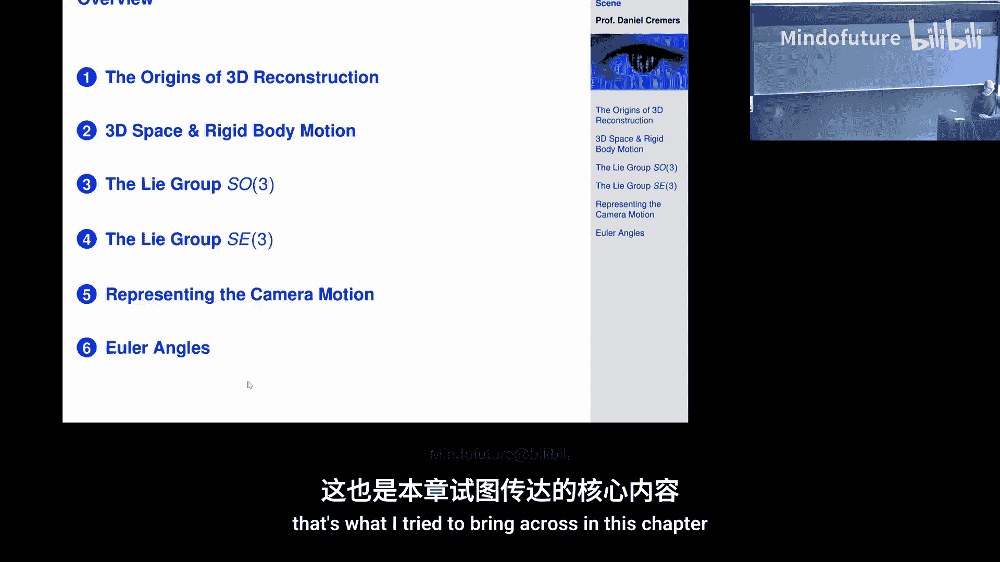
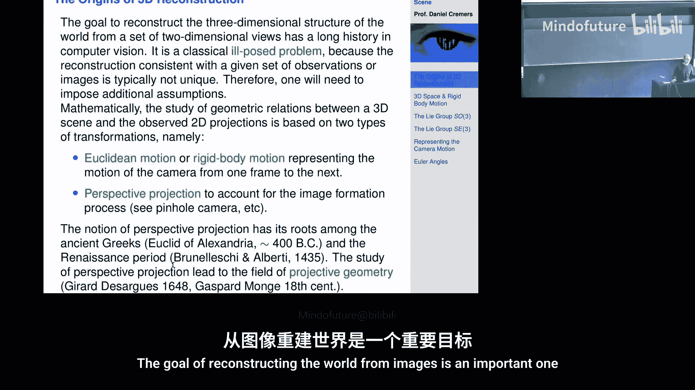
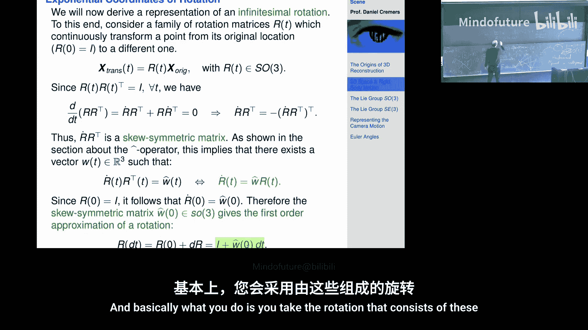
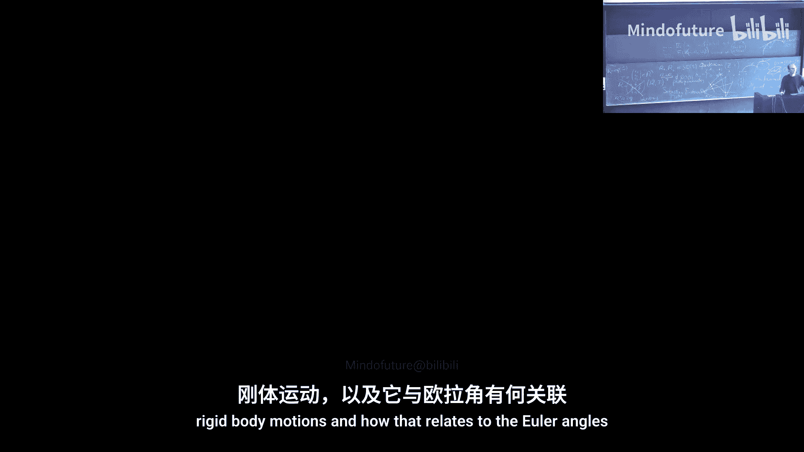

# 【慕尼黑工业大学】多视角几何 ｜ Multi View Geometry 2025 p04 P04_讲座_04_表示动态场景_第1部分 -BV1KgZEBrEXV_p4-

O。We left off last time。With the first chapter that was a recap on linear algebra and now we're getting more towards the core topic of the class and that is the reconstruction of the world from cameras and the first challenge that we'll tackle is and that does relate a little bit to linear algebra and things like that。

 but the challenge is how do we model the movement of the camera and this is a very important challenge in computer vision in general。

 you observe the world through a camera， the camera moves。

 how do you model that movement mathematically。And I think a lot of science and research is really just about finding mathematical representations for the world。

 for aspects in the world to model the world that we live in with mathematical equations and representations and here one of the core challenges is how do I encode the movement of the camera。

And then in the follow up chapters， we'll look into how the camera actually acquires three images of the 3D world。

 but here let's start with the reconstruction of the world from a moving camera how to represent this movement。

 this will be the core of this chapter。There's going to be six parts one is on the origins of 3D reconstruction。

 you know what is the history just like one or two sides on this。

 you know one can always spend forever talking about history。

 I don't want to do that but give you a glimpse of how long。humansums have studied these challenges。

And then we'll talk more concretely about 3D spaced rigid body motion。

 the movement of the camera in particular， and then we'll talk about so-called Lee groups。

 we've already heard what a group is and in this chapter we'll hear about what a lead group is that is a particular kind of group and this is a very interesting mathematical structure that comes up in all sorts of areas of sciences。

 but in particular when modeling rigid body motion。And we'll see in particular two lead groups。

 one is called SO3 and one is called SE3， we've actually seen them in the last chapter already SO3 were the rotation matrices。

3 by3 rotation matrices， Se3 was the special Euclidean group that was rotations and translation。

And we will see in this class what it means for something to be a Lee group and something and is what's called a Lee algebra。

And how that can help us to model the movement of the camera。 And lastly。

 we'll talk about something that some of you might have encountered before by the name of Euler Ans。

 who has heard of Euler angles before。 Oh， quite a lot。High school， I guess， right， maybe。Yeah。

 Ouler angles， maybe to say that up front， but I'll come to that。

 Ouler angles are a little bit weird。 they allow you to model 3D rotation， right？

And if you had to say how exactly were they defined， I bet you wouldn't remember right。

 at least I've heard， and I couldn't tell you it's three rotations。

 One is around some axis and another around another axis and the third。

 I think around the first axis or yet another axisxe and it's very confusing and I remember when I learned about the oor angles in high school。

 I hate it that really because it was completely random。

 youd sit there thinking why is it defined this way。

 Why do I first round rotate around Z why not X Why not Y why not？And the truth is， yeah。

 it doesn't matter。 though you can rotate around which hi axes you want。

 There is different ways to do it。 And it seems somewhat random。

But what we'll see hopefully in this class， how Euler angles relate to the so-called notion of a so-called Lee algebra and how that actually makes sense。

 and then you will find that it is a valid representation of rotation。

 but just one random one and you could pick any other if you prefer。

And I think this kind of understanding is very important。

 and that's what I try to bring across in this chapter。

All right， history， the goal of reconstructing the world from images is an important one。

 it has a very long history in the field of computer vision。

 but in fact well beyond the history of computers， a lots of the ideas that go back to the you see some citations here to the Greeks2000 more years ago。

Mathematically speaking， it's called an ill pose problem。

 This notion of ill pose problems is something that comes up in applied mathematician。

 This is a definition that goes back to a famous mathematician by the name of Hadammad。

He introduced this notion of a problem being ill posed and a problem。

 And so he introduced this distinction between ill posed problems。Vers versus， on the other hand。

 well pose problems。And basically， well pose requires three aspects。

 one is you have to have a solution。And secondly， this solution should be unique。And thirdly。

 the solution should be stable under perturbations。

And if that is true for a certain optimization problem， then this problem is called well posed。

If one of these conditions doesn't hold， either there is no solution or the solution exists。

 but it's not unique， there are many possible solutions， or there is one solution。

 but if you change the input slightly， then you get a completely different solution。

Such problems are called ill pose。And the reconstruction from images is generally considered an ill pose problem。

 The reason being that if you see a sparse set of images。

 there is typically infinitely many conceivable reconstructions。

That all give rise to the same images， because you don't see everything in， in some sense， right。

 And， and so as a result， the solutions for this problem just from the images are not unique。

And so typically， to get a meaningful reconstruction， you will have to make additional assumptions。

Basically giving the framework for a statistical inference where you would say among all conceivable reconstructions。

 which one is the most likely one？And then you start to make sense of things。

 but this is this notion of ill pose problem and 3D reconstruction is one of gazillions of ill posed problems that we face in the world every day。

Mathematically， the study of geometric relations between the 3D scene and these 2D projections is based on two transformations that we will discuss separately。

 The first one is the movement of the camera。And that uses this notion of Euclidean motion or rigid body motion。

 this group SC3 that we'll talk about in this chapter。And then in a follow up chapter。

 we'll talk about the second fundamental aspect in， in。You know。

 reconstructing from images and that is the notion of perspective projection。

 what happens when you have the camera in a certain location and then you see a projected image。

 this projection can be modeled with different projection models and we'll talk about the so- calledled pinhole camera and other projection models。

And some of these ideas really go back a long time， for example。

 this notion of perspective projection has its roots among the ancient Greeks 400 before Christ。

 and later again in the Renaissance period， people studied perspective projection。

And that led to this whole field of projective geometry that was pursued very intensely in particular。

 in France by people like De Zag and Gaspar Mos。I used to have images of perspective projection。

 I think I kicked them out for space reasons， but it's actually quite interesting to see。

To see some of these results of the Greeks。 Oh no， it's going be in the chapter on perspective projection So。

Not talk about it here not。And。This idea of reconstructing from images， as I said， is also very old。

 and this is somewhat surprising。 It's much older than computers， for example。

And the Austrian mathematician， Evan Croa showed in 1913 that if you observe。5 points。In two images。

 so you can think of you have points here in the world 1，2，3，4，5。

 And then you have two images where you see these points， right， One image is， say here。

 and another image is here。And so you would observe these points projected into into this image here。

 here， here， et cetera。 And then you would see the same five points projected into another image。

 right。And if you know the correspondence， which point here corresponds to which point there， right。

 If you have this， this correspondence in the of points in the image。

 then Croer showed that you can reconstruct the movement of the camera。From， say。

 the first camera to the second camera， this movement， rotation and translation of the camera。

 and you can reconstruct the 3D position of these five points。And he said all I need is five points。

 and then I can do it。Up to finitely many solutions。So again。

 you see the solution is not necessarily unique here still， but。It's in some sense， solvable。

 and this is quite an amazing achievement that he made more than 100 years ago。

 well before the advent of computers。 and to date， it's a little bit puzzling to me why people studied this if they didn't have the computers to actually solve things。

 they actually did things manually。manuallyally and I'll talk more about it later in class。

 this is a whole field called photogrammetry。And。Photogrammetry。

And I can say Teu Munich is one of the hot spots of photogrammetry and has always been 400 years。

 at least。And some of the pioneers in this field， for example。

 the father of analytical photogrammetry is a guy named Sebastian Fitavalder。

And he was a professor here more than 100 years ago。Pinster。He's one of the pioneers。

 and he was a professor at T U Munich。I find that surprising because Te Munich is not an old university。

 It's a very young one， but still， at least in that field of of what's called geody and photogrammetry。

 And we've been very much leading the way for， for more than a century。And。And from this。

Community come people like Ivin Croer who studied this from a very mathematical angle and showed that if they have five points in two images。

 they can do the reconstruction and how did they you know what was the problem they were interested in。

 they had photographs taken typically from airplanes。

And you would see structures in the photographs and you could relate the structures and then the obvious question is。

 given the correspondence between points， let's say the church tower in this photograph and the church tower in the next photograph。

 is there a way to infer how the plane moved and where the church tower is in the 3D world。

 that was the goal？They didn't care about church towers， necessarily。 Sebastian Pintavalda。

 the thing he most cared about is glaciers and the Alps。 I mean， you're in Munich， right， I mean。

 you all know Munich， right， The Alps are not far。And he was not just， and it turns out。

 lot of the professors for photogrammetry at whom at the time were interestingly not just photos。

 but also mountaineers。So they would go up in the mountains with photographic equipment。

 And what can I say their equipment was bigger than my smartphone today。

 So it was very daring and challenging endeavors they did to carrying these big cameras up on the hills on the mountains to take pictures of glaciers to measure the real extent of the glacier to understand this proportions the size。

 Why is that important wealth， for one thing， climate change， right。

 We all know that glaciers are disappearing。 But do we know at what pace they're disappearing。

You know， we can't just go there and measure by hand as this is not scalable， right。

 but if you could fly over it with with a plane， take pictures and then reconstruct everything。

 then you could actually study how the glaciers are disappearing。

And try to model and understand climate change。 And so a lot of this research starts from。

 from computer vision challenges， understanding the world from images， cameras。

But then you see there is a big gap and I've been trying to understand also what happened in that gap。

 well one thing for one thing there was the second， the first and the second World War in between。

 I think that slowed a lot of research activities， massively， there was also an exodus。

 a lot of talents， especially photogrammets， left Europe and went to the US。

So I'm skipping that part of history here。But in the 80s。

 then there is a paper that is very seminal by a guy named Longgo Higgins。

 and this is an algorithm that actually allows you to compute things with linear algebra。

To compute camera movement and 3D structure。 And this was one of the first you know。

 computable algorithms， computer supporteded algorithms that allowed you to do this solution。

It's called the eight point algorithm， Why is it called8 point because in contrast to Croa？

Longgen Hiin said， what if I have8 corresponding points， then the problem is slightly easier。

 And then he showed you can solve it with Line algebra。And so since this is a very seminal result。

 we'll discuss it as the central part in class。And there is an entire series of works along these lines that used you know the so-called Ipolar constraint。

 we'll talk about that as well and that allowed to reconstruct camera motion in 3D structure and some of the pioneers in this field are Oliv Fogers in France or Knatani in Japan。

 Steve Maybank going at al so there's a lot of researchers and you see already even in the 90s this research is happening around the globe。

And then there's extensions to three views where someone said， what if we don't have two images。

 but three images， is that better than having just two images， obviously it is。

 you see more and then you can devise algorithms that do this and some of the pioneers here are Aliimmonos Shahua and Hartley and many of them are still active know Richard Hartley still running around on conferences I see him frequently Im nonshahua as well Shahua is most known now not so much for the work he did pioneering in the 90s here。

 but for creating the company Mo I in case you've heard of that it's one of the biggest computer visionion startups successes。

 a company that was founded many years back by Am nonshahua and run by him for many years and he sold it to Intel for $15 billion years back but then。

Now， I think it's valued at around 45 billion or more。 I haven't followed up。

 So Anon Shahua is not just a very talented academic。 He's also a very gifted entrepreneur。嗯。

Tmai Cannaada as well did you know， factorization techniques。 Well， we'll talk about stuff later on。

And there is a lot of books， in fact I decided to have a separate page because I often get questions from students。

 is there a book for this class， there is a book that I built this class on at least initially and that is the one in the middle so these are several books that are out there this is just a subset of ones that I consider relevant。

Hartley， Cesarman is a classic， and you see this is the same Richard Hartley that I mentioned here。

Andrew Cissarman also very active in Oxford， I spent a whole year on sabbatical in Andrew Cissarman's team。

 a really nice team at the University of Oxford。And this is a classic。

 It's called multiple view geometry。Cambridge University Press。

 and then this is one that I built up on because Stean Osoato was my postdoc advisor at UCLA。

 it's called an Invi to 3D Division and one slight emphasis of this book and that's one of the things I liked about it is it tackles the whole challenge in the framework of linear algebra with basically linear algebra techniques in particular。

The singular value decomposition is， is how a lot of problems are formalized and solved。

And it also this linear algebra recap that I gave you last week is also from this book more or less to kind of compressed verse。

But as you can see， these books are by now a little bit outdated， possibly or old。

 They're both at least 20 years old。 And so there is obviously and lots of things that have happened。

 But one of the challenges is students always like textbooks。

 but the issue with textbooks is it's a huge effort to write a textbook。And once you've written it。

 it's outdated because the computer vision community moves super fast。

 whatever is important this year might be completely obsolete next year。

There's hyps that go through the community and what I've seen in my life in the last two or three decades that I've been active is the pace is accelerating。

You know whether whereas maybe 20 years ago， something would be relevant for a decade now it's relevant for one year。

 maybe two years， and then the community moves on， it's a bigger community and things happen faster。

 so the pace is accelerating， but this is something I see not just in computer vision in all areas of research。

And it's propelled by many things。 It's propelled by the fact that researchers like me。

 put their code online。That wasn't the case when I did my Ph D。 I would never publish code。 Now。

 all my PhD students， they have an interest in publishing code。For two reasons， one。

 they want to make sure research is reproducible。You don't just claim I got these results with my method。

 but I'm not showing you my method because then the world cannot validate whether you really achieve this with your method。

Whereas if you put the code online and ideally the images that you use， you can say here。

 try the algorithm and verify for yourself， so it's an aspect of making research reproducible。

But the other aspect is that the consequences that people can build up on it。

 they can take your code and they can expand it。 And a week later。

 you will have an extension of your method coming up somewhere in the world， right。

And that dramatically accelerates progress。Beyond that， obviously， with AI。

 we can generate code in no time these days。 and that is。Further fuels the。

 the acceleration of research。Around the globe。And so it's very hard to kind of pin down what is really。

You know the state of the art， what is the latest， but we've made this effort and this is coming out as we speak。

 a book that I'm writing or editing together with colleagues from this is Luca Carllowna is from MIT A Young Kim is from Seoul National University Frank Dellard is from Georgia Tech and Tim Barford is from the University of Toronto use so you see as always。

 this is kind of research activities that bring together people from pretty much everywhere in the world。

And it's a slam handbook， and it involves pretty much any relevant researcher in this field of slam。

 we made sure that everyone contributes， and it has three parts。

 so it's much bigger than these two books。 and it tries to cover really the whole state of the art up to the very latest stuff。

And there are three parts that are coming out you know， step by step。

 and I think they should be available online。Not all of these chapters are relevant for this class。

 but there is some， for example， there is a chapter on visual slam that I co authored。

 There is a chapter on。Boosting slam with deep neural networks we'll talk about that in this class as well。

 there is a chapter on deformable and dynamic slam that is reconstructing the world if the world is not static。

 willll distinguish that typically the classical assumption in 3D reconstruction is the camera moves。

 but the world should not move。And obviously， the world we live in is a very dynamic world。

 And so the question arises， what if the world does move。From one image to the next。

And there are two distinctions， obviously you can reconstruct actions if you film them synchronously right。

 if you have 64 cameras or 16 whatever many cameras in this room， and they are synchronized。

 then for any time step you can have 64 images that we're taking at the same time。

And so then from one image to the other， where at the same time， nothing moves by definition。

And then you can reconstruct the action frame by frame， if you will， right， and that works。

 but what if your camera over time moves and from one image to the next。

 the structure is no longer the same。That is a much more significant challenge。

 and this is something that's very actively studied these days， a very fascinating question。

 because then you have to somehow solve this chicken and egg problem。

 whether what you see as displacement comes from the movement of the camera or the movement of the object could be both right。

 and that brings you a chicken and egg problem。So this is then sometimes captured in the term dynamic and deformable slam。

And there's a lot of chapters in here that kind of try to cover pretty much the state of the art in this field of camera based reconstruction。

But it's really in the making， that's why I can't show you a nice title page because it's still in the making。

Alright， so let's come to the part of this chapter。 and that is the modeling of the camera movement。

 Some definitions。 again， we talk about three dimensional Euclidean space。 These are points in R3。

 if you will and。Honestly， some people distinguish between the Euclidean space E3 and the vector space r3 E3 is points in the 3D space。

 but then once you choose a coordinate system。Then each point can be associated with three coefficients representing。

The location of that point with respect to that coordinate system。

 and then you can basically identify the Euclidean 3D space with R3。

Where r three are just the coefficients in some basis to represent this point。But obviously。

 the distinction is that the coordinates will depend on what basis you choose。嗯。But in practice。

 you know， this distinction is a little bit academic， if you will， but you can， in some sense。

 talk about points in the 3D world just by。Naming the coordinates of that point in some basis， right。

 And you can talk about it as if it was the same thing。And then if you have two points x and y。

 you can define the vector that connects x to y， so this is x minus y is a vector in r3 that is called a bound vector so a vector that goes from x to y。

 but if you take that vector and make it independent of the base point y so it goes from y to x if you make it independent of the base point y。

 then it's called a free vector these are just terms just to make sure you've heard them and the set of free vectors。

 they form a linear vector space。And by identifying E3 and r3。

1 can endow this Euclidean space E3 with the scalar product。

 the norm and the metric that we get from R3， the traditional Euclidean metric。And again。

 the benefit of having a scalar product and a norm and a metric is that we can measure things。

 we can measure distances。 We can measure curve lengths， for example。

 right if you have a curve in R3， what does that mean while it means you have some interval。

 let's say 0 to 1 here's 0 here's1， and then a mapping。That you call gamma。

 and that maps each point of this interval to some point in 3D space along this curve。

 and then you can measure the length of this curve by taking if you have this mapping that maps from the interval to r3。

 then you can take the derivative gamma dot is d gamma by Ds。

And the norm and you can integrate over the parameter interval and that will give you the length of this curve in R3 right in this way。

 the norm that you have in the Euclidean space， r3 can be used to measure lengths of curves。

 areas of surfaces， volumes， things like that。So that's why it comes in handy to use R3 to represent the 3D world。

In addition， one nice feature of R3 is in addition to having the dot product and the scalar multiplication。

 we also have a vector multiplication that is called a cross product of three vectors。

 and this is a map that takes two vectors and assigns them a third vector。

And this is something you might remember from high school， there's this。

 I think is' called the right hand rule or something like that where you say if you have a vector U that points in direction of your thumb。

 the right hand， right thumb， and V in direction of your index。

 then the vector U cross V is a vector pointing in direction of your middle finger。

That's one way to memorize the orientation of this cross product because you get out another vector and this is how it's defined The first component is U2 times v3 minus u3 times v2 and vice versa。

 so this is the definition of the cross product I think we had it in the previous class and we also mentioned that you can use U hat to model the cross product。

In the sense that U cross V is nothing but U hat times V。

You can check for yourself if you take this skekusymmetric matrix you had that contains the components of U in this fashion。

 and you multiply by the vector v V1 v2 v3 here， then you get exactly this one out。

And so by fixing the vector U。We get a linear mapping where we map a vector V to the cross product of u times this vector V。

And。And as I said， this linear mapping can be modeled with this sw symmetric matrix。

 So this is a matrix that is anti symmetric or skuw symmetric。And。

And this operator hat we will see it more often in class。

 is the operator that takes a vector with components U1。

 U2 U3 and converts it into this 3 by 3 matrix here。

So this is the hat operator and this hat operator mathematically defines an isomorphism between the space R3 and the space little S3 that is the3 by3 skekusymmetric matrices or matrices of this form。

And then we have an inverse operator that takes a skuw symmetric matrix and converts it back into the corresponding vector just reading out the components here。

 basically u1 here， U2 here， U3 here。And。And this is the veg operator that goes from a ssymmetric matrix to R3 Now you're going to say why is the space of skesymmetric matrices called little SO3 we'll come to that later in class and I hope then you will understand we talked about the rigid body motion。

 the rotation group and that was large SO3， the special orthogonal group now we have a space called little SO3 and you think wow is that the coincidence that they're both called SO3 No it's not。

 there is a reason and there is a connection and we'll see what that connection is。

Let's go to the rigid body motion， What is a rigid body emotion I mentioned that before。

 a rigid body emotion， did I mention it， maybe I don't know。

 so it's an emotion that preserves the rigidity of things right and what does that mean it basically means that lengths are preserved and things cannot be distorted。

 angles are preserved and things like that。So often you define rigid body motion as a map。G T。

 that maps from r3 to R3 such that the length is preserved。 So the vector。

 if I map a vector v with G， then the length of that output is the same as the length of V。

 so it doesn't stretch or shrink anything， right。And then the cross product is preserved。

 So if I transform U cross V。It's the same as first transforming U and then transforming V and then doing the cross product that basically entails that。

The angles are preserved。Since Nor and scalar product are related by this identity。

 is called the polarization identity， sc the dot product between two vectors U and V is nothing but U squared plus v squared minus2 UV and if you carry that out you find it's the same as sorry this one this is U squared plus v squared plus2 UVV this is u squared plus v squared minus2 Uv right and so if you do the math you end up with the scalar product that remains you。

And so you can， what's the idea of this， You can express this。

TheThe dot product of two vectors as a function that depends on the norm of the sum and the difference。

Of these two vectors。 so the dot product and the norm are related in this way。

And so that entails if the norm is preserved， then the dot product is also preserved。

 this inner product of two vectors。And that basically means a rigid body motion preserves not just the links and the cross product。

 but also the inner product。And if it preserves the inner product and the cross product。

 then it also preserves this so called triple product。

 the triple product of three vectors is just taking the three vectors and doing this product of u times v cross w。

 it's called the triple product。Where is that interesting。

 It's interesting if you want to measure the volume of the space spanned by three vectors U VW。

 then you can use this triple product to do it。And what we see is the rigid body movement preserves this triple product and that entails that for any such volume element created by these three vectors I'm not going to draw it。

 I'm not very good at drawing 3D structures， but you have one vector U one vector v and another vector W and then you can imagine they somehow form this volume element right here in 3D and the volume of this is given by the size of this triple product。

And and if that is preserved under the rigid body motion。

 it means if I transform the whole space with the rigid body motion G T。

 then the volume doesn't change。 So we see linkss doesn't change。 angles don't change。

 and the volume doesn't change。 and that。AndYou know。

 often people would define rigid body motion as something that preserved lengths and angles and volume。

 but you can really derive these properties from these assumptions if it preserves the length and the cross product。

 then it preserves volume。Everything。😔，Now we see this is the definition of rigid body motion very often in the literature。

 if you look up， say on Wikipedia， what is rigid body motion， then Wikipedia might tell you， well。

 it's rotation and translation， right。If you take a rotation and a translation。

 that's a rigid body motion。But the issue is， then you don't really understand why is that called rigidippaty motion。

Here， it's clear， is's called rigid， but emotion because it preserves the rigid structure of things。

 You can move a camera， but you cannot twist it。 You cannot stretch it。 You cannot break it。

So it moves rigidly， so points on the camera。Preserve their distance， for example， right。

Nothing gets stretched。 And this is kind of。Ingrained in the definition of rigid body motion。 Now。

 what we can show is that under this definition， a transformation that preserves links and cross product。

We can show that there is only one such transformation。

 and that is a transformation with rotation and translation。And this is shown here。

 so it's a little bit lengthy。 The question is， does the definition that we have lead to a representation of rigid body motion and we'll see it does and we'll see at the end of this slide。

 that we can show if we have a transformation that has this rigid body motion assumptions preserves length and cross product。

 then we can show it must be of this form rotation。

 R x plus T with a rotation matrix R and a translation vector T。Let's look at why that is。

 It's a little bit technical。But since it preserves length and orientation。

Then it's sufficient to say what does the transformation do to my basis vectors because all points can be defined relative to their basis and if this relation is preserved。

 then all I need care about is what does it do to my basis vectors and E1， E2 E3。

 these are these canonical basiss with 1000，10001。IThis is what I mean by E 1， E 2， E 3。So we say。

And also I have to know basically， so I take a coordinate frame attached to the object。

And then this transformation， this rigid body motion， can change the origin。

 and this is a translation because that preserves the rigidity if I just shift everything。

 and then it can do something to my basis vectors， but that's pretty much all it can do everything elses。

 then how it acts on other points is defined by what it does to the base vectors， right。

And so I have a translation vector T that models the translation of the origin。

 It has three possible components， could be any。And then I define three vectors R I that are the transformation of each base vector EI。

 right。Now， I said the cross product is sorry the rigid body motion preserves links and cross product and dot product。

And since scalar product and cross product of these vectors are preserved， I know that R I times RJ。

 that means the transformed version of EI times the transformed version of EJ。

 they must the dot product must be preserved， so this must be the same as EI times EJ。And this is。

 you know， since these are canonical basis vectors， it's deelta IJ。

 if anyone hasn't seen this deelta IJ， I'm not sure I defined it， it's called the Cha delta。

 it's something that is1 if I equals J and0 else。Let's put it this way。

 I don't think chroniconika got a Nobel prize for this invention。I don't know Chron her。

 but it's called the Chroner deelta for some reason。😔。

I think I would turn around in my grave if they named something like that after me。

It's a pretty trivial thing。So this is deelta I chains and then in addition。

 the cross product must be preserved and we know the cross product of E1 times E2 is E3 and hence the cross product of r1 times r2 must also be R3。

And the first constraint， this one here says that are the column vectors。

 so these three vectors are I， they must be orthoormal， right。

 orthonormal means they are normal unit length and they're orthogonal to each other。

 this is one if and only if I is equal to J。Otherwise， it's zero。And。

And that basically says if I take a matrix with these three column vectors r1 r2 r3。

 then this is an orthogonal matrix， that's how we define orthogonal matrices that the columns are orthonormal that basically r transpose R。

 that's kind of all the dot products of the different R's with each other that must give the unit matrix。

The second property in turn， implies that the determinant of this matrix must be plus1。

And that basically says something that we've seen before it means if we take these three vectors that are the transformed versions of our canonical basiss。

 then together they form a matrix R， that is an orthogonal a matrix from SO3。

 the special orthogonal group， the group of orthogonal matrices with determinant plus1。

And so this is how the rotation comes in right， just by saying all we care about is what it does to the three basis vectors of my coordinate system that defines everything and we can show that this transformation due to the rigid body constraints must be a rotation matrix。

And so in this way， we've shown that the only possible family of rigid body emotions that preserve。

You know， these two things， the links and the cross product。

 these are transformations that have exactly this form are x plus D。

So now you not only know that a rigid body motion consists of rotation and translation。

 but you can also see why。There is no other transformation that preserves the rigidity of space。Next。

 we'll study these rotation matrices because you see it's a rotation and a translation。

 but the translation， there is not much to study about it。 Why。

 because you have three parameters for translation that's pretty trivial。 The question is。

 why do we look into the structure of the rotations。 Well。

 you see the definition of rotation matrices， you have this constraint R transpose R is identity。

 and you have the constraint that the determinant of r is plus one。Why does that matter， Well。

 let's say you want to estimate， And this is what we do on a daily basis。 We have images。

 We want to estimate how did the camera move。 Now， let's say you had to implement some code that estimates the movement of the camera。

 How would you go about it。 Well， you would say， okay。

 let me try to find the right rigid bodydy motion。 So my translation。 I take three elements。

 Let's call them T 1 T 2 T 3。 and this is something in R 3。

 you take a double variable for each of these。 and off you go， right， Then the rotation。

 you have a3 by3 matrix with you'd call them ABC D， E， F G H I， So you have 9 double parameters。

But you cannot take any 9 parameters。 They have to fulfill constraints。

 The first constraint is R transpose R must be the identity。

 The second constraint is the determinant of this thing here must be plus one plus1。

The determinant is nasty。 It's a times E times I plus B times F times J。

 J G plus whatever and and minus than the other diagons。

 That's a long expression with all your parameters inside。 and that has to be equal to one。

How do you assure that in your code。Because you can't just take any three by three matrix。

 It's not going to be a rotation。 if you estimate these parameters from images。

 you will get all sorts of parameters and most of them will not consist will not actually represent rotations because they don't guarantee these constraints。

And these constraints are not easy to guarantee because they are very nonlinear constraints。

 And for an optimization， this is a problem。This is not nice。

 You would want parameters that you can choose freely， such that whatever parameters you have。

 it will be a rigid body motion。And the question is， how can we get there？

 And you already know there is one way to do it for rotations。 There are these euler angles。Yes。😊。

It's not a rigid but emotion， in that sense。In the sense that if you take it through camera and you mirror it。

 then it's guaranteed to be broken。II don't think you can mirror 3D things in the world without breaking them。

So if I move my camera， this is a rigid body motion and mirroring is not it preserves the length。

 yes， but what it doesn't preserve is the cross product。That's where the mirroring breaks apart。

 Where is that here。So the length are quite right， if I mirror the space， then length is fine。

Distances are still preserved。 Any pair of points will have the same distance。

 But if you mirror something and the cross product points this way of these two vectors。

 and then you mirror。It points the wrong way。That's where mirroring breaks down。 So that's why。

 in fact， it's a very good question。 that's why we need this additional requirement for rigid body motion Without it。

 you could mirror things。But with this， you cannot mirror anymore。 That's what kills the mirror。

And you don't want mirroring when you model the movement of an object。Right， I mean。

 sometimes this is confusing。 but if I take a human， for example， and I move myself rigidly。

 I cannot mirror myself。Even if I did， I might look similar， but I have a wedding ring here。

 and I don't have one there。 So there is a distinction between the left side and the right side。

 And you cannot just。Convert that by moving an object around。

The rigid but emotion does not allow mirroring。So let's look at the rotations and this leads to what we call the Lee group and the Lee algebra。

 and this is probably the most famous Norwegian mathematician in history。ho coined the name Li Group。

 a guy named Sophs Li。And we will see how to derive it。

What we consider is a family of rotation matrices because that's interesting once I move my camera。

 I can move it infinitesimally， right， I can move step by step tiny little rotations。

 I can say I have an original vector X original， and then I rotate that could be the camera。

 could be the object that I rotate it doesn't really matter， I rotate it over time T。😊。

And for every time step， I want R to be a rotation。

And the reason why we focus on rotations is because translation is trivial。

 so we'll neglect it for now。 We'll just look at the rotation of an object。

And then this transformed vector is called x transformed at time T looks like that。

Now I know Rt is a rigid body motion， so I know that r times r transpose is the identity。

Not just for one tea， but for all times tea。And there is something that you might remember from high school if you have a function in time。

That is constant， Then the time derivative must be 0。So we can say if I take this RR transposed。

 which is by definition identity， it doesn't depend on time。

 so the derivative of this expression with respect to time must vanish must be0。

But what is that derivative。 Well， you remember how you do derivatives。

 even for matrices doesn't matter。 There is the so called。Pro rule。 I keep confusing。

 There's something called chain rule and product rule。 This is the product rule。

 It basically means if you have a product of two expressions， A times B。

 then you take derivative of a times B plus derivative of B times a。 And this is what you have here。

 So the time derivative of this expression is R dot times R transpose plus R times r dot transpose。

 right。And that expression must be 0。And what I can read out from this is that if I take this matrix。

 r dot r transpose and， I take the other one， bring it to the right hand side。

Then it's the same as minus r dot r transpose transposed because if I do a transpose here。

 what do I get， I get r transpose transpose， which is R again， and then r dot transpose。

 so I get basically this nest thing。What does that mean。

 it means that this expression r dot times r transpose is a s symmetric matrix， a matrix。

 which is the negative of its transpose， that's what we call antisymmetric or sku symmetric and so once we take a rotation matrix and we compute this expression。

Our dot times are transpose， then it is a Q symmetric matrix。

So we can write r dot times I transpose as something W hat。

 where W hat is some ske symmetric 3 by 3 matrix， So a matrix of this form here， right。

This is this Q symmetric 3 by3 matrices and this expression R dot r transpose has this form。

And now I can take this equation， it holds for all times。

 I can multiply from the right hand side with the matrix R。 We know r transpose r is the identity。

So we get r dot equals w hat times r。As an equation。

And this is an equation that governs all rotation a family of rotation matrices。

 It always fulfills this kind of equation。嗯。And that tells us a little bit how what is R dot。

 that is， how does the rotation matrix change over time and this change over time。

 let's say at time0 is governed by excuse symmetric matrix because at time0。

 R is the identity matrix R at time 0 I started with the identity by construction here。

 and so R dot at time 0 is given by this W hat。Which means the s symmetric matrix is nothing but the time derivative of my rotation matrix。

Or in other words， if I take a family of rotation matrices。

 then their time derivative is given by asymmetric matrix。And this is in the space little S3。

 we'll see why it's called little SO3 in a little bit。And so in other words。

 the ske symmetric matrices， if you see it， I don't know if you know the Taylor series where you basically say。

 if you have a function， I think you may have encountered that in analysis。

 if you have a function f of x， right you can write it as f at times0 plus x times f derivative at time 0。

And you can approximate this is called the first order Taylor expansion there is than higher order terms that are quadratic or higher in x。

 but if x is very small， then this is a good approximation and along these lines you can say that the rotation that I get after just a tiny bit of time。

Is the identity that I started with plus an offset D R。

 and this offset in the Taylor approximation is nothing but W hat times dt。

 that is the first the time derivative of R is a skusymmetric matrix。

 and so I can see infinitesimally， the rotation is nothing but is captured by this skusymmetric 3 by 3 matrices。

And so that is what we showed in this derivation， and that brings us to this definition of Lee group and Lee algebra。

What is a Lee group A lead group is a group that is at the same time a smooth manifold。

 Here's the exact mathematical definition。 a lead group sometimes called infinitesimal group is a smooth manifold that is also a group such that the group operations multiplications and inversion are smooth maps it's a little bit technical。

 but what it really means is that I have a group， why are the rotations a group Well。

 the rotation matrices they form a group， we show that because there is a neutral element。

 the identity matrix for every rotation there is an inverse rotation。

 So they make up a group but it's a different group then let's say if you take the integers right the integer numbers and the addition I mentioned last time that's an example of a group Yes。

 but this is a discrete group What we have with the rotation matrices S3 large S3 this is a continuous group which means from one rotation to another。

Can move infinitesimally and have a continuous family of rotations that go from one to the other。

And this notion of a group that has this possibility to move continuously from one element to the other。

 this gives rise to what's called a lead group。And what we just showed is that the tangent space to that lead group。

This is called the Lee algebrage。And this is in the case of S3 is the ske symmetric matrices。

 little S3， and that is why the two have the same letters， right？SO3 is the rotation group。

Special orthogonal group， orthogonal matrix with determinant+1。

Little S O3 are the Skew symmetric matrices。 And intuitively。

 I think I might have a drawing somewhere。 Here is a drawing。

 You can think of it in the following way。 You have a group， a lead group。

This is typically not a linear space。But then you can define at any given point of this group since it's a continuous differentiable group。

 you can define the tangent space， you can compute the derivative that defines the tangent space。

 and what we saw is these derivatives to the rotation matrices， they are skekusymmetric matrices。

 and the space of skeku symmetric matrices is a linear space。What does that mean linear space。

 for example， if you take two rotation matrices， R1 and R2 out of So3？Then in general。

 if you take their average， r1 plus r2 over 2。This will not be， in general。

 will not be a rotation matrix any more。 right， So if I take one element， let's say。

Do you see my mouse Yeah， here on the group。 and one element here。 And I compute the average。

 the matrix that is in between， it will not be a rotation matrix in general。Practically， never。

 actually。Whereas in the Lee algebra， if I have two different skew symmetric matrices and I take their average。

 it's still a skew symmetric matrix。 and more specifically。

 if I take a ske symmetric matrix of the form like I showed you， I don't have to draw it again。

 so a matrix。Of this form here， right that we see here。 this is ssymmetric mat。

This is a linear space。 I can take three parameters here and any three parameters give me by definition of skewsymmetric matrix for any vector U with three parameters U1 U2 U3。

 this makes it a valid skekusymmetric matrix。And so this is actually a linear space And the idea that Sophos Lee propagated。

 and it's a very beautiful idea， is that you should better study。

Properties of Lee groups by studying the corresponding Lee algebra， the tangent space。

And that's essentially what gives rise to the oiluler angles。 We'll see that in a second。

 The oiluler angles are nothing but a certain parameterization of this Lee algebra。

And so I think this is a little bit technical and so I do ask you to spend some time thinking about it。

 what does that mean， how does the Lee group connect to the Lee algebra。

 but it's one of the most fundamental insights into the modeling of rotations and rigid body emotions that these rotations and the rigid body emotions we'll see as well they form what's called a Lee group。

And that they are better modeled and studied in terms of the Lee algebra。

 because in the Lee algebra of sw symmetric matrices， I can pick my three parameters。 and I'm good。

I don't have to deal with these nasty constraints of determinant， of rotation， of orthogonality。

 all of that all gone， right and we'll see in a second how that comes about。

But maybe one last thing here。I mentioned this algebra。

 the term algebra pops up here for the first time， an algebra over a field K is a mathematical structure that is both a vector space where you have over some K with multiplication on the space V。

So in addition to having a possible in a vector space， you can add vectors。

 but here on top of adding vectors I also have a multiplication defined。

And this is this multiplication。 is's called the Lee bracket。 If you have two ske symmetric matrices。

 let's call them。W hat and V hat。And then you can define this le bracket of W hat and V hatt。

 which maps two skeku symmetric matrices to another skeku symmetric matrix。

 and it does so in the following way you just do matrix multiplication of W hat times V hat minus v hat times W hat。

And you can check for yourself that this outcome of this operation that what comes out here。

 if Wha and VHt are anti or skuwsymmetric， then this thing is also skewsymmetric。

And so it allows me to combine， in addition to adding the skusymmetric matrices that makes them a vector space。

 I can also multiply them and that is what is called an algebra。

So it it's a vector space with an additional structure on top of it。

This is the guy who invented this whole idea， the idea of modeling transformations and observing that there is this continuity。

 And as you can see， this was actually published in German at the time。

 This was more than 100 years ago。 German was still the language of science。

 partially there was also French and English。 So this was a different time people published in their own language much more。

 and they were verse in the other languages， so they could read whatever their colleagues published。

This is， in my experience， no longer the case。Typically， most scientists speak at best one。

 maybe two languages。Mario O Sophs Lee， a Norwegian born mathematician。

 he created this theory of continuous symmetry and applied it to the study of geometry and of differential equations。

 and among his greatest achievements was discovery this discovery that the continuous transformation groups are better understood in their linearized versions。

He didn't call them Lee groups。 He， I think he called them infinitesimal groups or something like that。

And these infinitesimal generators， that's what today we call a algebra。

 that is the skew symmetric matrices in the case of rotations。

And the linearized version of the group law saw this。

Group corresponds to an operation on the Lee algebra。Called the commutator or Lee bracket。

 This is this operation here。He was a professor in Christiania in Oslo。And。

He actually did come to Germany a Leipzig and succeeded the famous mathematician Felix Klein。

But in his later years， then returned back to Christian。Maybe a bit more。

 So what we've seen is that R dot can be written as W hat times R。 this kind of equation。

 if R is a rotation， a family of rotation matrices， right， this is what we derived earlier。

And we said that at time zero， we want to start at the identity。

 this is called a differential equation system。And differential equation systems are defined by first of all。

 one evolution equation that typically tells you what is the derivative or some equation involving the derivatives。

 and then you typically have various boundary conditions， for example， in this case。

 and initial condition， where do you start at time zero you start with the identity。

 meaning initially I don't rotate and then with time I start to rotate。

Now differential equation systems can be solved and this one is a particularly pretty one。

 it's very easy to solve it。 It's a classical exponential decay kind of equation。

 Any kind of exponential decay says that the time derivative。

 let's say if you have a substrate and you have cells that reproduce typically you have exponential growth and how is that defined the change in size is proportional to the current size that's the definition of exponential exponential growth right。

I think that's important in the press， in the media and the public people always talk about exponentially growing things。

 I bet 90% of the population， if you ask them， what exactly is the definition of exponential growth。

 they wouldn't be able to tell you。So this is something I find a little bit unfortunate， honestly。

 that people throw around with terminology and often don't know exactly what they are talking about。

😔，So here's the definition， exponential growth means。

That the rate of change is proportional to the current size。

And what's nice about this particular differential equation is that there is a closed form solution。

 and this is not only for scalar numbers， but also for matrix value things。

 you can basically say it's this exponential function。So if you have this equation。

Then E to the power of w hat times t is the solution at times0， you have the identity。

 and if you take the time derivative， you can validate it actually gives you this equation。

Now often people say， oh wait a second， but how do I define the exponentiation of matrices。

 that's very easy， as you know the exponential function is nothing but x to the power of n divided by n factorial as a power series。

 right？And if you write it in this fashion， you can define powers of matrices in this fashion。

 and that's what you get， you get an infinite sum of terms。 The first one is identity for n equals 0。

 then for the n equals1， you get W hat times t， W hat times t squared over 2 factorial， etc。

And this is， and what's nice is this is a rotation。This gives you the rotation at time T。

And so this shows you a way to get from a s symmetric matrix W had to a rotation matrix。

And we'll see in a second that for any skekusymmetric matrix， once I exponentiateiate it。

 I actually get a rotation matrix。And in fact， this defines a rotation around an axis given by w。

 So w is the axis around which I rotate， the vector W defines an axis in r 3。

 and the angle of rotation is given by t。So if W is unit length。

 then T gives me the angle of rotation。 How many degrees do I rotate？

You can also absorb the scalar into the ssymmetric matrix W right then W is not necessarily unit length。

 the vector W， but any length， and then it covers both the rotation angle and。Axes of rotation。

And we obtain and so then we can call this W times t。

 we can call it excuse matrix matrix V and then E V hat and then E of v hat is the rhx。

And so what this shows us is that this matrix exponential that we found here gives us a way to map from the Lee algebra to the Lee group。

 So we have this Lee algebra。Maybe I'll draw it on the board。

So we have the Lee group that is the rotation matrices SO3， and then we have the Lee algebra。

 that's little SO3， let's write it this way， little S3。

And now we found a way to take excusesymmetric matrix V hat here and map it to a rotation matrix R。

 and that rotation matrix is given by exponentiating the V hat。

So this exponential map maps akesymmetric matrix to from the skesymmetric matrices。To the group。

 S O3 of rotations。And this is the way to parameterize rotations by skesymmetric 3 by3 matrices。

What's nice is we can not only map from the algebra to the group。

 but we can also invert that mapping。And this is， as you know。

 the exponential function can be inverted and the inverse is the logarithm and we can do that as well and this is called the logarithismm of S03 and we'll see how that works So in real analysis the inverse is the logarithm in the context of Lee groups。

 this leads to a mapping from the group to the algebra so this inverse going back to this linear space。

 the Lee algebra。And so we can say that for any rotation matrix are here， there exists。

Akusymmetric matrix， W hat such that R is equal to X W hat。 That's what we're looking for。

 And this element， this ssymmetric matrix that has this property is denoted by the logarithm。

And now you might remember the logarithm is not necessarily unique。

 and this is something we find here as well， is that there may be multiple W hats that correspond to the same rotation matrix。

And this is not actually very profound。 This is something you already know。

 if I add to a rotation of an object， if I add 360 degree rotation。

 then I come back to the same thing。And if I add multiples of 360 degrees along any angle， actually。

 I always get the same rotation matrix。😊，And this is this multiplicity。

 So the W hat that has this property is generally not unique。

And there is a way to compute it and this is something I will just show I will not actually prove this in class。

 but it can be proven if you take a rotation matrix and let's say it's not the identity if it's identity it's trivial right if r is the identity you just take w equals zero no rotation that gives you identity。

But if you have a rotation matrix that is not identity， let's say then you can compute the trace。

 minus1 over 2， take the inverse cosine and that gives you the length of this vector w and the orientation also the angle of rotation you get w over length w is given by1 over2 times sine norm W。

And then times this Victor him。 That gives you。The the axisxes of rotation， if you will。

And one can show that if you define W in this fashion and you exponentiate it。

 then you get the rotation matrix R。And that statement above。

 it's a constructive proof to show that for any rotation。

 we can find an axis in an angle such that rotating that R corresponds to rotating by this amount around this axis。

As I said， we're not going to prove it， but this is a very nice statement that any rotation matrix can be represented with an axis and an angle of rotation。

As I said it's not unique， this is inherent in this logarithm that it's not unique if you take multiples of 360 degrees or two pi around any angle and you add them to this W。

 then it's still the same rotation。So here again， this drawing with the Lee group。

 the rotation matrices， the Lee algebra that is the tangent space。

 and the mapping from the algebra to the group is called the exponential map and the inverse is called the logarithm。

And this holds for S O 3， but it holds for any。L group and Lee groups can come in many forms。

 The two most common ones are the rotations and the Euclidean transform。

 the special Eucideus or the rigid body motion will come to that in a second。 But in principle。

 this concept can be applied elsewhere。 As soon as you have a group that is at the same time。

 a continuous manifold， the differentiable manifold。 you can define a tangent space。

 and that's your Lee algebra。To the Lee group。Maybe one practical thing that comes in very handy as you saw that to get the group element we need to exponentiate and I showed you here yes。

 we can do that， we just plug it into this infinite series。

 obviously once you implement it in your computer， you don't want to crank up infinite series。

 who wants that right？You know in principle you can say well the higher order terms they will likely get smaller so maybe I can neglect them I can approximate things but you don't want to approximate either and then there is a very elegant closedform solution and this is much like I don't know if you've seen that in complex analysis there is this function that if you have a real phi and imaginary exponent then e to the I phi if you write that as a power series it boils down to cosine phi plus I sine phi in fact in my view this is how cosine and sine are defined they are the real and the imaginary part of the exponential series。

RightAnd and so this is nice because it means you don't if you have any Ifi。

 you don't have to compute this， you know， as an infinite series。

 you can just compute cosine phi and sine phi and this is what you get。

 So there is this you can call it close form solution。

 the truth is that the infinite series is hidden in sine and cosine basically so these are lookup tables if you will。

But you can precompute cosine and sine for any angles， and then you can compute this for any Ihi。

 and along the same lines you can show and the proof is actually quite analogous that if you take asymmetric matrix W you had and you exponentiate it。

Then you can write it in this fashion。 It's an identity matrix。

 and then one term that is proportional to W hat。Time sign over norm。

And one is proportional to W hat squared。And the reason for that is very analogous to the proof of this。

 you know， if you have i squared， it's minus1 and if you have I to the power of4。

 it's back to1 so that basically you just reproduce the powers of I， they just reproduce themselves。

And this is the same for skesymmetric matrices， you can show the same。

 you can show if you have a unit length sku symmetric matrix。

 so we take the ske symmetric matrix W and we normalize it， we call that V。

 then what we can show is that if we do v squared， this is just v times v transpose minus identity and if we compute v cubed。

 it's minus v。So you get back to the original V hat， the negative of it。

And so if you then do that and you keep track of the different。

 even and odd powers of your skusymmetric matrix， W。

 and and then you can basically show that you can separate。Terms that are proportional to V hat。

Like the first one and then the second term is proportional to v hat squared。And the third term is。

 again， proportional to Vha but with a different minus sign。

And then the fourth one is again proportional to v hat squared with a different minus sign and the power of5 will be back here with a plus sign and then you get alternating signs。

 if you just order these terms by those that are proportional to v hat and those that are proportional to v hat squared。

 you get this expression， and then it's just a matter to observe that what you have here is nothing but sine of T where t is the length t so t is the length of W。

And this is1 minus cosine and that way we've proved that this identity is called the Rodriguez identity。

 Why is it useful， Well this Rodriguez identity allows you to compute the exponation for any skusymmetric matrix in closed form。

So you don't have to have an infinite series of powers that would take way too much time to make it practical you always use the Rodriguez formula。

And so now you have an actual usable recipe how to parameterize rotation matrices。

 you would not do what I said here， you would never write nine parameters and then choose them somehow and try to make sure that they fulfill these constraints。

 So this is not how you would do things in practice What you do is you take excuse symmetric matrix W hat and you exponentiate it。

And that is your rotation matrix， Nothing more。And then， you know， by definition。

 it will be orthogonal， and it will be determined One。 you don't have to worry。

 this is kind of guaranteed。And in order to compute it。

 you use the Rodriguez formula to actually do this computation。

And then you can plug in the three parameters in your skesymmetric matrix。

 That's  three degrees of freedom that go in here。 and you choose them in a way that you somehow。

You know， explain the images in your reconstruction challenge will'll come to that later on。

But this is how you use the Roary Rodriguez formula and the Lee algebra representation。All right。

Are there any questions for this part， Cause I'm debating。

 I don't think it makes sense for me to start on the next Lee。Group， but maybe to。

 to give you a short teaser， if there are questions I can answer yes。Quernions。

 that's a good question No， so there is there is many different representations for rigid body emotions or rotations more specifically。

 One is I can represent them as three by three matrices that our orthogonal have determined one that's nice but not very usable for compute purposes。

 Then there is this whole representation with the Lee。 algebrage。

 this is what we are discussing here。 We'll see that this actually relates to the euler angles。

 but then there is a third way to do it， and this is using what's called quaernions。诶。What tyranians。

Some researchers like Quetarians， I've never been a big fan of them because they complicate things on a different level。

One nice thing about quaernions， though， is that you have a representation of rotations that doesn't have an infinite multiplicity。

With with the Lee algebra， if you multiply multiples of two pi around any axis。

 you get the same rotation that's typically not nice。In math。

 you want a representation that you can work with， that you can parameterize easily without nasty constraints。

 That's all good here in this representation， but you also want a representation that is unique。

So that if you have a rotation， there is only one set of parameters that represents it。

You don't want this representation where you have infinitely many parameterizations that actually correspond to the same object。

 right？It's much like when you deal with people， it's better if every person has one unique name right if a person has10 different names and then you don't know who people are talking about right and this is similar here if I give you two parameterizations and they differ。

 it's often not trivial to see that you're talking about the same you know。

If I get one parameter set out and you get a different parameter set out。

 maybe we' actually have the same solution， but maybe we don't see it。

So there is this multiplicity in the Quaternions。 It's less so。 There is a multiplicity。

 but not in the same way as with with。With these Lee algebra representations。

But it's not too bad in practice， you you would always say。

 subtract any multiple of two pi and then you see what comes out。

So it's actually not difficult to get them into canonical representation。😔。

And what we'll do in the remainder of this chapter you see there is two things we will first introduce。

 extend this idea of Lee group and Lee algebra from the rotations to the full rigid body motion。

 and then we will also talk about the Euler angles in this context。Yes。Yeah， it you。

 you're quite right。 The drawing is a little bit misleading in that sense， because。It basically。

 you can see it in the best is maybe to see it。Hereear。

Where is it down here right and I said what is the rotation at time at infinitesimal time DT you start with the identity and then you move DT times a ssymmetric matrix and so the tangent space is basically if you have a rotation here is the lead group and then the tangent space basically tells you this rotation here。

 infinitesimally to the way is basically an offset and this offset is this W hat so that is the tangent space。

So it's obviously there are different things， but it defines the tangent space in the sense that the derivative is a ssymmetric matrix。

Yeah。And then the rotation that I get after just a tiny amount Dt is the identity plus this offset that is defined by the tangent space。

Any other question， yes？😔，た人生。The algebra's， well， it's yeah， better than this。 That's what I mean。

This is the usual way how you would learn， take a three by three matrix， make sure it is orthogonal。

 make sure a determinant is plus one。 The question is how would you even make sure？

You'd need a code that estimates these nine parameters。

 and this code should continuously somehow assure that this determinant is one and that this I transpose r's identity or in this graphical drawing。

 it means if this is your where did I have the drawing on the other board sorry。

If you have a rotation matrix that is here somewhere。And it's parameterized with your 9 parameters。

 And then in the numerical optimization， you drift here。

tThen you have a three by three matrix that is no longer a rotation matrix。

 so somehow then you have to somehow you know it should be in this nonlinear space。

 but how do you make sure it stays there？You cannot easily just push it back because where do you push it。

 right？ This is not a convex set that you can project on， even right？

 So this is the difficulty in optimization is how do you assure these constraints。

That have to be fulfilled by your9 parameters。And its not clear how this could be done。

So this is really the way to go is to represent them in this fashion because then the constraints are by definition fulfilled。

😔，Yeah， yeah， so so in other words， when you do optimization。

 you wouldn't say minimize some loss function， E， let's call it with the nine parameters， A B， C， D。

 E F， or whatever mini THI， right？GHI。Such that these A to I fulfill these constraints， right。

 such that determinant is one and R transpose R is1。And。

But what you would do is you would say minimize E in these three parameters， W1， W2， W3。

And you can choose them any way you like。And basically， what you do is。

You take。The rotation that consists of these is basically just exponentiating this。

 and then you take a loss on this rotation and you minimize with respect to W1。

 W2 and W3 instead of with respect to A to I right that's the difference that instead of doing this。

 you do that。Because then you have， this is called an unconstrained optimization problem。

Here you have a constrained optimization problem with these nasty constraints and with the Lee algebra。

 you get an unconstrained optimization problem and you can talk to anyone in optimization if you have an unconstrained problem is much better because there's nothing you need to worry about because you always stay in the feasible space by construction。

And that's the beauty of this that you get rid of all the constraints and you just solve a problem in the three degrees of freedom and they are really free degrees of freedom。

 right， there are no additional constraints。 That's the key idea。

 and we'll see tomorrow how this works for rigid body emotions and how that relates to the ouler angles。

Thanks very much。 See you tomorrow。