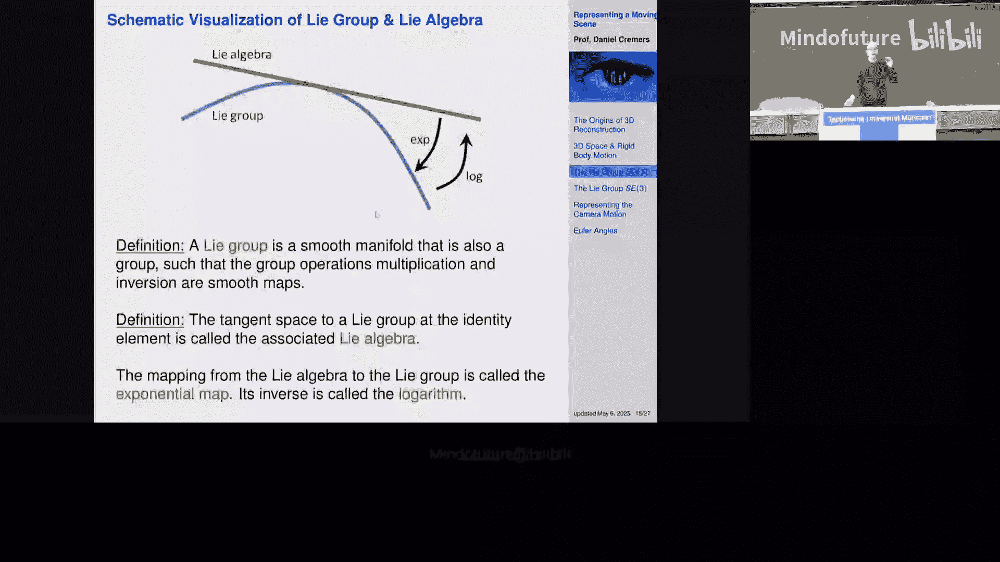
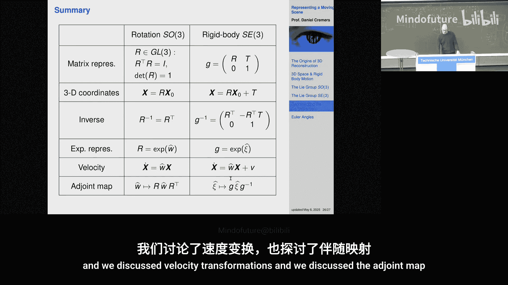
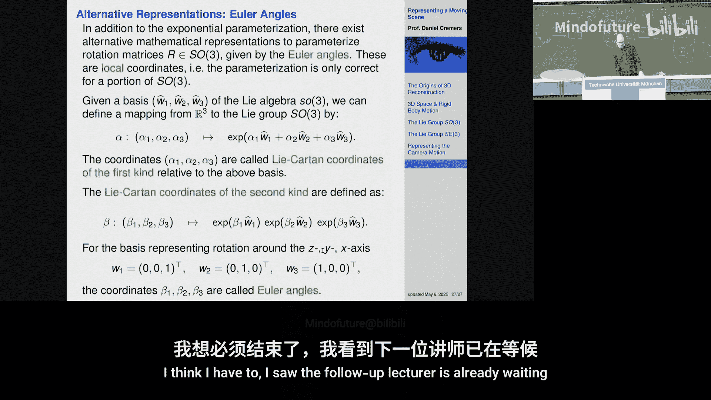
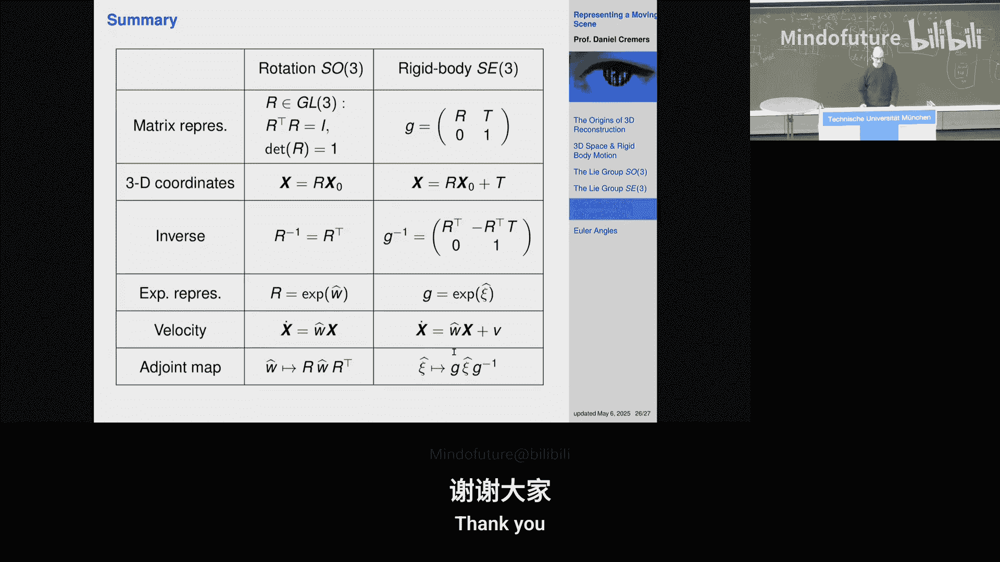

# 【慕尼黑工业大学】多视角几何 ｜ Multi View Geometry 2025 p05 P05_讲座_05_表示动态场景_第2部分 -BV1KgZEBrEXV_p5-

Okay， welcome to class。We left off yesterday in this discussion of Lee Group and Lee algebrage。

And to recap， a Lee group is a group that is also a smooth manifold。

And so this is not for every group right， but there are certain groups， for example the rotations。

 and these are groups and this was observed and analyzed by Sophs Lee。

 as Norwegian mathematician who saw that you can move in this group continuously。

this group as a space is not linear， meaning if you take two elements of the group， then。

 for example， the intermediate value in between will not be an element in the group and as soon as you have structures that are nonlinear。

 the question is how do you parameterize these spaces？Can you find an explicit parameterization？

And he realized that the way to do this is to consider for every group， a tangent space to the group。

And then you can parameterize this in the tangent space right because the tangent space is a linear space so you can have parameters that parameterize this linear space。

 and then you can introduce mappings that allow you to go from that linear space to the corresponding group element。

And we saw that this can be done someone was asking does it really intersect here， not really right。

 because so in that sense this visualization is a little bit simplified。

 we saw that if you compute the derivative of R in time。

 so you have a family of time parameterized family of rotations here。

And then we saw that this derivative is given by W hat， where was it？

And so the derivative in time is W hat。Here， at time 0。

And the space of W hats that forms a linear space in itself。 So this space is， you know。

 the space is a three dimensional space here， the Lee algebra。

 and it's spanned by the three by three skesymmetric matrices。

They form that linear space and you know it's a linear space once you take it at the origin。

 but obviously here you know the elements here are the identity matrix plus an offset in that direction in that offset is an element from the skusymmetric matrices。

So we have that connection that the Lee algebra is the tangent space to the lead group fixed at the identity element。

And it's called the associatedso Lee algebrabra， and then we have mappings。

 the exponential map that allows us to go from a ssymmetric matrix W hat once we exponentiate this。

Then we get a rotation matrix R。 And what's nice is once we do that with the s symmetric matrix。

 So a matrix from the space little S E3。Then this assures us。

 so it follows automatically that our transpose r will be the identity。Matrix。

 and it also follows that the determinant of r is equal to1。

 And so this is nice because it means we don't have to enforce these constraints manually or in the optimization。

 They are automatically guaranteed。And as I mentioned yesterday。

 the key benefit from a practical perspective is once you try to estimate the rotation of the matrix from images。

 let's say， from observation data， then you're moving by doing this。

 you're moving from a constrained optimization problem where you'd have to enforce these constraints to an unconstrained one where you just say。

I take a random element from that space， it can be any skesymmetricmetric matrix that has these three parameters that make up the skesymmetric matrix。

And then the rotation matrix is exponentiation of this skesymmetricmetric matrix。And that way。

 I have an unconstrained optimization problem that is typically much easier to work with。

What we also saw is that this exponentiation of matrices can be done in closed form。

 of skusymmetricmetric matrix it can be done by this so-called Rodriguez formula and that allows me by using sine and cosine。

 I can express it as something that has three terms。

 one is the identity and one is an offset from the identity that is one is in proportional to W hat and another term that is proportional to W hat squared。

And this is not difficult to show， and it's essentially because if you take a unit length geosymmetric matrix。

 we hat。Then you can see if I take V hat cube， it's the same as minus v hat。

 so the higher powers will just reproduce terms that are either of the form v hat squared or of the form v hat。

 and this is exactly what we see here one series of terms proportional to V hat。

 one series of terms proportional to V hat squared。

And that's nice because it means we don't have to compute this infinite power series that we have in an exponation。

So far so good， so this allows us to model rotations very elegantly with three now the question is if in addition we have translations。

 how can we deal with that？And I should be honest， there are two competing ways to do it from here on。

One way is that you keep them separately， you have your rotation matrix here。

 and then you take a translation vector T and R3。RightAnd that's your six parameters。

 three parameters here， three parameters there， and you're done， right。

But what we can do and we are going to do that for the sake of seeing this notion of Lee group and Lee algebra。

 we can observe that this group is E3 that involves rotation and translations。

 this is also a Lee group。So this is a group that is not a three dimensional group。

 but a six dimensional group， three degrees of freedom in the rotations。

 three degrees of freedom in the translations。With the translational degrees you see them here very explicitly。

 the rotational degrees， once you phrase it with this orthogonal matrix。

 you don't see the three degrees explicitly but they're in here right because the skekusymmetric matrix。

 what does it look like well it has zeros on the diagonal and then it has some three non-zero elements here and the negative of it on the other side right so this is。

And so these are your three degrees of freedom that you can see them in the skeku symmetric matrix。

That is this， as we saw earlier， the rotation angle and the。Axies of rotation。

 they define three parameters。So this is the60 degrees of freedom SC3 is therefore we saw it's a group right so we have neutral elements。

 inverse element and inverse one neutral element and then inverse elements we have a closeness。

 if we take two rigid body motion， then the outcome， the total outcome is again rigid body motion。

And we saw that and we also saw that we can parameterize the SC3 in homogeneous coordinates。

 and then each element can be written as a four by four matrix of this form where we have the rotation in the top left。

 then the translation vector T and then 01 in the bottom when I say01， you know notally。

 this is actually three zeros， obviously right。So you have to be a little bit careful。

 this is now 10， but since this is a3 by3 matrix， we have a row of three zeros here。

So this is a4 by four matrix representation of elements in SE3。

And this forms a L group a six dimensional Lee group， and what we can do is we can say， okay。

 if we have a Lee group， can we compute the Lee algebra that is associated with this Lee group？

And spoiler alert， you won't be surprised。The Lee algebra is called little S E3， right。

 So we have little S， sorry， this is should be little S03。

But we also have little S E3 that is the Lee algebrazebra associated with this knee group。

And what we can ask is what is little A3， what does it look like。

 and that's what we're going to do next。😔，And one aspect is you'll see that we can so this is an exercise。

 you can define all sorts of lead groups and you can then go ahead and try to compute the corresponding Lee algebras。

 what does that mean you try to compute the tangent spaces。

And we're going to do this for AC3 as well to give you this better kind of experience with Lee group and Lee algebra。

 this general principle that we apply here。😔，How do we do it well。

What we do is quite an analogy to the thing we did with S O3。

In S03 we considered the matrix r dot r transpose， you remember we did that， we derived it。

 in fact from this constraint， if you take the time derivative of this constraint。

And you do the product rule here， and then you rearrange terms。

 you find that the term r dot r transpose is a s symmetric matrix。 that was the observation。

And r dot r transpose， what does that mean， It's the time derivative of r and times the inverse of R。

 right， r transpose is the inverse， So we're going to do something similar。

 for the group elements G that we have here， these rigid body motions with rotation and translation。

 we're going to consider a family of rigid body motions parameterizing time。

For every time we have rigid motion of4 by four matrix studies in S E 3。

And then we're going to consider G dot times G inverse。

Which is essentially the same that we did for the rotations before， right。

 because our transpose is essentially our inverse， right。If we do that， one can show。

 one can do the computation， I didn't do it here on the slide， but you can try it at home。

You can arrange the terms。 And what you get out is this kind of matrix。 It's a4 by4 matrix。

Where on the top left you have r dot r transpose， so a ssymmetricsymmetric matrix。

And on the top right， you have this expression， T dot minus r dot r transpose times T。

And so we take this upper right hand element。 This is a 3D vector， and we'll call it VT。

So this is some vector in R3， and so in other words we showed that this G doT inverse has the form W hat with Sq symmetric matrix and some vector 3D vector。

😔，And this is a little bit an overuse of notation。 we will call this sci hat。

What does that mean Xi had， so it's overused becausesi is now a six dimensional vector。

That contains that make up this s symmetric matrix and another three elements that make up this vector V。

So it's a six dimensional vector， and it's called the。Twist。We'll come to that。Here。

And so what we see， if we take then this equation， we say G dot t inverse is we call thissi hat this4 by4 matrix here of this structure。

And now if we take G and multiply from the right hand side to this equation。

 like we did in S03 in the case for S3， same structure， we get again。

 this differential equation that says G dot。Equalssi hat times g。

And so that characterizes the temporal derivative of group elements over time is proportional to G where the proportionality factor is a4 by4 matrix Xxi hat。

 which is traditionally in the literature called a twist。Why is it called a twist。

 I think do I mention that a twist is something that is an infinitesimal rotation and translation。

 so a little bit like what you do if you screw a screw into the wall。

 you rotate and you translate and that's called a twist。And that's essentially what we have here。

 this is this infinitesimal rotation translation。And now these twists， you know， at time zero。

 we would have the identity。 so at time0， the time derivative of T is nothing but a twist。

And in other words the twists they form the tangent space to our lead group right so now we have the same idea we have the lead group some curved space in this case is six dimensional space right so again these visualizations that I do here where is the visualization here。

 they are very abstract right on the paper it looks like everything is one dimensional obviously it's not so the blue space in the case of S E3 is six dimensional and the tangent space is also six dimensional yes。

Doesn't have to be。Yes。😊，Yes。Any motion， rigid body motion。 If you look at it infinitesimally。

 it's a twist。That's the whole point here。Yeah， so it can。

 it rotates a little bit and it translates a little bit， right。

 and that infinitesimal transformation。Is called a twist。

 And this is essentially what we derived here。That showing that this space of elements of this form。

 top left is a ssymmetricsymmetric 3 by 3 matrix， top right is a 3D vector V in R3。

 this space is a six dimensional space linear space。

 this space is the tangent space to the lead group S E3。And it is called the Lee algebragebra。

 little S3。So you can see it takes a few lines to do the derivation and we get to this differential equation that relates the time derivative of G to the original G and the relation is given by this twist。

Twist matrices。And to clarify you have the twist matrices and they come out of a twist coordinate vectorsi that is a six dimensionmenal vector。

 and what is it contain， it contains the vector V that we have top right here， and it contains W。

 that three components that make up thisqsymmetric matrix W hat。And so this hat operator。

 it's a little bit overused in our slides， but I didn't want to introduce new notation here。

 this is the operator that converts the coordinate vector to the corresponding matrix。

It is the same hat that we use to convert a 3D vector to a ssymmetricsymmetric 3 by 3 matrix W hat。

 or ifs is 6 d vector， then it converts it to this 4 by 4 matrix。That is the twist。And similarly。

 like what we had before， the inverse of the hat operator， we call the V operator and this or。

 I think it's called Veegge operator， and it converts the 4 by4 matrix back into the corresponding parameter vector that has our six parameters。

And so along the same lines like with rotation you can first take three coordinates W in R3 right。

 that was for rotations， we took three coordinates that make up the skusymmetric matrix。

 we compute the corresponding skusymmetric matrix W hat。

 we exponent that one that gives us the rotation and that way we've parameterized rotation with our W with the three coordinates that make up the W。

And they tweeted them。Skusymmetric matrix W hat。 and here we can do the same。

 We can take a vector Psi in R6。 This is our 60 degrees of freedom。

Then we can convert that into this twist。Iha， like we see here。 And now the question is。

 how do we get the rigid body emotion T out of it？And you won't be surprised along the same lines。

 We take the differential equation， and we solve it。And this is shown here。

We have this differential equation。 It's pretty much analogous。

 G dot issi hat times G with a 4 by 4 matrixsi hat now this twist。At time zero。

 we assume we have no translation and identity as a rotation matrix so no rotation either。

And so this is the differential equation system that we have， and then we can solve it。By the way。

 in this twist coordinate vector， V and W， they have names。

The V is called the linear velocity because that is the component that is the velocity in terms of translational velocity that you know from high school right something moves infinitesimally。

 the change in translation is given by the velocity。And in the same way。

 the change in rotation is given by what's called the angular velocity。

 That's what you have when you have an ice skater spinning on the ice。

 they have a certain angular velocity， right。Means they rotate， they don't actually move in space。

 but the rotation changes and that gives you that is governed by this angular velocity。

 and that is the W。It's defined by a rotation axis and the speed of rotation。嗯。

So we have this differential equation system。 It has the unique solution。

That is given by this exponentiation。Unique because we have this initial condition。

With a different initial condition， you would obviously have a different solution。

 but if we start at identity， this is the solution we get， it's the exponentiation of this twist。

Matrix。And here again， we can use this power series， the exponential function， the power series。

 so all we have to do is take an infinite sum of powers of six by six matrices。

Obviously nothing you would want to do by hand， so the question is。

 is there a closed form solution and it turns out there is， and this is what I've shown here。

Much like with the Rodriguez formula， we're not actually when the Rodriguez formula actually proved that it holds here。

 we're not going to do it entirely because the proof is a little bit lengthy。

But you can show that if you exponentiate a4 by four twist matrix， you can write it in this form。

Where you have the exponentiation of this ssymmetric 3 by 3 matrix。

 there you use the Rodriguez formula to compute this。This E to the W hat。And then the top right。

 the 3 d vector that makes the translation， this vector is given by this expression here。

As a function of E to the W hat， and then W hat and V。So I say one cant show。

 I'm not showing it here。 The proof is a little bit longer。😔。

But it basically means that we have an exponentiation to go from the Lee algebra of these。

Twist matrices。Once we exponentiate。Once we exponentiate this。

 we get to our rigid body motion G in S E3。Large sorry， it's overlapping here。

 but this is the mapping。 so we exponentiate and we get our rigid body motion out。That's nice。

So now we can map from the Lee algebra of twist matrices to the a corresponding group element or rigid body motion。

And the question is， can we also invert this again。

 can we go back to we have a logarithm and indeed we have？Conversely。

 one can show that for every rigid body motion， there exists a twist coordinate。Sorry。

 is no that this is not the statement， so this shows that I can really reach every rigid body motion for any rigid body motion here。

 I first show that once you have a twist and you exponentiate you get a rigid body motion。

 but you can also show that for every rigid body motion， there exists a corresponding twist。

So that that is actually the in， yes indeed。And this is called the log rhythm then。

 so there exists a twist with six coordinates making the twist coordinate vector that forms this twist matrixciha such that once you exponiate it。

 you get the group element。How do you prove this second statement， well。

 we know that there exists a w with E to the W hat is R so we can say this can be done。

 we've already seen that before。嗯。And then you merely need to show that once you have W that defines the rotation that you want。

Can we find a V such that this whole expression here on the top left in this closed form solution that should make the translation vector right and so the question is once I find W to make the rotation in the top left。

Can I find V such that this whole expression gives me a desired translation vector T。

And it turns out this can be done。One can show that one can find a vector V such that this expression holds。

But again， like in S03， this so called logarithm is not unique thereof。

 that means there are inos infinitely many twist matrices。

 once I exponentiate them I get the same rigid body motion， the same rotation translation。

And this non uniqueness comes from the non uniqueness in the rotation because anytime I can rotate 360 degrees and multiples of 360 degrees around any angle and it will not affect the rigid body motion that I get。

So there exists infinitely many twists that represent the same rigid body emotion。

Someone was asking about quaernions yesterday。 I apologize。 I used to have slides on the Quaerions。

 but for time reasons， I kicked them out。I've never used Quearions myself。

 I should say though some people love them， I have colleagues in the field who work with Quears。

 this is an alternative representation， I recommend if you care about it you can look it up on Wikipedia。

 how Quearions are defined and how you can model rigid body emotions and rotations with Quearions。😔。

But for the sake of simplicity， I left that out of the class。😔。

So a few more words how we use these rigid body motion to represent the movement of the camera。

 the moving scene， so the idea is typically we have a static world and the camera moves around。

 but potentially we can you know at some point also consider objects that move。

Then you can model the movement of the camera with a family of rigid body emotions and you can model the movement of individual objects with respective rigid body emotions。

😔，I say rigid objects that would mean cars， for example， and to some extent， bicycles。And humans。

 if you consider them as a rigid object and in tracking a lot of people do that。

 if you don't care about how the arms and the legs move precisely。

 but you just want to know where's the human， then possibly is let's say for self-driving applications。

 modeling everything as a rigid body object is okay。

You might not care too much about how the leg moves， right。

 You just want to know where is the person at any given moment。

And so this approximation actually works fairly well for a lot of objects， Depend on the application。

And for all of these， you would use a rigid body motion if it's applicable。

 and then you can use these Lee algebra representations to model it。😔，So here the idea is now。

 and this is introducing a bit of a notation， we have a world a point in world coordinates。

 so this is some point in the world in some world fixed world coordinate system。

And then I observe that point from a camera that moves。And typically once I have a moving camera。

 I would have a camera coordinate system， so that is the world relative to my camera where I have an origin。

 let's say in the center of the camera and a Zx is that point in viewing direction etc。

 and so I have a coordinate system that moves around with a camera and then I can ask what are the coordinates of a point x0。

 once I observe it from a different camera vantage point with a different coordinate system。

And the difference in coordinates is just given by a rigid body motion。

And that is a rotation and a translation。There is sometimes confusion as to whether xt is Rx0 times t or whether it's vice versa。

That depends on how you define things， right， You can also say x0 is r times x plus T。

 and then you have the inverse transformation in a way。

 So you have to be a little bit careful what your your what your what。Convention you stick to。

 but here the idea is that you have a relative rigid body motion between the static world coordinate system and your camera system and that is governed by some rotation and translation and so you can。

 for example， phrase it in this way。You can either write it in 3D coordinates， Rx plus T。

Or if you like， you can write it in these homogeneous 4D coordinates that we've seen。

 and then you would just write g times x0 and now you have to be really careful the x0 in the box is a 3D vector。

 the x0 in the equation at the bottom is a 4D vector。So strictly speaking is not the same thing。

 and strictly speaking， you should use different notation。But you can imagine if I take a 3D vector。

 x0。In R3 and then I add make it in homogeneous coordinates which basically means I take the vector x0 and I add a1 to it。

 I could call this if you really insist I could call this x0 bar or something。

 but once I do that everything gets more and more complicated right and so for simplicity I'm just overusing the notation here。

 x all the x's can be either in 4D or in 3D。Now， you might wonder， well。

 how do I know which one I'm looking at is very easy。 If you have a little G here， this is。

A rigid body motion is a 4 by four matrix， then whatever it multiplies must be a 4D vector otherwise it doesn't make sense right so it's actually not difficult to see whether the x0 that you're looking at is a 3D vector like up here or a 4D vector。

If it's multiplied by a rotation matrix， it must be a 3D vector because rotations are 3D rotations。

If it's multiplied by a little G in a 4 by 4 matrix， then it should be a a 4D vector， right。

 and then it basically means this is in homogeneous coordinates。So。

 this is you have to read the notation properly。And distinguish。 but I apologize。

 I just didn't want to overload with too many bars and zeros。

 Otherwise you can get lost in too much notation as well。And typically。

 you would stick with either this or that representation to work with。And again。

 the benefit you can see it here， why would you go into 4D homogeneous coordinates。

 things get simpler。 You just have matrix vector multiplication and terms get shorter。

And if you do multiple transformations， you concatenate them， then you just multiply the Gs， right。

 whereas if you have rotation translations， things get very lengthy。

That's why this gives you often much more compact ways to compute things， to write things down here。

 you see it， right？Once you consider， for example， different observers。

 let's say you have one camera here and a different camera there。Then you can say。The point。

 so given two different times， right， So it doesn't have to be two cameras。

 but the same camera time 0 times 1 time 3， right then the same point will have different coordinates。

And if I want to know， what are the coordinates of a point in camera2 that had certain coordinates in the camera 1。

 let's say the points coordinates in camera 1 are x of T1， and I want to know at time T2。

 what are the coordinates if the camera moved？Then it did a motion between time1 and time 2。

 I call a G T2 T1 is the camera motion between frame1 and frame2。

And then they differ by this rigid party emotion。And if I define things this way and say the rigid value motion that relates the coordinates at time 1 and time 2 is this G2 T1。

 then I can do things like saying how about if I look at it at time T3？

Compared to the coordinates at time T2， it is just G of T3 T2 times x of T2。

And an x of T2 as a function of the coordinates at time T1 is exactly G T2 T1 times x of T1， right？

But then I can also say this in the image 3， there is a rigid body motion between the first and the third camera that is GT3 T1 times x of T1。

And this should hold for any points， right， any point that I consider。

I should have this relationship with a rigid body emotion moving from time one to time two or time one to time three。

And that means this family of rigid body Mo has to fulfill for any T1 T2 T3。

 it has to fulfill this property， you can see it here right because where is it。Clearly。

 for this to hold， I need for any point x in the corners of the first image。

 I need to make sure that basically this expression here must be the same as this expression here。

And so that way you can transfer coordinates from one frame to the other。 and here， believe me。

 it's really nice if we do this transformation with a simple matrix multiplication。

Because then doing multiple consecutive transformations just means you multiply the matrices。

If you were to do this in this representation that most people tend to use rotation plus translation。

 you get a miss。Every time you add a new transformation you have to multiply with the matrix and add the translation and then you get more and more terms in your expression it doesn't look pretty whereas here。

 it's still fairly simple to concatenate， that's one of the reasons why you like this homogeneous coordinates because expressions stay fairly simple。

Transforms are just matrix multiplications。And along the same vein。

 you can transfer coordinates back so you can say what is the coordinates in frame1 relative to the coordinates in frame2。

 this is G T1， T2， the transformation from T2 to T1。

And then x of T2 we saw is the same as T2 t1 times x of t1。

 and since this should hold for any point x in the incords of the first image。

 we can read off that G T1， oh sorry， that was not clever。诶。G T1 T2。

 sorry where is it this thing here must be the identity right so we can read of G T1 T2 times G T2 T1 should be identity。

 This is almost trivial right the transformation from frame1 to frame2 should be the inverse from the transformation from frame 2 to frame1 obviously right。

So G T1 T2， T1 inverse is G T12。There we have it。Allright。

 and so this way you can see you can use these， why am I showing you this is not really profound。

 it's just to show you how you can use rigidio body motions4 by four matrices to transform between coordinates in different systems。

Maybe one thing that you can consider is how is velocity transformed。

 so let's say I have objects that move and I observe their velocity in one frame。

And then I have a different frame that is different from the first one， how is that transformed？

So let's say we have a 0 x0 in frame T。And and the coordinates over time of that world coordinate point are given by X T is GT times x0。

And then I can see how do these coordinates， so this is now the camera moves。

 the point doesn't actually move， but the camera moves， right？

And then I can ask what is the observed velocity in the coordinates because once the camera moves。

 at least what I see is that the coordinates of a static worldpoint observed from a moving camera they change over time like so。

😔，And then that gives rise to this velocity。 x dot is g dot times x0。

And then we saw that G dot for these Lee group elements can be written。

 sorry then we go back into the coordinates of the point in the current camera。

 and that is G inverse times x。And so we see that we have this equation。

 x dot is G dot g inverse times x。And G daci inverse。

 we saw this is an element from the Lee Li algebra。

 And this is notoriously so as soon as you consider derivatives。

 time derivatives in in Lee group structures， you can expect the Lee algebra will pop up because that's the tangent space that's。

That's what you can expect。And so you can see that the velocity of that point as observed in camera frame T is given by a Lee algebra element times the coordinate vector。

And this we call the twist matrix G dot G inverse， we saw this 4 by4 matrix matrices from little SC3。

 and so we can write the velocity is a twist matrix times the coordinate vector。

You can also go to 3D and I sometimes do that so often we work in homogeneous coordinate。

 but you can always map things back to 3D coordinates right and then you plug in this twist matrix and then obviously you can write it as W at times x plus V。

And so this symbol we had these twist matrices， these four by four twist matrices from the Lee algebra。

 and they represent the relative velocity of the world frame as viewed from the camera frame。

And maybe one last thing because it does pop up in the literature every now and then is this notion called the ajoint map。

And I wanted to mention that so that you have at least heard of it before。

 I don't think we're going to use it much， but it's not to have heard of what that refers to。

 supposeose you have a viewer in another frame A。So that a viewer in another frame A is displaced relative to the current frame by some rigid body motion Gx Y。

So， we have。AFra that we call Y。And there is a rigid body motion relative to the camera。

 So we have one camera here that moves over time and observes the world。

 But then we have a different one that differs from X by this rigid body motion。

Then the velocity that this is observed in the new frame differs from the one in the old frame by this rigidibar motion。

And then x dot we saw is v hat times x。And if we express that x back in the coordinates of y。

 then it's G inverse， G X， y inverse times y。And so what you see is if x dot is given by v hat times x。

 then y dot is given by G v hat G inverse times y。So in other words。

 the relative velocity of points observed from camera frame A。in the original frame X。

 relative the velocity is given by V hat by the twist matrix， in the new frame A。

 it is given by G V hat G inverse。And this is this transformation where you multiply the twist matrix from left and right with G and G inverse。

 this is called the ajo map， so it's a map where you take a twist matrix from the Lee algebra and transform it to a different twist matrix by multiplying with the group G and G inverse from either side。

And that so this is called an adjoint map， it pops up in some calculations if you consider you know different coordinate systems and you want to know what is the observed velocity for this observer relative to the velocity that the other observer observes。

 then you often end up with these adjoint maps popping out。Nothing really profound。

 but you can see how this comes about， how the air joint map comes about。 and this is a mapping。

On the Lee algebra， that allows you to move from one element to the Lee algebra to another one。

So to summarize this aspect that the aspects that we discussed this whole idea of Lee group and Lee algebra。

 we considered two different Lee groups， one was the rotations， S03。

 and one was the larger lead group， the six dimensional Lee group S3。

 where in addition to the rotation you have the translation as well。

And you can represent them with matrices。In the case of rotations。

 you have a three by3 matrix that is invertible， that is orthogonal and has determinant plus one。

In the case of rigid bodydy Mos， you can write it as a4 by four matrix in this form if you want。

But you can also use 3D coordinates， right to write it。

 so instead of having the homogeneous coordinates， you can write it as rotation plus translation of some vector x to get a new vector。

And since these are groups， you always have inverses right， in the case of rotations。

 the inverse is this matrix is the transpose in the case of rigid body motion， you have this inverse。

Did I show that I'm not sure， but you can do it for yourself if you multiply this G with this G inverse。

 you get the unit matrix。It's not difficult to do。😔。

But always useful to do it at home to get some hands on experience。😔。

We saw exponential representations that we would use in practice to have an unconstrained optimization problem in the case of rotations。

 we get these twist matrices， we expentiate in the case of rigid body motion。

 we expand the twist matrices by this linear velocity vector， and once we expentiate。

 we get the four by four rigid body motion。And we discussed velocity transformations。

 and we discussed the a joint map。

Let me see， do I have time for the oiluler angles， I think I have I saw the follow up lecturer is already waiting。

😔。

Let's close it here， and I'll do the Euler angles next week。 Thank you。

