# 【慕尼黑工业大学】多视角几何 ｜ Multi View Geometry 2025 p06 P06_讲座_06_透视投影 -BV1KgZEBrEXV_p6-

Okay， maybe we can get started。

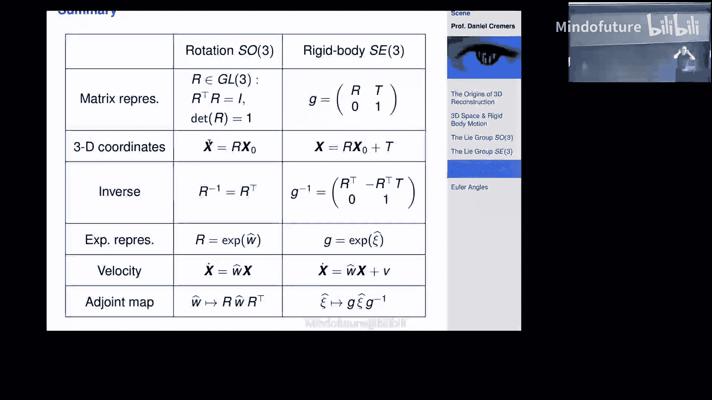

We left off last time with。Chapter 2， the end of chapter 2。

 more or less the end youll see not quite there is one last part and I mentioned it already the Euler angles。

So the summary is we talked about rigid bodydy motion and about first rotations and then also translations and together the rotations and translations。

 they form this group SC3， the rigid bodydy Mos。And so we talked about both of these groups。

 the rotation group， SO3， 3D rotations， and the rigid body Mos， S3。

 and then we mentioned that they are not just groups and we discussed what a group is that you have a neutral element that you have indoor elements。

 etc。And then I mentioned in addition to being a group there are also what is called a Lee group and the differentiator is that in a Lee group。

 the elements they form a continuous space that mathematically can be represented as a manifold。

And so you can move from one rotation to the next one by having a family of infinitesimal rotations that moves you from one element in the group to the next。

And once you have a family， you can also define a tangent space and this idea of the tangent space is not just a theoretical concept。

 but it can be used to parameterize the rotations。And to parameterize the Lee group and the way you do it is shown by this visualization here that you have a group that is a nonlinearar space typically for rotations。

 it has three degrees of freedom for rigid body motion。

 it's a sixdial group and it' nonlinear meaning you cannot just do linear combinations of rotations you will typically not get a rotation then。

 but instead what you can do is you can represented by its tangent space。

 and we showed that this tangent space is parameterized by the skuw symmetric3 by three matrices and this forms the le algebra。

 this tangent space， and this le algebra， little sc3 is a linear space。

And so we can parameterize the rotations， for example。

 by choosing an element in the skuwsymmetric3 by three matrices and then modeling this mapping from the algebra to the group by this exponentiation that we see here that brings us to the group elements and what's nice about that I mentioned it is if you take three degrees of freedom that model your skusymmetric3 by3 matrix right it has three degrees of freedom。

 you can choose them in any way you like once you exponentiate。

 you get a matrix that is by construction a rotation matrix。

 meaning it is determinant plus one and it fulfills these constraints that you need to have fulfilled。

And so that's nice because it allows you to parameterize rotations and hence also rigid body emotions by these exponential coordinates as they're called。

And using the exponential map to get your group elements。

Now the question is how do we do that in practice， Which choice of representation do we choose and the truth is it really doesn't matter。

 right， you have a s symmetric matrix and this has on the diagonal， it has zeros， obviously。

 and then it has three nonzero entries here they are these three。And then obviously。

 the entries you have here must be， since it's skewsymmetric， they must be the negative of this one。

 right？ So you really only have 3 degrees of freedom。 So you might as well call this one A， this one。

 B， and this one， C， And then this would be invariably minus a minus B and minus C here。

 And that's your 3 degrees of freedom， right， So you could go with that and be done with。

But you can also look into it a little more， what are the options that I have here？

And if you think about it some more， you find there are actually two ways to go about it。

 The first one is very much like what I suggested here that you have three matrices。W1 hat。

 W2 hat and W3 hat。 and then yourm and let's say they are the basis。 and that could be， for example。

 W1 hat。Could be the one where you have a one here and then 0，0。0，0 and then minus-1 here。0，0。

 that could be W1 hat， and W2 hat could have a one here。 W3 hat could have a one there。

 So let's say that's our basis。Then you can choose and then you can parameterize this W1 hat with alphapha 1 W2 hat with alphapha 2。

 W3 hat with alphapha 3， take the sum of these elements， right？

And that would amount to a matrix that has here， these alpha 1， alpha 2， alpha 3。

And that would be a choice for your skew symmetric matrix。

 and any skew symmetric matrix has obviously this form。And then， you exponiateiate。

And that would be your coordinates。 So these would be the three degrees of freedom that you choose。

 I call this ABC here。 You might as well call it。 maybe for consistency。

 I should have called this Alpha 1。And then what is it， This one is Alpha 2， Alpha 3。Alpha 3。

And here's minus alpha 3 and minus alpha 2。 So that would be that choice。

And this parameterization of your Lee algebra， and hence the group is called the Lee Caran coordinates of the first kind。

Relative to the above basis， right。And now that indicates there is a second kind。 And indeed。

 these are the Lee cartan coordinates of the second kind， and they are slightly different。

 at a first glance， looks almost the same， but they're not quite the same。 Here。

 the difference is the following rather than doing the concatenation in in the algebra and then exponentiating。

You do the exponentiation first to get the group element。 So this is the one rotation matrix。

 This is another rotation matrix， and that's a third rotation matrix。

 and then you do the concatenation not in the algebra， but in the group by multiplying。

The group concatetnation is group multiplication， matrix multiplication。

 and so you do the concatetnation then afterwards， so you first transform from the algebra element。

 this W1 hat to the group corresponding group element and then you exponentiate sorry and then you concatetnate in the group。

And you think isn't that the same and not necessarily。

 so this is very important in general you remember from high school that E to the A plus B is the same as e to the A times E to the B。

I'm sure you remember that that rule of exponentialonency。 I hope you can see that in the back。

 Maybe I should write B。 So E to the a plus B is typically E to the a times。E to the B。Typically。

 for scrs， this is the case for matrices not necessarily。

Because the matrices they don't commute and once you plug in this power series for the exponentiation and A and B are matrices。

 then you cannot convert that So in general。For matrices。

 this will in general not be the same if A and B are matrices。So this is very important。

 we cannot do that， and that basically implies that if you do this here and you do the same thing down here and choose alpha and beta the same。

 obviously， then still you will not necessarily get the same output。

And so this is important to keep in mind， these are different ways to parameterize， both are valid。

 and the question is which one do you prefer？嗯。And in particular。

 if you choose w1 as a canonical basis with 001，010 and 100， these ws。

 and then the Lee Qan coordinates with respect to this basis and the corresponding skesymmetricmetric matrices。

 this is called the euler angle。Now you all knew the oiluler angles， I remember。

 I asked you up front and everyone said they've heard about the Euler angles before。

 you probably did not know that the Euler angles are the Lee caran coordinates of the second kind with respect to this basis。

Now you know， I don't know if that helps， but what it shows you is something that I've always suspected when I was in high school and learned about the oiler angles。

 if they look random to you， yes， it is because they are random。

 you can choose any other basis and you can do it any other way and it typically also works， right？

So this is the Euler angles， this is one way of doing it。

 I must say I'm not the biggest fan of the Euler angles I would typically rather do it this way。

 I prefer the Lee cartan coordinates of the first kind。

 why well if you want to get the group element for one thing adding matrices is much faster done than multiplying matrices right？

So this is a computational challenge， something that maybe Euler didn't think about at the time。

 you know what is more efficient in a time when you didn't have computers。

 things were different and honestly it sometimes depends which choice is the better one so once you implement things it may be worth thinking about what is it that you want to do what is it that you have to do in your code how often do you have to map from the algebra to the group and if you have to do that all the time then think about using the car coordinates of the first kind because then you just have one single exponentiation。

And matrix summs， which is fast， whereas here you have three exponents and matrix multiplication。

 which at least in my view， should be much slower。Right，But then again， it depends。

What you're doing right so keep in mind there are these two possibilities。

 but ultimately it really doesn't matter in practice up to computational aspects。

 but what you want is you want some way to parameterize your group your three degrees of freedom and whether you call them alpha1 to alpha 3 or be 1 to be 3。

Whatever you prefer。Yes， so I think in both of these representations， you can have singularities。

And issues that， for example， that you choose two different parameterizations that end up in the same element and things like that。

 so there is this issue of non-unness that you always have with these Lee algebra representations and that is simply put if you have this tangent space on the group。

 you can fold this around any number of times and you will get the same group elements over and overr the fact that you can rotate around some arbitrary angle by multiples of two pi and you will get the same group elements so there is these issues。

Yeah。But in practice I find one can work fairly well with these Lee algebra representations and parameterization。

 this exponential coordinates， and whether you choose the Lee Carton coordinates of the first or the second kind。

 I think is really up to you。So that's it about Lee groups and Lee algebras and the representation of the camera movement。

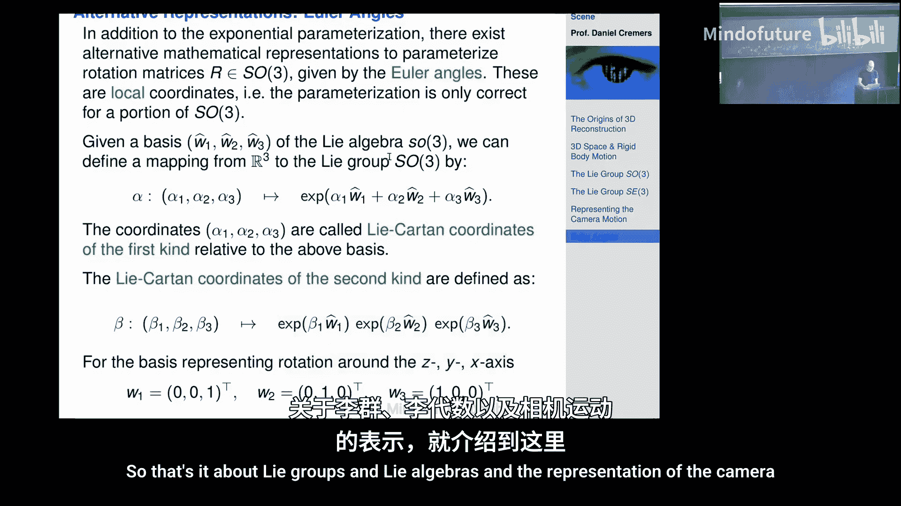

That brings us to the next chapter。嗯。And that is the chapter on。Perspective projection。

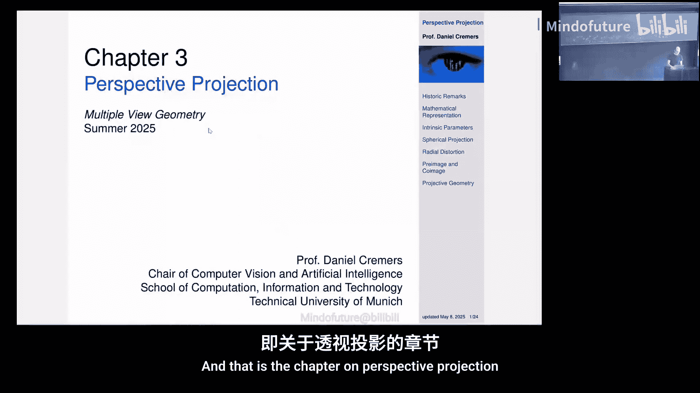

This is chapter three。And here this is kind of the second core element in this image formation process。

 the first one is I have a 3D world and I move my camera around so I need to know how can I model the movement of the camera。

 the second element is that this world that I observe here。

 once I moved my camera in with a camera center someplace。

 then basically I see a projection of things projected onto my camera screen and we'll discuss a little bit how that is done mathematically。

And there is a lot of different projection models， the perspective projection， spherical projection。

 there is aspects of radial distortion， and then this notion of pre-image and coimage。

 and there's this general mathematical field of projective geometry。

 this is not a class on projective geometry， but I want to briefly mention how that connects。

The perspective projection is something that's been studied for thousands of years。

 and that's always amazing how in history of mankind people studied things for millennia， really。

 and you can see some of the earliest formulations of geometry of image formation。

 they can be traced back to people like Euclid in the4 century before Christ。😔，And you can find。

Examples of at least partially correct perspective projection in the frescoes and mosaics of Pomppe a0 years before Christ。

 so that's at least how old perspective projection is。And then something rather mysterious happened。

 And this is。To me， still a mystery to some extent。But quite a well known phenomenon。

 then a lot of the knowledge that was around in the time of the ancient Greeks。Got lost。Disappeared。

 vanished， was gone， right。 And if you go back then into the middle Middle Ages。

 people didn't seem to know if you look at paintings from the Middle Ages， they're notoriously flat。

 There is no sense of dips in these images。Art historians will often tell you， well。

 that's because they were not interested in photoreistic representations of the world。

 A lot of the art of the time was， you know， art in churches。

 They wanted to display Christ and a lot of other things。And， and the sats and things like that。

 They didn't care about photorealism。I would disagree with that。

 I think if they had been able to make a photoreistic rendering， they would have done it right。

 anyone would have。I think they didn't know how to and maybe didn't think about how this could happen。

And。And so a lot of this was lost with the fall of the Roman Empire and so it shows you that the history of mankind。

 it's not always uphill， it keeps on going up and down and nowadays sometimes I feel we're on a downhill trend again。

 but I don't want to comment on politics here。😔，Definitely。

 it was downhill with the fall of the Roman Empire and。So as soon as empires fall。

 some cultural phenomena unfortunately get lost。😔，And this is one of them。

 And a lot of science and knowledge got lost of often， it wasn't fully lost。 And actually。

 the history about how a lot of this knowledge got rediscovered is a very fascinating one。

 Because some of this knowledge from the ancient。 I mean。

 we know today that Euclid and others had this。 How do we know， Well。

 there are scriptures that remain。😔，That were in libraries， kind of lost in the libraries。

 And then in the Renaissance， this was a period when particular people went through libraries and rediscovered what the ancient Greeks had done。

And so sometimes it is worth going back to history。

 seeing what people have come up with in the thousands of years that humanity has been around。

And so this was like a thousand years later， right， they rediscovered the perspective projection。

 and then this was the Renaissance period and the artists of that period。

 some of the most famous artists in the history of mankind。

 they really showed perspective projection massively。A little bit over the top I find sometimes。

 but it's okay。 so for example， there is a famous treatise de la Pia from 1435 by Leon Baista Albertti。

And that basically shows partially correct projections that explains the laws of perspective projection。

Then there are artists like Bruneessqui Donatello Alberti and many others。At the same time。

 the Renaissance not only rediscovered prospective projection， but in the Renaissance。

 artists like Leonardo Da Vinci， Carravaggio and Raphael。

 very studied in great detail the interaction of light with matter， how light reflects of objects。

 how you can really paint water and other materials in a very realistic way。😊。

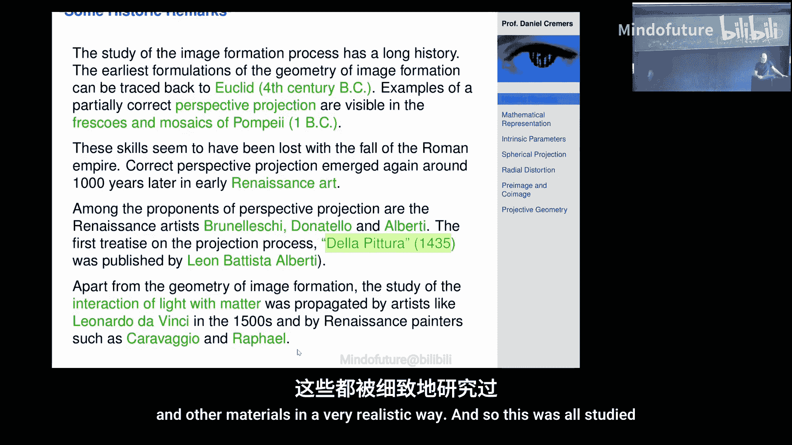

And so this was all studied here as examples， this is a monk named Fiippo Lipi。

 and this is a painting called the Feast of Herod Sals danceance。

 and you can clearly see a real sense of dips。That gives you a much more realistic impression than the flat paintings of the medieval times。

And so this must have been for the people at the time。

An amazing breakthrough to see what kind of renderings you could create and。

It gives you a much better feel of actually this being real， right， at be you being there。

And part of it comes through this tiling on the floor that gives you that sense of dips。

 And that really has these laws of prospective projection。

 all these lines meeting in some vanishing points。Et cea。Here's another example。

 the famous School of Athens， it's not so much famous for the perspective projection。

 it's famous because these are lots of famous philosophers that are painted here。

 but for us what's interesting is this perspective projection that you see in the painting。😔。

This is then a few years already a bit later in Germany。

 this is a machine conceived by Albert Dura for those who care about art。

 you will know that he always has his。And。Letters in the painting。 This AD D stands for Albert Dura。

And what you see in this drawing of Dura is a machine that he developed and conceived that allows him to get a perfect perspective projection。

 it requires， as you can see， two people。And what you can do is you can get a perspective projection of this musical instrument。

 for example， and what you see is there's a door he opens and closes and there's a string and this kind of models。

 the center of the camera of projection and all the different points go and what you really capture here is the ray of light that emits from this object and goes into your camera that is located here。

And you can then think about where would this end up on the screen and you can have a person hold his pencil there。

 and then he would hold the pencil， close the other one would close the door and you could mark off where that point would end up on the drawing。

😔，And that way， you get this， this kind of drawing that gives you。

A perfect way to really physically reproduce this projection。And then you know， this is again。

 200 years later， this is a satire and what we see here is that someone is misusing the laws of prospective projection to make things that are not possible。

 right？For example， up here， you have this lady leaning out the window and you have this hiker in the landscape and he's lighting his pipe on the candle that she's holding out the wind。

And even though locally， this makes sense globally， it doesn't， because clearly， this woman。

 based on the project perspective， should be much closer to the viewer than the hiker in the background。

 And so he should strictly be much smaller， et cetera。 or here， the flag that hangs off this， this。

 you house is occluded by the trees that should be in the background， right， So there is or here。

 you know， this guy who on this side of the bridge is shooting clearly in a straight line at the bird。

 But strictly speaking， this cannot be because the bird is in in the backgroundright。

 So this is kind of making fun of the laws of perspective projection。

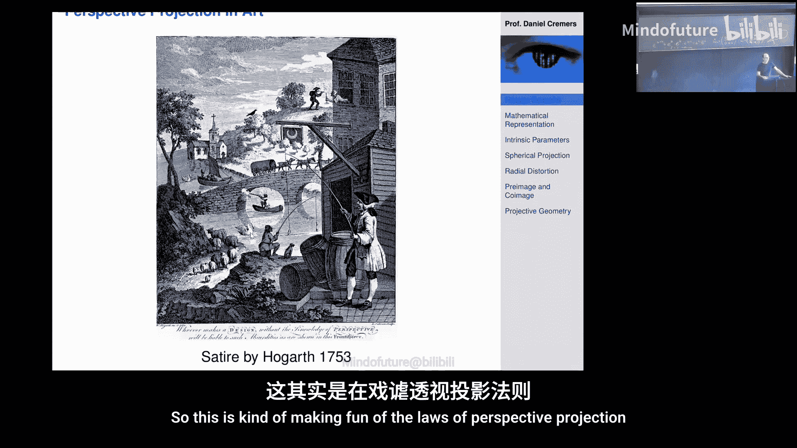

And one of the most famous persons who really use perspective projection beyond the limits is this Dutch artist MC Esher。

 she's a big， big， you know most of you will know it。

 he's in my experience very popular among people who are mathematically oriented and computer science。

Audience。And so these are examples of his drawings。 And you can see how。

 you know here you don't know what is up and what is down， right， And here you have， you know。

 staircases that， you know， locally everything makes sense， but globally somethingt doesn't match。

 you know you have， for example， this pillar that is apparently in the front。

And all of a sudden it ends up in the back and this pillar from the front ends up in the back here。

So some things don't really make sense。😔，But it's nice what you can do once you really deploy。

 And there's lots more of Esher。 if you want， go online。 There are so many drawings of Eher。

 and they're often quite amazing。 And I find you can spend like， you know，10。

15 minutes just staring at this image and。This is quite fascinating。

 So this is perspective projection in the field of art。Now we come to how we model it in the machine。

And one should say there are different aspects that are mingled into this drawing here。

 there is this notion of perspective projection， but there is also this notion of a lens that bundles the light and so here this is typically what you have in a thin lens。

You have different laws， but one laws is that the rays that come in parallel to the viewing direction。

 they will get distorted through the focus of expansion。And end up here。 And similarly。

 if the lines that go through the focus will go out parallel。 So there is typically a symmetry。

 at least if the lens itself is symmetric。And this gives you a focus。

And then you can model the projection of a 3D point x and you can model how it's mapped onto。

 let's say， a screen that would be placed here。And typically， in a camera。

 what you have is you have the lens， and then the screen is behind the lens。

But we'll see what we'll do for simplicity we'll typically assume that the screen is in front of the center of projection that makes the drawings a little bit easier。

 the only difference really is that in reality you would have a minus sign right so if this was a certain y coordinate and it goes through the center then you would have a minus here。

 so you would have in the projection you would not have f times x over z but minus f times x over Z and minus f times y over Z。

Here， X， Y， Z is the coordinates of this 3D point large x。

So the bold bold X is a 3D vector and the projection projects this 3D vector that is a point here on the object。

 let's say onto a point on the screen。And as I said。

 usually the screen would be behind the center of projection。

 so it would go through the pinhole or the lens and then project onto a screen behind。

 but we'll for simplicity just put everything forward that way we don't have the minus signs in our projection equation。

When I didn't go into the history of the perspective camera， the so- calledled pinhole camera。

 but I don't know if there is something later in class probably not。

 but this is also very old and some of the first cameras that people designed were in the ancient Arab world where you just take a black box。

And this is what's known as a camera obr， a black。BAnd then you have a little hole。

 and if you have a very bright object， then the rays go through this hole and you get a projection。

 let's say you have a candle here。 you can see a projection of this candle inside your black box and this actually works if the hole is sufficiently small and the object sufficiently bright and the chamber sufficiently dark。

 then you can see the inverse of the candle on the wall。 I've tried this is actually works。

 but the issue is the hole has to be sufficiently small。 What happens is if you make the hole bigger。

You get more light in， but then the projection gets more blurred because then the rays don't go through exactly one point。

 but they go through a hole right， and that blurs everything。And so with a pinhole camera。

 this is called pinhole camera， you want the hole to be small。

But then you often don't get enough light in to actually see anything。

 So there is a bit of a trade off there。And that is ultimately why people use lenses for projection。

 Why real world phones always have lenses。 They can bundle the light。

In a way that you then can have not an infinitesimal hole， but a larger aperture。

 and then the blurring gets removed by this lens that bundles all the light onto the screen。

But this is the standard perspective projection that you would get from a pinhole camera。

And what it basically says is that we see a projection onto the screen where we have this foreshortening that basically the x coordinates gets reduced。

 So if you have a certain， well let's say y coordinate here。

 then in the projection you have a slightly smaller y coordinate。

 and it depends on on basically the distance from the screen。

 the higher the distance said from the screen， the smaller the object appears on the screen。

And then you have a scaling with what's called the focal length of your sensor。😔。

That is basically the distance in a pinhole camera。

 the distance from the camera center of projection to the screen is called the focal length。

And with cameras， you can set the focal length。 It depends on the lens that you use。

So one of the key problems in this projection you see it already is you know。

 we see the world on the screen， we want something to know what is the 3D location in the real world。

 that is what reconstruction is all about， recovering the point large X from its projection little X。

And there is something that gets lost in the projection。

 What gets lost is really how far the object is from the screen。

And one of the issues with this projection is it's a nonlinear transformation。

It's not a matrix multiplication， but it's a division by the Z coordinate。And so in practice。

 what people often do is they try to mimic some linear transformation by going into homogeneous coordinates。

So you have x， Y， z and1。And then they basically keep the Z coordinate on the left hand side of the equation。

 So little x that is the projection of the 3D point onto the screen。

And the 3D point has the coordinates X， Y Z。 I go into homogeneous coordinates， So I have a one here。

 and then I have this projection that rescales with the focal length。

And then the division by Z happens here in the sense that I actually multiply the whole equation by Z。

 in principle， if you want just a projection， you have to divide by Z。

But we'll write it in this way to make it look linear。

 We'll see what the purpose of that is in a bit。But now we can separate the different aspects。

Is what's called a standard perspective projection。This is this matrix pi 0。

 It's a matrix which is basically a unit matrix， and then the last component is killed by it。

 So it maps the 4D vector X， Y， Z to a 3 d vector X， Y， Z。So， x， Y， Z 1，2 or 3 d vector x， Y， Z。

 it's called the standard Per projection， and then this matrix KF。

 this is a rescaling of the x and Y coordinates with the focal links。

That's the two matrices and with that we can then， and now if we assume that the whole object is at a certain distance from the screen and we assume that all points of my object roughly have the same Z coordinate。

 and we'll call it lambda that is the Z coordinate of all the points。

 then we can say lambda times the 2 d coordinate vector is Kf pi0 times the 3D coordinate vector in homomogeneous coordinates。

It's a little bit， you know， it's not very deep。 it's just notations that we introduce to see what the phenomena are。

 That is the ideal perspective projection。Now， in practice， what we do is we observe with our camera。

 but the camera moves around， right， and so we'll model the movement of the camera with a rotation and a translation parameter like we saw earlier。

In the last chapter， so the 3D coordinate vector in the coordinates of my camera is actually rx0 plus T。

 so we have a point x0 in world coordinates， so fixed coordinates and then we want to say what are the coordinates of that point with respect to my camera where the Z coordinate is in the viewing direction etc？

That differs by a rigid body motion。 So x is nothing butx plus Rx0 plus T or written in homogeneous coordinates。

 sorry。It is is this equation here。😔，So G times x0 where g is this element from the rigid body motion group。

And so that means the total transformation from the world coordinate point x0 to my screen coordinates is first I have to transform。

 and this is typical for all of these transformation equations。

 You have to read them from right to left。 I know we're used to reading from left to right。

 but here it's best to read them from right to left。 So I start with the world coordinate。

 Then I go into the camera coordinates。 That's a rigid body emotion G。

Then I have a standard perspective projection that kills the last component。

 and I rescale with the focal length， and that gives me the 2D coordinates up to scaling。

 That's the distance from the。 And here the assumption is that the distance Lada is kind of constant for the whole object。

If the focal links is known。And in many cases， you have a camera where you know the focal links。

 either because you have the camera and you can calibrate it and determine the focal links。

 or this happens a lot。 if you download images from the Internet。

 you'd be surprised you don't actually see that as someone who just looks at the image。

 but typically inside the image。 there is a lot of parameters that are stored。

Including things like the focal links。So very often， even with imagery from the internet。

 you can get the camera parameters out if it's the right image format。

 it will contain them inside somewhere。Why is that important， Because very often nowadays。

 we want to do reconstruction not from our own camera， but from the Internet。And if I can be honest。

 this is one of the biggest open challenges that we're working on to is how can we get 3D reconstruction to work on the internet？

On photo collections and videos from the Internet。YouTube is full of videos。

 can we reconstruct the 3D worlds that you see in these videos in principle we can。

 but to date there is no algorithm that does it。If you can come up with one。

 there would be a lot of use for it， you can imagine。And one of the challenges is， for example。

 once I have a video， I might not have the intrinsic of the camera， the focal length， all of that。

 So then I will have to estimate them from the same video， and then things get a little bit dicey。

And in addition， theres more challenges when you do 3D reconstruction from YouTube than typically you don't have the case where there's a video of a static world。

 typically most videos on YouTube have people running through the scene。

 objects moving everything moves right， people love motion right， but the issue is our algorithms。

 they don't like motion。They prefer a static world， and the question is。

 how can you determine which aspects of the scene are static， which ones are not。

 Can you estimate the 3D world and the objects that move around in it。

 and that's still very much an open territory for research。

But the parameters like the focal length are typically often stored in images。

 so then if you know it， you can normalize everything。

 you can just divide all your coordinates by the focal length。

And then you can write a projection just in this fashion。

Then you can basically leave out KF because you can basically rescale everything。

Or you basically measure everything in units of the focal length， if you will。

Let's talk a bit about camera parameters， the so called intrinsic parameters。

 so one distinguishes intrinsic and extri parameters。

 intrinsic parameters are the parameters that you can set inside your camera。

Things like the focal length， some of them are already preset and you cannot modify them depends on your camera。

And they differ from the extrinsic ones。 The extrinsic ones are the ones that deal with the rotation of the camera with the movement of your camera in space。

 But the intrinsic ones are the ones that you can set on the camera， and there are several。

And here they are， so you have this focal links that rescales everything that's part of the intrinsic parameters。

 but there is more and that is what gets you to pixel coordinates right if you take a digital image it has pixels。

And whereas in the standard 2D coordinates that we see the center of projection is typically in the middle of the image。

 once you download an image， the00 pixel is typically at the bottom left corner or bottom right corner。

 there's different conventions， right。And so and then it's in units of pixels， not maybe in centi。

 right， And so there is a conversion that happens from image coordinates to pixel coordinates。

 and that conversion does two things， first of all。There is an offset， this is O x and O Y。

 that is basically the offset of the center so that it moves to the bottom left。

And then there is a rescaling that converts into pixel coordinates。

And that rescaling depends on the settings of your camera。 For example， if in your smartphone。

 you say I don't want 10 megapixel image， but only one megapixixel image because I want to reduce memory footprint。

 then you know the pixel numbers will be different right so the units of the pixels you will have bigger pixels and then these parameters S x and S Y have to be rescaled accordingly。

So when you switch the resolution in your camera， what you really switch are these parameters S x and S Y that indicate the size of the pixel。

 if you will。And sometimes you can even have distortions。

 you can have a sw factor a theta that takes into account pixels that are not rectangular。

 so you can do that。In practice， you would prefer this to be zero。

 but if you have a really cheap lens， you know， mass produced somewhere on the other side of the globe。

 then you may want to use a skill factor to take that into account。系。

And so these are the different transformations that allow me to go from a 3D point with coordinates X。

 Y， Z in homogeneous coordinates。2 a 2D pixel coordinate vector with pixel coordinates x prime Y prime。

 and in homogeneous coordinates， the third one would be one。 And again。

 lambmbda is the distance from the camera。And so one should not be fooled。

 it all looks like nice linear algebra matrix multiplications， and the truth is it is。

 except for one crucial thing that is this lambda that we have here， right？

That is actually the Z coordinate， and it should be all divided by this Z or Lada if view。

And already by calling it Lambda instead of Z， we try to hide this aspect that there is a dependency on the Z coordinate that is still stuck here on the left side of this equation。

But we'll come to that。So this is then the matrix of intrinsic parameters。

 so it's basically this matrix with the focal length times this one with the pixel coordinate transformation。

 these multiplied together looks like that， so you have the focal length and the rescaling to the pixel coordinates and the offset of the origin here right and that is the matrix of intrinsic parameters。

And we saw that as a function of world coordinates at 0。

 the projection to pixel coordinates looks like that。 There is a matrix pi。This is a 4 by3 matrix。

or3 by4， whatever， so a matrix that transforms this 40 world coordinate vector into pixel coordinates and this matrix large pi is basically a rigid body motion 4 by4 standard perspective projection and this intrinsic parameter matrix。

3 by four matrix here。 it says pi。 there it is。 and this is called the general projection matrix。

 soundss very。Bmbbaastic， but it's， you know， it's just because that includes both the extrins and the intrinsic parameters of your camera。

In one protection matrix。And so that's how there is really how to get from a world coordinate vector to pixel coordinates in my camera。

But again， keep in mind， although this equation looks linear， it's not right。

 we have this scale parameter lambda that is really the z component and if we divide by this Z component。

 then the projection looks like that， then x prime， so the pixel coordinate component is this one。

With pi 1 being the column of pi， the first column of pi， pi 2， pi3。

 that is the three column vectors that make up the matrix。A large pie。And this is basically。

 and here you see the nonlinearity that our unknown world coordinate vector enters both in the numerator and the denominator of this expression。

A few more words about the intrinsic parameters， this is the matrix of intrinsic parameters。

 so OX so y I mentioned it， this is the x coordinate of the principal point in pixel so the principal point is basically the center of projection that goes so the Z coordinate of my camera I have a center of projection。

 the Z coordinate of my camera goes through the principal point。In the image plane。

 so where my viewing that Z coordinate intersects with the image plane that is the principal point and its coordinates in pixels are given by OX and OY。

And so depending on what number of pixels you want to have in x and y direction。

 this will get a different value here。And similarly Sx and S Y are the scaling that depends on the size of the resolution in x and y。

 and then theyre multiplied with the focal length and this alpha x is basically the unit length。

 the size of unit length in horizontal pixels and alpha y is the size of a unit length in vertical pixels。

The ratio between alpha X and alpha Y is called the aspect ratio of the image。

 So if it's a quadratic image， then it's one and otherwise， it's not。You have that for screens。

 for example， that you have this aspect ratio。And as I mentioned this F times s theta。

 this of diagonal element that we have here， this is a s of the pixel for non rececttangular pixels。

 you need to introduce that， but in practice you would expect should be close to zero if you have rectangular pixels it should be0。

So this is the standard perspective projection。 There is variations of it that one can also。

Employee in practice beyond the prospective pinhole camera that we just introduced that accounts for a planar projection surface。

嗯。So where the projection here is a plane。😔，But instead you could have a projection where the projection is not onto a plane but onto a sphere for example right and then you would have this point projected here。

 that point projected there etc so this would be the projection on the spherical screen。

 and you can do that the same way and it's practically the same projection equation almost not quite instead of dividing by the Z coordinate。

 you divide by the length of the vector so if this is a sphere with unit radius。

 then this point here is just you a normalized version。

 you take the X coordinate vector and you divide by its length if it's a 3D coordinate vector。

And so this is， but in practice， it doesn't really make such a big difference with respect to the mathematics in the sense that you have to divide by something that depends on x。

 whether it's just the Z coordinate， you divide by all three， you know。

 there is an nonlinearity no matter what， right？And so you can model it the same way with this Lada same projection equation exactly same。

 except that now lambda is not the Z component， but the length of the vector that includes x。

 Y and z。Often， we write for 2 d coordinates X tillilde y。

For homogeneous 2D coordinate vectors x and y， if they differ only by a scale factor like this scale factor lambda。

And if we introduce that notation tilde to even more hide this nonlinearity。

 we can say the 2 pixel vector x prime is basically up to scaling given by pi times x0。

 where pi is my standard perspective projection。And so this is the same。

 both for the pinhole projection with a flat screen。

 as well as for a projection with a spherical screen。And in fact。

 this property holds for any imaging surface as long as the rays between x and the origin intersect the image surface。

 Obviously， if I have a projection screen that is here and it doesn't actually intersect。

 that doesn't make sense。 But as soon as I have a screen and there is a unique intersection。

 then I have this， this property。And so in principle。

 you can come up with all sorts of projection screens。😔。

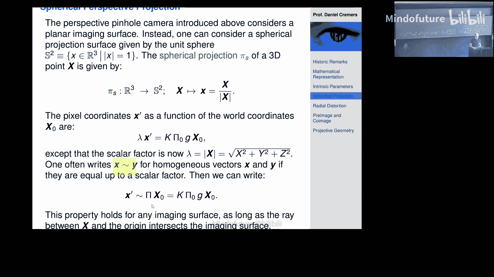

One thing that you have in practice， though， with real world cameras。

 especially if you take wide angle lenses or fish eye lenses。

 So there is this notion of wide angle length wide。Anglelins。

This is what you switch to in your smartphone。 If you want to not zoom in， but see the whole room。

 then you take a wide angle。 That's why it's called wide angle。

 And the extreme case is called the fish islands。Maybe because fish eyes do a projection like that。

 I'm not quite sure。Possibly。😔，And so what happens when you have wide angle links， short focal links。

 you get a distortion。😔，A distortion that you see here。

 so this is a bookshelf where in principle these lines that make the bookshelf。

 they should be straight， but you can see it up here really nicely how its actually curved， right？

And once you compensate and this is called radial distortion that happens through the real lens。

 and what we do in practice to cope with real lenses and the distortion they bring about is that we apply an undistorion to remove the radial distortion。

And once you do that， you get this kind of image and you can actually correct for it。This phenomenon。

 we can see how it's modeled but basically there is a center point that is undsistored and then things get increasingly distorted the further out from the center you are。

And this is called the center of distortion， typically it's again in the middle of the image。

 but as I mentioned， in the age of cheap cameras and cheap lenses。Who knows right。

 the center of distortion could be off away from the center， it could be all over the place。

 and then you but typically you have a distortion that depends on the radius on how far you are from the center of this door。

But in principle， if you get really， really cheap lenses。

 you could have all sorts of distortion phenomena， but the dominant one is typically one of radial distortion。

 How can we model it， Sorry， lots of text on here。 But if you're home， you can read it。

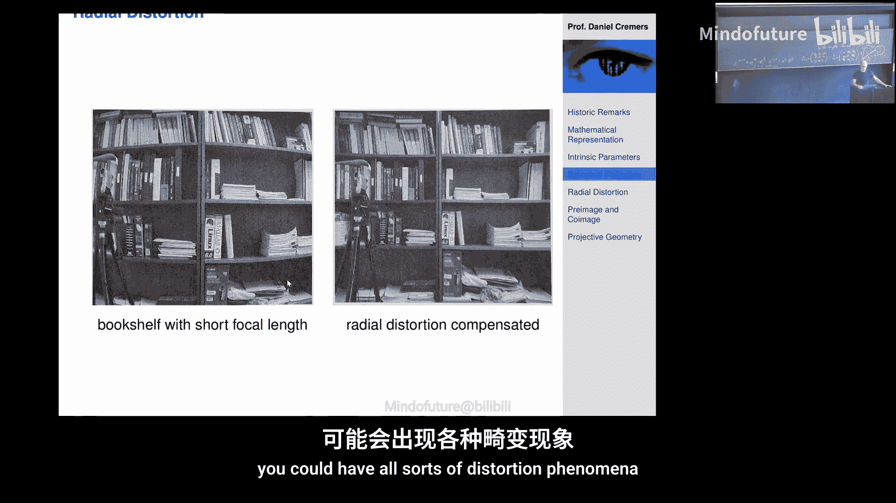

There is basically different ways to do it that have been proposed in the history。

 This is a very traditional way。 I don't even have a reference for this one where you basically say the following。

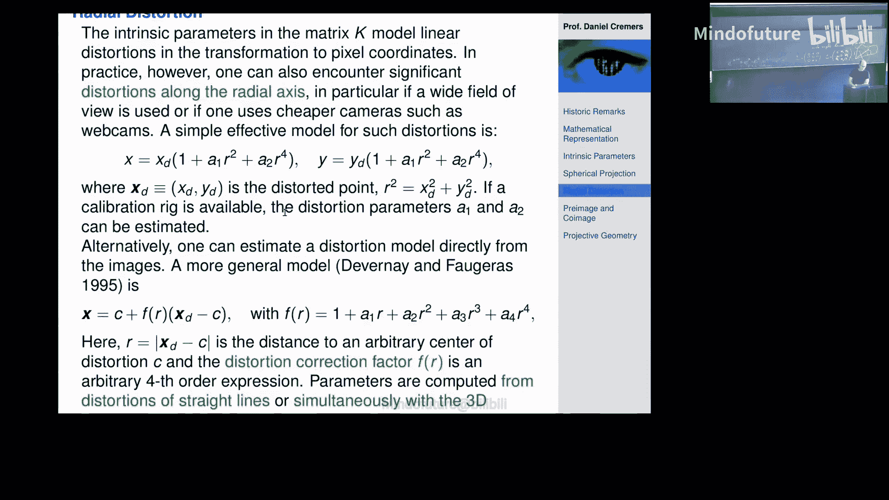

X D is the distorted point with coordinates X D and YD。

And then you have the distance from the center of that point is obviously R。

 right X D squared plus y d squared is r squared。 So that is the radius from the center。

And then you have a distortion that is such that it depends on this radius， and you have parameters。

 A1 and A2 that tell you how much distortion do I get the further away from the center I am。

And so you can say the distorted point has coordinates X D and YD。

 I compute the radius R in this fashion。And then I can compute where should the original point be。

 so the real point X and that's how you do this un distortistorion right。

 you take any point here and you basically and this has coordinates x d Y D and you move it back to the point X Y that you have in the undistored image and that those coordinates depend on X D with a factor that depends on the radius。

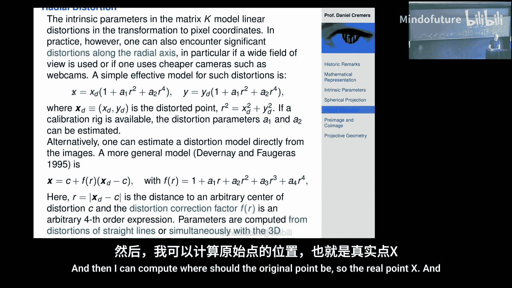

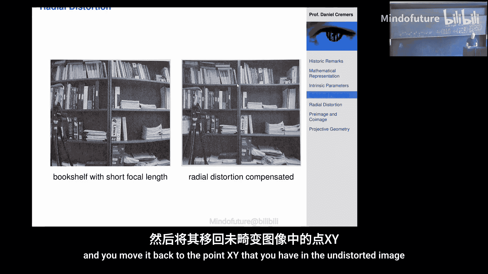

And typically you have this dependency， you can have a model with two parameters。

 one that depends on the square of the radius， one that depends on the fourth power and what you do in practice to get these parameters is you do at least squares fitting so you know you take these images。

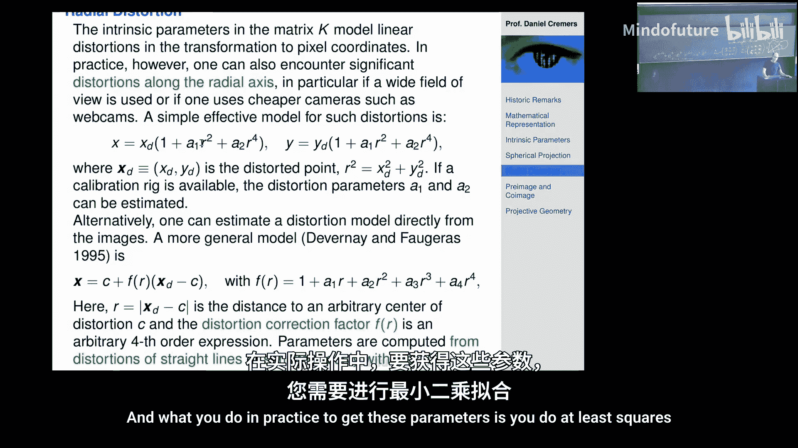

And you assume you know， let's say you have a checkerboard where you know every checker of the checkerboard where every square should be。

 then you can my corresponding point pairs points x in the undisored image X D in the distorted version that you observe。

And then you can fit if you have enough such points， you do at least squares fit。

L squares fit basically means you take， I didn't write that down。

 but the idea is you take a sum of points， let's say large n points， right， I from one to n。

 and then you have the coordinate where I see it X I。Minus the X that I model here。

 So that would be X D I， if you will， times1 plus a。A R squared plus B R to the power of 4。

 And then the whole thing square， right。 And then I minimize this loss function that I have here with respect to these two parameters A and B that are in here。

Everything else is known right， so I feed all my training data。

 the distorted points and the points where I want them to be， right？

I feed all of that into this loss function， And that's easy。 Why is it easy。

 Because this is linear in A and B， right， this expression， the whole fitting is linear in A and B。

 Once I squared， I get something that is quadratic in A and B。

 So when I say minimize with respect to A and B。 What do I mean， I mean， you take this loss function。

 let's call it E for energy or something。 and you set D E by D A。Equals 0。

 right at the minimum which should be 0， and D E by Db should be 0。 So you get two equations。

That you can solve and since this is quadratic in A and B。

These will be linear equations in A and B and you can solve them with a matrix inversion so this is I don't know if I say on the slide that you do least squares I should write that on the slide because this is how you actually solve it。

 you just have the two points the distort the two points that distorted points you fit this quadratic model to it determine the two parameters A and B。

 and then you have your radial distortion。And once you have your parameters， A and B。

 you can underscore the whole image in this fashion。

So I just need a small set of points where I know where they should go。

 and then I can fit this model with parameters， oh I call them A1 A2， sorry here I call them AB。

 doesn't really matter。And then you can determine these parameters A1 and A2 to make things fit。

And once you have them， then you can distort the whole image along these lines。😔，With this equation。

Now this is a fit that has two degrees of freedom if you really want to be more accurate。

 you can always be more accurate， for example， you could take r to the power of 6 and R to the power of8 or as you see here you can even take the odd powers if you want R R squared r cube R4 with parameters A1 A2 A3。

 A4， and if you want to be more rope more precise and more flexible you can say well maybe the center of distortion is not the image center。

Because it's a cheap lens。 Maybe the center of distortion is somewhere else， right。

 If you mass produce lenses， you know， they will not necessarily be perfect， right。

And then they will have all sorts of distortions so you can account for a different center of distortion。

And so what do you do， you take the distorted point and you see where is it relative to that center。

 and then you take the radius， which is the distance from the distorted point not to the origin now。

 but to a random center C with two coordinate C1 c2。And that is then the radius。

 and so this is the radius from the center of distortion and that determines this factor if that you have to rescale everything with。

 and then again the new point is relative to the center is basically in the distorted position given by this expression and this is。

 for example， something that was done in the 90s by a number of authors。

That have like four parameters， actually 6 parameters， including the center of distortion。

 to model a fairly precise distortion model。And it's no secret。 If you want to be super precise。

 you can take more parameters and get an even better fit， right， So depending on what you。

 you know how good the fit is， if you're not happy with it， it's pretty easy to just add terms here。

The next thing that you can do is here I told you you get this lease where fit by setting up this loss function。

 sum the sum over all pairs of true point distorted point， right？

In practice you may not know what the two points are and you may ask。

 can I remove the distortion without a human saying， oh。

 I know where this how this you bookshelf should look like or maybe a check in practice you would typically use checkerboards to do these calibrations。

To calibrate it's called calibrating your camera， this is a process that you do in computer vision to determine the intrinsic parameters。

 the focal length， the radial distortion， and what you do is you take a checkboard where you know where all the squares are。

 then you take a picture you see theyre not where they should be。

 and then you can do at least squares fit。Problem is。

 if you get an image like the one on the left and someone says do computer vision with it。

 you don't have the camera。 You cannot take the camera and picture your checkboard， right。

 That's not an option。 All you have is one or multiple images。Then the question becomes。

 can I determine a radial distortion that would make sense？

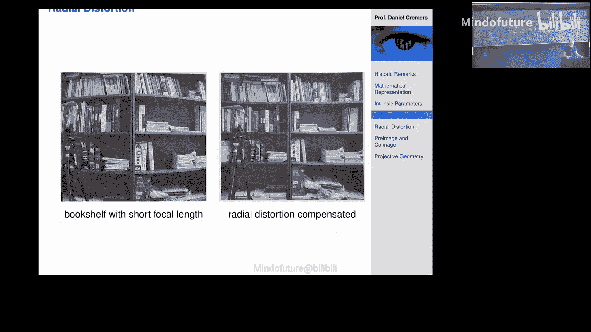

And one thing that can be done and was done， for example， by Andrew Fitzkebon。

 a collaborator of mine。What he did is he said， well， let's assume。

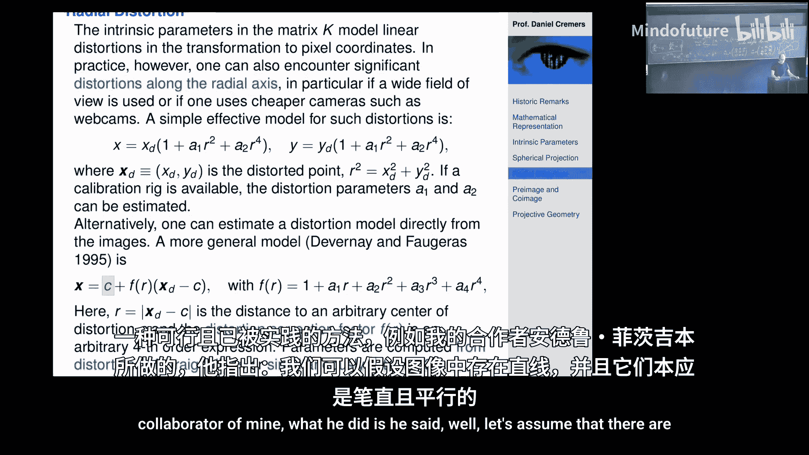

That there are lines in the image， and I know they should be straight and they should be parallel。

 For example， because I know I'm looking at a bookshelf。

 or because I know I have an image of a manm world in manm worlds。

 we have tend to have straight lines。 There is a lot of straight lines。 I see here。

 if they' are not straight but roughly straight， then you can say find an un distortisttortion that makes them straight。

 right。

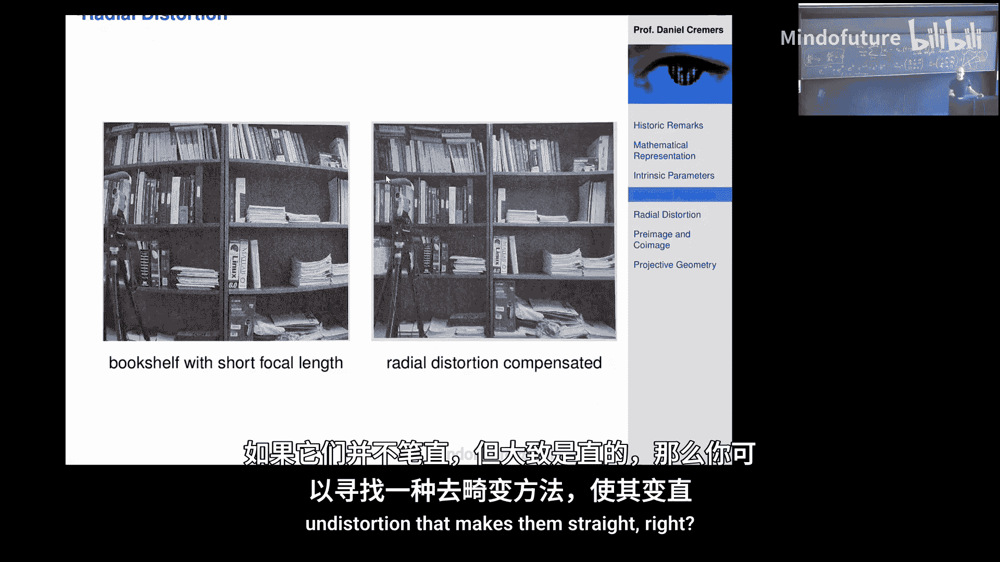

And this is what was done here。 so you can kind of try to simultaneously reconstruct things and make sure that lines get straight。

By this radial un distortistortion。 And then it's kind of a joint effort of reconstructing and un distortistorting the image。

So a bit more， so this is radial distortion。An important aspect for real cameras that you have to do to apply 3D computer vision and I said it before。

 this is， you know you'd say all solve problems and we're talking about the 90s， yes and no。

 it is to some extent solved， but one of the biggest challenges that is still ongoing and we just have a paper coming out at this year's CVPR conference where we look at more ways to eliminate distortion。

And where the aim is， can I estimate intrinsic parameters of a camera without having access to the camera just from the imagery。

 if it's a video from YouTube， let's say。And in YouTube videos。

 you tend to have a lot of radial distortion in because often people have egocentric video。

 they have a goPro camera， etc ce， and that can create significant distortions。

And other intrinsics that may not be known。 and then you want to estimate them。And increasingly。

 nowadays， you'd like to have a neural network that does it all， right。

But in order to achieve that you have to first understand what is it exactly that my network should do。

 and for that you have to understand what is radial distortion and how does it affect the image。😔。

So we saw this perspective projection that maps from 3D coordinates to 2D coordinates in the image。

And what we are going to define now is the notion of pre image。Of points and lines。

 And this is a very useful concept when you talk about camera based reconstruction。

And it comes from the fact that we lose something in the projection， right。

 what we lose in the projection， no matter what the screen here is。

 what we lose is what is exactly the distance of this point。

 let's call it the Z core and it basically this distance we don't have it。

 we lose it in the projection。😔，And so we see a point on the screen let's say this point on the screen right。

 and then we want to know what is the true 3D location of that point and from just one image we don't know we cannot determine it。

 but what we can say is that this point that we see on the screen。

 it must be somewhere along this way。 So if I know how my cameras facing。

 once I see a point I know the real 3D point must be somewhere on this on this line。

And so this line is called the pre image of the point。So if I have a point on the screen。

 then the corresponding pre image is the line， which line the line that connects the point to this the origin of your camera。

 so that line that goes through the origin of the camera and the observed point this is called the pre image。

And we can distinguish pre image of lines and of points。And here this is the pre image of a point。

But we can also talk about the pre image of a line。 And so this is what we're going to do here。

 Let's say we observe。 I don't know if I have here。 I have an a nice image。

 Here's a line in the image plane。 right， this line here。 And I want to know。

 what is the pre image of that line。And that is defined as all the points that potentially give rise to the observation of this line。

And this is a plane。 You see it here marked with P。

 this plane here that is spanned by the line and the origin that plane is called the pre image of the line。

How do we represent a line mathematically， Well， the line in 3D， so in homogeneous coordinates。

 40 vector has an origin， let's call it x0。And then an offset vector and the offset vector in homogeneous coordinates has the last component 0。

So that all the points I get here have the last component 1， so x0 plus mu times the offset v。😔。

And mu is some real value。And that's a way to parameterize all points on this line。

And this is a line in 3D。And then once I see that line in the image， so there is a line。

 let's say somewhere in 3D here， and then that line is projected onto my screen like shown in this figure so here's the line L we call it right and we look at this line being projected into this image。

The line we can parameterize in this fashion， so all points on the line L have this form。

And then the projection of the image is given by this prospective projection。

 standard perspective projection into the image。See if we assume we have you know。

 this is all in in the camera coordinates already。And so we have pi 0 times x0 plus mu times v。

 and then we have this equation here。😔，And so basically。

 what we do here and thistilde means it's the same up to scaling。And so in other words。

 the points x are treated as vectors from the origin of my camera and they span a 2D subspace P。

And this is the pre image of the line and the intersection of this plane P with the image plane gives me the image of the line。

Sounds very profound， but it's actually pretty obvious。

 And this piece is called the pre image of the line。

 So the definition is the pre image of a point or of a line in the image plane is the largest set of 3D points that gives rise to an image equal to the given。

Point our line。So if I have a line here， then the pre image I get it by taking the plane that is spanned by the origin and this line。

 this plane P， and once that's called the pre image。

 and once I intersect the pre image with the image plane， I get back the observation of the line。

So this is this， the image of the line is nothing but its pre image intersected with the image plane。

These are not very profound ideas， but they are useful with respect to the reconstruction challenge。

 we'll see that in a little bit because what we try to compute we can define pre imagess for one image。

 but we can also define pre imagess for multiple images so if I see the same line from a different vantage point。

 then that gives me another preim and then all I need to do is intersect the two pre imagess。

To get the reconstruction。That's why the pre image is a useful concept because the reconstruction is usually obtained by intersecting pre images。

But before we do so， we want to define what the pre image is。

 and we can define the complement of the pre image that's called the Co image。

So the core image of a point or a line is the subspace that is unique that is the unique orthogonal complement to the pre image。

 That sounds very abstract。Let's look at it in this drawing here。 So we said we have a line here。

 or a line in 3D， its observation is here。 Once we have a line。

 it gives rise to a pre image that is spanned by origin and a line。This plain P is the pre image。

And then the planes are given by a normal vector on the plane。 right。

 That is this vector that in this drawing is called L。 This is the normal vector on the plane。

 It's the orthogonal complement to the plane P。And that is called the co image of the line。

So how do I get the co image if I have a line， then it spans with the origin in a plane and the normal vector on the plane。

 that is the co image。😔，So the core image is the orthogonal complement of the pre image。

 this bottom symbol here denotes the orthogonal complement。😔。

And since the co image is the orthogonal complement of the pre image， vice versa。

 the pre image is the orthogonal complement of the co image。They are complementary in that sense。

In addition， I can say that the pre image is the span of the image。 So this is the image， right。

And it's characterized by vectors that make up this line， all these vectors that you see here。

 And if I take the span of these vectors。They're all linearly dependent。

 Theres only two vectors that I need， and they span this plane。 And that's the pre image。

 So the span of the image is nothing but the pre image。And what's important to observe is that image。

 pre image and core image are equivalent because they uniquely determine one another。

So once I have the pre image， I can compute the image by intersecting it with the image plane。

 and I can compute the co image from the pre image by just taking the orthogonal complement。😔。

And once I have the image， I can get back the pre image by taking the span of the image。

 So they're all equivalent to one another in the sense that I can determine one from the others。

And in the case of the line that we see in an image， the co image has the preimage is a plane。

 the co image is the normal vector L on the plane， and since it is the normal vector on the plane。

 it has the property that is orthogonal to all the points of the line L。

 so little x are basically the vectors here， that point points on this line in the image and this vector L is orthogonal to all of them。

And so L transpose x is 0 for all points along this line。This holds both for the line in 3D。

 but also for the line in the image。The space of all vectors orthogonal to L is spanned by the row vectors of L hat。

 So this is one way to get orthogonal complements I mentioned here。

 the pre image is the orthogonal complement of the co image。 Now。

 how do you compute the co image if you have a vector L that defines the normal。

 How do you get the two vectors that make up the display plane here。It's very easy。

 You compute this L hat。So we saw the ske symmetric matrix L hat is a matrix whose columns are orthogonal。

诶。Sorry， I think the rows are orthogonal or it doesn't really matter。

 but the rows are orthogonal to the vector L。 So L hat times L is 0。 we saw that before。

And so these span the victors， they span。This pre image P。

That's how you get it just by taking this span。Of Lha。嗯。

And so L hat has the two vectors that are orthogonal to L and that make up this plane P。😔。

In the case that x is the image of a point， the pre image is a line and the core image is the is the plane orthogonal to x。

 So it is spanned by the rows of the matrix X hat。 So this is along the same lines。

 you see every time I need to get the the。This complement， the orthogonal complement。

I take the hat operator that gives me that if I have a vector and I want two vectors that are orthogonal to it and then just take the hot operator and that's what you get。

😔，So in summary this is a lot of notation， a lot of terminology。

 and it may be a bit confusing if you see it for the first time。

 but it's not so difficult and it's mainly terminology。

Introducing this notion of pre image and co image。And we can do that not just for points and lines。

 in principle we can do it for any structure right， even if we see。

 let's say I'm not sure how good I can draw if this is your screen and you see a curve in the screen that also defines a surface。

 a curved surface in 3D space that is the pre image to that curve， right？😔。

Just by connecting all the points in the image plane that I see along this curve to the origin。

 I get this this。3D surface， a surface in 3D that defines the pre image of that curve。

We're not going to do it here for the sake of simplicity we'll stick to points and lines that are projected onto the screen。

And then I can define， I can talk about the image of these points， a 3D point observed in the image。

 a 3D line observed in the image， and I can talk about pre image and co image。

One has to be a little bit careful。This notion of preimage and the coimage being the orthogonal complement。

 this doesn't easily extend to curved surfaces so if we have a curve in the image。

 then the pre-image can be defined but it's not a plane anymore and so there is not a normal vector on the plane as the coimage things get more complicated but at least the pre-im we can still define it for all sorts of structures。

But if its points and lines and things are nice and easy。

 then we can get the pre image by taking the span of x。

 or in the case of a line that is defined by a normal vector L。

 then the pre image is given by L hat and the span of L hat makes the pre image。And vice versa。

 if we have a point。Then the pre image is a line， the co image is a surface spanned by two vectors that are the elements of X hat。

And that is the surface making the co image。 So that is。The sphe that is orthogonal to the。

To that point。And similarly here， we can define the co images the span of L。

 so L is the normal vector， and span L is the1D line here that this normal vector creates。😔。

So to summarize what we've seen so far， we talked about perspective projection in this chapter that allows us to go from 3D。

 either 3D coordinates or 4D， if it's homogeneous coordinates。

 camera coordinates to do 2D camera coordinates and to pixel coordinates。

And if we take homogeneous coordinates， which means we always take the last component being one。

 that makes the rigid body motion easier because it's just a multiplication with an element from EC3 a 4 by 4 matrix G。

That takes us from the world coordinates to the 4D camera coordinates。

 and then if we do a standard perspective projection and a focal length rescaling。

 we get to image coordinates。And once we do a rescalating into pixels。

 that gives us the pixel coordinates。 And so keep in mind， these different terms， world coordinates。

Camera coordinates thats still 3D， but relative to my camera。And then image coordinates。

 that's in the image plane。And then pixel coordinates。

 that's if you rescale things in the pixel grid。And in practice。

 what we get is this concatenation of all of these transformations that we can write in this fashion。

Where we have an intrinsic matrix that is a rescal by focal length and a rescal into pixels and shifting of the offset。

 possibly。And then have this we have this rigid body motion， as I mentioned。

 always read these projections from right to left。Meaning you start with x0， the world coordinates。

 then multiply into the camera coordinates， then standard perspective projection which kills the last component。

 and then this rescaling that brings in the intrinsic parameters of your camera in particular focal length and。

The pixelixel coordinate transformation。And we talked about this notion of pre image as being the maximal point set。

 which is consistent with a given image。And the co image is the complement of the pre image。

And you can use， as we saw， both the pre image or the co image can be used equivalently because you can compute one from the other。

Now， I mentioned。That this all relates to projective geometry。

 and we've seen these ominous homogeneous coordinates all the time where we take a 3D vector and we artificially make it into a 4D vector。

And。We did that why so that we could model the rigid body motion。

 this Rx plus T that we could model it as a single matrix multiplication。

 That was the practical reason why we introduce because we don't want to write Rx plus T and you see the issue is if this is my new coordinates。

 and then I do another rigid body transformation then I have r2 x plus T2 And if I do a third one then I have r3 times all of this mess plus T3 And at some point you don't see anything anyway you get the point why you don't want to do that right you get the point why you want to be able to multiply everything just with one little G because then you have G1 G2 G3 everything is nice and easy you just multiply and it's one single matrix multiplication done you don't get this endless mess of terms right So if you can avoid。

Please use homogeneous coordinates， that's the practical reason why an engineer would use homogeneous coordinates to simplify notation to get everything more easy and transparent。

😊，But there is more to it。 And this is， it kind of opens the door to this whole field of projective geometry and。

Basically， when studying the perspective projection， when studying these rigid bodydy emotions。

 and when studying homogeneous coordinateets， this is when people came up with the whole mathematical field of projective geometry。

And the ideas as follows typically you'd say， okay， in homogeneous coordinates。

 I have the last component1 right， that's not really nice。

 you would want to have something that is more flexible where you don't have to constrain the last component to be one。

 So what you can do is you can represent a 3D point with coordinates X， Y， Z。

By a line through the origin in R 4。And this is what we have here。

 So it's basically taking this homogeneous coordinate vector and multiplying it with a scalar W。

As you see here， right？Then we have XW， Y，W， Z W， and the last component is W。

And now we say this is a line。In 4 d。Prameterterized in W。

But what matters is only the direction in which this line is。

And so that's the whole point of basically associating a 3D point with a line in 4D。

Where all that matters about this line is the direction of the line。Meaning。

 I can normalize it any way I want。 I can divide by W。

 and then I get back this homogeneous coordinate vector。

And so we identify the point in homogeneous coordinates with the line connecting it with the origin。

 and that's this line here。And this leads to the definition of projective coordinates。

 and so the definition is an n dimensional project space PN is the set of all one dimensional subspaces lines through the origin。

Of the vector space are in plus one。 So that's exactly what we do here。

 in order to model the 3D space， we go to a 4D space and consider lines in 4D that go through the origin。

And if all we care about is the direction of these lines。

 then it's equivalent to having the 3D coordinate vector X， Y Z。

Because that automatically gives rise to this line here。

So we can identify lines to the origin in our n plus1 with points in the projective space P the n dimensional project。

And a point PN can then be assigned the homogeneous coordinate vector x1 through xn plus 1。

 among which at least one of the components X is non0。For any nonze lambda。

 the coordinates lambda x1 through lambda xn plus 1 represent the same point because it's along the same line。

 it's just a different point on the same line。This sounds all very abstract。

 so maybe I should make it a little bit more concrete。 Unfortunately。

 I am not very good at drawing four dimensional spaces。

So I'm just going to do it in one dimension list because then things are easier。

If we have like a 2D plane here and we have and I'm drawing it as a 1D line。

 so things are really easy， then we have points here。

 what we can do to parameterize these points is we consider a 3D space with an origin here and then we can consider all these lines。

Through the origin， this line and that line and they make up these points and you can see how if I consider all conceivable lines through this origin。

 it maps out all possible points so this is my space R and how sorry R in this drawing is really 1 dR and this is my space R2 and if I consider lines in R2 they intersect with here in exactly one point each and then this point in R I can associate with this line that goes through the point and through the origin and that's essentially what you do here。

There is only one caveat， and that is， if you take a line that is really parallel and goes up here。

 it never intersects。And so this is the points that we have additionally in the projective space。

 we have lines that basically intersect at infinity， if you will， right？

And what we write is that we say if the points x and y differ by a scalar factor。

 then we write them as equivalent， and so this is all the points of the line are equivalent。

 so they form an equivalentence class and that class is the one that corresponds to this point right？

And so that gives actually two alternative representations to projective spaces， for example。

 the projective space P2。I either it is one can represent each point on the 2D sphere。

 so this is a sphere that basically defines all possible lines to the origin where antipoal points are the same right so if I have a sphere here then basically this point and that point are the same point because it's this line going through them right and so all these antipoal points。

 they all this and that one they all are the same element。

And this is one way to parameterize the projective space and another one is that I take the point in R2。

So that would be basically。Here。And then in addition。

 I have to take S1 that is the circle that to account for these two points that are not in this plane。

And so these are the two ways to parameterize the projector space P2 is one is with a sphere where antipoal points are equivalent are the same element。

 or we can parameterize them with a plane that allows us to capture these intersections with lines here。

And then we still have kind of in S， we still have this circle of points where the corresponding line doesn't intersect the plane because it's parallel to the plane。

😔，And in fact， this holds for any projective space in any dimension that you have these complementary representations。

 So that's all I wanted to say， this is， as I said， not a class on projective geometry。

 I just wanted to give you a bit of a feel what projective geometry is about is about studying these projective spaces that come out of。

These homogeneous coordinate vis。 That's it。 And will'll continue tomorrow。 Thank you。

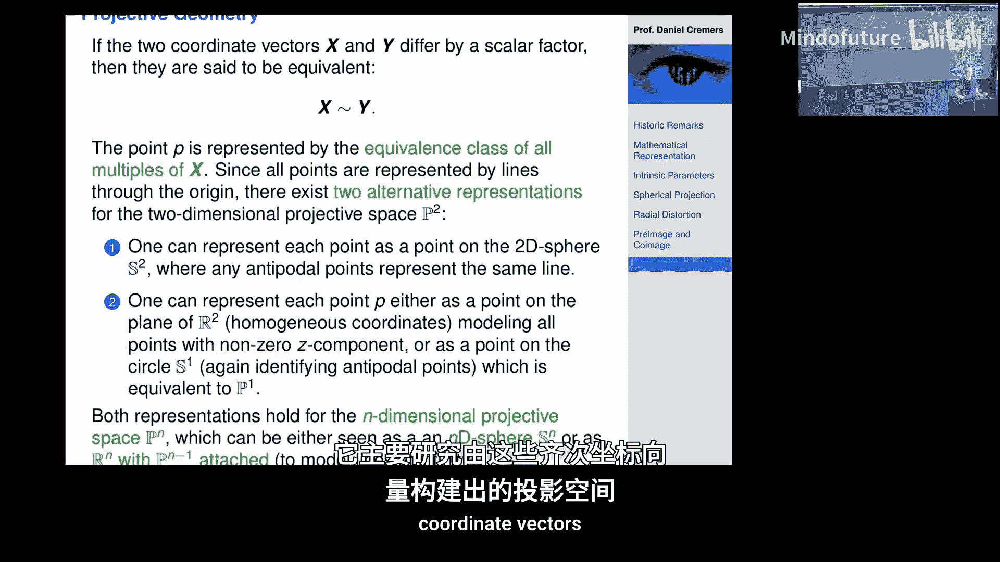