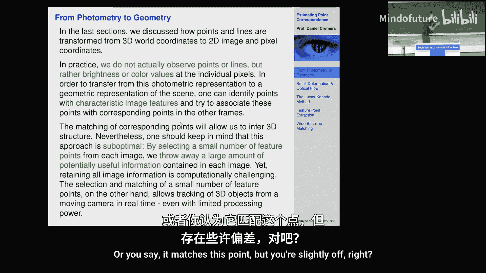
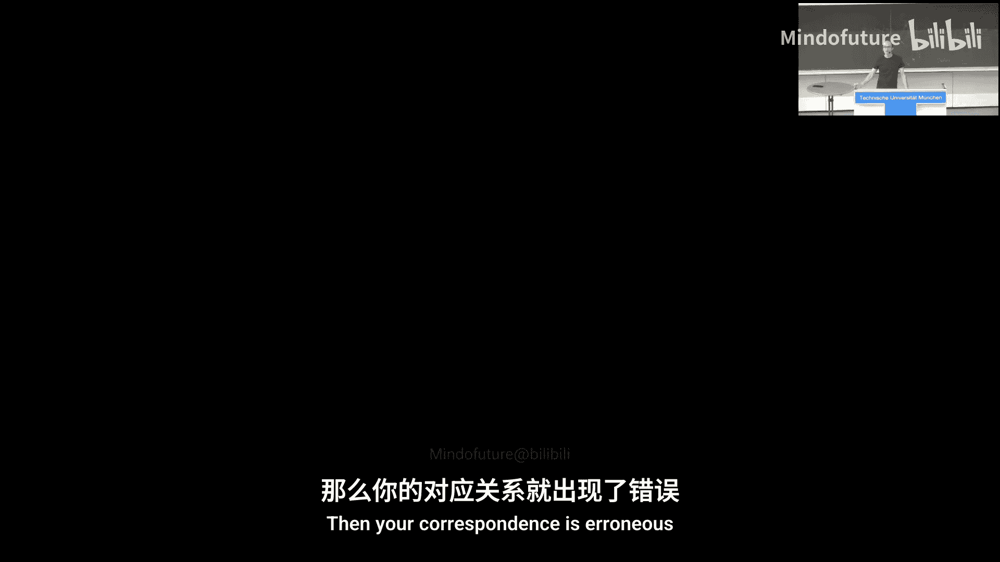
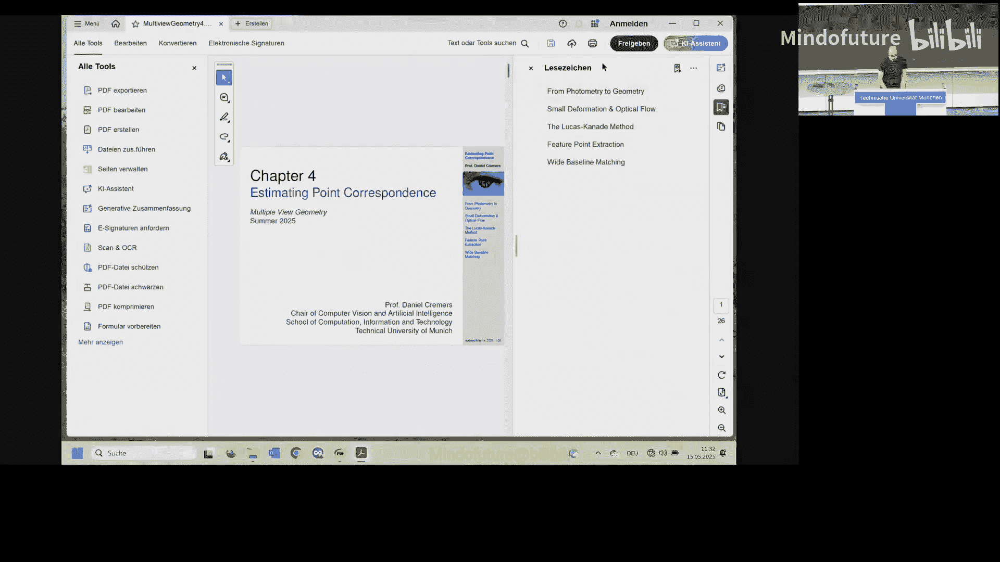
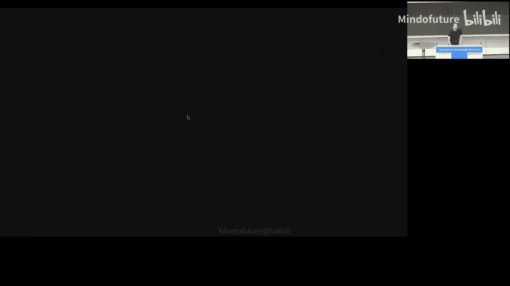
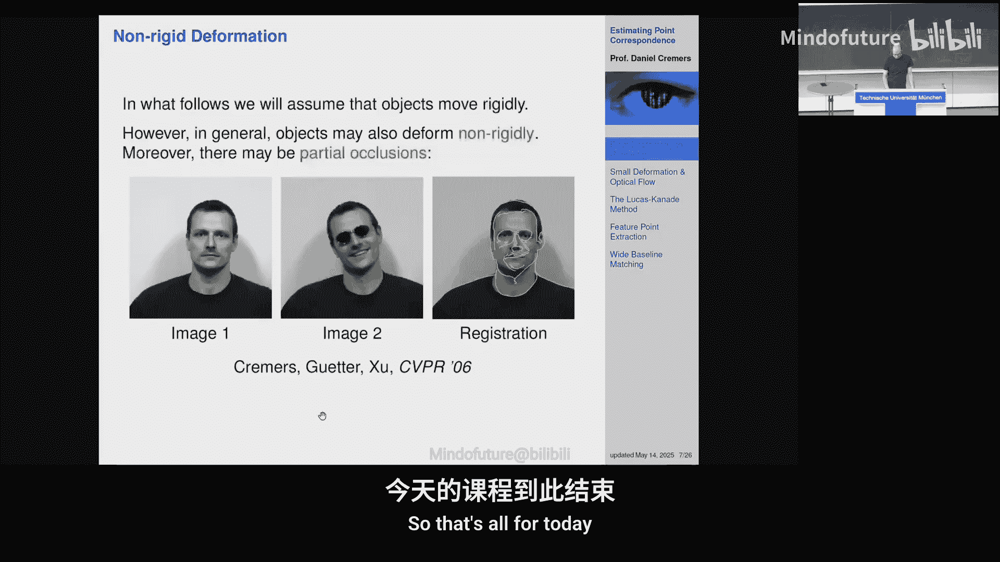

# 【慕尼黑工业大学】多视角几何 ｜ Multi View Geometry 2025 p07 P07_讲座_07_估计点对应关系_第1部分 -BV1KgZEBrEXV_p7-

Very good， so this brings us to chapter four of the class and this is estimating point correspondence where does this fit into the whole problem of 3D reconstruction Well。

 the key idea in 3D reconstruction is that you have a 3D world。

 let's say here somewhere and then you have images that observe that 3D world。

So you see points of that world in one image and then the camera moves。

 we talked about this rotation translation of the camera。

 you have a new camera position and then you observe that same world in the new camera right and so you see these same points。

 this is point1 in image1， this is point2 in image1 and here you have the same points in image2 and the key idea of reconstruction is what you don't have when you see structures you don't know how far they are from your camera。

 but once you move the camera around and this is a challenge that is called structure from motion。

Traditionally， that's the name structure from motion， meaning you move the camera。

And from observing the same structure from different angles。

 you can once you know the location of these points in the two images and the rigid body motion of the camera。

 you can triangulate these rays and determine where the 3D structure is in the world。

So that's in a nutshedy idea。 and you know， as I've drawn it now， it's an extremely simple idea。

But to make it work is not so simple。And one of the biggest challenges。for this problem。

 but in the whole field of computer vision is the problem of correspondence and that is the problem of I have two images and I want to know which point in one image is in correspondence to which point in the other image。

😔，Why is that a difficult challenge， Well， nowadays， you have megaix images。

 so you have cailllions of pixels in each image。And any of these pixels could potentially correspond to any of the other。

 How do you know which one As a human， you'd say， well， I can see it， right？

 I see there is a church tower， and I move， and I still see the same church tower。

 that for humans may be obvious for machines。 It's not so obvious。

 And this is the key challenge that is in this correspondence' estimation。And so therell be， again。

 several parts in this chapter， and the key challenge is what the camera observes is really colors。

 is brightness values。And but what you want is you want to somehow identify points and their correspondence。

 and so you want to move from photoometry to geometry。嗯。

Then we'll talk about this correspondence problem， and we'll focus on。

A classical case where you assume that things move only a little bit。Why would you assume that well。

 it makes the whole challenge a little bit easier if you say from all the pixels in image two。

 the corresponding one must be in the neighborhood， it cannot be just anywhere。And that happens。

 for example， if you move a camera just a little bit。

 then typically everything moves a little bit only。

 and then you have the case of what's called small deformation。

And then there are algorithms to tackle this， and one of the classical ones is the algorithm of Lucas and Cannaada。

That is a method that is one of the oldest methods we'll discuss in class。 It goes back to 1981。

And there are more recent methods that I'll talk about at the end of this chapter。

Where you basically tackle these correspondence problems。

 and this is often how it's done nowadays with a suitably trained neural network。

But I come to that in a little bit。嗯。So。And， in fact。Spoiler alert。

 this idea of using neural networks to estimate flow is something that my team pioneered， we were。

 I think the first group in the world to propose a neural network to do optical flow estimation。

 it's called flowNe for obvious reasons and it is I believe to date my most influential work。😔。

So we talked about in the last sections we talked about how to get from 3D world to 2D image and pixel coordinates。

 but you know typically we don't observe points and know assuming that we see points here and points there is kind of a simplification what we observe in the camera our brightness and color values and in order to transfer from this photometric color representation to a geometric representation of the 3D world we can try to identify points with characteristic image features that means if you have a church tower maybe you can train a neural network to identify you know the church tower and to make sure that in other images of the same church tower it will be identified again and once you have that you know using either a classical feature descriptor or learning-based feature descriptor。

You can try to。It determined correspondence based on similarity of features。

 you would say the features that are computed in this part of the image and in this part they should be similar。

 That's the key assumption。Traditionally， in fact， and we'll talk about that。

 the assumption was that the local brightness was the same。And basically。

 by assuming feature similarity， you go a little bit beyond the simple brightness constancy assumption。

And the way we tackle this reconstruction problem， this is the traditional way of doing it is you identify points。

 you determine correspondence between points across images， and once you have corresponding points。

 you do reconstruction of camera motion and 3D structure。And we'll talk about this pipeline。

 I would call it the classical pipeline。 It is a pipeline that works， but one should be careful。

 It is， in many ways， suboptimal whenever you have a problem and you decompose it into individual steps。

 you typically invariably end up with something that is suboptimal， why。

 because once you determine points and you identify some subset of points in an image。

The question is why these points， Why not the other points？

 There is more information in the image that you're not really using when you take a subset of points。

Secondly， once you identify correspondence， maybe the correspondence is not correct。 Maybe you say。

 oh， this point matches that point and it's actually not the right one。

 or you say it matches this point， but you're slightly off right。

Then your correspondence is erroneous， and then everything you build on top of it will invariably be erroneous。

 meaning the method cannot recover from the mistakes。

 right This is the issue with a multistep approach in general that at any stage of the method。

 you will make a mistake， and these mistakes will deteriorate whatever comes after。

Now， you'd say， then why do people do multi step approaches。Good question。

I think it's an engineering idea to decompose a big problem in smaller chunks and solve every chunk one after the other。

And that works in a way， but this works assuming that you solve every chunk optimally once and this never happens in the real world。

 nothing is ever optimal， you will always make mistakes in every step of your way。

 and then if you don't have a way to propagate all the way back to the original raw sensory data。

 then you will not get optimal solutions。I'll come to that later in class， nevertheless。

 the reconstruction from images is such a big challenge that one can say there is， you know。

 it does make sense to chop it up into steps that we solve。But one should be aware that this is。

 in a way， suboptimal。 And about 10 years ago， we've started promoting。

So called direct methods to camera based reconstruction that go straight from the brightness values of your camera to the reconstruction of the world。

 and we showed that indeed you get better performance。

By doing so and we'll talk about that later in class。😔，The issue is and。To some extent。

 to understand why some of these methods came about， you have to put yourself back in time， right？

One of the nice things of chopping a problem into small pieces is becomes more handleable。

 more manageable and maybe faster to compute solutions。And you know。

 if you put yourself back into the 1980s， you probably don't remember the 1980s。

 but there were computers at the time， and they were super slow。

So there is only so much you can compute and if you want to get 3D reconstruction in real time and everyone wants real time。

 then there is only so much you could do in the 80s and even today if you wanted to run on a smartphone or a wearable device。

 then you cannot have too much compute。And believe me。

 the big tech companies that work on augmented reality stuff， they spend a lot of effort， you know。

 optimizing the hell out of the performance to make sure it runs on edge。

And then sometimes you have to sacrifice， and then you will go for a method that is not as performant。

 but faster。And then these more traditional approaches may still be employed today if for many reasons to get things on edge in real time。

So here's an example how this looks and this is a little bit， you know。

 this is probably we're talking 1990s now， you have two images of in this case， a box of tea。

And you can see the little red dots， these are feature points that are extracted and that are being tracked over time。

And then once you track them from one frame to the other and identify correspondence。

 you can then once you have corresponding pairs， determine camera motion and as you see here。

  3D reconstruction is like a wire frame reconstruction of this T box and then you can put the texture back on top and then you can see what the T box would look like from a different vantage point。

This is a very simple kind of result， I guess nowadays， we have much more impressive。

Results will see that。😔，ち。有飞。😔，Let me see if I open this in a different viewer。

 it might actually be a video。😔，嗯。よべ？

Yeah。This is an animated gift。 So here you see the wire frame reconstruction from different vantage points。

 right。And you can see we do get from just a few image for two or three images。

 consecutive images that we can track and you see the movement is very small。

 this is what I mentioned， this small small displacement assumption that you move just a little bit that way you get fairly good correspondence and then you can estimate a 3D structure。

Now。The whole， and this whole works based on computing correspondence。

So let's look at this correspondence problem， it is a difficult one。

 this is an example of that is notoriously difficult in many ways， first of all。

 one should observe this is what's called a wide baseline correspondence problem because the images were not taken from a similar vantage point。

This is almost a 90 degree。 look on the same object， right。

And that makes it very difficult because then the corresponding partner will not be in the vicinity。

 typically， it can be in principle anywhere in the image， right？

The second thing to note is that you have repetitive structure， right， so this point here， locally。

 if you look at this patch in the circle， it looks almost exactly like this patch in this circle。

 right？But it turns out they're not the corresponding points。 You know。

 you might even as a human think， wa， isn't this the same point as that one， then no， it's not。

It's actually a different point this point connects to this black square。

 this point connects to a white square， so it's actually。

 you know since we are looking at it from a completely different vantage point and we have a repetitive structure。

 it's very easy even for humans you to not see the right correspondence。

And then how do you want a machine to say， what does this point here correspond to in this image。

 Tell me， right， You know， you look at it could be anywhere。 The way humans go about it， and you see。

The humans go about it by context， they look at this point， they see what's in the vicinity。

 the statue is standing there and there is a white square here。

 and so this cannot be that point right you can kind of reason about it。

 but this is something to do that in a machine is super nasty。And we are just starting to， to。

 to get that going。To bring in more large scale context into this reasoning of correspondence。

 and we'll talk about methods that do that。But here it's a difficult problem。

 Why is it difficult yet again？Because typically， you would assume。Correspondence。

 based on some notion of color similarity， the brightness the color should be similar if it's the same point。

Well， look at this part of the mouth， right， since this statue has a metallic appearance。

 It's very shiny。 That means the object is not what's called Lamberian。

So there is this term Lambertion。😔，If you had a lecture in graphics。

 you would probably know what it means， Lambberian means that the colors I see don't change with the viewpoint。

So if you look at a certain color， say on this table is a bad example because it's not Lamberian。

 but on the wall， let's say， and then I move a little bit the same point would keep its brightness。

And in practice， it means Lamorian are objects that are not shiny， they're not metallic。

 they're not translucent， they're not mirrors， right。

 these are examples of highly nonlammerian structures。The worst is really glass or mirror。

 If you look at a mirror and a point on the mirror， if you move。

 you see different points in the reflection and the same。

Point on the mirror will not have the same color。 It will reflect whatever color is in the background。

 right。So that's really a nasty case of non Lamerian structure。And what can I say。

 the non lumbertion assumption， if you have a non lumbertion world with shiny， metallic， translucent。

 whatever structures， computer vision doesn't work yet。And to date。

 this is one of the nasty things and challenges that is still， to a large extent， open。

 how to generalize computer vision algorithms so that they can reconstruct glass and metallic and。

You know， reflecting structures。Because this assumption of Lamberian worlds is very deeply ingrained in a lot of computer vision and if you think about it。

 you have to make some assumption， you have to images you want to know which what is the correspondence。

 well， if you don't make any assumption then could be any correspondent right。And even humans。

 they make this brightness constancy assumption。You can see that if you ever go to adico and you know I don't know if they still do it today。

 but in my youth they introduced these stroobosscope effects where they have very sharp black and white light and then if you move。

 you don't see the movement you see a very kind of jerky you've seen that probably why why can we not see the movement because we can no longer identify correspondence because the color changes are so drastic from one image to the next。

 the same structure will not have the same color and then we can no longer associate correspondence。

 which kind of shows you that humans use brightness consistency？To identify correspondence over time。

It's often， you know， hard to see what do we humans do。 And for us。

 this is one of the biggest mysteries in AI and in computer vision。

 we want to reproduce what the brain can do， but we can't look in the brain。 We can't you know。

 we can't say how the brain does it。 We just know it can do it right。

 but sometimes the brain fails and that's the most illuminating aspects if the brain fails because of a strroosco effect or something。

 then you can start to see what apparently the brain relies on。And in fact。

 it is this brightness constancy。😔，But， you know， there are lots of examples where this doesn't work。

 where the same structure due to reflections will actually look different。

And so what do we do in practice， well why does computer vision work in the real world。

 it doesn't work everywhere， but it works fairly well in the real world because we make assumptions like brightness constancy。

And then we build algorithms that are robust to outliers。

 So if there is a few points where the brightness is not preserved， that's all right。

 If the dominant part of the scene is Lamerian or more or less Lamerian， than things work。

And we'll see how that can be done。 and this took decades to develop methods that make assumptions。

 but at the same time， don't rely too much on these assumptions。

In the sense that if the assumption is violated， things don't go down the drain， that's important。

And so robustness to outliers is one of the core。Components of any working computer vision algorithm。

So here's examples and here's an example of outliers。 you see these two images。

 this is my back then collaborator， Christo Guter。嗯。One image where his head is straight。

 one where he's bent， and you see， it's not the same in one image he has sunglasses in the other one he doesn't。

 in one image he smiles and you see his teeth in the other one you don't， right。

If now I say find a correspondence between the two images， well that's not so easy。

 you know there are areas where the colors are consistent。

 but then there are areas in the mouth and the sunglasses where clearly the brightnesses are not consistent and still you can see we're able to find the correspondence that allows us to basically take this image and warp it onto the other one and what we show here is basically the contour lines extracted from this image。

 these are the white lines and then show where they go once we warp and you see that you know the sunglasses would match roughly where the eyes are so it's a fairly good alignment that we can get。

In fact， there is a video that I can show。😔，I do hope this video plays。

So oftenten with very old videos。And so you see that we're able starting from these two images only we're able to deform the shape and compute this displacement the deformation over time Now you could say yeah Christo doesn't look very happy after the deformation Yeah he gets slightly distorted so it's not perfect。

 it's a non-ri deformation and maybe one should use a little bit more of a rigidity assumption in it like the sunglasses really don't look so nice。

😔，But it's okay。 So this is the kind of displacements you can compute with respective algorithms。

Even if brightness is not perfectly preserved， even if you have non rigid movement and partial occlusions。

This is this aspect of robustness， as I mentioned。😔，Typically， in correspondence estimation。

 you distinguish two cases。 the case of small deformation。

 small displacement and the wide baseline stereo or large displacement stereo。For small deformation。

 there are a lot of algorithms that work fairly well。 And by now。

 we have algorithms that are very fast as well。For wide baseline there is algorithms。

 that's a little bit more tricky， I showed you why because the correspondence problem is just more difficult then and we'll see more examples in a little bit。

The nice thing is these two challenges are somewhat complementary， for example。

 very often in the case of realtime computer vision。

 let's say we want to reconstruct the world from a moving camera either for augmented reality or for self-driving cars。

 we put a camera in the car or in your hand or on a drone and then we want to get things and especially if you work on drones。

 you want things to be really fast because the drones are fast and they need to infer where they are。

 where the world is in real time and real time has different meanings depending on whether you walk or you fly。

Now， this is a case where you want to have algorithms that work really fast。

But the good news is this is a case where you typically have small displacement。😊，Because you get 30。

 sometimes 60 frames per second from a moving camera and in 130s of a second you cannot really move the camera so much and so you typically from one frame to the next do have the case of small deformation。

You're typically not in a wide baseline setting。And then it's actually doable to devise robust working algorithms and we've worked on this for many years that work in real time。

In the complementary cases， the white baseline case。

 this is much harder because any point could have gazillion of potential corresponding partners。

 They won't necessarily be in the vicinity and so you have to invest much more compute to get the reliable correspondence。

But in turn， typically in the wide baseline setting， you don't have real time in many applications。

 you don't care so much about this running at 30 or 60 frames per second。Because it's often the case。

 for example， where you are in a museum， let's say。

 and you walk around some statue and you take some 20 pictures and then you want the statue reconstruct it。

But whether that reconstruction comes 30 frames a second or in a half an hour later doesn't really matter so much for this application。

And so this is nice， so typically in white baseline applications。

 you do have more compute time to solve the problem。And to find this correspondence in particular。

 So for now， we' look at the small displacement setting here， this is the somewhat simpler case。

 and we'll see what assumptions we have to make to get a working algorithm and we'll start in the 1980s。

 Now you might say and I get that sometimes from students。

 Why do you teach things that were done in the 1980s right， we don't care。

 we want to know what's what's the latest state of the art now， Well， I tend to disagree。

 I think for research purposes， it is always helpful to see a little bit where we came from。

 what the history is how things evolve。And every now and then。

 it turns out it's very useful to know what was done in the past and to have a more long term memory of what。

How things evolved。Because then you can kind of bring back certain ideas that had been studied for decades。

😔，But it shows you also， you know， once you study more traditional methods。

 you get to appreciate why we do things the way we do them today and how that was better than what we did in the early days。

So here are some ideas and this now makes the use of the notation that we introduced in the last chapter。

 so we have， let me give you the notation， the points in 3D。We'll call it large x。

 that is this point here。And once we observe it in images， we call it in the image1。

 we call this point here little x1。I say little， but I shouldn't write it too small so that you can see it in the back little x1 and the same point in image 2。

 this point will call little x2。 So these are the two projections of the point large x。

And in addition， more notation， this distance from the first camera， we call it Lada 1 of x。

 so that is the distance of the point x from camera center of the first camera and for obviously this distance here to the second camera。

 this is what we call Lambda 2 of x， that is the distance of x from the second。Point。

And now once we're in homogeneous coordinates， and this is all homogeneous coordinates。

 So x1 has the third component 1。Once we rescale it with Lada 1， where do we get， Sorry。

 if we rescale it with Lada 1。And just with that Lada 1。Then we end up with a point large x。😔。

So we can see large x。Is lambda 1 times x1。😔，And now， where does it end up in image 2。

 the same thing holds for lambda 2 x lambda 2 x 2。This is rescaling x2 to get to this point。

 but then we have this point in the coordinates of the second camera。

 and so we need to do rotation and translation of it and this is what we have here。

So we rotate and translate the point large X， so what we have in the brackets here。

 this whole expression， let me see if I can highlight this expression is the point large x in the coordinates of the camera2。

And once we divide by lambda 2， we get the projection， namely little x2。

And so you see that x 2 relates to x1。This correspondence between x2 and x1。

 x2 relates to x1 by a function that basically says we take x1， we map it to 3D。

 we rotate and translate into this coordinate system。

 and then we divide again by the distance Lada 2 from camera2。And that way。

 we get the point coordinate x2。So you can see why did I show you， there is some function H。

 we call it， namely this function here that relates the point in the first image to the point in the second image。

And the issue is we don't know this function because we don't know the rotation。

 we don't know the translation of the camera， we don't know the dips values Lada 1 and Lada 2。

 so there is some function， but we don't know what it is。And once we try to compute correspondence。

 we can make different assumptions。 For example， we can assume that this function。

At least in a certain neighborhood is nothing but a translation。

Which means that this function H is just x plus an offset B。

But we can also have a more complex model for the displacement in a neighborhood。

 we can say it's some aine function。With we talked about the aine transformations。

 This is A X plus B。嗯。And in 2D， if it's so if we don't take homogeneous coordinates， but if。

this so we can write it in 2D， we can write it as x plus u of x and then U can be written in this fashion。

😔，And with a matrix S that depends on x and y in this fashion and then six parameters that model。

 what are these six parameters they are related to the2 by 2 matrix A and the offset vector B to the offset vector。

 so we have six degrees of freedom here in this Eine model。

The translational model only has two degrees of freedom， a translation in x and in y direction。

 right。This one has6 degrees of freedom， and so you can choose different parameterizations of that displacement that gets you from image one to image2。

And these are approximations of this function。And you can see roughly whether they are good or not。

 for example。If the rotation is just identity， so you just translate your camera and you don't rotate。

And then the distances are the same。 then indeed you have an identity matrix。

 and then all you have is a translation。But in general， this model will be too simplistic。

 especially if your camera rotates。😔，AndThen this approximation will not be so good。

 but you can make different approximations。And now we'll come to how can we use these assumptions to estimate correspondence？

And this brings us to this term optical flow。And that is a term that is used lot in computer vision。

 and it is useful to distinguish it from motion， it is related to motion， right， you have a video。

 you see things move， right？But people distinguish between optical flow and motion。

 It's not the same thing。 It's related， but it's not the same。 So optical flow。

Is generally not the same thing as motion。Why， for example。

 so what optical flow refers to is the apparent motion， the perceived motion in the image plane。

 that is what the flow is。And now you'd say， what's the difference。 Well。

 let's say you have a camera and I move towards the camera。

 Then there is a motion in the Z direction that you cannot observe。Because from that vantage point。

 you know， things don't change much。And then actually the motion that you get is once you have an object that moves towards the camera。

 then the real motion is a motion in 3D of the object moving towards the camera in the z direction。

 but the observed motion in the image plane is a divergent motion field where things kind of grow right。

 you can imagine things come closer， it kind of expands on the screen。And obviously。

 the object that's moving towards the screen is not expanding right， it keeps it size。

 and so you can see that the movement it does， the motion is when you say motion。

 you always have to clarify what do you mean by motion。😊，An optical flow is motion。On the screen。

Basically， the projection of the 3D motion onto the screen that is the optical flow。

And that's pretty much all we can estimate from images and this is something that people understood already in the 70s and 80s。

 and that's why there is a lot of study on optical flow estimation that is estimating essentially the part of the movement that is observable。

The projection of the movement， the 3D movement onto the screen。This has been a longstanding problem。

 And this is an interesting aspect about the history of science that very often in the history。

 there is a particular time when things。Suddenly evolve， right。

 And there's been work before the 1980s in the 70s。

 People studied this optical flow problem for many， many years。

 But then 1981 is a year when things happened。 important breakthroughs came about。

 and there are two breakthroughs that happened pretty much in parallel。😔。

one is by Lucas and Canad and one is by Horn and Shank。

 and both of these papers were two of the most influential papers in computer vision in the 80s。

Often when you， you know， it's a bit puzzling how for years， people study a problem。

 and then seemingly simultaneously， different groups propose a solution。

And these solutions are actually somewhat different。

 they're not equivalent they're different approaches。

 and it's sometimes a little bit puzzling in retrospect， why did that happen at the same time？

Is that a coincidence and I guess you know I don't really believe in coincidence。

 there is often a reason why things happen in a certain year and that is because the community talks。

 they exchange views， they start to realize what the real problem is and what needs to be solved and then they kind of simultaneously sit down and solve it。

And this is why often things happen in parallel around the globe。

 and this is something that we see over and over in the history of science。😔。

The two methods are different。The hornor and Shank method is what's called a variational method。

 and this is actually the very first ever variational method in computer vision。

I used to teach a class on variational methods， I don't do that anymore but it's an interesting research area。

 if you're interested in it， the classes on YouTube， recorded it about。

 I don't know 12 years ago so you can watch that class and it introduces this concept of variational methods in Horn and Shankka is the very first variational method。

 but variational methods are a little bit more technical and so for the simplicity of this class。

 I decided to just focus on the Luckas cannaada method here。What's interesting。

 despite more than 40 years of research on optical flow estimation。

 it's still a highly active research direction。And I can tell you。

This is typical for the science community is that it always goes in fashions and things come and go right when I started my postdoc at UCLI。

 my mentor there asked me what I wanted to work on and I said I want to work on optical flow。

And this was in 2002。 And he said， don't do that。 That's a complete dead end。

 This problem has been done， and we don't care about it any more。

 And it's essentially a solved problem， right。 Why do you want to study and work on a solved problem。

😔，Well， you know， sometimes it's good to listen to your mentors。

 sometimes it's good to follow their advice， and sometimes it's good not to follow their advice。

I did not。 I listened， but I did not follow his advice。 Why。

 because I was already in the middle of the project and I thought， well， I have these ideas。

 and I want to get them implemented。 They done。 And so I published papers on optical flow starting in 2004。

2003， actually。And you know， by the time of 2009， we published the most powerful optical flow algorithms the world had ever seen。

 and for years， this was the state of the art。And was it solved in 2009 no， nothing is ever solved。

 so I'm very careful when I talk to young researchers telling them that something is a solved problem in my experience。

 nothing is ever solved， right you can always do better and that's what drives all the researchers in our community。

 this idea that whatever has been done can be done better。

And this holds for a lot of computer vision problems。

 this holds for optical flow estimation for camera based reconstructions。

So it's good to see what is there， but it's also good to believe that this may not be the end of the story。

And then sometimes it could be just the beginning。And this holds for the whole wave of AI right。

 you know if you look at AI， there's been many times where people said oh， this is the end of AI。

 the winter of AI， I don't know how many winters they've had， don't listen。

 you know you have to come up with your own ideas of what you want to do and how you want to shape the future and the best is always to assume that whatever is there can be done better。

I wonder if it makes sense to。I'll tell you very briefly what the Luckas canadada method does because next week I'll not be there and then it's going to be recordings that you can watch about Lucas cannaada about correspondence but the key idea here is twofold one is this brightness comes see assumption the assumption that a point when I see it from another over time has the same brightness so I have a point x of T it moves over time and then the brightness when I evaluate at the location of this point the brightness should be the same for all times that's the first assumption。

And then there is a second assumption that's the one down here that says I assume that not just that point has a certain velocity。

 but the whole neighborhood has the same velocity， that's a somewhat simple assumption it doesn't always hold。

 but especially for a translational motion this is a perfect assumption。

And here we say not everything has to move with the same way。

 but in a certain neighborhood around this point。And from these assumptions you can set up a loss function。

 a cost function， this is this one here， that is a function of the velocity vector for all points in this window around a point x Wx is the window around x。

 and then there is a way under certain assumptions that you can determine this velocity vector。

And that's what the Lucas Cannaada methodod does， and Takio Cannaada is one of the early pioneers of computer vision。

 he really famous roboticist from。From Carnegie Mellon University and this is possibly one of his most influential works is this work on the Lucas canad method to estimate motion and I'll show you some examples sorry you know this is。

😔，But basically， that's roughly what's running in this example here is a Lucas Karid tracker。

This was extended by Carlo Tommasi into what's called the KLT tracker and that's more or less what's running。

 and this is to date one of the most popular computer vision algorithms because it allows you to track points and their movement over time in a video and once you have correspondence。

 this problem of correspondence estimation， there's so much you can do with correspondence。

And this is why the lookas cannaada has been influential。

 And this is why optical flow is studied to date， because once you have better correspondence。

 everything else gets better。 and there's a lot you can do with it。So that's， that's all for today。

