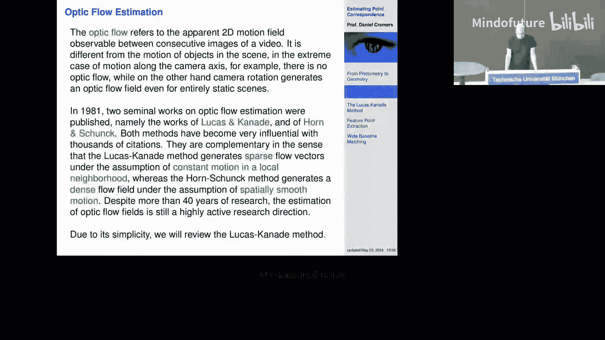
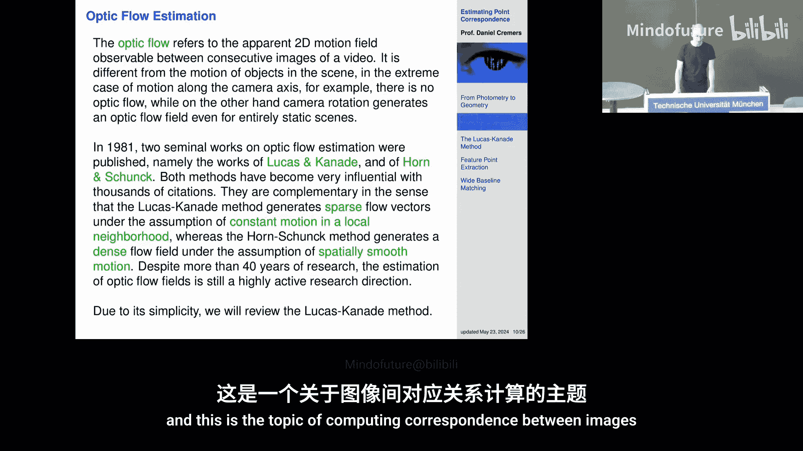
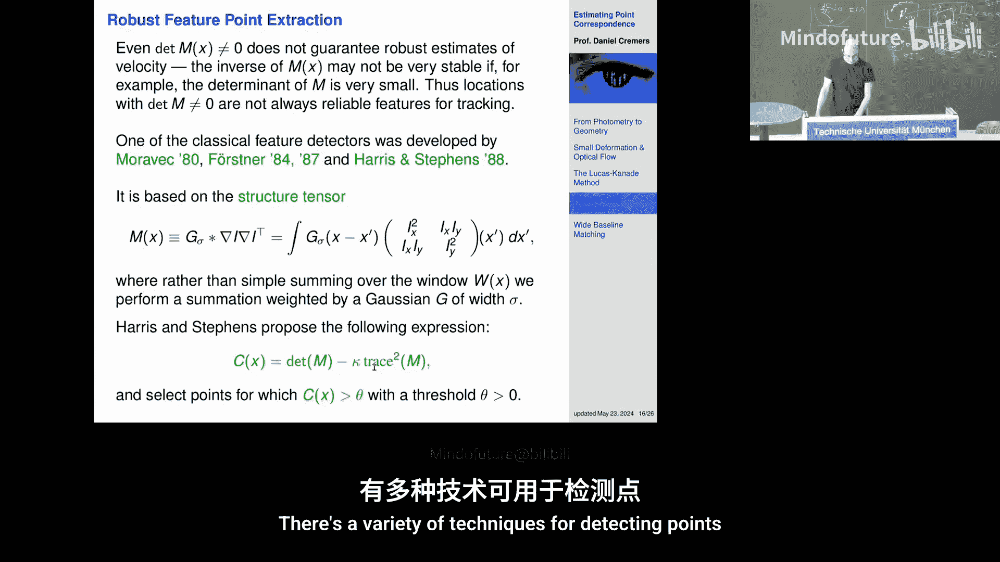
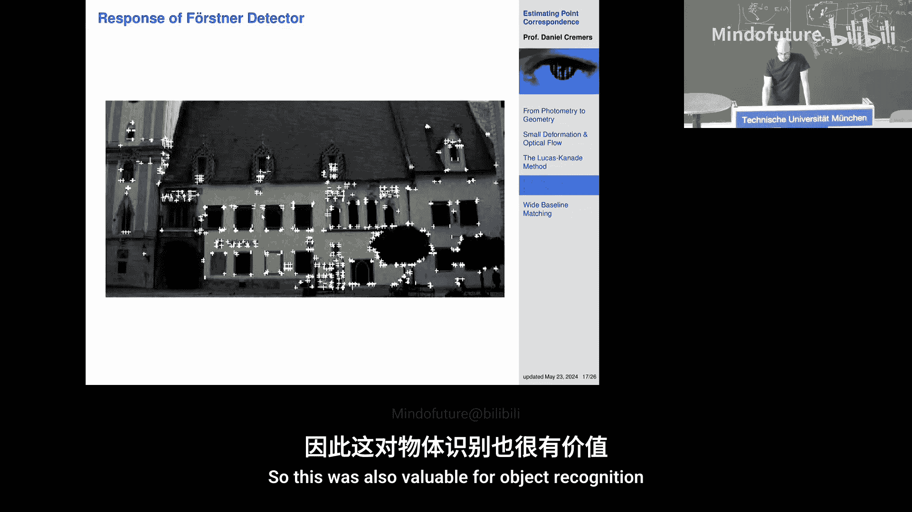
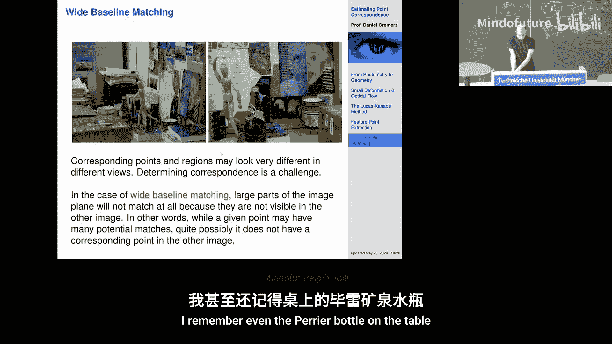
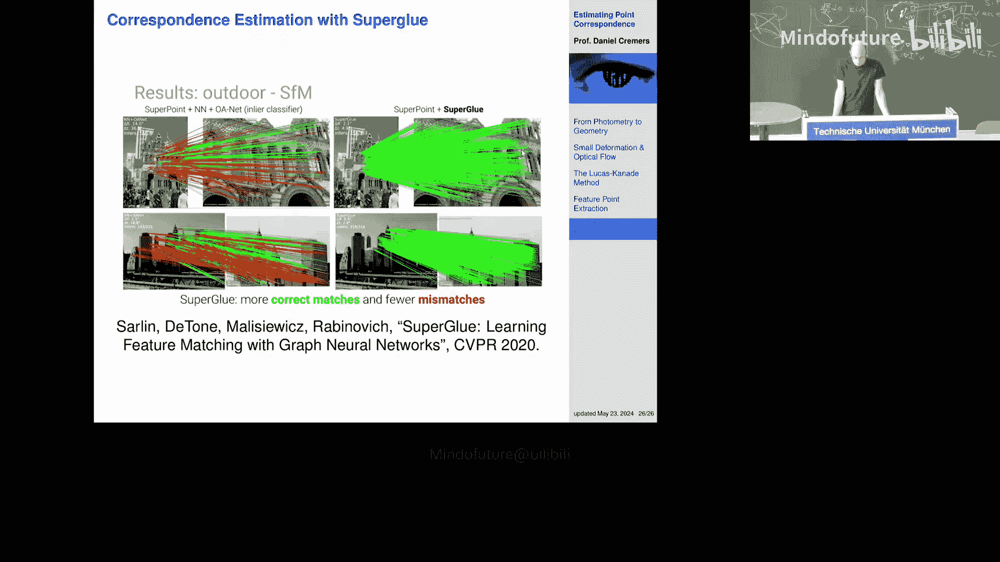

# 【慕尼黑工业大学】多视角几何 ｜ Multi View Geometry 2025 p08 P08_讲座_08_估计点对应关系_第2部分 -BV1KgZEBrEXV_p8-

We left off on the chapter of optical flow estimation。

 and this is the topic of computing correspondence between images。

What's important here to mention is the aim is that you're given two images and you want to identify which point in one image corresponds to which point in the second image。

 so if you have a pixel here， where is that pixel in the other image that's kind of the question that we want to ask and obviously not for one pixel but for many pixels。

And for many points in the image， we want to know where's the corresponding partner in the other image。

 So maybe for this point as well， right。And you can distinguish two types of methods。

 those that do this for a sparse set of points。This point， this point， this point。

 and then those that go ahead and say， let's get the correspondence for every pixel in the image。

And typically getting correspondence for every pixel is a little bit more challenging。

But it depends a little bit in terms of compute effort。

 it also depends on how you do it and what became very popular for many years is to use graphics。

 GPUs to do the computations， in which case you can compute things in parallel for all pixels and then you can do this for whole images very fast。

So for example。And you see a big transition， you see there's 1981 is when things started。

 my PhD advisor， he got his PhD， I think， in the 80s somewhere。

And he worked in the early optical flow community and they had very small images like 128 by 128 pixel images。

 and to estimate the optical flow， it took all night to compute for one pair of images， right。

 the correspondence。And， and it only worked for very selected scenes。 You know。

 there is a famous taxi driver scene。And he was involved in the recording my PhD advisor and that scene was used a lot。

 it was two images of a taxi driving around the block and you could estimate the motion of the taxi。

 right？And that was stellar， right， but it was staged。

 they actually paid the taxi driver to drive super slowly so that you have this one pixel movement basically。

And methods didn't really work very well in the real world and they were very slow。

 you know computing overnight， computing several days， and when I worked on optical flow。

 it was still computationally intense， but we started。

 we were among the first teams who started deploying things on graphics hardware。Around 2006， 2007。

 we started using GPUs in 2005， actually。诶嗯。And then in 2007 we started putting optical flow methods on GPUs and we could run very high resolution imagery。

 we could process it in real time， and so something that would have you know taken several days in the 80s in 2007 we could do it at 60 frames a second。

 and so there is a dramatic boost in performance， part of it is putting things on GPU。

 part of it is better numerics， better algorithms。And that we developed。

But here I want to go back to the origin， sometimes you wonder why is that you know there's a lot of colleagues of mine who mainly teach the latest right。

 you teach whatever is the optical flow method that was published this year right and then people don't see the origins don't understand where things came from and I sometimes find going back to the roots going back to where everything started is often very illuminating because it tells you where the initial reasonings behind things。

Often， if you see the latest work， you don't understand how that came about。

knowThings don't ever fall from the sky in sciences， they always build up on ideas of precursors。

And the first precursors here are the influential ones are the ones of Lucas Kad and Hornnachunk。

And they are different Lucas Canada estimates motion for a sparse set of points。

 only horn and chunk for the whole image。And Hornachnkka I mentioned last time is what's called a variational method。

I'll mention that term。I used to give a class on variational methods。and。

And hornorn and Shank is actually the first variational method in computer vision。

 so it's a very important work as such， doesn't mean that the opt of flow it generated was very good。

 right， the taxi drivers。Example of a somewhat staged setting where it actually worked。

But nevertheless， it was a very important innovation。

One should say despite more than 40 years of research on optical flow。

 this is still a very active research area there is constantly every year there are new algorithms papers being published on this topic。

And you can wonder why is that， why are there topics that are being studied for decades and decades and decades。

 right？There are two reasons here， first of all it is a very important problem if a problem is important you want good solutions。

 you're not happy with， you know， if it's unimportant， you can take the off the shelf 1980s method。

 it doesn't work super well but who cares， but if it's an important method you want good performance。

 you want accuracy， you want speed， you want scalability to high resolution imagery， etc。

Andto challenging movement in videos。So it's important。

 but the other thing is if you phrase it as an optimization problem。

 which is how things used to be done where you have a loss function。

 we'll see it on the next slide that you minimize， then these loss functions。

 if you discretely put them in a discrete setting are NP hard problems。

And that's an notorious observation if you research on an NP heart problem。

 you can spend a decade and a lifetime。Researching that one problem because there will not be a polynomial time solution and as long as you don't have a polynomial time optimal solution。

 you can come up with better and better approximate algorithms。

And so you see that in the optimization literature and you see it on these problems as well。

So the Lucas canadada method and I chose this one because it's fairly simple and it gives you an idea of how you can derive a method to solve this motion estimation problem from very basic assumptions and there are in fact two assumptions the first one is the assumption of brightness constancy so that's saying this point let's say it moves around in space like so。

😊，And the coordinate of this point well call it x sub T。So this is an object， let's say。

 let's say you fix the camera and an object moves through the video。

And the motion in the image plane， you call it x of Tt is time， x is the coordinate。

 and then we assume。That the object preserves its brightness so it moves but it doesn't change its color。

 so let's say you have some animal and you assume it's not like a chameleon or something that one image to the next changes its color even chameleons don't change that much in terms of color。

I found。And so the assumption is that the color is preserved and as I mentioned last time you have to make some form of assumption if everything can randomly change color from one moment to the next。

 then how do you want to determine correspondence？Unless you know how things change in color， right？

But here the assumption is the color is constant and you can phrase that like we did up there。

 you can say the intensity function， if I read it out at pixel location x of T。And time T。

 then it is constant。No。Note that theres twofold dependency on time。

 the second T is that I take the later image at a later time。

This first dependency is that I read out the intensity of that image at a different location。

 namely at the location x where it is at time T。And so you have this twofold time dependency。

 and now the assumption is that function should be constant for all times。

So if I read out the intensity at wherever that object is at that given time。

 then it should be the same intensity。And that's nice because if a quantity is constant。

 then you can say that the derivative must be zero。

 something you remember from analysis for constant functions， the derivative is zero。

It's essentially the same thing， right same。😔，Stment。

And the time derivative is the so-called total time derivative。

 it actually takes into account this twofold time dependency and so you have to apply your derivative rules。

 you have to say this is the derivative， first of all let's treat the first time dependency。

 and here I have to apply the chain rule， the derivative of I with respect to the first argument。

 this is the gradient of I， NabA is the spatial derivative of the intensity function。

And then by chain rule， D X by D T。And then there is this second time dependency。

 and this is the derivative of the intensity function with respect to the temporal argument。T。

 so this is that partial derivative of I with respect to T。

And if you remember this from analysis there is total derivatives and there are partial derivatives and in my experience students throw them all around and mix things。

 total and partial derivatives， but here is an important example where you have to distinguish the total time derivative where you look at how does the whole expression vary with time。

And from this partial derivative of the intensity function with respect to its second argument。

 time argument。And this whole expression must be zero。And that's nice because in some sense。

 and now observe here we have dx by D T， what is that that is the velocity。

 that is the velocity of the moving point， right d X how does it？Exordinate change in time。

And so this is a constraint that couples what does it couple that derivatives of my intensity function in space and in time with the velocity that I'm interested in。

So you'd say， hey， great， I have an equation that contains the velocity。

 why don't I just solve this for the velocity vector？😊，Well。

 that's not so easy because what you see here is the velocity vector， this V here。It's。

It appears in a scalear product with this gradient or the intensity derivative， right。

And so I cannot just pull it out， it's kind of baked into this equation in this vector。

 the product of two vectors， the gradient vector and the velocity vector。

And so what I can really only extract is the velocity component of the velocity vector indirect of the gradient right so I have my intensity function right let's say here。

And that gives me a gradient vectorctor。那不来。And then if something moves in this way， velocity V。

 the only thing I can observe in this constraint is the projection of this velocity vector on the intensity gradient right。

 this na I here， and so this component this here， this component is the velocity vector projected on the gradient。

 so nabla I。Tranpose V。 That's what I have here。And that component I can read out。

 this component of the vector I cannot read out。And it's very much if you think about it。

 if you take you know a black square on white ground and you move it like so。

 if you look at this area， you can only see the motion in this direction。

 you don't see the motion in the autogonal direction。And so because you can see it in this equation。

 you only see the projection of the velocity on the gradient vector。

So what Lucas and Cannaada did on top of this assumption that was a popular assumption at the time and still is。

They assumed that in a certain neighborhood。Let's say here。Around my point of interest。

 the velocity is constant。 So I assume that everything in this circle moves in the same with the same speed。

 in the same direction。So this vector v is a constant。And then let's say I call this window。

 let's say this point that I'm interested in is X here。And then I have a window around xw of x。

 and for all points in this window， let's call them x prime。😊，We have this equality here。

 so this constraint that you have up here is true， not just for the point x itself。

 but for all point x prime with the same velocity of vector v。

That's the two assumptions that they make brightness constancy and motion constancy in a neighborhood。

And then what they do is they set up a cost function。To say。

 how can I determine the velocity vector V？I want this constraint that you have here。

 I want this to be zero for all pixels in my window， WX around X， right？But in practice。

 it will never be exactly zero， so they say， I want this integral to be as small as possible。

And this is a way to phrase the optical flow estimation。

 the motion estimation as a problem of minimization， find a vector V。

 a velocity vector for this window， such that this sum of squares， if you will。

 is as small as possible。And that implies that for every pixel X prime。

 this expression should ideally be as small as possible。

And the lowest loss that you can get with this loss function is zero， right。

 if the constraints are all exactly zero， then this expression will be zero。And if not。

 this will try to drive the velocity estimation such that it best minimizes this expression。

Now you can say why do they do the sum of squares or integral of squares。

 there are many reasons for it， I don't want to go too much into detail but one nice feature of this approach and that's why it's the most popular optimization strategy for these kinds of problems。

The nice feature is if you take a quadratic loss function。

 this expression is quadratic in your unknown V here， right？This is linear in V。

 and once you square it， it's something that is quadratic in V。

 If you have a loss function that is quadratic。Then then minimization is easy。

 it amounts to a linear equation right because how do I minimize these energies I set the derivative to zero so at the minimum there's something you remember from high school right if I have a loss function like so。

😊，And I say I want the optimal V V optimal such that this expression is zero among all conceivable V's。

 how do I determine this point， it is the point where the derivative of this e of V let's call it the derivative must be zero。

 so at this point you have at this point you have。DE by DV。Must be zero， right， iss high school math。

And so that's what they do。 They set D E by D V C go to 0。 And since this is quadratic in V。

 the derivative is going to be something that's linear in V。

It's going to be something proportional to v plus some constant equals0。

And I wrote out what these coefficients are， this is a two by two matrix of gradient times gradient transpose summed up for overall pixels in this window。

 and this is this vector 2D vector Q。And then v is just minus m inverse times  Q。

That sounds nice and easy， obviously there's one caveat， as you all know。

 once you compute a matrix M and you invert it， not every matrix is invertible。

 we talked about it in the linear algebra section。So I need to make sure it's invertible。

 one way to make sure it' to make sure that the determinant is not zero。

A matrix is invertible if they determine it is not zero。

 so what you do in practice is for the Lucas canadada method is you compute all these derivatives of your intensity function in space。

 meaning how does the intensity change from one pixel to the next in xon in y direction that's your gradient vector。

 then you compute this two by two matrix by summing up this two by two matrices overall pixel。

You compute also the time derivative。 How does the intensity change from one image to the next a given pixel。

And then you compute this expression。And then you go through all pixels and look。

 is the determinant of this m non zero？Or sufficiently large in practice。 And if it is。

 then it means you can invert this matrix， and then for that pixel。

 you can define or compute a velocity vector like here。So this is really what they do。

And you can distinguish actually two kinds， and so that is the velocity vector that you can associate whenever the matrix is invertible。

 you can compute the velocity vector B。It's very nice。

The next thing is you can actually generalize that in in the Lucas cannaada paper。

 they were considered the。transranlational motion， so they assumed the whole window moves in the same fashion。

 it turns out you can actually generalize that fairly elegantly。

 you can assume let's say if this is your point x， you can take a window around it and then you can say I don't need to assume that the velocity is constant in this whole window。

But I assume that the velocity is of some parametric form， for example， that。

Everything rotates with a given rotation or something， right？And then you can use what we discussed。

 you can use an aine model and say for all pixels x prime。

 the velocity vector at that location is given by some matrix s times a parameter vector p。

If we go back what was S here is S and P， for example， this is one way to do it。

 so you have some matrix S and you have some vector P like you see on the bottom。

 six parameters that define an aine motion。That could be a rotation this way。

 could be a rotation in the other way， it could be an expansion， whatever it doesn't matter。

 you have six parameters that describe a velocity field in this window and the idea is that the vector at every pixel isn't necessarily constant。

 it's not the same vector， but the six parameters p1 to p6 they are the same for every pixel in the window。

And so this vector p is constant， the matrix S that we have here in green is not constant。

 it can vary with x prime， but the unknown vector P that parameterizes the motion in this window。

 that vector is constant for the whole window。And then I can also。

 and then the nice thing is you have the exact same loss function。

 but now it's a function of the six parameters P。Let make up this Aine motion。

And it doesn't matter how many parameters you have。

 What matters is that this expression is linear in P。And if it's linear in P。

 then the square makes it something quadratic in P。 and that means if I solve for P。

 I get a linear equation system again。I didn't write it out。

 but it's actually fairly straightforward， you get you can basically， you know， if you write this。

 you can you end up getting something of the form P transposed with some big matrix。

 let's call it A P。plus， some， I don't know。And。Victor alpha transpose times p plus a constant。

That is your loss function， EFP。And then this A is actually an integration。Over this window。

And once you set the derivative to0， you get a times p plus alpha equals0。

 and then you get p is a inverse minus a inverse times the vector alpha。

So and the matrix A is a6 by6 matrix if p is a six dimensional vector。

Then rather than inverting a two by two matrix like in the basic Lucas canad。

 you have to invert a6 by6 matrix， but something that's still computationally very fast。

This is something you shouldn't underestimate often people think why didcannaada do this。

 why did they do that in the 80s things were very often driven by can I compute it fast because the computers were just very slow so there's only so much you can compute in real time but inverting a two by two matrix was even real time compatible in the 80s。

And so the Lucas cannaada method became very popular because it was one of the techniques that could be run in real time for not too large images in the 80s already。

AndBut even with the6 by6 matrix， that's still fairly fast to invert。

And that gives you more power because you can model rotational motions and things like that。

The next question is when can we actually estimate this motion right。

 we said the matrix M must be invertible， here's I wrote it down， here's the matrix M again。

 this i sub X is the derivative of the intensity and x direction。

 how does the intensity change in x direction and i sub Y is derivative in y direction？

And this is this two by two matrix， it needs to be invertible， meaning determinant must be non zero。

By the way， if you ever implement these things， obviously checking whether determinant is nonze does not make sense。

Because all these quantities in a machine are double variables。

 double variables are never exactly zero，They have some double precision， right？

So I say determinant must be zero， what you do is this is a positive semi definite matrix。And so。

The eigenvalues are all non negative and so basically also the determinant is non negative and nonzero means it must be sufficiently large so you can define some threshold epsilon and you say is the determinant larger than epsilon？

And if not， then it's essentially zero， right？This is how you do this in practice on the slides I just say check if it's non zero。

😔，In practice， you have some threshold there。What can happen is that the determinant is zero。

 but the matrix itself， this is sometimes called a structure tensor， can be non zero。😔，For example。

 if one of the eigenvalues is0， but the other one is not right in that case， you have a degeneracy。

 and this happens in fact， if you have， for example， a black square on a white crown，Like here。

 you can only estimate motion in the direction orthogonal to the。To the。

to the edge basically right because the object here has constant intensity。

 which means if I move it vertically， then nothing changes in the intensity pattern in my window。

So the derivatives in the y direction are zero， and then I cannot estimate motion in the y direction。

 right？😔，And once that happens， then this term here will be0 and the off diagonals will be0 because IY will be0。

 the matrix is nonze because the derivative in x is nonze。

 but the second eigenvalue is0 right so you see you're and then you can only estimate motion in the x direction。

And so you can look at the structure tensor and that's been done。

 a lot of people studied the structure tensor and its properties。

And that leads to this feature tracker， you know， the method for estimating the motion is by Lucas Cannaada。

 for the feature tracker， this is called the KLT tracker， Cannaada Lucas Tommasi。

One of the first trackers in the history of computer vision。Tmai Carlo Tommasi。

 the third author on this work。😔，And they put it made it into a feature tracker。

 and the way it works is it just sequentially computes optical flow。

So you go through the image for every pixel you compute this two by two derivative matrix with a certain window around it。

 how do you choose the size of the window heurically。

 maybe five by5 maybe seven by7 maybe nine by nine pixels， you typically take squares。

 I draw circles when I say window but in practice you would typically take a square。

 why because it's faster to implement you have a four loop over the x and y components you don't want to sum up over a circle that's just at least in the 80s was too much compute and so you would often。

Just take a box around it。Your pixel of interest， compute this derivative， sum them up。

 integrating means something， right？And then you check is the determinant sufficiently large。

 meaning is it nonze？And if so， for these points where it's sufficiently large。

 how do you choose the threshold again， another heuristics， or there are some heuristics that go in。

 but typically you can find parameters that work for a whole range of images。

But you can imagine people spend a lot of time you know designing these methods thinking and this is not fully trivial either。

 you can imagine that if you increase the intensity range， if you double all intensities。

 then possibly you might need to adjust the threshold accordingly etc。

 so there are some dependencies that you and you can write papers about it and that's what people did in the 80s following the Luka canada。

 they studied suitable choices for thresholds for criteria。

 do you take the determine and do you take the trace of the matrix there's many different things that have been advocated。

 some work better， some work worse but。But I found I tried a lot of different recipes。

 and in the end it's all roughly the same。诶。And so once this is sufficiently large。

 the matrix can be inverted and then you can compute this inverse and that gives you the motion vector at time T。

And now rather than redoing the exact same procedure for time t plus1。

 you only go to those points where you had a motion vector at time T let's say I figured out this pixel here moved this way and this pixel here moved that way and this pixel here moved this way right in this strategy and here's a pixel that moved that way。

In the next time step， I will go to wherever they moved and look at what is this determinant of the matrix at that time here。

And then I can estimate if it's still sufficiently large， I can estimate the flow there， then there。

 then there， and I can concatenate all these motion estimates into a track。A feature tracker。

 and that's very much what you remember from the T box example that I showed last time。

 that's essentially what they were running there， a feature tracker of this kind。

It generates a trajectory for pixels。What happens every now and then is that the threshold on the determinant the determinant gets too small。

 then you lose the track right so that happens that you lose tracks over time。

And if you don't like that， you can always reinitialize and create。

 start new tracks at later stages by just going over the image again and looking at where is the determined sufficiently large。

And you can decide how many points you want to track based on。

 know how much runtime do you want to dedicate to it， how much compute effort。And with more compute。

 you can track more points， et cetera， it' pretty obvious。And that leads to motion estimation。

 it leads to feature tracking， but it also developed you know what emerged is a method to extract feature points。

😊，And this is a method that became known by the name of Harris and Steven's Cor detector。😔。

But as you can see from these literature citations that I put here。The ideas are much older。

 It goes back to Moraic。 and in Germany， it's known by the name of a Firstrsner detector。

Wlfkung Fersner is a researcher in photogrammetry and computer vision。

 and this is one of his most influential works from the '84 and '87 and he's still active， you know。

 he's officially retired but the last email I got from him was yesterday， right？

And he says he's very interested in maybe working together and sorry you're not。Nowadays。

 people retire， but since the population is still healthy and young， you know。

 they get bored if they're in retirement then they'd rather continue doing research， right。

 and I understand and so。Looking into can we maybe do something together because he has a lot of experience on this whole field of photogrammetry and remote sensing and computer vision。

One of the pioneers in this field。😔，AndBecause。This was not only useful for estimating motion。

 but you could extract interesting points in this fashion， you go into the image。

 you have a lot of pixels and you have to see in the 80s。

 many methods could not just process every pixel because you didn't have enough compute time and then the question is which pixel should I focus on。

And then if you have an object like a box here， you know。

 you'll find out what's interesting to focus on is corners because once things move around the corners tell you most about the object if you look at the inside of it then it's not very informative if it's just constant color there's not much that can be observed and so you want corners and corner detection became a super and popular topic for tracking for motion estimation but also for object detection classification in the predeep learning age you wanted to extract interest interest points it was often called and this is one of the first interest maybe the first or most important interest point detector is this one compute this so-called structure matrix or structure tensor。

Typically， you would give more weight， by the way， to the central point。

 so you would have a Gaussian convolution of this matrix， the derivative matrix。

 where basically you have the derivatives at each pixel。

But then weighted by a Gaussian such that the points in the center get more weight and further out you go。

 the less important they become。And then you compute either the determinant or Harris Stevens。

 they did some function that is determminant minus kappa times the trace squared。

 I don't want to go into why you would in addition use the trace。

 I found it really doesn't make a difference， you can take the determinant you can take this strange combination of determinant and trace。

 or you can take the smallest eigenvalue， you have two eigenvalues if the smallest one is large sufficiently large。

 the bigger one is even larger then you can invert the matrix。

And then you can call all points where this criterion is larger than a threshold。

 you call them interest points。And gives you a fast way to compute interest points。

Little side note for two by two matrices， determinants are very fast to compute。

 its the product of the diagonals minus the product of the of diagonals right and the trace is just the sum of the diagonals。

 these are all quantities that even in the 80s could easily be computed in real time for larger images right。

That makes these techniques very attractive if they're fast。

I should say this was all superseded by other descriptors that came in the years later。

 but the next important one was a descriptor called Sift， and that came about in 2004。

And there's years in between right 20 years， so this Harris corner detector was the stage of the art。

 one could say for 20 years until David Loy came out with the ifft in 2004， and by now this。

 in turn is largely superseded by suitably trained neural networks that extract possibly more interesting。

Points and features。But maybe I should distinguish sift is a descriptor that you compute for the point。

 how you find the points is very often still using this corner detector ideas。

 but it depends there's a variety of techniques， for detecting points and then for associating these points with some descriptor。

But here's this firstner detector。Run on an image right so and you see they're called corner detectors。

 it doesn't mean they only detect corners， they basically detect structures where you have sufficient brightness variation in different directions。

 so they would not spark on an edge but on something where you have variations of brightness both in x and in x and in y direction。

That's what you're looking for and this is the output。And you see at the corners of the windows here。

 know， wherever theres interesting structures， they will spark。😔。

And that gives you kind of a sparse approximation of the full image。

 and you can already see from here that this might be suitable for recognition purposes。

Because I don't look at the uniform roof tiles， I don't look at the uniform wall color。

 but I look at the structures where things happen sort of in terms of intensity variations and if I extract these maybe that tells me about what I'm looking at。

 whether it's a face or a car or whatever， so this all you know was also valuable for object recognition。

Maybe a few more words on white baseline， so this optical flow as I said， is for small baseline。

 it works for not two large motions in the white baseline setting。

 the correspondent problem becomes really nasty。Because first of all， the search space grows large。

 I cannot assume that the corresponding partner is in the neighborhood， it could be anywhere。

And secondly， the fact that a lot of points don't have corresponding partners becomes very prominent。

 like this whole part， for example， in this image， isn't even visible in that image。

 this is a pair of images from the book of Ma and Suatto that I use for this class。Interestingly。

I remember that scene when I was a postdoc in the lab， you know。

 they had arranged it for this pair of pictures that they used in the book。

But when I was there a year or two later， it was still there。

 that corner of the room still looked exactly like I remember even the Perier bottle London here。

你tail子。And。So there are some challenges when extending to larger baselines， the baseline， by the way。

 is if you take two images with a camera， one from here and one from there。

 then the distance between the camera centers， this is called the baseline right so I have one image here and one image here。

 and the camera moved from let's say， from here to here， then this is called the baseline。

The distance between the camera centers and this correspondence estimation or motion estimation is then called wide baseline。

Setting。One challenge when you compute motion like in this KLT tracker， for example。

 is that you create drift because you estimate motion incrementally step by step and every time you make a little bit of a mistake and so when you try to associate points across images you get drift in these trajectories and one idea is if you do motion estimation across multiple frames is that that you keep track from one frame to the other where the thing move but you can also try to align the first frame to the last frame and you can try to compute alignments across wider and that invariably gives you white baseline so even for a video if you move a camera infinitesimally you can call it small baseline。

 but if you want to try to align the very first than the last image you will typically have。

A large baseline problem to solve。And there are several things you may need to do then is one is you need to generalize the motion model that you use because something that infinitessimally is translational in a small neighborhood over a longer distance。

 it may not be translational anymore， I things might move in various ways。

And then possibly a more general motion model is important is usable。And then。

What also happens when you have larger time delays is that intensities can change so this assumption that the object has the same intensity may not be true anymore because maybe the sun comes out over time or the cloud covers the sun gradually and so intensities can start to vary and then you have to devise similarity measures that somehow you know you have to assume something about the intensities。

 if they're not perfectly preserved then at least maybe they don't vary too much or something where you can compute robust。

And similarity measures that are robust to illumination changes。

And one such measure is the so-called normalized cross correlation。

 it looks pretty nasty somehow but it's actually very simple。

 so let me carry you through what you do is in a window again in a window X you compare the intensities and what you do is you take the average intensity and subtract it。

 so the average intensity of your patch， let's say this patch。

You subtract it that removes the average intensity for the image one and for the image two。

 so what I'm trying to do is I'm trying to correlate or compare a patch in image one with a patch in image2 and ask is this the same patch are they in correspondence and the assumption is that maybe the brightness is not perfectly the same but I can subtract the average brightness on both images and then I compute the so-called normalizedmalized crosscorrelation where basically the way this works is you can imagine you take the intensities of this patch after removing the average as a long vector and then you take the scalar product of these two vectors for the patch1 and a patch2 and you divide by the norm of these vectors norm of patch1 and norm of patch2？

And the benefit of the cross correlation is twofold， first of all。

 by subtracting the average intensity of each patch。

 I get something that is invariant to additive intensity changes so if I have the same patch except the total intensity is increased by some constant。

Then that constant drops out once I could subtract the average。

 the constant disappears and they're the same again。

And the other nice thing is through this normalization that I have here。

 I also get invariant to multiplicative brightness changes。

 so if I take the same image and just rescale all intensities with a factor gamma。

Then this measure is not affected because the gamma gets killed by this division here by the normalization。

 and so that's essentially the idea of this normalized cross correlation for comparing patches and if you take the intensities after subtracting the mean as a vector as I said。

 then this whole thing is nothing but the cosine between the angles of the two vectors。

And so these kinds of they're sometimes called cosine similarity measures。

 they're very popular in all sorts of applications。And here is what。

And so what you can do is you can then say let's take an eine motion model with a matrix A and an offset vector D。

 so that includes rotational motion， and then I want to find the optimal eine transformation A and D here that wars the two images。

 the corresponding patches so that the cross correlation is minimized。

And that would be a way to compute motion that is very robust to additive and multiplicative brightness changes。

😔，But computing solutions is a bit of a challenge。Yeah。

 maybe very last part to conclude this chapter is this class is not a class on neural networks。

 but one should say optical of flow is by a technique is by now a problem that is tackled with neural networks as well。

And I should say it's partially our fault， we were the first to propose a neural network for flow estimation in 2015。

 and not surprisingly， we called it flowNe。And this is among the most influential works that I've been involved in is with my former postdoc。

 Thomas Brooks。Who is now a professor in Frebourg？And what we proposed is to train a neural network to predict this motion or flow from video and what can I say。

 you know I'm skipping decades of research here between the Lucas cannaada method from '81。

 and this convolutional network from 2015 there's about 35 years of research on optical flow。

 but this is not a class on optical flow like in 2007。

89 we had the world's most accurate flow methods that we developed that ran on GPUs et but by now this is all superseded by neural networks。

And this is the first neural network for flow estimation。

 but at this point all state of the art optical flow methods essentially follow this paradigm of devising a suitable network architecture and training。

the network to estimate flow。These are some network architectures that we advocated in 2015 by now there's a lot of alternative and possibly more suited architectures that people have proposed。

There is also very recently now where're in 2020， this is a technique called Superglue by Polly Duasla。

 a PhD student from Zurich who will be defending his PhD thesis I think in two or three weeks。

 I'll be in Zurich for the defense， and he develop a technique called superglue。

 which is a way to compute correspondence and here you see the framework has multiple components。

 first of all you extract features， you detect features and you compute descriptors for features。

 this is like the deep learning frontend and then there's a deep learning middle layer where you compute a graph between the points and its features and then you run graph neural networks to compute correspondence and in particular something I like about this work called superglu as he makes use of optimal trends。

This is a very powerful machinery to compute correspondence。

 something that we use a lot for shape correspondence as well。

And what you can see is that this optimal transport， what it does。

 it kind of jointly estimates correspondence for all points。

And it makes it sure that things are consistent。And this consistency gives you much better correspondence。

 much like an optical flow where you would say that neighboring points should be matched to neighboring structures。

 if you don't make that assumption， then you get a lot of false correspondence。

 but with this regularity assumption like in super gluelu， you get much better correspondence。

Here again， examples on real world imagery where you can see we're nowadays able to take two images。

 one from the facade from very far， one from very nearby， and we can get very good。

 green means correct correspondence， red means wrong correspondence。

 and with the super glue you get a lot of correct correspondences。

 even from very different vantage points， looking at the same sea。

And so we are and by now using these kinds of techniques able to get very accurate correspondence across images。

 this is not the end of the story， you know， there's more recent works that get even better correspondence。

 as I said， it's an ever ending story and there will always be better and better techniques。

But that shows you a little bit some of the more recent developments in correspondence estimation across images。

 And that's where I want to conclude for today。

