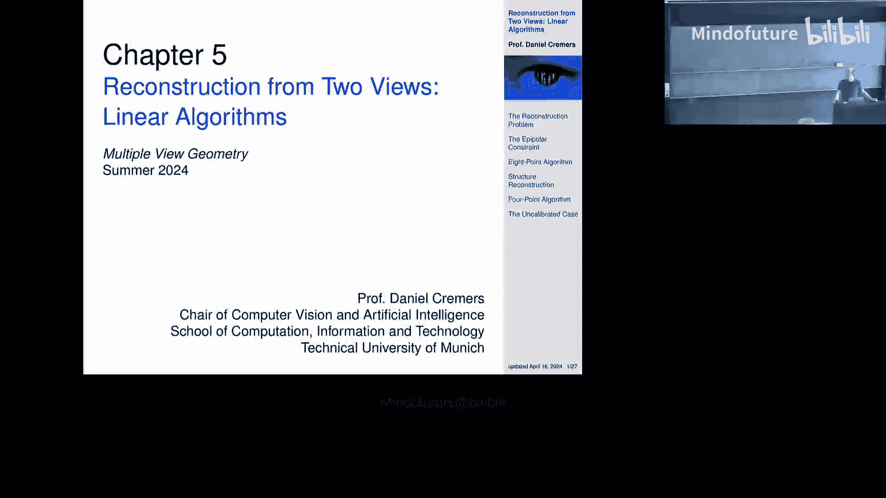
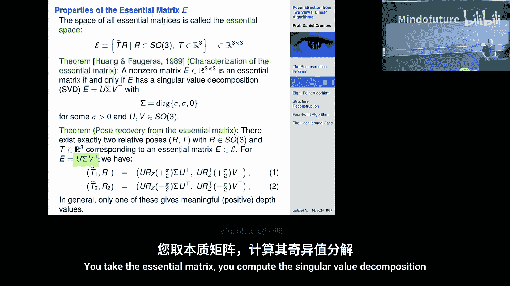
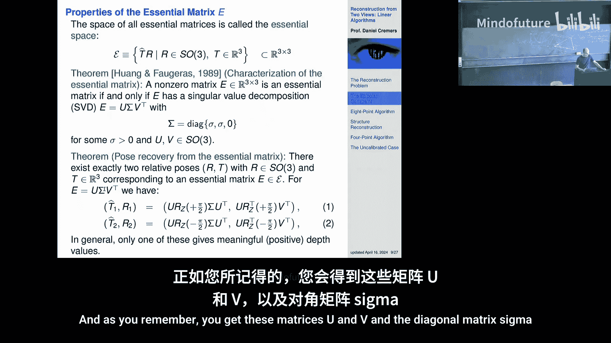
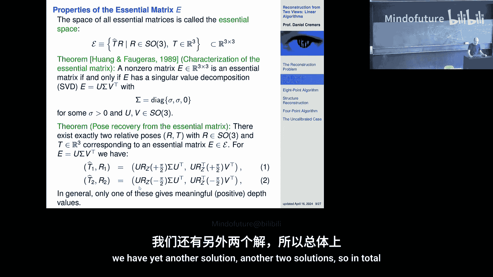
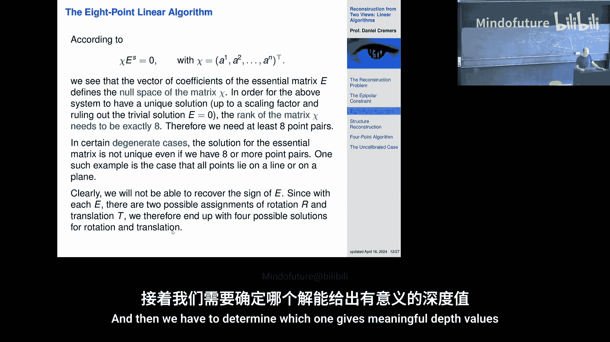
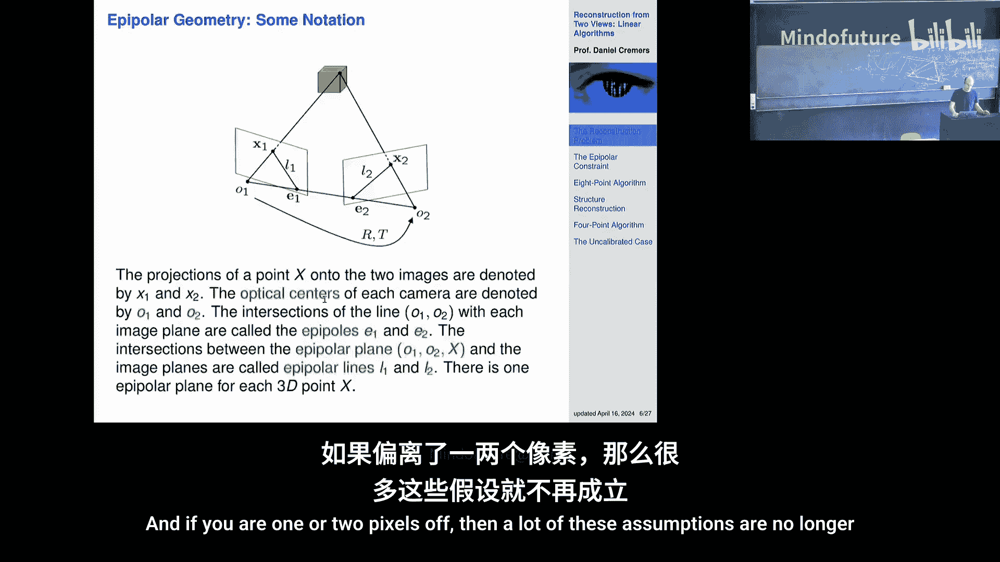
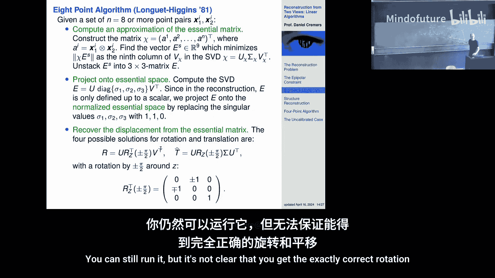
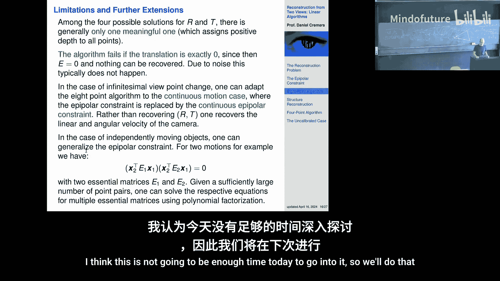

# 【慕尼黑工业大学】多视角几何 ｜ Multi View Geometry 2025 p09 P09_讲座_09_基于双视图的重建-线性算法_第1部分 -BV1KgZEBrEXV_p9-

Okay， welcome to class。We are now starting chapter 5。

The last chapter was on correspondence estimation。 This one is on reconstruction from two views。

And as you can see in the title， it's about linear algorithms and I'll come to what that means and how it differs from obviously nonlinear algorithms that we'll discuss later in class。

So linear algorithms really means that we can deploy linear algorithm linear algebra techniques to solve the problems that we're interested in。

And the complementary technique of nonlinear optimization basically means that you can no longer run eigenvalue solutions。

 but you have to devise more sophisticated iterative numerical solvers。

So this is about linear algorithms， why do I treat this well。

 it gives you a lot of the foundations of Epolar geometry， as it's called。

 about reconstructioncon of camera motion and 3D structure and it's not necessarily the algorithms that you would use nowadays to reconstruct from let's say。

 a moving camera。Because a lot of the techniques are very elegant and simple mathematically。

 but they often do not work super well in real world conditions。But we'll come to that later。

 Nevertheless， I find the theoretical foundations are useful and important to learn about。

So there's six parts here's the problem formulation。 so we discussed。

 so maybe I'll draw a little picture to give you an idea of what。And sees their chalk here。

 There's usually chalk。Someone took the chalk。ちゃ。So basically what we have is this setting where we observe some world from two images。

 one image here with a camera center here， and then we see the same point in another image。

And I say the same point we assume that we have estimated the correspondence。

 so we assume we have estimated which point in this image corresponds to which point in that image so that we have this point here and then we have another point let's say the red one。

 that corresponds to this world point and that corresponds to that pixel in the other image and so we have that for a number of points and one of the algorithms we'll discuss in this class in this chapter of class is the socalit eight point algorithm。

 this is kind of the culmination of what we discuss is the very famous algorithm called eight point algorithm。

Point algorithm。And as the name indicates。It takes eight corresponding point pairs in two images。

 and itconstructs both the motion of the camera。 So the rotation and translation that gets you from one camera into the other。

And also， the 3D location of these points。By the way， in a lot of these drawings that I make。

 you will find there is a transformation， an arrow going from here to here， and then I write RT。

It could well be， you know， it， I don't clarify very precisely whether this is the rotation and translation from image 1 to image2 or from two image2 to image 1。

 You know， it's somewhere there is a relative rigid but emotion。

 whether that is the motion from one to the other or vice versa。

Is up to you how you want to phrase that as long as you make it consistent。

So theres a relative motion between the two。Prameterized with some rotation and translation。

 And so the aim of what we are doing is now given all these points in 2 D， little x1， little x2 here。

And sorry， little X 1。And here's another one， this is x2 for this point and then we have other ones for the other points。

 you know we can give indices I for this one and this could be x， I'll write it in red。This could be。

X。First image coordinate of the first image of point J。 And here's the。Second。

 the coordinate in the second image of point J。 And we have all these 2 D coordinates of corresponding points in the two images and what we're learning looking for。

Is， first of all。The 3D coordinate， large X， I and the 3D coordinate of the other point。

 large X J and all of these and the rotation and translation。 So these， we assume， are known。

And these are the unknowns。So we assume， as it's said here。

 that we're given a set of corresponding points in two frames taken with the same camera from different vantage points。

Then in addition， the second assumption we obviously make here is that the world that we want to reconstruct is static。

That can be achieved in two ways。 If you are dealing with a moving camera。

 you have to really assume the world doesn't move。But if the world actually moves。

 like you remember in the beginning， I showed this example of a rope jumping girl。

 you can get the static world assumption if you synchronize the cameras that are filming。

 So if you put 20，30， 40 cameras in this room and synchronously film，Then at a given time。

 you can simultaneously acquire all images。 And then for that set of images， time is kind of frozen。

 and then you can assume the world is static。Because it doesn't move from one camera to the other because the images are taken simultaneously。

😔，So theres different ways to deal with。With it to make sure this assumption is fulfilled。That said。

 there is a big challenge， and that is still， to a large extent， in open challenges。

 What do you do if you film something with a moving camera and while you're filming， the world moves。

So then you want to reconstruct both the motion of the camera。

 but also the motion of the objects that move around。😔，And depending on how complex that motion is。

 this is to date an unsolved problem。But for this chapter， we assume static world。

And we also assume that the camera we have， the intrinsic parameters are known。

 So this focal length and all these pixel transformation parameters that we talked about in previous chapters。

 We assume all of this is known。And the aim is to estimate 3D location and camera motion。

And the way we do that is this is a classical kind of chicken and egg problem， in fact。

 the chicken and egg problem of 3D computer vision， this structure and motion problem。

 as it's often called。So this problem， as I mentioned that term before， I believe。

 is called structure and motion or sometimes structure from motion。Stuc。Structure。And motion is。

 is a common。Term that was used for many decades。 There is an alternative term nowadays is called。

 and this is often in short SFM structure from motion is is an acronym structure from motion。

There is another term that is popular， simultaneous。Localization。And mapping。And。Mping。

And that acronym is， in short slamb。Now whether slam and structure for motion are the same or not depends on who you ask。

 I would say it's roughly the same， but last night， for example。

 I read a PhD thesis and the our author argued that Slam is often more referred to the setting where you have a moving camera。

Where basically the motion from one frame to the next is incremental and you have typically small movements of the camera。

 whereas structure from motion often means you are given a collection of images that are unordered。

That can be taken from any vantage point。 There is not necessarily a temporal consistency in the video。

Like in slam。Also， it depends on what your sensor is。

 s was originally used for Liar based localization and mapping。And when you use a camera。

 people typically specify and say visual slab。And so that is a term that is very popular nowadays。

 But you see a little bit， the terminology also evolves with the years people。Update what they。

 you know， there is a significant overlap In both cases。 you want 3D structure and camera motion。

 but typically the settings are slightly different。And often。

 you would deploy different methods for one or the other。

Once you know the relative motion just to introduce a third term here。

 there is a term called triangulation it's written on the slide that is if you know the camera motion so you know how they're facing and then you need to estimate the 3D position well if you know the exact camera motion and you know the exact correspondence then the problem is easy you just。

Extend this ray and you extend that ray and wherever they intersect that is your 3D point right so that's in some sense。

 in that sense， you see if one part of the problem of this chicken and egg problem of structure and motion。

 if one part is solved， then the rest is often trivial or easy。

Except not quite in reality because in reality， these correspondences are not perfect and you can imagine if you're just slightly off。

 then this ray will go elsewhere and then you will get a completely wrong 3D coordinate right so this is only you all these reconstructions are on the assumption that everything you estimate is perfect。

And this is something we'll come back to later in class what you do in a noisy and uncertain world。😔。

So here's a practical example youre given two images， right， these two。

 and now you want to know where is that point P in the 3D world。So let's put some notation here。

 as I mentioned， x1， little x1 and little x2 are the 2 d coordinates of that point P observed in image 1。

 image 2，01 and 02 are the camera centers for the two images。

And you can imagine that this is not actually super difficult in the real world if you have scenes like that。

 and this is how everything got started more than 100 years ago in this field of photogrammetry。

 people wanted to measure things from photomea distances， locations， etc。

 from airplane images or photographs like here。😔，What you can do in such images。

 you can go into the image and manually label the points for which you seek the 3D location， right。

 If it's not too many， you can take this corner here， this corner， there， this corner here。

 this corner。 So for these kinds of， you know， structures。

 this is not so difficult to find corresponding points。And then， you can。Set yourself the challenge。

 given enough corresponding points in the two images。

 Can I reconstruct camera motion and 3D structure。In general。

The reconstruction of camera motion and 3D structure is challenging。

 just to give you an estimate of how many unknowns we might have。 Let's say。

 we're given two views of， let's say，100 points in each of them。

So that's 200 point coordinates in 2D。And then the goal is to estimate 6 parameters that model the rigid body motion。

 rotation and translation 3， rotation，3 translation。And then in addition。

 we want to estimate the 3D coordinates for these 100 points in each image。

 so that's 100 times three coordinates and so one thing you can do and this is often how this is tackled is you could solve this by minimizing what's called the projection error。

😔，So you take 3D points。X large large x J is that the the 3D coordinate of point J。

And J goes from1 to 100。 so this sum， it doesn't say here， but it goes from1 to 100。And then I say。

 well， the 2D coordinate of point J in image 1， this one here。Or this one。

This should be consistent with what I get if I project that point down into the first image。

And then for the second image， if x large x changes is in the coordinates of the first image。

In order to get the projection into the second camera， what do I need to do。

 I need to first rotate and translate this point， so this r comma t comma Xj basically means Rxj plus T and then perspective projection so pi is this perspective projection。

Into then the second image。 and there it should coincide with the second coordinate。

And if you do it this way， you're basically minimizing the distance between where that point projects on the screen and where you actually observed it。

And you do that for the two images and obviously you can see you could do the same for K images。

 this easily extends to three， four， or five images。

 then I have multiple rotations and translations to get into all the different cameras and I could easily generalize this by saying if and now I observe a third image。

 then the projection of that point into the third image should also match whatever the point I have there。

And for every additional image， you would have an additional term in this sum。

And then you sum over all the points。 And this is your projection error。

Sometimes it's called projection error， sometimes it's called reproion error。

 this depends on what perspective you take。And this is a problem and we'll talk about this problem later in class。

 it's called bundle adjustment， and it's a very classical technique that was developed almost 100 years ago。

😔，Surprisingly， well before computers ever saw the light of the world。

And I just did some research on it， and I found a lot of the pioneers of this bundle adjustment。

Were actually here at Te Munich。In fact， the founder of Tium Munich， he was a geoicist。And so。

 in some sense， Te Munich was founded for these types of problems。

And so this is maybe why we're still doing it today， we go back to the roots of where we started。

And I guess I might tell a little bit more about the foundations of this bundle adjustment and how it relates to the history of Teo Munich。

But for example， the pioneer of what's called analytical photogrammetry。

 he was a professor at T Munich， so a precursor of mine。In the early 20th century。

And analytical photogrammetry means they actually solve these types of problems by hand。

 analytically by doing math， right They didn't have computers。

I find that completely mind booggling how you could try to solve anything like that by hand。

 and in fact， they did so to reconstruct， for example， height altitude profiles in the Alps。

 you know， they flew over the Alps with airplanes， took photographs and tried to reconstruct you know the landscape。

With these kinds of methods。But they did it analytically， they did calculations by hand。

 and as a result， very often， it took many years to do a reconstruction。

Something that we today might be able to achieve in a few seconds with computers。

But I'll tell you more about the history of bundle adjustment at a later stage。So this is。

 unfortunately， even if you have a computer， this is a difficult problem。

 The reason why this is difficult is this is a loss function with hundreds of unknowns that you have to estimate。

😔，And it is highly nonconvicts。I may have mentioned that convetx a loss function。

 if you have a set of unknowns， let's say this is your space of unknowns。

 your solution space solution is， and then you have a loss function。

 sometimes it's called energy that's why it's often written as an E E of S if that loss is convex like so。

 and this is your optimal solution， that's easy to compute even if you have a high degree of lots of degrees of freedom。

 you can just initialize somewhere S in it。And then you essentially much like a ball。

 you let it roll down the hill。 you can simulate that process。

Something called gradient descent is is a baseline technique。

 and that will give you the optimal solution here。 That's easy， right。

 But and this is a loss function that's called convetx。Convicts， now。

 if you have a loss function that is not convicts something like so。Then is very difficult。

 This is not convicts， not convicts， and the problem with not convicts。

 non convicts or non conts is sometimes called non conts。

The problem with non convex loss functions is there is no algorithm that will find the optimal。

And obviously， if there's one dimension， you can just try every solution and see which one gives you the lowest cost。

 right， Maybe this one， maybe this one， right。But if you have hundreds of dimensions。

 you cannot do that anymore。 It's just。It's beyond what you can compute。In two， three。

 four dimensions， you can do some form of complete search where you just try every solution。

 plug it into your loss， compute the loss and figure out which one gives me the lowest loss。

But for hundreds of unknowns， it is just not scalable。

And then you need to devise approximate techniques to solve these loss functions。

 and that can be very difficult。And it depends on the loss function that there's a lot of math that needs。

 and we'll talk a little bit about solvers for these kinds of bundle adjustment at a later stage。

What we'll do now is we'll rephrase the reconstruction problem in a way that allows an analytical closed form solution。

And this before we do that， let's bring in some more notations on what is called Epolartry。Wow。

 I hope my batteries aren't dying。That's not good。嗯。So here's the idea。

 3D structure to camera centers， and we observe the points in image 1 and image 2 called little x1 little x2。

In addition， we have these points here， E1 and E2， they are called the Epoles。How do you get them。

You get them by basically drawing a line connecting the two optical centers of your camera。

And wherever these lines intersect the image plane， this is called the Epole in image 1， E1。

 and in image 2， E2。Now， these points need not be in the image plane itself in the visible part of the image plane。

 they can be somewhere outside as well here， they happened to fall inside the image。

 but that's not necessary right， if especially if the camera predominantly translates。

 then the epi poleles will likely not fall in the visible part of your image， but doesn't matter。

And then you have these lines that connect your 2D coordinate with the Epole。

 They're called Epolar line。And so you have for every 3 d point x， you have2，2D projections x1 x2。

 you have the two Eolles， and you have this Epolar line。诶。

And these Epolar lines are useful in the sense that if you observe。

 you can imagine if you observe a point along this line。

 then you know that the corresponding point must fall on the Epolar line here， right？

It's pretty clear。 You don't know how far it is along this way could be here， here， here， here， here。

 But all of these projections would fall on the Epolar line。

Which means if you're searching for the corresponding partner， for example， for x2。

Then you only need to search along an Epolar line strictly， speaking right。

 because depending on where it is in 3D space， it will be on one of these locations along this Epolar line。

😔，And this plane that is formed here that is spanned by the 3D coordinate of the point and the two object centers。

01 and02。 This plane that you see here is called the Epipolar plane。In principle。

 it's infinitely extended。 So what we see here is this triangle here。

 this big one is a part of the Epolar plain。So this just gives you all the notation。

And now what we'll do is we'll derive a constraint that basically relates the 2D locations of the observed point。

 x1 and x2 with the motion of the camera。😔，And here's and this is the constraint。

 It's called the Epolar constraint。 As you can see。

 it involves the 2D coordinates x1 and x2 of this point and the camera motion。

And this constraint must be fulfilled。And what's interesting is about this constraint。

 We'll see in a second how it's derived。 But what's interesting is the 3D location doesn't。

Enter this constraint any more。And so the Epolar constraint allows us to separate。

The structure and motion problem into one problem that only involves the camera motion and the 2D coordinates。

 Remember the 2D coordinates X little x 1 X 2。 we have them。

What we don't have is camera motion and 3D coordinates， and so the question is。

 is there a way to kick out the 3D coordinates and the answer is yes， there is。

 and this is how you can do it。So here let's go through it step by step。

 This is basically the projection onto the first image。 Why is that， this is let's not make this red。

 but white。This distance of the 3D point to the camera center is， well， let's call it Lambda 1。

And the same distance for this with respect to the second camera center， this one here。

 we call it Lambda 2， right。 So this distance。Then if we go into homogeneous coordinates。

 remember that's where the third component is1， then if we rescale little x1 with lambda 1。

 where do we end up， we end up with large x to 3 d coordinates。So this is basically。😔。

Catures the projection of the 3D point into the image。 You know， we we said earlier。

 x1 is large x divided by Lambda。 But the distance from the camera。

 where if you put Lada on the left side， you get this equation。Now for the second camera。

 it's the same Lambda 2 times x2 gives me that point。

 but in the coordinates of the second camera which differ from the coordinates or in the first camera by rotation translation that's why for the second camera we still have to rotate and translate to get it into the second camera coordinates So that's the two projection equations let's look at them。

 they contain the 2D coordinates， they contain the 3D coordinates。

 they contain the camera motion and they contain the unknown dips from the camera that's Lada1 and Lada2。

But now we'll sequentially transform these equations to get something that doesn't contain the 3D parameters anymore。

 And heres how first， we take this x here and we plug it in here。Right。

 so we we take the right hand equation， Lada 2 x2 equals r times r x That's lambda 1 x1 plus t。

And as you can see， in one step， we have killed the 3D location X is gone。There is no 3D location。

 but we still have the depths parameters， Lambda 1 and Lambda 2 that kind of contain the 3D information。

But now we'll transform again。 What we'll do is we'll first multiply with T hat。

Tea hat is this3 by 3 skesymmetric matrix that models the cross product with tea。

And if we multiply that to the left from the left， we get T hat times x2 Lada is a scalar so we can pull it out of this matrix vector product。

 so we get lambda2 T hat x2。And then we get here。 This term is lambda1 T had R X1。

And then T hat times T， since T hat models， the cross mimic the cross product。

T cross T is actually 0。 So this term disappears。And we are left with this equation。

What's important here， these transformations that we're doing， for example， multiplying with T hat。

 They are not equivalent transformations。 So this equation is not equivalent with that。

 but it follows。 So if this equation holds and it has to hold。Then so does this equation。

 So this equation we know it holds。😔，Next we do another transformation that is not equivalence transformation。

 so in other words， we cannot go back from the equation at the bottom to it doesn't entail the equations on the top。

 but it is， if you will， in necessary condition。If this condition is fulfilled。

 we are still not guaranteed that these will be true。But if these are true。

 then we know this should also。So we take this equation here and we multiply from the left with x2 transpose。

 so we basically project onto x2。If we do that， then on the left hand side， we get x2 transposed。

T hat X 2。What is that， Well， T hatt X 2 is nothing but T hatt X 2 is just a cross product。Of。

T and x 2， So T cross product with x 2。It's pretty bad to use cross products and x's in the same equation。

 Sorry about that。 So this is the cross product。 But if you then multiply with x to transpose。

 x2 transposed。Then you get a cross product of something with x2。 that is something orthogonal to x2。

 If you multiply with x2， then this will give you 0。And so the left hand side here will get 0。

And the right hand side is lambmbda 1。X 2 transpose T hat R， X 1。

And then I can since lambda 1 is not0， I can divide by Lada 1。

 the right hand side is0 after our wall， and I get this equation here。And so we can derive。

 we just derive this equation from the two projection equations that model the projection into image 1 and into image 2。

And we end up with an equation that is very interesting。

 It's an equation that includes the 2D coordinates， X1 and x2。

And it contains the camera motion parameters， rotation and translation in form of this matrix T hat times R。

And this constraint， we know it must be fulfilled if we observe a 3D point in two images in form of x1 and x2。

 then these must relate to the camera motion in this fashion。So it's a necessary constraint。

And what's nice about this constraint and quite beautiful is called the Epolar constraint。

 And what's nice is it does not include any 3D information。 It only includes 2D coordinates。😊。

And camera motion。And the idea is if we have now the problem is you cannot from this equation。

 so x1 and x2 are known， right， that's the 2 d coordinates that we have。

The unknown camera motion is T And R。The problem you see it now is that the camera motion is somehow baked into this constraint in a way that you cannot just solve for TNR。

 that would be beautiful if we just take this equation and solve for TNR but that's not possible because it's really baked into this into this matrix vector product。

But the idea is， if we and we'll see that in a second。

 if we take enough such constraints for not just one point pair， but multiple point pairs。

 then maybe we can actually。Rives something to compute the camera motion。

 And this is called the8 point algorithm。But before we do so。

 let's look a little bit more on this Epolar constraint Here it is x2 transpo T hat r x1。This matrix。

 what that you have in here， T hat is a matrix。 R is a matrix。 The product is， again。

 a 3 by three matrix。 This matrix is called the essential matrix E。As the name indicates。

 it has a certain importance。And hence， the apolar constraint that you have here is often also called the essential constraint。

Or the biline constraint。 Why is it called bilinear。

 Because it's linear in all the different things in x1， in x2 and in。In this T R X， T R matrix。Now。

 this constraint can be interpreted geometrically and we'll do that so that you get a slightly different interpretation of what does it capture this constraint。

 It's important to understand what is captured by this constraint。It basically says that if you have。

 let's say you have these two points that you observe in the two images。 and then you have the the。

The a line that connects these two camera centers。Basically。

 what it says is if you observe two points， sorry。In two corresponding points in two images。

 then this thing should be a triangle。Meaning that these lines need to intersect somewhere。

 I don't know where they intersect， but I know if this is the line connecting my two camera origins and these are the two points。

 I know they cannot be like that because they would never intersect they have to intersect in some 3D location。

And so what you can do is you can take these vectors。 In fact。

 we'll see which vectors will take one vector pointing from。This is O2。 This is O1。

 We'll now take one vector pointing this one。And then this vector and that vector。

 And we can say these three vectors， they form a plane。Or in other words。

 the volume that is spanned by these three vectors should be 0。

And I mentioned that before when we introduced vectors and vector spaces that you can define the so-called triple product of three vectors and you say that the volume is0 now let's look at what the three vectors。

This vector is if we go into the camera coordinates of the first camera， this is little x1。

 this vector here， right？This vectorAnd then this vector here is the translation vector。

 basically this one here， T is the translation that goes from01 to02 or vice versa。

And this vector here is in principle x2， but if you express it in the coordinates of the first camera。

 it's r times x1 r times x2 because you have to rotate into the coordinates of the second camera。

Sorry， I think it's vice versa way， this is x2 here。

And so we go into the coordinates of the second camera， I apologize。

 then this is x2 and this here is r times x1 if we express everything in the coordinates of the second camera。

 we could also take the coordinates of the first camera， it doesn't really matter。

But here we'll use this coordinates of the second camera， so the three vectors that we have here。

 maybe I'll draw them in red。This vector。This vector and this vector， these three vectors are。T。

X2 and R X1。 And if we compute the triple product of this， T， R X1 and x2， this triple product。

Then basically， if we write this out T cross， we can write as T hat times， right。

 This is the whole idea of this hat operator to mimic the cross product。

Then we have x2 transpose times T had R x1。And the statement that this should be0 basically says the volume that these three vector span must be0。

 and that basically means they need to intersect somewhere。 If they don't intersect。

 we create a nonzero volume in the space span by these three vectors。

And so the Epolar constraint says nothing but the fact that we don't know where the 3D location is。

 but there be a point where they intersect。 There must be a point where these vectors intersect。

 and hence the Epolar plane is really a plane。So this is the geometric interpretation of this Epolar constraint。

So you see first we derived it from the projection equations and now we saw a different way to interpret it。

 namely saying that there should be an intersecting 3D point where the lines intersect。😔。

a little bit more about essential matrices， so we see what enters this aollar constraint is the essential matrix T hat times R。

And it's important to understand the structure of these essential matrices because what we're going to do is we'll devise an algorithm called it the eight point algorithm。

 you see it's coming up next， where we first estimate the essential matrix and then from the essential matrix we estimate translation and rotation of the camera。

So let's look at these essential matrices， they form a space called this E script E。

Whi is three by three matrices of the form T had R where T is a translation vector and r is a rigid body is a rotation matrix of S3。

And you can characterize what is the space of essential matrices looks like。

 this is a theorem by Huang and Foges who basically say a nonzero matrix E is an essential matrix if and only if it has a singular value decomposition with two identical singular values and the third one being zero。

By the way， this is not very deep to see that the last singular value must be 0。

 That is because the matrix T hat is rank deficient。

 Remember we talked about these esymmetric matrices in the linear algebra into。

 and I mentioned they have an even rank。So if it's a three by three matrix。

 they must be either completely zero or rank2。 In fact。

 the one vector that is mapped to0 is the T vector T hat times t is nothing but t crossproduct with T and that is0。

 so there is one vector that is map to0 so this is not a full rank matrix it has you know a rank2 and so and then you remember the rank once you do products with matrices。

 the rank can grow larger。If you have a matrix that is not full rank then。

 and you multiply it with others， the rank deficiency remains so invariably the last singular value of this must be easy。

 This is because of the tea hat here。And as I said， we're not going to prove these theorems。

 but we'll basically just state them， in addition you can show that the two largest singular values are actually identical。

And so in some sense， not any three by3 matrix can be an essential matrix it has to have such a singular value decomposition。

 but what's nice is the statement is if and only that you see in this theorem here。

 right this is an important mathematical term， it means if the singular value decomposition has this form。

 then there is an essential matrix that it corresponds to。

 and if meaning there is a translation and rotation。And in turn。

 if we have an essential matrix of this form， then we know the singular value decomposition must have this kind of form。

Next， the question is， if you are given an essential matrix 3 by3。

 Can you read out rotation in translation， And the answer is yes。You can。

 And this is the second theorem that you can recover the pose from the essential matrix。

 So if you are able to compute the essential matrix。

 then this theorem tells you what the rotation and translation are。And this is what it looks。

 You take the essential matrix。 You compute the singular value decomposition。

 So you see here this SvD actually becomes in handy。 And as you remember。

 you get these matrices U and V and the diagonal matrix sigma that has this。

2 singular values。 and the third one being 0。And what you do then is you basically。

 it's a little bit complicated。What you do is you take these matrices and you build this product for the T hat matrix and for the rotation matrix。

 where RZ is a rotation of around the Z axis by plus pi half。

 so 90 degree rotation around the Z axis。And here as well。

 and here a rotation around the x had axis by a minus 90 degree and here's same。😔，Transposed。

So this is fairly straightforward to compute。 Once you have this essential matrix， you get this。

Now what I'm showing here are there are two solutions for translation and rotation。

 and this is typical once you have an essential matrix。

 there is two equivalent solutions that give rise to the same essential matrix。

The question then is often which one is the right solution right， we have one translation rotation。

 one is the right one， one is the wrong one， typically what you can do is you can try both and see which one gives meaningful positive depth values and typically only one of the two is the right one。

 that's how you can distinguish which one is the correct solution。

That leads us step by step towards thee。8 point algorithm。But before we do that。

 you see the essential matrix has this form of singular value decomposition。

So what you can do are now two different strategies to tackle this problem just to show you once you try to solve the problem。

 what options do you have？😔，What you can do is you can recover the essential matrix from these Epolar constraints so you build all these Epolar constraints not for one 3D point but for a number of them enough so that you get an essential matrix T had R。

 this essential matrix and then then what you end up getting this matrix E is typically doesnt you know numerically will not have this exact singular value decomposition。

 but what you can do is you can compute E and then project onto this space we'll see how that can be done。

And then you can extract relative translation and rotation。And so this is typically how we proceed。

 we compute the essential matrix， and then from the essential matrix。

 we estimate translation and relation。嗯。There are， actually。Two ways to to， you know。

 this sensor matrix that you determine here with these points。 We'll see that in a bit。

Will not necessarily be an essential matrix， and so there are two ways to enforce that E must be an essential matrix because we know it should be an essential matrix。

 so whatever we compute for E should be of this nature。

 meaning it should have this singular value decomposition。

There are two ways to assure that the first one is that we just recover some 3 by3 matrix E。

And then we project it onto the essential space， meaning we compute the nearest essential matrix。

The other solution would be to impose in the optimization that the E should be an essential matrix。

 and both approaches have strengths and drawbacks。The second approach where you actually optimize everything under the constraint that E must be an essential matrix is。

 in principle， mathematically more accurate。But it's much harder to compute because this constraint is a nasty constraint。

 much like the。You know the rotation matrix assumption， if you want to constrain art。

 the rotation matrix， as you know， this is difficult and here as well to constrain it to be an essential matrix is not easy。

What we therefore pursue is we first we pursue the first approach that is we estimate a matrix E。

 and then we project onto the essential。Just a second。I think the slides have shifted。

 I should move that slide。 So this is how you do the projection on the essential space。

We compute some matrix。 Let's call it F。3 by3 matrix。

 and now we want to compute the nearest essential matrix， so the nearest3 by3 matrix closest to f。

 but that is of is an essential matrix and there is a thing that basically guarantees that what we do is we minimize the distance between in the Frbeius norms and if you do that So you have。

You compute。The singularing value decomposition of your matrix F。With these three singular values。

 Lada 1， Lada 2， Lada 3， and they can be nonze or they can be anything。

 Let's assume they're ordered in size。 Lambda 1 is the largest， Lada 3， the smallest。

Then the projection is achieved by basically setting Lada 3 to 0。

And replacing Lada 1 and Lada 2 by the average of the two。

And this is not so difficult to show that if you minimize the distance here。In the essential space。

 then E has this form。And it's not surprising， you know the two larger singular values must be equal。

 the smallest one must be zero， so here we take the smallest one。

 we basically force it to zero and we take the two larger ones and we average them to get them equal。

And then this is by construction and you can prove that is the nearest essential matrix。

 we're not going to prove it here， but one can prove that this is the solution to this optimization problem。

嗯。え？And so this is the projection on the essential space that we can do to solve this first step here project onto the essential space。

 But let's first look at how we compute the essential matrix。We start by this Epolar constraint。

 Where is it？This one here in the box， x2 transpose T had R x1， and T had R is the essential matrix。

 So we have x2 transpose E X1 equals 0。For one point and we have and what we do now is we rewrite this constraint。

 Here it is x2 transpose E X1 equals0。But now what we do is we rewrite it in a slightly different form。

 We've seen that before that this bilinear form is called with x2 x1 and the matrix E in the middle。

We can basically rearrange the parameters of the matrix E into a long 90 vector。

 so e stack is basically the three columns of the matrix E stacked into a 90 vector。

And then we use this Cha product of x1 and x2， x1 cross x2 is something that we call a is also a 9D vector。

 so x1 and x2 are 2，3D vectors， this is a 9D vector， this chronica product。

This is what it looks like。 it basically contains all pair combinations of the components of x1 and x2。

 so x1， x2， x1。Y 2， x，1， z 2， and then Y， et cetera， et cetera。 So these all。

Paired combinations of elements of x1 and x2。In a 9 d vector。

 and you can show that this bilinear form can be written as a transposed E stack。

Why do we and I think we introduced that earlier in linearar algebra that the whole chronica and the stack notation is useful to rewrite a vector matrix vector product into a scalar product of two。

Why do we do that？ Well， The vector A contains all the known parameters。

 the 2D coordinates in my images。 These are known， right。

And the vector E stack contains all the unknowns in my essential matrix。

 And so we have separated a vector that contains the knownuns。

 transpose times a vector that contains the unknowns equals 0。

And what's nice is once we write it this way， we can easily generalize this to multiple points。😊。

Were basically rather than having one vector times e stack equals 0。

 we have a matrix times e stack equals0， so a matrix vector product equals0 where chi。

 the matrix chi that you have here， This is the Greek for those who don't speak Greek fluently this thing is called Chi。

This letter。This matrix chi contains all the stacked versions for n points。

 so a1 is x1 cross x2 for the first point， A2 is the same for the second 3D point and AN is so we assume we have N3D points。

 we can build this matrix chi out of these。And then chii times the essential matrix in a stacked vector form must be 0。

And this is very elegant and very simple。 what it means is we take our 2D coordinates of endpoints。

 we build the matrix chi， and then this constraint says all the apolar constraints for all endpoints say nothing but that this victory E stack。

Lives in the nullled space of the matrix sky。And so all we need to do now is compute the nu space of this matrix chi。

 and that gives us our essential matrix E。In the stacked vector form。

 And then we can unstack it again to get to eat，So and that is essentially the idea of the8 point algorithm that we have here。

 so we see that the vector of the coefficients of the essential matrix defines the null space of the matrix chi。

It's a vector that is mapped to 0。Now， obviously， one solution for this matrix vector is that we just set E to0。

 but we don't want a zero solution， we want the solution。That is non trivial。 So， you know。

 obviously， E equals 0 is always a valid solution here。

But what we want to assure somehow now that we have this matrix vector product being zero。

 we want to make sure that there is a unique solution up to scaling。

 a unique solution for Etac and how can we assure that basically what we need to assure that this matrix。

 it is an n by9 matrix。😔，That this matrix has rank 8， exactly rank 8 and not less。

Cause if it has rank 8。Then we know the null space is one dimensional。

And in order for this matrix and n by 9 matrix to have rank 8， we need to have at least 8。

Columns here in this matrix， right， It's columns from A1 through A N， right。If we choose n equals 8。

 meaning we observe8 point pairs in two images。8 3 d points that we want to reconstruct if we have eight points。

 then we can， you know， in general， we can assume up to degenies that the rank of this matrix will be。

And that hence， the null space of it will be one dimensional。

And this is why this algorithm is called the eight point algorithm。

 because you need at least eight points to assure rank8。In practice。

 if you take exactly eight points and sometimes even if you take more points。

 there are degenerate cases where this matrix will not have rank 8 but will be ranked deficient。

 then you have a problem then there is no unique essential matrix。For example。

 if all the points you observe， all the 3D points you observe in this world。

 if they all lie on a line or on a plane， then you have a degenersacy and this does happen in the real world if you take images and all images。

 all the things you see live on a plane， you have a degeneracy。

And so this is something that in general， you should try to avoid。Fortunately。

 these kinds of degens typically only happen in manm worlds。

Where we look at the building facade and we take pictures of the facade and everything we see is just on the facade。

In the real world， we typically don't have perfect planes or lines。 We have。

 in our rugged structures where points lie in， in， in， in non degenerate configurations。

But this has been studied extensively what kind of degenies arise。

 and the plane is one of the most common ones in manm worlds。

There are other so called quadrics I don't know if I'll talk about that。

 but they don't typically appear in the real world。😔。

Another thing to see is that we will not determine the signine of E。

 So if E is then vector spanning then null space， then obviously minus E will also be a solution to this equation。

 right。So E is only defined up to s， and so what the8 point algorithm does it computes a solution for E for the null space of chii。

 assuming that you have sufficiently many points to have a one dimensional null space。

 it computes the null space。And then up to sign， and then for each E for plus E and for minus E。

 we have two solutions for rotation and translation each。 Where is that。

Here these two solutions for translation rotation， and so in total this is for 1 E and for minus E we have yet another solution another two solutions So in total that gives us four possible solutions for translation and rotation。

And then we have to determine which one gives meaningful depths values。

 meaningan positive depths values associated with each point。

This we've discussed。 And so this， in summary， is the eight point algorithm on a single slide here。

 I tried to really fit everything on one slide because it's a somewhat involved algorithm。

 but it still fits on one slide if you squeeze it。So given a set of and this is an algorithm that was devised by Longet Higgins。

 and it was quite an influential idea of estimating camera motion and it a fairly beautiful mathematicalterrivation。

😊，AndI would say it's terribly practically useful， but it's still a very pioneering work because it's a closed form analytical solution to the camera motion estimation。

And as a consequence， Longit Higgins， he passed away a few years ago and a lot of the best paper awards at conferences are called Longit Higgins Award。

At the International and in fact， there are two conferences which somewhat independently decided to give their best paper award the name Longgo Higgins Award。

I believe。ICCV， and。Either ECCV or CVPR， I don't remember。

They have this long at Higgins award for the best paper at the conference。In。

Memory of long athiggins。The inventor of the 8 point algorithm。So here it is。

 assume we have eight or more point pairs， more is typically better because it assures that you have no degeneracy。

Then you compute this matrix chi where you basically take the cross products of the 2D coordinates of each point。

Point pair， the coordinates in the first image， coordinates of the second image of point I。

 you create this 9 d vector out of them。And then you take all these 90 vectors into a big matrix and in by9 matrix。

Or is it 9 by n。 I don't know。 So it's in columns and。And9 rows。And。

And then you find the vector E E stack， which minimizes this norm。Why is that？ Well。

 you want the vector that is mapped to 0， right， you want the vector that is defines the null space。

 So if you minimize this norm， you get the vector that lives in the null space that makes the smallest matrix vector product here。

And。All。And the way you do that is you can basically compute the SVD of this matrix chi。

And then the column of V in this SVD representation。

 the ninth column of V stack is the vector corresponding to the smallest singular value。

And that is the null space because we saw that in principle this should have rank8， this chi。

 meaning the ninth singular value should be0 in practice numerically will will be the smallest one。

 but the vector associated with that singular value that spans the null space of this matrix chi is the ninth column vector of V chi。

And then you take that column vector， it's a 90 vector， that is your solution for e stackack。

 and you just unstack it into your matrix E。Now that matrix that you get by doing so。

 it will not be guaranteed to be an essential matrix。In practice。

 and so what you do is you project it onto the essential space。

 This is what we saw in one of the previous slides。

 You basically set the smaller singular value to0 and the larger ones you replace by the average。

Or even simpler。We say， I think the batteries are really going down on this one。

We basically replace the larger two singular values by one。

And this is called the normalized essential space， so it's an essential matrix。

 the nearest essential matrix of unit length， if you will， where the singular values are just one，1。

 and zero。😊，Why can we do that？ Well， the essential matrix we saw this matrix E is nothing but T hat times R。

 but what we will see is that in this whole reconstruction challenge。

 we can only reconstruct everything up to scale。It means we can only determine the translation up to scale y。

 because if we rescale everything by a constant factor， we will get the exact same observations。

And this aspect that the translation can only be determined up to scaling。

 this is something we can use all over the place， for example， in step two here， by saying well。

 it doesn't matter if we rescale E by a constant factor。You know， the average of Sigma 1 and Sigma 2。

 it comes out the same so we can always renormalize things。 and that's what we do in this step。

We normalize it to unit links。And so then that gives us the normalized essential matrix closest to the one we estimated here in step one。

😊，And then from that essential matrix， we read out these four possible solutions for rotation and translation。

😊，And I've written them already in this more compact form。

 so this is rotation around the Z axis by either plus pi over 2 or minus pi over 2 that gives you two possible rotation matrices here。

And then you have the same matrix in here and you get two possible translation vectors。

I've written out what is the rotation by plus or minus pi over 2 around the z axis。

 this is what it looks like right， not surprising the Z component remains fixed and you have a 90 degree rotation in X and y。

😔，And so this is the eight point algorithm and this is kind of an iterative approach where in three steps we get a close form solution or more specifically four conceivable solutions for the relative camera motion between two frames。

It's a very elegant approach， it's this method of longer in Higgins。

 it works perfectly well in the case that you have perfect correspondences right So if you have 3D points and you know precisely where they are on the 2D image。

 then you can run this algorithm and it will give you rotation and translation of the camera。😊。

Unfortunately， in the real world， nothing is perfect。 You observe a point， you know。

 even if you go back to this church tower example， no to the。Fcade example。

 even if you mark the point T by hand， how are you going to be sure that you're not maybe one pixel off or two pixels off and if you are one or two pixels off then a lot of these assumptions are no longer valid。

And this is kind of the downside of the8 point algorithm， you can still run it。

It's not clear that you get the exactly correct rotation and translation。

And， in fact， this。I apologize， I don't know what's going on。I think the batteries are low。

 It's not even clear that you'll get the closest conceivable rotation and translation。

The next question that one can ask is this is an eight point algorithm。

 It requires you to have eight corresponding points。 Can we go with less。There is a very。

I think it really wants me to stop today。 There is a famous theorem more than 100 years ago by Ivin Croer。

In 1913， that showed that you need five corresponding point points。

5 corresponding points to estimate camera motion and 3D structure。

 So people knew already more than 100 years ago that in principle 5 is enough。

To determine the camera motion。 And now long at Higgins in 81 developed an approach that needed8 points。

 You could say that's not really progress。 If in 1913， they could do it with  five and in 81。

 they needed 8。 But there is a difference。 The 8 point algorithm is a linear algorithm。

 It means you compute matrices， you compute singular value decompositions， and you're done。

The approach that Croupa advocated in 1913 is or the theory that he proposed offered a much more difficult way to actually compute these things and I'll give you a bit of a hint in which way you can reduce the number of points。

So we showed that if you have at least eight points。

 then you have a rank 8 matrix chi in unless you have a degenerate sitting。

And then you can compute a solution for translation and rotation so far so good。

 but what we didn't use is the fact that in this step1。

 we didn't actually use the fact that E is an essential matrix。

 we just computed a random E and then we computed a projection on the essential space。

 but in step one the fact that E must be an essential matrix was not used。

And we can actually use that。For example， since the E。

 the matrix E has the smallest singular value that is 0。And in fact。

 that is essentially how Croer tackled it， that the space of essential matrices is in fact a five dimensional space。

 so E has not nine degrees of freedom， but only five degrees of freedom。😊。

And that's if you exploit this constraint， then you can actually get away with fewer corresponding point pairs。

So a very simple way to take this into account is to say。

 since the last singular value of the essential matrix is0， we know the determinant of E must be 0。

And what we can do is we can take， for example， just 7 point pairs。

 in which case the rank of the matrix will be at most7。

And that means that we have a two dimensional null space。

 so we can compute the two vectors E1 and E2 that span this two dimensional null space。

And we know the right essential matrix must be some linear combination up to scale of E1 and E2。

 So something of the form E1 plus alpha E2。And now all we care about is what is the linear combination。

 what is the parameter alpha that gives us the right essential matrix and since we know the true essential matrix should have determinant0。

 what we end up with is now an equation in alpha where we say now choose alpha such that this deterant actually becomes0。

And， and this is what you can do。 And that way， you would end up with something that is essentially a7 point algorithm。

 right。Estimate， you know， this chi matrix for 7 point pairs compute2 the the the vectors associated with the two smallest singular values。

 E1 and E2， and then。Solve this equation for alpha。Whi is not easy。

 this is not a linear equation right， this is typically somewhat involved equation。

 this determinant equation， but you can solve it for alpha and then you get your solution for the essential matrix。

And along these lines， Croa approved in 1913 that one only needs five point pairs to recover rotation and translation。

In fact， if you have degenerate motion， for example， if you know that your camera moves in a plane。

Or that it goes through a circular motion， one can often resolve the problem with even fewer point pairs。

うん。Yeah， so this would be cubic in alpha。😔，And so in principle。

 there are three possible solutions for alpha。Indeed， and then。In general。

 you'd have three possible solutions for alpha， and then you'd have to try these three and see which one gives meaningful depth values in the same way。

 Yeah， it's a good point and in fact。If you look at the result that Croer achieved。

 he said we can recover camera structure and motion。From five corresponding point pairs。

 And then it says up to finitely many solutions。And this is exactly that that already here。

 if once I solve for alpha， it looks like easy， right， but no there are， as you say。

 three possible solutions for alpha， and that gives us times， you know。

 for every essential matrix I have two possible solutions for the rotation and translation。

 and so that multiplies。And so in the end， but what's good is you still have finitely many solutions。

 not infinitely many that's the important， but it's not necessarily few。

 and that makes it a little bit cumbersome。Because you will then have to actually try these different ones to see which one gives meaningful result。

And we're not going to go back into the footsteps of Croa because I think that is actually a rather involved method that or。

Paper。But this gives you a bit of a glimpse in how you can tackle this。😔，How you can go， for example。

 from eight point pairs to seven point pairs and now just two more steps and we're at five point pairs。

😔，And people have used Crous results， and there is at this point。

 also a so calledled five point algorithm。5 point algorithm。That was not。Proposed by Croa。

 but many years later in that I still remember， I think it was David Nister and Heri Steveius who came up with it。

 but it's an algorithm that is very involved。 It uses techniques from advanced mathematics。

 so calledled Grobe nerve， etc， to actually compute the solution。😔，But in principle。

 this algorithm exists and given five corresponding point pairs。

 it computes camera motion and 3D structure。The question is， why would you go with5 rather than 8。

You know what what does it matter， right， you could say， well， why I have enough points， right。

 I'll just use8。 The issue is whenever you identify correspondences。

 you can make a mistake and you might。😔，you know， putting correspondence to pairs that either do not belong together because they're not the same point。

 like on this checkboard example， it might be the wrong square that you're putting in correspondence。

But also， you might be off a little bit。 And so it's the right pair。

 but it's a little bit inaccurate because they're not properly placed， etc。

And the more points you have， the more likely that something is off。

 and then everything goes down the drain， right。And if you can get away with fewer points you're often better off and what people then do is a lot of engineering to make this work For example。

 they start with five correspond points maybe even more then they estimate camera motion and 3D structure and then they go back and look at the correspondence and say which ones are not properly matched and these are then considered as outliers and then you resample the correspondences and try to find only points where the correspondences are consistent and this is called ransack is a technique that people have device is called short for random sampling consensus。

And so to identify which points are the right correspondences， which ones are wrong ones。

 and so you basically alternate this correspondence estimation with a five point algorithm to find a consistent camera motion and that you can imagine gets to be very nasty。

And how well it works is another question， but it， it gets rather involved。

Maybe a little bit more about the eight point algorithm， as we saw among we get， you know。

 once we have the essential matrix， we can have plus or minus E。 And for every each of them。

 we get two solutions for rotation and translation。 So in total， we get these four。

Combinations of rotation and translation。And typically what we do is we plug these different camera motions that we estimate these four possible solutions。

 we plug them in and do this triangulation and then we see what comes out as values for Lambda 1 and Lada 2。

 we'll see that in a second。And then we can see which one is a meaningful one。

This algorithm fails if the translation is exactly zero。 So if you take a camera and only rotate。

 then is hopeless。Why， because then the essential matrix will be 0， right， T hat will be 0。

 and hence E will be 0。 Everything will be 0。 and it's you don't get anything out。

But then if you think about it， if you have a camera that only rotates。

 how would you ever want to estimate 3D structure， you cannot。

Ca you will see the points always in the same location， no matter how far they are， right。

 because they will always project to the one and only camera center that you have。

 You're not changing。 So you need to change the camera centre to get any paralls to get any way to inferips。

Without translation， you cannot infer from a purely rotating camera。 You cannot infer dips。

 It's impossible。And sometimes people don't realize that they put the camera on a pen tilted union unit and it pans around and then they expect from all the images they get。

 they reconstruct 3D。 No， you have to have some lateral motion to get 3D to have this parallax to C 3D。

But in practice， once you move your camera around a little bit in the real world。

 you always have a bit of translation， so unless you really design it to not translate。

 this will typically not be an issue。One thing to mention is in the book of Ma Suwato that I used as a basis for this class。

 at least for the first half of this class， there is also a version of the eight point algorithm designed for infinitesimal motions right we talked about this whole idea of modeling rotation and translation infinitesimole。

 so rather than having the matrix R， we talked about this the algebra where you have this s symmetric matrix W hat。

And then R is E to the power of W hat so you can exponentiate this skew symmetric matrix to get the rotation。

 and we said that infinitesimal rotations can be modeled by skesymmetric matrices。And indeed。

 you can also model an infinitesimal or a continuous apolar constraint。

Which basically models the case that your camera moves infinitesimally。

 and then you can impose a constraint that couples the 2D coordinates。

With this skesymmetric matrix that captures infinitesimal rotation。

And then you recover not rotation and translation， but you recover what's called linear and angular velocity of the camera。

So two consecutive images from a moving camera， I can estimate the linear and the angular velocity。

Next comment is that sometimes I talked about it that we assume the world is static， but in fact。

 you can also assume that the world moves and then can then all you care about is let's say you have a static scene and a car that drives through。

Then what you care about is first of all， the relative， and then you have two frames frame time1。

 time two， what you care about is the rigid body motion between the two frames。

Or the rigid body motion between that governs the motion of the car。And so would you can assume。

 for example， if you have two motions， one is the motion of your camera。

 one is the motion of some object in the scene， then you have two rigid body motion that relate to various structures。

And。And then you know， for all the points I observe， either they are on the static background。

 then they have to be consistent with the rigid body motion of my camera。Or they are on the car。

 then they have to be consistent with basically the corresponding rigid body motion that is between the camera and the car。

 right？And there's going to be two rigid body motion and each point will be either on this object on one object or on the other。

 and what you can then do is you can say， well， then the product has to be zero。

Meaning the point coordinates x 1 and x2 must be consistent with rigid body Mo 1 or rigid body motion 2。

In the first case， this thing should be zero in the second one， this thing should be zero。😔。

And then the idea is we saw if you have eight points。

 you can have the linear8 point algorithm to compute the rigidio body motion and here what you can do is you can assume if you have sufficiently many points that you can simultaneously recover multiple rigidio body motion。

And then you can devise techniques of what's called polynomial factorization to estimate not one essential matrix。

 but two， three， four essential matrix。How practical that is is another matter， right。

 because if you have too many rigidio body emotions。

 you might need endlessly many corresponding point pairs。

 which is very hard to get in the real world。But in principle。

 there are ideas to generalize this Epolar constraint to multiple objects。

There's a friend of mine wrote a whole book about that， vial。Rene Vidal and Ma。

 the same Ma from the Mawato book。 It's called a generalized PC A。まして。Priinncipal component analysis。

 I think that's the title of the book， but they devised techniques to tackle exactly these multibody structure for motion problems。

As you would call it。I we not going to go this direction。

 but I just wanted to point out that there are ways to generalize these ideas。

The next part is then about how to reconstruct the structure。 So now we estimate it with the a point。

 we estimated the camera motion。 The next step is once you have the camera motion to estimate to do this triangulation to estimate these depth values。

 I think this is not going to be enough time today to go into it。 So we'll do that next time。

