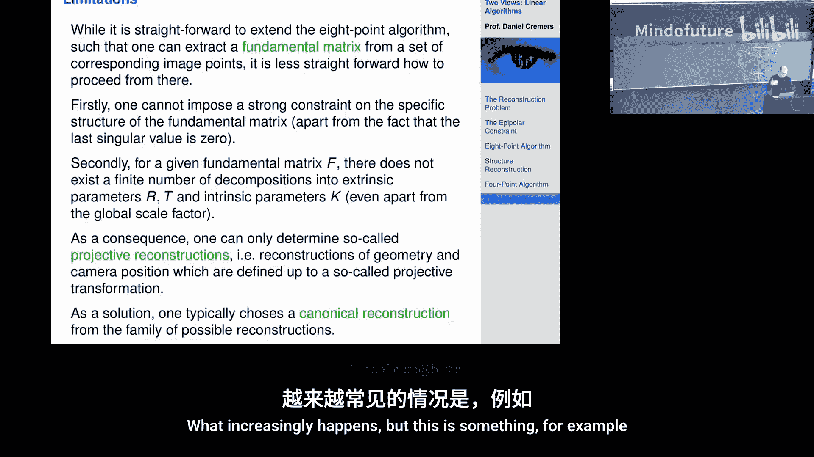
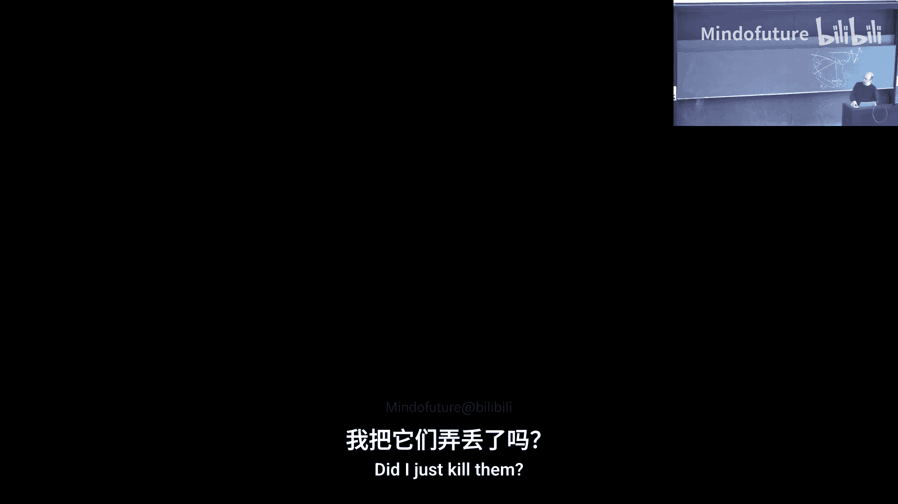
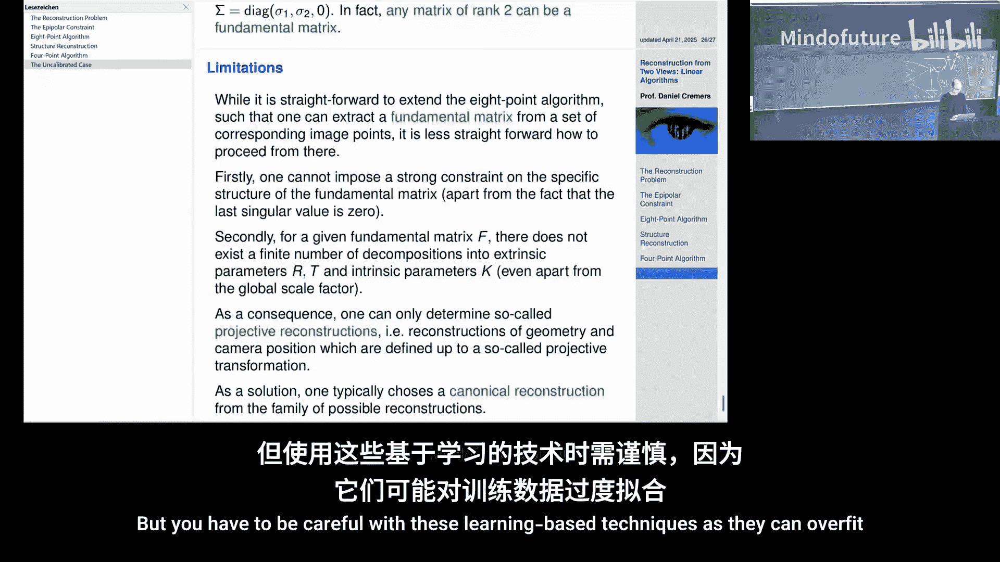

# 【慕尼黑工业大学】多视角几何 ｜ Multi View Geometry 2025 p10 P10_讲座_10a_基于双视图的重建-线性算法_第2部分 -BV1KgZEBrEXV_p10-

Admittedly， I should say the chapter we're in right now。 This is chapter 5。

 and following is chapter 6， these are probably the two chapters in class that are most technical。

 most mathematical。And so I， I would ask you to bear with me。

And what we developed here are some of the foundations of multiple view geometry。

 of reconstructing from multiple images， and in fact I split this up。

 so chapter 5 is on reconstruction from two views and chapter6 is on reconstruction from more than two views。

 so three， four or five views。And the core idea is always that you have a 3D world。

 that you observe this world in images， say this image here， and that image here。

And possibly in chapter。Six， a third image or a fourth image， right。

 and then you see these projections of the 3D point， let's call it large x into these images。

And then you have these projection equations。This one and this one that tell you。

How a point large x is projected into image1， and that is the coordinate little x1。

 so that let's say this is image 1， So this is x1， and this is the projection into image 2 is little x2。

And what we're missing out from in the observation is the distance of this point。

 Let's call it Lambda 1 from the first image。 or in the case of the second image， sorry。

 this is Lambda 2。This distance here to the center， to the camera center。

So these are the distances that are missing in these equations。

 but we can write down the projection equations and now keep in mind what do we have。

 what we are given is the 2D coordinates x1 and x2。But we're looking for is everything else。

We are looking for the coordinate vector large x， the 3D coordinate。

 We're looking for the rigidge of body motion， and we're looking for the depths values。

 Lambda 1 and Lada 2 that we。Don't know， right。 So it's not so nice。 You know。

 you think linear equations， right， I've learned about linear equations in high school。

 Can I use linear equations。 Can I solve for the unknowns， right？ That's what you want to do， right。

 But look at these equations。 And you see it's not that easy， right。

There are few knowns and a lot of unknowns， right。And the question is。

 how can I get something reasonable， how can I simplify these equations to get to something that I can actually compute？

😊，And there is something quite impressive that people came up with。

 And this is the so calledled Epolar constraint。So the way it works is from observing a point in two images。

 I can derive a constraint this one in the box down here。And interestingly。

 this constraint contains the 2D coordinates that I have， the the known 2D coordinates and。

Prameterters that relate to the rigid body motion of the camera。

 So the rotation and translation between these two cameras， rotation and translation。

 if we consider these two images for now， it's the rotation and translation between image 1 and image 2。

 Why is that interesting。 Well， it's interesting because this constraint does not contain large x。

 the 3D coordinate， and it also does not contain the lambda parameters。

 So we were able to kick them out in this derivation。And how did we do it Well。

 We inserted this equation here in here， right？ So if you take large x is lambda 1 little x1 and put it in here。

 you get this。 And then we sequentially applied transformations First， we applied T hat。

 This is a matrix that kills the translation vector T。 If you apply it from the left， right。

Lambda is a scalar， so it's lambda 2 times t hat times x2 equals again， lambda is a scalar。

 we pull it out lambda 1， t had r x1。是。Exactly， and now T hat x2 is something that is orthogonal to x2。

 It's T cross x2。It's the cross product of translation end of the x2 vector。

And so if we project that onto t onto sorry onto x2， x2 transpose。

 we multiply from the left with x2 transpose， then this thing here becomes0。

Because this vector is orthogonal to x2， so projection of this vector on x2 will be 0。

And on the right hand side， I have lambda 1， x 2， T had R， x1。

And then the lambda1 like is a constant， I can divide by it。

 and I end up with something that does not contain any of the 3D parameters。

 It is a relationship between the 2D parameters in the image and the possible rigid body motion between the two cameras。

And later on， I think I don't know if I showed you this。

 what this constraint really says is that the two vectors and the translation vector that they span a plane。

 meaning these two lines must intersect in 3D。 and that basically means that these three。

These three lines， they actually form a plane。That is what is really captured in this socalled Epolar constraint。

And the plane is called the Eippolar Pla。So it says these three vectors。

 the translation and x1 and x2， these three vectors， they form a plane。

 meaning something that has0 volume。 In fact， this is the volume that of the。Space they span。

 and this being zero means they all live in one plane。

 and that basically means I don't know where the 3D coordinate is。

 but I know they must intersect somewhere once they're in the plane， they will intersect eventually。

 right？And that's what this constraint actually contains。

 this information that there is a 3D coordinate where these two rays will intersect。😔。

This is the Epolar constraint Now the nice thing is it contains information about the camera motion。

 the downside is you can't just solve it for T hat and R right that would be perfect if I can just solve for the unknowns but again it's not a linear equation。

 it's an equation that contains both a 2D coordinates and these camera parameters in some mingled up way。

And this mingled up way is called the essential matrix， so you take the rotation the translation。

 you build this matrix T hat from the translation vector。

 T hat times r is the3 by3 matrix called the essential matrix。

 and hence this constraint is called the essential constraint。

 and here I've derived again how this really captures the volume spanned by these vectors。

 the three vectors， the translation vector。And then x2 and x1。

 but in the coordinate frame of the second camera， so that's the three vectors， x1。

 x2 and T they you know expressed in the coordinates of the second camera。

 this is the volume they span and that volume is0 because they intersect here。

So what we're going to do and this leads to the a point algorithm is we'll take this constraint。

For lots of points， not just this one point pair but a lot of other points right about eight in fact。

 at least eight， and then we have eight such constraints， and we can put them。

 I'll skip that I think you saw it in the video from last week but we can put them all so we rewrite this constraint。

 x2 transpost essential matrix x1 equals0， we rewrite it as an inner product of two vectors。

 one that contains the pairs of x1 and x2 here， all of the possible pairs。A nine dimensional vector。

 and then one that contains all the entries of the essential matrix here stacked into one vector。

And then this is actually equivalent to this， the nice thing is here we have the unknowns。

 the essential matrix unknowns and thes， which is these pairs of coefficients from the 2D coordinate vectors。

And now I can do that not just for one point pair， but for a lot of point pairs that are in in with an index 1 through n。

 so I have n point pairs， and each point pair gives rise to this nine dimensional vector of 2 d coordinates of the pairs of points。

Right，And so I have a lot of 90 vectors N of these。

 And then I can say this matrix chi times e stack must be 0。 So this is now a system of equations。

 This is one linear equation in the vector E stack。

And here I have a system of linear equations with the matrix chi。And so keep in mind。

 Kai is known and E stack is unknown。 That's what I'm trying to find the camera parameters in the essential matrix。

Now how do I solve this， you know you could say oh。

 I see the solution Etac equals zero right that's a valid solution。

 but obviously that's not a meaningful solution because that would amount to having zero translation zero rotation and everything is kind of zero right is the trivial solution if you will。

We want something that is nonze， we want some baseline。

 and so what we are looking for is eigen the vector to the smallest singular value of Etac because then that gets minimized。

😔，And so the other thing is we want a unique solution。

 so we really want the null space of this matrix chi to be one dimensional。

 there should be only one vector or its scaled versions that should be in the null space of this matrix。

Now that we can enforce by enforcing that the rank of this matrix must be at least 8， in fact。

 exactly 8。And this is the reason why you take eight point pairs because if you don't have eight point pairs。

 but less maybe four or five point pairs， then this matrix cannot have rank eight。

 then it will have rank four or five yes。Yes。Yes。Very good point。 Yes， so these x1 and x2。

 they are always in homogeneous coordinates。 Very good point。 So there are 3D coordinate vectors。

 and that's why this ends up being9 dimensional。So T hat is a 3D vector， and R is a 3D matrix。

 And let me see。Heres that。Now， so these are all 3D matrices， and then for this to make sense。

 x1 is also a 3D vector。😔，So it's all 3D vectors and 3D matrices。

 but indeed it means the last component is one， so basically we express this point where this distance is one right so the distance of the screen to the origin is one and then it's the Z coordinate and it is always one for this little X。

😔，Good point。Yeah。In practice， once you take eight points or more。

 that's sufficient to assure that this will have rank 8。But there are exceptional cases， for example。

 one degenerate case that actually happens and these exceptional cases are called degenerate cases。

And one of these is common in applications that is when all the points you observe lie on some plane in 3D in that case。

 there are also more complicated degenerate cases， so-called quadrics but they don't really appear much in the real world。

 but unfortunately especially in manmade worlds planes are very common you know。

 and it can happen that you direct your camera onto a plane right and then this approach will become degenerate。

Then the rank will not be 8， but it will be less than 8。 And then you don't have a unique solution。

By the way， when I say unique solution here with this multi view reconstruction from a moving camera。

You can only have uniqueness up to scale。This is the thing， you know。

 you want to reconstruct the relative camera motion， you want to reconstruct the 3D world。

 well if you rescale everything by a factor， you get the exact same point observations。

That's why they filmed。That's why they can film， you know， Titanic in the bathtub， right。

 They can take a tiny boat on a tiny ocean， make a tiny translation。

 And you cannot tell from the imagery it's gonna be the same， right。

 So the scale of the world cannot be observed from a single moving camera。

And that means this E stack and everything， the rotation， the translation in particular， sorry。

 the translation is always only known up to scaling。If you rescale everything by a factor of two。

 the baseline by a factor of two， the coordinate vectors by a factor of two。

 you get the same point observations。Everything is identical。

 I'm saying that you know strictly speaking not quite if you film in the bathtub。

 the waves of the ocean will be smaller and then there are you know inherent scales in nature。

 but apart you know water for example has a particular scale so that's a little bit tricky for the Hollywood people to make sure the ocean looks realistic。

 but apart from that everything can be rescaled。And that's been used quite frequently。

 There is a famous movie called the Boat。From， I don't know。

 in the 30s where they filmed things with a miniaturized version of their boat。

That's a good question。 So if we have eight points， rank8 is likely。

 how can we make sure that rank 9 will not happen Well， we know if these points are， you know。

 accurate， then this there will be a matrix E stack in the nu space that is made up of T hat and R in this fashion。

 Where is it。Here so we know there is a translation and rotation that gave rise to these images。

 and so we know by theory that there must be at least one nontrivial vector in the null space。

 and that basically says no matter how many points you take，There will be rank8。

 There will not be full rank， right， otherwise there is no translation and rotation。

 but if the points you observe are really the projections of 3D points。

 then there must be a translation and rotation that explains it。

 and that is the one that gives rise to this e stack matrix that makes this null。

So that's the good news is the theory tells us that no matter how many points we take。

 this will not be full ring Now that is the theory in practice things are a little bit tricky because in practice you observe points in the image。

 but you may you know there is always uncertainties， there's noise。

 there's errors in the measurement meaning you observe the point here。

 but maybe the true point was slightly off maybe it was there。And if that happens， then actually。

 the thing will be full rank。 It will be rank 9。 cannot be more than rank 9。

 because it's an n times 9 matrix。 So the rank will be at most 9。 And in the real world。

 it will actually be 9。 It will not be 8。And so it will not be exactly zero。

 and that's why you revert to this idea of taking the vector associated with the smallest singular value。

Hoping that this is kind of the component that comes in from the noise that makes this last singular value non zero。

 in principle， the smallest singular value should be zero。😔。

But this is actually something we'll come back to a little bit later in class。 this is very tricky。

 right， you have noise on the measurements， on the observations。

 how that noise factors into your estimations is complicated。

And then spectral solutions do not do the best job in accounting for noise。

 I've mentioned that before。This is a spectral solution。 We'll talk about how far it goes。

 It's very beautiful。 But once it comes to real world noisy data。

These spectral approaches you start to break down， and then you really need to model noise and uncertainty more explicitly and we'll come to that later。

😔，But this is bringing Gi rise to this eight point algorithm where you compute these。

 you know for pairs of points， X I J1 and X I2， So this is from I equals 1 through8 or more。

You compute these A1 through A N。These chronica products of these x1 and x2。

They give you this matrix chi。And then then you try to find you minimize this right。

 you say this should be zero， but I minimize this and minimization of this can be done by taking the column associated with the smallest singular value and that is the ninth column in the SVD。

 so if I do an SVD of chi U the diagonal matrix sigma with a singular values on the diagonal and V transpose。

 then I just take the ninth column of V。And that is。The essential matrix in a stacked version。

 So you just unst it again to a3 by three matrix。 And that is your essential matrix。That's。

 in principle， the idea。Once you do that， you end up with a matrix due to noise and uncertainty that may not be exactly an essential matrix。

And we saw also in this previous slides that the essential matrix space is made up of matrices that have the smallest or the smallest singular value。

 this one here must be 0。And， and the largest ones are equal。

And so you basically can project onto the essential space so you take your matrix E and find the nearest essential matrix。

 which amounts to setting the smaller singular value to0 and then basically replacing the two large or singular values by their average if you will。

 we saw that where is it here， so you replace these by their average and that gives you a projection onto this essential space。

In practice， since we don't know the thing up to we only know things up to scale。

 we can just as well replace it by a one。This is a common thing in all of these derivations that you make use of the fact that E is only going to be known up to scale。

 and so I can always rescale things and whether I call it sigma sigma 0 or just 110。

 I just rescaled it by sigma。And then we saw that from the essential matrix。

 you can actually recover rotation and translation。 There is a way to do it。 Here is the equations。

 By the way， this R z plus minus pi over 2 is a rotation around the z z axis pi pi over 2 or minus pi over 2。

 So you can see there are actually two possible solutions。

 one with plus pi over 2 and one with minus pi over 2 for the rotation and two solutions for the translation。

And that will give you a total of four possible rotation and translation pairs。

 Here is the rotation around the zax。You can see it is characterized by Z， remaining the same。

And in end， you only rotate in the X Y plane。So we have four possible solutions and what you do in practice in the aid point as long as Higgins conceived it。

 you try all four and see which one gives you positive depth values because the next thing you do after computing rotation translation then you have the rigid body motion。

 then you can triangulate and compute the lambdas， the distance from the camera。

 and once you do that typically only one of these rotation translation pairs will give you positive depth values。

And that's the one you choose。So this is this algorithm called the eight point algorithm as it was pioneered by Longed Higgins。

It's quite an influential algorithm， why， because it allowed to solve for the camera motion in closed form analytically。

 and this is beautiful。 you know， in sciences， there are basically two ways to solve for things。

 One is you solve it analytically。 Then you have the exact closed form solution。

And the other way is that you solve things numerically。是。Now， you could say， way， way， wait。

 the singular value decomposition is a numerical solution。 Yeah， up， up to these numerical aspects。

 But in principle， it's an analytic solution。 you are saying the solution is given by the vector associated with the smallest singular value。

And that differs from numerical solutions where you approximate a solution in an iterative numerical fashion。

So this is the beauty of it， people love closeform solutions and this is part of why this work was so influential and also Longit Higgins had an impact。

 a lot of the best paper awards at the computer visionsion conferences are nowadays called Longed Higgins Award。

In memory of Longgen Higgins， who unfortunately passed away。5。A few years ago。

He pioneered this field of multiple view geometry with the8 point algorithm。 It is beautiful。

 It is elegant。 Does it work well in practice， not really。You know。

 this is often the caveat we face in research is that the things that are beautiful don't work and the things that work are not beautiful。

 so， you know。You got to take whatever you can。So maybe I think this is also the end of this video from last week。

 but I wanted to briefly recap and now get into how we reconstruct the structure。

 the 3D locations So here the ideas now we have the 2D coordinates in the image X1 x2。

For a number of points that we index by J here。And we have the rigid body motion that the eight point algorithm gave us rotation and translation。

Do we have everything Not quite， We don't have the Lada parameters。

 So this is what we try to compute now。 is this Lada 1 and this Lada 2。In fact。

 only one of them matters， right， if I know the distance from the first camera。

 then I can compute the point， right？Then I don't need the distance from the second camera。

 So obviously one of these Lada parameters is sufficient for everything I need。

How do we go about it again， we write down the projection equation。

 how is the point large x projected into image 1 and image2。

 and this is already using the fact that we insert it here R x1 sorry lambda 1 x1 is the point large x。

I keep in mind if if I go into camera 1， then this large x is lambda 1 little X 1， right。

 It's in homogeneous Cors。 This is distance 1。 If I rescale by the real distance。

 I get the point large X。And once I multiply rotate and translate， then I get the projected。

 then I get the point large x in the coordinates of camera 2。 and this is Lada 2 x 2。

The only thing we've added here is this parameter gamma， which is a little bit weird。

 but this accounts for the fact that we can rescale everything and it's still meaningful。

And so what we're trying to estimate now is we're trying to estimate gamma。

 the scale of things and the lambda ones。Now what we do is we again transform these equations。

 As you can see， we have lambda 2 and Lada 1， as I said， we only care about one of these。

 so let's kick out one of them。 In this case， we kick out lambda 2。How do we do this？ Well， you know。

 this is a vector that is proportional to x2。How can we kick out x2。

 We multiply by x2 hat right and this has the effect of annihating x2 right so we multiply here from the left when x2 hat that term becomes 0。

 that's the0 here。This term， what do we get， The Lada is a scalar。 We pull it out。 So it's Lada 1。

 J X 2 hat， X2 J hat。R X，1， J。And then this term becomes gamma is again scala x2 J hat times t。

And so this is a linear equation。In the unknown Lambda1 J and kma。

And now we can write that as a linear equation system。 and this is what it looks like， right。

 So the first term， this one here times lambda 1 j and the second term here times gamma equals 0。

And so we have one such equation for every point pair。

From one through n right so we have n such point pairs and each of them gives rise to one linear equation Now what do we do obviously we stack all of these linear equations into one big linear equation system。

 this is it and so it has all the lambda ones for all the npoint and this gamma parameter that is the baseline scale。

😔，And we have a linear equation system， M times this we call this vector lambda equals 0。

And this is a vector n plus one dimensional because we have endpoint pairs。

 each of them provides the slamda parameter and then the gamma parameter。

And the matrix M is just this one you can see on the diagonal， I have these， you know， what is it。

 if I go back， it's basically this term here。X2， J had R， X，1， J。

And this is this term for J equals 1 to J equals 2 up to J equals n down here， right。

And then the second term， that is this term here。This term is， is all all easier。So is it massive。

Equation system， but， you know， this is the nice thing about linear algebra。

 It doesn't matter how big the equations are as long as they're linear are good。

RightAnd so now all I need to do is solve for lambda you know lambda is so again I've solved things with linear algebra and again。

 like in the8 point algorithm， the solution that I'm looking for。

 these unknown depth values are you know they make up the null space of this matrix m。

The matrix M I can compute， it has the 2D coordinates x1 x2 of all these points。

 and it has rotation and translation of the camera。

 which I've already computed with the8 point algorithm。So this matrix M is a known matrix。

 and lambda is a vector that is in a null space。So you can again apply your singular value decomposition or。

 which is equivalent， you can do m transpose M and compute the smallest eigenvalue。

And the corresponding eigenvector is this lambda we saw that eigenvectors and singular values sorry eigenvalues of m transpose m are related to the singular values of M so you can apply both here。

 either SVD or eigenvalue decomposition。And that gives you lambda。

 So this is this vector and this is the solution of all the different depths。

 but up to scale and you can very nicely see what happens if you rescale lambda。 Well， first of all。

 the distances rescale， if you double it， everything doubles， right？

And the baseline also doubles this gamma。 So you can see very nicely how rescaling。

 And this is why we introduce this parameter gamma。

 because it allows us to rescale everything accordingly。 Translation is known。

 But then we say it's only known up to the scale gamma。 That's why we add this gamma here。

 And then we can rescale everything， we find a solution， Lambda。 And then once we have the solution。

 we can always rescale arbitrarily。 How would you scale things in practice。 Typ。

 you would fix the baseline to be one， right。It's an arbitrary fix。

 but that anchors it basically says we have a perfect reconstruction of rotation。

 translation and 3D points。But we don't know what the units are， right， We don't know if it's meters。

 kilometers or de or whatever。 And so you fix this to be unit one basically。😔，Give it links。

So you reconstruct everything in the units of your camera baseline。So that is the algorithm。

 the8 point algorithm for estimating camera motion。

 and also here same linear algebrabar solution for estimating 3D structure。

And so this is very beautiful and obviously computationally super fast because singular value any kind of matrix operations like eigenvalue decomposition。

 singular value decompositions are very fast to compute。😊，Does it work super well， Not really。

 here's an example from the book that the class built on。Two images left and right。

 here is the two cameras that were reconstructed and the points。

Can you recognize the 3D structure in this point out， not really。Is it accurate？Who knows。

I guess these points are on the cup here， so yeah， they're a little bit more forward than the points back in the middle。

诶。Yeah， it's not， not。 I wouldn't go ahead and try to quantify the precision of this reconstruction。

 but it it goes to show you that in principle things work。 How well does it work？ Well。

 it works perfectly if the data is noise free。😔，So if you have 2D images and you know exactly where every point is。

 if there is no distortions in the image， if the points are perfectly located where there should be。

 let's say this one is perfectly on the corner of this box and this one as well but already by looking at it by hand。

 it looks like it's not exactly in the right position， so you see you know。

Nothing is ever perfect right， and real world cameras create all sorts of distortions and sometimes you can account for them but to some extent you have to live with the fact that things are not perfect and then you get noise in and then these linear algebra solutions start to break down but we'll come back to that later。

I mentioned degenerate configurations， these quadric surfaces you need when eight points are not sufficient to assure rank8。

But one of the rare cases of these， an instance of a particular quadric surface is the plane。

 so these quadric surfaces， they are family of surfaces in 3D and one such case is if everything is a 2D plane。

As I said， this happens a lot in manm worlds， the floors， the walls， the tables， you know。

 and is that going to be a problem， you know， a lot of computer vision people when they do 3D reconstruction。

 they know about these degeneries。😔，So they will never go to a wall and just， you know。You know。

 track the wall。 They will make sure that they get some structure into the images that are not on the wall right so and how can you assure that well。

 either you move sufficiently away from the wall so that you see more than just the wall or you turn the camera a little bit or you take a wide angle camera that sees more of the world on the sides。

And that way you are sure that the observations will not all if some of them are on the wall fine。

 but if they're all on the wall， then you have a problem。Interestingly。

 if you know the structure you're reconstructing is a plane。

Then there is another technique called a four point algorithm that actually works。

And for that algorithm， you actually use the knowledge that the 3D structure is a plane。Obviously。

 if it's not a plane， then the foure point will not work。

 But let's assume for now that all the points that we see lie on some plane in R 3。

How are planes and we'll see how we can bring that knowledge into the eight point algorithm and convert it into what's called the four point algorithm。

So here's how it works。How is a plane defined， a plane is defined by a normal and an offset vector you might remember that from high school so you have a normal vector and the points on the plane all'll have the property that if you project them onto the normal then you get the offset right sos not very deep let's say there is my plane here right and then theres some origin I don't know maybe here and this is the offset from the origin this is the D right and you have a normal vector n here on the plane and so any point on the plane once you project it onto the normal。

 let's say if this is the origin then the projection onto the normal is this thing here and that is D so for any point X that live large x that lives on the plane。

 the projection on the normal is D。So you can rewrite that if you divide by d。

 you can say 1 over d n transpose x1 equals 1。No。We have the projection equations， x2 is Rx1 t。

Where x1 is the 3 d coordinate vector in with respect to frame 1 and x2。

 the 3 d coordinate vector with respect to frame 2。Now， we write。

You can see we take this one here and we insert it in here。Why do we do that。

 Because we get something that is proportional to x1 right so this thing that you see here。

 this expression we just saw is one， so we can add it here to multiply t by one。

 and that is this here。😔，And then we can pull out the x1。

 and so we see that in the case that the 3D structure is a plane。

 the 3D coordinate vectors differ by a matrix multiplication。

Which is r plus1 over D T and transpose times x1。And this matrix that creates the mapping from the coordinates in camera one to the coordinates in camera2。

 this matrix， this thing here is called a homoography。So here it is。 it looks like that。

 a rotation plus this thing here。By the way， this is an outer product of two vectors in case you're confused T is a 3D vector and transpose another one。

 so it's an outer product， not an inner product， but an outer product。

 so it creates a three by three matrix out of these。

This is called a homomography matrix and once you insert the 2 d coordinates。

 you know x large x2 is lambda 2， little x2， large x1 is lambda 1， little x1。

 you see that also the 2D coordinates up to scaling are related by a homomography。

This till that we saw before， it means equal up to scaling。

 And the scale factor is Lada 1 divided by Lada 2。And this expression is called a planar homomography。

 so this is a homomography and this is a planar homomography。

 and if we look at this homomography matrix that enters here， what does it consist of。

 it consists of parameters that depend on the camera， motion， rotation translation。

 and on the plane parameters， normal and offset vector。

And so what we're going to do now is we're going to use this property that x2 is h times x1 and compute the homomography matrix。

 and this homomography has baked in the camera transformation and the plane parameters。

But what's nice is the 3D parameters have will disappear in the same way。

So we take this planar homomography that we've seen Lambda 2 x2 is h lambda 1 x1。We multiply again。

 we want to kill one the lambda one of the lambda parameters by killing this left hand side。

 we multiply by x2 hat。And that gives us on the left side0 because x2 hat times x2 is 0。Remember。

 the multiplication with x2 hat is always the cross product with x2。

And cross product of x2 with itself is 0。😔，So we get the0 and then we get lambda 1 x2 hat h x1 equals 0。

 we divide by lambda 1 because it's nonze， we can divide by it， and we get this expression。

So we get something that is very related to the Epolar constraint。It contains the two D coordinates。

And in this case， not the essential matrix， but the homomography matrix。And keep in mind。

 the homomography matrix contains the camera parameters here and the plane parameters。

So it's a little bit more complicated because the plane parameters are also baked into this matrix age。

But we can devise a similar solution to compute H from the 2D coordinates。

And so we proceed in pretty much the exact same way as in the eight point algorithm。

 But you'll see there is a beautiful。 and that is， we don't need eight points。

 We'll see we get away with far fewer points。How what do we do， We rewrite this。

 So we get a transpo H stack。 H is a3 by3 matrix。 We stack it into a 9 d column vector， and a is now。

A big a matrix， a 9 by three matrix made up of x1。Chronika X 2 hat。

And this is the difference is in the eight point algorithm， we had a similar equation。

 but every point pair contributed a single column here。Now。

 every point pair contributes three columns to this equation， whoops。sorry。See， it's。

 it's a 9 by three matrix。 So every point pair contributes three columns。

And we'll see that in fact two of these are linearly independent。

 that's because these hat matrices are not full rank， they have ranked2。

Meaning one of them is linearly dependent on the other two columns。

 And so it's really only two that they contribute。 but that's precisely the two that makes the eight point algorithm into a four point algorithm because every point pair contributes rank2 and in order to get rank8。

 all I need is four point pairs。We'll see that。 so we have。

 you know we write this as a matrix chi again， it's a3 n by 9， so it's not n by 9， but3 n by9 matrix。

 and then we see that the homography matrix makes up the null space of this chi that's how it was constructed。

 if you will。And now this gives rise to the four point algorithm。And this is how it works。

 you compute this matrix chi from these so you compute these A's like shown here。

From the point pairs in two images。Then you compute the matrix k a chi and then you do a singular value decomposition and take smallest the vector associated with the smallest singular value。

 so the one that gets you nearest to0。And that gives you the homomography matrix。

 and then you can unstack it， and so what you can extract is this matrix here。😔。

Something that depends on the camera parameters。Maybe a few general comments so you saw the whole derivation of the four point algorithm is very much following in the footsteps of the eight point algorithm。

 but it makes use of the idea that everything lives on a plane and that allows you to reduce the number of parameters。

We saw， however， that instead of estimating the essential matrix。

 we estimate the homomography matrix， and then we need to estimate rotation and translation。

 but it's more complicated here because the homomography matrix， let's go back to it。

It contains the rotation and translation， but it also contains the plane parameters， D and N。

 the normal of the plane and the offset of the plane。

And so that makes it a little bit more tricky because we need to extract more parameters from the homoography matrix。

And you see already that there is only so far you can go with this because if you， you know。

 you can only reconstruct things up to， you know。You can decompose it into rotation。

 the normal and T divided by d。If we go back， sorry。Oh， that was way back。Here。😔。

RightIf we rescale both the translation and the offset D by the same parameter。

 then we get the same homoography matrix。 So this scale ambiguity is also there， not surprisingly。

And so in the in the。4 point algorithm， we can only get the scale in units of the offset of the plane and the origin。

 So this offset and the scale of our baseline there connected。

And the nice thing is instead of requiring eight point pairs， we only require four point pairs。

 Why is that nice， you know， you'd say does that matter， I take an image。

 I can extract as many points as I want， Yes extracting points is easy。

 but computing correspondence is the nasty bit。And we saw that。

 and if you need eight corresponding point pairs， the probability that some of them are not right is just much higher than if you have four point pairs。

 right？So the fewer point pairs you need， the better。And in fact。

 one of the most powerful algorithms in the field that went beyond the eight point algorithm for general structure and motion reconstruction is called a five point algorithm。

And that really builds on the footsteps of this mathematician Croer who proved that you really only need five point pairs。

But it's a very involved algorithm that requires a lot of mathematics。

 And I decided to not mention it in class。There is relations， by the way。

 between the essential matrix T had an R R and the homomography matrix， right。

So if you write homoography as r plus T U transpose。Then with some 3D vector U。

 then you can show that the essential matrix is T hat times H。And。This is not surprising， right。

 because if you take t hat times this age， you get T hat R plus T hat T， but T hat t is 0， right so。

Is T hat R And that is the essential matrix。Similarly。

 you can show that H transpose E plus e transpose H is 0。So。

 so there is connections between the essential matrix and the homomography matrix。And。

This is the only thing I'm going to mention about hographies。

 but this idea of working with planar structures and that the transformation between the structure into two images can be phrased as a homography。

 this is a very powerful concept， and this is what makes a lot of applications work for example。

 years ago， you know smartphones， Android came out with you know or Google。

 there's different apps that come out with techniques that can recognize things in images。

And this works amazingly well。 If the things you want to recognize are in a plane。

Patterns in a plane for that。 It works almost perfectly。And no surprise。

 these techniques heavily rely on E modeling the transformation between images as a homomography。

And as soon as things are less plainer， things get dicey。So， for example。

 I think was it called Google Glass， No， it was， no， it was called Google。Lens， lens。

 that's the appright。 You can take a picture and tells you what you're looking at。

 You can try if it things that are essentially plainer it works。 And the more 3D， the things get。

The more shaky the recognition becomes。And this is because they heavily rely on approximating these transformations with hographies。

And you could even say that recognizing things using hographies is a solved problem。

 And I've seen amazing works。 There is one pioneer in the field。 David Nister。

 Nister and Stevanos in 2006， they presented something scalable recognition with a vocabulary tree at CPR in New York。

 I remember the talk was quite amazing。And they were able to recognize C covers in real time。

 among 10000 Cs， they pointed into the camera and the system could recognize it instantly and play the first song。

And they did a live demo with it where he held up the different Cs to the camera and the camera would play whatever song。

Nowadays， you'd say this is standard， but this was 15， you know 2006。When was that long time ago。

20 years ago， right， That's when things started。 And this was using hographies。

 And that's essentially what we were went into the Google lens as well， right， more or less。

But to date， if things are 3D and not plainar， then it's tricky， then it's not so easy。

So this assumption of planar structures and the use of hographies can make a lot of things easier。😔。

Maybe one last comment。This was all reconstruction with the essential matrix and the essential constraint。

 It was all under the assumption that we had a calibrated camera。

And that we know the calibration so and in practice you can make that happen if you have your camera。

 you take pictures of a checkupboard or some pattern。

 you can compute the intrinsic parameters that we talked about。

 the focal links and the pixel parameters here it is again， all these intrinsics of the camera。

 you can precompute them by looking at how how is the checkboard pattern appear in the image and then you can precalibrate everything。

And then you can use this essential constraint and to structure and motion reconstruction like we saw。

 but。In practice， sometimes that doesn't work， sometimes you don't have the camera。

 so you cannot calibrate it。Now， then sometimes if you don't have。

 if you scrape the images from the internet， let's say a lot of people do that。

Then you can still make things work if the images happen to have the intrinsics coded in the image。

 So a lot of image formats will in the header contain the intrinsics， focal links， etc。

 You can read them out。 and all is good。providedvided that you trust him。 let's say， right。

But there are lots of images on the net where you don't have the intrinsics where you only have the images。

 and that's all。 let's say if you're a film buff and you really like to reconstruct the house that Vivian Lee walked through and gone with the wind。

 you know， the movies from what the 50s，30s，40s。 I don't know， right， You have the video。

 but you that's all you have。 you don't have the intrinsic parameters of that camera， right。

And then you get into this field of what's called uncalibrated reconstruction。

And this is to date still true， you know， you download a video from YouTube and you want to reconstruct it。

 there is to date no algorithm that can do it and part of the challenge is that we don't know the intrinsics and that we face this issue of uncallibrated reconstruction。

 which means we need to estimate both the rigid body motion that we have here。

 but also the intrinsics that are in baked into this matrix， right？

And then it turns out you can do that。What you can do is that you basically say we have a transformation between these coordinates。

 x and x prime that is given by the intrinsic matrix。And then we can write the Epolar constraint。

Here it is with x1 and x2。In a calibrated format， and compared to the ones that are actually measure。

 the difference is that sorry that they differ by K inverse and K inverse transpose multiplied from left and right here。

And so then I can write the 2D coordinates that I measure are k x1 prime x2 prime。

 they differ from the real ones x1 and2 by these calibration parameters。

 and so I end up with an equation that is much like the apolar constraint。

But it doesn't contain the essential matrix E， it contains the fundamental matrix F that differs from the essential matrix by these calibration matrices multiplied from left and right to it。

And so you can proceed the exact same way as in the eight point algorithm you to compute not the essential matrix。

 but the fundamental matrix。By the way， I think that was a clever marketing move to call this matrix fundamental matrix。

If you ever invent something， call it fundamental， it's going to have a bigger impact then。

So you have to be careful， you know， maybe this is fundamental Who knows， you know。

 the term fundamental is always a little bit vague， right？

But I see that a lot when people sell research， this is part of marketing is to give it catchy names that sound bombastic。

😔，That said， I don't know who invented the fundamental matrix。 I don't know who named it that。

But yeah。嗯。So the nice thing is that this inver case and invertible matrix， this intrinsic matrix。

 so it does not affect the rank of this matrix。So we can compute the SVD of F。

 And then we can say the last。Singular value must be 0。 Why。

 Because the last singular value of the essential matrix is 0。 that's rank 2。

 So the essential matrix has rank 2。 That means the fundamental matrix must also have rank 2。

 so we know the the smallest singular value must be 0。Unfortunately。

 that's pretty much all we know about fundamental matrices。 We saw that essential matrices。

 the two larger singular values are equal。 This is generally no longer true for fundamental matrices。

 So due to this multiplication with K inverse from left and right that creates a distortion such that the singular values can be not equal。

So any matrix of rank 2 can， in fact， be a fundamental matrix。

Which means that the projection on the fundamental space， the space of fundamental matrices。

 is not as powerful as the projection on the essential space。

We all we can do is basically take the smallest singular value and and replace it by 0。

But the two larger ones we， we don't know。And that so that already gives rise to a certain limitation of this you know uncallibrated reconstruction。

 it is straightforward to extend the eight point to the fundamental matrix。

 so rather than estimating the essential matrix you estimate the fundamental matrix from a set of eight corresponding point pairs。

It's not so straightforward how to proceed from there。 We saw that in the aid point。

 we take the essential matrix and somehow extract rotation and translation here。

 things are not so easy。So first， as I said， you cannot impose a strong constraint on the structure of fundamental matrices。

 apart from killing the last singular value， making it0， you cannot， for example。

 replace the first two by one like we did before。And secondly， once you have the fundamental matrix。

 there is no finite number of decompositions。😊，Remember in the essential matrix， we could。

 if I go back， you'll see the equations here。 Here they are。

 there are four solutions for rotation translation。😔，From the essential matrix。Unfortunately。

 in the uncalibrated reconstruction， this is not the case。

 are there is a whole family of so called projective reconstructions。

And the real world could be any of them。And so people try to， you know。

 to find canonical reconstructions， for example， saying the lines should be orthogonal because I'm likely looking at a man made world or something。

😔，And so typically， there is a way to choose from this family of project reconstructions。

 a canonical one。That's pretty much all you can do。

So the reconstruction with uncalibrated camera is to date a challenge。What increasingly happens。

 but this is something， for example， we just had two papers this year at the upcoming CVPR conference in two weeks that actually deal what did I do？

Did I just kill them。

That deal with uncalibrated reconstruction， how you can estimate everything from videos。

 This is a very much active research challenge still。嗯。

And what people increasingly revert to is learning based techniques that， you know。

 if you have an infinite phantom family of possible solutions。

 the hope is that some learning based oracle can tell you which one is the most likely one。

But you have to be careful with these learning based techniques。

As they can overfit to the training data。

