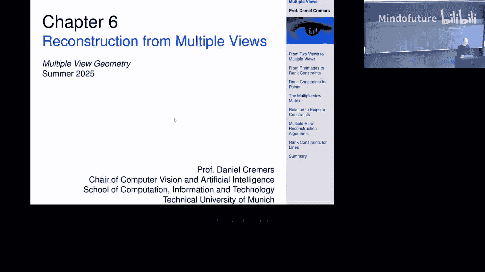
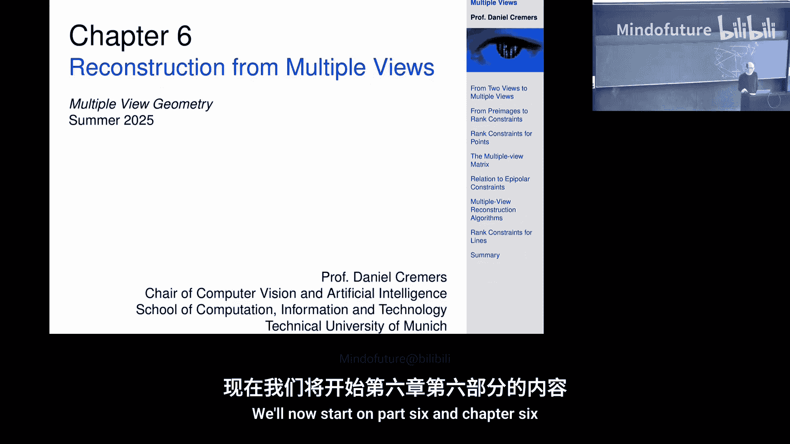
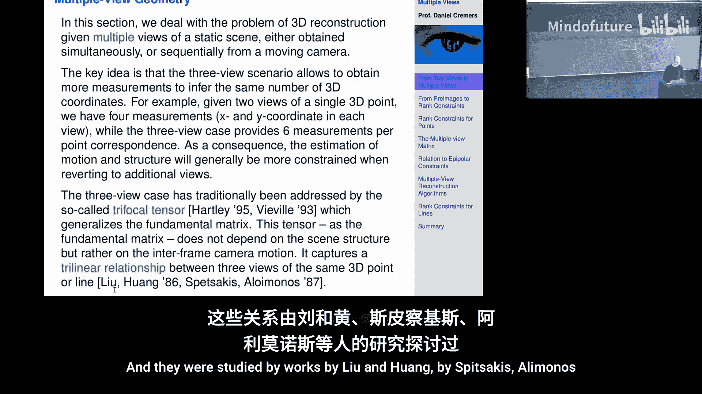
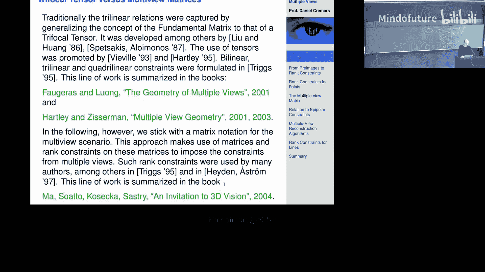
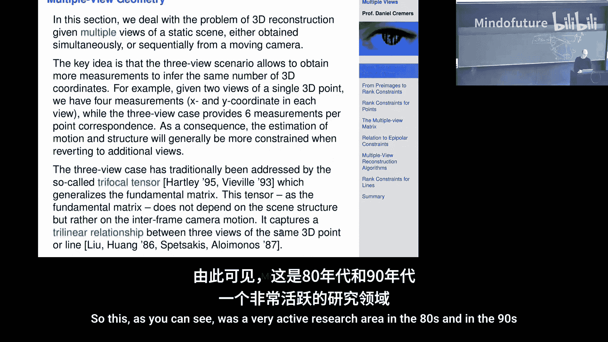
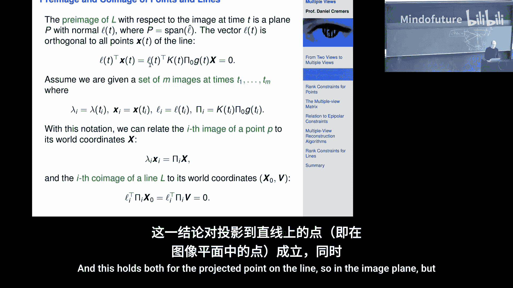
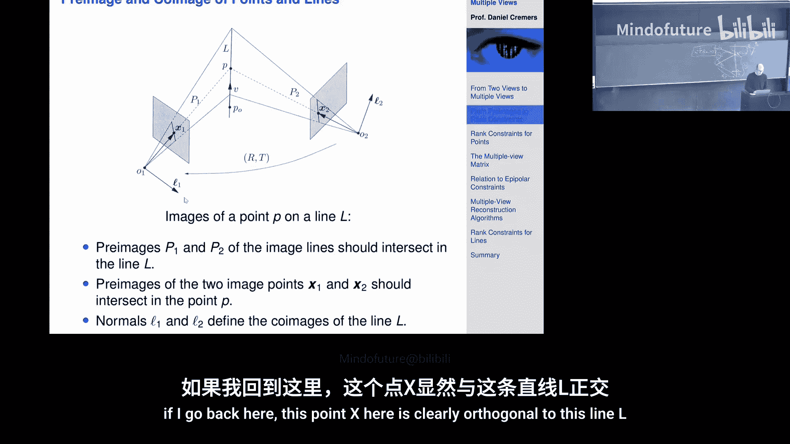
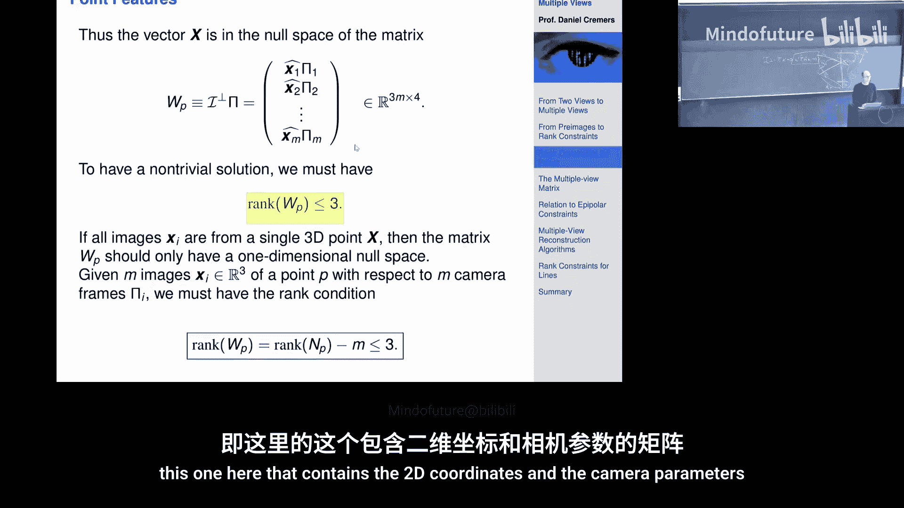

# 【慕尼黑工业大学】多视角几何 ｜ Multi View Geometry 2025 p11 P11_讲座_10b_基于多视图的重建_第1部分 -BV1KgZEBrEXV_p11-

We'll now start on part 6 and chapter 6 and this is the reconstruction from multiple views。

 I've already made the drawing here so this is where we have x1， x2。

 and then we have x3 and possibly more cameras where we observe the same point。

And。I was debating whether I should keep that chapter， but I decided to keep it。

 it's rather technical， but it really， you know since this class it's now called multiple view geometry you know it's called 3D computer vision but it used to be called multiple view geometry and this whole field was called multiple view geometry and obviously multiple is typically more than two。

 right？And so this is really the core of multiple view geometry that we'll touch on here。

 One of the key questions is to which extent is that practically relevant to。

 But I think there is something that is relevant and that will likely come back even in the deep learning age。

 and that is the fact that，If I take multiple images。

 you saw that I can build constraints for two views x2 transpo T hat R x1 equals0。

 This is the essential constraint or Epolar constraint between pairs of images， right。

And now you could say， well， if I have a whole lot of images。

 then I will just take lots of pairwise constraints between pairs of images。

 always seeing a set of points in these two images in these two， in these two in these two。

 right and you can enforce all of these constraints。 The question is。

What if I observe the same 3D point in three images。

 Can I derive a constraint that tells me that it's in three images。

 And is that equivalent to enforcing constraints with respect to pairs of images。

 And what we'll see in this chapter is no， it's not equivalent。 There is more in enforcing。

Multi view consistency across three views， then across lots of pairs of views。

And before I go into technicalities， I'll show you an example so that you get the intuition。

 why we do what we do。Here's an example。 Here's another example。😔。

So these are examples where I have three cameras located at 0102 and03， and I'm observing points。

 right。In fact， I observe 1 point p。And now， if you look at these examples。

 you see that I can enforce consistency between views for all pairs of cameras。

And I always get a consistent reconstruction for every pair。But it's not the same one。

 It's three different points said I reconstruct。This point P down here is the reconstruction from cameras 2 and 3。

They intersect in this point。 All good， right， And that's all this constraint says。

 all this constraint says for pairs of cameras is they should intersect somewhere， right？

 So if you enforce that they should all inter for every pair of cameras。

 the the observe point observations should intersect somewhere。

Then you still don't guarantee that it's the same point。There is no consistency for the three views。

 So this point is in the intersection for cameras 1 and 3。 This is 2 and 3。 This is one and 2， right。

 and they're not consistent。Or this same thing， right。

 where I have you know three points at the intersections for three cameras， they're not consistent。

So in that case， the question is， can we assure consistency for more than two views and in fact。

 we'll see that you can and that will bring you a benefit。

And even though three views are often not used as much in a lot of software today。

 I do believe that enforcing three view consistency can make things more robust， more stable。

And so this is what we're going to look at here for how we get from two views to multiple views。

 and we'll talk again about this concept of pre images and how we can enforce consistency。

So this is this whole field of multiple view geometry that was sparked by studying3，2，3。

 four more views of。And there is different ways to tackle it。But basically。

 you can look at it if you observe the 3D point， not in2， but in more images。

 then you get more measurements of the same point。And so it should create more constraints。So。

 for example， if I have a three view case and for every point that I observe in three views。

 I get six measurements。 the x and y coordinate in every of the three images。

And so you can see even just by looking at the numbers how many。

 you know this is usually a good thing to do when you solve science problems to think about how many knowns。

 how many unknowns， how many measurements， how many unknowns right and the unknowns here always 3D for every point that I see 3D point I get three unknowns right that come in。

But for every image that I see from that point， I get two knowns， right？

So obviously from a single image I cannot reconstruct because I have two measurements and I have three unknowns。

 from two images， you have four measurements， three unknowns。

 and from three images of that point you have six measurements。3 unknowns just for the point。

And so one can see that by using more projections of this point。

 I can constrain things more and I can use the information that the point that I'm looking for should be consistent with all of these projections。

This three view case has traditionally been addressed by the socalled trifocal tensor。

 introduced by people like Hartley， Richard Hartley。

 who are still around on conference in Vville in 93， even and it generalizes the fundamental matrix。

 So this fundamental matrix or the essential matrix here。 It couples two2D coordinates。

 and there is a constraint We'll see that couples three2D coordinates。

The 2Ds of the same point with respect to three images。And much like the fundamental matrix。

 the idea is that this tensor that couples them does not depend on the 3D structure。

 but only on the inter frame camera motions between image 1 and image 2 and image 1 and image 3。

So I'm going to have multiple rotations and multiple translations and to capture these relationships and whereas this is called a bilinear relationship。

 y bilinear because it's linear in these two parameters right in x1 and x2。

Triryline means I get an expression that is linear in all three parameters。

And they were studied by works by Liu and Huang， by Spitzzaki， Salimmonos and many others。

So this， as you can see， was a very active research area in the 80 and in the 90s。

And it's summarized in a series of books， for example， Oliv Fojus， one of the pioneers in this field。

 he wrote together with long this book on geometry of multiple views and then Hartley and Cissarman came out with their multiple view geometry book and so yeah。

So these all advocate this use of the triffocal tensor。

 and what I'm going to use in this class is built on this book by Mauatto Coikacestry that just uses linear algebra so you don't actually need the notion of tensors and tensor algebra。

😔，And this was developed among other people by Bill Triggs， by Ands Hyde and Ustrm and others。

In their 90s。Here's the idea。 We tackle this with this concept of preimage。

 we discussed the notion of pre-image so you remember when I have a point observed in an image then the preimage is the entire line here all possible 3D locations if you will that give rise to the same projected point that's the preimage of that point now if you observe that same point in multiple images then let's call it x1 through xm is a point observed in m images then the pre-image for these multiple observations is nothing but the intersection of these preimage and so for example this is the pre-image for x1 this is the preimage for x2 and the pre-image for both is the intersection is the point where they intersect。

And so pre image computation is essentially the same thing as reconstruction。

Once I compute the pre images and intersect， then hopefully I get a unique solution。

 and that is the reconstruction。We talked about pre images of points and lines。

 so here again is this idea that you have a line observed in two images and then the pre image of these two is the intersection of these planes。

😔，When we talk about points here the idea is that we have a point that is observed from a moving camera so a large x is the point once the camera moves over time。

 I have to rotate translate it into the coordinates of the camera， then standard projection。

 intrinsic parameters， as you can see in principle they can change over time if you want。

And that is the projected point up to the depths。So lambda of t is the depth of the point。

 k of t is the intrinsics over time and pi0 of the generic prediction。😔，诶。

And this is the rigid body motion， rotation and translation。And you can do the same for a line。

 so if you have a line in 3D， this is how it's parameterized with a base vector x0 and an offset V where the last in homogeneous coordinates the base vector obviously has last component 1 and the offset has last component 0。

It gives the direction of the line。Now we can do pre image and co image of point and lines。

 and then we can say the pre image of a line L with respect to the image at time T in the plane with normal L。

Where P P is this plane that is spanned by Lhap。And。

And this vector L is the vector that is orthogonal to these points。

 I guess you can see it in this image， this is the vector L， it's orthogonal to the plane。

 so the dot product with L must be0 and this holds both for the projected point on the line so in the image plane。

 but also so if I go back here， this point X here is clearly orthogonal to this line L。

 but also the point P this line is orthogonal to L。😔。

And that holds for any point on the line。 And so I can say this must be0 for all times。T。嗯。And now。

 Im。Let's see， I write I introduced this more compact notation to make things a little bit more transparent pi I is the projection at time T into that includes the rigid body motion。

 the standard projection， and the intrinsics。L I is the normal vector on the plane at time T and lambda I is the depths of the point at time T。

And so with this notation， I can write the projection of a point P in its world coordinates into the image I can be written like that。

 some projection matrix gives you the 2D coordinate up to scale Lada。And for the line。

 it's similar So this is for a point observation， but for a line， I have the same。

 and in that case I have two constraints， two equations。

 one for the baseline vector and one for the offset vector。And so these constraint equations。

 these equations， they contain the 3D parameters of points and lines as unknowns。

As in the two view case， we want to eliminate these， right， We want to find。The camera motions。

In the two view case， we saw how do we eliminate it。

 we introduced this apolar constraint that contains the essential matrix and the 2D coordinates。

 The question is， how can we extend that to to three and more views。

And this has been studied extensively and so here I will do this in more detail for point features and then I should say compared to the last years I compressed this class a little bit。

 so for the line features I basically just summarized it because it's not as relevant really。

But let's look at the projection of a point into M images。

 so here this is the point x and this is the projection into a set of images pi。

 and this is projections into M images and they're given by the 2 d coordinate x1 times the corresponding depth value Lada 1 or in image 2 x2 Lada 2 image Mxm Lada M。

 and so to write this very compactly I can write the projection of a 3D point into M images with a single equation in this form。

Where basically I have this projection that models the projection into all these images。

 and these contain the rigid body emotions and the intrinsics as we saw before。

And then I have a vector lambda that contains the dips values for all the M images。

And that's the vector that I'm looking for。 This is the unknown。 But then also， keep in mind。

 the projection matrices are also unknown。 So this is， again， an equation that looks linear。

 but it's not。Because the only thing that's known， really， is I。 This is the 2D coordinates。

 Thats is known。 All the other things are unknown。 I don't know the 3D coordinate vector。

 I don't know the camera transformations in the projections。 and I don't know the scale parameters。

 The distance of that point from camera 1， camera 2 and camera 3。 So all of these， et cetera。

 I don't know。And so what we're going to do is much in analogy to the apolar constraint。

 We're going to eliminate things from this equation to get some compact constraint that ideally only contains the 2D coordinates and the camera motions。

 So we want to kick out both the lambmbdas and the large X。How do we do this？ Well。

 let's introduce this matrix NP。So this is just stacking the pi and the eye next to each other。

 So here's the projection matrices into the M images。

 here's the known 2D coordinates all in one massive matrix， right。

And then we can say now this matrix must have a nontrivial right nu space。 and in fact。

 it is this vector x and minus lambda transpose。 If I multiply NP by this vector I must get0 because that's the equation we have here right So what I'm doing here is just rearranging the terms。

 So I write i lambda。I lambda minus。 and what is it。Pi times x equals 0。

 and then I can stack the I lambda into one and the minus the lambda and x into a vector。

 And then I can see this vector here， this one， it leaves。In the null space of this matrix。

 So you see， we try to again， model things with matrices and the solutions that we're looking for are in the null space of the matrix。

So we know that there is a vector such that and it's nontrivial it has some 3D coordinate。

 some depths values， so not the zero vector， some other vector that is mapped to0。

 which means this matrix， a 3 m by m plus4 matrix cannot have full rank。Full rank would be m plus4。

And we know that there is a non trivialvial nu space。

 so we can say the rank of this matrix must be at most m plus 3。

What do we enforce with this rank constraint by saying the matrix is rank deficient。

 It doesn't have full rank。 We are saying there must be a non trivialvial vector in this null space。

 and that essentially says there must be a 3D coordinate vector and depth values Lambda such that there is something in the intersection of all these images。

 So it's almost the same as the epiponal constraint just for M images。

We can say the rank must be deficient。 There must be a vector in this null space that contains X and lambda。

And here you see the beauty of it by imposing this rank constraint。 What do we gain。

 We get a constraint that contains what the 2D coordinates that we have and the camera parameters。

 So no 3D coordinates， large x and no lambda values。😊。

And so this is how you can use the notion of matrix rank constraints。

 saying the rank of a matrix that will in generally have rank m plus4 can only have m plus3。

 its's rank deficient， and that allows us to enforce a constraint。

Between the camera parameters and the 2D coordinates。

So this is really the extension of the Epolar constraint that couples camera parameters and 2D coordinates in one constraint here。

 same thing， one constraint that contains in this matrix NPP。

 the camera parameters here and the 2D coordinates。Now， this constraint is a little bit large。

 and so what we can do is we can compactactify a little bit。

 and this is what we do as we introduce this matrix I bottom。And this is just x1 hat to XM hat。

 so this is a bit in analogy to what happens in the A point algorithm that you also eliminate things and so this matrix has the property by construction of annihilating I I has on the diagonal x1 through XM right this is this I here。

If I multiply this with x1 hat through Xm hat， then obviously I get0。

 which means if I pre multiply this equation here this equation here with I hat from the left hand side。

 then the I term disappears and what remains is I hat times the projection matrix times x equals 0。

And so this says that the 3D coordinate vector x must live in the null space of this matrix i bottom times p。

And this is a。I bottomom times P is a matrix W P。 we call it， and this is a 3 m by4 matrix。

 and in general， it will have rank 4。 but now we know there is a vector x in the null space。

 a non trivial， not the zero vector， non trivial vector in the null space。

 So this cannot have rank 4。 It can have at best rank 3。And so this is another way to phrase it。

 So I have a rank constraint on this matrix W。 this one here that contains the 2D coordinates and the camera parameters。

