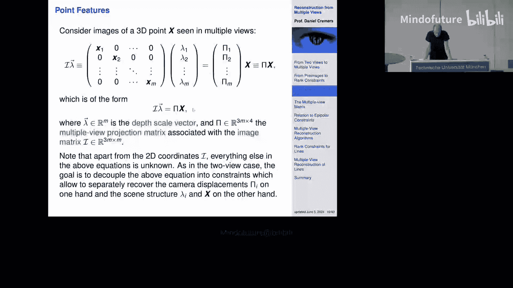
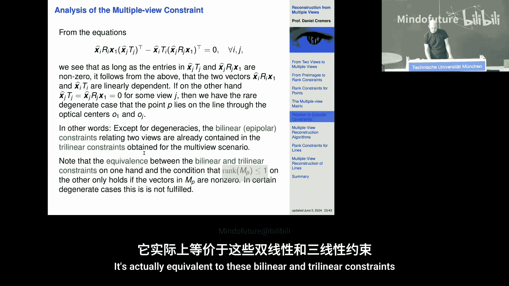
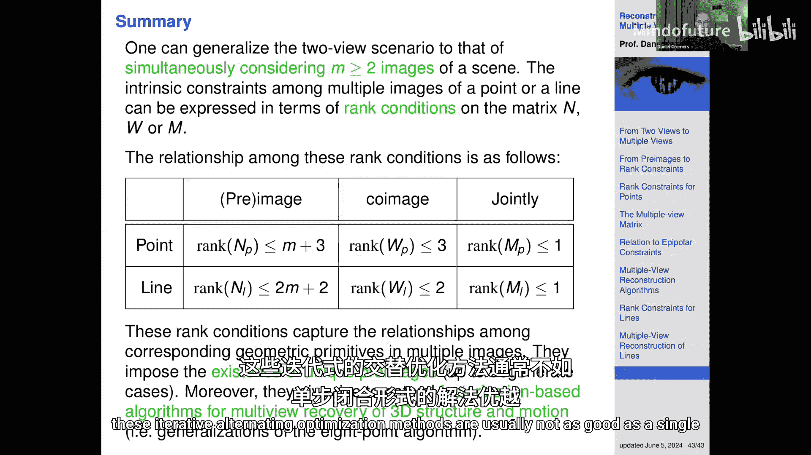

# 【慕尼黑工业大学】多视角几何 ｜ Multi View Geometry 2025 p12 P12_讲座_11a_基于多视图的重建_第2部分 -BV1KgZEBrEXV_p12-

We talked about this is， as I mentioned and you'll see it today， I'll prove it to you。

 and this is the most technical part of the whole lecture。So。Brace yourselves。嗯。

What we're going to do is we're going to derive constraints for multiple views。

 so we derive the Epolar constraint。From which we then developed the eight point algorithm and in this chapter we're going to extend this to multiple views and we'll focus on points observed。

 not in 2 but in multiple views and this is what you see in this equation this equation describes the observation of points。

 and the 2D points are x1 through XM， it's basically one point large x that is observed in multiple views。

And we have these projection matrices that model the projection of that point large x into M different views。

 so not two with a aippolar constraint we would just have two lines here here we have M lines M observations of a point large x。

And these observations in the 2D images are called x1 through Xm。And here are the unknown distances。

 Lambda 1 through Lambda n that is the distance to the point large x and you remember if we take the 2D coordinate and scale it with its steps。

 if it's in homogeneous coordinates， then we get the 3D point。But up to obviously。

 the camera transformations that are encoded into in these pies。And this is very general。

 often we took the view where we said the first camera is the reference coordinate system。

 but here we can have world coordinates and the first camera can have its own rotation and translation。

So this is the equation and if we write it in a very compact form， we can call this matrix I。

 this vector lambda， this matrix pi。And then， X。And what we do now we rearrange this。Basically。

 you see pi and。I will put into one matrix。And then。

And then basically we have the constraint pi I times this vector x minus lambda equals0 right so what we do here is we take everything to the lefthand side I lambda minus pi x equals0 and then we write this pi I into one matrix and then x trans minus lambda transposed into another vector and then we have this matrix called it NP times this vector u must be0。

 so this equation here is the same equation as on the previous slide。嗯。Yes。

 so we wrote it in one equation why do we do that well now we can interpret we can say oh。

 this matrix NP， this is this matrix， this is a matrix that has a vector in the null space。

And that is a nonzero vector because it contains the depth values and the 3D coordinates。

And what's interesting here is again， in this way we separated the 3D coordinates and the dips values from the camera coordinates。

 so this matrix NP， you can see it， it only contains the camera transformations。

And the 2D coordinates that we know they're given。And so now we can say since this vector。

 U lives in the null space of this matrix NP P。The rank of this matrix cannot be full rank。 Allright。

 so this vector U is in the null space and that means the matrix does not have full rank。

 And here you see you know this is something I found interesting we talked about the rank of matrices in the introduction to linear algebra when I learned about ranks of matrices I thought that was a completely useless concept it is not you can actually do things with it。

 you can say here， for example， we have a matrix that has is of dimension 3 m times m plus4。

And so the rank can be at most m plus4， but if the rank is m plus 4， then it has full rank。

 then the null space is only the zero vector。Then we can argue since there is a non zero vector U in the null space of this matrix NP P。

The rank cannot be full rank。 and since the rank is at most m plus 4， it means if it's not full rank。

 it must have rank at most M plus 3。And more specifically， and we'll use that later on。

 we can say if there is a unique reconstruction， there must be a 3 d point x and depth values lambmbda such that this vector is mapped to0 by this matrix。

If that vector exists， then the rank is n plus3 of the matrix。And if that vector should be unique。

Up to scaling。Then the rank should be not less or equal to m plus3， but exactly m plus 3。

 because if it's less than m plus 3， maybe m plus 2 or m plus one。

 then it means the solution is non unique。And this is how you can use the rank and look at the rank of this matrix。

 and it will tell you everything。If the rank is m plus 4， that means there is no solution。

 no vector that lives in an nu space， if the rank is m plus 3。

 there is a unique solution and if the rank is m plus 2 or less。

 then there are potentially multiple solutions。Then there is no unique reconstruction。😔。

And so just by computing this matrix and looking at its rank。

 we can basically define the number of solutions from none to a unique one to infinitely many。

And so what we're going to do is basically we're going to say。This is the matrix NP P。

The camera transformations between the various images must be such that the rank is exactly m+3。😊。

And this is how we can constrain what kinds of camera motion are conceivable with these multiple views of a point。

And so this is much like the Epolar constraint， which tells us about what camera motions are conceivable here。

 we have a similar one。And the constraint should be the rank should be M plus 3。

Now this is a little bit tedious。Oh， and then and then we rewrote this。In the following way。

 we defined this matrix I bottom where we have on the diagonal x hat x1 hat through XM hat。

And it has the property of what's called annihilating eye。Remember I was this matrix here。

 this one which with the Xs on the diagonal， and X hat is always such that X hat times Xi is 0。😔。

So if you define this matrix with the X hats on the diagonal。

 it has the property of basically killing Xi。And so if we pre multiply the above equation with i bottom。

We get， you know， i bottom times i is 0 and i bottom times pi is not necessarily zero。

 and so what we end up with is basically this equation。I bottom times pi times x equals0 so is。

ARewrite， this can be deduced from applying this matrix。

And so it means we have a matrix I bottom times pi that has a vector x in its null space。

 And since that is the 3D vector encoding the vector encoding the 3D point， it is not a null vector。

 So there is a non trivialvial vector in the null space of this matrix。

And this is what we call WP is this matrix i bottom times pi and since i bottom has on the diagonal。

 these Xi hats and pi has on the diagonal， the pi eyes。We have Xi hard times pi I on。And you know。

 stacked into this matrix here。😔，And what dimension does it have again。

 you'll see we always compute these matrices， and then we look at the dimensions they have。

It's a 3M by 4 matrix。And now we're saying this matrix has a non trivial null space。

 there is a vector x in the null space and obviously we want this vector to be unique up to scaling。

 so the null space should be one dimensional and so the rank for a unique reconstruction should be 3。

If we allow multiple conceivable reconstructions， then we can say the rank should be at most three。

Why because it has rank four， you know default it has four columns， so the full rank would be four。

 but if the null space is not just the zero vector then the rank must be at most three so this comes in over and over this arguing about ranks of matrices。

And is there a fairly popular concept in the natural sciences。

 when dealing with linear algebra techniques that you look at matrices and you look at ranks of matrices like here？

And so we see we now talked about the matrix NP and the matrix WP and we showed that the matrix WP has a rank that is the rank of NP minus m and that is3。

 so you see we simplify things a little bit so we have。AMa with four。Columns。

And if we say this matrix should have at most rank three。

We can interpret this constraint geometrically， we can say the point X lives in the null space of this matrix and basically if we look at this matrix it defines a set of planes in fact two m planes I think I mentioned that last time and the constraint says that the point basically lives in the intersection of all these planes that you see here so this is the point observed in image one。

 this is the point observed in image2。And this is the geometric interpretation of this rank constraint。

What we're going to do now is we're going to rewrite this even more compactly。You know。

 if we go back， what did we derive， we first constructed a huge matrix that is 3 m by m plus4。

 and we said its rank is at most m plus 3。Then we constructed a more compact matrix i bottom times pi that we call WP。

And we said it's a 3 m by4 matrix， it has at most rank  three。

And now we're going to compactify that even further。

You'll see in a second basically and you see in order to do that。

 we go into the coordinates of the first camera， so the projection matrix for camera one we assume is just the identity of rotation and no translation。

 so we are the world coordinate system is the system of camera one。

And then we have the remaining cameras with rotation and translation here。

And these are3 by four matrices。诶。And they model the projection of a point x into the individual images。

And then we can define this matrix WP here it is。And now we'll do something that at first glance looks a little bit weird。

We take this matrix W P and multiply it with this matrix， D P。This one here。This is a4 by5 matrix。

 and what's important about this matrix， it's a matrix that has full rank。Why does it have full rank。

 as you can see， it has five columns。 No， Er 3。4，5 five columns。

And basically what you have here has and four rows， so it's a matrix that has at most rank four。

But it has here for independent。😔，Columns。As you can see， this one is a rank 2 matrix， this x hat。

These hat matrices， we talked about it， they always have rank too。Unless there're zero。😔。

And this is a vector x1 that is actually orthogonal to the vectors here， so it defines another。

 it adds one more to the rank so this together gives it rank 3 and then here we have a01 so we have a component here that creates basically is linearly independent from the sorry from the other columns。

And so this has four linearly independent columns， and that basically entails that you can look at this matrix and you'll see it has the rank four。

And that means it's a full rank matrix and why is that important。

 we mentioned that in the linear algebra section， if you multiply any given matrix with a full rank matrix。

 then the product will preserve the rank， multiplying a matrix WP with a full rank matrix does not affect does not affect the rank so if WP has a certain rank。

WP times DP will have the same rank。And if you do this multiplication。

 it's a little bit tedious to do quite honestly。😊，But I did it。

 I verified and indeed what you get out looks like this year。And I should say， at a first glance。

 you know， who comes up with these ideas， I don't know。I don't know who came up with this idea。

 but it's a technique that I read about in this book of Ma and Suato。😔，And Kose Caasri。

It's quite a clever trick because what you end up with is this big matrix here。😊。

And then you can argue since there are zeros here， this is how it was designed。

 So this matrix is designed so that on the top you have zeros here。

And here you have x1 hat times x1 hat。And now you can argue the whole matrix here。诶。

And this is two column vectors here。And you can argue this whole matrix has rank at most three。

 if and only if this sub matrix here has rank。😔，At most， one。

And that is because this matrix contributes a rank of two。So if this here had more than rank one。

 then together with this， it would have more than rank three。😔，This is the argument here， right。

 it's a little bit tricky。😔，But the argument is that since this already provides a rank of2。

 x1 hat has a rank of2 right and X1 hat at times x1 hat also has the rank of2 so this structure here contributes a rank of two and then this remainder can only contribute one more in terms of rank。

And so you can deduce that this matrix down here， this sub matrix。This one， let's call it MP。

 This must have rank1。And this matrix， these are two column vectors， right。

 So this matrix is a 3 times m minus1 times 2 matrix。

 so it has three times M minus-1 rows and two columns。

And these two columns must be linearly dependent。That means one must be a multiple of the other。

And this matrix has rank 1， that is the constraint。 So this constraint in green。

 rank WP less or equal to 3 is equivalent to saying the rank of MP is less or equal to 1。

And so now you see how we further compactified it， now we have an equation that contains。

 what does it contain， the 2D coordinates in the images and the rotations and translations for each camera are 2 T2。

 R3， T3 and RMTM。And this matrix has two columns， and they are linearly dependent。

This matrix has rank at most one。 In fact， you can argue if the rank of this matrix was 2。

 then there exists no feasible reconstruction。If the rank is one， exactly one。

 then there is a reconstruction that is unique up to scaling。And if the rank is zero。

 that means the matrix itself itself is zero， then you have non uniqueness in the reconstruction。

And so just by looking at a matrix with two columns， you can tell from the three cases on the rank。

You know， a matrix with two columns can there's only three possibilities for its rank， it could be 2。

1 or0。And that distinguishes the three cases of， you know， no reconstruction。

 a unique reconstruction and multiple reconstruction。

So to summarize the study of looking at projections of a single point large x projected into multiple images。

 we can construct this multi view matrix it's called。A matrix with two columns。And。

And we can say we can construct different matrices。

 but this matrix has a rank that is the same as rank WP minus2。

 and the rank of WP was the rank of NP minus m plus 2。

And all of these matrices have a rank bounded by one in order to have a reconstruction。

And they have a rank exactly one if the reconstruction should be unique。

So for multiple images of a point， we have these three matrices and if it's a single point that is projected into multiple images here and that we observe in these images。

 then these rank constraints must be fulfilled。We can， again， interpret this geometrically。

So here is the multi View matrix again。😔，And what does it say， So theres two columns in this matrix。

 and this matrix， basically， we are saying the rank should be by atmost one。 and that says nothing。

 but if you have two vectors， it means one vector is a multiple of the other。

So this vector here is a multiple of that vector there。😔。

That's what it means to be linearly dependent， and that's what it means to have rank less than less or equal to one。

😔，And in fact， this mimics the projection basically。

 you know the projection of the point into image I can be written in this way。

 we've seen that lambda I， you know， if we take this point and rotated into the coordinates。

我 is second。So these are the projection equations we derived them earlier here。

 lambda I Xi hat R X1 plus Xi hat times ti equals0。That that's basically saying that this。

 you know if this column is a multiple of that column。

 it means this thing is a multiple of that thing and then we can define vector lambda 1 at sorry scala lambda 1 such that lambda 1 times X I hat ri x1 equals plus x x2 hat t2 equals0 right is this is saying there dependent。

you may remember the definition of linear dependency was that theres a linear combination of the two vectors that maps to zero。

 here it is。And if you write that out， you can say MP times lambda 1，1 is 0。Now。

 you could argue why did we call the factor here Lambda1 this this scale a factor。

 It is actually the distance of the point from the first camera。

And so what it captures this multi view constraint， what it captures is that there exists a distance。

 and this is the distance of the point from the first camera that is not observable from just that first camera。

 but that becomes observable once you have multiple cameras。

So and that is the information about the point that is missing in the first image right if I see a point in the first image。

 then I know the 3D location should be along this ray， but what I don't know is how far it is。😔。

And this information is captured in this constraint that there is this physical distance of the point。

1 of the point from image 1。How does that relate to the Epolar constraints。

 we now have these constraints for multiple images of a point observed in multiple images。

 how does it relate to the Epolar constraints that we had for two images？

Here's the matrix again for this matrix to have exactly rank1。

 it basically means this vector and that vector must be linearly dependent， as we said。

And that basically means this thing must be a multiple of that。

And this actually corresponds to the apolar constraint between image 1 and image2 for the first pair and image1 in image 3 for the second pair。

 etc。And we'll see why that is on the next slide。But what's more is you could say， okay。

 if this thing is a multiple of that thing and this thing is a multiple of that thing， you could say。

 well， then it's nothing but all the apolar constraints between the first camera and the eyes camera。

But the truth is there is more in this constraint than just epipolar constraints。😔。

And the information that is in there is that not only is this。

Block here on the top sorry I can this thing a multiple of that thing。

Or there is a linear combination of these two that maps to zero。

 but there is a linear combination of these。With the exact same factors that maps to 0。

 So it's the same Lada 1 that models this linear dependency。

 And this is an additional constraint that is not trivial。

So it's not just one being a multiple of the other。

 but it's one being a multiple of the other with the same factor for all of these。

Blocks that you have here。😔，So let's look at this， I'm claiming that。

 but this being the linear combination of these sorry these two elements corresponds to the Epolar constraint。

 let's look at how that works， so the claim was that linear dependency of XI had TI and XI had riIT X1。

Gives rise to this Epolar constraint， XI transpo， TI had R X1 see。

 this is the Epolar constraint between image1 and image I。Sorry， this doesn't work super well。系啦。

So let's prove this， here's how it works。 assume we have these two vectors。

 X I had T and X I had R X1。We're saying there is a scalar such that one is a multiple of the other。

 let's call this scalar gamma。Now XI hat is nothing but XI hat TI is nothing but XI cross product with TI。

 and remember that is a vector that is orthogonal to X and T。Where is this one here。

X hat R X1 is a vector that is orthogonal to X and R X1。So we have three vectors here， they are X。

 T and R x1， these three vectors。And these victors。

Are such that if I do crossproduct between pairs of them。

 I get the normal vectors and these are coplanar， the two normal vectors so if I you know this vector here is a vector that is pointing in the normal of the plane spanned by X and T。

So Xi and TI span one plane and that it's normal。And X and RX1 span another plane。

 and this is a vector pointing in the normal of that plane and now saying one vector is a multiple of the other means it's the same plane。

And it means these three vectors are coplan or。 They all live in the same plane。

And if you remember our discussion in a chapter on the Epolar constraint。

 we prove that this is exactly the Epolar constraint， it says that these three vectors。

 maybe I should draw a picture， these three vectors actually form the same plane。

And so we have now kind of。Deeduced。That this equation that says one is a multiple of the other corresponds to the apolar constraint between the two images。

And the fact that these three vectors form a plane can be rewritten in this way。

 we've seen it before， and that is exactly the apolar constraint。So here's the point large x。

 here's the observation in image1。😔，So this is x1。 and here's the observation in image。

 what do we call it I， right？ So this is X。And then we have a rigidgie body transformation and we can define this system and basically the statement is that these vectors that you have here。

 this one。And。And this one is X。😔，This one is T。😔，The translation vector here。

 basically this one and。Then we have this vector here and in the coordinates of the I's image。

 this is R times x1 because you have to rotate into the coordinate systems of the first camera with the rotation RI。

 this is TI。😔，And basically the statement that we have now is that these vectors， they form a plane。

 so this vector this vector and this vector， they all live in a plane。

 which implies that there is an intersection here。😔，Cause if they don't live in a plane。

 then you don't have any 3D point in the intersections。So it's， again。

 this aippolar constraint that we can read out。😔，But there is more。 so in this matrix here it is MP。

 as I said， it has two columns， right？And one column is a multiple of the other because the rank at most is one。

 so one is a multiple of the other。And if we write these two columns like this。

 so one is a column with A1 through AN and B1 through BN。

I don't know why I call it and it should be M probably。😔，Yeah。It doesn't matter。

 so it doesn't matter so there's two column vectors nonze and now we're saying one column vector is a multiple of the other。

 meaning the rank of this matrix is one。And now there are several statements you can make。😔。

And there is one statement， what we now showed is that if AUi is a multiple of B。

 then that entails the apolar constraint between image I and image1。That's what we just showed。

Will show that there is more in this constraint， though than just the pairwise apolar constraints。So。

 you know， we have this image eye and we have， you know lots of images and in principle。

 you know we can say we have aippolar constraints always between the first image。And the second。

 the first image and the third， the first image and the fourth， etc。

 but will show now that there is more information captured in these multi view constraint。In fact。

 what you can show is that this matrix with two column vectors of this form is ranked deficient if and only if。

These expressions are 0。 AI， B， J transpose minus B， I A J transpose is 0 for all pairs of I and J。

This is a statement that is a bit technical to prove it's a general statement in linear algebra。

 we're not going to prove it in this class。It's a general property for matrices of this form that they are ranked deficient。

If this holds。As another example， right， if you ever you have a class on linear algebra and someone were to prove the statement to you。

 you would likely say this is a completely useless statement， right？But turns out， no。

 and it' you know it's amazing how many things people in linear algebra proved and some of them turned out to be very useful。

 and this is one because what we can do now is we can take this statement from linear algebra and we can basically rewrite the rank constraint into these socalled trilinear constraints。

😊，Why are they trilinear？Because if we write that out for our matrix， right， our matrix， where is it。

 here it is。AI involves X2 and x1。And BI involves X2。And now we have the statement AI。

 Bj transpose minus BIAj transpose is0。If we write that out。Then this is what it looks like。😔。

This is the expression here。It's a little bit heavy。Let's have symbols here。

 But what's interesting is that each of these terms involves。Three points， namely the point X1。

 the point X I and the point X J。So I now have a constraint that always involves triples of cameras。

 triples of observations。 The Epolar constraint， remember was a constraint that involves pairs of observations。

 image1 and image I。Here now I have a constraint that involves three points simultaneously and also the motions between the three cameras。

Namely， the motion， the rotation from between the first and the I's camera and the rotation between the first and the J's camera。

And if I rewrite this out， you can multiply this out and then you see you have Xj hat transpose on the right。

 if you do the transpose you have to invert the order here and so you can pull out the Xj hat and you can pull out the XI hat on this side。

嗯。There is no transpose y because these matrices are skuw symmetric。

X hat transpose is the same as minus x hat。And we use this property and this changes the signs basically。

 and then you end up with this equation。😔，Or more specifically。

 you get an overall minus sign by doing this transpose。 And so you can rewrite it this way。

And this is a matrix equation， so it corresponds to three by three scalar three times three scalar triline equations。

 and in fact one can show that only four of them are linearly independent。诶。

I'm debating how much deeper I should go， as I mentioned。

 this is a rather technical chapter and I just wanted to give you an idea here of how this works。

So one can study these constraints。And look at what they say。

 they actually contain the bilinear apolar constraints except for degenies。So you can basically。嗯。

When if these entries here， Xj had T and Xj had this one here， if they are as long as theyre non0。

 you can deduce that the two vectors X had RX1。This one here， and。And this one here。

 that they're linearly dependent。And that we remember is basically the Apolar constraints。😔。

And so we can read out again， the Apolar constraints。

And what's nice is that we can rewrite this rank constraint。That we derived first。

 it's actually equivalent to these bilinear and trilinear constraints。

So here's where we left off。Discuss the projection of point observed in multiple images or not two。

 but more than two images as a way to generalize the apolar constraint that was derived for the two image case here Now the multi image case。

 So we have observations of that point in M images。 These are called little X1 through little X M。

And then we have corresponding camera motions between the different cameras relating the second camera to the first camera。

 the third camera to the first camera， etc cetera。 So these are R2 T2， r3。

 T3 rotation and translation of the eyes camera into from the first。

And then we derived constraints saying that if there is a point in the intersection of the various pre images。

Then the rank of this matrix must be one or it must be bounded by one for there to be a feasible reconstruction。

So we have rank of this matrix MP being bounded by one， this matrix has two columns。

OfLengs three times a minus1。So obviously with two columns， it will have at most rank two。

 and the constraint says it should be at most rank one。

And that essentially means that one column must be linearly dependent with the other one。

 meaning there is a linear combination that is that maps them to 0。

And that means there is a two dimension vector with coordinates Lada 1 and 1。

 such that MP times this vector must be zero。And so in some sense。

 this rank constraint really captures the unknown distance Lada one of the point P that we're looking at from the first camera。

And this information， this distance from the camera is missing from one single image， but it is。

 as you can see here contained in the observations from multiple images。Next。

 we showed that one can derive the planar Epolar constraints here。

 so for this matrix to have exactly rank man， the two vectors must be linearly dependent and that means that one must be a multiple of the other and as we've seen as we've seen next slide here。

 you know so if one of these vectors Xha T is a multiple of the other with some factor gamma。

 this enhales the Epolar constraints， something we'。第二。

Because basically it says that it all comes down to saying that these three vectors， X。

 T and Rx1 all live in the same plane， meaning they're coplanar。

 and that you remember is you know if I have these two observations of a point。

 here's that the vector connecting the optical centers is the translation vector and then two Xs。

 X is one Rx1 is the other one in the coordinates of the I'1 then saying this basically says they all span a plane and that implies entails that there is a point in the intersection of the two observation vector。

But there is more information contained in this Epolar constraint than just that and sorry。

 theres more information contained in this multi view constraint saying rank MP should be one or less or equal to what。

Then just the Apolar constraints， and this is what we'll see here。

And for that will' make use of a property of a result from linear algebra。

 and that is a result that applies to any matrix with two column vectors。

 A1 through AN and B1 through BN。And the statement says that this matrix is ranked deficient。

 if and only if we have these properties， AI， BJ transpose minus B， I， A J transpose must be。

This is a statement that will not prove here from Linear algebra， but we'll just make use of it。

And if we do that for this matrix， if we write out these constraints for this matrix。

And as you can see， they always involve one element from the first column and so AI， BJ， BI， AJ。

 these are four different elements from these two matrices。And if we write that out。

 then we get this constraint。It's a somewhat lengthy constraint， but let's look into it。

 it contains again 2D observations of points in the first image in the I's image Xi and in the J's image Xj and it contains corresponding camera matrices。

 rotation and translating related translation relating always the I's on the J's image to the first image。

And so this is called a trilinear constraint， why is it called trilinear because it's linear in three elements。

 right it contains the elements of the observations of points in three cameras rather than two cameras。

And this is a very important observation here， the fact that this multi view constraint。

 which in principle contains information of a point observed in M images。

For this multi view constraint to be fulfilled， it is equivalent to having these triline constraint fulfilled。

 So constraints that only coupled three images at the time。And that's a surprising observation。

 it basically means that once we have information about three images at a time。

 it doesn't actually provide any additional value to consider four images or five images at the time。

So if we consider all conceivable triplets of images and we impose these constraints。

 that is as much as we can extract in terms of information from multiple use。

So we'll see that the trialline constraints contain more information than just the pair wise everypolar constraints。

But it also basically implies that considering more than three image doesn't provide additional constraints。

So these trial linear constraints， they basically form a matrix equation。

And its a three by three matrix， so it's nine scalar tri linear equations。

We'll analyze these now and we'll look at what they contain contain in addition to the I linear apolar constraints so first observation is if these entries here these are vectors ex hat Tj and this one ex had Rj x1 if these are non0。

 then basically this entails that these two vectors are linearly dependent y because there is a linear combination here of these two vectors that maps to0。

If on the other hand， both of these are zero， this could happen it's a rare degenerate case where xj hat Tj is0 that。

Is the cross product of X J and TJ。And this is the cross product of Xj and Rj x1。

 and you know the cross product is zero if the vectors are。

Parallel because the cross product is basically a vector normal to these two vectors， right？

But for this to be0， it means they all line， lie on a line right and that happens in the degenerate case that the point P that we observe from these two cameras lies on the line through the optical center。

 so you have these two camera centers and if the point you're looking at is exactly on this line you know it's very rare case。

 but theory could happen then we have a degeneracy。But except for that very rare degeneracy。

 the bilinear constraints relating the two views are already contained in the trilinear constraints。

 why is that well because the fact that these two vectors here sorry。X I hat RI X1 and X I hat T。

 the fact that these are linearly dependent， we saw that earlier it actually is equivalent to the Epolar constraint。

It is equivalent to saying that these three vectors， the translation vector xj and Rj x1。

 that these three vectors， they form a plane。And that was nothing but the Apolar constraint。嗯。嗯。

One more observation is that the equivalence between the bilinear and trilinear constraint on one hand and the condition that rank is of MP is bounded by one on the other only holds if these vectors in MP are nonzero here these two column vectors that we have in this multiview matrixmp。

If they are non0， if they're both0， this is a very rare degenerate case。

 Then it doesn't entail these biline or triline constraints。

Now we always are aiming for the case that we have a unique pre image so that there is a unique point in the intersection of the various pre images。

And what we can now do is show how the bilinear and triallinear constraints that we have here assure the uniqueness of a pre image of a point observed in three images。

So let's say x1， x2 and x3 are the 2 d point coordinates in three cameras frames with distinct optical centers。

 So this is important that camera actually moves from one location to the next。For example。

 all of this would not work if you just rotate a camera with the optical center in the same place。

 you have to have distinct optical centers to have this parallax that would allow you to infer a meaningful 3D point。

If these three images satisfy the pairwise Epolar constraints， then a unique pre image is determined。

 except if the three lines associated to image points x1 x2 and x3 are coplanar。

So let's look at that what is。YesAnd here these sorry TIJ and RIJ refer to the transition between frames I and J。

So we have three frames one， two， three with indices， IG can be between one， two and three。

 and then we have these epipolar constraints between pairs of images。

This degenerate case that we mentioned here that the three points are co planar。Let's look at that。

 That would be this case here， right， So here are the three optical centers。

 Theyre in general position。 right， They form a plane。 This is the so called trifocal plane。

 And now we say the point P that we're looking at lives in the plane plan spanned by these three optical centers。

If that is the case， then as you can see here in pairs of images， there is always。An intersection。

Of the observations， say， for example， camera 1 and camera 3 here。

 there is also a point in the intersection for camera 1 in camera 2 and camera 2 and camera 3。

 but these three points need not be the same。So I have basically three points in the intersection of pairs of of greys。

 but they need not be the same。And this is quite a rare or rather seldom setting that the point I'm observing happens to live in the same plain spanned by the three counts。

 and that is then a degenerate case where I cannot expect to uniquely reconstructible。Fortunately。

 that setting doesn't happen very often。Similarly， if these vectors satisfy all trialline。

 and so here you see this is an example where the pairwise epipolar constraints are not sufficient to assure a unique pre image。

 right？It basically means if I just impose pairIY Epolar constraints。

 I cannot be sure that the point P is uniquely defined by these Epolar constraints because I can have three different point P such that the pairwise Epolar constraints are fulfilled。

But we'll see that the triline constraints are actually stronger than the Apolar constraint。

So if these three vectors satisfy the all trial linear constraints of this form。

 then a unique pre image is determined also in the case above。

And this kind of pathological case is determined unless the three lines associated to image points x1 x2 and x3 are coline so not co planar but actually coline that is this。

S to say cold， wholelineia means they're along the same line。This is a very rare case。

When can that happen， So there is one case where this can happen and actually does happen in practice。

 And that is a case where in the context of autonomous driving。

 let's say if you're driving down the highway in a straight line。

 then all camera centres live on a line。And then if you observe a point right where you're moving。

 the focus of expansion， it's called， then you can imagine that all these observations。

 they are all colonline and that is a degenerate case where you cannot recover the 3D position of that point that you're moving to。

Any point along the ray in your direction of motion will be a valid reconstruction。

And it doesn't matter how many observations you have along this line that you're moving。

 So if you're really moving along the line and looking along that line。

 this is a clearly degenerate case。So these are two statements about the uniqueness of the preimage that we can expect from the Epolar constraints and from the trilinear constraints。

 it kind of shows you that you have a better way to impose a unique pre-image by looking not at just pairs of images and their epipolar constraints。

 but by looking at triplets of images and the corresponding trilinear constraint。

So this is one degenerate case that we discussed where we have pairs of Epolar constraints from three cameras。

 but since the point P is in the plane spanned by these three cameras， we don't have a unique。

Pre image from the Ipolar constraints。And。Here is another degeneracy for the pairwise apolar constraints。

 this is an example where the optical centers lie on a straight line。So， for example。

 as I mentioned the case when you're driving down the street。

 and then even if you're not looking in the direction youre driving， but out to the side window。

 let's say， And you observe some point there。Then you you know since the optical centers are on the line。

For any point that you observe， no matter where in 3D space。

 then the optical centers together with that point will form a plane。And then again。

 as you can see in this example， you will not have a unique pre image just by considering pairs of lines。

You consider pairs of lines， say x1 and x2， you say there should be a point in the intersection。

 you consider x1 x3， you say there should be a point in the intersection and then x2 and x3 again。

 you impose the epipolar constraints saying they should intersect these lines right so you impose all the possible epipolar constraints and still you do not get a unique pre- imageage necessary。

So this is a case where the point P and the optical centers again live in the same plane。

 and that is not so rare it happens when， say a car moves on the highway when an object moves in a straight line。

And。And then for these cases， the Epolar constraints will not allow a unique pre imageage。

 both in this case and in that case。And so this is rare because it means only very specific points will fall into this category。

 but this case is more common because it happens frequently that the moving camera moves on the line。

And then you can run into trouble by imposing just the apolar constraints。

 but for both of these constraints， the triline constraints are considering triplets of points will assure a unique pre image。

As I said， unless the point P now in this scenario here also is on the same line。 Then obviously。

 there isn't anything we can do。So you can see a little bit the geometric interpretation of these Epolar and triline constraints in these settings。

 and this is the key message of this chapter really is to say that considering more than two images in fact。

 three images at a time will help to better constrain the reconstruction to assure that there is a unique pre image that there is a unique reconstruction。

So you see that this multi view constrained on the rank of this multiview matrix MP。

 it allows us to distinguish three different cases since this matrixmp has two columns。

 its rank it have three cases， it can be rank0， if the matrix itself is zero meaning both column vectors are0。

 it can be rank1 or rank2 by that a three possible cases for a matrix with two column vectors。

And in these cases， we can summarize if the rank of the matrix is2。

 then there is no point correspondence， there is no point in the intersection of the various lines。

 and we have an empty pre image， so no reconstruction。

And that basically means that if these are really the camera motions that make up that are involved in this matrix MP。

 then the observations that you have cannot correspond to a single 3D point observed in these images。

And we're always assuming that there is a point P that we observe in M images， right？

And so in other words， the way you can use this multi view matrix is it gives you information about what camera motions are conceivable。

And the idea is that。That嗯。That we say， find camera motions such that the rank of this multi view matrix is one。

Ca in that case， we have point or bounded by one， right。

The feasible camera motions are such that the rank is either  one or 0。

And in the case that the rank is one， we have a point correspondence and we have a unique pre。

Whereas if the rank is zero， then we do have point correspondence。

 meaning there is a point in the intersection of the various pre imagess。

 but that intersection is not unique， it's not a unique point。In case of rank D equals zero。

And so how can one use these constraints？We can basically use them to decide which features too much。

Basically， we can say fine points in the image。And correspondences such that the rank of this multi view matrix is exactly one。

And that allows us to establish point correspondence over multiple frames。And lastly。

 we saw in the previous slides that these rank constraints on the multi view matrix can be equivalently rewritten in form of sets of triline constraints。

In always three images of a point and the corresponding camera motions between these three images。

And we saw that this is really equivalent and hence having more than three images at the same time in the constraint doesn't provide any additional information for the reconstruction。

Because we have this result that the multi view rank constraint is equivalent to all these trialline constraints。

And we saw this geometric interpretation， and we saw the various degenerate cases of points observed in three images。

And。Now we'll look into the Recon channel so much you know， so in some sense。

 the multi view constraint here， these rank constraints。

 they are the generalization of the Epolar constraint that we had for pairs of images to multiple images。

And much in the same way as we derive the8 point algorithm。

 we can try to derive a corresponding algorithm for reconstruction of camera motion and 3D structure in the multi view city。

So8 point algorithm was for two views， now what would be the analogous thing for multiple views？

And this is what we're going to tackle next。So the rank conditions here on the multi view matrix that capture all the constraints among the multiple images of a point and so in principle one could perform a reconstruction you know minimizing some global objective function we'll talk about that in the next chapter subject to these rank conditions and this would lead to some non nonlinear optimization problem analogous to what's called bundle adjustment in the two of you case。

 so it's a multi view bundle adjustment and we'll talk about these things in the next chapter。

But one can also aim at add something akin to the eight point algorithm or the analogous thing to the eight point algorithm that where we separately estimate structure and motion。

 and this is what will derive in the following such an algorithm。

 but one should point out that these algorithms are not necessarily very practical。

And these spectral approaches where you deploy kind of eigenvalue solutions。

 and they do not imply optimality in the context of noise and answer。

So both the eight point algorithm and the following algorithm for the multiview setting。

 they really assume that you're observing endpoint in M images。

And that you have exact observations and exact correspondence。And the key issue is in practice。

 you never really have that you never really have exact point corresponds。

 Sometimes you have correspondences there they entirely wrong where you're matching the wrong points across images。

 but sometimes you do match the right points except that due to the observability issue。

 They may not be precisely located where they should be。

 So there are some uncertainty in the exact location of these points。

 and the problem is that the way this uncertainty propagates into these kinds of spectral algorithm is not not very nice。

 So it degenerates the reconstruction。Significantly。But nevertheless， it's。

Possibly interesting to look into this algorithm to see how does the aid point generalize to the multiview setting？

And so let's look at that， suppose we have M images of endpoint Pj。

 So now you know before we had M observations of 1 point P， now we generalize this。

 much like in the eight point derivation， we assume that we are not observing just one point。

 but endpoint and these are Pj。And these observations， we will call them x1 J to xmj。

 so the observation of point J in images1 through M。

And what we want to estimate is the unknown projection matrix。

 the right condition that we derived earlier states that the two columns of this multi view matrix NP P。

For every point P are linearly dependent and if we write that out here it is。So here is。

 so this is the same as what we have before， except now we always have this upper index J for the various points from J going from one through M。

And sorry，And alpha J are parameters and we'll see that they correspond to the inverse dip from the first images。

So alpha j is just1 over lambda lambda j1， the distance of point J from the first image。

 so these alpha parameters they basically correspond to the inverse steps。Of the， of the point。皮。

Jay observed in an image 1。And you can see that because each row of this above equation can be obtained from just looking at this observation of point J images。

Okay。In these images， so these are the the equations connecting image observation up in the point in the image one and the image I。

And so this is base， there is equations coupling the unknown distances of a point from the first camera and the various rotations and translations of the camera。

And if we look at this equation。😊，It contains both the camera motions that relate the first camera to all the subsequent cameras to him it contains the observation of all the points in images to him。

And it contained and the image one as well here on the right side。

 and it contains the inverse steps of the first。OfOf every point with respect to the first camp。

And now we'll go a little bit in analogy to the a point algorithm。

 we'll assume that we have the depth of these points。So this alphaphate and the inverse steps。

 if we assume we know this one。Then what we can do is we can basically solve for the camera motions。

 right？Because why， because then we have an equation here。

 this is an equation that is linear in the camera motions， r2， T2， r3， t3， etc。

 you see that these equations are linear， assuming that all the other 2D observations we have them that we always have。

 in addition we now assume we have the structure parameters， so the distance from the first cam。

So you see at that point， we're slightly deviating from the eight point algorithm because the eight point really decouples the structure parameters。

 Lada J from the camera parameters here。We don't decouple it。

 but we assume that one of them is known so we derive what is called an alternating optimization method where you alternatingly estimate alpha J and a camera motion。

So here for known structure， known alpha J， we can solve this， we can write this if we rewrite this。

 we can basically use this chronic a product to extract。

 to basically write this as as a matrix vector。In this equation here here。

 if we use the Cha product to basically extract R and T here。

 then we can write all of this in the following matrix vector form where we always have X11 transposed Cha product with X I1 hat。

At times RIS and then alpha 1 X1 at T。And this is then one big matrix。

 and if we assume the alphas are known and the X's are given here。

 then this matrix p is a known matrix and we see yet again what we and here by the way。

 this is R stack is just the stacked version of this rotation matrix where we stack the three column vectors into one long nine dimension vector。

And so this is a vector that contains。9 elements for R I and then three for the translation。

 so it's a 12 dimensional vector and this matrix P is a 3 in by 12 matrix。

And now you see that the desired camera motions， they define the null space of this matrix。

And we have such equations for all the different camera motions。

And then we can say for this matrix to have a nontrivial null space。

 a nonzero camera matrix or camera vector here in this case。

 and the 12 dimensional camera vector containing rotation and translation parameters for this to be nonzero。

 we need this matrix that in principle can have a rank 12， we need it to be a rank deficient。

 there must be a nontrivial null space so we can impose and that this should be at most rank 11。

And in fact， for this to have even the possibility to have rank 11， we need， obviously。

 n must be at least6。And that's basically because it's3 n times 12。

 so the rank is always at most 3 n， but as we saw these  Q symmetric matrices they always only have rank two rather than having rank three。

 so it's basically this will be two。And。To in。And then with n equals6。

 we can expect the rank and could be 12。And so this is why we actually need at least six points。

 not eight points， but we need six points for this algorithm to work。

So if we assume that we have at least six points in which case the rank could potentially be 12。

 then constraining it to say the rank must be at most 11 is a meaningful constraint。In practice。

 one will typically use more than six points to assure that we have a full rank matrix here。

 and then we compute a singular value decomposition。 And as in the eight point。

 we will take the column vector associated with the smallest singular value。

 and that will give us the camera vector for camera I。AndAnd so you see， once we have structure。

 the alpha parameters the known in first steps， we can use this to recover the capitals。

By seeing yellowa value decomposition however again。

 we can use linear algebra techniques to compute the camera motion。And in turn。

 once we have the camera motion， we can use this equation here， right。

 that means then what is this equation if we have all the camera motions。R RI and T。

 then we have these these structures here and then we can determine alpha j by what's called a least squares estimation you know this this thing should be zero for all j from one through n and what we can now do is we can do the sum over all j and take the norm of this squared and sit and say this should be small。

And if you minimize this in a least squares fashion。

 it's then a quadratic loss function with respect to alpha J。

And then you set the derivative with respect to alpha j to0。

 then you get a linear equation in alpha J， which you can solve， and this is what this looks like。

I apologize that I didn't actually write out these steps。 It would be a bit lengthy。

 but in some sense， you can try that at home。 take this expression on the left hand side。

 Take the norm of it squared， sum up over all J from one through in。

And then you say this should be minimal， so you set the derivative with respect to alpha J。

 you set it to zero。And you get a linear equation system， you solve that for alphapha J。

 and you can find for yourself that this is what you get。Here is the sum。

From2 to m of these elements and then sum from the of these elements。

And so that gives us a way to iteratively estimate structure and motion。

 We can say if we know the structure， the alpha parameters。

Then we can use an SvD to compute the camera motion and if we know the camera motion。

 we can compute the structure。And one way to mimic the eight point algorithm would be to alternatingly solve。

And then the question is， if you iterative meol here， how would you initialize well。You know。

 you can always start with the two of you sitting。Make use of the eight point algorithm for two views of these endpoint and then use the eight point to compute an estimate of structure and motion and then use that estimate of the depth values Lambda J to estimate the multi the camera motions as shown in previous slide。

So you would use SVD to determine the camera motions here。

So you at first use the aid point for the first two images or any two images in your set。

And get an estimate of the depth values， Lada J。 these are the the inverse of the alpha J。

 so alpha j is 1 over lambda J。 and once you have the alpha js。

 you can use this multi view approach to compute all the camera motions。

And then you can do this alternation to， you know， refine the structure and refine the camp。

And this can be done either in batchmos or recursively。

And what's interesting is here the estimation of the structure parameters。

 If you look at this solution here， this actually makes use of all the camera motions in all the images and all the 2D observations here in the various images from one through M。

😊，Okay。Yeah。AndWhere the estimation of the camera motion， it only makes use of。It you know。

 they're estimated independently。Im sorry I this was wrong。

 let me correct this while the estimation of the camera motion。

 the projection equations makes use of the two frames one and yeah， that's what I said。

So this only makes use of the frames1 J。If you look into it， you have X1， and then you have X I here。

 So the observation of the endpoints in two images。

This one makes use of the observation of the endpointing all images。Here's then。

 so this concludes the aspect of the part of observation of endpoint in M images。

And we found an algorithm that was somewhat akin to the8 point algorithm。But you see in some sense。

 it's not as powerful as the eight point algorithm and that is in the sense that the eight point is really a closed form solution to get the camera motion and then 3D structure。

So we can really decouple the core problems of motion and structure estimation。

In this generalization， we haven't fully decoupled。

In the sense that whenever we estimate the structure parameters alpha t， we need the camera motions。

 and when we estimate the camera motions here， we need the structure parameters。

 we couldn't fully decouple things right。And in that sense， it's air is。

It's in many ways suboptimal as an algorithm for 3D reconstruction， because first of all。

 you use SvD singular value， decomposition approaches spectral solutions they're called spectral because you're using the eigenvalue spectrum of matrices。

And these spectral solutions， this is true for this multivi reconstruction。

 but it is typically true for a lot of areas in the sciences whenever you phrase something as a spectral solution。

 you know a closer look often reveals that you tend to neglect uncertainty and noise in the observation。

And so first we have to assume that there is no noise in the observations。 and secondly。

 we still don't get a really closed form solution， but we get something that is iterative in the sense that we alternatingly estimate Al J and the camera motions R I and T I。

And so this is kind of a downside that we see of this algorithm for reconstruction of structure and motion in the multi view setting。

 it is not as elegant as the eight point out。So this is for observations of points。

 we can do the same thing for the observation of lines。

And this is detailed in the book of Ma Soatto Koska and Satry。

 I have a brief kind of overview of this in the remainder of this chapter。

 so I don't want to go too much into these details here so let me just glimpse over it。

 this is not really， I don't think this is relevant will make sure this doesn't play a role in the exam。

 but I still just for your interest want to brush over it what you do as you consider again observations of a line in multiple images。

And you remember when we set a line， we derived that the line has a base point x0 and an offset vector v。

 and then for both the base point of the offset vector we have these constraints that basically define this normal vector all。

And so we have this matrix WL here， and we say there are two vectors。

 namely x0 and v that live in an null space of this matrix that are mapped to0 by this matrix。

Because we have this for all I， and so we can write that into a big structure。

 a matrix m by4 matrix and this m by4 matrix contains two vectors x0 and V in an null space and that means this matrix which could potentially have a rank up to four because it has four columns this matrix only has rank 2 why because we have two。

 in fact linearly independent vectors x0 and v that define a two dimension null space and this is where you see the advantage of looking at lines。

 once we have know a line that we observe in two images。

 we have a 2 d null space and that gives us a stronger rank constraint。

 we can directly impose that a matrix with four columns should have made a rank at most two。

And then we can also interpret this geometrically， we can look at pre images of lines observed in two images。

 and then we see。You know， with pre imagesages， the ideas that we say for the observations for two observations。

 these lines， you know， the pre imagesages should intersect。

 the problem is that if you consider a line saying the pre imagesages should intersect is not a very strong constraint for lines because if you take two planes they practically always intersect。

 no matter which line you observe here， you know， the intersection of pre imagesages is there is possible。

And then you see， if you consider triplets of him of observations of lines。

 then it's actually less trivial。 Then you immediately see considering triplets of observations of lines and saying these should all intersect in one line is not trivial。

In the sense that， you know， you can have pre images or one pair of lines intersect in a line L2。

 pre images of the other intersect in a line L3， but they need not be the same line。And there。

 this is where multi view constraint can help because you impose that the intersections of there should be a non empty intersection of all three pre images in a single line as shown。

And that gives us a unique recon。So going back what we do in a multiview setting now is quite an analogy to the point observation for the line observation we have this matrix that we said has rank at most two then we again prem post multiply here from the righthand side with a full rank matrix like this we derive this matrix and then again we say that you know for this to have at most rank two since this contributes a rank one it's a column vector this subma can have at most rank one and this is how we compactify this constraint quite analogly to the point observation we can derive the submatri down here。

 this one that contains the camera motions for all the images and the observations of the lines encoded in these vectors L1 through LM。

And that forms a matrix that has four columns again。

 and this matrix with four columns now this our statement is the rank must be a best one。

And basically， the statement is that the meaningful pre image can exist only if the rank is at most。

And then we can derive trialline equations， again， we can make use of the fact we can derive。

 we can basically derive trialline equations。Of this one。I don't want to go too much， as I said。

 into details， but you can derive similar kind of triline equations that always couple what they couple the observation of a given line in three images。

 namely image 1， image I and image shape。And the corresponding rotation matrixes， R and Rj。

 interestingly here， these tritanary equations do not contain the translation matrix。

But then taking into account the full kind of multi view matrix and also its fourth column。

 we can derive these triline equations that involve always triples of lines and rotation and translation。

And so basically we have two constraints that we can derive one that only contains the rotations of this matrix。

 a triline equation that only containsstrains the rotation and another one that constrains both the rotation and translation and that is in fact from the same lemma with this two column matrix having rank1 you have the same trialline con。

And so we have this slemma given three camera frames with distinct optical centers and any three vectors。

 L1 L2 L3 that represent the three align observations in the three images。

 then these three images satisfy the trialline constraints that we had。

then if these triline constraints are satisfied， then there is a unique line in the intersection of the pre images。

Then we can basically say this if this trial in their constraint is fulfilled。

 then we have a case like this one where there is a unique line in the pre image of in the intersection of these pre images。

So we can basically rule out this case where the pre images do not coincide in a single line。

That can be ruled out by these triline constraints so again we see that just looking at pairs of images is not sufficient。

 even in the case of line observations for looking at pairs of images。

 we cannot assure that the pre- imagesages coincide in the same line but once we consider three images at the time then we can assure that there is a unique preage。

So to summarize。We have much the same as in the case of points。

 we have that in the case of lines so this is the case the section on multi view reconstruction of lines observed in M images。

 we can see that if we observe M lines in M images。

 so a line in M images and this line is associated with these vectors all that are normal to the pre-image are normal to these lines in each image。

 then they correspond to the same line in space if the rank of the matrix ML relative to any of the camera frames is one。

And if the rank is zero， then we have a pre image， but then we have a line。

 but it's determined up to a plane on which all the camera centers must look。

And so overall we have these three cases， the rank of this matrix can have there are three possibilities it can have rank two。

 rank1 or rank zero in the case of rank two， we have no line correspondence。

 meaning there is no meaningful reconstruction in the case of rank one we have a correspondence and a unique pre-image a unique reconstruction。

And in the case of rank 0， meaning the matrix ML itself is zero， we have line correspondence。

 but the pre image is not unique， meaning there are multiple conceivable reconstruction。

So here's the summary both for lines and points， we can define a set of matrices。

 we saw it and this is similar in the line case， we can define matrices NP， WP and MP。

 and then we have corresponding rank constraint。And so by simultaneously considering him larger or equal to two images。

 so three， four， five， two， three， four， five images。

 we have constraints that tell us when is there a reconstruction conceivable。

And so these rank constraints， they generalize the Epolar constraint that we had in the case of two views。

 they generalize these Epolar constraints to multiple views。

 and they assure the existence of unique pre images。

 So by saying the rank should be exactly one for this multi view matrix。

 either for a point or a line， we can assure that there is a unique reconstruction。

And when I say unique， again， always unique up to scaling。

 obviously you can always rescale the world and everything by a factor and you'll get the same observations。

And we also saw that these multi view matrix and multi view rank constraints not only allowed to provide a unique preimage a unique reconstruction。

 but they can also serve as a basis for an algorithm to actually reconstruct camera motion and 3D structure。

 an algorithm much akin or analogous to the eight point algorithm。

 but the key difference was the aid point is a single step algorithm in one step you get the camera motion relating the two images here we saw that all we can hope for is an alternating algorithm where we alternatingly estimate camera motion and 3D structure。

And as such， you know， these iterative alternating optimization methods are usually not as good as a single step closed form solution。

