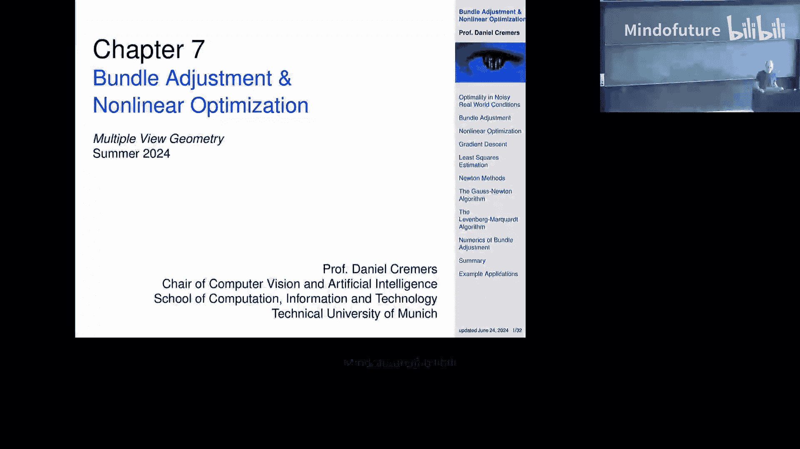
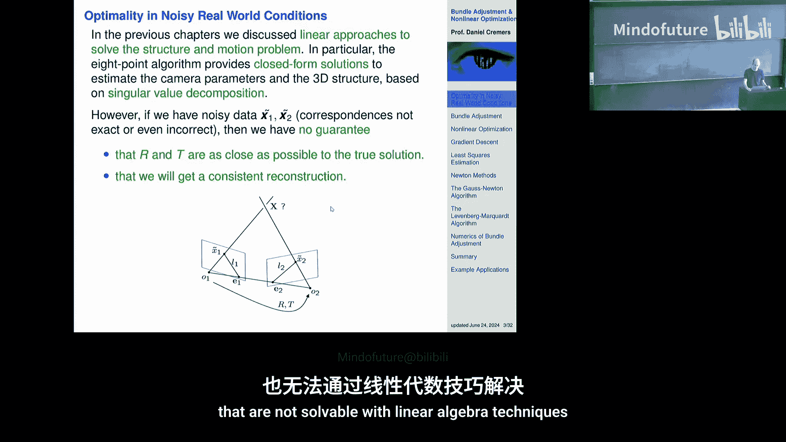
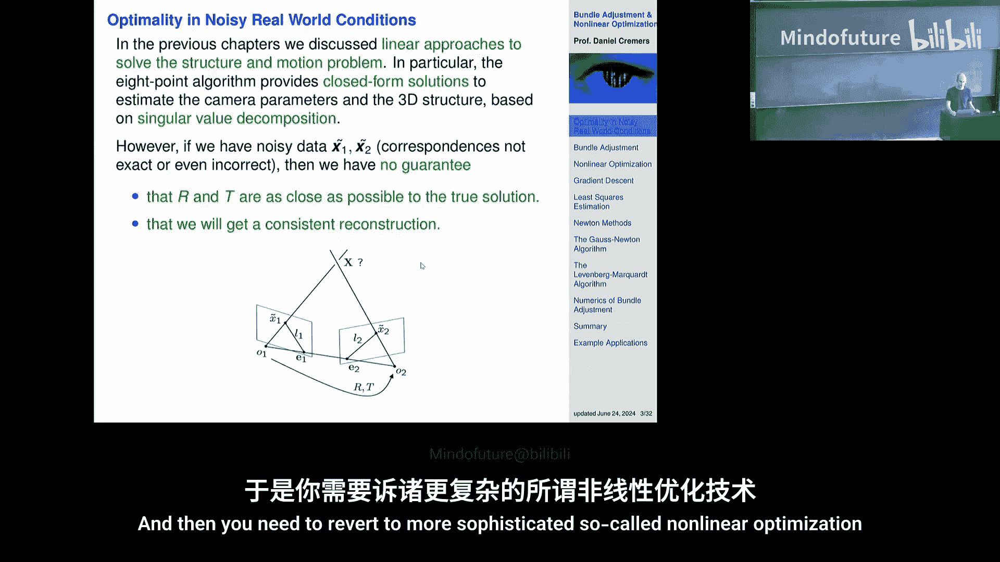
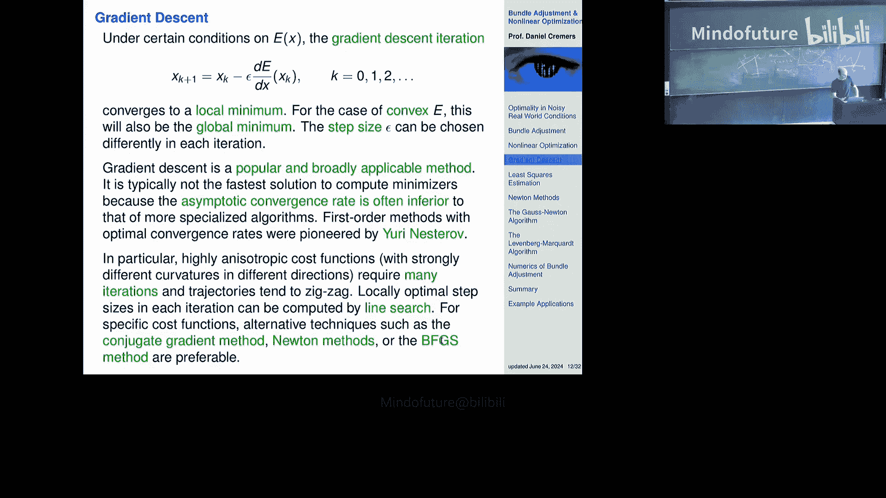

# 【慕尼黑工业大学】多视角几何 ｜ Multi View Geometry 2025 p13 P13_讲座_11b_捆绑调整-非线性优化_第1部分 -BV1KgZEBrEXV_p13-

So last week we ended with a multi view chapter， which I admit was a little bit technical and a little bit tense。

And now we're moving into chapter 7， bundle adjustment and bundle adjustment is an approach to solve the camera reconstruction problem。

 the 3D reconstruction problem from cameras that is in some ways more practical than these。

The 8 point algorithm and its multi view extension that we discussed。But let me get into it。

 as you can see it's a fairly lengthy chapter and I should say this is a chapter that I revised a little bit compared to what I taught in the last years。

So there is more recent developments that I included here。

Especially when it comes to the numerics of bundle adjustment。

So maybe to motivate why is this approach important why bundle adjustment in previous chapters we discussed linear approaches to solve this structure and motion problem and we talked in particular about this so called8 point algorithm that provides a closed form solution to estimate both the camera motion and the 3D structure using this linear algebra technique called singular value decomposition。

And the key idea there was that we observehi eight corresponding points in two images， right？

And then we try to recover the camera motion and the 3D structure from these corresponding observations。

The key challenge there is we kind of make this very strong assumption that we see eight corresponding points。

 and we previously discussed about the challenge of actually estimating correspondence and we noted that it's not an easy problem and that there are optical flow algorithms to compute this pairwise corresponds。

But the question that arises is， what if this correspondence that you start with is in some way or other not perfect。

And one can actually distinguish different ways in which it is not perfect。 first of all。

 if you are looking at something that has a repetitive structure like this walls here right。

 or these tiles on the ceiling or a checkboard pattern。

 then there is a chance that you find a point and you can localize it exactly。

 but the one you assign as corresponding point maybe the wrong one because you're not looking at the same tile but maybe one tile over。

 so it's actually an incorrect match if you will。This is one kind of nuisance that you can face。

 the other is that you have the right point but it's not localized exactly in the right position this can happen if you have areas in the image like the floors that are rather untextured and then finding a point and finding that point repetitively in the corresponding other image is very difficult。

And then you might be slightly off and then the question is if the set of corresponding point pairs that you start with in the eight point algorithm。

 if that one is perturbed and not exact， then what happens right and so the challenge is if you want to put notation to it we can say that we have points x1 and x2。

 but then what we actually observe are noisy data， x1， tilde and x2 tilde。

Which do not lie exactly in the position where they should be， but somehow slightly off。

So they're not exact or they're even incorrect， and then the issue that we face in this eight point algorithm is that the rotation and translation are not as close as possible to the correct solution and also the reconstruction may be inconsistent。

And so the question is， how can we make sure that even in noisy conditions。

 these reconstruction methods still work？And what you need to do to address this is you need to model that noise more explicitly。

 but once you do that you end up with loss functions that are not solvable with least squares approaches that are not solvable with linear algebra techniques。

 and then you need to revert to more sophisticated so called-linear optimization techniques。

 and so what we'll do in this chapter is we'll first introduce this framework of bundle adjustment that allows to account for noise and uncertainty in the observations。

Then once we have this loss function， then we will talk about nonlinear optimization techniques。

 we'll talk about gradient descent， least squares estimation， Newton methods， Gause， Newton。

 the11 back mark algorithm， so a lot of numerical algorithms to solve loss functions。

These algorithms are very important because they really are the power of a lot of current state of the art reconstruction methods。

And then we'll come back to the bundle adjustment problem and talk about how these techniques can be applied to bundle adjustment。

 and then we'll summarize and then I'll show some applications of these bundle adjustment techniques to real world imagery。

So to start here， statistical approaches to cope with noise， as I said。

 these linear approaches that we discussed in the previous chapter。

 the eight point algorithm in particular， they're very elegant because they provide optimal solutions to the problems right。

 we can inclo form so we can say if you compute the eigenvector associated with a smallest singular value。

 then this gives you the solution， and this is what you'd call a closed form solution。

 and these are often nice because you don't have to approximate， you can compute an exact solution。

But the problem is that the solution you compute is with respect to a cost function that is not really the right one。

And this is a common problem in computer vision， not just in 3D reconstruction。

 but in many areas of computer vision and the sciences that you have two types of that you basically face。

 you you have to find a difficult compromise between problems that you can solve exactly。

But that may not be the problems you want to solve。And then problems that you want to solve。

 except there is no exact solution for them。And this is a common kind of caveat that we face in the sciences that we have to decide between something that we can solve in closed form and the thing that we really want to solve。

And in other words， you can either try to solve your original problem that you really want to solve。

 but only find an approximate solution。Or you can find a loss function that is not exactly what you want。

 but similar。 And you can find the exact solution to that one。And here it's kind of the same。

 we have a trade off somehow if we approximate the loss function， we can find an exact solution。

 or if we don't want to approximate the loss function， we have to compute an approximate solution。😔。

And so the whole challenge here is to make sure that things actually work in noisy。

 real world conditions。😔，And spectral solutions like the8 point algorithm often do not take into account noise and uncertainty。

 and this is a phenomenon that actually holds well beyond 3D reconstruction。In fact。

 I've been in talks and presentations on completely different questions。

 but someone advocates a spectral solution where he says。

I'll phrase this problem in this way and then the solution is the eigenvector to the largest or smallest eigenvalue。

And this is a very common strategy to solve problems。 and almost always。

 it ignores uncertainty and noise。And you know， I can notoriously ask the question。

 how does your approach deal with uncertainty and noise， and pretty much every time people say。

 oh yeah， you identify the weak spot of the method。

 It's exactly that And sometimes people ask me afterwards and have you worked on this because that is exactly the issue we're facing。

 say no， but it's the spectral solution and they always have that in common。

That in some way or other noise is not taken into account。😔。

And you can take that into account and there's many frameworks that allow you to do that if you're interested in a deeper reading on that。

 there is a so called Bayesian formulation， so called a posterii estimation approach。

I don't want to go too much into detail， but it all builds up on the so-called Bayesian formula introduced by a clergyman Thomas Bayes in the 19th century。

 so this is very old ideas， and what he said is he wants to estimate the probability or maximize the probability for having 2D coordinates little X and camera motion R&T given the noisy measurements of these 2D coordinates extilled。

And he says， find the right 2D coordinates and the right camera motion given these noisy observations。

And then you can rephse that and this is based on the so-called Bayesian formula by saying this is the same as maximizing this product of two probabilities。

 one is how likely are the measurements given the true observations and the camera motion times the prior probability on the 2D coordinates and camera motions。

And so this is a little bit complicated because if you were to apply it。

 you'd have to model a prior probability on the space of rotations and translations and 2D coordinates。

 and this is not so easy because these， as we discussed before， rotations live in a manifold。

 namely the manifold of rigid but emotions。Rotations and translations。

AndOne can try to tackle this and model these probability distributions on these spaces。

 and this is one way to go about it。And I don't want to go too much into technicalities here。

 But if you assume this likelihood here to be Gaussian distributed。

 meaning the observed points are in a Gaussian distribution around the real 2D points。

 So we have the。The true2 de coordinates and the noisy， the observed ones。

 and if we assume that the observations are Gaussian distributed around the true ones。

Then this approach leads to an optimization problem of this form where you minimize the quadratic discrepancy between the observed 2D coordinates and the real ones。

 so pi of large xj is the perspective projection of large xj into the first image。😔。

Pi of RT Xj is the projection of the point large Xj into the second image where we have to rotate and translate this before。

And so these are the 2D coordinates that I would get by projecting the 3D points into the image。

 and then the s function says they should be close to where I observe them。

And this is the key difference to the eight point approach here。

 We explicitly have a cost function that says the model 2D point should be close to the measured 2D point。

 It doesn't have to be the same， but it should be in the vicinity。

As measured with this quadratic loss here。And so we have a loss that basically says。

 I have a 3D point I projected into pairs of images and then I say the observed to coordinate in image1 and in image2 should be close。

 close in this least squares sense。And so what you are minimizing is what's either called the projection or the reprojection error。

 there's different terms for it between the observed 2D coordinates。

 Xj Tilde and the projected 3D coordinate with respect to camera one or。行。And as I said， this。

Pi of R T Xj basically means pi of Rxj plus T。 This is the projection into the second image。

Now this is for two images， this loss function here， and this is called bundle adjustment。

 I'll come a little bit to the history of bundle adjustment。

 it's actually fairly long standing approach and I didn't know that until actually a few months ago that this approach of bundle adjustment is at least10 years old。

So much older than computers。And one can wonder why would people study that before the advent of computers。

 but I'll come to that in a second， So this is for two images right this is the projection into the first image。

 this is the projection into the second image of endpoint so you see and you have a loss function that tells you how well do the projections of these endpoints into the two images match。

 how consistent are they with the 2D observations right。😔。

And so what we're saying now is find a rotation and translation of the camera and find 3D locations of your endpoint。

 large endpoint， x1 through xN， so these are 3D coordinates。Of these points。

 such that the projections of these points into these images。

Are consistent with the2D observations that we have。

This is for two images and it's very easy to generalize that you can see this is sum over endpoints and theres two residuals that measure the discrepancy to the projection into the two images。

You can generalize that to M images just by taking a sum of1 through M。Overall。

 the images where you see the endpoints， then you have the your sum over the endpoints and then you say。

X tillil the I J is the 2D coordinate of point J observed in image I。

And that should be consistent with rotation and translation of the coordinates X into image I and Per projection pi。

And then， use。To basically penalize this discrepancy， quadratically。

Here's a little aspect that makes it more suitable in practice what happens if you have endpoints and you observe them in images。

 then obviously you will typically not see every point in every image， right。

 you move around with a camera you see a certain number of points over time。

 and each point will be observed in a certain number of cameras。

You can take that into account in your loss function by this variable theta IJ。

 which is just one if the point J is visible in image I and0 if it's not visible in image I。

Question is obviously how do you know whether the point is or isn't visible Well。

 one thing is you can try to fix them by hand if you have a set of images and you can see whether the points are in the image or you have to estimate this by you know correspondingence estimation approaches and if you don't find the corresponding partner。

 then you just set this variable to zero。But in practice you might also want to estimate these variables along with everything else。

 but there is one caveat if you put this variable theta into the loss function。

 so into the unknowns and estimate it， obviously you don't want the algorithm to set theta to zero for all points because then the whole loss function would become zero。

So you have to say， well， you know， I have to somehow impose that a certain number of points is actually visible。

 otherwise this is not going to work。But in principle， this is the loss function right。

 and so you can estimate all rotations and translations for all images and you can estimate all points from one through n。

EJoinly。And so much like in the A point algorithm， we tried to estimate camera motion and 3D structure and we were able to decouple it first estimate camera motion 3D structure here also we estimate camera motions and 3D structure。

But it's in one single optimization problem。And it's not actually easy to decouple it， it's not。

 in fact， even possible to separate structure and motion here。😔，And one has to be a bit careful。

 this is， you know， we now come to an age where people predominantly use deep networks to solve problems。

 and I found this approach of minimizing a loss function in order to determine your solution。

Has become a little bit less common， and so students are often not as familiar with this concept of minimizing loss functions or energies。

 So the idea is really that you set up this loss and then you compute the parameters， rotations。

 translations and 3D coordinates such that this loss becomes small。😔，And once you do that。

 the key question that anyone who deploys optimization techniques。

 this is called an optimization technique because you set up a loss function and then you sayMy unknowns are the parameters that minimize this loss。

The key question that anyone needs to ask is， is the loss function convex or not？

Because if a loss function is convicx， then you can find the optimal solution。

 And if your loss function is not convicx and has a lot of local minima， then it's much harder。

 So I think this is something I mentioned a convicx loss function is one like that。 convictx， right。

 So here is your solution space。 and here is your loss typicallyp called E for energy or。

And if this is convex， then the optimal solution as optimal can be found。

 you just start anywhere and you basically roll down the hill。

 this can be modeled in the machine and then you can find a configuration with lowest cost。

But if your loss function is not convicts。Like so。Then it's actually not so easy to find this optimal solution。

And the difficulty comes from the fact that typically the space of solutions is not like in this picture。

 a one dimensional space， but it has many dimensions。Right here， you know。

 if we want to compute the minimum， of course， in 1 d。

 you can just sample this loss function and evaluate it until you find a point and at least on a certain discretization。

 you could say， I'll just try all these solutions and then take the one this one here with lowest cost。

 right？And if you sample the whole space sure that sufficiently， finally， in 1 D， you can do that。

But in high dimensions， this so called complete search strategy does not work any。

 And what is the dimension。 So there are two things you have to ask yourself first。

 What is the dimension of the problem that I'm solving。And secondly， is the problem convex or not。

 that's basically because if it's just one dimension， then you don't care。

 then you can do a complete search and if it's two dimensions， still fine if it's three dimensions。

 maybe。And at some point， it starts to get tricky。 What is the dimension here， Let's look at it。

 Here's our loss function。 rotation and translation。 These are six parameters， right。

 three for rotation  three for So the number of unknowns is the number of unknowns。

For this problem is is equal to six parameters for rotation and translation of each camera。

 we have M cameras， so times m。Plus， and then we have the 3D coordinates that's a 3D vector times in large n number of points。

 and so if you have thousands of points or millions of points and thousands of cameras。

 it's a big problem。And then， unfortunately， it is not convicts。So if we look at this loss function。

 there are two downsides。 First， we have many unknowns。 And secondly。

 the loss function is not convetx。 It looks convictx because you have a quadratic here。

 And as you know， the quadratic looks like that。This is， you know。

 this is this is a function that is S squared， essentially。And quadratic is good， but the caveat is。

 it's not really quadratic。 You know， on the outside iss quadratic because you have the square here。

 but inside this residual here。This depends in a highly nonlinear way on the rotation translation and the 3D coordinates。

There is the richer body motion。 There is the perspective projection。

 All the things we talked about go in here。 And so if you plot this as a function of the unknowns。

 it's no longer convicts。And this is a big issue。😔，And to some extent。

 this is why people develop the linear 8 point algorithm because it circumvents this problem。

 It phrases everything as an eigenvalue solution， and you're done。 One step easy here it， it's nasty。

 But the problem is， as I mentioned， this8 point algorithm doesn't minimize the right loss function。

 It doesn't minimize this particular loss。So we'll have to look at how can we minimize this kind of loss function。

But before we do that， maybe let me mention that there are different ways to parameterize this problem。

 This is one way， and in some sense， the most obvious way， you have 3D coordinates。

 you have camera motions right and you have this quadratic discrepancy。

 We can also take a slightly different viewpoint。We can also say rather than estimating 3D coordinates。

 I will parameterize everything in the first image and I will estimate the 2D coordinates in image 1 right so we have this problem where we are observing this world in let's say two or more images and then rather than storing the 3D coordinate large X。

 we can also store let's say X。I have to make sure that I have the indices in the right positions。

So before we talked about the 3D coordinates。Now see。 Yeah， X X J， I called it。

 You can also have the 2D coordinates in image 1 and then scale them with thisda one。Lamda one j。😔。

That is the depths， right？😔，And then large x J is the same as and then you can do this。

 you can say the 2D coordinates， the real ones should be close to the measured ones in image1。

And I go to image2 by taking this point， large x， which is lambda times little x， rotate translate。

 prospectively project that gives me the corresponding。

 So what I'm doing now is I'm taking this point little x J。

 I'm scaling it here and then projecting down to the other one。

And then I should match the 2D observation or should be close in the same kind of least square sense。

 so as you can tell this is really the exact same loss function。

 two residuals measuring the discrepancy of the point in image 1 and in image 2。

 except rather than starting from the point here I start here and then I'm looking for the 2D point and I'm looking for the unknown depths。

This is an alternative， whether that is easier or more difficult is another question。

But as you can see， we can also express it in this way。

That for the 2D case and similarly for the M image case， obviously。Another thing we can do is we can。

Basically say， well， we have measured 2D coordinates and we have the true ones and for all images I from1 through two in the two image case and for all points。

 these should be consistent in the least square sense， and then we know that these 2D coordinates。

 they fulfill the Epolar constraint。So this here is the Epolar constraint for all points j from one through n。

And then we say in addition， if we phrase them in homogeneous coordinates。

 the third component should be one for the points in image one and in image 2。😔。

So this is yet another way to parameterize it here。

 this is different in that we have one loss function and then subject to a set of constraints in general in optimization you can specify a loss function and you can specify certain constraints。

This is called a constrained optimization problem once you have a loss function and the unknowns fulfill certain constraints。

Here you have an unconstrained loss function。😔，In principle， unconstrained， if you look closely。

 you find we are optimizing over rotations and translations。 the question is how you represent them。

If you represent R as a3 by3 matrix， then it also has to fulfill constraints， it has to be in S3。

 right？So depending on how you parameterize R， you will。

 this will be a constrained optimization problem as well。😔。

So you can see there is different ways and I'm showing you this because depending on what papers you read。

 sometimes they will introduce bundle adjustment like this， sometimes for M images like this。

 but sometimes also like that， but it's all the same thing essentially yes。

So this is a good question， which is the preferable representation。

 I must say I like this one on the bottom most。Because it's the simplest。

Because I don't start with 2D， then go to 3D then back to 2D。

 but I'm directly phrasing it in the parameters that I care about I want to know the 3D points。

 so I put them in here， I want to know the camera motions and then I have this rather compact loss function。

😔，And then I would not I don't like constrained optimization as much typically an unconstrained optimization problem is often easier to deal with。

 you just have your parameters and they can take on any value you don't have to worry in between whether they leave the space of feasible configurations so the way you can do that is wherever you have R you will plug in this le algebra encoding x you will basically write all the R's as x of this w hat this s symmetric3 by3 matrix and then you put your three parameters of the rotation your three degrees of freedom。

 you put them into this w hat this sw symmetric matrix and then you plug that into wherever R appears in the loss function。

Then you have a fully unconstrained problem with the three degrees of freedom for the rotation of each camera。

 three degrees of freedom translation， and three parameters for the 3D coordinate for each point。

And then it's a fully unconstrained problem。 And then you have to figure out which algorithm to deploy to solve it。

So that would be my preference。😔，So then you have a loss function。

 Let's say this one on the bottom here， right， Que is， how do I estimate these unknowns now。

And this brings us to a very general， oh。Just a second。Before I go into nonlinear optimization。

 I did want to mention something about the history of bundle adjustment because it's interesting because it's long。

 And because surprisingly， it ties very much in with Tu Munich。

 because you'll find that a lot of this was actually pioneered here at T Munich about 100 years ago。

So we're very much。EW in the footsteps of our ancestors。

This field of bundle adjustment emerged or the topic of bundle adjustment emerged in the field of what was traditionally called photogrammetry and geodysy。

To give you a bit more information here， photogrammetry photo is。

Photographs and grammetry means you measure something。Some metric quantities， right。

 you want to measure something from photographs。And in fact。

 it all started by people putting cameras on airplanes and flying over the Alps around here and trying and asking can we use these photographs to reconstruct the 3D structure of the Alps from these images because if we could that would save a lot of trouble。

 you wouldn't have to go into nature and actually measure things there with rulers or something how do you get the topographic maps of the world and you didn't have lasers to scan the hundred years ago。

 there were no lasers， but you had photographs and so the question arises can we tap into these photographs to find something about the world geodises about measuring the world we live in？

And to date T Munich has chairs of photogrammetry and geodesy。

 and so it's always been from the very get- go， it's been something very much at the heart of Te Munich。

 in fact， the founder of Te Munich， I didn't realize that until recently， hes a geoologistist。

 he was a geoologistist and he created Te Munich， so he clearly had this whole challenge in mind when he founded our university。

😔，And the idea of this approach bundle adjustment we saw it is that you try to estimate 3D coordinates of points and camera motions。

And typically， the rigid body motion。 But you can also estimate intrinsic calibration parameters。

 things like radial distortion。 A lot of the things we discussed。

 you can just put them all into the same loss function and estimate everything。Together。

And we saw that you can model this with probability distributions， these uncertainties， the noise。

 and depending on which ones you use， let's say zero mean Gaussian noise is the most common assumption。

 and that gives this quadratic loss function that we saw。Qudratic， in the sense that here。

I have a square on the residuals。Why is it called bundle adjustment in German Boundle Ousc This is the term people use the idea is that you have a bundle of light rays that are hitting your camera images and you try to adjust them so that they are consistent with some so you have these bundles of light from here and here and they should match some 3D points that are being observed and you optimize both the rigid body motion and the correct position of these points so that the 2D observations are consistent。

And this is called bundle adjustment。And typically we'll see that these optimization problems that emerge in order to infer 3D positions and camera motions are non convets and they are solved with so calledled nonlinear least squares approaches。

There is an overview paper that is frequently cited， it's from 1999。

 some of these authors are still active in the community， Billriegues， Richard Hartley。

 Andrew Fitzgibbban， you see them hopping around， for example。

 I do believe that Richard Hartley was at CVPR last week， I'm not quite sure though。😔。

Here are some of the people who pioneered things。 Firstst of all。

 I mentioned the founder of Teomunnich Kl Maxax from Bowenfin。 He was， he not only founder Temunnich。

 but he was a geicist。 So he was interested in measuring things about the。 and he strongly believed。

 and this was the core of founding Teo Munich。 He believed in bringing together engineers and mathematicians to actually solve these kinds of problems。

Because you need an engineer to see what the real world challenges are and maybe phrase it in form of an optimization problem。

 but then you may need applied mathematicians to show you how to actually solve these problems optimally。

😔，Then， there's Ia doal。Who founded the International Society for Photogrammetry and Remote Senensing not so far from here in Vienna in 1910。

 so over10 years ago， people were working in this field of photogrammetry and created the first international society。

 this is often something that really shows how much importance， a certain topic has received。

Then there is a guy who is considered the pioneer of analytical photometry。

 a researcher named Sebastian Fitavalda。And he developed ideas of estimating camera orientations from feature points。

And it's called analytical photogrammetry because people didn't have computers。

 right We're talking 100 years ago。So they actually set up these loss functions and they try to compute things analytically on paper with paper and pen。

 and very often it took them many years to reconstruct something from a set of images。

Sebastian Fitavalder was a professor at Tommunnich here， right， Similarlyly， Ottoon Grer。

 the one below， he developed techniques for solving these nonlinearese squares problems。

 He was also a professor at Tom Munich。And then there's called Reer。

 who advocated the use of vector algebra， algebra， and protective geometry。And。

And then there's a guy named Hewood Schmidt。 He was not at tomb， but I think at E T H Zic。

And he went to the US after the Second World War in 1945。嗯。

And so very much this whole history of bundle adjustment is tied to the history of the 20th century。

 He emigrated after the war。And。Together with a team of rocket scientists。

 they went to the US from Germany。And there they teamed up with a guy named Dwayne Brown。

And deployed these nonlinearly squares techniques that were developed here in Europe。

 they deployed them on the largest computers of their time。

At the ballistic Research laboratories between 52 and 55。And in fact。

 when I started on bundle adjustment and when I read about it in Wikipedia， usually， you know。

 and you probably assume that as well， Wikipedia knows everything。

It will tell you the origins of everything。 Well， Well， it turns out， yes and no。

 But when I started reverting to Wikipedia， most sources just said， oh。

 bundle adjustment was developed in the 50s。 And that's what I've been hearing for years in the community that the bundle adjustment method was developed in the 1950s。

And if you dig deeper， people will say， oh， it was a guy named Dwayne Brown， who invented it。

And then you download the papers of Dwayane Brown and then you read them， and he will somehow say。

 well， it was all developed by the 1950s。But by the 1950s is not the same as in the 1950s。

 right And so then I started to dig deeper。 And you know， I found that sources were often shallow。

 and then it's unfortunate that people often write papers on something。

 but they don't actually disclose where the ideas come from。

But I think it's important to keep track of where ideas emerged。

And this is why I dug deeper and I found all these pioneers who actually laid the foundations of what then Dwayane Brown and how Muchmid picked up and deployed on supercomputers of their time。

Here are some of these pioneers。 And as I said， this is Hemuschmidt and Dwayin Brown。

 the team who actually first deployed these techniques on computers。

But the foundations of these nonlinear nearly East squares approaches were actually laid by people like Sebastian Vcealder and Ottofon Gruber。

 all professors here at To Munich。So much about the history of it。 And it's， you know。

 not so common that we go back so far in computer vision。But here。

 the stories start well before the computers。Now we have this nonlinear least squares estimation problem。

 the bundle adjustment problem， how do we solve it？Theres a lot of literature on it。

 here's just a few books if you decide to get more interested in it。

 there are many numerical techniques to solve optimization problems。

 these are classical textbooks like Besicas， nonlinear programming， Naadal and Wright。

Nummerical optimization or Lunebergga Ya linear and Noline programming。

And depending on and the issue is there is not just one algorithm that does everything。

 well there is one algorithm that does many things， but not everything。

 the gradient descent algorithm is who has heard of gradient descent。Oh， everyone。

 very good because that's what， you know， the core of what you apply when youre train a neural network is also gradient isn it？

This is the standard powerhorse of optimization you might ask if you have gradient descent why do we need other methods well gradient descent the good news about gradient descent is it always works if your loss function is differentiable so if you can compute gradients you can apply gradient descent and it will get you downhill it will you know you can start here and you will get to this point and you know it's not the right solution but it's an okay solution right and so gradient descent always works but typically is not the fastest algorithm so there are two things that you care about in optimization one is you want optimal solution。

And not just local optima， but ideally global optimum， and secondly， you want them fast。Because。

 you know， you don't want to wait forever ever until the machine cranks up the solution。

And for both gradient descent is often not necessarily the method of choice。

 so gradient descent is typically what you deploy when you don't know any better right that's kind of the plain vanilla algorithm that you always start with and once you have a little bit more understanding of the loss function that your optimizing。

 you would refer the revert to more targeted algorithms and this could be Newton methods or the Gaus Newton algorithm or a variant of it called the liven Be Markquid。

 there are many more algorithms for opt but I will for the sake of simplicity focus on these because they're all in some form related。

Even other algorithms， there are so called non smooth optimization techniques that can be applied to non differentiable problems。

 but ultimately they all have elements of the gradient descent in it。

So the gradient descent is really the prototypical approach for optimization。😔。

Here's again how it works I'll keep this short because clearly you've all heard about this technique。

 it aims at computing a local minimum of a generally nonconvex cost function and what it does。

 it just iterably steps down the hill until the loss doesn't decrease any further。😔。

And what you want is you want to go in the direction where the loss decreases most。

So if let's say these are is lines of constant loss， you want to go down the hill。

 it's much like if you go hiking in the Alps and you want to get to the bottom of a valley。

 the best well not the best， but the fastest way to go straight。Might kill you halfway through。

 So if you're in the dollar mites， don't try gradient decent you know。

But but if your aim is to get down fastest then yeah， sure。

 you might not be alive by the time you're down， but it's going to be quick。

So how does it work mathematically and this is something I often notice is people have an intuitive understanding but often don't have the mathematical expressions to actually formalize this process What you do is you have your loss function E you have the unknown x let's say just one or it could be n dimensionmenal as you see here and you want to find a vector x such that E is minimized。

 so you start with an initial x and you introduce a time。Here， and that is initially at time 0。

 you start with some initial solution x0， which could be， for example， this one here2。

 right in this example， you start with x0 equals 2。

And then you have the differential equation of this form that says the change in x over time is given by the negative gradient of the energy minus T by the x。

And this change in time， d x by D T， you can actually approximate it by saying this is x at time t plus 1 minus x at time t。

 this is what you and if you insert that and solve for x at time t plus1 or K plus1 I wrote here then you get x at k plus1 is at iteration K minus and then if you have a step size here。

 epsilon， and then if you plug that into the upper equation and you solve for x at time k plus1。

 you get this here。So it basically says take the old estimate and subtract epsilon times D by the x。

 and this epsilon is often called the learning rate in neural networks or the step size in general。

So this is the idea。 And then you can iterate that and it basically gets you down the hill。

And then you can ask how do I choose that step size epsilon， that's a whole art by itself？Here it is。

😔，This is the update equation for the gradient descent。

 so iteratively you estimate for starting from x0， you estimate x1， x2， x3， x4。

 and you just keep iterating this equation。And you can choose the step size differently in each duration if the loss function is convex。

 like in this example， this will actually get you to the optimum eventually。As I mentioned。

 gradient descendent his。Popular it's a broadly applicable method。

 but it is typically not the fastest solution to compute minimizers。

AndYou can study convergence rates of algorithms。 This is something one of the I think most。

The leading pioneers in this field， someone I also met once is Yuri Nesterrov and he studied convergence rates of so-called first order methods。

 what is first order mean， it means a method that uses the first derivative of the loss function。

Like the gradient here。If you use second derivatives。

 these are called Newton methods and then you talk about second order methods。

But these gradient based methods are called first order methods。

 and there is a whole literature about first order optimization methods。

 and then you can study the different convergence rates。

 meaning how fast do you get to the optimum with respective methods and gradient descent is typically not the fastest。

In addition， if your loss functions are highly anisotropic and you have， let's say。

 an energy landscape which looks like this， so these are level lines of constant energy which are curved。

 then if you do gradient descent， maybe your minimum is down here。

 but if you start here it will first go into this valley and then it will do a lot of steps along this valley and take pretty much forever to get there。

This is something that is， so there's a so called zigzaing that you get。

 So people have studied this a lot in different contexts that。

That gradient descent might require in its plain vanilla form， a lot of iterations。😔。

There are smarter techniques， there's， for example， techniques like the line search right。

 if you don't know how to pick epsilon， you say okay， I'm starting from iteration Xk。Here's my Xk。

And then the gradient says the minimum should be somewhere in this direction right。

 let's say if this is the negative energy gradient what I can do is rather than taking a specific exercise。

 I can do a complete search， as I mentioned in 1D complete searches fast。

 I just try all sorts of solutions along this direction。And this is called line search。😔。

For obvious reasons because you search along the line and so you can do gradient descent with line search and that might be much faster。

Because you don't take a heuristic step in that direction， but the optimal step in that direction。

But there are a lot of other loss optimization techniques， for example。

 the so-called conjugate gradient method is a popular candidate where you always try to find directions in each duration that are kind of orthogonal to each other then there are newton methods。

 as I mentioned， these are second order methods， also a popular method is the BFGS method。

 so depending on what loss function you are looking at different algorithms may be more appropriate。

