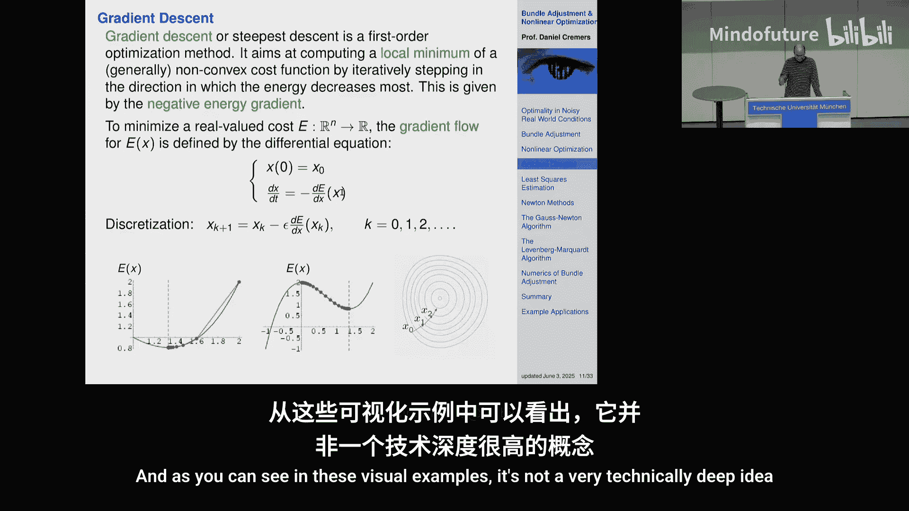
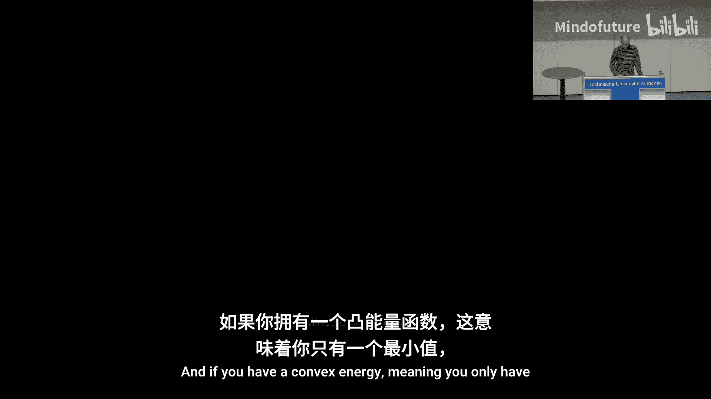
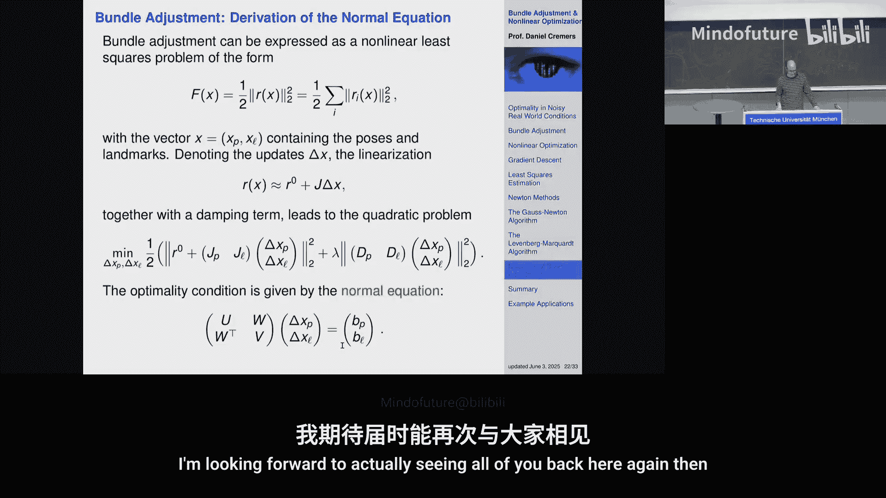

# 【慕尼黑工业大学】多视角几何 ｜ Multi View Geometry 2025 p14 P14_讲座_12_捆绑调整-非线性优化_第2部分 -BV1KgZEBrEXV_p14-

All right， let's continue here， we talked about bundle adjustment and we talked about the you know the famous gradient descent or steepest descent algorithm and algorithm that steps down into the minimum and as you can see in these visual examples is' not a very you know technically deep idea。

 you just iteratively step down to the minimum and if you have a convicx energy。

 meaning you only have，😊。

Sorry here we are back again， you only have one minimum then it finds that minimum in most loss functions though your energies are not convictx。

 which means you may have local minima and then you will typically end up in some local minimum by this procedure。

And this is， for example， the case when you train a neural network。

 typically the loss functions are not convictx， and so all you can expect is a local minimum。

Why these local minima that you find when training a network are still good， This is to my knowledge。

 still more or less a mystery。 There is a lot of research that went into it， but。Typically。

 once you have a non convicx problem theres and so much， you can prove about optimality of solutions。

😔，But it's a work is kind of the workhorse for a lot of optimization approaches here's this idea。

 this iterative approach you step to a local minimum。

What we're going to do now is we're going to look at problems that are a little bit more structured。

 not just a random loss function。But a loss function of a particular structure。

 and in these cases there are more efficient algorithms to optimize。Let's take one example。

 it's a very simple one， it's linear least squares estimation。

 so the idea you all know this is that you have a set of points and you try to fit the line through it。

 right？😊，For example， if you know。😔，You can have。A linear dependency between what's it。

 an input vector BI and an output vector AI， and the linear dependency is captured by AI being BI transpose x with some vector x。

So this is and then you have a Gausian， some noise that is added to it， this ata I。

 and typically you would assume some now noise such as zero mean Gaussian noise。

 so sampled from a Gaussian distribution with zero mean and some covariance matrix sigma。

And for simplicity， let's assume this coherence matrix is diagonal， so it's the identity times this。

The variance sigma squared on the diagonal。😔，What you can do then is you can do what's called maximum likelihood estimation to determine the unknown parameter vector x that models the mapping between input B and output A。

 right？😔，And if you apply maximum likelihood， say find the most likely x given a lot of sample data AI。

 B。And then you can show this leads to an ordinary least squares problem。

 how do you show it while you set up the probability distribution， you maximize it。

 and then you can equivalently minimize the negative logarithm and if you apply the negative log to a Gaussian distribution you end up with a quadratic loss。

😔，It's a fairly standard procedure。😔，And so you have this loss function。If you will。

 you can write it in this way， A minus Bx transpose。Times a minus bx。

 where B is the matrix containing the vector's B。This idea is called Linear least Squares estimation。

 It was introduced by Leandndre in 1805 and kind of independently or in parallel by Gaus around 1800 as well。

And in fact， this is an important development， this is where the Gausian distribution emerged in fact。

You know， it didn't fall from the sky， the question that Gaus asked is if you do least squares estimation。

And you want to fit the model what is this kind of you know what noise distribution do you need such that the maximum likelihood estimator ends up being the mean。

In which case， in which noise distribution do you get the arithmetic mean because typically when you have know。

This amounts to computing the mean， and the question is when do you expect to find the mean under which distribution and this is where he found the normal distribution。

 how he called it。😔，Obviously， he didn't call it Gausian distribution。

And so this is how the normal distribution was invented。

 It is the distribution that in the maximum likelihood estimation case leads to the arithmetic mean。

And the nice thing is about this whole approach is that。Is that this is a quadratic loss function。

 and so it's very easy to minimize right if you want to minimize this even in a more general case when you have Gaussian noise。

 but zero mean， but some random covariance matrix sigma，😔。

Then you get the generalized least squares problem where you minimize this expression here。

And you can see this is exactly the exponent of a Gaussian distribution once you apply the negative logarithm。

 you get this thing down as the loss function。😔，So this is a quadratic loss function。

Once the covariance， the inverse covariance matrix， a positive， definite inverse covariance matrix。

 and the closed form solution is you minimize this， how do you minimize it。

 it's a quadratic function， you set the derivative to zero。

 so the derivative with respect to the unknowns， you set it to zero。

 and you end up with this expression for x。And。If there is no correlation among the observed variances。

 then the covariance matrix is diagonal， so this would be the case that we had here with a diagonal covariance matrix。

Then typically this problem is called weighted least squares Why am I telling you this well I should be honest。

 I was kind of confused myself a few years back about all the different terminologies that people have。

 there's least squares， there's weighted least squares， there's generalized least squares。

 there's nonlinear least squares， there's，Itteratively reweight least scores at some point you get completely confused what is what and so I wrote it down here on the slides。

So the least squares is this one。Ordinary least squares。

 it's called then with a covariance matrix it's called generalized least squares and if that covariance matrix is diagonal where the diagonal elements of the inverse covariance matrix here are sigma I to the minus2。

And these are the weights here。 then is' called the weighted least squares problem。

You can obviously consider the case that the covariance matrix of your noise is unknown。😔。

And you try to estimate it along with the parameters of everything else。😔。

Then you can there is an iterative estimation it's called feasible generalized least squares。

 and in the diagonal case it's called iteratively reweighted least squares。😔，So what does that mean。

 it means I minimize this loss function， I keep the weights fixed。

 and then I update the weights iteratively。诶。It's then called iteratively reweighted least square is a fairly powerful algorithm that often converges very fast。

 so here is how it works， so we have this loss function。😔。

And the idea now is that we have a least squares problem。😔，With weights。

 but the key thing is that these weights actually depend on the solution。

And there are many interesting problems that can be cast into this form。

 Maybe I'll mention one of them。Me get one of the boards down。That's going to take a while。

I think these boards must be from the 19th century， I don't know where the gauss sit。

Gaus put them up himself。嗯。Al right， are some stories。

 so what one of the loss functions that you want to minimize is a sum where you have the norm。

 just the norms or not the norm squared， but just the norm。😔，Say AI minus f of X。

And the way you can do that is you can write it as a weighted least squares problem where you do WI and then AI minus f of Xi。

诶。ItFs sorry。😔，Squared。And then the weights， these weights。

 they depend on x in the way that with WI of x is just given by1 over this expression。

1 over AI minus f of x。😔，And you see if you insert that weight in here。

 you get exactly this expression， and so this is called robust least squares estimation because it's more robust because you don't have a quadratic loss。

 but just the norm。And you can write it as a weighted least squares problem。

 and this is often how you optimize。😔，That you minimize this because it's apart from the weights it's quadratic。

 and then you keep the weights fixed and then update the weights accordingly。

 so first estimate the solution in X， then update the weights and then reestimate the solution。

That's why it's called iteratively reweighted least squares。

 so this is one example problem that you can tackle with iteratively reweighted least squares。😔。

And the idea is you see it here， we get the solution in x where for time iteration T plus one。

 where we keep the weights as a function of the solution at time T。

And then it's a quadratic loss function， so it's easy to minimize and so in each subproblem we solve this problem。

😔，So whether it's quadratic depends obviously on the residual of xfi of x。

 sorry there should be an I and Mr an I。嗯。And so this is how you can solve it。😔，Ittriatively。

Whether it's convex depends on the residual， but if F is linear in x。

 then this whole thing here ends up being quadratic， in which case we can solve it easily。😔。

What's important though， is to keep in mind that once you have a weighted least squares problem and the weights depend on x。

 strictly speaking， the overall problem is generally no longer convictx。

And so this approach tends to work well in practice， for example。

 for this robust estimation approach it works quite well。

But there is no guarantee that they will find the global optimum。😔。

This is very common as soon as you have problems that are not convexed。

 there is a whole zoo of algorithms that you can throw at it。Even if they work in practice。

 it doesn't mean they give you guaranteed optimal solutions。😔。

And sometimes I see that people confuse that even in the neural network age。

 they throw gradient desent on a nonconvict problem and then they say our solution is the optimum。

 well， it's a local optimum， but it's not typically the global optimum。In addition。

 and this is probably the most general form of least squares estimation。

 we have something that's called nonlinearar least squares estimation。

 that's kind of the generalization of all of it where you have a least squares problem of the type that you have residuals squared summed up。

 and then you have some residual that depends on your unknowns in some form。

 typically some fitting problem where you have a function that maps an input BI to an output AI。

With an unknown parameter vector that models that functional dependency。And that can be linear。

 but it can be quadratic and it can be anything， and typically you don't know what it is。

But it's some parametric function parameterized in a parameter vector x that maps from input to output。

 and ideally input and the input should map to the output in the sense that the discrepancy。

 the quadratic discrepancy is minimized。😔，And as we saw。

Bundle adjustment is exactly that in bundle adjustment I have points in 3D I project them into image and this is happening by this residual I'm measuring the discrepancy between the observed point and the projected point。

And then I minimize the quadratic discrepancy for all the points that are observed here。

 so I is the summation over all points projected into all sorts of images and so you can check for yourself but the bundle adjustment where was it here iss exactly in this。

😔，And where is the best formulation。This one maybe is exactly in this form， right， we have。Re。

 we have the observed point， and this is the mapping project of the projection of point Xj into image I。

😔，And we minimize this discrepancy， and so it's exactly。😔。

In this form that we call nonlinear least squares estimation。Important to note。

 generally this is not convicts， even if at the first glance this looks quadratic。

 depending on how it actually depends on x in the residual， it may be nonconvicts。If is' linear。

 then we have a quadratic loss function， but in general， f will not be linear as a function of x。

 and then this will not be convictx。But what's nice is you can write down formally the optimality condition for this。

How do you do that well you set the derivative of this thing with respect to x， you set it to zero。

If you do that then you have to apply the chain rule right so you get two times R times DRI by dxj equals 0 for all J。

 so this is the derivative of this residual with respect to Xj。For all the different unknowns， Xj。

This is nice， so that's the optimality condition。 This equation is what I need to solve。

 unfortunately， you can typically not solve this directly with respect to Xj。

And so you revert to iterative algorithms to compute solutions。😔。

And you can apply a gradient descent obviously to this。

 but you can apply more sophisticated algorithms and we'll talk about some including the Newton method。

 the Gauss Newton and the Linburg Markqu algorithm。

AndSo here they are the Newton method is a very general optimization method。Here as well， you know。

 these ideas are not terribly profound。 I remember when I first started thinking about how can you find the minimum of a loss function。

 You know， you have a loss function。😔，Like so and then you read about gradient descent and how you kind of step down into the valley and then you start thinking well。

 if I can fit the first derivative here that tells me where does it go down。

 is it not possible to fit the second derivative as well right you know once you start computing derivatives。

 why don't you compute the second derivative and thereby fit the parabola to this whole problem？

Why is that useful， Well， for a parabola， I know how to find a minimum。

There is a closeform solution to find this position where the parabola has its minimum right so what you can do is fit a parabola。

 step to the minimum and then here fit another parabola and step to that minimum it' something for example I remember when I was studying I thought of this this would be the right idea to do it because then you don't need step sizes that you need in gradient descent you fit the parabola every time you keep going。

And you know， then much later， I read up about it and found out this is a known procedure and it's called the Newton methodod。

I mean， it's so obvious that even hundreds of years ago， people came up with it。Not very profound。

And how does that work， Well， you all know how to fit a parabo it's called a Taylor approximation。

 right， so you take your loss function。And you approximate this loss function。

 let's say E is the loss you approximated。You know， iteratively， so at iteration at T， I've fitted。

 I have some point Xt so that would be my initial point Xt here。😔。

And I fit the first and second derivative， the first derivative at Xt I call G。

 the second derivative is the Hessian matrix I call H。And then this is a quadratic fit。😔。

Minor comment， by the way， I mentioned bundle adjustment was largely developed at T O Munich。

Hessip from the Hessian Matrix guess where he was a professor。At T Muic， right。

 you may not have known that。 Yeah， but so a lot of the foundations for all of the things we do。

You know go back to people who were here。😔，So this is the second derivative and this is the quadratic fit。

 you know first order linear term， second order quadratic term。

 so this is this orange parabola right and now we say find a minimum of that parabola。

 how do we find a minimum we take this quadratic approximation and we set the derivative to0。

Meaning we find a place where this is horizontal， the derivative。Terivative of this quadratic。

 If we do that for this approximation， I should say this is not exactly D E by the X， but it's。

This the derivative of this approximation with respect to x right and whereas x。

 there is a linear term so we get the G and then in the quadratic term it's just h times x minus xt。

Now we set this to zero and surprise surprise， it's a linear equation。

 it was built that way right it's a quadratic fit once you take the derivative you get a linear equation system that you can solve and the solution is just given by xt minus h inverse times G right if I solve this with respect to x I find the next update here this is x that's the next iterate。

 and so I set the next iterate， I call it xt plus1 to to the solution of this equation。

And so this would be my X T plus one would then be。

And as you can see in this drawing that's why I drew it this way。

 it is fairly close to the minimum you know obviously this is a technique that's not always going to work right。

 if I start at a very bad point， let's say here and I fit the parabola you know and the loss function looks like that and the parabolic fit it will look like that。

 it doesn't even have a minimum right so you got to be in the right regime where things are actually you know。

😔，系。Bending inwards where you have a positive， definite Haitian matrix。To。

 to fit the meaningful problem。And this is typical for the Newton method。

 it tends to work really well and is very fast provided that first of all。

 you can actually compute the second derivative right that's something you need and secondly once you're in the basin of attraction in this kind of。

😊，Concave sitting。And convex setting。Then， it will。It will typically converge very fast。

What's interesting to note is if you look at the update equation。

 it is very similar to the gradient descent。When I have people in exams。

 I often ask them if they know the update for the Newton method。😔，And surprisingly。

 many people don't know。 It's not so different from gradient descent， right。

 What do I do in gradient descent？ I take epsilon times the gradient。

 Then minus epsilon times the gradient here。 We have almost the same。

 except the step size in the gradient descent is replaced by the inverse of the hessian matrix。

And that's where it's adaptive。Meaning if it's a very curved part。

 it will take a smaller update step， and if it's a very flat part， it will take a larger update step。

 which kind of is meaningful， I would say。Typically。

You can choose a more conservative step size if you're a little bit hesitant whether the the negative the inverseitian is a good estimate for the step size。

You can add a gamma between0 and 1 to have a little bit more conservative update tips。

When applicable， that means when you can compute second derivatives and when the Hasian is positive definite。

 then second order methods are typically faster than first order methods at least。

 and this is important when measured in the number of iterations that I need。

And this is unfortunately a discrepancy here， right， why。

 because in every iteration I have to compute the Hestsian and I have to invert the Hatsian。😔。

Computing this and inverting it can be time consuming。

 so even if you need fewer iterations in a Newton method。

 it doesn't mean in terms of clock time you will actually be faster。

Because if every iteration takes a lot of time to compute， then you're wasting time there。

 and so there is a trade off that you end up finding between optimizing iteration counts and optimizing actual clock time。

And。Partly due to this discrepancy， there are two communities in this optimization world。

 the first order people and the second order people， and the second order people will always say。

 we are faster when measured in iteration numbers and the first order people will then respond yeah。

 but in terms of actual clock time you're not right。😊，And then even more so。

Which approach is more suitable first order a second order if it kind of depends on the hardware that you have to implement things。

 for example， if you run things on a GPU， something that's become popular in the deep learning world but that's been around for we started running algorithms on GPUs around 2004 so 20 years ago on NviDdia GPUs incidentally。

And when we did so we showed in many papers that you can dramatically accelerate compute once you run things on GPUs。

 but there is a tradeoff， there are certain things that are not so easy to parallelize， for example。

 matrix inversion right so if you in iteration you have to compute and invert a hesian matrix。

 this may be something that doesn't port well to the GPU。

 in which case you don't profit from the massive acceleration that the GPU gives you。

Meaning even if the second order method is faster。In clock time on the CPU。

 it may not be faster on the GP。 and so this makes the whole story of what is better。

 really complicated。And while in principle， second order methods have advantages。

 it's tricky to get them working。For example， to my knowledge。

 you know one of the biggest challenges nowadays in optimization is to optimize neural networks and to date people don't seem to use second order methods。

😔，And you we tried， many others tried there is a challenge to make them work。😔。

One aspect is when your problems get really big， the Hsian matrix gets massive， right？

You cannot really invert it。 You cannot store it。 You cannot invert it。

 So you have to come up with more clever methods。And then typically。

 you can expect that the Hassian matrix will generally not be positive definite。

There are then ways around it， there are so called quasi Newton methods。

 and these basically approximate the real hesian by a matrix that is similar but positive definite。

So basically saying whatever negative definite negative eigenvalues it has。

 you just clamp them to zero and then you hope that this will do the trick。

And that's one way of doing it or you can invert the hessian and then approximate that with a positive definite matrix。

 So there is tricks and these are called quasi notes and methods and they can be shown to work。

There are also methods that deal with non differentiable problems。

 There are so called semi smooth Newton methods。 So there's a whole zoo of techniques。

To make Newton methods work in a bigger range of problems。😔。

And hopefully one day someone will come up with a solution for training neural networks with second order methods and that might help reduce the carbon footprint that we leave。

😔，Here's a variant of the Newton method that is really popular。

 and that is the power horse of all bundle adjustment。

 It's a technique called the Gaus Newton algorithm。 And as you can see。

 it was named by two of the most influential scientists in history。

It solves nonlinearly squares problems of this form， like we discussed。😔。

And the idea is the following， it can be derived as an approximation to the Newton method， right。

 so we take this nonlinear least squares and we run the Newton method on it。 What does that mean。

 It means we compute the first derivative of this loss function， This is it。Chain rule， right。

 the gradient， so RI1 times DRI by the Xj， we saw that before。

And then we have to in the Newton method here and the update we need the Hessian matrix。

 so we compute the Hesian matrix means we take the derivative of the derivative。

 so that would be the second derivative matrix， so we take GJ and take the derivative with respect to Xk。

And so h JK， the component of the hessian matrix xjK is the derivative with respect to J and then derived again with respect to K。

If you do that here， you have to do the product rule as well， right。

 there are two terms there is residual and it's derivative。😔。

We take the derivative with respect to XK， so we get a first term。

 which is DRI by Dxj and times DRI by DxK that would be keeping this term fixed and taking derivative of that term。

And then we have another term， which is keeping this term fixed RI and then taking the derivative of this one with respect to Xk。

So we have a second order derivative of the residual。😔。

And now comes the key approximation of the Gaus Newton method， it takes this Hessian matrix。😔。

With these components and says， let's just ignore the second order term right with respect to the residual we have here the first order derivatives。

 a product of two first order derivatives， and here a term involving a second order derivative。

And that's the term we're just gone。Kick out， just ignore and approximate it with zero。

It's a bit of a bru approximation and we can come back to whether that's a good approximation or not。

😔，But what we end up getting then is an approximation of the Hsian matrix， which involves。

 if you call this the Jacobian of the residual。JIJ is the derivative of residual RiI with respect to Xj。

Then this is just j times j j transpose j basically。

And this is the approximation of the Hessian matrix。 So if you call J， the matrix of。

This is called the Jacobian matrix， is the matrix involving the derivatives of all the residuals with respect to all the unknowns。

😔，Then the approximation is that the hesian matrix is two times J transpose J。😔，And then， you know。

 if you look at what was the gradient of our loss， this was just， you see it here。 This is J trans。

 This is J transpose。 This is R。 So J trans 2， J transpose R was the was the。

Graient over our loss function。And so the update in the cows Newton algorithm is take the old iterate and the update plus the update delta and delta is J transpose J。

 so our Haitian approximation here。Inverse times J transpoar。The factors too， as you can see。

 they cancel here。So this is the update rule for what's called the Gaus Newton algorithm。

 and man an approximation to the Newton algorithm。😔，But what's really beautiful is in principle。

 it's based on a second order optimizer。😊，But with respect to the residual that enters my least squares problem。

 it only involves first order derivatives， and that makes it very powerful and very practical because you have a residual and all you need to compute is the first derivative。

Then you take that first derivative here of your residual and you construct this update。

 all it takes is the residual and the first order derivative of it。

And that gives you the Gausnuton method。😔，And the nice thing about the Gaussnuin method is it has a convergence behavior much like a second order method。

 even though it only requires first order derivatives。

Because it is based on an approximation of the second order derivative matrix。😔。

And the beauty of this is twofold， first of all， I only need to compute first order derivatives。

 not second order derivatives， because I ignored the second order derivatives in the approximation。

The second beautiful thing is this matrix J transpose J by construction is positive definite。😊。

How do you see that Well， if you take J transpose J。

 the approximation of the Hessian matrix is positive definite in the sense that if I do x transpose this times x。

 then this is the same as Jx norm squared and that obviously is always non- negativegative。

So you can see this Hesian matrix that we approximate with J transpoche is by construction positive definite。

Or semi defite， at least。When is the approximation good we kicked out the term。

 that's a bit of a drastic move， right， When can we expect this to work well we have two terms that make up the Hatsian。

 the components of the Haitian matrix， the first order derivatives and the second order derivative term。

And clearly the approximation is good if this term is much smaller than that term。

 and so this is basically the regime in which the Hessian approximation is valid。😔。

When does that happen， Well it happens once the resid is small， right， once we're near the minimum。

 we expect the resid should get zero at that point， that's how everything is constructed。

 So once you're near the minimum R I will be near zero in which case this thing should be a good approximation。

Or if the re is。Close to linear right if RI is linear。

 then the derivative is constant and the second derivative will be0。

 so as soon as you have something where the residual is nearly linear in x。

 then the second derivative will be approximately0。

And then you can expect this approximation will be good。

 so either once you're close to convergence or once you have an essentially approximately linear problem。

 the re being linear， then this will work well。Now whether these conditions are fulfilled。

 is another matter， but in practice this Gaus Newton algorithm works well。

 but you see already that you have an interest in making a nonlinearar at least squares optimization problem where the residual should ideally be approximately linear。

 and the more linear R is in x， the better this algorithm will work， the faster it will converge。

Maybe a few more things here。There is an extension of the Gauss Newton algorithm that is called the Linba Markquad algorithm based on two researchers by the names of Linburg in 1944 and then later Marquad in 1963。

And they suggested something that can be seen。As a hybrid between a Gaus Newton algorithm and a gradient descent。

And this comes from if you look at the Newton update here it is again with the he inver as a weighting of the gradient vector。

You can actually create hybrids of Newton and gradient descent as I mentioned gradient descent and Newton update are practically the same one you have a step size and one you have the inverseian right。

 where you can combine them， you can have a step size lambda and the hesian and there's different ways to write it but this is one way where you basically take H plus lambda identity and then invert it。

So you have， and you can see， you know， for lambda equals zero， you get back the newton method。

And for very large lambda， this term will dominate。

 and then you have something that is very much a gradient descent。

Because then you just have a scalar term dominated by this expression here。😔，Times G。

And so this is called a damped Newton method and it's。

In some sense a hybrid between Newton and gradient descent， depending on how you choose lambda。

 you get either more Newton， if youd set lambda to zero or close to zero or you get more gradient descent。

 if you take a large lambda， why would you ever do that well， for example。

 if you have a loss function that is you know like so？Then in this regime。

 you don't want to compute the second derivative matrix because it's not convex youre in an area where things are very concave。

 right， Huhesian will not be positive Def， you know the parabola fit will open to the bottom and it's kind of unbounded below。

 right？So what you want to do here is you want to start with a gradient descent that gets you down the hill and once you're in a regime where the curvature changes right。

 then you want to switch to a Newton method。And typically。

 once you get closer to the minimum to this basin of attraction。

 that's where you want to move to a newton method。How can you do that。

 Well you can take a damp Newton method， start with a very large lambda， meaning do gradient descent。

😊，And at some point， reduce the Lada and thereby switch to a Newton method and you can kind of continuously change from a gradient decent dominated approach to a Newton Newton type method。

And this is some of the things you can do with this damp Newton methods， right。

And now obviously you can do the same damping in the Gaust Newton approximation right here。

 how does that work， you have the Hatian。That's approximated by J transpose J like we saw。

 and then you add a little bit of gradient descent into it with Islam Lada weighted identity。

And this is called the Linburg algorithm， works really well。

And then you can do and Mark would spend a lot of time looking at you know this algorithm and its variance to optimize loss functions and what he cared about are where often loss functions that were highly anisotropic where you have very thin valleys and then you find you want to have a more adaptive approach where the damping is more componentwise。

And so rather than adding lambda times the identity。

You add lambda times a diagonal matrix that on the diagonal as J transpose J。

So you take your hisian approximation， you take the diagonal elements and you do something that is kind of more adaptive。

So depending on what the size of j transpose j is on the respective diagonal elements。

You use something that is kind of where the lambmbda is kind of in proportion to whatever is already there on the diagonal。

And so that makes it more adaptive and so what he found is that that makes the convergence faster。

 especially when you have very anisotropic loss functions。😔，Often in optimization。

 if you have a loss function that is isotropic， then life is easy。

 but if you have such elongated structures I mentioned it last time。

 then already the gradient descent will you know zigzag forever and so there needs to be adapted versions and this is one。

As I mentioned， let's say in the neural network world there is also similar adaptations of the gradient descent algorithm。

 for example， some people may know that neural networks are optimized by an algorithm called atom。😔。

And this is an adaptive adaptive momentum algorithm。

 so it's kind of in spirit related ideas of how to adapt gradient decent type algorithms to deal with anisotropic loss function。

😔，All right， this brings me。I don't know if I should mention this is a lot of math。

So that gets us back to the bundle adjustment and what we're going to do in the next。

Session is how to discuss how to apply Gaus Newton and similar types of iterative algorithms to solve the bundle adjustment problem。

😔，嗯。I should say next week is one of the biggest computer vision conferences， in fact。

 the biggest computer vision conference is a conference called CVPR。

It's not just the biggest computer vision conference。

 but it's actually the biggest conference in the world in terms of impact factor。

 there is no conference bigger than that across all disciplines。

So it's the flagship conference in the fields of computer vision and AI， it's in the US in Nashville。

I will be there to present a lot of research that we're doing and also to follow up on the latest trends and developments in the community。

And so unfortunately， I won't be here next week and so I would ask you to revert to like last time we'll upload videos that you can watch and they will cover this material。

😔，I know it's always， especially for the people sitting here， you'd prefer live。😔。

I'll be back live the week after right after CVPR and I'm looking forward to actually seeing all of you back here again。

😔，Thank you。

