# 【慕尼黑工业大学】多视角几何 ｜ Multi View Geometry 2025 p15 P15_讲座_13_捆绑调整-非线性优化_第3部分 -BV1KgZEBrEXV_p15-

We lift off in numerics of the bundle adjustment。

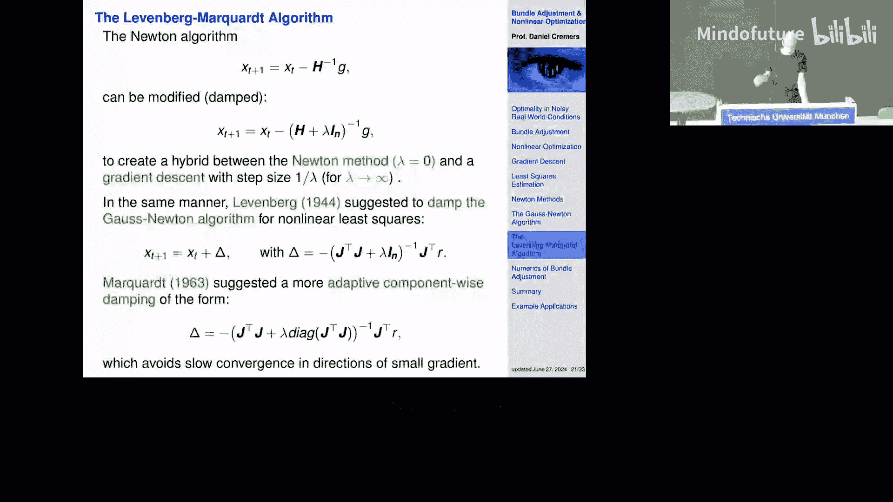

Remember， the idea of bundle adjustment was to jointly estimate camera motion and3。

 iss this too loud。It'O。Okay， to jointly estimate camera motion and 3D structure by minimizing a loss function。

 let me go back to just recap what the loss function is， these were the pioneers who developed it。

These ideas， and you remember， in particular， the first computerized solutions were developed by Hemo Schchmidt。

Who came from Germany， in fact， in the team of the rocket engineer， Van H Von Brown。

who went to the US to develop rockets and spacecrafts and in his team Helmchmidt was part of the team and he brought all the bundle adjustment knowledge and he teamed up with Dwayne Brown to deploy things on big supercomputers。

😔，Well， off the times。And the loss functions that people minimize is。Sorry， this one。😔。

Where you basically say you are observing a set of points in a set of images。

 so end points in M images and for each point in each image， you want to make sure that。

The observed point is close to where it should be based on the perspective projection。😔。

Of the 3D point Xj with Richard Buddy Mo R I and T。

And then you penalize the quadrtic risk discrepancy I already mentioned that there's many parameters that we try to estimate here。

 basically three parameters for every 3D point， so that's three n parameters。

 three times n parameters and then six parameters for the rigid body motion of each camera that's six times little M here plus the three times large n。

 that's the number of unknowns， and then we have a large number of observations。

 how many basically ideally we have M times n unknowns。So， observations， this is often important。

 you know， this is not a linear equation system that we're solving here。

 It's a nonlinear optimization problem。But still， it's often useful to look at how many observations do we have to constrain our solution？

Compared to the number of unknowns and you can see that with more points and more images。

 the number of observations grows faster than the number of unknowns because it's n times m here。😔。

So this is a useful observation。 So in some sense， the more images I have of the world。

 the better I can constrain the reconstruction problem。

That's the bundle adjustment problem Now we started talking about iterative solvers to solve these so-called nonlinearar least squares problems if we go back to the loss function again。

 look at the loss function you know you know when you work in this field you tend to see a lot of energies。

 a lot of loss functions in with time you start to see what is there there's typically a summation over observations of images and points and then there is a loss function that has a square here so on the outer surface it looks like it's quadratic in the unknowns but be careful the unknowns are in here。

😔。

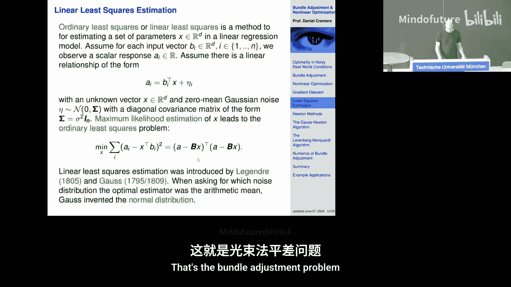

And this is a rigid body motion of the point Xj and then the perspective projection and as you remember。

 this is not a linear transformation， which means the residuals that we square here。

The residuals themselves are not linear， and hence the loss function is not quadratic。

And this is the class of problems that is called nonlinear least squares。😔。

Because the residual is not linear and we have a least squares problem。😔。

And so if if you write this more compactly， you can write these residuals as our I squared here。

 squared residuals， summed over I right， So the sumian over I would be the number of images times the number of points。

 so that's the number of terms in the summation， and then we have all these residuals that depend on our vector of unknowns x。

So this is often useful to reduce the loss function into a compact form so that you see what is the structure of it。

 some residual that depends on the unknown x， rotations， translations written and the 3D point。😔。

And then squared and summed up right。 And so for this type of loss function。

 non nonlinear least squares， a very powerful and popular technique is。

An approximation of the Newton method called the Gause Newton methodthod。This was the Newton method。

 We have to bear the update basically says， take the old estimate minus the gradient multiplied by the inverse hesian matrix。

 So this is the classical。Prototypical second order optimization method。

 and you remember the idea of the Newton method was that we take our loss function， whatever it is。

 we fit a paraboloid to it。There's only one color here。

 so basically we start somewhere we fit a paraboloid and we step always to the minimum of the paraboloid and once we do that this is the update step。

😔，That you can derive。And now comes the key idea of the Gausnuuter method。 It says。

 if we compute the Hasian for this sum of squared residuals。

We first have to compute the first derivative， so we do the chain rule。

If we derive this with respect to R and with respect to x， we first get R。

 then the times the R by the Xj。😔，And now if we apply another derivative in order to get the second derivative matrix。

 the so-called hesian， we have two terms based on the product rule。

 derivative of the first times the second， that would be this term。

 and then derivative of the second times the first， that would be this term。😔。

And so you see we have a product of two first derivatives of the residual plus the residual times the second derivative of the residual。

😔，And now so this is the exact Haitian for the Gausnu to for the Newton method。

And you could just take that and plug it in here， compute the update。

What you can also do is and this is the idea of the Causs Newton approximation is you drop this second term。

😔，Basically saying we assume that the residuals are essentially linear。

And so this term is larger than that term。And then you can this term dominate。 So if youre near。

 if your residuals are near linear， then this term will dominate this whole expression。

 And so we can basically just take this first term where the Jacobian is。

The matrix of the derivatives of the residual。And so this is the Gauss Newton approximation。

 the nice thing about it is it is a second order method because it uses a second derivative of the loss function。

 but an approximation of the second derivative， which is such that you actually with respect to the residuals only need first order derivatives。

And so you could say it's kind of a hybrid between a second order and a first order method。

 but it is considered a second order method because it uses an approximation of the second derivative。

😔，But computationally， it's just more efficient because you don't have to compute the full blown hessian matrix for big problems。

 you know， we're talking。Millions of points， plus thousands of camera transformation parameters。

 You know， this is a matrix that will be million times a million。

Good luck with setting it up and inverting it。I'm sure you haven't spent much of your career so far inverting matrices。

 but this is one big thing and it's a big problem。😔，And so if you can avoid inverting a matrix。

 and then obviously this is something you'd want to do。😊，And we' come to them。

So this is the Kus Newton algorithm that we derived。

 and then we talked about the Len bark Markquad algorithm。

 which is a variant of the Kus Newton that includes a damping。😔。

You can damp the original Newton method， it basically means you add a little bit of the identity to the hesian matrix that you can also see it from a numerical perspective that stabilizes the inversion of the Hasian matrix because the identity matrix is always easy to invert。

And more specifically， it becomes something that is a hybrid between the Newton and the gradient descent。

😔，If you set lambda equals0， you have the original Newton method， if you let lambda go very large。

 then essentially you can ignore the heian here， this term will dominate for large values of lambda。

 and then you have essentially a gradient distance with step size 1 over lambda。

And so the idea is if you have a loss function like here， that initially when you're in a regime。

 maybe where the quadratic approximation is not good。

 you would do gradient steps and once you reach a regime where the quadratic approximation is better。

😔，You can switch to a newton method and you can do that transition gradually if you want。😔。

The key challenge， obviously， being， how do you pick lambmbda。

 How do you update it in a meaningful way， This is a whole art by itself。

 much like just a step size selection ingredient gradientent is a bit of an art。

 There was a question。You have to see if you're in a concaved situation。

 then the Newton method doesn't actually apply。😔，Because then if you fit the parabooid like this。

 it's going to be a paraboloid that's open to the bottom。😔，And then if you say。

 can you find the minimum of that paraboloid？It doesn't have a minimum。

 so the Newton method isn't even applicable in concave situations。😔。

So this is a little bit the issue that you really， the Newton methodth assumes that you are in the basin of attraction and then it goes fast to the minimum。

😔，But you have to first get to that basin， and this is where the gradient ist。Will I help you。

As I mentioned， Linberg in 1944， and then Mark was in 1963 devised。

Damed versions of the Gaus Newton method， So here the Gaus Newton approximation J transpose J as an approximation of the Hasian。

 where J is the Jacobian the first derivatives of the residual。😔，And then you add， again。

 this damping term to this approximate issue。😔，And then multiply by the gradient。

 this is then j transpose r， right， the gradient we headed here for these residuals。

 you can write it as r times the Jacobbian。😔，This is how the Jacoban transpo times。

And so that this is the Linburg damping， just a plain you know， vanilla damping。

 an isotroppic damping， meaning you damp the same in all spatial directions。

And what Markqu found that in some cases， it's more suitable if you have these， you know。

 in two dimensions， lost functions that have kind of a more anisotropic nature with isol lines like that。

You don't want to end up doing gradient to you don't want to oscillate too much and then you want to take larger steps in the flat directions and smaller steps in the more curved direction。

And you can do that by having this weighted diagonal。😔。

Where you basically weighted by the carvature in each direction。That is the Leavenburg Markqud。

 but as I mentioned， which one you choose， the Gaus Newton， the Linburg， the Leavenburg Markqud。

 it kind of depends on the problems you're solving。😔。

And it's not always this super adaptive livingbackmark where that's kind of work based。😔。

We had papers where my students say they prefer the just plain old Co Newton。😔，So it depends。😔。

But all these algorithms are being used for solving。😔，Band legitimate probe。Let's look at this。

 more specifically。Here is the bundle adjustment problem。

 This is the sum of the residuals squared here。 I write it like that。

And then x is the number you know here now is the vector that contains the parameters involving the XP stands for the poses。

 that means rotation and translation of the camera， so that's six parameters for every image。

And X L are the hot landmark parameters， the landmarks of the 3D positions。Of each point。

And so this is a long vector that is six times little M if M is the number of images and three times large n if n is the number of points。

😔，And。The Gaus's noteton algorithm can be derived from this loss function in a slightly different way。

😔，You can say， and it comes out to the same， really， you can say approximate the residual。

With the first order Tayloror approximation where you have the initial residual at and and then plus the derivative Js。

 the derivative of R with respect to x times deelta x， that is the update。

So this is a linearization of the residuals that we do here。😔，So they're nonlinear。

 but we linearize it with a Taylor approximation and then we have an update so the change in my unknowns deelta X。

😔，And now we try to find an update in the parameters for the cameras and the parameters for the 3D points。

😔，Delta X P and Delta Xl。And once you insert this linearization in this loss function。

You get this expression here with the residual r0 plus。

 then the Jacobians in camera poses and the landmarks， times deelta Xp， delta Xl squared。😔。

And if in addition， you add the stamping。That we had in the Linberg methodod or the Linback market quad。

 you add basically a regular riser that says。That I don't want to be。

 the updates shouldn't get too large。 So much like in gradient and de。

 you want to stay close to the initial estimates。And you can check for yourself。

 but if you take this loss function， you can see by construction， since I linearize the residual。

 this loss function becomes quadratic and the way the regular riser on the updates is also quadratic。

This whole problem becomes quadratic in the updates Delta Xp and Delta XL。😔。

And if you do these updates， you get basically to the Gas Newton or the Le1 Backmarkqua algorithm。😔。

This is another way to derive the Gaus Newton and the Le back mark quad that you approximate the loss function and then。

😔，Apply an optimization。😔，So based on this linearization。

 we have a quadratic loss in the updates of the camera poses and the landmarks。

And this way want to minimize， right， And once you have a quadratic loss function。

 the minimality condition is a linear equation system。Of this form， with some matrix。Like this one。

And then the updates in landmarks and poses of the camera， and then some constant vector。B。

And all of these can be computed， and then you can compute the update vector。

 Dlta X and Delta X P and delta Xl by inverting this matrix。😔，And this matrix。

 this equation is called the normal equation。And this matrix is called the system matrix。

 So you can see all these things have names indicates that they're just being used quite a lot， yes。

Yes， these are damping matrices that relates very much to this term here。So you could use， you know。

 this diagonal Jacob and if if you of J transpose J。

 but you can use any kind of damping matrix that basically，😔。

Tells you how you want to damp the updates。😔，And so this is the normal equation and what we do is we solve this equation in order to determine updates for the parameters。

 for the camera pose and the parameters for the landmarks。😔，So far so good。

 the key problem is that this matrix， we mentioned it before， it's huge million times a million。

 so don't try to do this at home。To invert such a matrix， how do we go about it？

What's interesting and this is something people studied this matrix intensively and looked at what is the structure of this matrix？

😔，And what they find is that it has this structure， so U is a fairly small block， why is it small。

 U is the block type contains is the camera the number of camera parameters times the number of camera parameters。

And typically you have far fewer parameters for the cameras because you're going to have maybe 100 images。

 times6 is 600 camera parameters。But then you're going to have a million points。

 times3 is3 million point parameters。So whereas U is only like 100 by100。

 this or ordered 100 times 100， the V matrix is more like a million times a million。😔。

So U is fairly small but V is gigantic， but what's nice about V is that matrix is essentially block diagonal and this is what you see here。

 this big thing on the bottom right is a matrix this is actual from actual bundle adjustment problems from blue rack is an example。

😔，And what visualized here graphically is。The black elements are the nonze elements。

And the white elements are all zero。Why is there so much zero in V Well basically V involves the 3D coordinates of the points and the points will typically not all be visible in all images if you walk around with your camera。

 you will have sets of points in certain images。😔，And only if multiple points arise in the same image。

 they share the same residuals， then you will have an element， but typically。

They will be uncorrelated。And yes， I added that last night。

 it's in this so because I think it's important for you to understand what this matrix looks like。

 so I decided。😔，To add this is a new slide， but the slide deck is online and it contains the new slide。

 so if you want to go and download it， you'll find it。😔。

It should be in the new slide deck if it's not， let me know。Interestingly。

 you can go back to the works of this Dwayane brown that I mentioned， this guy bottomom left。

And you find papers of his from the 50s。😔，And these papers。

 he studies very intensively the structure of this system matrix， he looks at it。

 this block diagonal structure， and you could say he dedicated years of his life studying the structure of these matrices and a lot of researchers did because if you have a big matrix and you know you need to invert this matrix。

 you know just plugging it into Matlaub or something and say inverted， that's not going to work。

 it's millions by millions， so you have to really look into the details and see isn't there something in the structure of these matrices that I can exploit。

And indeed， it turns out there is， since this big matrix V here is essentially diagonal。

 it's very easy to invert， diagonal matrices or block diagonal matrices that just have elements around the main diagonals。

 these are very fast to invert。😊，What makes this difficult to invert as a whole is that this part here。

 we call a W here， right， this W， this and the U， they are not these ws。

 they make it a little bit hard to invert the whole matrix。😔。

But there is a very beautiful trick in linear algebra。And it's called the sure compliment。

And that allows us to invert this matrix more efficiently。😔，And， you know。

 I remember that sure compliment in my linear algebra class。

 and it was one of these examples that I found completely useless， right。

Because I didn't know what it was good for and here it turns out it becomes very handy right。

 I don't know if Sch realized how important this strategy was when he developed the trick。😔。

What he showed is if you take this matrix。This one here， UW this whole equation basically。

 and you left multiply with this invertible matrix， don't ask me how we found this right。

 but let's take this matrix and lift multiply what you end up with is this equation system。😔。

And it is in fact， equivalent to the original equation system because this is an invertible matrix。

 so you're not changing anything。😔，About the solution but。What's notable is this zero here。

 That's the crucial thing。There is a zero that appears here。

 So this matrix multiplied by the updates in camera poses and landmarks is this vector。

And so we can equivalently solve this equation。😔，And the matrix S that we have here is given by u minus Wv inverse。

 W transpose， this matrix is called the sure complement。It's a matrix that is symmetric， positive。

 definite and block structure。😔，But as I mentioned， the key thing is that you have a zero here。

What does that mean， It means this first equation， right。

 S times deelta Xp plus0 times deelta Xl is this here？😊。

We can solve this for the update in the pose parameters without needing the landmark parameters。

 They are killed here by the zero， right。 So we have one equation that's only for the camera pose updates。

It's much like in the eight point algorithm， remember。

 we decoupled it into a problem that only involved the camera transformations。

 same idea here for the update in the camera parameters。

 we don't need to know the update in the pose parameters。 we've decoupled it with this trick。

And what's beauty is that this is an equience transformation。

 so the solution in the updates is still the same as for the previous problem。

So we can go ahead and first compute the update in the camera poses。😔。

And once we buy the first equation here。And once we have Delta X P。

We can compute the corresponding deelta X L from the second equation。And in fact。

 this basically means that we have to invert the matrix v and remember v is big。

 but it's essentially diagonal， so it's easy to invert。😔。

So we can basically back substitute the solution for delta Xp that we get from the first equation into the second one。

 we know deelta Xp。We can bring that to the right hand side。

 and what we have is v times deelta Xl is something on the right hand side。

And so deelta Xl is just v inverse times whatever that is on the right end。So that's easy。

 the key challenge now is to solve the first equation and this is this equation S times delta Xp is this thing here。

😔，This equation is called the reduced camera system。

It's an equation to us to update the camera poses。That doesn't require the update of the landmarks。

And what it requires is for us to invert that。Sure complement matrix matrixtri S。And that is。

 in fact， the key computational bottleneck and bundle adjustment is to solve this reduced camera system。

BP and BL is from here。This is basically， I don't。 I didn't write it out。 but if you。

Take this loss function and set the derivative to 0。 You get a linear equation system。

This is a loss function， and that is a function of the update parameters。Delta X， P and Delta X L。

And then we want to minimize this。😔，In Delta X P and Delta Xl。And we do so by setting D E by D X。

P and L must be equal to 0。And since this loss function is quadratic in these。

This equation will be a linear equation， and it will be of this form。You can do this at home。

 you can actually compute the derivative of this with respect to this vector， delta Xp， delta Xl。

 and you get a linear equation system and then you'll know what BPP and BL are。

 I didn't write them out here but you can do that at home。😔，So it's constant， you know。

 the unknowns are these and these are all constants。😔，Okay。So far， so good。

This is the reduced camera system， and that is the key bottleneck in bundle adjustment。

And for decades， people have been solving this reduced camera system by numerical solvers like consjugate gradient methods。

 for example。😔，But what we found out， and you know。

 I would have thought the bundle adjustment problem has been around for a hundred years is definitely a solved problem。

😔，Well， you know， it happens in research that you think something is solved。

Until someone comes by and proves you differently and one of my students， Simon Weber。

 who actually did the exercises， I think last year or the year before。😔。

He looked and maybe through this class， he studied bundle adjustment， he looked into it， and he said。

 this is not how you should solve this equation system。

 and he introduced last year at the CVPR conference a paper that he called power bundle adjustment。

And this is a technique to solve this reduced camera system， this equation here。

 to get the pose updates in a way that is much faster。😔。

And a much more accurate and much more memory efficient than existing method。

And I decided since this is a completely new way of solving the bundle adjustment problem。

 I thought this is a good time to teach this in class， so I've never taught this before。

 but I think it's a very powerful technique to solve it。😔。

And I think it will become the established way to solve bundleism。😔。

And it's all based on something that you might remember from analysis。

It is called the geometric series。 It's a power series。

 So if you take an element R scalar between minus1 and1 and sum up all the powers of R。

 then from0 to infinity， if r is in the interval minus1 to 1， you get1 over 1 minus R。

This looks maybe a bit weird， but you I'll give you an analogy。

 this is something I often tell my children， they love cake， right？And。

I told them here's a way that you can make sure that you will always have cake for the rest of your life。

You just take a big cake， right， and every day you eat half of it。And you just keep doing that。

On day one you get half a cake， on day two you get a quarter of a cake， etc。

 and it turns out you can eat cake until infinity right and the one cake is enough right and this is in fact what you get if you take r equals1 half here。

😊，1 half plus  one， fourth， plus 1，8， plus 1，16s， et cetera。 Well。

 what does it give you one in total， right。And if you start at zero， then it gives you。

 and then you get I to the power of zero， you get one first， then you get two here。

And you can do that not just for one half， but for any power， for the powers of any fraction。

 one third， one， you know， whatever。😔，And this is called the Gemetric series。

One result from analysis that I remember and that I really liked about my analysis class how you can sum up infinitely many times and still end up with something finite。

What I didn't learn in my analysis class and what I learned from my students Simon Weber。

 he's a mathematician， he pointed out the same series applies for matrices。

So if you have a matrix that matrix m quadratic matrix that is bounded。

 as we say m is smaller or equal to1 basically means the largest eigenvalue is bounded by one and all the eigenvalues are m are bounded by1 if that is the case then one minus m inverse the same that you have here right can be expressed in a power series of that matrix。

 so you have sums of powers of the matrix M plus sum residual。

And that residual is the remainder basically from m plus1 to infinity of that series。

 and the property is that this residual goes to zero if you take M going to infinity。

 which means if you take the sum to infinity you get equality here。

This residual disappears thats larger U with larger values of little M。

So basically little M is the truncation， you take a sum of powers and you truncate somewhere。😔。

And so you can approximate this one minus M inverse for a matrix， M1 is the identity matrix。

 by the way，1 minus M inverse， you can approximate by a power series。

Now you might say what is that good for， well， first of all。

 it's pretty beautiful that you can do that for matrices。😔。

But we'll use this power series to approximate the sure complement。

 the inverse of the shore complement。Because remember what we need to do here is we need to invert S。

😔，And we need to somehow compute the inverse of S and we can find an approximate solution。

 So this S here it is written again with this mates UW and V， that's what S was。😔。

If we pull out the U， then we get u times identity minus some matrix u。😔，系。And so as inverse。

 if we formally write it out， is this matrix 1 minus distinct inverse times u inverse。

But you remember was a small matrix， so that's easy to invert and it is block diagonal。

The key difficulty was was is in therefore inverting this。

And what we can do is we can now apply this result from the geometric measure sorry from the geometric series for matrices in order to approximate this thing here with a power series。

😔，And this is what we do here。 so this thing， you know， if we go back here。

 we have the matrix M to the power of I summed from0 to m。😔，And in our case。

 the matrix M is this matrix here。😔，So we take this matrix。 here it is。

Take its powers to the power I， sum it up over O M。

 And then we have the U inverse that we retain from here。

 And that gives us an approximation of the inverse sure matrix， yes。Mmhmm。😊，So here's this matrix。😔。

In that luracous sites， and you see V is block diagonal。

But note that you was also essentially block diagonal。This is you and U is much smaller。

 so that's much easier to invert。😔，To what extent the structure is like that interestingly depends on the type of it a good question that you're asking。

 to what extent this matrix structure really looks like that depends on the kind of bundle adjustment problems。

In the sense that if you have a bundle adjustment problem where you have one。

3D structure and the cameras are all surrounding it。

Then you have a setting where any given 3D point is visible in potentially every image。

 right or many images。If instead you have a scenario where you move with a camera through a room and you face forward。

 then points will disappear from the various images and they will not be visible in all images and so the neighborhood structure governs the structure of this system matrix。

😔，But here in many cases it does look like that and then you can make use of the fact that you can be inverted fast and so we can just compute the inverse of U。

😔，And the rest of the sure complement we can inverse we can approximate by this power series。

Why are matrix power series a good idea because you don't have to invert matrices。😔。

You just multiply matrices and multiplying matrices is something that modern computers can do very fast。

😔，In fact， computers and the software libraries were designed。

 the whole mudla revolves around making matrix multiplications fast。😔。

So this is something that is easy and we can do that to any order and we get a better and a better approximation of the inverse of the shore complement。

😔，And so this is fast and numerically very stable to do。😔，And so we can compute the landmarks。

 the other poses much faster by solving this inversial complement with the power series。

 and hence the whole problem can be done much faster。

 also much more memory efficient because you can multiply these matrices in place so it doesn't take much memory。

😔，And we actually did evaluations in last year's publication， here's， for example。

 two well known bundle adjustment problems from a data set called BL。

The bowel data set is called bundle adjustment at the large。

 it's a popular data set of bundle adjustment problems。😔，And why we plot it here is the runtime。

And the loss， the bundle adjustment loss function， and as we said you want to minimize the loss and so you want to look at how fast can I minimize it。

😔，And you can see depending on how much precision you want， these power bundle adjustment solves。

 no matter whether you take a 64 bit or a 32 bit implementation。

 they are very fast and both implementations give you essentially the same performance。

Whereas existing， however， this is a technique called square root bundle adjustment and this is the。

Commonly used，terrace silver is much slower。In fact， you know， if you take this cut off and say。

 you know how long does it take me to reach this energy level of the loss function here。

 we're talking about maybe one second or something like that。

 whereas here we're talking six or seven second。😔，Or maybe more， right？So it's almost， you know。

 you could say almost an order of magnitude faster than the state of the art。😔。

And similar on this problem right where the ser solver takes some 23 seconds and hours take some。😔。

I don't know。 For sick。Why is it important to look at 32 B and 64 B implementations， Nowadays。

 you would run a lot of these on。Graphics， hardware on GPUus。

 and GPUs typically work in floating point 32 B。So you always need to check for numerical algorithms。

 whether the performance is the same or similar if you only have 32 bit implementation。😔。

Because if it is， then it means you can run this straight away on a GPU and get a dramatic speed up。

😔，Now this is just for two bundle adjustment problems。

 what you'd like to see is does that really hold for all conceivable bundle adjustment problems。

 the BL data set contains approximately 100 bundle adjustment problems。

And what we did is we averaged all of these 100 problems into one single plot。😔，And basically。

 we said， you know， how long does it take to solve it exactly。

 and that is then considered the unit of time。And then we can normalize everything to that same time unit。

 which gives us what we call a relative time here。And here's the number of problems that we are able to solve in this relative time。

😔，Again， and you want in this plot you want to be in the top left corner。

 meaning you want to solve as many problems as possible from these 100 problems in as short a time as possible。

😔，Then obviously， we terminate at a certain tolerance。 tolerance are these thresholds where we say。

 okay， this is good enough。This is the accuracy we want and then you have low tolerance that means you solve the bundle adjustment to low accuracy。

😔，And then you have high tolerance and you have very high tolerance levels， right？

And what you see is this power bundle adjustment， these orange and blue curves。

 they do dominate the performance for low and high and very high tolerance。

 only at extreme tolerance at some point this approximation is no longer the fastest。But in practice。

 you typically don't care about super high precision when you solve these bundle adjustment problems。

😔，In fact， what is conceivable， obviously， is that you solve。

The bundle adjustment problems with power bundle adjustment up to a high tolerance。

 and if you want extreme tolerance， you can then run a classical solver on top of it。😔，Sorry。

 I say high tolerance， I mean high precision that amounts to small values of the tolerance tau。😔。

Yeses。Yes。😊，So this is a good point， it is a very good point， I note you really follow closely。

 we have this truncation here， M right？😔，And the higher we take M， the better the approximation。

 but obviously there is a trade off， if you take higher values of M the compute time will go up and so you have an interest of taking M that is sufficiently high but not too high。

😔，And in fact， in our publication in 23 last year， we actually show an automatic way to determine M that is quite reasonable and that works quite well。

😔，And so all of the evaluations are done by this adaptive choice of M。😔。

And so I do believe since we are significantly faster and not only faster but also more accurate right。

 so we get， you know even if we let runtime go very fast， even far up to five。

 we're still better than some of the other methods here， for example。

 the 64 bit version still supersedes or the other method。😔，And so it gives you more speed。And more。

Accuracy and also more memory efficiency， what I'm plotting here or what we plotted here is depending on the size of the problem。

 the number of observations that can go into the millions， like 1 million。

2 million3 up to 5 million observations。😔，Points observed in images。

And what we plot on the Y axis is the memory footprint of the different methods for this size problem。

 obviously the bigger the problem， the more memory you need。

 but note the orange and the blue curve are again the power bundle adjustment and you can see here where significantly we have significantly less memory than the competitors。

😊，In fact， five times less memory than then the fastest competitor， square root bundle adjustment。

 this one here。😔，And two times more memory efficient than the pop ser solver。😔。

And very often for large scale bundle adjustment problems。

 maybe you don't care about runtime because you have time because you can run it overnight。

But memory can be the bottleneck because your machine will eventually run out of memory once you go into 12 gigab。

 you have to find the right GPU to actually handle this right？😔。

And if you want to solve even bigger problems， then at some point you' here。😔，You're limited there。

And so the key bottleneck for solving very big bundle adjustment problems is， in fact， the memory。

And having something that is twice or even five times more memory efficient is valuable。😔。

That's a good question how sensitive are they to initial conditions。

 this is an important problem and in fact there is a follow up paper that's in the making that is under review and that is not published yet where we tackle exactly that problem。

😊，So if you know， you're all asking very good questions。

 I'm impressed if you are interested in going in this direction， doing research in this field。

 this is very much active research that Simon Weber and others are working on。😊，嗯。

And they introduced a new method that they called power variable projection。

 and that is a technique that is more independent of initialization。

And because bundle adjustment problems， solvers need to have some initialization。😔，So to summarize。

 in fact。I don't think I mention it here very often what you do for these kinds of large scale reconstruction problems is that you initialize with something not like the eight point algorithm。

 but there is an extension or a variation called the five point algorithm that was published a few years ago。

😔，I don't know， 10 years ago， maybe more， typically you would initialize with the five point algorithm and then run bundle adjustment after that。

😔，So to summarize， bundle adjustment was pioneered for over a century as a technique to estimate structure and motion。

mininimizing this weighted non nonlinear L least squares problem with the residual squared。

 and then there are iterative solvers like Gaus Newton living back Marwa。

 but in the end you have to solve， you know you can deploy the sure complementary。

 then you have the reduced camera system。😔，The problem in your pose， camera pose update。

 and for that， we advocate this technique called power bundle adjustment that is faster。

 more accurate and more memory efficient than existing solvers。😔。

Let me briefly show you some examples， these are some papers that contain examples this was a paper that became really populous naly site Zeliky modeling the world from internet photo collections。

 basically what they did in these papers is they took this far enough so that you can enter the term search term Notre Dame。

 and the algorithm will collect images from the internet that contain images of Notre Dame and will reconstruct then parts of the facade of Notre Dame。

Which is quite amazing because it shows you you can reconstruct the 3D world without a camera。😔。

Because the 3D world is in the images， in the internet。😔。

And we are still kind of struggling at this point how to make this vision more scalable that we can reconstruct worlds seen in images。

 seen in YouTube videos， for example。😔，But this is one step in this direction。😔。

This is another complementary technique called parallel tracking and mapping。

 where we estimate camera motion and 3D structure in real time。

And I think next time I'll show you videos because I see that I'm over time and I don't want to take too much time。

 so I'll show you nice example results next time， sorry about not showing them now but we'll do that next week。

😔，Thank you。Okay， welcome everyone to class， Multi View geometrytry。

 this is Cha 7 bundle adjustment and No nonlinearar optimization and the aim was to tell you how you can jointly estimate camera motion and 3D structure from a set of points observed in a set of images。

And remember here， we had little M images and little n large n points in each image。

And then we basically have a perspective projection of the point Xj here。

 rotated and translated into the camera eye， and then prospectively project it。

 and that should ideally match the observed point。In， in the respective image。

That was the idea of bundle adjustment。 And then you have these variables theta I J。

 which are basically based telling you whether the point is actually visible in that image or not。

 So， you know， when you move around with your camera and you observe points。

 not every point will be observable in every image， right。

And so this is the idea that here we can basically， you know。

 have a variable that we set to zero whenever the point is not visible。

 then it doesn't affect the whole estimation。And the whole point of this approach is to say find the motions of the cameras for one through M cameras and the 3D locations of these points。

 such that this projection error is minimized， such that everything is maximally consistent in the sense that the projected points end up where they are observed ideally。

This is the whole idea of bundle adjustment as a problem as an optimization problem。

 it falls in the class of socalled nonlinear least squares problems。

 which you can see because you have a sum of squared expressions， but each residual。

Depends on your unknowns in a nonlinear way。 If this residual inside the square was linear in the unknowns。

 then it would be a linear least squares problem， then the cost would actually be a simple quadratic cost。

 that is easy to minimize。 But as soon as this residual becomes nonlinear。

 you are facing a so called nonlinear least squares problem。

And then we talked about different algorithms to solve these problems。

 we talked about the Gauss Newton algorithm， damped versions like the Linberg Markqua algorithm。

 and lastly we talked about power series approaches like the power bundle adjustment that give you a much faster。

 more accurate and more memory efficient solution。And那。Do I really w to switch off， No， no， no。

 I don't wna。No。嘿y。Sorry。😔，For some reason， the system decided it wants to switch off。

No we don't want to switch off， it's not done yet。😔。

That's where we left off last time and then I promised you I would actually show you some practical results right because a lot of classes are generally about theory。

 about the mathematics behind it， but of course I know that the audience likes to see results。

Not just theory。 So here's some results。😔，And maybe to give you a bit of an idea of where this all stems from。

 the idea of reconstructing from camera images is a longstanding one， as I mentioned。

 the bundle adjustment problem has more than 100 years of history。And over time。

 researchers developed solutions that would allow you to reconstruct a 3D object from a set of images。

 but very often these solutions were obtained in controlled environments where you have your own camera。

 you can calibrate it， you can compute the intrinsics， you can move it around。

 you can determine the motion， you can do everything step by step in a very controlled way。

 the result being that the world is full of images。

 but no one can use these techniques unless they're really an expert。

And the key problem of computer vision is that computer vision in general will only become a commodity once the public can actually use technologies and once you don't need to be a real expert to run a certain method right because a lot of this you know if you don't know how to implement a live back markwi algorithm。

 then you will not be able to solve this stuff and if you don't know how to calibrate your camera because all you have is a smartphone and you don't know anything about intrinsics。

 then you can't use this right？But then came a time when Pamil realized can we not make this accessible to the internet？

And this is a technique that was pioneered by three authors， Svely， Noah S Navely， Rick Zeisky。

 and Steve Ss。And they're all still very active。 I saw all three of them at the CVPR two weeks ago。

And what they published in 2008 was a paper called Modeling the World from Internet Photo collectionions。

And the key idea in this work was somewhat groundbreaking when they said the internet is full of images。

 either on Google or on Flr or whatever data set you want to use， tons of images are there。

Can we put in a search term like Notre Dame。Get all these images automatically in no time。

 And is that sufficient to reconstruct a 3D model of Notre Dame。

And so this goes well beyond having your own camera and calibrating it and taking the images in。

 you know， meaningful distance from at the same lighting conditions right， you enter Notre Dame。

 you get all sorts of images， some taken a day， some taking at night， some taking close up。

 some taken far away， some possibly paintings of Notre Dame right that look completely different from the real one。

 right？So a lot of the effort in this paper goes into what you would call pruning。

 They first go through all these images that Fler spits out and go through and check do they match my requirements and one of the things you can check nowadays is。

Does the image contain the camera intrinsics， very often， they are stored with the image。

 If they are good， If not， kick the image out。 Go to the next one。

And so they only retained camera images that were in some sense， meaningful。 Next。

 they went ahead and checked， is the color consistent across these images。

 because if some images were taken a day and some at night。

 things look very different from day to night， and then it's very difficult to automatically find any kind of correspondence。

Rather than trying to find the correspondence， they said kick out any image that isn't color consistent。

 so they pre process very aggressively and just prune out and it all builds on the assumption that you have enough images。

 and I think for the internet that is a valid assumption。

The internet always has tons of images like here， for example。

 you see the window of the Notre Dame but pictured from the inside that's not going to help you when you try to recover the facade of Notre Dame you have to make sure you actually have the same structure or here you see images where is predominantly a selfie of someone with a tiny little bit of Notre Dame in the background that's pretty useless to recover the facade of Notre Dame and here' is a person that I don't see what Notre Dames got to do with it probably a picture of someone taken inside Notre Dame or something so you see there's all sorts of images that come up that have very little to do with what you need but there is enough that you can make work。

And then they showed that， indeed， just typing the search term， the algorithm can prune out。

 get enough images in order to recover this kind of reconstruction of the facade of。Oh。

 I think this doesn't match。 This looks like the trevi fountain to me。

I don't think it's not for Dame sorry。 This is， but some reconstruction of the Trevi Foundation is something that was popularly reconstructed in Rome。

 not in Paris， though。😔，Yeah， I think that's more the trey found。 Well， it doesn't matter。

 So you can， you know， somehow take all these images and get a reconstruction and you see all the camera positions were being estimated as well。

So this is one way of deploying bundle adjustment in order to get large scale reconstructions based purely on internet imagery。

But I should say it's not just bundle adjustment， there is a lot more， there's pruning。

 there's finding the right images， there's identifying corresponding points。

 and once you have the points， then you can do the bundle adjustment。

Another interesting work that inspired a lot of research in our field is a work by Gilor Klein and Murray。

😔，And。That is called PEam， parallel tracking and mapping。4 small AR workspaces。

 So this was a paper published in an AR conference called Is Mys， the International AR Symposium。

Mixed and augmented reality， international symposium and mixed and augmented reality。

 and I suspect this may have been one of the most influential Izmar papers ever Ismar is not like as big as CVPR or ECCV。

 it's a somewhat smaller event， but this paper。Quite an impact。Technically， I talked with Gual Klein。

 and he was at our workshop at CVPR two weeks ago。And he said there's not necessarily so much that was novel in this work。

 but it was integrating a lot of techniques in a system that ran in real time。😔。

And this I found was quite amazing。 And it really propelled a lot of research in our lab。😊。

And I'll show you some examples now from these works。😔。

So here is a video of this multi view reconstruction。😔。

Of Dubbrovnik so these are reconstructions achieved from a set of camera images and you see the reconstructions are not dense they are sparse point clouds and you always see these camera locations where the many images were taken and you see you can reconstruct the whole town of Dubrovnik using the search word Dubrovnik and all the images that come out。

😔。

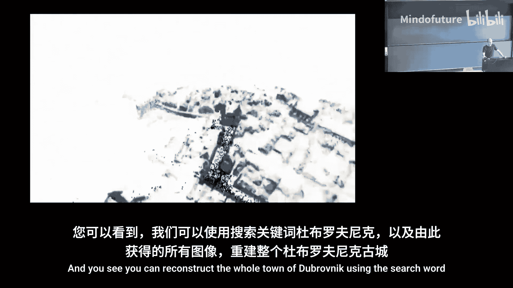

It always reminds me that I have never been to dorovrovnik， and I should really go there some。Okay。

 sorry， this is。And here is another one I hope the video plays， this is Rome。😔。

And there was a paper with a fascinating title，Building Rome in a Day。You know。

 this expression Rome was not built in a day， what they did is they actually in that paper that appeared a few years back。

 they showed how much of Rome you can reconstruct within 24 hours。😔。

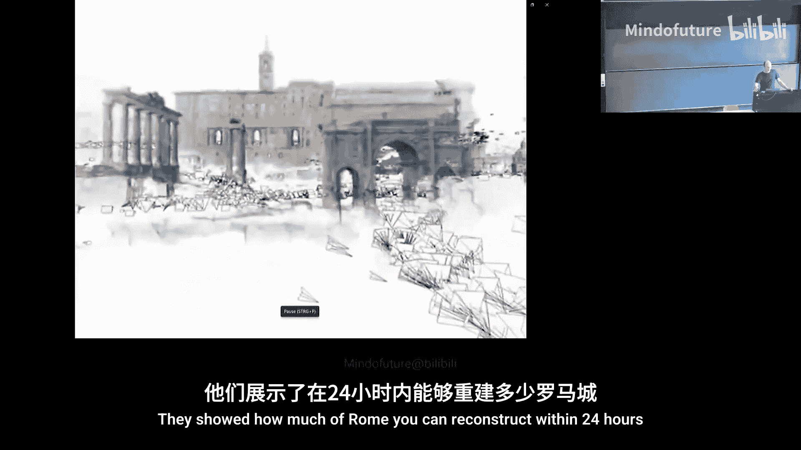

But this was using intensive amounts of cloud computing。

 and so there was a follow up paper with an even nicer title。

 it was calledBuilding Rome on a cloudless day。And I thought that， you know。

 you can hardly beat the first title， but you can。So these were all reconstructions then achieved on。

 on just a single PC with one graphics card or something。

And so algorithms have evolved to a level where you can scale them， but you see， you。

 just the fact that it takes a day to compute all this shows you there is need for faster bundle adjustment solvers。

 which is why we now develop the power bundle adjustment。Here's Pton。This is Geokline。

 maybe something upfront， some of you may know the HoloLens project from Microsoft。

 this is the origin of Hololenens Geok Kline and his Pam is what really was the first version of HoloLense was built on Pam。

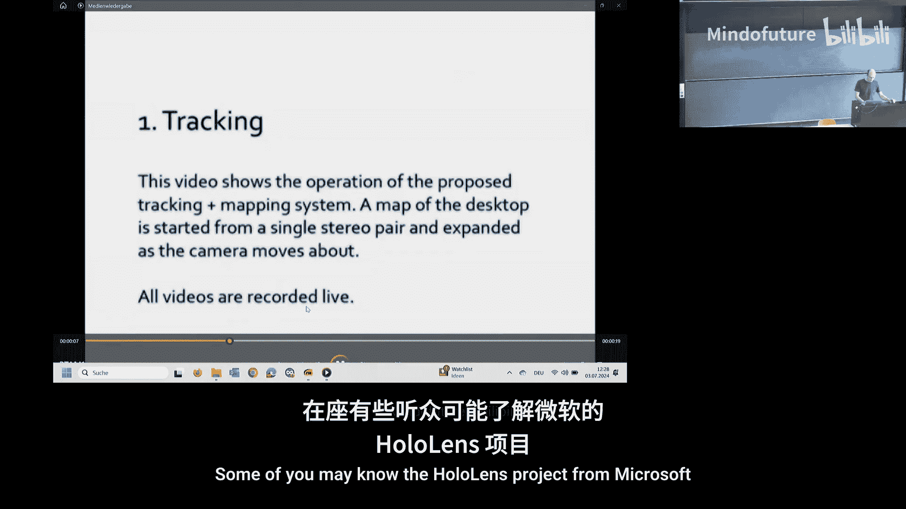

Much like the meta arearia glasses are very much built on the things we developed here。😔。

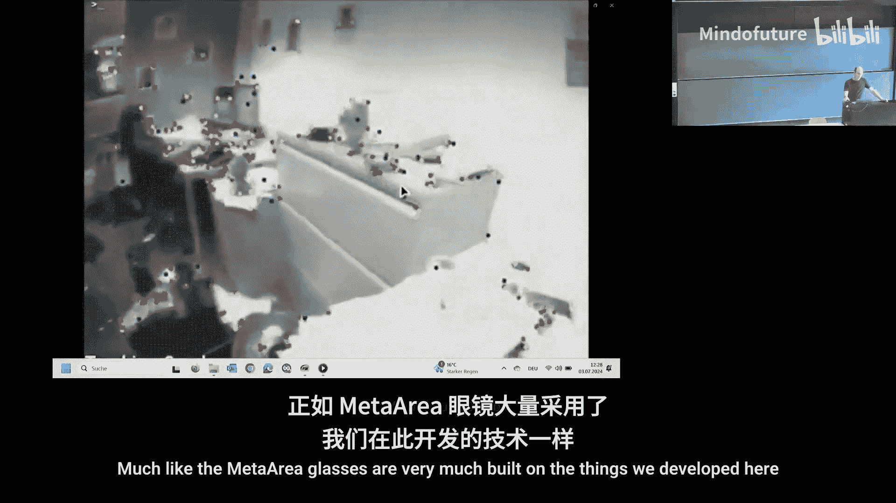

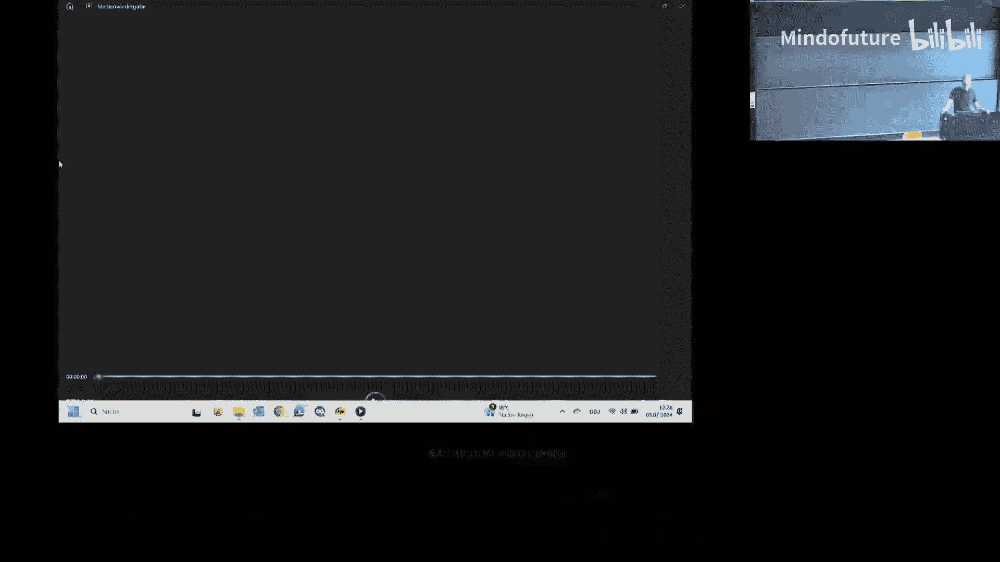

Yeah， so you see it's for tracking and mapping in small environments。

 I'll try to play the video again。😔，Here we go。2007 and so you see what's happening here is it's all recorded live so you see everything is computed in real time。

 it tracks points， it finds correspondence and then you can see it estimates the 3D location and you can check how accurate it is by this grid that is projected into the world and while you move around the grid seems to stay fairly static this is a way to validate how good the tracking is。

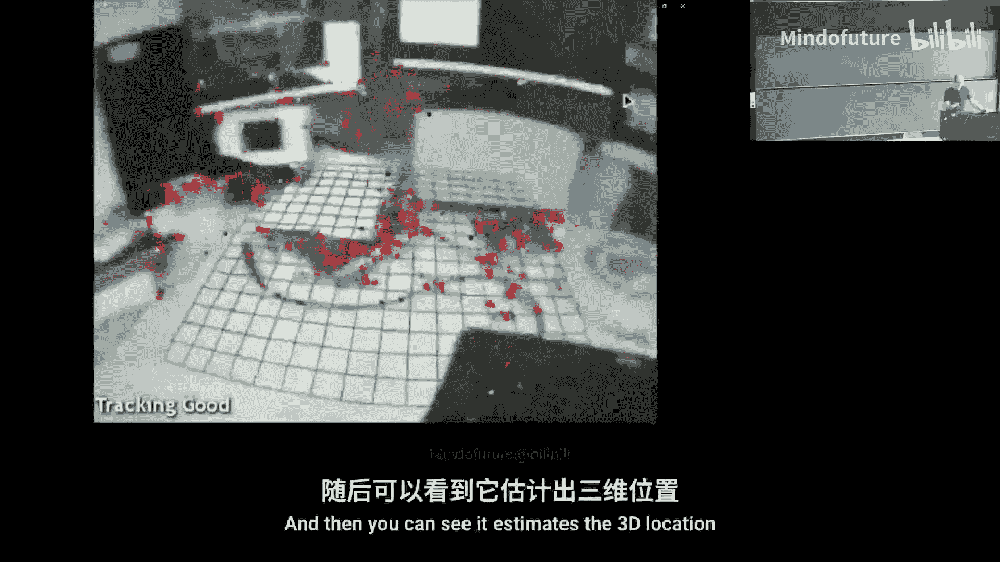

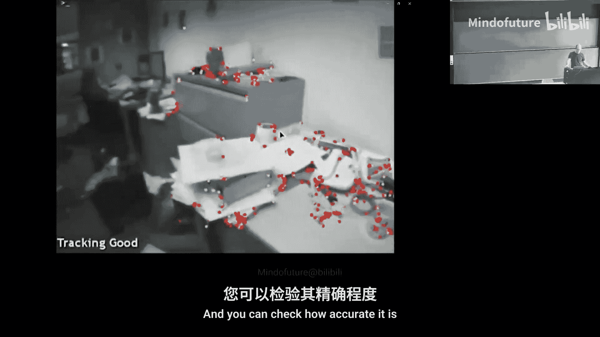

And that works so so because when you move away and come back， the grid is still there。

 but whether it's shifted in the meantime is something you can't really tell very precisely。😔。

But then once you have a technique that can track a single camera at fairly high precision and robustness。

 you can do tons of things and this is what Ga O Klein showed he's an extremely creative guy and I love this videos。

 you'll see why。

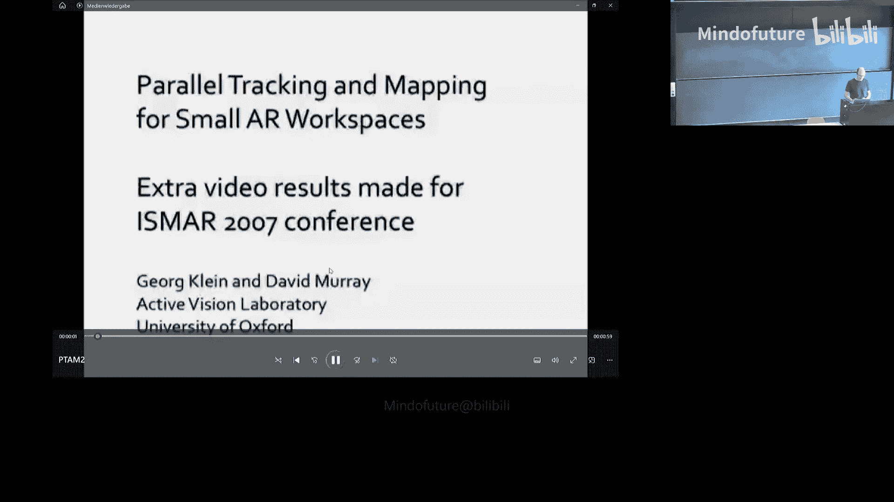

So these were extra videos made in Kyoto at the AR conference like outside the train window。

 he can you know find this grid and then he can superimpose little objects that wave around in real time so you see through the camera and you see while the cameras moving。

 you can project things into the world。

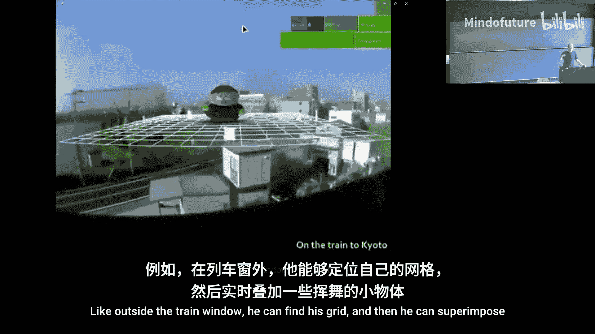

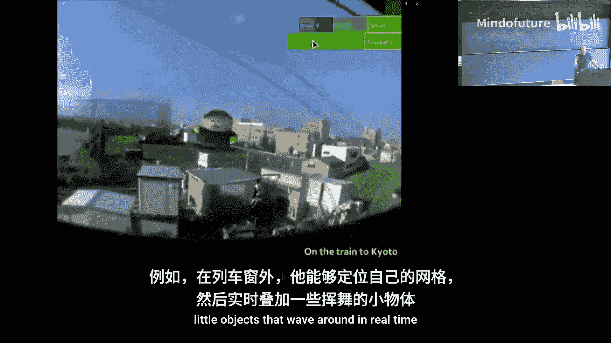

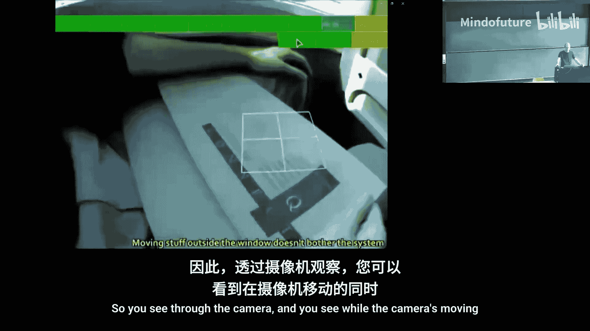

Lots of， entertaining things that you can put， right？😔。

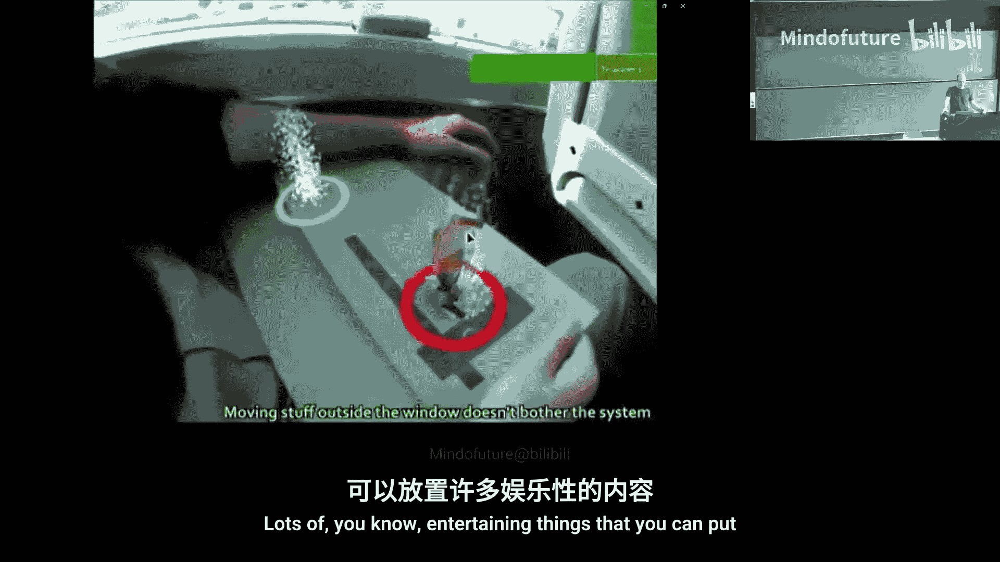

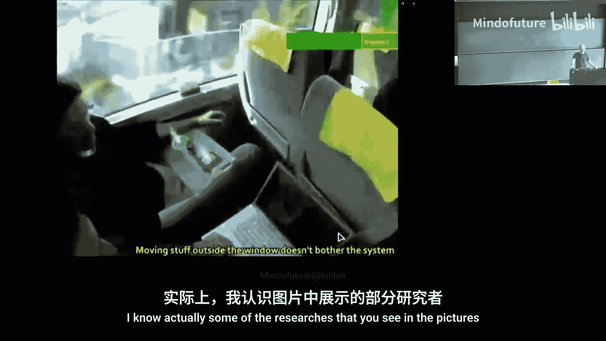

I know actually some of the research that you see in the pictures。😔。

So this shows you you can move the camera around and things stay fairly static or here。

 this is my favorite， I think he's a big fan of Star Wars。😔。

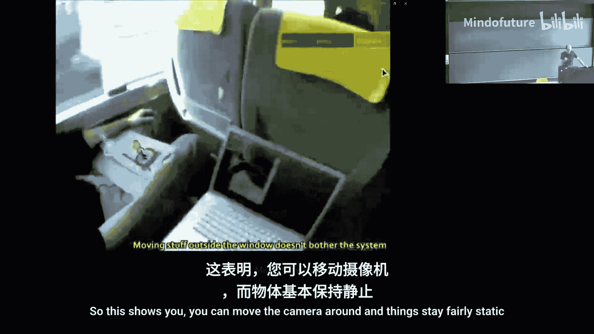

And so you have this called Ewo rampage， I think he calls。

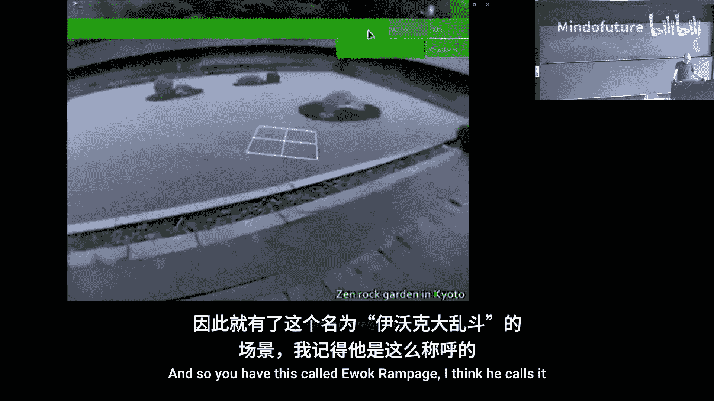

There we go。 and this is the stone garden。 and so while he's moving around with a camera。

 there's Ewos and Darth Vado fighting each other。 So it gives you a little glimpse of augmented reality in action。

 right？

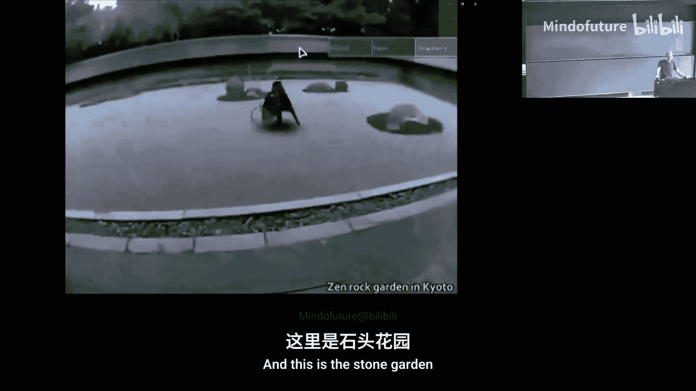

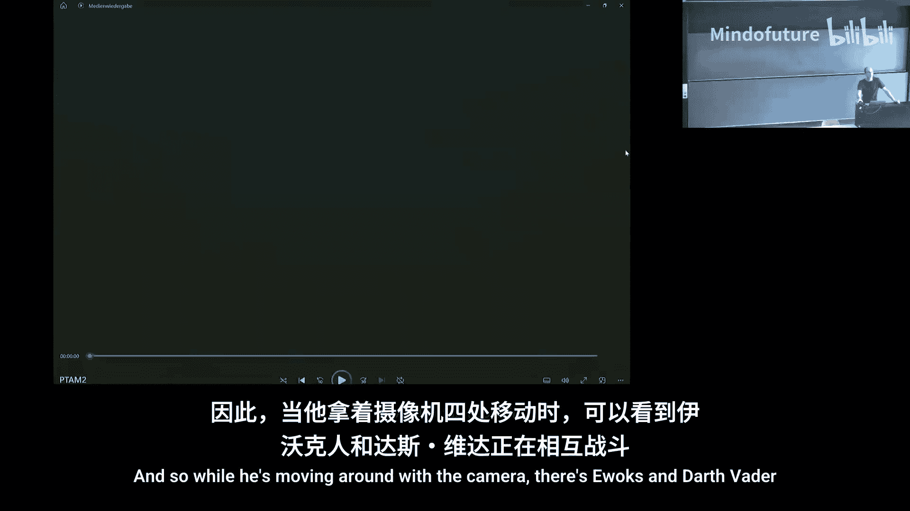

How you can， and this is very much what a lot of you know。

 propelled a lot of activities in the field of augmented reality。

 the fact that all of a sudden you could put objects into the scenes in real time。😔。

It led to the development of the Microsoft Hololenens that said。

 I think the Hololen recently got discontinued， so it will not be a product anymore。

 I've talked to the lead developer Mark Polyfacese。

And the issue is it's not so easy to commercialize this stuff right it's a very heavy device。

 you put it on your head， we just talked about this with a new startup you know no one wants a big head mounted device on their head。

 especially not if you're at work right and so you know supporting workers by putting a super heavy device on their head。

 it's just not doesn't really support them and they don't see the added value and so its you know although there is a lot of potential there。

 how to commercialize things is a whole different question。

 just because the technology is cool doesn't mean someone's actually gonna to buy it。😔。

Keep that in mind if you do your next startup。

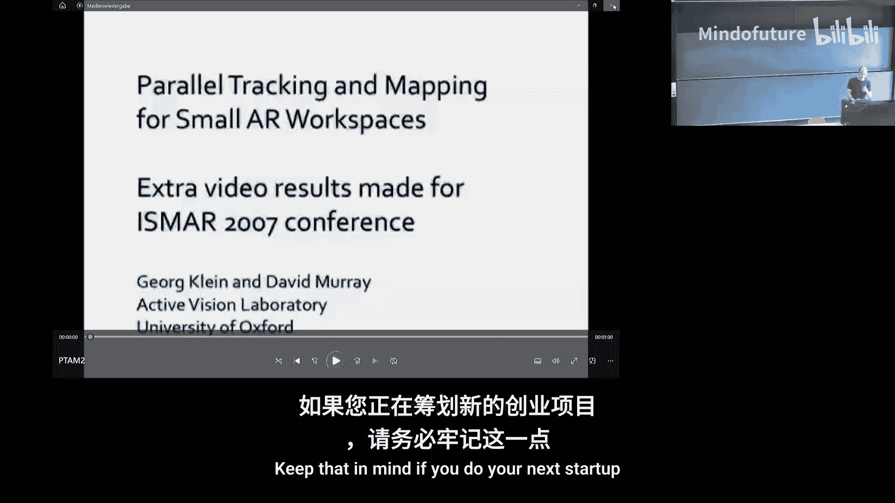